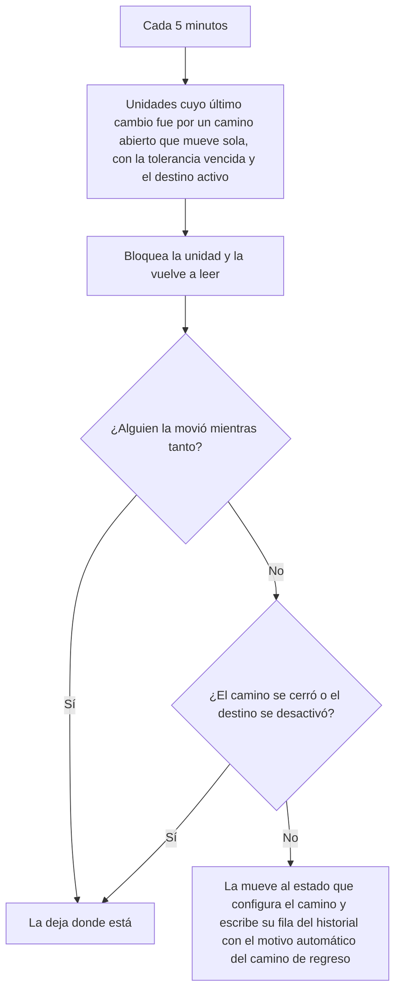

# Contexto `fleet` — ERP Millennium Mobility

**Actualizado:** 20/10/2026 (segunda ronda de la auditoría, primera fase, diccionario v1.25, integrada en `develop`, merge `e245186`, y verificada contra el código: `companyReach` y `brandReach` en lugar de `companiesActingOn` y `brandsActingOn`; la versión del Inventario por los contadores de `data_versions`, D-128) · 20/10/2026 (segunda ronda de la auditoría, primera fase, diccionario v1.25, construida en `audit2/phase1`: `VehicleAccessPolicy`, una clase pura que decide dónde actúa cada permiso sobre una unidad, F1; `FleetSessionAccount`; el alcance con `CompanyReach` y `BrandReach`, F3; `PermissionCodes` en lugar de `FleetPermissions`, F2; `PathPermissions`, `FleetErrors` y el regreso automático en sus paquetes, F4 a F6 y H6; la exportación del Inventario por `documents::acl`, D-125) · 20/10/2026 (lo que construyó la auditoría, verificado contra el código integrado: backend `audit/be-integration`, merge `81bb8c1`, con `0982165` y `7a792b9` a `c2b2575`; frontend `audit/fe-integration`, merges `36210f6` y `52249e4`, con `847550b` y `c3d1e69` a `c03bdf1`; la segunda fase, la carrera del motivo automático, `06b160c`, y la exportación del Inventario, D-116, `1b98b37` en el backend y `fb27113` en el frontend. Falta llevarlo a `develop`) · 20/10/2026 (auditoría del 20/10/2026, diccionario v1.24: el regreso automático con su motivo reservado, D-110, que reemplaza la propuesta 6; la empresa propia del historial y de las lecturas, D-111; el modelo, su marca y su tipo activos en el alta, D-108, y el aviso del modelo con unidades, D-107; los estados y los caminos como listas cortas filtradas en el servidor, D-113, con §14.23 adoptada; un solo prefijo de código por agregado, D-114) · 20/10/2026 (paso 5 integrado en `develop`: merges `32d4996` en el backend y `28ffe6a` en el frontend; la última ronda registra la unidad sin placa, deja el origen GPS al dispositivo, lleva todo camino de alta al estado inicial y lee el historial en `/vehicles/{id}/status-changes`) · 20/10/2026 (paso 5 construido en `feature/fleet`, backend y frontend: estados, caminos, unidades, historial y kilometraje, con las migraciones V46 a V48) · **Estado:** integrado en `develop` el 20/10/2026; borrador para validar, y pendiente de la sonda contra el backend real · **Fuente:** diccionario de datos v1.24 (§2.5, §2.6, §5.6, §8.1 a §8.6, §11.1, §13.1 y las decisiones D-9, D-14, D-16, D-18, D-19, D-20, D-42, D-84, D-86 y D-95 a D-116), [mapa de contextos](../mapa-de-contextos-millennium-mobility.md), [convenciones de la API](../convenciones-de-la-api-millennium-mobility.md), [procesos y pantallas](../procesos-y-pantallas-millennium-mobility.md) (P7, P8, apartado 3 y preguntas 1, 2 y 4), [orden de implementación](../orden-de-implementacion-millennium-mobility.md), las decisiones del responsable del 19/10/2026 y el código de `develop` al 20/10/2026: backend `32d4996`, que integra `feature/fleet` (`39937eb`, 33 commits sobre `6d73031`), y frontend `28ffe6a`, que integra `feature/fleet` (`52be927`, 43 commits sobre `e76450f`, con un merge de `develop`). Si este documento y el diccionario no coinciden, manda el diccionario.

**Cómo leerlo.** Las secciones 1 a 3 están escritas para quien conoce el negocio. La 4 y la 6 nombran archivos del código para el equipo. Lo marcado **(propuesta)** no lo decide nadie todavía; las propuestas para el diccionario están juntas en la sección 6 b, y las decide el responsable. Lo que aprobó el responsable el 20/10/2026 con la auditoría está construido e integrado en las ramas de integración de la auditoría, y se describe como está, también su segunda fase: la exportación del Inventario y la carrera del motivo automático.

---

## 1. Qué es y qué no es

`fleet` responde qué unidades tiene cada empresa, en qué estado de su ciclo de vida está cada una, por qué llegó a él, cuánto tiempo se tolera que siga ahí y cuánto marca su odómetro. Es el centro del modelo (§8): las compras, la habilitación, los fondos y, más adelante, los contratos cuelgan del vehículo. Es el paso 5 del orden de implementación y usa a `organization`, `vehiclecatalog` e `iam` por sus fachadas.

**Las cinco tablas que posee en el paso 5** (diccionario §8). El mapa §3 le asigna además las de la habilitación y los fondos, que llegan con los pasos 9 y 10.

| Tabla | Qué guarda | Diccionario |
|---|---|---|
| `vehicle_statuses` | Los estados del ciclo de vida: En habilitación, Disponible, Vendido, Activo, Mecánica, Siniestro, Custodia, Puesta a punto e Inactivo | §8.2 |
| `status_change_reasons` | Los caminos permitidos entre estados, cada uno con su motivo, su tolerancia, qué pasa al vencerse y el permiso que exige | §8.3, §8.6, D-100 |
| `vehicles` | Las unidades: empresa, marca comercial, modelo, color, VIN, número de motor, placa, año, ubicación y estado actual | §8.1 |
| `vehicle_status_history` | Cada cambio de estado de cada unidad: de dónde, a dónde, por qué camino, quién, cuándo y hasta cuándo se tolera | §8.4 |
| `vehicle_mileage_readings` | Las lecturas del odómetro, con su momento, su origen y quién la registró | §8.5 |

Las columnas están en el diccionario y no se repiten aquí. Las que el código agregó y el diccionario todavía no tiene están en la sección 6 b.

**Lo que parece suyo y no lo es, o todavía no**

| Parece de `fleet` | Es de | Por qué |
|---|---|---|
| El costo de la unidad: valor de factura, notas de crédito, valor del vehículo | `procurement`, leído por la capa de lectura con `stock.ver_costos` | La unidad no conoce facturas (mapa §6.1, decisión 7). `/vehicles` nunca trae montos. El permiso `stock.ver_costos` ya existe (V46), pero ninguna ruta lo exige todavía |
| El proveedor de la unidad | `procurement` | Es un dato de la compra, no de la unidad (§8, introducción) |
| El ingreso físico, la inmatriculación, el título y las placas recibidas | `fleet`, en el paso 9 | Son las columnas que §11.1 agrega a `vehicles` con la habilitación |
| El primer registro de la placa | `fleet`, en el paso 9, con `habilitacion.registrar_hitos` | Es un hito de la habilitación (§5.6, §11.1): el alta no recibe placa. La columna, su forma y su unicidad en el país ya existen, para la carga de migración |
| La columna `current_mileage` | `fleet`, en el paso 9 (§11.1) | Hasta entonces el kilometraje de la unidad se calcula de su última lectura cada vez que se lee |
| Los documentos, el equipamiento, las llaves y el impuesto vehicular | `fleet`, en el paso 9 | Bloque 9 |
| Los fondos y las cesiones | `fleet`, en el paso 10 | Bloque 10 |
| Quién corrigió una placa o un VIN, y por qué | `shared`, en el paso 6 (`change_log`) | Por eso corregir la placa y el VIN espera a ese paso (decisión del responsable del 19/10/2026) |
| El número que la unidad tenía en el Excel (`legacy_number`) | `fleet`, solo por la carga de migración (paso 9, D-18) | La API no lo recibe ni lo genera (decisión del 19/10/2026) |
| La anulación y el traspaso (`annulled_at`, `transfer_date`, `transfer_reason`) | `fleet`, cuando lleguen compras (paso 7, D-104) y ventas (D-20) | Las columnas existen desde V47; nada las escribe todavía |
| La marca del vehículo (Chevrolet, TVS), el modelo y el color | `vehiclecatalog` (§7) | La unidad apunta a ellos; no los modifica |
| La empresa, la marca comercial (Lizzo, Lima Bikes) y la ubicación | `organization` (§6) | Ídem |
| El nombre de quien cambió un estado o registró una lectura | `iam` y `organization` | `iam` entrega el identificador público de la cuenta y el nombre de su colaborador (mapa, decisión 6) |

**Palabras con un significado preciso aquí**

| Palabra | Significa | No confundir con |
|---|---|---|
| Unidad | Un vehículo físico de una empresa, identificado por su VIN | La línea de factura con ese VIN, que es de `procurement` (mapa §1) |
| Estado | En qué punto del ciclo de vida está la unidad: Disponible, Vendido, Activo… Cada estado es de una familia (comercial, productivo, recuperación o terminal) y dice si la unidad genera ingresos en él (§8.2) | Que un estado esté activo o desactivado en el catálogo, que solo dice si se sigue ofreciendo |
| Estado inicial | Donde nace toda unidad registrada; hoy, En habilitación. Hay uno solo | — |
| Camino | Un paso permitido de un estado a otro, por un motivo. Solo existen los caminos cargados (D-19); lo demás se rechaza | — |
| Motivo | Por qué se recorre un camino: Venta, Choque, Morosidad. Cada motivo es un camino propio: Mantenimiento preventivo y Choque van de Activo a Mecánica con tolerancias distintas (§8.3) | — |
| Camino de alta | El que no parte de ningún estado: el motivo con que nace una unidad, Registro de compra | — |
| Cerrar un camino | Desactivar su motivo. El historial que lo nombra se conserva | Borrarlo, que no existe |
| Tolerancia | Cuántas horas se acepta que la unidad siga en el estado por ese motivo. Vacía, ese caso no se mide (§8.3) | Un plazo del contrato |
| Vence | El momento en que se acaba la tolerancia de un cambio. Se calcula y se guarda al registrar el cambio (§8.4) | — |
| Vencida | Una unidad cuya tolerancia del último cambio ya pasó. Aparece en la lista de vencidas del inventario | — |
| Avisar, al vencerse | La unidad aparece entre las vencidas. No se envía ningún aviso aparte | — |
| Mover sola, al vencerse | El sistema mueve la unidad a otro estado y firma como `SYSTEM`: una unidad Vendida vuelve a Disponible a las 48 horas. Es la única transición que ocurre sola (§8.3) | — |
| Motivo automático | El motivo reservado con que el sistema registra un regreso automático: «Regreso automático por vencimiento», del camino que va del destino al estado configurado. Lo crea el sistema; nadie lo elige ni lo edita (§8.3, D-110) | El motivo del camino que venció, la Venta |
| Lectura | Lo que marcaba el odómetro en un momento, con su origen: GPS, taller, entrega, devolución o manual (§8.5). Las de GPS las trae el dispositivo, sin autor; una persona registra las demás | El kilometraje de la unidad, que es su última lectura |
| Sustitución de odómetro | La primera lectura de un tablero nuevo, cuando se cambió el tablero. Es el único hecho que admite una lectura menor que la anterior (§8.5) | Corregir una lectura, que no existe: una lectura no se edita |
| Alta | Registrar una unidad: nace en el estado inicial por el camino de alta (§8.3) | — |
| Ubicación | El lugar físico donde está la unidad (`locations`, §6.5). Vacía mientras no ha ingresado | La geografía de `location` |

---

## 2. Ciclo de vida de cada agregado

Nada de `fleet` se borra: ni las unidades, ni los estados, ni los caminos, ni el historial, ni las lecturas. La API no tiene `DELETE` (convenciones §3.1) y la cuenta de la aplicación no tiene permiso de borrar (V19).

### Unidad

| Momento | Qué pasa |
|---|---|
| Alta | La registra en Logística › Inventario quien tiene `stock.crear_vehiculo` (la semilla se lo da al superadministrador, al administrador de empresa y a Operaciones). Lleva su empresa, su marca comercial, su modelo, su color, su VIN y su año; el número de motor y la ubicación son opcionales. Nace sin placa: su primer registro es un hito de la habilitación, en el paso 9 (§5.6, §11.1). Nace en el estado inicial por el camino de alta, y esa primera fila del historial la firma quien la registró (§8.3, §8.4). El modelo, su marca y su tipo tienen que estar activos (D-108), y el alta le avisa a `vehiclecatalog`, en la misma operación, que el modelo ya tiene unidades: desde entonces el tipo del modelo queda fijo (D-107) |
| Qué cambia | Con `stock.editar_vehiculo`: el color, el número de motor, el año del modelo, la marca comercial y la ubicación actual (§5.6). El estado, por un camino y con su permiso. El kilometraje, con cada lectura |
| Qué queda fijo | La empresa, su país y el modelo, desde el alta; con el modelo, el tipo de vehículo. El VIN tampoco cambia por ahora: el dominio sabe corregirlo, pero la API no lo ofrece hasta el paso 6, cuando la bitácora registre quién, cuándo y por qué (§13.1; decisión del 19/10/2026). Lo mismo la placa, cuando la tenga |
| Retiro | No tiene en el paso 5. La anulación llega con compras (paso 7, D-104) y el traspaso al cliente con ventas (D-20); sus columnas ya existen |
| Nunca | Se borra; cambia de empresa; contradice el tipo de vehículo de su modelo; recibe un número del Excel por la API (D-18) |

### Estado del vehículo

| Momento | Qué pasa |
|---|---|
| Alta | Lo crea el superadministrador, con `catalogos.gestionar_estados`, en Catálogos › Estados y motivos (D-100). V47 siembra los nueve del flujograma (§8.2) |
| Qué cambia | El nombre, la familia, si genera ingresos y si es el inicial |
| Qué queda fijo | El código, desde el alta |
| Retiro | Se desactiva y se puede reactivar. Las unidades que ya están en él se quedan; ninguna entra nueva. No se desactiva el estado inicial, ni el estado al que un camino abierto mueve unidades solas: primero se cambia el inicial o se cierra ese camino |
| Nunca | Se borra; hay dos estados iniciales, aunque uno esté desactivado |

### Camino (motivo)

| Momento | Qué pasa |
|---|---|
| Alta | Lo crea el superadministrador desde un estado de origen, o como camino de alta, sin origen, que lleva siempre al estado inicial. Nombra el permiso que exige (D-100); sin permiso propio, exige `stock.cambiar_estado`. Un camino de alta no nombra ninguno: registrar una unidad exige `stock.crear_vehiculo` (**propuesta**, sección 6 b). V47 siembra los nueve caminos de §8.3, cada uno con el permiso que le da §5.6. Al guardar un camino que, al vencerse, mueve sola la unidad, el sistema asegura en la misma operación el motivo automático del camino de regreso, del destino al estado configurado, o reutiliza el que ya tiene (D-110); V51 crea los de los caminos que ya existen. Si en ese camino de regreso una persona ya declaró un motivo con el código `REGRESO_AUTOMATICO`, el camino no se guarda (`409 STATUSCHANGEREASON_CODE_CONFLICT`) |
| Qué cambia | El nombre, la tolerancia, qué hacer al vencerse y a qué estado mover la unidad, y el permiso. Un motivo automático no se edita ni se cierra por la API: lo mantiene el sistema (`422 STATUSCHANGEREASON_AUTOMATIC_LOCKED`, D-110) |
| Qué queda fijo | El origen, el destino y el código: son el camino |
| Retiro | Se cierra, desactivando su motivo; desactivar todos los motivos de un par cierra el paso entre esos dos estados (§8.3). Se reabre, salvo que haya ya otro camino de alta abierto hacia el mismo estado, que sea un camino de alta hacia un estado que ya no es el inicial, o que mueva unidades solas a un estado desactivado |
| Nunca | Se borra; lleva a su propio estado de origen |

### Fila del historial

| Momento | Qué pasa |
|---|---|
| Alta | La escribe el sistema con cada cambio, en la misma operación que el estado actual de la unidad: el alta, cada cambio que hace una persona y cada regreso automático, este con el motivo automático de su camino (§8.4, D-110) |
| Qué guarda | De qué estado a cuál, por qué camino, quién, cuándo, cuándo vence la tolerancia, un detalle opcional de hasta 2 000 caracteres y la empresa de la unidad, copiada de ella (D-111): la base rechaza una fila que nombre otra empresa que la de su unidad |
| Qué cambia | Nada. Un error se corrige con un cambio nuevo (§8.4) |
| Nunca | Se edita ni se borra: la cuenta de la aplicación solo lee e inserta en esta tabla |

### Lectura de kilometraje

| Momento | Qué pasa |
|---|---|
| Alta | La registra, en la ficha de la unidad, quien tiene `stock.registrar_kilometraje`; una sustitución de odómetro, quien tiene `stock.registrar_sustitucion_odometro`. Lleva los kilómetros, el momento de la lectura —que no puede ser futuro—, el origen —taller, entrega, devolución o manual— y un detalle opcional, y el sistema le copia la empresa de la unidad (D-111). Las de GPS las trae el dispositivo, sin autor, cuando llegue su integración: la API no las recibe de una persona |
| Qué cambia | Nada |
| Nunca | Se edita ni se borra; entra menor que la lectura anterior sin ser una sustitución (§8.5) |

---

## 3. Flujos funcionales

En cada flujo, "el sistema revisa" es lo que el backend comprueba, en ese orden. Toda ruta exige un permiso del catálogo (§5.6, D-95), y el servicio decide dónde actúa con la asignación que lo trae (D-99): una unidad que la cuenta no ve con `stock.ver` no existe para ella (`404 VEHICLE_NOT_FOUND`); una que ve, pero sobre la que su permiso no actúa, responde `403 ACCESS_DENIED`. El stock se ve en toda la empresa (D-14), y lo que se toca depende de dónde está la unidad: un rol de sede actúa solo sobre las unidades de la ubicación propia de su sede (D-101), y una asignación limitada a una marca, solo sobre las unidades de esa marca (D-102).

Las pantallas son tres: Logística › Inventario (`/fleet/vehicles`), la ficha de cada unidad (`/fleet/vehicles/{id}`) y Catálogos › Estados y motivos (`/fleet/vehicle-statuses`). Inventario lo abren los seis roles del sistema que tienen `stock.ver`; el administrador de accesos no. Estados y motivos lo abre solo el superadministrador; los demás roles leen los estados y los caminos con `catalogos.ver` desde la ficha de la unidad.

### F1 · Registrar una unidad

**Rol:** quien tiene `stock.crear_vehiculo`: en la semilla, superadministrador, administrador de empresa y Operaciones. **Pantalla:** Logística › Inventario, botón "Nueva unidad", que solo aparece con el permiso.

1. Elige la empresa (las activas), la marca comercial (las activas de esa empresa), la marca del vehículo, el tipo si quiere acotar ("Cualquiera" por omisión), el modelo (los activos de esa marca), el color y la ubicación (las activas de la empresa, o "Sin ubicación": "Vacía mientras la unidad no ha ingresado.").
2. Escribe el VIN ("17 caracteres, sin I, O ni Q."; se guarda en mayúsculas), el año del modelo, de 2017 al año siguiente, y el número de motor, opcional. La placa no se pide: la unidad se registra antes de inmatricularse, y el primer registro de su placa es un hito de la habilitación (paso 9; §5.6, §11.1). El diálogo revisa lo mismo que la API antes de enviar.
3. Guarda (`POST /vehicles`). El sistema revisa, en orden: que la empresa exista y la cuenta la alcance; que la marca comercial sea de esa empresa y esté activa, y la empresa también (D-84); que la ubicación, si la da, exista, sea de la empresa y esté activa; que `stock.crear_vehiculo` actúe en esa empresa, en esa marca y, si la ubicación es la propia de una sede, en esa sede (D-101, D-102); que el modelo y el color existan y estén activos, y también la marca y el tipo del modelo (D-108: `ExternalVehicleCatalogService.resolveModelForNewUnit` traduce lo que responde la fachada de `vehiclecatalog`); la forma del VIN; que ninguna unidad de ninguna empresa tenga ese VIN —lo mira con una elevación a `SYSTEM` que solo responde sí o no (§2.5), y si dos altas pasan a la vez, la base detiene la segunda con la misma respuesta—; y que haya un estado inicial con un camino de alta abierto hacia él. Una placa que llegue en el cuerpo se ignora. En la misma operación, después de escribir la unidad y su primera fila del historial, le avisa a `vehiclecatalog` que el modelo ya tiene unidades (`markModelInUse`, D-107): si el alta falla, el modelo tampoco queda marcado.

**Errores que ve:** "Ya existe una unidad con ese VIN." (`409 VEHICLE_VIN_CONFLICT`); "La empresa no existe o está inactiva." (`COMPANY_NOT_FOUND`, `COMPANY_INACTIVE`); "La marca comercial no es de la empresa o está inactiva." (`COMMERCIALBRAND_NOT_FOUND`, `COMMERCIALBRAND_INACTIVE`); "La ubicación no es de la empresa o está inactiva." (`LOCATION_NOT_FOUND`, `LOCATION_OTHER_COMPANY`, `LOCATION_INACTIVE`); "El modelo no existe o está inactivo." (`VEHICLEMODEL_*`); "La marca del modelo está inactiva: no se registran unidades nuevas de ella." (`422 VEHICLEBRAND_INACTIVE`); "El tipo de vehículo del modelo está inactivo: no se registran unidades nuevas de él." (`422 VEHICLETYPE_INACTIVE`); "El color no existe o está inactivo." (`COLOR_*`); "No hay un estado inicial ni un motivo de alta configurados: revise Estados y motivos." (`422 VEHICLESTATUS_INITIAL_MISSING`, `STATUSCHANGEREASON_REGISTRATION_MISSING`); "Su rol no registra unidades con esa marca comercial o en esa ubicación." (`403 ACCESS_DENIED`). El diálogo queda abierto con lo escrito. Si una lista no se pudo leer, el diálogo lo dice ("No se pudieron cargar las empresas.") y ofrece reintentar, en vez de mostrarla vacía. Lo mismo con los catálogos de flota, cada uno bajo su campo y con su propio estado en la fachada de `vehiclecatalog`: "No se pudieron cargar las marcas del catálogo.", "No se pudieron cargar los tipos de vehículo.", "No se pudieron cargar los colores del catálogo.".
**Resultado:** "Unidad registrada en su estado inicial." y se abre su ficha. La unidad queda En habilitación, sin placa, y su historial empieza con la fila "Alta de la unidad · Registro de compra", firmada por quien la registró.

### F2 · Editar los datos generales de una unidad

**Rol:** quien tiene `stock.editar_vehiculo`: en la semilla, superadministrador, administrador de empresa y Operaciones, donde actúa su asignación. **Pantalla:** la ficha de la unidad, botón "Editar" en la cabecera de los datos, que aparece solo si la ficha dice que la sesión puede editar esa unidad (`allowedActions.edit`).

1. Cambia el color, el número de motor, el año, la marca comercial o la ubicación. La empresa, el VIN, la placa y el modelo se muestran fijos.
2. Una marca, una ubicación o un color que la unidad ya tenía y que se desactivó después se conserva, rotulado "(inactiva)" o "(inactivo)"; uno nuevo tiene que estar activo y ser de la empresa (D-84).
3. Guarda (`PUT /vehicles/{id}`). El sistema revisa: que la cuenta vea la unidad; que el permiso actúe donde la unidad está; que lo nuevo sea de la empresa y esté activo; y, si cambia la marca o la ubicación, que el permiso actúe también donde la unidad termina: un rol de sede no manda una unidad a otra sede, a un tercero ni a ninguna ubicación (D-101), y nadie la pasa a una marca sobre la que no actúa (D-102).

**Errores que ve:** "Su rol no puede dejar la unidad con esa marca comercial o en esa ubicación." (`403 ACCESS_DENIED`), y los de la marca, la ubicación y el color de F1.
**Resultado:** "Unidad actualizada."

### F3 · Mover la unidad por un camino

**Rol:** el que tenga el permiso del camino (tabla). **Pantalla:** la ficha de la unidad, botón "Cambiar estado".

Los caminos que siembra V47 son los del ejemplo de §8.3, con el permiso de §5.6 (D-100). Siniestro e Inactivo existen como estados, pero ningún camino lleva a ellos todavía (procesos, pregunta 2).

| Desde | Hacia | Motivo | Tolerancia | Al vencerse | Permiso | Roles de la semilla |
|---|---|---|---|---|---|---|
| *(alta)* | En habilitación | Registro de compra | — | — | `stock.crear_vehiculo` | SA, AE, OP |
| En habilitación | Disponible | Habilitación completa | — | — | `stock.habilitar` | SA, AE, OP |
| Disponible | Vendido | Venta | 48 h | Mover sola a Disponible | `stock.vender` | SA, AE, AV |
| Vendido | Activo | Entrega al cliente | — | — | `stock.entregar` | SA, AE, hasta que el negocio decida (pregunta 4) |
| Activo | Mecánica | Mantenimiento preventivo | 72 h | Avisar | `stock.atender_en_taller` | SA, AE, OP, TA |
| Activo | Mecánica | Choque | 480 h | Avisar | `stock.atender_en_taller` | SA, AE, OP, TA |
| Activo | Custodia | Morosidad | 720 h | Avisar | `stock.recuperar` | SA, AE |
| Custodia | Puesta a punto | Resolución de contrato | — | — | `stock.recuperar` | SA, AE |
| Puesta a punto | Disponible | Reacondicionada | — | — | `stock.atender_en_taller` | SA, AE, OP, TA |

SA = superadministrador · AE = administrador de empresa · OP = Operaciones · AV = asesor de ventas · TA = taller. El diagrama de estos caminos está en procesos y pantallas, P7.

1. El diálogo dice "Desde {estado actual}: solo los caminos permitidos que su rol puede recorrer." y ofrece los destinos a los que lleva un camino abierto desde el estado actual, hacia un estado activo, que la ficha dice que la sesión puede recorrer en esa unidad (`allowedActions.walkableReasonIds`). Un motivo automático nunca figura entre ellos: lo recorre solo el regreso automático (D-110), y el diálogo no lo ofrece aunque el registro lo nombrara. Así, sobre la misma unidad Activo de su sede, el taller ve los dos caminos a Mecánica y el asesor de ventas no ve ninguno; sobre una Disponible, al revés: el asesor ve Venta y el taller nada.
2. Elige el destino y después el motivo, que muestra su tolerancia ("Choque (480 h)"), y escribe un detalle opcional.
3. Guarda (`POST /vehicles/{id}/status-changes`, que responde `201` con la unidad en su estado nuevo). El sistema revisa: que la cuenta vea la unidad; que el destino exista y esté activo; que el motivo exista, esté abierto y no sea automático (`422 STATUSCHANGEREASON_AUTOMATIC_NOT_SELECTABLE`, D-110: "Ese motivo lo aplica solo el sistema, al vencer la tolerancia: elija otro."); que lleve a ese destino; que salga del estado en que está la unidad —un cambio que no está declarado se rechaza, no se advierte (§8.3)—; y que el permiso del camino actúe donde está la unidad (D-100, D-101, D-102). Escribe el estado de la unidad y su fila del historial en la misma operación, con el vencimiento calculado desde ese momento. El historial se lee en `GET /vehicles/{id}/status-changes`.

**Errores que ve:** "Ese camino no está permitido desde el estado actual de la unidad." (`422 STATUS_TRANSITION_NOT_ALLOWED`, `STATUSCHANGEREASON_TARGET_MISMATCH`); "Su rol no puede recorrer ese camino." (`403 ACCESS_DENIED`); "El estado destino está inactivo." (`422 VEHICLESTATUS_INACTIVE`); "No encontramos el estado destino: cierre el diálogo y vuelva a elegirlo." (`404 VEHICLESTATUS_NOT_FOUND`); "El motivo elegido se cerró mientras lo elegía: elija otro." (`404 STATUSCHANGEREASON_NOT_FOUND`), y el diálogo vuelve a leer los caminos. Si ningún camino sale del estado para esa sesión: "Ningún camino permitido sale de este estado para su rol."
**Resultado:** "Estado cambiado." La pestaña Historial de estados muestra el cambio con su camino, su motivo, quién y cuándo, y cuándo vence.

### F4 · El regreso automático al vencer la tolerancia

**Rol:** ninguno: lo hace un proceso programado (`StatusToleranceBreachTask`), cada 5 minutos por omisión (`FLEET_STATUS_TOLERANCE_CHECK_INTERVAL`), con alcance `SYSTEM` (decisión del responsable del 19/10/2026). Corre en una sola instancia a la vez, por `SingleInstanceRun` de `shared`, con el nombre de proceso `fleet.status-tolerance-breach`: un candado de PostgreSQL (`pg_try_advisory_lock`) que, si otra instancia lo tiene, salta la corrida; la siguiente recoge lo que quede.

1. Una unidad vendida hace más de 48 horas, que nadie movió desde la venta, vuelve a Disponible.
2. La fila del historial dice Vendido → Disponible, con el motivo automático de ese camino, «Regreso automático por vencimiento», firmada por `SYSTEM` y sin vencimiento, porque ese motivo no tiene tolerancia (D-110). Si el motivo falta, el proceso lo crea; si en ese camino una persona declaró un motivo con el código `REGRESO_AUTOMATICO`, deja la unidad donde está y lo registra en el log. Las filas de regresos escritas antes conservan el motivo del camino que venció: el historial no se reescribe. La unidad también queda firmada por `SYSTEM` como su último cambio (D-42).
3. El proceso respeta el catálogo como una persona: un camino cerrado o un destino desactivado no mueve nada, tampoco si cambiaron mientras el proceso corría.

**Qué ve el usuario:** en el historial, la fila del regreso con `SYSTEM` como autor; la unidad deja de figurar entre las vencidas.

### F5 · Registrar una lectura y una sustitución de odómetro

**Rol:** `stock.registrar_kilometraje` (en la semilla, superadministrador, administrador de empresa, Operaciones, asesor de ventas y taller); para una sustitución, `stock.registrar_sustitucion_odometro` (superadministrador, administrador de empresa y taller). **Pantalla:** la ficha de la unidad, pestaña Kilometraje (`?seccion=kilometraje`), botón "Registrar lectura".

1. El diálogo dice "La unidad marca {n} km." o "La unidad todavía no tiene lecturas.", y propone la fecha y la hora de ahora en la zona de la empresa, no la del navegador (§2.6), y el origen Manual. Ofrece los orígenes que registra una persona: Taller, Entrega, Devolución y Manual. Las lecturas de GPS las trae el dispositivo, sin autor (§8.5).
2. Escribe los kilómetros, corrige la fecha y la hora si la lectura se tomó antes —una lectura de taller puede cargarse días después (§8.5)—, y agrega un detalle opcional.
3. Si la ficha permite a la sesión registrar una sustitución, aparece la casilla "Sustitución de odómetro: se cambió el tablero y la serie empieza de nuevo". Para quien solo puede registrar sustituciones, viene marcada y fija.
4. Guarda (`POST /vehicles/{id}/mileage-readings`, con `isOdometerSubstitution`). El sistema revisa: que la cuenta vea la unidad; que la lectura no sea futura; que su origen no sea GPS; que el permiso —el de la lectura o el de la sustitución— actúe donde está la unidad; que no sea menor que la lectura más cercana tomada en ese momento o antes, salvo que sea una sustitución; y que no sea mayor que la más cercana tomada después, tampoco si es una sustitución, salvo que esa siguiente sea una sustitución: un tablero nuevo no acota lo que se leyó en el anterior.

**Errores que ve:** "La lectura es menor que la tomada antes de ese momento." y, a quien puede registrar una sustitución, "La lectura es menor que la tomada antes de ese momento: si se cambió el tablero, márquela como sustitución de odómetro." (`422 MILEAGE_BELOW_PREVIOUS`); "La lectura es mayor que la tomada después de ese momento: revise los kilómetros, la fecha y la hora." (`422 MILEAGE_ABOVE_NEXT`); "La lectura no puede ser futura." (`422 MILEAGE_READ_AT_IN_FUTURE`; el diálogo también la detiene antes de enviar); "Una lectura con origen GPS la trae el dispositivo: elija otro origen." (`422 MILEAGE_SOURCE_NOT_ALLOWED`, si otro cliente de la API la manda); "Su rol no puede registrar esa lectura." (`403 ACCESS_DENIED`). Las dos primeras respuestas traen en `context` la lectura vecina, con sus kilómetros y su momento; la pantalla todavía no la nombra (sección 6 c).
**Resultado:** "Lectura registrada." El kilometraje de la unidad es el de su lectura más reciente por momento: una lectura cargada tarde, entre otras dos, no lo cambia. La pestaña marca la sustitución con "Sustitución de odómetro", y en "Quién" nombra a la persona; "El dispositivo" aparece solo cuando la lectura no tiene autor.

### F6 · Mantener los estados y los caminos

**Rol:** superadministrador, con `catalogos.gestionar_estados` (D-100). **Pantalla:** Catálogos › Estados y motivos (`/fleet/vehicle-statuses`), maestro-detalle: los estados a la izquierda, con la entrada fija "Alta de la unidad" al inicio para los caminos sin origen; a la derecha, los caminos que salen del estado elegido —que la pantalla pide al servidor con `?fromStatusId=` o, para "Alta de la unidad", con `?origin=registration` (D-113), en un estado propio del store, apartado de la lista completa que nombra las referencias, y solo con la respuesta del último origen pedido—, con su destino, su motivo, su tolerancia ("No se mide" si no tiene), qué pasa al vencerse y el permiso que exigen —"El de reserva (stock.cambiar_estado)" cuando no nombran uno, y `stock.crear_vehiculo (alta)` en los de alta—. Un motivo automático se muestra con la etiqueta "Automático", "Lo aplica el sistema" como permiso y sin acciones (D-110). Mientras se leen los estados o los caminos, cada panel muestra su barra de carga ("Cargando los caminos"), y si no se pudieron leer lo dice —"No se pudieron cargar los estados.", "No se pudieron cargar los caminos."— con "Reintentar", en vez de una lista vacía. Debajo del ancho de escritorio, se ve uno a la vez, con "Volver a los estados".

1. **Estado nuevo o editado.** Código (letras, números y guion bajo; "no cambia después de guardarse"), nombre, familia, si genera ingresos y si es el inicial.
2. **Camino nuevo**, desde el estado elegido o desde "Alta de la unidad": destino, código del motivo, nombre, tolerancia en horas, qué hacer al vencerse ("No hacer nada", "Avisar" o "Mover la unidad sola", con el estado al que moverla) y el permiso, elegido entre los permisos `stock` del catálogo. Un camino de alta solo se abre hacia el estado inicial y sin permiso propio: "Registrar una unidad exige stock.crear_vehiculo: un camino de alta no lleva un permiso propio."
3. **Desactivar o activar** desde el menú de la fila. Desactivar pregunta antes: un estado "dejará de ofrecerse como destino. Las unidades que ya están en él y su historial se conservan."; un motivo "dejará de ofrecerse al mover una unidad; si era el último de su camino, ese camino se cierra. El historial se conserva."

El sistema revisa: que el código del estado no se repita, y el del motivo no se repita en su camino; que haya un solo estado inicial, activo o no —para cambiarlo, primero se quita la marca del anterior—; que no se desactive el inicial ni el estado al que un camino abierto mueve unidades solas; que un camino lleve a otro estado; que lo que pasa al vencerse tenga tolerancia; que "Mover la unidad sola" tenga un estado al que mover, distinto del destino y activo mientras el camino esté abierto; que el permiso exista en el catálogo; que un camino de alta no nombre permiso y lleve al estado inicial, también al reabrirlo después de que la marca de inicial pasó a otro estado; y que no haya dos caminos de alta abiertos hacia un mismo estado, tampoco si dos pedidos llegan a la vez (V48).

**Errores que ve:** "Ya existe un estado con ese código." (`VEHICLESTATUS_CODE_CONFLICT`); "Ya hay un estado inicial, activo o desactivado: quite esa marca al otro primero." (`VEHICLESTATUS_INITIAL_CONFLICT`); "Es el estado en que nace una unidad: marque otro como inicial antes de desactivarlo." (`VEHICLESTATUS_INITIAL_RETIREMENT_NOT_ALLOWED`); "Un camino abierto mueve unidades solas a este estado: cámbielo o ciérrelo antes de desactivarlo." (`VEHICLESTATUS_AUTO_TARGET_RETIREMENT_NOT_ALLOWED`); "Ya existe un motivo con ese código." (`STATUSCHANGEREASON_CODE_CONFLICT`; el mismo texto cuando un camino que mueve sola la unidad choca con un `REGRESO_AUTOMATICO` que una persona declaró en el camino de regreso, sección 6 c); "Ese motivo lo mantiene el sistema para el regreso automático: no se edita ni se desactiva." (`STATUSCHANGEREASON_AUTOMATIC_LOCKED`); "El permiso elegido no existe en el catálogo." (`PERMISSION_NOT_FOUND`); "Un camino de alta no lleva un permiso propio: registrar una unidad exige stock.crear_vehiculo." (`STATUSCHANGEREASON_REGISTRATION_PERMISSION_NOT_ALLOWED`); "Ya hay un camino de alta abierto hacia ese estado: una unidad nueva no elige entre dos." (`STATUSCHANGEREASON_REGISTRATION_CONFLICT`); "Un camino de alta lleva al estado inicial, donde nace una unidad: elija ese estado." (`STATUSCHANGEREASON_REGISTRATION_TARGET_NOT_INITIAL`); "El estado al que el camino mueve la unidad sola está desactivado: elija otro o actívelo primero." (`STATUSCHANGEREASON_AUTO_TARGET_INACTIVE`); "No encontramos ese estado: vuelva a cargar la página.", "No encontramos uno de los estados del camino: vuelva a cargar la página." y "No encontramos ese motivo: vuelva a cargar la página." (`404 VEHICLESTATUS_NOT_FOUND`, `STATUSCHANGEREASON_NOT_FOUND`).
**Resultado:** el catálogo cambia para todas las empresas: los estados y los caminos son del sistema, no de cada empresa. Lo que ya está en el historial no cambia.

### F7 · Consultar el inventario, las vencidas y la ficha de una unidad

**Rol:** los seis roles del sistema con `stock.ver`; el administrador de accesos no lo tiene (D-56). **Pantalla:** Logística › Inventario y la ficha de la unidad.

1. **Buscar.** Escribe parte del VIN, de la placa o del número de motor ("Ej. ABC123, B15D4123456 o 9BGKS69X0LG123456").
2. **Filtrar** por empresa (las del alcance, las inactivas rotuladas "(inactiva)"), por marca comercial de esa empresa, activa o retirada, por estado y por tolerancia: "Solo vencidas" deja las unidades cuya tolerancia del último cambio ya pasó, digan lo que digan al vencerse. La API filtra también por ubicación y por modelo.
3. **Leer la lista**, que ordena por VIN, placa, número de motor, año o fechas: placa ("Sin placa" si no tiene), VIN, año, empresa, estado y kilometraje. "Ver ficha" abre la unidad.
4. **La ficha** lleva arriba la placa —o el VIN, si no tiene placa— y debajo la marca, el modelo y el VIN. Los datos: empresa, marca comercial, marca y modelo, color, año, VIN, número de motor, placa, ubicación, estado, kilometraje ("Sin lecturas" si no hay), propietaria ("La empresa", o "Traspasada el …" cuando tenga fecha de traspaso, §8.1) y el registro, con su fecha y quién lo hizo, por su nombre. Las fechas van en la zona del país de la empresa, como `dd/mm/aaaa hh:mm` (§2.6). Debajo, las pestañas Historial de estados y Kilometraje, cuya elección queda en la dirección. Cada una es una lista paginada del administrador de datos compartido, sin buscador y sin columnas que ordenar: el servidor responde lo más nuevo primero y no busca ni ordena (`searchable="false"`, `vehicle-status-history` y `vehicle-mileage-readings`, `c3d1e69`). La ficha ofrece solo lo que la sesión puede hacer sobre esa unidad (`allowedActions`); el backend lo vuelve a revisar en cada operación.

El sistema revisa: la lista trae solo las unidades de las empresas donde `stock.ver` actúa y, dentro de cada una, las de las marcas de las asignaciones que lo traen (D-99, D-102); un rol de sede ve toda su empresa (D-14). Un filtro que nombra algo fuera del alcance o que no existe da una lista vacía, nunca una pista de lo que hay en otra parte.

**Errores que ve:** "No encontramos esta unidad: no existe o no está a su alcance." (`404`); "No se pudieron cargar las unidades."; una lista sin resultados dice "No hay unidades con los criterios seleccionados.", y a quien puede registrar le sugiere hacerlo.
**Resultado:** el stock de toda la empresa, con lo que cada sesión puede hacer en cada unidad.

**Exportar el Inventario** (D-116, segunda fase de la auditoría). "Exportar" en la barra de la lista descarga el Excel de `GET /vehicles` con la búsqueda, los filtros y el orden de la pantalla, y todas las unidades que coinciden, por la plataforma de documentos (convenciones §8). El archivo `inventario-<fecha>.xlsx` lleva Placa, VIN, Número de motor, Año del modelo, Marca, Modelo, Código de tipo de vehículo, Tipo de vehículo, Color, Empresa (su nombre comercial), Marca comercial, Código de ubicación, Ubicación, Código de estado, Estado, Kilometraje (km), N.° anterior y Registrada: el tipo, la ubicación y el estado van también por su código, porque sus nombres pueden repetirse. Los momentos van en la zona del país de la empresa por la que filtra, o de la única empresa que ve quien exporta; si no, en `America/Lima`. Trae solo las unidades que quien exporta ve con `stock.ver`, y un pedido igual reutiliza el documento mientras no cambien los datos. Con "Solo vencidas", un documento puede reutilizarse hasta diez minutos sin las unidades que se vencieron en ese lapso, porque el vencimiento depende del reloj y no de los datos (convenciones §8.3). Un fallo dice "No se pudo descargar el archivo. Inténtelo de nuevo.".

---

## 4. Reglas de negocio

Capas y marcas según el [README de esta carpeta](README.md). En la columna **Dónde se aplica**, los nombres de la base son restricciones de las migraciones V46 a V48, y de V50 y V51 desde la auditoría; los demás, clases del backend o archivos del frontend. Las pruebas del backend están en `src/test/java/.../fleet` salvo que se diga otro paquete; las del frontend, junto a cada archivo de `src/app/fleet`, y las de extremo a extremo en `e2e/fleet.spec.ts`.

| ID | Regla | Fuente | Dónde se aplica | Prueba | Estado |
|---|---|---|---|---|---|
| FLT-R01 | El VIN tiene 17 caracteres, se guarda en mayúsculas y no se repite en todo el sistema. No lleva I, O ni Q (**propuesta**, sección 6 b) | §8.1, D-9 | Base: `vehicles_vin_ck` y `vehicles_vin_uq` (V47). Dominio: `Vin`. Servicio: `VehicleCommandServiceImpl` lo busca en todas las empresas con una elevación a `SYSTEM` que solo responde sí o no (§2.5) y responde `409 VEHICLE_VIN_CONFLICT`; una carrera que la base detiene la traduce `VehicleRepositoryImpl`, y el servicio responde el mismo `409` sin escribir nada (`d39cf87`). Frontend: `vehicle-form-dialog` | `VehicleTests.aVinHas17CharactersWithoutIOOrQ` y `theIdentifiersAreStoredNormalized`; `VehiclesIntegrationTests.aVinOfAnotherCompanyAnswersItsConflictAndAPlateIsNotTakenOnRegistration`; `VehicleLockTests.aDuplicateVinTheDatabaseRefusesIsRaisedAsTheVin`; `VehicleRacedIdentifierTests.aVinTheDatabaseRefusesAnswersTheVinConflict`; `vehicle-form-dialog.spec` ("validates as the dictionary does…"); e2e ("says a VIN is already registered…") | ✅ |
| FLT-R02 | La unidad se registra sin placa: el primer registro de la placa es un hito de la habilitación (paso 9). Cuando la tenga, es de 3 a 10 letras o números, se guarda en mayúsculas y sin guiones, espacios ni puntos, y no se repite en el país | §8.1, §5.6, §11.1, §2.2, D-16, D-86 | Recurso: `CreateVehicleResource` no tiene placa, y una que llegue en el cuerpo se ignora (`0500088`). Base: `vehicles_plate_ck` y el índice único parcial `vehicles_country_plate_uq` (V47), para la carga de migración del paso 9. Dominio: `LicensePlate`. Persistencia: `VehicleRepositoryImpl` traduce el duplicado a `VEHICLE_PLATE_CONFLICT`. Frontend: `vehicle-form-dialog` no pide placa | `VehiclesIntegrationTests.aVinOfAnotherCompanyAnswersItsConflictAndAPlateIsNotTakenOnRegistration`; `VehicleTests.theIdentifiersAreStoredNormalized`; `VehicleLockTests.aDuplicatePlateTheDatabaseRefusesIsRaisedAsThePlate`; `vehicle-form-dialog.spec` ("validates as the dictionary does… and asks no plate", "registers the unit… without a plate…"); e2e ("registers a unit… without a plate…") | ✅ |
| FLT-R03 | Corregir un VIN o una placa ya registrados deja quién, cuándo y por qué | §8.1, §13.1; convenciones §3.2 | No se aplica: no hay ruta de corrección. `Vehicle.correctVin` y `correctPlate` existen en el dominio, y `stock.corregir_placa` y `stock.corregir_vin` en el catálogo (V46), sin uso. Llega con la bitácora, en el paso 6 (decisión del 19/10/2026) | Sin prueba | ❌ |
| FLT-R04 | El año del modelo va de 2017 al año siguiente al actual | §8.1 | Base: `vehicles_model_year_ck` (solo el mínimo). Dominio: `Vehicle`, con el año del servidor (sección 6 c). Recurso: `@Min(2017)`. Frontend: `vehicle-form-dialog` | `VehicleTests.theModelYearGoesFrom2017ToNextYear`; `vehicle-form-dialog.spec`; e2e ("refuses what the dictionary refuses before sending…") | ✅ |
| FLT-R05 | El número de motor es opcional, de hasta 50 caracteres, y se guarda en mayúsculas | §8.1 | Dominio: `Vehicle`. Recurso: `@Size(max = 50)`. Frontend: `vehicle-form-dialog` | `VehicleTests.theIdentifiersAreStoredNormalized`; `vehicle-form-dialog.spec` | ✅ |
| FLT-R06 | La marca comercial y la ubicación de una unidad son de su empresa, y su país es el de su empresa | §8.1; orden, paso 5 (G3.1) | Base: `vehicles_commercial_brand_company_fk`, `vehicles_current_location_company_fk` y `vehicles_company_country_fk` (V47), sobre las llaves que dejaron V20, V26 y V41. Servicio: la marca se resuelve dentro de su empresa (`resolveScope`; una de otra empresa responde `404 COMMERCIALBRAND_NOT_FOUND`) y la ubicación de otra empresa responde `422 LOCATION_OTHER_COMPANY`. Frontend: ofrece solo las de la empresa elegida | `vehicle-form-dialog.spec` ("offers a new unit the active brands, locations and colors of the company chosen"); `VehicleRetiredReferencesTests.aSuperadministratorIsToldTheLocationIsOfAnotherCompany` (`LOCATION_OTHER_COMPANY` a una sesión que ve la ubicación). Ninguna prueba ejerce todavía las tres llaves | ⚠️ |
| FLT-R07 | A una empresa, una marca comercial o una ubicación inactiva no se le pone una unidad nueva, ni se elige un modelo o un color inactivo, ni un modelo cuya marca o tipo estén inactivos; lo que la unidad ya tiene se conserva y se sigue editando mientras no cambie | D-84, D-108, §7.3, §7.4 | Servicio: `VehicleCommandServiceImpl` (`COMPANY_INACTIVE`, `COMMERCIALBRAND_INACTIVE`, `LOCATION_INACTIVE`, `VEHICLEMODEL_INACTIVE`, `COLOR_INACTIVE`, `422`; `VEHICLEBRAND_INACTIVE` y `VEHICLETYPE_INACTIVE`, que traduce `ExternalVehicleCatalogService.resolveModelForNewUnit`, `7a792b9`); en la edición revisa solo lo que cambia, y el modelo no cambia (FLT-R08), así que la marca y el tipo del modelo se revisan solo en el alta. Frontend: `vehicle-form-dialog` ofrece lo activo más lo que la unidad tiene, rotulado "(inactiva)", y `vehicles.store` tiene un texto para cada código (`e58dd5a`) | `VehicleRetiredReferencesTests.aRetiredModelIsNotGivenToANewUnit`, `aModelOfARetiredBrandIsNotGivenToANewUnit`, `aModelOfARetiredVehicleTypeIsNotGivenToANewUnit`, `aRetiredColorIsNotGivenToANewUnit`, `aNewUnitIsNotPlacedUnderARetiredCommercialBrandNorAtARetiredLocation`, `aNewUnitIsNotRegisteredUnderARetiredCompany`, `anEditKeepsWhatTheUnitHasThoughRetiredSince` y `anEditRefusesWhatItChangesToARetiredOne`; `vehicle-form-dialog.spec` ("keeps in an edit the brand, the location and the color the unit has though retired…"); `vehicles.store.spec` ("says a VIN is already registered, or why else a unit was refused…"); e2e ("names what a unit keeps though retired since…") | ✅ |
| FLT-R08 | El tipo de vehículo sale del modelo y no se contradice desde la unidad; el modelo no cambia después del alta | §8.1 | Base: `vehicles` no tiene columna de tipo. Dominio: `Vehicle` (el modelo es fijo). Servicio: la edición no recibe el modelo | No hace falta: la columna no existe y la API no recibe el modelo al editar | ✅ |
| FLT-R09 | La unidad no se borra nunca; se anula o se traspasa | §8.1, D-104, D-20 | Servicio: `/vehicles` no tiene `DELETE`. Base: la cuenta de la aplicación no tiene permiso de borrar (V19). La anulación y el traspaso llegan con los pasos 7 y de ventas | `FleetRowsAreNeverDeletedTests.theApplicationCannotDeleteARowOf` (las cinco tablas, `67ab81b`) | ✅ |
| FLT-R10 | El propietario vigente se deduce: sin fecha de traspaso, es la empresa | §8.1, D-20 | Dominio: `Vehicle.isOwned`. Frontend: la ficha dice "La empresa" o "Traspasada el …" | `VehicleTests.theIdentifiersAreStoredNormalized`; `vehicle-profile-view.spec` ("shows every datum by its name…") | ✅ |
| FLT-R11 | El número del Excel llega solo con la carga de migración: la API no lo recibe ni genera correlativos | §8.1, D-18; decisión del 19/10/2026 | Recurso: `CreateVehicleResource` no tiene `legacyNumber`. Dominio: el alta lo deja vacío | No hace falta: la API no recibe el campo | ✅ |
| FLT-R12 | Una unidad nace en el estado inicial por el camino de alta abierto hacia él, y esa primera fila del historial la firma quien la registró | §8.2, §8.3, §8.4 | Servicio: `VehicleCommandServiceImpl`; sin estado inicial o sin camino de alta, `422 VEHICLESTATUS_INITIAL_MISSING` o `STATUSCHANGEREASON_REGISTRATION_MISSING` | `VehiclesIntegrationTests.operationsRegistersAUnitInTheInitialStatusWithItsRegistrationMoveSignedByTheCaller` | ✅ |
| FLT-R13 | Hay un solo estado inicial, activo o desactivado; para cambiarlo, primero se desmarca el anterior | §8.2 | Base: el índice único parcial `vehicle_statuses_initial_uq` (V47). Servicio: `VehicleStatusCommandServiceImpl`, `409 VEHICLESTATUS_INITIAL_CONFLICT` | `VehicleStatusCatalogTests.theInitialStatusIsASingleOneWhateverItsActivityAndIsHandedOverByUnmarkingIt`; `vehicle-statuses.store.spec` | ✅ |
| FLT-R14 | El código de un estado no se repite y no cambia; es de letras mayúsculas, números y guion bajo. Su familia es una de las cuatro de §8.2 | §8.2, §2.4 | Base: `vehicle_statuses_code_uq`, `vehicle_statuses_code_ck` y `vehicle_statuses_category_ck`. Dominio: `VehicleStatus`, `StatusCategory`. Servicio: `409 VEHICLESTATUS_CODE_CONFLICT`. Frontend: el código queda bloqueado al editar | `VehicleStatusCatalogTests.statusesArePathsAreWrittenOnlyWithTheirPermissionAndEachDuplicateHasItsCode`; `vehicle-status-form-dialog.spec` ("initializes with status data and code disabled") | ✅ |
| FLT-R15 | Un estado se retira desactivándolo: las unidades que ya están en él se quedan y ninguna entra nueva | §8.2 | Servicio: `VehicleCommandServiceImpl` rechaza un destino desactivado con `422 VEHICLESTATUS_INACTIVE`, y `VehicleAllowedActions` no ofrece caminos hacia él. Frontend: `change-vehicle-status-dialog` los deja fuera | `VehicleStatusCatalogTests`; `VehicleAllowedActionsTests.aPathTowardARetiredStatusIsNotOffered`; `change-vehicle-status-dialog.spec` ("leaves out a closed path, one to a retired status…") | ✅ |
| FLT-R16 | No se desactiva el estado inicial, ni el estado al que un camino abierto mueve unidades solas; un camino abierto no mueve unidades solas a un estado desactivado (**propuesta**, sección 6 b) | §8.2, §8.3 | Servicio: `VehicleStatusCommandServiceImpl` (`422 VEHICLESTATUS_INITIAL_RETIREMENT_NOT_ALLOWED`, `VEHICLESTATUS_AUTO_TARGET_RETIREMENT_NOT_ALLOWED`) y `StatusChangeReasonCommandServiceImpl` (`422 STATUSCHANGEREASON_AUTO_TARGET_INACTIVE`, también al reabrir). Frontend: el texto propio de cada código | `VehicleStatusCatalogTests.theInitialStatusIsNotRetired`, `theStatusAnOpenPathReturnsUnitsToAloneIsRetiredOnlyOnceThePathIsClosed` y `anOpenPathDoesNotMoveUnitsAloneToARetiredStatus`; `vehicle-statuses.store.spec` ("says why a status cannot be retired…"); e2e ("says why the initial status… cannot be retired") | ✅ |
| FLT-R17 | Solo existen los caminos declarados: un cambio que no figura se rechaza, no se advierte. El motivo tiene que llevar al destino pedido y salir del estado en que está la unidad | §8.3, D-19 | Servicio: `VehicleCommandServiceImpl` (`422 STATUS_TRANSITION_NOT_ALLOWED`, `STATUSCHANGEREASON_TARGET_MISMATCH`). Dominio: `StatusChangeReason.departsFrom` y `leadsTo`. Frontend: `change-vehicle-status-dialog` ofrece solo los caminos que salen del estado actual | `VehicleStatusTransitionTests.aChangeThatIsNotDeclaredOrAReasonOfAnotherPathIsRefused`; `change-vehicle-status-dialog.spec` ("offers only the statuses that active paths from the current status lead to") | ✅ |
| FLT-R18 | Todo cambio registra fecha, hora, quién y motivo, y el estado de la unidad y su fila del historial se escriben en la misma operación. Quién es siempre la cuenta de la sesión, o `SYSTEM` en lo automático; nunca se supone | §8.3, §8.4, D-42 | Servicio: `VehicleCommandServiceImpl.writeMove`, en una transacción; `FleetSessionAccount.accountId()`, de `application/internal/outboundservices/session`, falla sin sesión (desde la primera fase de la segunda ronda, en lugar de `VehicleAccess.sessionAccountId`, sección 6). Base: `changed_by` y `reason_id` obligatorios | `VehiclesIntegrationTests.operationsRegistersAUnitInTheInitialStatusWithItsRegistrationMoveSignedByTheCaller`; `VehicleStatusTransitionTests.theSalesAdvisorSellsAndTheWorkshopIsDeniedTheSale` | ✅ |
| FLT-R19 | Cada camino nombra el permiso que exige; sin permiso propio, exige `stock.cambiar_estado`. Un camino de alta no nombra ninguno: registrar exige `stock.crear_vehiculo` (**propuesta**, sección 6 b) | D-100, §8.6, §5.6 | Base: `requires_permission_id`, llave foránea hacia `permissions` (V47); V48 la vacía en los caminos de alta. Servicio: `PathPermissions`, en `application/internal/queryservices`, cuyo permiso por omisión se nombra `PermissionCodes.Stock.CHANGE_STATUS` desde la primera fase de la segunda ronda (sección 6); los cinco permisos que nombran los caminos sembrados no tienen constante, porque el camino los lee como dato; `StatusChangeReasonCommandServiceImpl` (`404 PERMISSION_NOT_FOUND`, `422 STATUSCHANGEREASON_REGISTRATION_PERMISSION_NOT_ALLOWED`). Frontend: `status-change-reason-form-dialog` ofrece los permisos `stock` del catálogo y "El de reserva" | `VehicleStatusTransitionTests.thePermissionOfAPathIsItsOwnAndStockCambiarEstadoOpensOnlyThePathsWithoutOne`; `VehicleStatusCatalogTests.aRegistrationPathNamesNoPermission` y `theSeededStatusesAndPathsAreReadByEveryRoleAndTheSeededPathsNameTheirPermissions`; `StatusChangeReasonRegistrationIndexTests.noRegistrationPathNamesAPermission`; `status-change-reason-form-dialog.spec`; e2e ("corrects a reason with its permission sent whole…") | ✅ |
| FLT-R20 | El origen, el destino y el código de un camino no cambian; un camino lleva a otro estado, y su código no se repite dentro del camino (**propuesta**, sección 6 b) | §8.3 | Base: `status_change_reasons_path_code_uq` (`UNIQUE NULLS NOT DISTINCT`) y `status_change_reasons_moves_ck`. Dominio: `StatusChangeReason`. Servicio: `409 STATUSCHANGEREASON_CODE_CONFLICT` | `StatusChangeReasonTests.aPathLeadsSomewhereElseAndItsToleranceIsConsistent`; `VehicleStatusCatalogTests.statusesArePathsAreWrittenOnlyWithTheirPermissionAndEachDuplicateHasItsCode` | ✅ |
| FLT-R21 | Un estado tiene a lo sumo un camino de alta abierto (**propuesta**, sección 6 b) | §8.3 | Base: el índice único parcial `status_change_reasons_registration_uq` (V48). Servicio: `409 STATUSCHANGEREASON_REGISTRATION_CONFLICT` al crear y al reabrir, también en una carrera que la base detiene. Frontend: el camino de alta se abre solo hacia el estado inicial | `VehicleStatusCatalogTests.aSecondOpenRegistrationPathIntoTheSameStatusIsRefused`; `StatusChangeReasonRegistrationIndexTests.aSecondOpenRegistrationPathIntoAStatusTheDatabaseRefusesIsRaisedAsSuch` y `aClosedRegistrationPathBesideTheOpenOneIsKept`; `StatusChangeReasonRacedRegistrationTests.aRegistrationPathTheIndexRefusesAnswersTheRegistrationConflict`; `status-change-reason-form-dialog.spec` ("opens a registration path only into the initial status…") | ✅ |
| FLT-R22 | La tolerancia son horas positivas, o vacía si el caso no se mide; qué hacer al vencerse exige tolerancia; mover la unidad sola exige el estado al que moverla, y solo entonces, distinto del destino del camino | §8.3 | Base: `status_change_reasons_sla_hours_ck`, `_on_breach_ck`, `_breach_needs_sla_ck` y `_auto_transition_ck`. Dominio: `StatusChangeReason`. Frontend: `status-change-reason-form-dialog` | `StatusChangeReasonTests.aPathLeadsSomewhereElseAndItsToleranceIsConsistent`; `status-change-reason-form-dialog.spec` ("asks for a tolerance as soon as something happens…", "asks where the unit moves by itself only when…") | ✅ |
| FLT-R23 | La tolerancia se cuenta desde el cambio: el vencimiento se calcula y se guarda al registrarlo, y la unidad aparece entre las vencidas cuando la tolerancia de su último cambio pasó | §8.3, §8.4 | Dominio: `StatusChangeReason.dueAt`. Servicio: `writeMove`. Persistencia: `VehicleRepositoryImpl` filtra `overdue` por la última fila de cada unidad. Frontend: el filtro "Solo vencidas" y la columna "Vence" | `StatusChangeReasonTests.aPathDepartsFromItsOriginLeadsToItsDestinationAndComputesWhenItsToleranceEnds`; `VehiclesIntegrationTests.theInventoryIsSearchedSortedAndFilteredByOverdue`; `vehicles.store.spec` | ✅ |
| FLT-R24 | La única transición que ocurre sola es la del camino con un estado configurado al vencerse. La hace un proceso programado con alcance `SYSTEM`, que firma como `SYSTEM` la fila y la unidad, respeta los caminos cerrados y los estados desactivados, y deja la unidad que alguien movió mientras tanto. La fila nombra el motivo automático reservado de su camino y no lleva vencimiento (D-110). Corre en una sola instancia a la vez | §8.3, §8.4, D-42, D-110; decisión del 19/10/2026 | Servicio: `StatusToleranceBreachTask`, por `SingleInstanceRun` (`0982165`), y `VehicleCommandServiceImpl` (`ApplyBreachedTolerancesCommand`), con `AutomaticReturnReasons.returnFrom` (`538d43a`), en `application/internal/commandservices`; desde la primera fase de la segunda ronda, la decisión la toma `AutomaticReturnPolicy.decide`, de `fleet/domain/services` (sección 6). `DeadlockRetry` repite una vez la corrida entera si pierde un interbloqueo (D-128). Dominio: `Vehicle.transitionAlone`. Persistencia: `VehicleStatusHistoryJpaRepository.findBreachedMovingAlone` | `VehicleStatusTransitionTests.theScheduledProcessReturnsAloneTheSoldUnitsWhoseToleranceRanOut` (la fila nombra `REGRESO_AUTOMATICO`) y `theScheduledProcessLeavesAUnitWhosePathIsClosedOrWhoseDestinationIsRetired`; `StatusToleranceBreachTaskTests.theTaskMovesTheOverdueUnitsFromAnEmptyScopeByElevatingItself`; `PostgresAdvisoryLockSingleInstanceRunTests` (`shared`); `VehicleTests.onlyAMoveMadeAloneNamesItsAuthorOnTheUnit` | ✅ |
| FLT-R25 | Un estado o un motivo no se borra: se desactiva, y el historial sigue siendo explicable | §8.2, §8.3 | Servicio: `PATCH /vehicle-statuses/{id}/status` y `/status-change-reasons/{id}/status`; sin `DELETE`. Frontend: "Desactivar" pregunta antes | `vehicle-statuses.store.spec` y `status-change-reasons.store.spec` ("… through its status subresource, never deleting it"); `vehicle-statuses-view.spec` ("asks before deactivating…"); e2e | ✅ |
| FLT-R26 | El historial de estados y las lecturas no se editan ni se borran: un error se corrige con un hecho nuevo | §8.4, §8.5 | Base: la cuenta de la aplicación solo lee e inserta en `vehicle_status_history` y `vehicle_mileage_readings` (V47), y `hand-over-database.sql` le vuelve a quitar `UPDATE`. Servicio: sin rutas de edición | `FleetRowLevelSecurityTests.theHistoryAndTheReadingsAreNeverEditedEvenWithTheSystemScope` | ✅ |
| FLT-R27 | Los estados y los caminos los lee quien tiene `catalogos.ver` (los siete roles) y los escribe quien tiene `catalogos.gestionar_estados` (en la semilla, solo el superadministrador) | §5.6, D-43, D-100 | Servicio: `@PermissionRequired` en `VehicleStatusesController` y `StatusChangeReasonsController`. Frontend: la ruta la abre solo `SUPERADMIN`, y la vista se muestra sin escrituras a quien solo lee | `VehicleStatusCatalogTests.theSeededStatusesAndPathsAreReadByEveryRoleAndTheSeededPathsNameTheirPermissions` y `statusesArePathsAreWrittenOnlyWithTheirPermissionAndEachDuplicateHasItsCode`; `vehicle-statuses-view.spec` ("shows the catalog to who only reads it…") | ✅ |
| FLT-R28 | Una lectura no puede ser menor que la anterior, salvo que sea una sustitución de odómetro, ni futura | §8.5 | Dominio: `MileageSeriesPolicy`. Servicio: `VehicleCommandServiceImpl` (`422 MILEAGE_BELOW_PREVIOUS`, con la lectura anterior en `context`; `422 MILEAGE_READ_AT_IN_FUTURE`). Base: `vehicle_mileage_readings_mileage_ck` (no negativa). Frontend: `register-mileage-dialog` detiene la futura, medida en la zona de la empresa | `MileageSeriesPolicyTests.aReadingLowerThanThePreviousOneIsRefusedUnlessItIsTheOdometerSubstitution`; `VehicleMileageReadingTests.aReadingLowerThanThePreviousOneOrHigherThanTheNextOneIsRefusedNamingIt`; `register-mileage-dialog.spec` ("refuses a reading in the future…"); e2e | ✅ |
| FLT-R29 | Una lectura cargada tarde encaja entre las de alrededor de su momento: tampoco puede ser mayor que la siguiente, ni siquiera como sustitución, y una sustitución posterior no acota lo leído en el tablero anterior (**propuesta**, sección 6 b) | §8.5 | Dominio: `MileageSeriesPolicy.check` y `nextBound`. Servicio: `422 MILEAGE_ABOVE_NEXT`, con la lectura siguiente en `context` | `MileageSeriesPolicyTests.aBackDatedReadingHigherThanTheOneAfterItIsRefusedEvenAsASubstitution` y `theNextBoundStopsAtAnOdometerSubstitution`; `VehicleMileageReadingTests.aReadingTakenBeforeASubstitutionAndLoadedAfterItIsMeasuredAgainstTheOldDashboard`; `register-mileage-dialog.spec` ("sends a reading lower than the current one taken days ago…"); e2e ("registers a reading… a late one between those around it too…") | ✅ |
| FLT-R30 | La sustitución de odómetro es un hecho distinto, con su propio permiso | §8.5, §5.6 | Servicio: `VehicleCommandServiceImpl` exige `stock.registrar_sustitucion_odometro` en vez de `stock.registrar_kilometraje`. Base: `is_odometer_substitution` (**propuesta**, sección 6 b). Frontend: `register-mileage-dialog` ofrece la casilla solo donde la ficha lo permite | `VehicleMileageReadingTests.theOdometerSubstitutionIsAcceptedWithItsPermissionAndRefusedWithoutIt`; `register-mileage-dialog.spec` ("offers the odometer replacement only where the record allows…", "fixes the reading as a replaced odometer…") | ✅ |
| FLT-R31 | El kilometraje de la unidad es el de su última lectura | §8.5, §11.1 | Servicio: `VehicleViewFactory` lo calcula de la lectura más reciente por momento (`findLatestByVehicleIds`). La columna `current_mileage`, que se escribiría en la misma operación, llega con el paso 9 | `VehicleMileageReadingTests.aReadingIsRecordedAndBecomesTheMileageOfTheUnit`; `vehicle-profile-view.spec` ("says the unit has no reading instead of 0 km") | ✅ |
| FLT-R32 | Una persona registra las lecturas de taller, entrega, devolución y manuales, a su nombre; las de GPS las trae el dispositivo, sin autor, y la API no las recibe de una persona | §8.5, §5.6 | Servicio: `VehicleCommandServiceImpl` pone la cuenta de la sesión en toda lectura y responde `422 MILEAGE_SOURCE_NOT_ALLOWED` a una de origen `gps` (`MileageSource.isRecordedByAPerson`, `9b95258`); la integración con el dispositivo todavía no existe. Frontend: `register-mileage-dialog` ofrece solo los cuatro orígenes de una persona, y la ficha dice "El dispositivo" solo cuando la lectura no tiene autor | `VehicleMileageReadingTests.aReadingOfTheDeviceIsNotTyped`; `vehicle-profile-view.spec` ("opens the readings from ?seccion=kilometraje, with the device as who read when nobody did", "says a reading typed by a person it cannot name is not available…") | ✅ |
| FLT-R33 | El stock es visible en toda la empresa: una lectura ve las empresas donde `stock.ver` actúa y, dentro de cada una, las marcas de las asignaciones que lo traen; un rol de sede lee toda su empresa. Una unidad fuera de eso no existe para quien consulta, y un filtro que la nombra da una lista vacía | §2.5, D-14, D-99, D-102 | Servicio: `VehicleAccessPolicy.reach` y `sees` —desde la primera fase de la segunda ronda, en lugar de `VehicleAccess`, con `AccessScope.companyReach` y `brandReach`, que responden `CompanyReach` y `BrandReach` (sección 6)—, `VehicleQueryServiceImpl`. Persistencia: `VehicleRepositoryImpl.search`. Base: Row Level Security en `vehicles` como piso (FLT-R38) | `VehiclesIntegrationTests.aUnitOfACompanyTheCallerDoesNotActOnIsNotFoundAndLeftOutOfTheList` y `anAssignmentOfABrandSeesOnlyTheUnitsOfThatBrand`; `VehicleOutOfReachTests.aUnitOutOfReachIsNotFound` (`GET` y `PUT /vehicles/{id}`, `GET` y `POST` de `/status-changes` y de `/mileage-readings`, con una unidad de otra empresa y con una de otra marca de la misma empresa, `67ab81b`); `VehicleStatusTransitionTests.aRoleOfABranchMovesOnlyTheUnitsAtItsBranchAndSeesTheWholeCompany` | ✅ |
| FLT-R34 | Un rol de sede actúa solo sobre las unidades de la ubicación propia de su sede; las de una ubicación de terceros, o sin ubicación, las tocan los roles de empresa. Si cambia la marca o la ubicación, el permiso tiene que actuar también donde la unidad termina | D-101, D-99, §2.5 | Servicio: `VehicleAccessPolicy.actsOn` —desde la primera fase de la segunda ronda, en lugar de `VehicleAccess.actsOn`—, con `AccessScope.actsOnBranchBrand` o `actsOnWholeCompanyBrand` de `shared`; `VehicleCommandServiceImpl` revisa el destino de una edición. Frontend: la ficha ofrece solo lo que dice `allowedActions` | `VehiclesIntegrationTests.aRoleOfABranchRebrandsOnlyTheUnitsAtItsBranch` y `aUnitGoesOnlyToALocationWhereTheCallerActs`; `VehicleAllowedActionsTests.aRoleOfABranchMayEditOnlyTheUnitsAtItsBranch`; `AccessScopeTests.theBranchAndTheBrandOfAWriteComeFromTheSameGrant` (`shared`); `vehicle-profile-view.spec` ("holds back the writes the record does not allow on the unit, as at a location of another branch") | ✅ |
| FLT-R35 | La marca de una asignación acota lo que se ve y lo que se toca de las unidades; una asignación sin marca alcanza todas | D-102, §5.7 | Servicio: `VehicleAccessPolicy` —desde la primera fase de la segunda ronda, en lugar de `VehicleAccess`—, con `AccessScope.actsOnBrand`, `actsOnWholeCompanyBrand`, `actsOnBranchBrand` y `brandReach`, que responde un `BrandReach` y reemplazó a `brandsActingOn`, y `PermissionGrant.actsOnBrand`, de `shared`. Base: no, por decisión (D-102). Frontend: el diálogo de alta todavía ofrece todas las marcas a una sesión limitada a una (sección 6 c) | `VehiclesIntegrationTests.anAssignmentOfABrandSeesOnlyTheUnitsOfThatBrand` y `anAssignmentOfABrandRegistersAndRebrandsOnlyUnderItsBrand`; `AccessScopeTests.aGrantOfABrandActsOnThatBrandOnlyAndAGrantWithoutBrandOnEveryBrand` (`shared`) | ✅ |
| FLT-R36 | Cada operación exige su permiso: leer, `stock.ver`; registrar, `stock.crear_vehiculo`; editar, `stock.editar_vehiculo`; mover, el del camino; una lectura, `stock.registrar_kilometraje` o `stock.registrar_sustitucion_odometro`. La ficha dice qué puede hacer la sesión en esa unidad, y la pantalla ofrece solo eso | §5.6, D-95, D-100 | Servicio: `@PermissionRequired` en `VehiclesController` y la decisión de cada servicio; `VehicleAllowedActions` arma `allowedActions` con las mismas reglas que las operaciones. Frontend: `vehicles-view` y `vehicle-profile-view` con `IamFacade.hasPermission` y `allowedActions` | `VehicleAllowedActionsTests.theWorkshopAndTheSalesAdvisorSeeTheirOwnPathsOnTheSameUnit` y `theUnitAnsweredByAnEditOrAMoveCarriesItsActionsAndARowOfTheListNone`; `VehicleStatusTransitionTests.theSalesAdvisorSellsAndTheWorkshopIsDeniedTheSale`; `vehicle-profile-view.spec` ("offers nothing while the record says nothing…"); e2e ("offers a session only what the record allows on the unit…") | ✅ |
| FLT-R37 | Los permisos del paso 5 y sus marcas siguen la matriz de §5.6: dieciséis códigos, y `stock.entregar` solo para el superadministrador y el administrador de empresa hasta que el negocio decida | §5.6, D-95; procesos, pregunta 4 | Base: V46 siembra el catálogo y las 47 marcas, firmadas por `SYSTEM`, y se detiene si no cuenta 76 marcas en total | `PermissionsMigrationTests` (`iam`, el catálogo y la matriz de V45 y V46); `AuthenticatedUserIntegrationTests` y `RolesIntegrationTests` (`iam`) siguen el catálogo nuevo | ✅ |
| FLT-R38 | La frontera entre empresas la defiende también la base: una unidad la ven y la escriben solo quienes alcanzan su empresa; el historial y las lecturas, por su propia empresa, la de su unidad | §2.5, D-66, D-111 | Base: Row Level Security forzada en `vehicles`, `vehicle_status_history` y `vehicle_mileage_readings` (V47). V50 da a las dos últimas su `company_id` y reescribe sus políticas sobre él (`access_scope_reaches(company_id)`), sin pasar por `vehicles` y con la misma semántica (`eda42c1`) | `FleetRowLevelSecurityTests.theScopeOfACompanySeesOnlyItsUnitsTheirHistoryAndTheirReadings`; `RowLevelSecurityMigrationTests` (`shared`: desde V50, las tres son tablas de empresa, y el historial y las lecturas, tablas en que solo se inserta) | ✅ |
| FLT-R39 | La unidad registra cuándo y quién la creó y la cambió; un proceso automático firma como `SYSTEM` de forma explícita. Los estados y los caminos no llevan columnas de registro | D-42, §8.1, §8.2, §8.3 | Persistencia: `VehiclePersistenceEntity` extiende la clase base con autor; `Vehicle.transitionAlone` lleva `SYSTEM` | `VehicleAuditTests.savingAnExistingVehicleKeepsItsPublicIdItsCreationMomentAndItsAuthor`; `VehicleStatusAuditTests.savingAStatusThatAlreadyExistsKeepsItsIdentifiersAndItsCode` y `StatusChangeReasonAuditTests.savingAPathThatAlreadyExistsKeepsItsIdentifiersAndThePathItIs` (`67ab81b`); `VehicleTests.onlyAMoveMadeAloneNamesItsAuthorOnTheUnit`; `VehicleStatusTransitionTests.theScheduledProcessReturnsAloneTheSoldUnitsWhoseToleranceRanOut` | ✅ |
| FLT-R40 | Una cuenta sale del servidor como su identificador público y el nombre de su colaborador, nunca por su número interno; la cuenta automática se llama `SYSTEM` | §2.4; mapa, decisión 6 (**propuesta**, pendiente de validar) | Servicio: `ExternalIamService`, sobre `IamContextFacade.fetchAccountReferencesByIds`, que lee los nombres en lote de `organization` | `IamContextFacadeTests.theAccountsOfAListAreNamedByTheirPersonAndTheSystemAccountAsSystem` (`iam`); `vehicle-profile-view.spec` ("lists the moves… and who moved the unit, by name…") | ✅ |
| FLT-R41 | Las fechas se muestran en la zona del país de la empresa de la unidad, como `dd/mm/aaaa hh:mm`, también si la empresa dejó la sesión; una lectura propone hoy y ahora en esa zona | §2.6, D-40 | Frontend: `vehicle-profile-view` y `register-mileage-dialog`, con `IamFacade.companyTimeZone` y, para una empresa fuera de la sesión, la zona de su país (`LocationFacade`) | `vehicle-profile-view.spec` ("dates a unit of a company that left the session… in the zone of its country"); `register-mileage-dialog.spec` ("proposes today and now in the zone of the company…"); e2e ("shows the record of a unit… dated in Lima") | ✅ |
| FLT-R42 | Un camino de alta lleva al estado inicial, donde nace una unidad registrada; tampoco se reabre si la marca de inicial pasó a otro estado. El destino de un camino no cambia al editarlo | §8.2, §8.3 | Servicio: `StatusChangeReasonCommandServiceImpl` responde `422 STATUSCHANGEREASON_REGISTRATION_TARGET_NOT_INITIAL` al crear y al reabrir (`54b78d9`). Frontend: `status-change-reason-form-dialog` abre el camino de alta solo hacia el estado inicial, y el rechazo tiene su texto | `VehicleStatusCatalogTests.aRegistrationPathLeadsIntoTheInitialStatus`; `status-change-reason-form-dialog.spec` ("opens a registration path only into the initial status, and with no permission of its own"); e2e ("registers a unit only through the open registration path into the initial status…") | ✅ |
| FLT-R43 | Un camino que mueve sola la unidad al vencerse tiene, en el camino de regreso, su motivo automático reservado: `REGRESO_AUTOMATICO`, «Regreso automático por vencimiento», abierto, sin permiso ni tolerancia. Lo crea el sistema y uno solo por camino; nadie lo elige, lo edita ni lo cierra | §8.3, D-110 | Base: `status_change_reasons.is_automatic` y `status_change_reasons_automatic_ck`, que deja a un motivo automático sin tolerancia, sin nada al vencerse, sin permiso, con origen y con el código `REGRESO_AUTOMATICO` (V51, que crea los de los caminos que ya existen y deja como está un motivo que una persona declaró con ese código); `status_change_reasons_path_code_uq`. Servicio: `StatusChangeReasonCommandServiceImpl` lo asegura al crear, editar o reabrir un camino abierto, por `AutomaticReturnReasons.ensureFor` —desde la primera fase de la segunda ronda, partida en una lectura (`findAutomaticReturn`) y una reserva (`reserveAutomaticReturn`), con la decisión en `AutomaticReturnPolicy` (sección 6)—, y responde `409 STATUSCHANGEREASON_CODE_CONFLICT` si en el camino de regreso hay un `REGRESO_AUTOMATICO` que declaró una persona; `422 STATUSCHANGEREASON_AUTOMATIC_NOT_SELECTABLE` y `STATUSCHANGEREASON_AUTOMATIC_LOCKED`; `VehicleAllowedActions` lo deja fuera (`538d43a`). Dos operaciones que lo crean a la vez no fallan: `StatusChangeReasonRepository.reserve` lo inserta con `INSERT … ON CONFLICT ON CONSTRAINT status_change_reasons_path_code_uq DO NOTHING` y lo vuelve a leer, así que la segunda espera a la primera y reutiliza el motivo automático que guardó, o responde `409 STATUSCHANGEREASON_CODE_CONFLICT` si el que encuentra lo declaró una persona; el proceso programado lo reserva igual. Un motivo que una persona declara en una carrera con un código que el camino ya tiene lo traduce `UniqueViolations` al mismo `409` (segunda fase, `06b160c`). Recurso: `isAutomatic`. Frontend: Estados y motivos lo muestra con "Automático" y sin acciones, y el cambio de estado no lo ofrece (`be777e6`) | `AutomaticReturnReasonTests.theSaleAlreadyHasItsAutomaticReturnAndTheListSaysItIsAutomatic`, `savingAPathThatMovesUnitsAloneEnsuresItsAutomaticReturnOnce`, `anAutomaticReasonIsNeitherEditedNorClosed` y `nobodyMovesAUnitWithTheAutomaticReasonNorIsItOffered`; `StatusChangeReasonTests.aPathThatMovesUnitsAloneHasAnAutomaticReturnThatNobodyEditsOrCloses`; `StatusChangeReasonAuditTests.aReservedReasonIsSavedAsAutomatic`; `StatusChangeReasonRacedPathCodeTests.theAutomaticReturnAnotherRequestSavedIsReused`, `theReservedCodeAPersonDeclaredOnTheReturnMeanwhileAnswersTheCodeConflict` y `aCodeThePathAlreadyHoldsAnswersTheCodeConflictWithNothingWritten`; `status-change-reasons.store.spec` ("reads a reason the system keeps for an automatic return as such (D-110)"); `change-vehicle-status-dialog.spec` ("never offers a reason the system keeps for an automatic return…"); `vehicle-statuses-view.spec` ("shows a reason the system keeps for an automatic return as such, without actions (D-110)"); e2e ("shows the reason of an automatic return as the system keeps it, without actions (D-110)") | ✅ |
| FLT-R44 | Registrar la unidad le avisa a `vehiclecatalog`, en la misma transacción, que su modelo ya tiene unidades, y desde entonces el tipo del modelo queda fijo | §7.3, §8.1, D-107 | Servicio: `VehicleCommandServiceImpl` llama a `markModelInUse` por `ExternalVehicleCatalogService`, en la transacción del alta, después de la unidad y su primera fila del historial (`7a792b9`). El modelo no cambia después del alta (FLT-R08), así que ninguna edición vuelve a marcarlo | `VehicleRetiredReferencesTests.aRegistrationMarksItsModelAsHavingUnits` y `aRefusedRegistrationLeavesTheModelUnmarked`; en `vehiclecatalog`, `VehicleCatalogContextFacadeTests.theFirstUnitMarksTheModelAndMarkingAgainChangesNothing` | ✅ |
| FLT-R45 | El historial y las lecturas llevan la empresa de su unidad, copiada al escribirlos; como la empresa de una unidad no cambia, nunca discrepan | §8.4, §8.5, D-111 | Base: `company_id NOT NULL` con su llave foránea a `companies` y su índice, rellenado desde `vehicles`, y una llave compuesta `(vehicle_id, company_id)` hacia la nueva `vehicles_id_company_uq`, así que la base rechaza una fila que nombre otra empresa que la de su unidad (V50). Dominio: `Vehicle.companyId` es fijo y la columna no se actualiza; `VehicleStatusHistoryEntry` y `VehicleMileageReading` llevan `companyId`, que el servicio copia de la unidad y los ensambladores escriben (`eda42c1`) | `FleetRowLevelSecurityTests.theScopeOfACompanySeesOnlyItsUnitsTheirHistoryAndTheirReadings` (una fila con la empresa de quien llama para una unidad de otra la rechaza la llave, `23503`); la copia la recorren todas las pruebas que registran una unidad, la mueven o le toman una lectura, sin una prueba propia | ✅ |
| FLT-R46 | Los estados y los caminos se leen enteros, sin página; los caminos se filtran en el servidor por su origen, `?fromStatusId=` o `?origin=registration`, y los dos juntos se rechazan | D-113; convenciones §6.2, §14.23 | Consulta: `GetStatusChangeReasonsQuery.of` rechaza `fromStatusId` con `origin`, y un `origin` que no sea `registration`, con `400 VALIDATION_ERROR`; el controlador solo delega (`b963273`). Frontend: `status-change-reasons.store` pide los caminos de un origen en su estado propio (`paths`, `pathsOrigin`, `pathsLoading`, `pathsLoadFailed`), apartado de la lista que nombra las referencias, y conserva solo la respuesta del último origen pedido (`be777e6`) | `VehicleStatusCatalogTests.thePathsAreFilteredByTheirOriginInTheServer`; `status-change-reasons.store.spec` ("asks the server for the paths of the registration, or of one status, apart from the whole list (D-113)", "keeps only the answer of the origin last asked for"); `vehicle-statuses-view.spec` ("reads the statuses and asks the server for the registration paths, where it starts (D-113)", "asks the server for the paths of the status chosen…"); e2e ("asks the server for the paths of the origin chosen, one origin at a time (D-113)") | ✅ |
| FLT-R47 | El Inventario se exporta a Excel desde su propio endpoint, `GET /vehicles`, con la búsqueda, los filtros y el orden de la pantalla, y los nombres de sus referencias resueltos en lote por las fachadas | D-116; convenciones §8 | Servicio: `FleetDocumentKinds` (`vehicles`), con el alcance de cada asignación de `stock.ver` (`DocumentScopes.grantsOf`, que desde la primera fase de la segunda ronda llega por `documents::acl`, D-125) y la versión de `vehicles`, `vehicle_statuses`, `vehicle_status_history` y `vehicle_mileage_readings` —desde esa fase, por `FleetDataVersions.vehicles()`, que implementa `JdbcFleetDataVersions` en `infrastructure/persistence/jdbc`, sin nombrar tablas en `application`, y leída de los contadores de `data_versions` (D-128)— más `fetchDataVersion()` de `vehiclecatalog` y de `organization`; el `@GetMapping(produces = SpreadsheetExporter.MEDIA_TYPE)` de `VehiclesController`, que resuelve las referencias en una lectura por clase. Fachadas: `VehicleModelSummary` con `brandName`, `vehicleTypeCode` y `vehicleTypeName`; `LocationReference` y `UnitLocation` con `code` (`1b98b37`). Frontend: `VehiclesStore.exportVehicles` y el Inventario `exportable` (`fb27113`). Un límite: `overdue` depende del reloj, no de los datos (convenciones §8.3) | `VehicleInventoryExportTests.theFileNamesEveryReferenceAndWritesTheMomentsInTheZoneOfTheCompany`, `anEqualRequestReusesTheDocumentUntilTheDataChanges` y `theFileHoldsOnlyTheUnitsOfTheCompaniesAndBrandsOfTheCaller`; `vehicles.store.spec` ("downloads the inventory on screen as the Excel file the backend generates, and says when it fails"); `vehicles-view.spec` ("offers the inventory as an Excel file…"); e2e ("downloads the inventory with the search of the list") | ✅ |

---

## 5. Relación con otros contextos

**Las dependencias.** `fleet` declara `allowedDependencies = {"shared", "organization::acl", "vehiclecatalog::acl", "iam::acl"}`, y `ModularityTests` lo verifica. La primera fase de la segunda ronda de la auditoría le suma `documents::acl`, para la exportación del Inventario (D-125). Depender de `iam` es la opción B de la decisión 6 del mapa, elegida en el código el 19/10/2026 y pendiente de validar por el responsable (sección 6 a); no forma un ciclo, porque `iam` no llama a `fleet`. Tampoco lo forma `markModelInUse`, la escritura que la auditoría suma a la fachada de `vehiclecatalog` (D-107): la llamada va en el mismo sentido que las lecturas, y `vehiclecatalog` no llama a `fleet` ni lee sus tablas ([vehiclecatalog.md](vehiclecatalog.md), sección 5). El mapa también le permite `location`, para la moneda del costo de equipamiento, que llega con el paso 9; hoy no la usa.

**Lo que ofrece: nada todavía.** No hay `FleetContextFacade`: ningún contexto llama a `fleet`. La que propone el mapa §5.1 —la unidad por VIN, su empresa, su estado, anularla y, si se decide, darla de alta desde la factura— llega con compras (paso 7), y su forma depende de dónde nace la unidad, la decisión 5 del mapa, que sigue abierta (procesos, pregunta 1). Hoy la unidad nace en Inventario.

**Lo que usa de otros contextos**, cada uno por su servicio `External<Contexto>Service`, que traduce la respuesta a registros propios de `fleet`:

| Contexto | Miembro de su fachada | Para qué |
|---|---|---|
| `organization` | `fetchCompanySummaryByPublicId` | La empresa del alta: si existe y quien llama la alcanza, con su país |
| | `resolveScope` | La marca comercial del alta, o la nueva de una edición: de esa empresa, activa y con la empresa activa (D-84), leídas con `FOR SHARE` |
| | `fetchCommercialBrandReferenceByPublicId` (nuevo) | La marca de un filtro del inventario: una lectura simple, activa o no, sin bloqueo, porque una marca retirada conserva sus unidades (D-84) |
| | `fetchLocationReferenceByPublicId` (nuevo) | La ubicación donde se pone una unidad, con su empresa, si está activa y, si es propia, su sede (D-101) |
| | `fetchDataVersion()` (segunda fase) | La versión de las empresas, sedes, marcas comerciales, ubicaciones y colaboradores que nombra la exportación del Inventario |
| | `fetchLocationReferencesByIds` (nuevo; G3.2) | Las ubicaciones de varias unidades en una lectura, que deciden en qué sede actúa una escritura; desde la segunda fase, `LocationReference` lleva también su `code`, que `ExternalOrganizationService` pasa a su `UnitLocation` y que la exportación del Inventario escribe |
| | `fetchCompanyReferencesByIds`, `fetchCommercialBrandReferencesByIds` | Nombres e identificadores públicos en lote, para las vistas |
| `vehiclecatalog` | `VehicleCatalogContextFacade` (nueva): `fetchVehicleModelSummaryByPublicId`, `fetchColorSummaryByPublicId`, `fetchVehicleModelSummariesByIds`, `fetchColorSummariesByIds`; `markModelInUse`; y `fetchDataVersion()` (segunda fase) | El modelo y el color del alta y de la edición, con si están activos —el modelo, también su marca y su tipo, D-108—, y en lote para las vistas y la exportación, con el nombre de la marca y el código y el nombre del tipo (`brandName`, `vehicleTypeCode`, `vehicleTypeName`, segunda fase). `markModelInUse` es una escritura: al registrar una unidad, marca que su modelo ya tiene unidades (D-107). `fetchDataVersion()` da la versión de lo que nombra la exportación del Inventario |
| `iam` | `IamContextFacade` (nueva): `fetchAccountReferencesByIds`, `fetchSystemAccountId`, `fetchPermissionByCode`, `fetchPermissionReferencesByIds` | Quién creó o cambió una unidad, movió un estado o registró una lectura, como identificador público y nombre (decisión 6); la cuenta `SYSTEM` que firma el regreso automático (D-42); el permiso que exige cada camino, por código al guardarlo y por identificador al leerlo (D-100) |

Para nombrar a las personas, `iam` le pide a `organization` el nombre del colaborador de cada cuenta en una sola lectura (`fetchEmployeeNamesByUserIds`, nuevo en `OrganizationContextFacade`); `fleet` no llama a `organization` para eso. Con los cuatro miembros nuevos, `OrganizationContextFacade` pasa de 18 a 22, y la consumen `iam` y `fleet`.

**Los puertos de `shared`.** El alcance de quien llama lo leen de `CurrentAccessScope` los servicios, que se lo pasan a `VehicleAccessPolicy`, una clase pura que no lo lee (desde la primera fase de la segunda ronda; antes lo leía `VehicleAccess`: sección 6), con los métodos por marca que el paso 5 agregó a `AccessScope` —`actsOnBrand`, `actsOnWholeCompanyBrand`, `actsOnBranchBrand` y `brandsActingOn`, hoy `brandReach`— y `PermissionGrant.actsOnBrand`: una sola asignación tiene que alcanzar a la vez la sede y la marca de una escritura (D-99, D-101, D-102). Los controladores exigen su permiso con `@PermissionRequired` —11 en `fleet`—; desde la primera fase de la segunda ronda, con una constante de `PermissionCodes`, de `shared`, que reemplaza a `FleetPermissions`. `SystemAccessScope` lo usan el proceso programado del regreso automático y la búsqueda del VIN y de la placa en todas las empresas, que solo devuelve sí o no. El proceso programado corre por `SingleInstanceRun`, que lo deja correr en una sola instancia a la vez (`0982165`). El autor de la unidad lo llena el auditor que aporta `iam` (D-42).

**Frontend.** `fleet` no ofrece fachada. Usa `IamFacade` para los permisos de la sesión (`hasPermission`), la zona de cada empresa (`companyTimeZone`, nuevo) y los permisos `stock` que se pueden poner en un camino (`loadPermissionOptions`, nuevo); `OrganizationFacade` para las empresas (`loadCompanyOptions`) y, nuevos, todas las marcas comerciales y todas las ubicaciones de una empresa, activas o no (`loadCommercialBrands`, `loadCompanyLocations`); `VehicleCatalogFacade` para las marcas, los tipos, los colores, los modelos activos de una marca y un modelo por su identificador, cada catálogo con su carga y su error propios, que `vehicle-form-dialog` muestra bajo su campo y `vehicle-profile-view` limpia con su `clear…Error()` (`a2ef8f2`); y `LocationFacade` para la zona del país de una empresa que ya no está en la sesión. Cada fachada devuelve vistas mínimas y lee por un store de su contexto.

---

## 6. Estado y pendientes para cerrar

**Estado al 20/10/2026: cerrado e integrado en `develop`, incluida la sonda contra el backend real**, que desde el 18/10/2026 corre sobre `erp_mm_db_verify` mientras no exista `erp_mm_db_live`, una base que crea el responsable. Se integró con el paso 4 todavía abierto, por decisión del responsable (sección a), y sus propuestas para el diccionario (sección b) y la redacción de la decisión 6 del mapa esperan su validación. Lo que aprobó la auditoría del 20/10/2026 está construido e integrado en `audit/be-integration` y `audit/fe-integration`, con su segunda fase —la exportación del Inventario y la carrera del motivo automático—, y falta llevarlo a `develop`.

**Cómo se llegó.** El 19/10/2026 el compañero johanncamiloaga subió el código de `fleet` en la rama `feat/vehiclecatalog`. Una revisión adversarial de solo lectura confirmó 46 hallazgos, seis de ellos bloqueantes. El responsable congeló esa rama y pidió rehacer el paso en `feature/fleet`, en los dos repositorios, sobre `develop` y con los commits del compañero como base. Después de la reconstrucción hubo más rondas —una revisión adversarial del backend, otra del frontend, una revisión del contrato entre los dos y una última que alineó el código con el diccionario y las convenciones—, y sus hallazgos se corrigieron todos.

**Backend: 33 commits sobre `6d73031`** (cabeza `39937eb`), con las migraciones V46 a V48:

- **La base del compañero** (6): `ecf2a2f`, `7ff2949`, `3017dde`, `0969f65`, `f72ec6c` y `f2f6f3c`. Sus migraciones V46 y V47 se reemplazaron en `d957d7d`.
- **La reconstrucción** (8): `5a26b00` dónde actúa un permiso sobre una marca, en `shared` (D-102); `fab902d` `IamContextFacade` (decisión 6); `d54b8d4` los miembros de fachada de `organization` y `vehiclecatalog`, respondidos por sus servicios de consulta; `d957d7d` los permisos del paso 5 (V46) y el esquema según el diccionario (V47); `b28506e` el dominio y la persistencia; `2335592` dónde actúa cada lectura y cada escritura, y la API; `8ad5e8b` las pruebas de las reglas con los roles de la matriz, conectadas como `erp_mm_app`; `544eb83` las pruebas de `iam` con el catálogo nuevo.
- **La primera ronda de correcciones** (8): `fb5e437` y `6088953` el filtro por marca sin bloqueo y sin exigirla activa; `2a97e5a` `SYSTEM` firma también la unidad en el regreso automático; `0e89a1e` el regreso deja fuera los estados desactivados y los caminos cerrados; `edb19d6` una lectura anterior a una sustitución se mide contra el tablero viejo; `7f2b8af` un rol de sede cambia la marca de una unidad de su sede; `80624b4` un solo estado inicial, un solo camino de alta y un destino vivo para el regreso; `2ec1530` las pruebas del permiso de cada camino, de la elevación del proceso y de la marca de las escrituras.
- **La segunda ronda** (4): `2b4b940` dónde termina una unidad que cambia de ubicación o de marca; `56bd72a` el destino retirado del regreso y el permiso en un camino de alta; `3981497` `MILEAGE_ABOVE_NEXT`, separado de `MILEAGE_BELOW_PREVIOUS` (cambia el contrato); `20c264b` `allowedActions` en la ficha de la unidad.
- **`3ba3fa0`**: V48, un camino de alta abierto por estado en la base, y ninguno que nombre un permiso.
- **La última ronda** (6): `d39cf87` un VIN que la base detiene en una carrera responde `409 VEHICLE_VIN_CONFLICT`, sin escribir nada, en vez de un `500`; `0500088` la unidad se registra sin placa, que llega con la habilitación (§5.6, §11.1; cambia el contrato); `9b95258` una lectura de origen GPS no se escribe a mano (`MILEAGE_SOURCE_NOT_ALLOWED`); `54b78d9` todo camino de alta lleva al estado inicial (`STATUS_CHANGE_REASON_REGISTRATION_TARGET_NOT_INITIAL`, hoy `STATUSCHANGEREASON_REGISTRATION_TARGET_NOT_INITIAL` por D-114); `d6164de` el historial se lee en `GET /vehicles/{id}/status-changes`, y un cambio de estado responde `201` (cambia el contrato); `39937eb` el README del backend describe `fleet`.

**Frontend: 43 commits sobre `e76450f`** (cabeza `52be927`), uno de ellos el merge de `develop` `68a9d1f`. La base del compañero (5: `b906130`, `7479342`, `af55a19`, `15e48aa` y `50d386c`); la reconstrucción (4: `793af39` las fachadas leen por sus stores, `1adb93e` el contrato alineado con el backend y la ficha de la unidad rehecha, `b3c1364` el inventario, el catálogo de estados y el menú, `885d044` el simulador e2e como sirve el backend y las pruebas de extremo a extremo); el ajuste al backend rehecho (5: `7957a9e`, `2129adc`, `d63bff3`, `91e4d5b` y `8808580`, que ofrece en la ficha solo lo que permite `allowedActions`); las rondas de revisión, 20 commits de `7e17f33` a `b22f60c`: lo retirado que una unidad conserva, los textos de los códigos nuevos, el encabezado de la ficha, las respuestas tardías de los selectores, Estados y motivos como maestro-detalle, las fechas de una empresa que dejó la sesión en la zona de su país, y el autor de una lectura que la sesión no puede nombrar; y la última ronda, 8 commits de `297822e` a `52be927`: el simulador responde los estados desconocidos, los identificadores mal formados y las tolerancias rotas como el backend, y lista en sus mismos órdenes; los textos de un estado, un camino o un motivo que ya no está; cómo reparte una vista los paneles de `mm-master-detail` (DESIGN.md, `2fe03e8`); el alta sin placa (`669d79a`); solo los orígenes que registra una persona (`e589dd7`); el texto del camino de alta que no lleva al inicial (`b76e2d8`); y el historial en `GET /vehicles/{id}/status-changes`, con el cambio de estado respondido `201` (`52be927`).

**La auditoría del 20/10/2026**, integrada en `audit/be-integration` (merge `81bb8c1`) y `audit/fe-integration` (merges `36210f6` y `52249e4`):

- **Backend** (8 commits de `fleet` y de `shared`): `0982165` cada proceso programado corre en una sola instancia (`SingleInstanceRun`); `7a792b9` el alta exige el modelo, su marca y su tipo activos, y marca el modelo con unidades (D-107, D-108; el texto general de `COMMERCIALBRAND_INACTIVE`); `6e2484b` un solo prefijo por agregado (D-114, cambia el contrato); `b963273` los caminos filtrados por su origen en el servidor (D-113); `eda42c1` V50, la empresa del historial y de las lecturas (D-111); `538d43a` V51, el regreso automático con su motivo reservado (D-110); `67ab81b` las pruebas del alcance de cada ruta de una unidad, de los guardados y de que nada se borra (C6 a C9); `c2b2575` el README. Entre el primero y el segundo va `040ad1e`, de `vehiclecatalog`, que agrega `markModelInUse` ([vehiclecatalog.md](vehiclecatalog.md), sección 6).
- **Frontend** (8 commits): `847550b` el administrador de datos sin buscador (`searchable="false"`, en `shared`); `c3d1e69` las pestañas de la ficha con ese administrador (A2); `4a07919` la carga y el error de Estados y motivos (C4); `2fb80fd` los `*.resource.ts` en sus `-response.ts` (C5); `be777e6` los caminos pedidos por origen y los motivos automáticos (D-113, D-110); `8e22667` los códigos con un solo prefijo (D-114); `e58dd5a` los textos de la marca y el tipo inactivos (D-108); `c03bdf1` las pruebas de extremo a extremo. La fachada de `vehiclecatalog` con estado propio (`a2ef8f2`) toca también los consumidores de `fleet`.
- **Segunda fase**, después de integrar: `06b160c` dos guardados que crean a la vez el mismo motivo automático reutilizan uno, y el código de una persona en una carrera responde `409` (FLT-R43); `1b98b37` y `fb27113` la exportación del Inventario (D-116, FLT-R47); en `shared`, `83db25e` la depuración de los documentos.

**Verificación final** (20/10/2026, sobre las cabezas integradas): la suite completa del backend, 1 806 pruebas sin fallos, 58 de ellas de `fleet` en 15 clases; las unitarias del frontend, 1 651 sin fallos, 117 de ellas de `fleet` en 11 archivos; la suite e2e completa, 951 pruebas: 915 pasan, 32 se omiten por proyecto y 4 vencieron su tiempo bajo carga y pasaron al repetirlas; las de `fleet`, los 23 casos de `e2e/fleet.spec.ts` en los tres proyectos, 69 de 69, con las capturas de Inventario, la ficha y Estados y motivos en los tres anchos. **La sonda contra el backend real no corrió:** `erp_mm_db_live` todavía no existe, y solo el responsable crea bases. Tampoco existe todavía `e2e-live/fleet.live.spec.ts`.

**La segunda ronda de la auditoría, primera fase** (20/10/2026, construida en `audit2/phase1` e integrada en `develop`, merge `e245186`; hallazgos F1 a F6 y H6). No cambia ninguna regla de `fleet`: mueve y parte las piezas que deciden, para que cada una se pruebe sola y viva en su capa (skill `backend-module`, §2). Los commits de `fleet`: `509bfec` (H6), `4127580` (F1), `10d4313` (F3, con `shared` y `organization`), `c7df7e3` (F2, con todos los contextos) y `b28dab8` (F4 y F6).

| Hallazgo | Antes | Desde la primera fase |
|---|---|---|
| F1 | `VehicleAccess`, un componente de Spring que leía el alcance, decidía y daba la cuenta de la sesión | `fleet/application/internal/policies/VehicleAccessPolicy`: una clase final pura, sin Spring, con tres métodos estáticos —`reach(scope)`, `sees(scope, empresa, marca)` y `actsOn(scope, permiso, empresa, marca, sede o null)`—; se prueba sin el contexto de Spring (`VehicleAccessPolicyTests`). La ubicación de la unidad la leen los servicios: `locationOf` en `VehicleCommandServiceImpl` y `branchOf` en `VehicleAllowedActions`. La cuenta de la sesión la da `fleet/application/internal/outboundservices/session/FleetSessionAccount.accountId()`, que reemplaza a `sessionAccountId()`. `PathPermissions` pasa a `application/internal/queryservices` |
| F2 | `FleetPermissions` y los textos sueltos de los permisos | `PermissionCodes`, de `shared`, con su grupo `Stock` ([mapa de contextos](../mapa-de-contextos-millennium-mobility.md), §5.3) |
| F3 | `companiesActingOn` y `brandsActingOn` devolvían un conjunto, y uno vacío podía leerse como «todas» | `AccessScope.companyReach(permiso)` y `brandReach(permiso, empresa)`, que devuelven `CompanyReach` y `BrandReach`, de `shared/application/security`: cada uno `Every()` o `Some` con su conjunto, quizá vacío. Los métodos viejos se borraron en el mismo commit, con otro nombre: el plan los conservaba |
| F4 | `FleetErrors` fuera de su capa | `application/internal/errors/FleetErrors` |
| F5 | Un servicio de comandos que crece sin límite | La regla de la skill: se parte por agregado pasadas unas 300 líneas |
| F6 | El permiso por omisión de un camino, como texto | `PathPermissions` lo nombra `PermissionCodes.Stock.CHANGE_STATUS` (D-100), y su javadoc explica por qué vive en `application`: el dominio guarda identificadores de permisos, no códigos |
| H6 | `AutomaticReturnReasons` leía, reservaba y decidía en un solo paso | Una lectura (`findAutomaticReturn(from, to)`) y una reserva (`reserveAutomaticReturn(from, to)`) separadas; la decisión —reutilizar el motivo, reservarlo o responder `409`— pasa a `fleet/domain/services/AutomaticReturnPolicy.decide`, con tipos del dominio (`Decision`: `Reuse`, `Reserve` o `Refuse`) y su prueba sin base (`AutomaticReturnPolicyTests`), y lo que queda va a `application/internal/commandservices`, con `ensureFor` y `returnFrom` como antes |

Además, la exportación del Inventario pide su documento al módulo `documents` por `documents::acl` (D-125), y su versión de los datos sale de `FleetDataVersions`, sin nombrar tablas en la capa de aplicación (H2), leída de los contadores de `data_versions` (D-128; [convenciones de la API](../convenciones-de-la-api-millennium-mobility.md), §8.3). `DeadlockRetry`, de `shared`, envuelve los servicios de comandos de `fleet` y `StatusToleranceBreachTask`. `VehicleCommandServiceImpl` pasa de las 300 líneas, pero es de un solo agregado, así que la regla de F5 no lo parte. Las pruebas que la cierran: las de `fleet` completas, `ModularityTests`, `AccessScopeTests`, `StatusChangeReasonRacedPathCodeTests`, `StatusToleranceBreachTaskTests`, `VehicleAccessPolicyTests`, `AutomaticReturnPolicyTests` y `VehicleInventoryExportTests`. La segunda fase no cambia `fleet` salvo lo que toca a todos: `AccessScope` sin `administers*`, cuyas llamadas en las pruebas de `fleet` se cambian en el mismo commit.

### a) Decisiones

El responsable decidió el 19/10/2026:

1. **Las referencias a cuentas** (mapa, decisión 6): opción B para `fleet`. `fleet` depende de `iam::acl`, y `IamContextFacade.fetchAccountReferencesByIds` devuelve de cada cuenta su identificador público y el nombre de la persona. La opción A, la capa de lectura, queda para `change_log` e `import_batches`, de `shared`. El mapa la registra como **propuesta pendiente de validar**, porque el responsable pidió validar la redacción.
2. **Corregir el VIN y la placa** espera al paso 6, con la bitácora (FLT-R03).
3. **`legacy_number`** llega solo con la carga de migración, en el paso 9 (FLT-R11).
4. **El regreso automático** (`mover_sola`) es un proceso programado que firma como `SYSTEM` (FLT-R24).
5. **El paso 5 se integra con el paso 4 todavía abierto.**
6. **`stock.entregar`** sigue solo en el superadministrador y el administrador de empresa hasta que el negocio responda la pregunta 4 (FLT-R37).
7. **V47 se conserva y V48 se agrega**, en vez de reescribir V47: el responsable decidió no recrear la base de verificación.

Y el 20/10/2026, después de integrar: **`feat/vehiclecatalog` se adelantó hasta `develop`** (fast-forward) en los dos repositorios, para que el compañero siga trabajando en esa rama.

El mismo 20/10/2026 aprobó las decisiones de la auditoría, que el diccionario v1.24 registra y que están construidas e integradas. Las de `fleet`:

1. **D-108.** El alta rechaza un modelo, una marca o un tipo inactivos. Solo el alta los revisa: el modelo de una unidad no cambia después del alta y la edición no lo recibe (FLT-R07, FLT-R08). El plan de la auditoría nombraba también la edición que cambia el modelo, que no existe.
2. **D-110.** El regreso automático escribe su fila con el motivo automático reservado de su camino, que reemplaza la propuesta 6 (FLT-R24, FLT-R43).
3. **D-111.** El historial y las lecturas llevan su `company_id`, y su Row Level Security lo usa directamente (FLT-R38, FLT-R45).
4. **D-113.** Los estados y los caminos son listas cortas sin página, y los caminos se filtran en el servidor por su origen (FLT-R46; convenciones §14.23, adoptado).
5. **D-114.** Un solo prefijo de código por agregado: `VEHICLESTATUS_*` y `STATUSCHANGEREASON_*`. Este documento ya nombra los códigos nuevos.

Con ellas llegaron también `markModelInUse` (D-107, FLT-R44), el candado de una sola instancia para `StatusToleranceBreachTask` (FLT-R24) y las pruebas que faltaban (plan, C6 a C9). La exportación del Inventario (D-116, FLT-R47) llegó en la segunda fase.

La última ronda resolvió sin decisión nueva tres puntos en que el código se apartaba del diccionario: la placa salió del alta (§5.6, §11.1; FLT-R02), el origen GPS quedó para el dispositivo (§8.5, §5.6; FLT-R32) y todo camino de alta lleva al estado inicial (§8.2, §8.3; FLT-R42).

### b) Propuestas para el diccionario

Lo que el código hace y el diccionario no dice, o dice de otra manera. Decide el responsable del diccionario: si las acepta, el diccionario las registra; si no, el código cambia.

| # | Propuesta | Diccionario hoy | Código |
|---|---|---|---|
| 1 | `vehicle_mileage_readings.is_odometer_substitution BOOLEAN NOT NULL DEFAULT FALSE`: la sustitución de odómetro es una lectura marcada, no una tabla ni una ruta aparte | §8.5 nombra el hecho y no su columna; convenciones §14.22 propone `POST /vehicles/{id}/odometer-replacements`, con el cuerpo pendiente | V47; `POST /vehicles/{id}/mileage-readings` con `isOdometerSubstitution` |
| 2 | El código de un motivo no se repite dentro de su camino: `UNIQUE NULLS NOT DISTINCT (from_status_id, to_status_id, code)`. El mismo código puede repetirse en caminos distintos | §8.3 no le da unicidad | `status_change_reasons_path_code_uq` (V47) |
| 3 | Un camino de alta lleva al estado inicial, y un estado tiene a lo sumo uno abierto: el alta toma ese camino sin preguntar, y con dos el orden de las filas elegiría el motivo y la tolerancia de la unidad nueva | §8.2 y §8.3 lo dan a entender (`is_initial`, "vacío significa el alta"), pero no lo dicen | `status_change_reasons_registration_uq` (V48), `STATUSCHANGEREASON_REGISTRATION_CONFLICT` y `STATUSCHANGEREASON_REGISTRATION_TARGET_NOT_INITIAL` |
| 4 | Un camino de alta no nombra permiso: registrar una unidad exige `stock.crear_vehiculo`, nombre lo que nombre el camino | D-100: cada camino nombra su permiso, y uno sin permiso exige `stock.cambiar_estado` | V48 vacía el permiso de Registro de compra, que V47 sembró; `STATUSCHANGEREASON_REGISTRATION_PERMISSION_NOT_ALLOWED` |
| 5 | Las listas cerradas se guardan en minúsculas y sin tildes: `comercial`, `productivo`, `recuperacion`, `terminal`; `avisar`, `mover_sola`; `gps`, `taller`, `entrega`, `devolucion`, `manual` | §8.2, §8.3 y §8.5 las escriben "recuperación", "avisar o mover la unidad sola", "GPS, taller, entrega, devolución, manual" | Los `CHECK` de V47, como `locations.location_type` |
| ~~6~~ | ~~El regreso automático escribe su fila con el camino que venció como motivo (de Vendido a Disponible, por Venta), firmada por `SYSTEM` y sin vencimiento~~ | Reemplazada el 20/10/2026 por D-110: la fila lleva el motivo automático reservado del camino de regreso (§8.3, §8.4) | `VehicleCommandServiceImpl`, que desde D-110 escribe el motivo reservado (`538d43a`) |
| 7 | Un rol de sede lee toda su empresa y actúa solo sobre las unidades de la ubicación propia de su sede; las de terceros o sin ubicación, las tocan los roles de empresa. Una asignación tiene que alcanzar a la vez la sede y la marca de una escritura, y una edición se mide también donde la unidad termina | D-14, D-99 y D-101 lo dicen por separado; no dicen qué pasa al mover la unidad de ubicación o de marca | `VehicleAccessPolicy` (antes de la segunda ronda, `VehicleAccess`), `AccessScope.actsOnBranchBrand` |
| 8 | No se desactiva el estado inicial, ni el estado al que un camino abierto mueve unidades solas; un camino abierto no mueve unidades solas a un estado desactivado. Hay un solo estado inicial, activo o desactivado | §8.2 dice que se marca el inicial y que un estado se retira; no dice qué pasa con estos dos | `VehicleStatusCommandServiceImpl`, `StatusChangeReasonCommandServiceImpl`, `vehicle_statuses_initial_uq` |
| 9 | Los dieciséis permisos del paso 5 (`catalogos.gestionar_estados` y quince de `stock`) se sembraron con las descripciones del diccionario, salvo dos que no caben en los 150 caracteres que el propio diccionario da a la columna: `stock.ver` ("Inventario y ficha de la unidad: datos, historial, lecturas, documentos, equipos, llaves y cesiones; vencidas; habilitación. Sin costos (D-14)", 142) y `stock.ver_costos` ("El costo visto desde la unidad: valor de factura, notas de crédito y valor del vehículo, la columna de costo del exportable y sus indicadores", 141). Se propone que §5.6 adopte esos textos | §5.6: 170 y 180 caracteres, en una columna `VARCHAR(150)` | V46 |
| 10 | Una lectura cargada tarde tampoco puede ser mayor que la lectura siguiente, ni siquiera como sustitución; y una sustitución posterior no acota lo leído antes en el tablero viejo | §8.5 dice solo que no puede ser menor que la anterior | `MileageSeriesPolicy`, `MILEAGE_ABOVE_NEXT` |
| 11 | El VIN no lleva I, O ni Q (ISO 3779) | D-9: 17 caracteres | `Vin`, `vehicles_vin_ck` |
| 12 | Los códigos de estados y de motivos son de letras mayúsculas, números y guion bajo | §8.2 y §8.3 dan ejemplos (`MANT_PREVENTIVO`), no la forma | `vehicle_statuses_code_ck`, `status_change_reasons_code_ck` |
| 13 | Si en el camino de regreso una persona ya declaró un motivo con el código `REGRESO_AUTOMATICO`, ese motivo no se vuelve automático: guardar el camino que mueve sola la unidad responde `409 STATUSCHANGEREASON_CODE_CONFLICT`, V51 lo deja como está, y el proceso programado deja la unidad donde está y lo registra en el log | §8.3 y D-110 dicen que el sistema asegura el motivo y que hay uno solo por camino; no dicen qué pasa si una persona ya usó ese código | `AutomaticReturnReasons`, V51 (`538d43a`); con la segunda ronda, `AutomaticReturnPolicy` |

### c) Pendientes, cada uno con su momento

| Qué | Quién y cuándo |
|---|---|
| Validar la redacción de la decisión 6 en el mapa (opción B para `fleet` y `procurement`, opción A para `shared`) | El responsable |
| Las propuestas de la sección b | El responsable del diccionario |
| Quién registra la entrega al cliente (`stock.entregar`, pregunta 4). Cambiarla es mover una marca de la matriz con una migración de `iam` | El negocio; hasta entonces, el superadministrador y el administrador de empresa |
| La sonda contra el backend real del paso 5, que todavía no existe, y los casos de la sonda de `organization` y de Roles y permisos que faltan, sobre `erp_mm_db_live` con una segunda empresa | El responsable crea la base; es criterio de cierre del paso ([orden](../orden-de-implementacion-millennium-mobility.md), "Cuándo un paso está terminado") |
| Cerrar el paso 4: los modelos reales conciliados; [vehiclecatalog.md](vehiclecatalog.md) existe desde el 20/10/2026, pendiente de validar | Paso 4, que sigue abierto: el paso 5 se integró antes por decisión del responsable |
| Llevar a `develop` lo que construyó la auditoría del 20/10/2026, ya integrado y verificado en este documento | El integrador, al cerrar la ronda |
| Un `REGRESO_AUTOMATICO` que declaró una persona responde el mismo texto que cualquier código repetido ("Ya existe un motivo con ese código."), que no dice que el choque está en el camino de regreso (sección b, propuesta 13) | Seguimiento del frontend, cuando el responsable decida la propuesta |
| Una sesión limitada a una marca ve todas las marcas de la empresa en "Nueva unidad", porque la sesión del frontend no lleva el alcance por marca; el backend la rechaza con `403` ("Su rol no registra unidades con esa marca comercial o en esa ubicación.") | Seguimiento del frontend |
| Los textos de `MILEAGE_BELOW_PREVIOUS` y `MILEAGE_ABOVE_NEXT` podrían nombrar la lectura vecina —sus kilómetros y su momento—, que ya viaja en `context` | Seguimiento del frontend |
| Inventario y la ficha se abren por los códigos de los seis roles del sistema que tienen `stock.ver` (`RouteAccess` por roles), no por el permiso: un rol propio con `stock.ver` (D-98) no ve la opción, aunque la API le responda | Seguimiento del frontend, para toda pantalla que exige un permiso (procesos, apartado 3.1, propuesta) |
| El año siguiente del año del modelo se calcula con el año del servidor, no en la zona de la sede o de la empresa (§2.6); importa solo en la noche de Año Nuevo. Necesita un miembro de fachada que dé la zona de la sede y que el servicio le pase al agregado el año actual | Menor; con el próximo cambio de la unidad |
| Corregir el VIN y la placa, con motivo y su fila en `change_log` (`PUT /vehicles/{id}/vin` y `/plate`); los permisos ya existen | Paso 6 |
| La consulta de costos de la ficha, con `stock.ver_costos` | Capa de lectura, pasos 7 y 11 (mapa, decisión 7) |
| El primer registro de la placa (`habilitacion.registrar_hitos`, §11.1), `current_mileage` en `vehicles`, la carga de migración con `legacy_number` y `stock.cargar_migracion_inicial` | Paso 9 |
| La lectura de GPS que trae el dispositivo, sin autor | Con su integración, sin paso asignado |
| La anulación (`stock.anular_vehiculo`, D-104) y el traspaso (D-20) | Paso 7 y ventas |
| `FleetContextFacade` y dónde nace la unidad (mapa, decisión 5; procesos, pregunta 1) | Paso 7 |

### d) Diferencias con las convenciones de la API

La última ronda alineó el historial con las convenciones (`d6164de`): se lee en la colección `GET /vehicles/{id}/status-changes`, como dice §2.2, y `GET /vehicles/{id}/status-history` ya no existe. Lo que sigue sin coincidir lo decide el responsable, ajustando las convenciones o el código:

- No hay rutas de elemento `/status-changes/{id}` ni `/mileage-readings/{id}` (§2.2).
- `POST /vehicles/{id}/status-changes` responde `201` sin `Location`, como las demás colecciones de hechos de `develop` (`/users/{id}/suspensions`, `/users/{id}/role-assignments`), y su cuerpo es la unidad en su estado nuevo, con `allowedActions`, no el hecho. `POST /vehicles/{id}/mileage-readings` responde `201` con la lectura, y su `Location` es la colección. §14.9 propone `201` con el `Location` del hecho creado.
- La sustitución de odómetro es una lectura marcada, no `POST /vehicles/{id}/odometer-replacements` (§14.22; sección b, propuesta 1).
- ~~`/status-change-reasons` filtra por `fromStatusId` e `isActive`; `?origin=registration` (§14.23) no existe, y la pantalla separa los caminos de alta por su origen vacío.~~ Resuelto el 20/10/2026 por D-113, que adopta §14.23: `/status-change-reasons` acepta `?fromStatusId=` y `?origin=registration`, sin los dos juntos, y responde siempre el arreglo completo; la pantalla pide los caminos de cada estado al servidor (`b963273`, `be777e6`).

### e) Integración

**Hecha el 20/10/2026.** `feature/fleet` salió de `develop` —`6d73031` en el backend y `e76450f` en el frontend— y se integró con la verificación final de arriba: merge `32d4996` en el backend (cabeza `39937eb`, 33 commits) y `28ffe6a` en el frontend (cabeza `52be927`, 43 commits). Trae V46, que solo siembra permisos y marcas, V47, que crea tablas y siembra estados y caminos, y V48, que se detiene si un estado tuviera ya dos caminos de alta abiertos. Ninguna reescribe filas guardadas de otros contextos, así que no necesitó inventarios. Después, por decisión del responsable, `feat/vehiclecatalog` se adelantó hasta `develop` en los dos repositorios (sección a).

---

## 7. Preguntas abiertas

| Pregunta | Dónde se lleva |
|---|---|
| ¿Dónde nace la unidad: en Inventario antes de la factura, o al registrar la factura? | [Procesos y pantallas](../procesos-y-pantallas-millennium-mobility.md), apartado 5, pregunta 1; [mapa](../mapa-de-contextos-millennium-mobility.md), decisión 5 |
| ¿Qué caminos se cargan además de los del ejemplo? Hoy ninguno lleva a Siniestro ni a Inactivo | Procesos y pantallas, pregunta 2 |
| ¿Quién mueve la unidad de Vendido a Activo (`stock.entregar`)? | Procesos y pantallas, pregunta 4; diccionario §5.6 |
| ¿Cómo se muestran las referencias a cuentas fuera de `iam`? | Mapa, decisión 6 (opción B en el código, propuesta pendiente de validar) |
| ¿Cómo llegan los costos a la ficha de la unidad? | Mapa, decisión 7; [convenciones](../convenciones-de-la-api-millennium-mobility.md) §14.19 |
| ¿La sustitución de odómetro es una lectura marcada o un hecho con su ruta y sus datos? | Convenciones §14.22; sección 6 b, propuesta 1 |
| ~~¿Cómo se listan los motivos de alta?~~ | Resuelto el 20/10/2026 por D-113: con `?origin=registration` (convenciones §14.23, adoptado) |
| ¿Un hecho nuevo responde `201` con `Location`? Hoy los de `fleet`, como los demás de `develop`, responden `201` sin él, o con el de su colección | Convenciones §14.9; sección 6 d |
| ¿Cómo se corrige una lectura escrita de más? Una lectura no se edita, y la correcta, al ser menor, solo entra como sustitución de odómetro | Diccionario §8.5; **(propuesta)** llevarla a §8.6 |
| ~~¿Puede una persona registrar una lectura de origen GPS?~~ | Resuelto el 20/10/2026 por §8.5 y §5.6: no; la trae el dispositivo (FLT-R32) |
| ~~¿Se registra la placa en el alta, antes de la habilitación?~~ | Resuelto el 20/10/2026 por §5.6 y §11.1: no; su primer registro es un hito del paso 9 (FLT-R02) |
