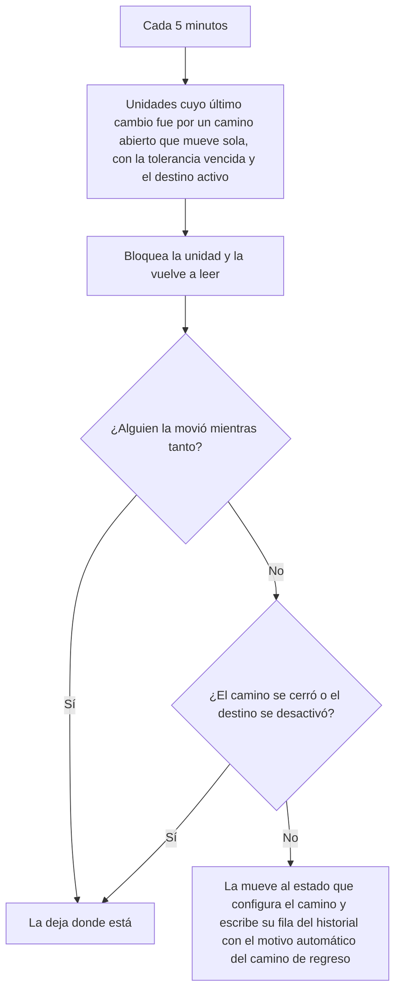

# Contexto `fleet` — ERP Millennium Mobility

**Actualizado:** 12/11/2026 (después: toda fecha vacía con etiqueta muestra «dd/mm/aaaa» —el ingreso de unidades, la instalación y el retiro de un equipo, el traspaso y la importación de garantías, entre otros—, con una prueba que lo exige en todas las plantillas, y la columna de las llaves dice «Serial de fábrica», revisión 95 de `DESIGN.md` —frontend `334b4f1d`, merge `7cc55425`, publicado en `develop`—: en F10). Antes, el mismo día («Editar hitos» en una fila con el formato de sus fechas, solo el área de contenido se desplaza hacia lo que señala una tarea, «Instalar equipo» en espera sin equipo por instalar y el diálogo de la llave con la etiqueta primero y el serial de fábrica explicado, revisiones 93 y 94 de `DESIGN.md` —frontend `77825c6d`, `fb9cafb5` y `d0ad10c2`, merge `707fff6a`, publicado en `develop`—: en F10). Antes, el mismo día (la fila de pasos de la habilitación, compacta, con una franja por paso y el botón a lo ancho de su columna, revisión 92 de `DESIGN.md` —frontend `05ed6a89`, merge `1be31b69`, publicado en `develop`—: en F10). Antes, el mismo día (la fila de pasos de la habilitación, más baja, y las unidades elegidas en la línea de «Exportar», revisiones 90 y 91 de `DESIGN.md` —frontend `c8979afa` y `0d95ec57`, merge `43172b7a`, publicado en `develop`—: en F10). Antes, el mismo día (los requisitos de la habilitación van en una fila de pasos donde hay ancho, y «Cargar documento» pide el tipo y sus fechas en la misma fila, revisión 89 de `DESIGN.md` —frontend `da4a9c43` y `1225d65f`, merge `d169717f`, publicado en `develop`—: en F10). Antes, el mismo día (la página de habilitación de una unidad lleva sus requisitos como lista de tareas, cada pendiente con el botón que lo completa, y sus tablas ya no pegan el texto al borde del panel, revisión 88 de `DESIGN.md` —frontend `2cb908b0` y `ab02aea0`, merge `8e8a9522`, publicado en `develop`—: en F10). Antes, el mismo día (el VIN de cada fila abre la unidad en Inventario y su habilitación en Habilitación y en Vencimientos, con la regla para toda lista, revisión 87 de `DESIGN.md` —frontend `2a086825`, merge `c98403fc`, publicado en `develop`—: en F7 y F12). Antes, el mismo día (la limpieza del backend, merge `c87aa50d`: `fleet` marca sus modelos solo con `markModelsInUse`, desde el 03/11/2026, y la marca de un solo modelo salió de la fachada de `vehiclecatalog`, en el alta, FLT-R44 y la sección 5; los campos de error que el frontend nunca lee, en la sección 7; y la sonda en vivo de los pagos, corrida el 11/11/2026, en la sección 6 j). Antes, 10/11/2026 (lo que pasó a saldo, la inicial y en qué se usó cada nota, construido el mismo día: backend `afc6b76a` y `59de8fee`, merges `ba5bbb15` y `4639799f`, y frontend, merge `96b1a3f6`, diccionario v1.54; FLT-R146 en ✅). Antes, el mismo día (lo que pasó a saldo, la inicial congelada y en qué se usó cada nota, en «Compra y costo», D-248 y D-249 del diccionario v1.53, decididas ese día y por construir: la sección 1, la ficha de F7 y FLT-R146, en ❌ hasta construirla). Antes, 09/11/2026 (la cabecera de la ficha de la unidad, con un botón principal y un menú, DESIGN.md revisión 62, frontend merge `2fcbecbe`, en F2; y la integración de la auditoría, en `develop` el mismo día: backend `f4e025f7`, frontend `0f797b69`). Antes, 09/11/2026 (la auditoría de punta a punta de ese día y sus ramas, integradas en `integration/audit-2026-11-09` —backend merges `b4ade13a`, `9627e4b8` y `d00879e2`; frontend `59f7733e` y `d4d53692`—: En traspaso y la entrega del asesor de ventas, D-238 y D-239, con V122 y V123 —backend `b7d846f3`, `9f9bd093`, `d5faacb2`; frontend `250a1dec`, `9dd5c398`, `80efd461`—, en las secciones 1 y 2, F3, F7, FLT-R138 y FLT-R141 a FLT-R144 y la sección 6 o; el nombre de la marca, el modelo y el color en el recurso de la unidad, B14 —backend `ba5cca87`, frontend `7e18e792`—, en F7, FLT-R145 y la sección 5; las pruebas de FLT-R06, FLT-R67, FLT-R78 y FLT-R83 —backend `eabdc346`, `5c1bba7d`, `5de83c4e`— y la suite que pasa con las dos cuentas —`fix/suite-under-two-accounts`—; las columnas que faltaban a FLT-R133 a FLT-R140, y FLT-R139 repetida: la del traspaso pasa a FLT-R141; en F4, Contrato firmado en vez de Vendido; y en la sección 6, V111 a V113, lo que ya estaba construido y seguía como pendiente, y la propuesta 16 aplicada). Antes, 06/11/2026 (las cargas de archivos, D-225 a D-231: backend `7f01d0b2`, frontend `94ed5925`, migraciones V114 a V119). Antes, 06/11/2026 (el traspaso de una unidad, D-223: backend `d39bcf37` y `b51c413a`, frontend `70d2899b` y `a60715db`, migración V113; el ciclo del leasing, D-218 a D-222: backend `ad38e5fc` y `ba7e6a2d`, frontend `0131b883`, migración V112; Puesta a punto cierra la entrega y pide la revisión física, D-216 y D-217: backend `674a6cda` y `209b7cf3`, frontend `6c7a0773`, migración V111). Antes, 04/11/2026 (la segunda revisión de punta a punta y sus correcciones, integradas en `develop` ese día —backend `851b4d09`, frontend `3a49f141`, sin migraciones—: el regreso desde un Vendido desmarcado, el aviso una vez por unidad y los candados del catálogo, en F4, F6 y FLT-R55 y FLT-R57; la barra de Inventario, Habilitación y Vencimientos, en F7 y F12; las pruebas nuevas, en FLT-R52, FLT-R63, FLT-R71, FLT-R95 y FLT-R131; la propuesta 16, en la sección 6 b; y el cierre, en la sección 6 m) · 04/11/2026 (la fecha base de la brecha de días, de cada unidad —R22, D-199; backend `c43d1bc1`, merge `1bd767f1`—: el primer pago que cubre la unidad, en F7, en FLT-R131 y en la sección 6 l; y las propuestas 14 y 15 de la sección 6 b y el texto de §2.7 sobre los documentos, aprobados por el responsable y aplicados ese día —documentación `7cc29f4`, diccionario v1.39—, en las secciones 6 b, h y k) · 04/11/2026 (la revisión de punta a punta del plan v4 y sus correcciones, integradas en `develop` ese día —backend `44136ae1`, frontend `cc782649`—: el regreso automático y el catálogo de estados y caminos, con la puerta fuera de su alcance, en F4 y F6; el costo por la marca de la unidad y la unidad leída otra vez después de `VEHICLE_OUTDATED`, en F10; el filtro por estado de la habilitación, en F12; FLT-R49, FLT-R51, FLT-R52, FLT-R55, FLT-R57, FLT-R61 a FLT-R64, FLT-R68, FLT-R70, FLT-R71, FLT-R76, FLT-R79, FLT-R80, FLT-R84 a FLT-R86, FLT-R90, FLT-R91 y FLT-R98 con lo que cambió y las pruebas que se movieron o se sumaron; las propuestas 14 y 15, en la sección 6 b; lo corregido y lo que queda, en la sección 6 k) · 03/11/2026 (los pagos a proveedores, fase 5 del [plan de compras y habilitación](../plan-de-implementacion-compras-y-habilitacion-2026-11-02.md), construidos e integrados en `develop` ese día —backend `601cc177`, con V105 a V107; frontend `e0ed0f68`, con la rama `feature/procurement-payments` hasta `4e079f12`—, D-199 y D-212: el estado de pago y la brecha de días, que `fleet` lee de compras por `UnitPurchases`, en la sección 1; el estado, la brecha y el pago de la unidad en su ficha, en F7; FLT-R130 a FLT-R132 en ✅, con sus pruebas y sus commits; lo que suma `UnitPurchases`, en la sección 5; lo construido y lo que queda, en la sección 6 j) · 03/11/2026 (las notas de crédito, fase 4 del [plan de compras y habilitación](../plan-de-implementacion-compras-y-habilitacion-2026-11-02.md), construidas e integradas en `develop` ese día —backend `e213c01c`, con V102 a V104; frontend `d579211a`—, D-104, D-182, D-191, D-203 y D-204: el costo de la unidad, que `fleet` sirve leyéndolo de compras por `UnitPurchases`, en la sección 1; «Compra y costo» y la unidad «Devuelta al proveedor», en F7; FLT-R94 a FLT-R99 en ✅, con sus pruebas y sus commits, y FLT-R52 con el nombre de hoy de su prueba; los dos miembros nuevos de `FleetContextFacade` y lo que suma `UnitPurchases`, en la sección 5; lo construido y lo que queda, en la sección 6 i) · 03/11/2026 (la habilitación, fase 3 del [plan de compras y habilitación](../plan-de-implementacion-compras-y-habilitacion-2026-11-02.md), construida e integrada en `develop` ese día —backend `8bfdb938`, con V95 a V101; frontend `2659126a`—: F8 a F12, construidos; FLT-R55 a FLT-R93 en ✅, con sus pruebas y sus commits; las tablas de la habilitación, en la sección 1; `location::acl` y lo que `fleet` usa de `vehiclecatalog`, `organization` y `location`, en la sección 5; lo construido y lo que queda, en la sección 6 h) · 03/11/2026 (la habilitación, fase 3 del plan, especificada y en construcción: F8 a F12 y FLT-R55 a FLT-R93, en ❌, tomados de la [especificación de habilitación](../especificacion-habilitacion-2026-11-02.md), paso 8.0) · 03/11/2026 (las facturas de compra, fase 2 del [plan de compras y habilitación](../plan-de-implementacion-compras-y-habilitacion-2026-11-02.md), construidas e integradas en `develop` ese día —backend `16f69af3`, frontend `2dc6505c`—, D-104, D-153, D-160, D-175 y D-182: `FleetContextFacade` y los puertos `UnitPurchases` y `UnitContracts` en la sección 5; FLT-R48 a FLT-R54 en ✅, con sus pruebas; la anulación de una unidad, el año fijo de una unidad facturada y el filtro «Sin factura vigente» del Inventario, en la sección 6, g; dónde nace la unidad, cerrada en la sección 7) · 31/10/2026 (cierre de la revisión del 31/10/2026, [plan de cierre](../plan-de-cierre-de-la-revision-2026-10-31.md), S12, antes del paso 9: la regla del camino de estado pasa al dominio, `StatusPathPolicy` y `Vehicle.transitionTo` con el camino declarado, `44c41c1f`, FLT-R17 en «Dominio»; las lecturas de kilometraje, en su propio servicio, `VehicleMileageReadingCommandServiceImpl`, `9694c24a`; la unidad y su historial, en las piezas `VehicleMovements` y `VehicleIdentifierCorrections`, `9bf56bf9`, y `VehicleCommandServiceImpl` baja de 527 a 312 líneas de código; ninguna respuesta cambia; sección 6) · 31/10/2026 (la sonda del paso 5, `e2e-live/fleet.live.spec.ts`, frontend `f0ee86aa`, en `develop`, corrió contra el backend real: 8 de 8 en cada una de dos corridas, sección 6; la de la bitácora, `changelog.live.spec.ts`, corrige el VIN de una unidad, FLT-R03, 6 de 6; la de fondos, 7 de 7) · 30/10/2026 (diccionario v1.33 y `develop` del 30/10/2026, frontend `88484481` y backend `a54ee29b`, publicados el 30/10/2026: Estados y motivos se abre solo con `catalogos.ver`, D-141, que resuelve el hallazgo de quien solo escribe, FLT-R27; la búsqueda de fondos y del Inventario no distingue tildes, D-142, V86, sección 6 f; la sonda de fondos contra ese código, 7 de 7) · 29/10/2026 (lo que construyó la auditoría del 20/10/2026 llegó a `develop` ese mismo día, merge `000d7c5f` en el backend y `52249e4` en el frontend, con la exportación `fb27113` hecha sobre `develop`; la sonda del paso 5 todavía no existe, y la sección 6 ya no dice que corrió; la lista de fondos deja de cargar cuando no hay empresa que ofrecer, `d8d3ae3a`; la sonda de fondos registra la marca de su unidad en «Gestionar marcas», `efdff929`; Inventario y Estados y motivos se abren por permiso desde la segunda ronda de la auditoría) · 26/10/2026 (cierre de la auditoría del 25/10/2026, diccionario v1.30: el catálogo de fondos y las cesiones a mano, adelantados al paso 9 en V75, sección 6 f; quién cede una unidad, excepción a D-101, D-134) · 21/10/2026 (paso 6 integrado en `develop` y subido: la corrección de la placa y del VIN con su fila en la bitácora, FLT-R03, D-129) · 20/10/2026 (segunda ronda de la auditoría, primera fase, diccionario v1.25, integrada en `develop`, merge `e245186`, y verificada contra el código: `companyReach` y `brandReach` en lugar de `companiesActingOn` y `brandsActingOn`; la versión del Inventario por los contadores de `data_versions`, D-128) · 20/10/2026 (segunda ronda de la auditoría, primera fase, diccionario v1.25, construida en `audit2/phase1`: `VehicleAccessPolicy`, una clase pura que decide dónde actúa cada permiso sobre una unidad, F1; `FleetSessionAccount`; el alcance con `CompanyReach` y `BrandReach`, F3; `PermissionCodes` en lugar de `FleetPermissions`, F2; `PathPermissions`, `FleetErrors` y el regreso automático en sus paquetes, F4 a F6 y H6; la exportación del Inventario por `documents::acl`, D-125) · 20/10/2026 (lo que construyó la auditoría, verificado contra el código integrado: backend `audit/be-integration`, merge `81bb8c1`, con `0982165` y `7a792b9` a `c2b2575`; frontend `audit/fe-integration`, merges `36210f6` y `52249e4`, con `847550b` y `c3d1e69` a `c03bdf1`; la segunda fase, la carrera del motivo automático, `06b160c`, y la exportación del Inventario, D-116, `1b98b37` en el backend y `fb27113` en el frontend. Falta llevarlo a `develop`) · 20/10/2026 (auditoría del 20/10/2026, diccionario v1.24: el regreso automático con su motivo reservado, D-110, que reemplaza la propuesta 6; la empresa propia del historial y de las lecturas, D-111; el modelo, su marca y su tipo activos en el alta, D-108, y el aviso del modelo con unidades, D-107; los estados y los caminos como listas cortas filtradas en el servidor, D-113, con §14.23 adoptada; un solo prefijo de código por agregado, D-114) · 20/10/2026 (paso 5 integrado en `develop`: merges `32d4996` en el backend y `28ffe6a` en el frontend; la última ronda registra la unidad sin placa, deja el origen GPS al dispositivo, lleva todo camino de alta al estado inicial y lee el historial en `/vehicles/{id}/status-changes`) · 20/10/2026 (paso 5 construido en `feature/fleet`, backend y frontend: estados, caminos, unidades, historial y kilometraje, con las migraciones V46 a V48) · **Estado:** integrado en `develop` el 20/10/2026; borrador para validar; su sonda contra el backend real, corrida el 31/10/2026 · **Fuente:** diccionario de datos v1.24 (§2.5, §2.6, §5.6, §8.1 a §8.6, §11.1, §13.1 y las decisiones D-9, D-14, D-16, D-18, D-19, D-20, D-42, D-84, D-86 y D-95 a D-116), [mapa de contextos](../mapa-de-contextos-millennium-mobility.md), [convenciones de la API](../convenciones-de-la-api-millennium-mobility.md), [procesos y pantallas](../procesos-y-pantallas-millennium-mobility.md) (P7, P8, apartado 3 y preguntas 1, 2 y 4), [orden de implementación](../orden-de-implementacion-millennium-mobility.md), las decisiones del responsable del 19/10/2026 y el código de `develop` al 20/10/2026: backend `32d4996`, que integra `feature/fleet` (`39937eb`, 33 commits sobre `6d73031`), y frontend `28ffe6a`, que integra `feature/fleet` (`52be927`, 43 commits sobre `e76450f`, con un merge de `develop`); para la sección 6, también el código de `develop` al 29/10/2026 (backend `5ec83065`, frontend `bda96499`) y las sondas del frontend al 31/10/2026 (`f0ee86aa`). Si este documento y el diccionario no coinciden, manda el diccionario.

**Cómo leerlo.** Las secciones 1 a 3 están escritas para quien conoce el negocio. La 4 y la 6 nombran archivos del código para el equipo. Lo marcado **(propuesta)** no lo decide nadie todavía; las propuestas para el diccionario están juntas en la sección 6 b, y las decide el responsable. Lo que aprobó el responsable el 20/10/2026 con la auditoría está construido e integrado en `develop` desde ese mismo día, y se describe como está, también su segunda fase: la exportación del Inventario y la carrera del motivo automático.

---

## 1. Qué es y qué no es

`fleet` responde qué unidades tiene cada empresa, en qué estado de su ciclo de vida está cada una, por qué llegó a él, cuánto tiempo se tolera que siga ahí y cuánto marca su odómetro. Es el centro del modelo (§8): las compras, la habilitación, los fondos y, más adelante, los contratos cuelgan del vehículo. Es el paso 5 del orden de implementación y usa a `organization`, `vehiclecatalog` e `iam` por sus fachadas, y desde el 03/11/2026 también a `location`.

**Las cinco tablas que posee en el paso 5** (diccionario §8). El mapa §3 le asigna además las de la habilitación y los fondos, que llegan con los pasos 9 y 10. Las dos de los fondos, `funds` y `vehicle_fund_assignments`, ya existen desde V75: el catálogo y las cesiones a mano se adelantaron al paso 9 (sección 6 f). Las cuatro de la habilitación existen desde el 03/11/2026: `vehicle_document_types` (V97), `vehicle_documents` (V98), `vehicle_equipments` (V100) y `vehicle_keys` (V101), con los hitos de §11.1 en `vehicles` y `requires_enablement` en `vehicle_statuses` (V96) (sección 6 h). `vehicle_tax_declarations` existe desde el 06/11/2026 (V116), con las cargas de archivos (sección 6 n).

| Tabla | Qué guarda | Diccionario |
|---|---|---|
| `vehicle_statuses` | Los estados del ciclo de vida: En habilitación, Disponible, Contrato firmado (código `VENDIDO`), Activo, Mecánica, Siniestro, Custodia, Puesta a punto, Robado, Pérdida total, En traspaso (desde V123, D-239) e Inactivo | §8.2 |
| `status_change_reasons` | Los caminos permitidos entre estados, cada uno con su motivo, su tolerancia, qué pasa al vencerse y el permiso que exige | §8.3, §8.6, D-100 |
| `vehicles` | Las unidades: empresa, marca comercial, modelo, color, VIN, número de motor, placa, año, ubicación y estado actual | §8.1 |
| `vehicle_status_history` | Cada cambio de estado de cada unidad: de dónde, a dónde, por qué camino, quién, cuándo y hasta cuándo se tolera | §8.4 |
| `vehicle_mileage_readings` | Las lecturas del odómetro, con su momento, su origen y quién la registró | §8.5 |

Las columnas están en el diccionario y no se repiten aquí. Las que el código agregó y el diccionario todavía no tiene están en la sección 6 b.

**Lo que parece suyo y no lo es, o todavía no**

| Parece de `fleet` | Es de | Por qué |
|---|---|---|
| El costo de la unidad: valor de factura, notas de crédito, valor del vehículo y costo sin IGV | `procurement`, que lo calcula y lo responde por `UnitPurchases`; `fleet` lo sirve en `GET /vehicles/{id}/purchase-cost`, con `stock.ver_costos` (D-203, desde el 03/11/2026) | La unidad no conoce facturas (mapa §6.1; la decisión 7, cerrada por D-203). `/vehicles` nunca trae montos: los trae solo esa ruta (FLT-R97) |
| El estado de pago de la unidad y los montos de su pago | `procurement`, que los calcula con los cinco montos de la unidad y los responde por `UnitPurchases`; `fleet` muestra el estado sin montos con `stock.ver`, cuenta la brecha de días y sirve los montos en `GET /vehicles/{id}/purchase-cost`, con `stock.ver_costos` (D-199, D-212, desde el 03/11/2026). Desde D-248 y D-249 (decididas y construidas el 10/11/2026), también la inicial congelada, lo pendiente y lo que pasó a saldo, y en qué pagos se usó cada nota | La unidad no conoce pagos (mapa §6.1). La brecha no se guarda: se recalcula en cada lectura (FLT-R131) |
| El proveedor de la unidad | `procurement` | Es un dato de la compra, no de la unidad (§8, introducción) |
| El ingreso físico, la inmatriculación, el título y las placas recibidas | `fleet`, desde el 03/11/2026 (V96) | Son las columnas que §11.1 agrega a `vehicles` con la habilitación (sección 6 h) |
| El primer registro de la placa | `fleet`, desde el 03/11/2026, con `habilitacion.registrar_hitos` (`POST /vehicles/{id}/plate`, FLT-R65) | Es un hito de la habilitación (§5.6, §11.1): el alta no recibe placa. La columna, su forma y su unicidad en el país ya existían, para la carga de migración |
| ~~La columna `current_mileage`~~ | — | No llega: D-165 (02/11/2026) la descarta, y el kilometraje de la unidad sigue siendo su última lectura |
| Los documentos, el equipamiento, las llaves y el impuesto vehicular | `fleet`: los documentos, el equipamiento y las llaves desde el 03/11/2026; el impuesto vehicular, desde el 06/11/2026, con las cargas de archivos | Bloque 9 (secciones 6 h y 6 n) |
| Los fondos y las cesiones | `fleet`: el catálogo y las cesiones a mano desde el 26/10/2026 (V75); la carga del archivo de garantía mobiliaria, desde el 06/11/2026, con las cargas de archivos | Bloque 10 (secciones 6 f y 6 n) |
| Quién corrigió una placa o un VIN, y por qué | `shared`, en el paso 6 (`change_log`) | Por eso corregir la placa y el VIN espera a ese paso (decisión del responsable del 19/10/2026) |
| El número que la unidad tenía en el Excel (`legacy_number`) | `fleet`, solo por la carga de migración (paso 9, D-18) | La API no lo recibe ni lo genera (decisión del 19/10/2026) |
| La anulación y el traspaso (`annulled_at`, `transfer_date`, `transfer_reason`, `transfer_owner_name`) | `fleet` (D-104, D-20, D-223, D-239) | La anulación, desde el 03/11/2026; el traspaso, desde el 06/11/2026, con `PUT /vehicles/{id}/transfer`, de una unidad en Inactivo y, desde el 09/11/2026, también en En traspaso |
| La marca del vehículo (Chevrolet, TVS), el modelo y el color | `vehiclecatalog` (§7) | La unidad apunta a ellos; no los modifica |
| La empresa, la marca comercial (Lizzo, Lima Bikes) y la ubicación | `organization` (§6) | Ídem |
| El nombre de quien cambió un estado o registró una lectura | `iam` y `organization` | `iam` entrega el identificador público de la cuenta y el nombre de su colaborador (mapa, decisión 6) |

**Palabras con un significado preciso aquí**

| Palabra | Significa | No confundir con |
|---|---|---|
| Unidad | Un vehículo físico de una empresa, identificado por su VIN | La línea de factura con ese VIN, que es de `procurement` (mapa §1) |
| Estado | En qué punto del ciclo de vida está la unidad: Disponible, Contrato firmado, Activo… Cada estado es de una familia (comercial, productivo, recuperación o terminal) y dice si la unidad genera ingresos en él (§8.2) | Que un estado esté activo o desactivado en el catálogo, que solo dice si se sigue ofreciendo |
| Estado inicial | Donde nace toda unidad registrada; hoy, En habilitación. Hay uno solo | — |
| Camino | Un paso permitido de un estado a otro, por un motivo. Solo existen los caminos cargados (D-19); lo demás se rechaza | — |
| Motivo | Por qué se recorre un camino: Venta, Choque, Morosidad. Cada motivo es un camino propio: Mantenimiento preventivo y Choque van de Activo a Mecánica con tolerancias distintas (§8.3) | — |
| Camino de alta | El que no parte de ningún estado: el motivo con que nace una unidad, Registro de compra | — |
| Cerrar un camino | Desactivar su motivo. El historial que lo nombra se conserva | Borrarlo, que no existe |
| Tolerancia | Cuántas horas se acepta que la unidad siga en el estado por ese motivo. Vacía, ese caso no se mide (§8.3) | Un plazo del contrato |
| Vence | El momento en que se acaba la tolerancia de un cambio. Se calcula y se guarda al registrar el cambio (§8.4) | — |
| Vencida | Una unidad cuya tolerancia del último cambio ya pasó. Aparece en la lista de vencidas del inventario | — |
| Avisar, al vencerse | La unidad aparece entre las vencidas. No se envía ningún aviso aparte | — |
| Mover sola, al vencerse | El sistema mueve la unidad a otro estado y firma como `SYSTEM`: una unidad Vendida vuelve a Disponible a las 48 horas. Es la única transición que ocurre sola (§8.3) | — |
| Motivo automático | El motivo reservado con que el sistema registra un regreso automático: «Regreso automático por vencimiento», del camino que va del destino al estado configurado. Lo crea el sistema; nadie lo elige ni lo edita (§8.3, D-110) | El motivo del camino que venció, la Venta |
| Lectura | Lo que marcaba el odómetro en un momento, con su origen: GPS, taller, entrega, devolución o manual (§8.5). Las de GPS las trae el dispositivo, sin autor; una persona registra las demás | El kilometraje de la unidad, que es su última lectura |
| Sustitución de odómetro | La primera lectura de un tablero nuevo, cuando se cambió el tablero. Es el único hecho que admite una lectura menor que la anterior (§8.5) | Corregir una lectura, que no existe: una lectura no se edita |
| Alta | Registrar una unidad: nace en el estado inicial por el camino de alta (§8.3) | — |
| Ubicación | El lugar físico donde está la unidad (`locations`, §6.5). Vacía mientras no ha ingresado | La geografía de `location` |

---

## 2. Ciclo de vida de cada agregado

Nada de `fleet` se borra: ni las unidades, ni los estados, ni los caminos, ni el historial, ni las lecturas. La API no tiene `DELETE` (convenciones §3.1) y la cuenta de la aplicación no tiene permiso de borrar (V19).

### Unidad

| Momento | Qué pasa |
|---|---|
| Alta | La registra en Logística › Inventario quien tiene `stock.crear_vehiculo` (la semilla se lo da al superadministrador, al administrador de empresa y a Operaciones). Lleva su empresa, su marca comercial, su modelo, su color, su VIN y su año; el número de motor y la ubicación son opcionales. Nace sin placa: su primer registro es un hito de la habilitación, en el paso 9 (§5.6, §11.1). Nace en el estado inicial por el camino de alta, y esa primera fila del historial la firma quien la registró (§8.3, §8.4). El modelo, su marca y su tipo tienen que estar activos (D-108), y el alta le avisa a `vehiclecatalog`, en la misma operación, que el modelo ya tiene unidades: desde entonces el tipo del modelo queda fijo (D-107) |
| Qué cambia | Con `stock.editar_vehiculo`: el color, el número de motor, el año del modelo, la marca comercial y la ubicación actual (§5.6). El estado, por un camino y con su permiso. El kilometraje, con cada lectura |
| Qué queda fijo | La empresa, su país y el modelo, desde el alta; con el modelo, el tipo de vehículo. ~~El VIN tampoco cambia por ahora: el dominio sabe corregirlo, pero la API no lo ofrece hasta el paso 6, cuando la bitácora registre quién, cuándo y por qué (§13.1; decisión del 19/10/2026). Lo mismo la placa, cuando la tenga~~. Desde el paso 6 (21/10/2026, D-129) el VIN y la placa se corrigen con su permiso y su motivo, y la bitácora registra quién, cuándo y por qué (FLT-R03) |
| Retiro | La unidad se anula (D-104) o se traspasa, desde En traspaso o Inactivo (D-20, D-223, D-239). Desde el 09/11/2026 (V123) sale de la flota por En traspaso, y pasa a Inactivo solo con su traspaso registrado (FLT-R142, FLT-R144) |
| Nunca | Se borra; cambia de empresa; contradice el tipo de vehículo de su modelo; recibe un número del Excel por la API (D-18) |

### Estado del vehículo

| Momento | Qué pasa |
|---|---|
| Alta | Lo crea el superadministrador, con `catalogos.crear_estados`, en Catálogos › Estados y motivos (D-130). V47 siembra los nueve del flujograma (§8.2); V112 suma Robado y Pérdida total (D-219, D-220), y V123, En traspaso (D-239) |
| Qué cambia | El nombre, la familia, si genera ingresos y si es el inicial |
| Qué queda fijo | El código, desde el alta |
| Retiro | Se desactiva y se puede reactivar. Las unidades que ya están en él se quedan; ninguna entra nueva. No se desactiva el estado inicial, ni el estado al que un camino abierto mueve unidades solas: primero se cambia el inicial o se cierra ese camino. Desde el 09/11/2026, En traspaso e Inactivo no se desactivan nunca: por ellos una unidad sale de la flota y se traspasa (FLT-R143) |
| Nunca | Se borra; hay dos estados iniciales, aunque uno esté desactivado |

### Camino (motivo)

| Momento | Qué pasa |
|---|---|
| Alta | Lo crea el superadministrador desde un estado de origen, o como camino de alta, sin origen, que lleva siempre al estado inicial. Nombra el permiso que exige (D-100); sin permiso propio, exige `stock.cambiar_estado`. Un camino de alta no nombra ninguno: registrar una unidad exige `stock.crear_vehiculo` (**propuesta**, sección 6 b). V47 siembra los nueve caminos de §8.3, cada uno con el permiso que le da §5.6. Al guardar un camino que, al vencerse, mueve sola la unidad, el sistema asegura en la misma operación el motivo automático del camino de regreso, del destino al estado configurado, o reutiliza el que ya tiene (D-110); V51 crea los de los caminos que ya existen. Si en ese camino de regreso una persona ya declaró un motivo con el código `REGRESO_AUTOMATICO`, el camino no se guarda (`409 STATUSCHANGEREASON_CODE_CONFLICT`) |
| Qué cambia | El nombre, la tolerancia, qué hacer al vencerse y a qué estado mover la unidad, y el permiso. Un motivo automático no se edita ni se cierra por la API: lo mantiene el sistema (`422 STATUSCHANGEREASON_AUTOMATIC_LOCKED`, D-110) |
| Qué queda fijo | El origen, el destino y el código: son el camino |
| Retiro | Se cierra, desactivando su motivo; desactivar todos los motivos de un par cierra el paso entre esos dos estados (§8.3). Se reabre, salvo que haya ya otro camino de alta abierto hacia el mismo estado, que sea un camino de alta hacia un estado que ya no es el inicial, o que mueva unidades solas a un estado desactivado |
| Nunca | Se borra; lleva a su propio estado de origen |

### Fila del historial

| Momento | Qué pasa |
|---|---|
| Alta | La escribe el sistema con cada cambio, en la misma operación que el estado actual de la unidad: el alta, cada cambio que hace una persona y cada regreso automático, este con el motivo automático de su camino (§8.4, D-110) |
| Qué guarda | De qué estado a cuál, por qué camino, quién, cuándo, cuándo vence la tolerancia, un detalle opcional de hasta 2 000 caracteres y la empresa de la unidad, copiada de ella (D-111): la base rechaza una fila que nombre otra empresa que la de su unidad |
| Qué cambia | Nada. Un error se corrige con un cambio nuevo (§8.4) |
| Nunca | Se edita ni se borra: la cuenta de la aplicación solo lee e inserta en esta tabla |

### Lectura de kilometraje

| Momento | Qué pasa |
|---|---|
| Alta | La registra, en la ficha de la unidad, quien tiene `stock.registrar_kilometraje`; una sustitución de odómetro, quien tiene `stock.registrar_sustitucion_odometro`. Lleva los kilómetros, el momento de la lectura —que no puede ser futuro—, el origen —taller, entrega, devolución o manual— y un detalle opcional, y el sistema le copia la empresa de la unidad (D-111). Las de GPS las trae el dispositivo, sin autor, cuando llegue su integración: la API no las recibe de una persona |
| Qué cambia | Nada |
| Nunca | Se edita ni se borra; entra menor que la lectura anterior sin ser una sustitución (§8.5) |

---

## 3. Flujos funcionales

En cada flujo, "el sistema revisa" es lo que el backend comprueba, en ese orden. Toda ruta exige un permiso del catálogo (§5.6, D-95), y el servicio decide dónde actúa con la asignación que lo trae (D-99): una unidad que la cuenta no ve con `stock.ver` no existe para ella (`404 VEHICLE_NOT_FOUND`); una que ve, pero sobre la que su permiso no actúa, responde `403 ACCESS_DENIED`. El stock se ve en toda la empresa (D-14), y lo que se toca depende de dónde está la unidad: un rol de sede actúa solo sobre las unidades de la ubicación propia de su sede (D-101), y una asignación limitada a una marca, solo sobre las unidades de esa marca (D-102).

Las pantallas son tres: Logística › Inventario (`/fleet/vehicles`), la ficha de cada unidad (`/fleet/vehicles/{id}`) y Catálogos › Estados y motivos (`/fleet/vehicle-statuses`). Desde la segunda ronda de la auditoría (20/10/2026, `b73e2a22`) cada una se abre por el permiso que usa, no por los roles del sistema (procesos, apartado 3.1). Inventario y la ficha, con `stock.ver`: con la semilla, los seis roles del sistema que lo tienen, y no el administrador de accesos; también un rol propio con `stock.ver`. Estados y motivos, desde el 30/10/2026 solo con `catalogos.ver`, porque escribir exige leer (D-141; frontend `71765c0b`): con la semilla la abren los siete roles, y solo el superadministrador escribe, con `catalogos.crear_estados`, `editar_estados` o `desactivar_estados` (D-130); los demás roles leen además los estados y los caminos desde la ficha de la unidad. Hasta el 30/10/2026 se abría también con esas tres escrituras, y un rol propio que solo escribía estados veía la opción pero sus listas le respondían `403` (sección 6 c). Desde el 26/10/2026 hay además Configuración › Fondos y la pestaña Cesiones de la ficha (sección 6 f).

### F1 · Registrar una unidad

**Rol:** quien tiene `stock.crear_vehiculo`: en la semilla, superadministrador, administrador de empresa y Operaciones. **Pantalla:** Logística › Inventario, botón "Nueva unidad", que solo aparece con el permiso.

1. Elige la empresa (las activas), la marca comercial (las activas de esa empresa), la marca del vehículo, el tipo si quiere acotar ("Cualquiera" por omisión), el modelo (los activos de esa marca), el color y la ubicación (las activas de la empresa, o "Sin ubicación": "Vacía mientras la unidad no ha ingresado.").
2. Escribe el VIN ("17 caracteres, sin I, O ni Q."; se guarda en mayúsculas), el año del modelo, de 2017 al año siguiente, y el número de motor, opcional. La placa no se pide: la unidad se registra antes de inmatricularse, y el primer registro de su placa es un hito de la habilitación (paso 9; §5.6, §11.1). El diálogo revisa lo mismo que la API antes de enviar.
3. Guarda (`POST /vehicles`). El sistema revisa, en orden: que la empresa exista y la cuenta la alcance; que la marca comercial sea de esa empresa y esté activa, y la empresa también (D-84); que la ubicación, si la da, exista, sea de la empresa y esté activa; que `stock.crear_vehiculo` actúe en esa empresa, en esa marca y, si la ubicación es la propia de una sede, en esa sede (D-101, D-102); que el modelo y el color existan y estén activos, y también la marca y el tipo del modelo (D-108: `ExternalVehicleCatalogService.resolveModelForNewUnit` traduce lo que responde la fachada de `vehiclecatalog`); la forma del VIN; que ninguna unidad de ninguna empresa tenga ese VIN —lo mira con una elevación a `SYSTEM` que solo responde sí o no (§2.5), y si dos altas pasan a la vez, la base detiene la segunda con la misma respuesta—; y que haya un estado inicial con un camino de alta abierto hacia él. Una placa que llegue en el cuerpo se ignora. En la misma operación, después de escribir la unidad y su primera fila del historial, le avisa a `vehiclecatalog` que el modelo ya tiene unidades (~~`markModelInUse`~~ desde el 03/11/2026 `markModelsInUse`, el mismo aviso para una unidad o un lote, D-107): si el alta falla, el modelo tampoco queda marcado.

**Errores que ve:** "Ya existe una unidad con ese VIN." (`409 VEHICLE_VIN_CONFLICT`); "La empresa no existe o está inactiva." (`COMPANY_NOT_FOUND`, `COMPANY_INACTIVE`); "La marca comercial no es de la empresa o está inactiva." (`COMMERCIALBRAND_NOT_FOUND`, `COMMERCIALBRAND_INACTIVE`); "La ubicación no es de la empresa o está inactiva." (`LOCATION_NOT_FOUND`, `LOCATION_OTHER_COMPANY`, `LOCATION_INACTIVE`); "El modelo no existe o está inactivo." (`VEHICLEMODEL_*`); "La marca del modelo está inactiva: no se registran unidades nuevas de ella." (`422 VEHICLEBRAND_INACTIVE`); "El tipo de vehículo del modelo está inactivo: no se registran unidades nuevas de él." (`422 VEHICLETYPE_INACTIVE`); "El color no existe o está inactivo." (`COLOR_*`); "No hay un estado inicial ni un motivo de alta configurados: revise Estados y motivos." (`422 VEHICLESTATUS_INITIAL_MISSING`, `STATUSCHANGEREASON_REGISTRATION_MISSING`); "Su rol no registra unidades con esa marca comercial o en esa ubicación." (`403 ACCESS_DENIED`). El diálogo queda abierto con lo escrito. Si una lista no se pudo leer, el diálogo lo dice ("No se pudieron cargar las empresas.") y ofrece reintentar, en vez de mostrarla vacía. Lo mismo con los catálogos de flota, cada uno bajo su campo y con su propio estado en la fachada de `vehiclecatalog`: "No se pudieron cargar las marcas del catálogo.", "No se pudieron cargar los tipos de vehículo.", "No se pudieron cargar los colores del catálogo.".
**Resultado:** "Unidad registrada en su estado inicial." y se abre su ficha. La unidad queda En habilitación, sin placa, y su historial empieza con la fila "Alta de la unidad · Registro de compra", firmada por quien la registró.

### F2 · Editar los datos generales de una unidad

**Rol:** quien tiene `stock.editar_vehiculo`: en la semilla, superadministrador, administrador de empresa y Operaciones, donde actúa su asignación. **Pantalla:** la ficha de la unidad, botón "Editar" en la cabecera de los datos, que aparece solo si la ficha dice que la sesión puede editar esa unidad (`allowedActions.edit`). Desde el 09/11/2026 la cabecera muestra a lo sumo dos botones, «Cambiar estado», relleno, y «Editar», y el resto va en el menú «Más acciones de la unidad»: «Registrar traspaso» o «Corregir traspaso», «Corregir placa» y «Corregir VIN»; «Ver habilitación» y «Ver bitácora de la unidad»; y al final, en rojo, «Anular unidad» (decisión del responsable para toda ficha; DESIGN.md, revisión 62; frontend `65185188`, merge `2fcbecbe`).

1. Cambia el color, el número de motor, el año, la marca comercial o la ubicación. La empresa, el VIN, la placa y el modelo se muestran fijos.
2. Una marca, una ubicación o un color que la unidad ya tenía y que se desactivó después se conserva, rotulado "(inactiva)" o "(inactivo)"; uno nuevo tiene que estar activo y ser de la empresa (D-84).
3. Guarda (`PUT /vehicles/{id}`). El sistema revisa: que la cuenta vea la unidad; que el permiso actúe donde la unidad está; que lo nuevo sea de la empresa y esté activo; y, si cambia la marca o la ubicación, que el permiso actúe también donde la unidad termina: un rol de sede no manda una unidad a otra sede, a un tercero ni a ninguna ubicación (D-101), y nadie la pasa a una marca sobre la que no actúa (D-102).

**Errores que ve:** "Su rol no puede dejar la unidad con esa marca comercial o en esa ubicación." (`403 ACCESS_DENIED`), y los de la marca, la ubicación y el color de F1.
**Resultado:** "Unidad actualizada."

### F3 · Mover la unidad por un camino

**Rol:** el que tenga el permiso del camino (tabla). **Pantalla:** la ficha de la unidad, botón "Cambiar estado".

Los caminos que siembra V47 son estos, con el permiso de §5.6 (D-100). V112 suma los del flujograma, que están en §8.3 del diccionario: los de taller con `stock.atender_en_taller` y los de recuperación y salida con `stock.recuperar` (D-221). También cambia los nombres (D-218), mueve Choque a Siniestro y crea Robado y Pérdida total (D-219, D-220). Inactivo no tiene salida. Desde el 09/11/2026, V123 cierra las salidas directas a Inactivo por «Contrato completado» y «Venta directa» —de Activo y de Disponible— y las abre hacia En traspaso, que sale a Inactivo por «Traspaso inscrito» (`TRASPASO_INSCRITO`), todas con `stock.recuperar` y sin tolerancia hasta que el negocio la fije (D-239, D-240; FLT-R144). El historial que recorrió los caminos cerrados se conserva.

| Desde | Hacia | Motivo | Tolerancia | Al vencerse | Permiso | Roles de la semilla |
|---|---|---|---|---|---|---|
| *(alta)* | En habilitación | Registro de compra | — | — | `stock.crear_vehiculo` | SA, AE, OP |
| En habilitación | Disponible | Habilitación completa | — | — | `stock.habilitar` | SA, AE, OP |
| Disponible | Contrato firmado | Firma de contrato | 48 h | Mover sola a Disponible | `stock.vender` | SA, AE, AV |
| Contrato firmado | Activo | Entrega al cliente | — | — | `stock.entregar` | SA, AE y, desde V122 (09/11/2026, D-238), AV, en su sede |
| Activo | Mecánica | Mantenimiento preventivo | 72 h | Avisar | `stock.atender_en_taller` | SA, AE, OP, TA |
| Activo | Siniestro | Choque | 480 h | Avisar | `stock.atender_en_taller` | SA, AE, OP, TA |
| Activo | Custodia | Morosidad | 720 h | Avisar | `stock.recuperar` | SA, AE |
| Custodia | Puesta a punto | Resolución de contrato | — | — | `stock.recuperar` | SA, AE |
| Puesta a punto | Disponible | Reacondicionada | — | — | `stock.atender_en_taller` | SA, AE, OP, TA |

SA = superadministrador · AE = administrador de empresa · OP = Operaciones · AV = asesor de ventas · TA = taller. El diagrama de estos caminos está en procesos y pantallas, P7.

1. El diálogo dice "Desde {estado actual}: solo los caminos permitidos que su rol puede recorrer." y ofrece los destinos a los que lleva un camino abierto desde el estado actual, hacia un estado activo, que la ficha dice que la sesión puede recorrer en esa unidad (`allowedActions.walkableReasonIds`). Un motivo automático nunca figura entre ellos: lo recorre solo el regreso automático (D-110), y el diálogo no lo ofrece aunque el registro lo nombrara. Así, sobre la misma unidad Activo de su sede, el taller ve los dos caminos a Mecánica y el asesor de ventas no ve ninguno; sobre una Disponible, al revés: el asesor ve Venta y el taller nada.
2. Elige el destino y después el motivo, que muestra su tolerancia ("Choque (480 h)"), y escribe un detalle opcional.
3. Guarda (`POST /vehicles/{id}/status-changes`, que responde `201` con la unidad en su estado nuevo). El sistema revisa: que la cuenta vea la unidad; que el destino exista y esté activo; que el motivo exista, esté abierto y no sea automático (`422 STATUSCHANGEREASON_AUTOMATIC_NOT_SELECTABLE`, D-110: "Ese motivo lo aplica solo el sistema, al vencer la tolerancia: elija otro."); que lleve a ese destino; que salga del estado en que está la unidad —un cambio que no está declarado se rechaza, no se advierte (§8.3)—; y que el permiso del camino actúe donde está la unidad (D-100, D-101, D-102). Desde el 31/10/2026 es la unidad la que se niega a moverse por un camino que no lo permite (`Vehicle.transitionTo` con `StatusPathPolicy`, FLT-R17, `44c41c1f`); las respuestas y su orden no cambiaron: el `422` del camino sigue antes del `403` de su permiso. Escribe el estado de la unidad y su fila del historial en la misma operación, con el vencimiento calculado desde ese momento. El historial se lee en `GET /vehicles/{id}/status-changes`.

**Errores que ve:** "Ese camino no está permitido desde el estado actual de la unidad." (`422 STATUS_TRANSITION_NOT_ALLOWED`, `STATUSCHANGEREASON_TARGET_MISMATCH`); "Su rol no puede recorrer ese camino." (`403 ACCESS_DENIED`); "El estado destino está inactivo." (`422 VEHICLESTATUS_INACTIVE`); "No encontramos el estado destino: cierre el diálogo y vuelva a elegirlo." (`404 VEHICLESTATUS_NOT_FOUND`); "El motivo elegido se cerró mientras lo elegía: elija otro." (`404 STATUSCHANGEREASON_NOT_FOUND`), y el diálogo vuelve a leer los caminos. Si ningún camino sale del estado para esa sesión: "Ningún camino permitido sale de este estado para su rol."
**Salir de Puesta a punto** hacia un estado con puerta pide la revisión física (D-217): la ficha nombra esos caminos en `allowedActions.physicalCheckReasonIds`, el diálogo muestra la casilla y no guarda hasta marcarla, y el backend rechaza el cambio sin ella (`422 VEHICLE_PHYSICAL_CHECK_REQUIRED`).
**Salir de En traspaso hacia Inactivo** pide el traspaso registrado (D-239, desde el 09/11/2026): la ficha nombra esos caminos en `allowedActions.transferHeldReasonIds`, nunca en `walkableReasonIds`; el diálogo los muestra deshabilitados con «Falta registrar el traspaso: hágalo con «Registrar traspaso» en la ficha.», y el backend rechaza el cambio sin él (`422 VEHICLE_TRANSFER_REQUIRED`: «Registre el traspaso de la unidad antes de pasarla a Inactivo.»). Es una regla de la unidad, no del catálogo: `TransferExitPolicy` la decide por los códigos de los dos estados y `Vehicle.transitionTo` la aplica, así que cerrar o editar un camino no la apaga (FLT-R142). Las revisiones van en este orden: el camino, su permiso, la unidad anulada, la revisión física, el traspaso y, al final, la puerta de la habilitación.

**Resultado:** "Estado cambiado." La pestaña Historial de estados muestra el cambio con su camino, su motivo, quién y cuándo, y cuándo vence; bajo el motivo, «Revisión física confirmada» cuando la hubo.

### F4 · El regreso automático al vencer la tolerancia

**Rol:** ninguno: lo hace un proceso programado (`StatusToleranceBreachTask`), cada 5 minutos por omisión (`FLEET_STATUS_TOLERANCE_CHECK_INTERVAL`), con alcance `SYSTEM` (decisión del responsable del 19/10/2026). Corre en una sola instancia a la vez, por `SingleInstanceRun` de `shared`, con el nombre de proceso `fleet.status-tolerance-breach`: un candado de PostgreSQL (`pg_try_advisory_lock`) que, si otra instancia lo tiene, salta la corrida; la siguiente recoge lo que quede.

1. Una unidad en Contrato firmado (código `VENDIDO`; Vendido hasta D-218) hace más de 48 horas, que nadie movió desde la firma, vuelve a Disponible.
2. La fila del historial dice Contrato firmado → Disponible, con el motivo automático de ese camino, «Regreso automático por vencimiento», firmada por `SYSTEM` y sin vencimiento, porque ese motivo no tiene tolerancia (D-110). Si el motivo falta, el proceso lo crea; si en ese camino una persona declaró un motivo con el código `REGRESO_AUTOMATICO`, deja la unidad donde está y lo registra en el log. Las filas de regresos escritas antes conservan el motivo del camino que venció: el historial no se reescribe. La unidad también queda firmada por `SYSTEM` como su último cambio (D-42).
3. El proceso respeta el catálogo como una persona: un camino cerrado o un destino desactivado no mueve nada, tampoco si cambiaron mientras el proceso corría.
4. Desde el 04/11/2026 (`345c1f75`), solo el regreso desde Contrato firmado mueve sola una unidad a un estado que exige la habilitación: el catálogo no guarda otro camino así (F6), y si un camino guardado antes movería una unidad incompleta a uno de esos estados desde otro estado que Contrato firmado, el proceso la deja donde está y lo registra en el log con `WARN` (FLT-R57).
5. Desde la segunda revisión del 04/11/2026 (`a126216f`), el regreso desde Contrato firmado salta la puerta solo mientras Contrato firmado tenga `requires_enablement`, porque entonces sostuvo completa a la unidad mientras esperaba (D-184). Si el superadministrador desmarca Contrato firmado, el proceso lee la habilitación como en cualquier otro camino y deja en Contrato firmado a la unidad a la que le falta algo, como el GPS que se le retiró mientras estaba en Contrato firmado (D-170). El catálogo sigue eximiendo por el código `VENDIDO` al guardar un camino. El `WARN` de una unidad retenida sale solo en la primera corrida después del vencimiento, y las siguientes lo dicen en `DEBUG` (`62708a60`; FLT-R57).

**Qué ve el usuario:** en el historial, la fila del regreso con `SYSTEM` como autor; la unidad deja de figurar entre las vencidas.

### F5 · Registrar una lectura y una sustitución de odómetro

**Rol:** `stock.registrar_kilometraje` (en la semilla, superadministrador, administrador de empresa, Operaciones, asesor de ventas y taller); para una sustitución, `stock.registrar_sustitucion_odometro` (superadministrador, administrador de empresa y taller). **Pantalla:** la ficha de la unidad, pestaña Kilometraje (`?seccion=kilometraje`), botón "Registrar lectura".

1. El diálogo dice "La unidad marca {n} km." o "La unidad todavía no tiene lecturas.", y propone la fecha y la hora de ahora en la zona de la empresa, no la del navegador (§2.6), y el origen Manual. Ofrece los orígenes que registra una persona: Taller, Entrega, Devolución y Manual. Las lecturas de GPS las trae el dispositivo, sin autor (§8.5).
2. Escribe los kilómetros, corrige la fecha y la hora si la lectura se tomó antes —una lectura de taller puede cargarse días después (§8.5)—, y agrega un detalle opcional.
3. Si la ficha permite a la sesión registrar una sustitución, aparece la casilla "Sustitución de odómetro: se cambió el tablero y la serie empieza de nuevo". Para quien solo puede registrar sustituciones, viene marcada y fija.
4. Guarda (`POST /vehicles/{id}/mileage-readings`, con `isOdometerSubstitution`). El sistema revisa: que la cuenta vea la unidad; que la lectura no sea futura; que su origen no sea GPS; que el permiso —el de la lectura o el de la sustitución— actúe donde está la unidad; que no sea menor que la lectura más cercana tomada en ese momento o antes, salvo que sea una sustitución; y que no sea mayor que la más cercana tomada después, tampoco si es una sustitución, salvo que esa siguiente sea una sustitución: un tablero nuevo no acota lo que se leyó en el anterior.

**Errores que ve:** "La lectura es menor que la tomada antes de ese momento." y, a quien puede registrar una sustitución, "La lectura es menor que la tomada antes de ese momento: si se cambió el tablero, márquela como sustitución de odómetro." (`422 MILEAGE_BELOW_PREVIOUS`); "La lectura es mayor que la tomada después de ese momento: revise los kilómetros, la fecha y la hora." (`422 MILEAGE_ABOVE_NEXT`); "La lectura no puede ser futura." (`422 MILEAGE_READ_AT_IN_FUTURE`; el diálogo también la detiene antes de enviar); "Una lectura con origen GPS la trae el dispositivo: elija otro origen." (`422 MILEAGE_SOURCE_NOT_ALLOWED`, si otro cliente de la API la manda); "Su rol no puede registrar esa lectura." (`403 ACCESS_DENIED`). Las dos primeras respuestas traen en `context` la lectura vecina, con sus kilómetros y su momento; la pantalla todavía no la nombra (sección 6 c).
**Resultado:** "Lectura registrada." El kilometraje de la unidad es el de su lectura más reciente por momento: una lectura cargada tarde, entre otras dos, no lo cambia. La pestaña marca la sustitución con "Sustitución de odómetro", y en "Quién" nombra a la persona; "El dispositivo" aparece solo cuando la lectura no tiene autor.

### F6 · Mantener los estados y los caminos

**Rol:** superadministrador, con `catalogos.crear_estados`, `editar_estados` o `desactivar_estados` (D-130). **Pantalla:** Catálogos › Estados y motivos (`/fleet/vehicle-statuses`), maestro-detalle: los estados a la izquierda, con la entrada fija "Alta de la unidad" al inicio para los caminos sin origen; a la derecha, los caminos que salen del estado elegido —que la pantalla pide al servidor con `?fromStatusId=` o, para "Alta de la unidad", con `?origin=registration` (D-113), en un estado propio del store, apartado de la lista completa que nombra las referencias, y solo con la respuesta del último origen pedido—, con su destino, su motivo, su tolerancia ("No se mide" si no tiene), qué pasa al vencerse y el permiso que exigen —"El de reserva (stock.cambiar_estado)" cuando no nombran uno, y `stock.crear_vehiculo (alta)` en los de alta—. Un motivo automático se muestra con la etiqueta "Automático", "Lo aplica el sistema" como permiso y sin acciones (D-110). Mientras se leen los estados o los caminos, cada panel muestra su barra de carga ("Cargando los caminos"), y si no se pudieron leer lo dice —"No se pudieron cargar los estados.", "No se pudieron cargar los caminos."— con "Reintentar", en vez de una lista vacía. Debajo del ancho de escritorio, se ve uno a la vez, con "Volver a los estados".

1. **Estado nuevo o editado.** Código (letras, números y guion bajo; "no cambia después de guardarse"), nombre, familia, si genera ingresos y si es el inicial.
2. **Camino nuevo**, desde el estado elegido o desde "Alta de la unidad": destino, código del motivo, nombre, tolerancia en horas, qué hacer al vencerse ("No hacer nada", "Avisar" o "Mover la unidad sola", con el estado al que moverla) y el permiso, elegido entre los permisos `stock` del catálogo. Un camino de alta solo se abre hacia el estado inicial y sin permiso propio: "Registrar una unidad exige stock.crear_vehiculo: un camino de alta no lleva un permiso propio."
3. **Desactivar o activar** desde el menú de la fila. Desactivar pregunta antes: un estado "dejará de ofrecerse como destino. Las unidades que ya están en él y su historial se conservan."; un motivo "dejará de ofrecerse al mover una unidad; si era el último de su camino, ese camino se cierra. El historial se conserva."

El sistema revisa: que el código del estado no se repita, y el del motivo no se repita en su camino; que haya un solo estado inicial, activo o no —para cambiarlo, primero se quita la marca del anterior—; que no se desactive el inicial ni el estado al que un camino abierto mueve unidades solas; que un camino lleve a otro estado; que lo que pasa al vencerse tenga tolerancia; que "Mover la unidad sola" tenga un estado al que mover, distinto del destino y activo mientras el camino esté abierto; que el permiso exista en el catálogo; que un camino de alta no nombre permiso y lleve al estado inicial, también al reabrirlo después de que la marca de inicial pasó a otro estado; y que no haya dos caminos de alta abiertos hacia un mismo estado, tampoco si dos pedidos llegan a la vez (V48). Desde el 04/11/2026 (`345c1f75`; FLT-R55, FLT-R57), revisa además que un camino abierto que espera en otro estado que Vendido no mueva solas las unidades a un estado que exige la habilitación —«Mover a» los muestra deshabilitados, con «Exige la habilitación completa»—; que un estado no pase a exigirla mientras un camino así lo tenga como destino; y que el estado inicial no la exija, ni un estado que la exige pase a ser el inicial —el diálogo retiene una marca mientras la otra está puesta—. Desde la segunda revisión del mismo día (`5bcd796b`), marcar un estado y guardar o reabrir un camino hacia él no se cruzan: el camino lee su destino `FOR SHARE` y la marca lee el estado `FOR NO KEY UPDATE` antes de sus caminos, así que el segundo pedido espera y ve lo que confirmó el primero (FLT-R55).

**Errores que ve:** "Ya existe un estado con ese código." (`VEHICLESTATUS_CODE_CONFLICT`); "Ya hay un estado inicial, activo o desactivado: quite esa marca al otro primero." (`VEHICLESTATUS_INITIAL_CONFLICT`); "Es el estado en que nace una unidad: marque otro como inicial antes de desactivarlo." (`VEHICLESTATUS_INITIAL_RETIREMENT_NOT_ALLOWED`); "Un camino abierto mueve unidades solas a este estado: cámbielo o ciérrelo antes de desactivarlo." (`VEHICLESTATUS_AUTO_TARGET_RETIREMENT_NOT_ALLOWED`); "Ya existe un motivo con ese código." (`STATUSCHANGEREASON_CODE_CONFLICT`; el mismo texto cuando un camino que mueve sola la unidad choca con un `REGRESO_AUTOMATICO` que una persona declaró en el camino de regreso, sección 6 c); "Ese motivo lo mantiene el sistema para el regreso automático: no se edita ni se desactiva." (`STATUSCHANGEREASON_AUTOMATIC_LOCKED`); "El permiso elegido no existe en el catálogo." (`PERMISSION_NOT_FOUND`); "Un camino de alta no lleva un permiso propio: registrar una unidad exige stock.crear_vehiculo." (`STATUSCHANGEREASON_REGISTRATION_PERMISSION_NOT_ALLOWED`); "Ya hay un camino de alta abierto hacia ese estado: una unidad nueva no elige entre dos." (`STATUSCHANGEREASON_REGISTRATION_CONFLICT`); "Un camino de alta lleva al estado inicial, donde nace una unidad: elija ese estado." (`STATUSCHANGEREASON_REGISTRATION_TARGET_NOT_INITIAL`); "El estado al que el camino mueve la unidad sola está desactivado: elija otro o actívelo primero." (`STATUSCHANGEREASON_AUTO_TARGET_INACTIVE`); desde el 04/11/2026, "{estado} exige la habilitación completa: solo un camino a Vendido puede llevar la unidad sola ahí. Elija otro estado." en el diálogo del camino, con el nombre del estado en el catálogo (`STATUSCHANGEREASON_AUTO_TARGET_GATED`), "Este estado es el destino automático de {caminos}: no puede exigir la habilitación completa. Cambie antes el destino de esos caminos." (`VEHICLESTATUS_ENABLEMENT_AUTO_TARGET`) y "El estado inicial no puede exigir la habilitación completa, y un estado que la exige no puede ser el inicial." (`VEHICLESTATUS_ENABLEMENT_INITIAL`); "No encontramos ese estado: vuelva a cargar la página.", "No encontramos uno de los estados del camino: vuelva a cargar la página." y "No encontramos ese motivo: vuelva a cargar la página." (`404 VEHICLESTATUS_NOT_FOUND`, `STATUSCHANGEREASON_NOT_FOUND`). Desde la segunda revisión, el aviso de un camino reabierto desde la lista y rechazado nombra el estado por su nombre, nunca con un `{{ status }}` literal, y dentro del diálogo del camino el rechazo dice su propio texto (`46d36540`, `4b24c845`).
**Resultado:** el catálogo cambia para todas las empresas: los estados y los caminos son del sistema, no de cada empresa. Lo que ya está en el historial no cambia.

### F7 · Consultar el inventario, las vencidas y la ficha de una unidad

**Rol:** los seis roles del sistema con `stock.ver`; el administrador de accesos no lo tiene (D-56). **Pantalla:** Logística › Inventario y la ficha de la unidad.

1. **Buscar.** Escribe parte del VIN, de la placa o del número de motor ("Ej. ABC123, B15D4123456 o 9BGKS69X0LG123456").
2. **Filtrar** por empresa (las del alcance, las inactivas rotuladas "(inactiva)"), por marca comercial de esa empresa, activa o retirada, que aparece al elegirla, por estado y por tolerancia: "Solo vencidas" deja las unidades cuya tolerancia del último cambio ya pasó, digan lo que digan al vencerse. La API filtra también por ubicación y por modelo. Desde el 04/11/2026 la barra lleva la búsqueda, Empresa, Marca comercial al elegir una empresa, Estado, Tolerancia y Factura vigente, cada uno con un valor, y al final «Exportar» y «Nueva unidad», con «Limpiar filtros» y, en el teléfono, «Filtros» (DESIGN.md, revisiones 40 y 44; frontend `0036e50c`, `6721267e`).
3. **Leer la lista**, que ordena por VIN, placa, número de motor, año o fechas: placa ("Sin placa" si no tiene), VIN, año, empresa, estado y kilometraje. El VIN de cada fila abre la unidad, desde el 12/11/2026, como el número de una factura abre la factura, y "Ver ficha" la sigue abriendo desde el menú. Es el VIN y no la placa porque toda unidad lo tiene, y la placa llega al final de la habilitación (`DESIGN.md`, revisión 87; frontend `2a086825`, merge `c98403fc`).
4. **La ficha** lleva arriba la placa —o el VIN, si no tiene placa— y debajo la marca, el modelo y el VIN. Desde el 09/11/2026 la marca, el modelo y el color salen del recurso de la unidad, `brandName`, `modelName` y `colorName`, activos o no, y la ficha ya no descarga los catálogos para nombrarlos (B14; backend `ba5cca87`, frontend `7e18e792`; FLT-R145). Los datos: empresa, marca comercial, marca y modelo, color, año, VIN, número de motor, placa, ubicación, estado, kilometraje ("Sin lecturas" si no hay), propietaria ("La empresa", o "Traspasada el …" cuando tenga fecha de traspaso, §8.1) y el registro, con su fecha y quién lo hizo, por su nombre. Las fechas van en la zona del país de la empresa, como `dd/mm/aaaa hh:mm` (§2.6). Debajo, las pestañas Historial de estados y Kilometraje, cuya elección queda en la dirección. Cada una es una lista paginada del administrador de datos compartido, sin buscador y sin columnas que ordenar: el servidor responde lo más nuevo primero y no busca ni ordena (`searchable="false"`, `vehicle-status-history` y `vehicle-mileage-readings`, `c3d1e69`). La ficha ofrece solo lo que la sesión puede hacer sobre esa unidad (`allowedActions`); el backend lo vuelve a revisar en cada operación.

El sistema revisa: la lista trae solo las unidades de las empresas donde `stock.ver` actúa y, dentro de cada una, las de las marcas de las asignaciones que lo traen (D-99, D-102); un rol de sede ve toda su empresa (D-14). Un filtro que nombra algo fuera del alcance o que no existe da una lista vacía, nunca una pista de lo que hay en otra parte.

**Errores que ve:** "No encontramos esta unidad: no existe o no está a su alcance." (`404`); "No se pudieron cargar las unidades."; una lista sin resultados dice "No hay unidades con los criterios seleccionados.", y a quien puede registrar le sugiere hacerlo.
**Resultado:** el stock de toda la empresa, con lo que cada sesión puede hacer en cada unidad.

**Compra y costo, y la unidad devuelta** (desde el 03/11/2026, con las notas de crédito; D-203, D-204). La ficha muestra, a quien tiene `stock.ver_costos` en la empresa y la marca de la unidad, el panel «Compra y costo», entre sus datos y sus pestañas: la factura vigente, el valor de factura, sus notas de crédito vigentes, el valor del vehículo y el costo sin IGV «(calculado)», en la moneda de la factura y en la de la empresa, con la tasa de la factura. Sin línea vigente dice «Sin factura vigente: su valor es cero.». Lo lee de `GET /vehicles/{id}/purchase-cost` (FLT-R97). Una unidad que una nota con «anulación de unidad» devolvió y que no se pudo anular, porque tenía contratos o una cesión abierta, lleva en el Inventario y en su ficha la insignia «Devuelta al proveedor», y la ficha dice «Volvió al proveedor y sigue sin anular: cierre sus cesiones abiertas y anúlela.» (FLT-R98, FLT-R99).

**El pago de la unidad** (desde el 03/11/2026, con los pagos a proveedores; D-199, D-212). Quien ve la unidad con `stock.ver` ve en su ficha, después de «Estado», la insignia de su estado de pago —Sin pago, Pago parcial, Pagada o Saldada— y la brecha de días, «1 día» o «N días», con el signo menos si se pagó después de la entrega: desde el primer pago que cubre la unidad —por lo que se le imputó, o por su parte de lo que su factura recibió sin imputar—, o desde la factura si ningún pago la cubre, hasta su primera entrega o hasta hoy en la zona de su empresa. Cada unidad tiene su propia fecha base desde el 04/11/2026 (backend `c43d1bc1`): de 50 motos pagadas en dos bloques de 25, cada bloque cuenta desde su propio pago; antes, todas contaban desde el primer pago aplicado a su factura. No trae montos, y una unidad sin línea de factura vigente no muestra ninguno de los dos (FLT-R131, FLT-R132). Quien tiene `stock.ver_costos` ve además, en «Compra y costo», la sección «Pago»: el valor menos lo cubierto, lo que falta pagar o la inicial del cliente, el dinero entregado, la retención, lo pagado con saldo y cada pago de su factura, con lo que le tocó a la unidad; cada pago abre su ficha en otra pestaña (PRC-R121 de [procurement.md](procurement.md)).

**Lo que pasó a saldo, la inicial y en qué se usó cada nota** (decidido y construido el 10/11/2026: backend `afc6b76a`, merge `ba5bbb15`, y `59de8fee`, merge `4639799f`; frontend `9025e808` y `8be18746`, merge `96b1a3f6`; D-248 y D-249, diccionario v1.53; en el backend, `feature/unit-level-balance` y `feature/balance-trace`; en el frontend, `feature/balance-trace-screens`, con la revisión 76 de `DESIGN.md`). «Compra y costo» sigue diciendo el valor de factura, fijo, menos cada nota con su número, su fecha y su motivo, igual al valor del vehículo, y el costo sin IGV sobre ese valor (NIC 2, párrafo 11). Suma lo que pidió el responsable: bajo cada nota, «Pasó a saldo a favor USD X», lo que esa nota bajó de un vehículo ya cubierto, y «Se usó en la factura F001-B», que enlaza al pago solo si quien la ve lee los pagos (`passedToBalance`, con `stock.ver_costos`; `usedIn`, además con `pagos.ver`); y el grupo «Pago», como una resta: valor − cubierto − inicial + pasó a saldo = pendiente, con la inicial del cliente congelada al saldar, que una nota posterior no achica (`toBalance`, `customerInitial` y `pending` de `UnitPurchases.UnitPaymentPosition`). Una unidad devuelta no tiene costo: lo que pasó a saldo de su línea se ve en la nota y en la posición de la factura. El adaptador de `procurement` deja `findCurrentNotesOnLines` por una lectura de los créditos vigentes de las notas del proveedor y de un conjunto de facturas, y el costo de compra de muchas unidades, el de la exportación de stock, se calcula por factura y en lote (FLT-R146). Se construyó así, y `usedIn` es de la nota entera, repartido en el orden de los usos para mostrarlo, y viaja solo en la lectura de una unidad; `customerInitial` es cero cuando la unidad no está saldada.

**El traspaso de la unidad** (desde el 06/11/2026, D-223; En traspaso desde el 09/11/2026, D-239). La ficha ofrece «Registrar traspaso», o «Corregir traspaso» si ya tiene uno, según `allowedActions.registerTransfer`: `stock.recuperar` actúa sobre la unidad y está en En traspaso o en Inactivo. El diálogo pide la fecha de traspaso, que no pasa de hoy en la zona de la empresa, el motivo —fin de contrato, venta directa u otro— y la nueva propietaria, «como figura en el traspaso» (`PUT /vehicles/{id}/transfer`); una corrección pide además su justificación y deja en la bitácora solo lo que cambió. Desde ese día la unidad deja de ser de la empresa: la propietaria pasa a «Traspasada el …». Una unidad En traspaso sin traspaso registrado sigue siendo de la empresa, y su camino a Inactivo espera retenido (F3; FLT-R138, FLT-R140 a FLT-R142). **Errores que ve:** «Solo se traspasa una unidad que salió de la flota: En traspaso o Inactivo.» (`422 VEHICLE_TRANSFER_NOT_ALLOWED`); «Un traspaso no puede ser posterior a hoy.» (`422 VEHICLE_TRANSFER_DATE_IN_FUTURE`); «Su rol no puede registrar el traspaso de esta unidad.» (`403 ACCESS_DENIED`).

**Exportar el Inventario** (D-116, segunda fase de la auditoría). "Exportar" en la barra de la lista descarga el Excel de `GET /vehicles` con la búsqueda, los filtros y el orden de la pantalla, y todas las unidades que coinciden, por la plataforma de documentos (convenciones §8). El archivo `inventario-<fecha>.xlsx` lleva Placa, VIN, Número de motor, Año del modelo, Marca, Modelo, Código de tipo de vehículo, Tipo de vehículo, Color, Empresa (su nombre comercial), Marca comercial, Código de ubicación, Ubicación, Código de estado, Estado, Kilometraje (km), N.° anterior y Registrada: el tipo, la ubicación y el estado van también por su código, porque sus nombres pueden repetirse. Los momentos van en la zona del país de la empresa por la que filtra, o de la única empresa que ve quien exporta; si no, en `America/Lima`. Trae solo las unidades que quien exporta ve con `stock.ver`, y un pedido igual reutiliza el documento mientras no cambien los datos. Con "Solo vencidas", un documento puede reutilizarse hasta diez minutos sin las unidades que se vencieron en ese lapso, porque el vencimiento depende del reloj y no de los datos (convenciones §8.3). Un fallo dice "No se pudo descargar el archivo. Inténtelo de nuevo.".

### F8 a F12 · La habilitación (construida el 03/11/2026)

El contrato está en las [convenciones](../convenciones-de-la-api-millennium-mobility.md), §2.2 y §7.2, y en la [especificación de habilitación](../especificacion-habilitacion-2026-11-02.md) §4; las pantallas, en su §6 y en la revisión 35 de `DESIGN.md`. Sus reglas son FLT-R55 a FLT-R93, en ✅ desde el 03/11/2026, cuando la fase 3 se integró en `develop` (backend `8bfdb938`, frontend `2659126a`; sección 6 h). Lo que el código hizo distinto de la especificación está en su versión 3, con la marca «Como se construyó»; lo que corrigió la revisión de punta a punta del 04/11/2026, en su versión 4, con la marca «Como se corrigió», y en la sección 6 k.

### F8 · Mantener los tipos de documento del vehículo

1. Abre Catálogos › Tipos de documento (`/fleet/document-types`), con `catalogos.ver` (D-141). La lista filtra por país y estado, busca por código o nombre y exporta.
2. «Nuevo tipo de documento», con `catalogos.crear_tipos_documento`, pide el país, el código, el nombre y si vence, si bloquea la disponibilidad, si lo ve el cliente y si es solo de unidades a gas (D-139, D-166).
3. «Editar», con `catalogos.editar_tipos_documento`, no cambia el país, y el código queda fijo en `TIVE` y en un tipo que un documento ya usa (`codeLocked`). «Activar» y «Desactivar», con `catalogos.desactivar_tipos_documento`: un tipo desactivado deja de pedirse y de bloquear, y sus documentos se conservan.

### F9 · Registrar el ingreso de las unidades

1. En Logística › Habilitación (`/fleet/enablement`), con `habilitacion.registrar_hitos`, selecciona hasta 100 unidades «Fuera de tienda» de una empresa y pulsa «Registrar ingreso».
2. Elige la fecha, que no puede pasar de hoy en la zona de la empresa, y la ubicación: el ingreso la fija (D-165, D-186). Se guardan todas o ninguna (`POST /vehicle-arrivals`). Desde la segunda revisión del 04/11/2026, si alguna ingresó mientras tanto, sale sola de la selección, la lista se vuelve a leer y el mismo diálogo registra las demás (`b698c392`).
3. Una sola unidad se registra o se corrige desde su página de habilitación (`PUT /vehicles/{id}/arrival`). Quitar el ingreso solo corrige un error, y no procede si la unidad ya tiene equipos instalados; lo admite la API, y la pantalla no lo ofrece. Desde la ficha de una factura, «Registrar ingreso» hace lo mismo con sus unidades.

### F10 · Completar la habilitación de una unidad

1. «Ver habilitación» abre `/fleet/enablement/{id}`: el estado de habilitación con cada requisito cumplido o pendiente, y los paneles de hitos, documentos, equipos y llaves, con las acciones de su `allowedActions`. Desde el 12/11/2026 los requisitos son una lista de tareas (`DESIGN.md`, revisión 88; frontend `2cb908b0` y `ab02aea0`, merge `8e8a9522`, publicado en `develop`): «2 de 5 requisitos cumplidos», y cada pendiente con el botón que lo completa donde `allowedActions` lo permite —«Registrar ingreso», «Cargar» el documento, «Instalar» el equipo, y en las placas el paso que sigue: título, placa o placas recibidas—, que abre el diálogo ya puesto en ese documento o ese equipo, o «Hitos» con el foco en su campo. La primera tarea que la sesión puede hacer es el siguiente paso; lo que espera dice qué espera (un equipo, el ingreso, FLT-R76; la placa, la TIVE, FLT-R65) y no ofrece botón. Al guardarse, el foco pasa al paso siguiente; con todo cumplido, la lista se pliega en una línea. Donde la lista tiene al menos 48rem de ancho, los requisitos van en una fila de pasos unidos por una línea, verde en los cumplidos, con los botones alineados al pie; en el teléfono, en columna (revisión 89, frontend `da4a9c43` y `1225d65f`, merge `d169717f`). «Cargar documento» pide el tipo y sus fechas en la primera fila (la emisión y, si el tipo vence, el vencimiento) y el archivo debajo. La fila de pasos se hizo más baja (revisión 90, frontend `c8979afa`, merge `43172b7a`): la insignia va en la línea del conteo, los pasos de las placas en una línea, y «Falta» solo se oye donde el botón ya lo dice; 256 px a 1440 px, antes 350. En la lista, las unidades elegidas comparten la línea de «Exportar» en vez de ocupar una línea propia (revisión 91, `0d95ec57`, el mismo merge). Después, más compacta (revisión 92, frontend `05ed6a89`, merge `1be31b69`): cada columna abre bajo una franja de su paso (verde cumplido, azul el siguiente, gris el resto) en lugar de la fila de íconos, el ícono va en la línea del nombre y el botón ocupa el ancho de su columna; 228 px a 1440 px. No hay botón para pasar a Disponible: esa decisión es de la ficha de la unidad (F11), la única que sabe si la sesión puede cambiar su estado. En «Documentos», un tipo que bloquea dice «Requerido para entregar»; y las tablas de documentos, equipos y llaves, dibujadas a mano, dejan 16 px a cada lado en vez de pegar el texto al borde del panel.
2. **Hitos:** el inicio de la inmatriculación, el título y su fecha, y las placas físicas, que piden la placa. La primera placa se registra cuando la unidad tiene su título y su TIVE vigente (`POST /vehicles/{id}/plate`); después se corrige con motivo, como siempre. Desde el 12/11/2026 «Editar hitos» pone los cuatro en una fila, con «dd/mm/aaaa» en las fechas vacías (revisión 93, frontend `77825c6d`, merge `707fff6a`); y una tarea de la lista que abre un hito desplaza solo el área de contenido hasta su campo, nunca la pantalla entera (revisión 94, `fb9cafb5`, el mismo merge).
3. **Documentos:** se cargan por tipo, PDF o imagen de hasta 5 MB, con su emisión y, si el tipo vence, su vencimiento. El nuevo reemplaza al vigente, que pasa al historial. El certificado de gas se pide solo a las unidades a GNV o GLP (D-166).
4. **Equipos:** se instalan después del ingreso, con su serial cuando el tipo lo exige, quién instaló y su costo con su moneda, que solo ve y escribe quien tiene `stock.ver_costos` en la empresa y la marca de la unidad (D-187, D-102; por marca desde el 04/11/2026). Se reemplazan o se retiran por falla o robo; nada se borra. Desde el 12/11/2026 «Instalar equipo» espera, con su motivo, también cuando no queda equipo por instalar: uno instalado se cambia con «Reemplazar» en su fila (revisión 94, frontend `d0ad10c2`, merge `707fff6a`).
5. **Llaves:** su etiqueta, su tipo, dónde están y, si están en la empresa, su caja. La etiqueta es la que identifica la llave en la empresa; el serial es el de fábrica, opcional, que puede repetirse y sirve para pedir una copia (D-29, FLT-R82). Desde el 12/11/2026 el diálogo pide primero la etiqueta y al final el «Serial de fábrica», con esa nota (revisión 94, `d0ad10c2`); y la columna de la tabla también se llama «Serial de fábrica», para no confundirlo con el serial de un equipo, que sí identifica al aparato (revisión 95, frontend `334b4f1d`, merge `7cc55425`).
6. **Si otra persona cambió la unidad mientras tanto** (`VEHICLE_OUTDATED`), «Editar hitos» y el ingreso de una unidad muestran la unidad como está ahora, con su `updatedAt`, y se guarda otra vez sobre eso (desde el 04/11/2026). Desde la segunda revisión, si la ubicación de la unidad leída otra vez se desactivó mientras tanto, el diálogo del ingreso la quita y lo dice (`5d6d34c5`); y «Registrar costo» pide el costo según el `correctCost` de la propia instalación, nunca manda un costo vacío (`7cd9f40f`).

### F11 · Pasar una unidad a Disponible

1. En «Cambiar estado», un destino que exige la habilitación —Disponible, y Vendido mientras la semilla lo marque— se ofrece solo si a la unidad no le falta nada: el ingreso, los documentos que bloquean, la pantalla cuando corresponde, el GPS y las placas físicas (D-164, D-183). Si falta algo, el camino aparece deshabilitado con lo que falta (`heldReasonIds`).
2. El regreso automático desde Vendido no pasa por la puerta mientras Vendido la exige; desmarcado Vendido, desde la segunda revisión del 04/11/2026, la unidad incompleta se queda en Vendido (F4). Una unidad entregada y reacondicionada vuelve a Disponible si no le falta nada. Si la puerta rechaza un destino mientras el diálogo está abierto, ese destino queda retenido con lo que le falta a la unidad (desde la segunda revisión, `e18a6754`).
3. En un estado con puerta no se retira un requisito sin reemplazo: el equipo se reemplaza, o la unidad sale antes por «Pierde un requisito», de Disponible a En habilitación, con `stock.habilitar` (D-184).

### F12 · Seguir la habilitación y los vencimientos

1. Logística › Habilitación lista las unidades no anuladas de una empresa con su estado de habilitación y lo que les falta, filtra por los seis estados, ubicación, marca comercial y modelo, y exporta. Desde la segunda revisión del mismo día, Modelo y Documento también se muestran solo con `catalogos.ver`, porque leen catálogos (`d2ae9682`); y la barra lleva la búsqueda, Empresa, Marca comercial, Habilitación («Todas» mientras no se elige un código), Ubicación y Modelo, y al final «Exportar», con «Limpiar filtros» y, en el teléfono, «Filtros» (DESIGN.md, revisiones 40 y 44; `0036e50c`, `f5425b24`, `916e20e4`). Desde el 12/11/2026, el VIN de cada fila abre la habilitación de la unidad, como «Ver habilitación» del menú, y en «Vencimientos» la abre en sus documentos. Una fila se elige solo con su casilla, así que el enlace no la elige (`DESIGN.md`, revisión 87; frontend `2a086825`, merge `c98403fc`).
2. La pestaña «Vencimientos» lista los documentos vigentes que vencen en los próximos 30 días, o los ya vencidos, contados en la zona de la empresa, hasta que llegue el módulo de notificaciones (D-167). No se exporta. Desde la segunda revisión, con la misma barra: Empresa, Vencimiento y Documento.
3. La ficha de la unidad muestra su insignia de habilitación y lleva a su página.

---

## 4. Reglas de negocio

Capas y marcas según el [README de esta carpeta](README.md). En la columna **Dónde se aplica**, los nombres de la base son restricciones de las migraciones V46 a V48, y de V50 y V51 desde la auditoría; los demás, clases del backend o archivos del frontend. Las pruebas del backend están en `src/test/java/.../fleet` salvo que se diga otro paquete; las del frontend, junto a cada archivo de `src/app/fleet`, y las de extremo a extremo en `e2e/fleet.spec.ts`; las de la habilitación (FLT-R55 a FLT-R93), en `e2e/enablement.spec.ts` y `e2e/vehicle-document-types.spec.ts`. Al final de **Dónde se aplica**, las reglas de la habilitación nombran los commits que las construyeron.

| ID | Regla | Fuente | Dónde se aplica | Prueba | Estado |
|---|---|---|---|---|---|
| FLT-R01 | El VIN tiene 17 caracteres, se guarda en mayúsculas y no se repite en todo el sistema. No lleva I, O ni Q: era la propuesta 11 de la sección 6 b, que D-160 aplicó al enmendar D-9 | §8.1, D-9, D-160 | Base: `vehicles_vin_ck` y `vehicles_vin_uq` (V47). Dominio: `Vin`. Servicio: `VehicleCommandServiceImpl` lo busca en todas las empresas con una elevación a `SYSTEM` que solo responde sí o no (§2.5) y responde `409 VEHICLE_VIN_CONFLICT`; una carrera que la base detiene la traduce `VehicleRepositoryImpl`, y el servicio responde el mismo `409` sin escribir nada (`d39cf87`). Frontend: `vehicle-form-dialog` | `VehicleTests.aVinHas17CharactersWithoutIOOrQ` y `theIdentifiersAreStoredNormalized`; `VehiclesIntegrationTests.aVinOfAnotherCompanyAnswersItsConflictAndAPlateIsNotTakenOnRegistration`; `VehicleLockTests.aDuplicateVinTheDatabaseRefusesIsRaisedAsTheVin`; `VehicleRacedIdentifierTests.aVinTheDatabaseRefusesAnswersTheVinConflict`; `vehicle-form-dialog.spec` ("validates as the dictionary does…"); e2e ("says a VIN is already registered…") | ✅ |
| FLT-R02 | La unidad se registra sin placa: el primer registro de la placa es un hito de la habilitación (paso 9). Cuando la tenga, es de 3 a 10 letras o números, se guarda en mayúsculas y sin guiones, espacios ni puntos, y no se repite en el país | §8.1, §5.6, §11.1, §2.2, D-16, D-86 | Recurso: `CreateVehicleResource` no tiene placa, y una que llegue en el cuerpo se ignora (`0500088`). Base: `vehicles_plate_ck` y el índice único parcial `vehicles_country_plate_uq` (V47), para la carga de migración del paso 9. Dominio: `LicensePlate`. Persistencia: `VehicleRepositoryImpl` traduce el duplicado a `VEHICLE_PLATE_CONFLICT`. Frontend: `vehicle-form-dialog` no pide placa | `VehiclesIntegrationTests.aVinOfAnotherCompanyAnswersItsConflictAndAPlateIsNotTakenOnRegistration`; `VehicleTests.theIdentifiersAreStoredNormalized`; `VehicleLockTests.aDuplicatePlateTheDatabaseRefusesIsRaisedAsThePlate`; `vehicle-form-dialog.spec` ("validates as the dictionary does… and asks no plate", "registers the unit… without a plate…"); e2e ("registers a unit… without a plate…") | ✅ |
| FLT-R03 | Corregir un VIN o una placa ya registrados deja quién, cuándo y por qué | §8.1, §13.1; convenciones §3.2 | Servicio: `PUT /vehicles/{id}/plate` y `/vin`, con `stock.corregir_placa` y `stock.corregir_vin` donde actúan sobre la unidad (empresa, marca y sede, D-101 y D-102) y el motivo obligatorio; escriben la fila de `change_logs` en la misma transacción, con la marca de la unidad, y una corrección rechazada no deja fila. La placa solo se corrige si la unidad ya tiene una (`422 VEHICLE_PLATE_NOT_REGISTERED`): la primera es un hito de la habilitación (§11.1), y nunca se borra. `allowedActions` ofrece `correctPlate`, `correctVin` y `viewChangeLog`. Frontend: los diálogos de corrección y "Ver bitácora de la unidad" en la ficha (paso 6, integrado el 21/10/2026, D-129) | `VehicleChangeLogIntegrationTests`, `VehicleAllowedActionsTests`, `VehicleTests.onlyAPlateTheUnitHasIsCorrected`; e2e `fleet` y `change-log` | ✅ |
| FLT-R04 | El año del modelo va de 2017 al año siguiente al actual | §8.1 | Base: `vehicles_model_year_ck` (solo el mínimo). Dominio: `Vehicle`, con el año del servidor (sección 6 c). Recurso: `@Min(2017)`. Frontend: `vehicle-form-dialog` | `VehicleTests.theModelYearGoesFrom2017ToNextYear`; `vehicle-form-dialog.spec`; e2e ("refuses what the dictionary refuses before sending…") | ✅ |
| FLT-R05 | El número de motor es opcional, de hasta 50 caracteres, y se guarda en mayúsculas | §8.1 | Dominio: `Vehicle`. Recurso: `@Size(max = 50)`. Frontend: `vehicle-form-dialog` | `VehicleTests.theIdentifiersAreStoredNormalized`; `vehicle-form-dialog.spec` | ✅ |
| FLT-R06 | La marca comercial y la ubicación de una unidad son de su empresa, y su país es el de su empresa | §8.1; orden, paso 5 (G3.1) | Base: `vehicles_commercial_brand_company_fk`, `vehicles_current_location_company_fk` y `vehicles_company_country_fk` (V47), sobre las llaves que dejaron V20, V26 y V41. Servicio: la marca se resuelve dentro de su empresa (`resolveScope`; una de otra empresa responde `404 COMMERCIALBRAND_NOT_FOUND`) y la ubicación de otra empresa responde `422 LOCATION_OTHER_COMPANY`. Frontend: ofrece solo las de la empresa elegida | `vehicle-form-dialog.spec` ("offers a new unit the active brands, locations and colors of the company chosen"); `VehicleRetiredReferencesTests.aSuperadministratorIsToldTheLocationIsOfAnotherCompany` (`LOCATION_OTHER_COMPANY` a una sesión que ve la ubicación); desde el 09/11/2026, `FleetRowLevelSecurityTests.aUnitTakesOnlyTheBrandAndTheLocationOfItsCompanyAndTheCountryOfItsCompany` (backend `eabdc346`), que ejerce las tres llaves al registrar y al cambiar una unidad, con el alcance `SYSTEM`, y cada una responde `23503` con su nombre | ✅ |
| FLT-R07 | A una empresa, una marca comercial o una ubicación inactiva no se le pone una unidad nueva, ni se elige un modelo o un color inactivo, ni un modelo cuya marca o tipo estén inactivos; lo que la unidad ya tiene se conserva y se sigue editando mientras no cambie | D-84, D-108, §7.3, §7.4 | Servicio: `VehicleCommandServiceImpl` (`COMPANY_INACTIVE`, `COMMERCIALBRAND_INACTIVE`, `LOCATION_INACTIVE`, `VEHICLEMODEL_INACTIVE`, `COLOR_INACTIVE`, `422`; `VEHICLEBRAND_INACTIVE` y `VEHICLETYPE_INACTIVE`, que traduce `ExternalVehicleCatalogService.resolveModelForNewUnit`, `7a792b9`); en la edición revisa solo lo que cambia, y el modelo no cambia (FLT-R08), así que la marca y el tipo del modelo se revisan solo en el alta. Frontend: `vehicle-form-dialog` ofrece lo activo más lo que la unidad tiene, rotulado "(inactiva)", y `vehicles.store` tiene un texto para cada código (`e58dd5a`) | `VehicleRetiredReferencesTests.aRetiredModelIsNotGivenToANewUnit`, `aModelOfARetiredBrandIsNotGivenToANewUnit`, `aModelOfARetiredVehicleTypeIsNotGivenToANewUnit`, `aRetiredColorIsNotGivenToANewUnit`, `aNewUnitIsNotPlacedUnderARetiredCommercialBrandNorAtARetiredLocation`, `aNewUnitIsNotRegisteredUnderARetiredCompany`, `anEditKeepsWhatTheUnitHasThoughRetiredSince` y `anEditRefusesWhatItChangesToARetiredOne`; `vehicle-form-dialog.spec` ("keeps in an edit the brand, the location and the color the unit has though retired…"); `vehicles.store.spec` ("says a VIN is already registered, or why else a unit was refused…"); e2e ("names what a unit keeps though retired since…") | ✅ |
| FLT-R08 | El tipo de vehículo sale del modelo y no se contradice desde la unidad; el modelo no cambia después del alta | §8.1 | Base: `vehicles` no tiene columna de tipo. Dominio: `Vehicle` (el modelo es fijo). Servicio: la edición no recibe el modelo | No hace falta: la columna no existe y la API no recibe el modelo al editar | ✅ |
| FLT-R09 | La unidad no se borra nunca; se anula o se traspasa | §8.1, D-104, D-20 | Servicio: `/vehicles` no tiene `DELETE`. Base: la cuenta de la aplicación no tiene permiso de borrar (V19). La anulación es `stock.anular_vehiculo` (D-104); el traspaso, `PUT /vehicles/{id}/transfer` (D-223) | `FleetRowsAreNeverDeletedTests.theApplicationCannotDeleteARowOf` (las cinco tablas, `67ab81b`) | ✅ |
| FLT-R10 | El propietario vigente se deduce: sin fecha de traspaso, es la empresa; con ella, quien la recibió | §8.1, D-20, D-223 | Dominio: `Vehicle.isTransferred`, la presencia de `transferDate`. Frontend: la ficha dice "La empresa" o la nueva propietaria, y debajo el día y el motivo | `VehicleTests.theIdentifiersAreStoredNormalized`; `VehicleTransferIntegrationTests`; `vehicle-profile-view.spec` ("shows every datum by its name…") | ✅ |
| FLT-R11 | El número del Excel llega solo con la carga de migración: la API no lo recibe ni genera correlativos | §8.1, D-18; decisión del 19/10/2026 | Recurso: `CreateVehicleResource` no tiene `legacyNumber`. Dominio: el alta lo deja vacío | No hace falta: la API no recibe el campo | ✅ |
| FLT-R12 | Una unidad nace en el estado inicial por el camino de alta abierto hacia él, y esa primera fila del historial la firma quien la registró | §8.2, §8.3, §8.4 | Servicio: `VehicleCommandServiceImpl`; sin estado inicial o sin camino de alta, `422 VEHICLESTATUS_INITIAL_MISSING` o `STATUSCHANGEREASON_REGISTRATION_MISSING` | `VehiclesIntegrationTests.operationsRegistersAUnitInTheInitialStatusWithItsRegistrationMoveSignedByTheCaller` | ✅ |
| FLT-R13 | Hay un solo estado inicial, activo o desactivado; para cambiarlo, primero se desmarca el anterior | §8.2 | Base: el índice único parcial `vehicle_statuses_initial_uq` (V47). Servicio: `VehicleStatusCommandServiceImpl`, `409 VEHICLESTATUS_INITIAL_CONFLICT` | `VehicleStatusCatalogTests.theInitialStatusIsASingleOneWhateverItsActivityAndIsHandedOverByUnmarkingIt`; `vehicle-statuses.store.spec` | ✅ |
| FLT-R14 | El código de un estado no se repite y no cambia; es de letras mayúsculas, números y guion bajo. Su familia es una de las cuatro de §8.2 | §8.2, §2.4 | Base: `vehicle_statuses_code_uq`, `vehicle_statuses_code_ck` y `vehicle_statuses_category_ck`. Dominio: `VehicleStatus`, `StatusCategory`. Servicio: `409 VEHICLESTATUS_CODE_CONFLICT`. Frontend: el código queda bloqueado al editar | `VehicleStatusCatalogTests.statusesArePathsAreWrittenOnlyWithTheirPermissionAndEachDuplicateHasItsCode`; `vehicle-status-form-dialog.spec` ("initializes with status data and code disabled") | ✅ |
| FLT-R15 | Un estado se retira desactivándolo: las unidades que ya están en él se quedan y ninguna entra nueva | §8.2 | Servicio: `VehicleMovements.move`, la pieza de `VehicleCommandServiceImpl` que mueve la unidad desde el 31/10/2026 (`9bf56bf9`), rechaza un destino desactivado con `422 VEHICLESTATUS_INACTIVE`, y `VehicleAllowedActions` no ofrece caminos hacia él. Frontend: `change-vehicle-status-dialog` los deja fuera | `VehicleStatusCatalogTests`; `VehicleAllowedActionsTests.aPathTowardARetiredStatusIsNotOffered`; `change-vehicle-status-dialog.spec` ("leaves out a closed path, one to a retired status…") | ✅ |
| FLT-R16 | No se desactiva el estado inicial, ni el estado al que un camino abierto mueve unidades solas; un camino abierto no mueve unidades solas a un estado desactivado (**propuesta**, sección 6 b) | §8.2, §8.3 | Servicio: `VehicleStatusCommandServiceImpl` (`422 VEHICLESTATUS_INITIAL_RETIREMENT_NOT_ALLOWED`, `VEHICLESTATUS_AUTO_TARGET_RETIREMENT_NOT_ALLOWED`) y `StatusChangeReasonCommandServiceImpl` (`422 STATUSCHANGEREASON_AUTO_TARGET_INACTIVE`, también al reabrir). Frontend: el texto propio de cada código | `VehicleStatusCatalogTests.theInitialStatusIsNotRetired`, `theStatusAnOpenPathReturnsUnitsToAloneIsRetiredOnlyOnceThePathIsClosed` y `anOpenPathDoesNotMoveUnitsAloneToARetiredStatus`; `vehicle-statuses.store.spec` ("says why a status cannot be retired…"); e2e ("says why the initial status… cannot be retired") | ✅ |
| FLT-R17 | Solo existen los caminos declarados: un cambio que no figura se rechaza, no se advierte. El motivo tiene que llevar al destino pedido y salir del estado en que está la unidad, y una persona nunca elige el motivo automático de un regreso (D-110) | §8.3, D-19, D-110 | Dominio, desde el 31/10/2026 (`44c41c1f`; hallazgo H5 de la revisión de ese día): `StatusPathPolicy`, de `fleet/domain/services`, responde un `Verdict` —`ALLOWED`, `AUTOMATIC_REASON`, `WRONG_TARGET` o `WRONG_ORIGIN`, en ese orden— y nunca un código de la API; `Vehicle.transitionTo(Long, StatusPath)` la consulta y, si no lo permite, lanza `StatusPathRefusedException` y la unidad queda donde estaba; `StatusPath`, el camino declarado como objeto de valor, sale de `StatusChangeReason.path()`. El regreso automático sigue por `Vehicle.transitionAlone`, con `AutomaticReturnPolicy` (FLT-R24). Servicio: `VehicleMovements.move` traduce el veredicto a los códigos de siempre, en el mismo orden (`422 STATUSCHANGEREASON_AUTOMATIC_NOT_SELECTABLE`, `STATUSCHANGEREASON_TARGET_MISMATCH`, `STATUS_TRANSITION_NOT_ALLOWED`), antes de que `VehicleCommandServiceImpl` decida el permiso del camino (`403`, D-100). Hasta entonces las revisiones estaban en `VehicleCommandServiceImpl` y `transitionTo` solo asignaba el estado. Frontend: `change-vehicle-status-dialog` ofrece solo los caminos que salen del estado actual | `StatusPathPolicyTests` (`aPathThatDepartsFromTheCurrentStatusAndLeadsToTheOneAskedForIsAllowed`, `aPathThatDepartsFromAnotherStatusIsRefused`, `theRegistrationIsNeverWalkedByAUnitThatExists`, `aPathThatLeadsToAnotherStatusIsRefused`, `theAutomaticReturnIsNeverChosenEvenWhenItWouldFit`, `theFirstReasonIsTheOneAnswered`), sin base; `VehicleTests.theUnitRefusesAPathThatIsNotDeclaredForTheMove`; `VehicleStatusTransitionTests.aChangeThatIsNotDeclaredOrAReasonOfAnotherPathIsRefused`; `change-vehicle-status-dialog.spec` ("offers only the statuses that active paths from the current status lead to") | ✅ |
| FLT-R18 | Todo cambio registra fecha, hora, quién y motivo, y el estado de la unidad y su fila del historial se escriben en la misma operación. Quién es siempre la cuenta de la sesión, o `SYSTEM` en lo automático; nunca se supone | §8.3, §8.4, D-42 | Servicio: `VehicleMovements`, que escribe la unidad y su fila en la transacción del servicio de comandos (`writeMove` de `VehicleCommandServiceImpl` hasta el 31/10/2026, `9bf56bf9`); `FleetSessionAccount.accountId()`, de `application/internal/outboundservices/session`, falla sin sesión (desde la primera fase de la segunda ronda, en lugar de `VehicleAccess.sessionAccountId`, sección 6). Base: `changed_by` y `reason_id` obligatorios | `VehiclesIntegrationTests.operationsRegistersAUnitInTheInitialStatusWithItsRegistrationMoveSignedByTheCaller`; `VehicleStatusTransitionTests.theSalesAdvisorSellsAndTheWorkshopIsDeniedTheSale` | ✅ |
| FLT-R19 | Cada camino nombra el permiso que exige; sin permiso propio, exige `stock.cambiar_estado`. Un camino de alta no nombra ninguno: registrar exige `stock.crear_vehiculo` (**propuesta**, sección 6 b) | D-100, §8.6, §5.6 | Base: `requires_permission_id`, llave foránea hacia `permissions` (V47); V48 la vacía en los caminos de alta. Servicio: `PathPermissions`, en `application/internal/queryservices`, cuyo permiso por omisión se nombra `PermissionCodes.Stock.CHANGE_STATUS` desde la primera fase de la segunda ronda (sección 6); los cinco permisos que nombran los caminos sembrados no tienen constante, porque el camino los lee como dato; `StatusChangeReasonCommandServiceImpl` (`404 PERMISSION_NOT_FOUND`, `422 STATUSCHANGEREASON_REGISTRATION_PERMISSION_NOT_ALLOWED`). Frontend: `status-change-reason-form-dialog` ofrece los permisos `stock` del catálogo y "El de reserva" | `VehicleStatusTransitionTests.thePermissionOfAPathIsItsOwnAndStockCambiarEstadoOpensOnlyThePathsWithoutOne`; `VehicleStatusCatalogTests.aRegistrationPathNamesNoPermission` y `theSeededStatusesAndPathsAreReadByEveryRoleAndTheSeededPathsNameTheirPermissions`; `StatusChangeReasonRegistrationIndexTests.noRegistrationPathNamesAPermission`; `status-change-reason-form-dialog.spec`; e2e ("corrects a reason with its permission sent whole…") | ✅ |
| FLT-R20 | El origen, el destino y el código de un camino no cambian; un camino lleva a otro estado, y su código no se repite dentro del camino (**propuesta**, sección 6 b) | §8.3 | Base: `status_change_reasons_path_code_uq` (`UNIQUE NULLS NOT DISTINCT`) y `status_change_reasons_moves_ck`. Dominio: `StatusChangeReason`. Servicio: `409 STATUSCHANGEREASON_CODE_CONFLICT` | `StatusChangeReasonTests.aPathLeadsSomewhereElseAndItsToleranceIsConsistent`; `VehicleStatusCatalogTests.statusesArePathsAreWrittenOnlyWithTheirPermissionAndEachDuplicateHasItsCode` | ✅ |
| FLT-R21 | Un estado tiene a lo sumo un camino de alta abierto (**propuesta**, sección 6 b) | §8.3 | Base: el índice único parcial `status_change_reasons_registration_uq` (V48). Servicio: `409 STATUSCHANGEREASON_REGISTRATION_CONFLICT` al crear y al reabrir, también en una carrera que la base detiene. Frontend: el camino de alta se abre solo hacia el estado inicial | `VehicleStatusCatalogTests.aSecondOpenRegistrationPathIntoTheSameStatusIsRefused`; `StatusChangeReasonRegistrationIndexTests.aSecondOpenRegistrationPathIntoAStatusTheDatabaseRefusesIsRaisedAsSuch` y `aClosedRegistrationPathBesideTheOpenOneIsKept`; `StatusChangeReasonRacedRegistrationTests.aRegistrationPathTheIndexRefusesAnswersTheRegistrationConflict`; `status-change-reason-form-dialog.spec` ("opens a registration path only into the initial status…") | ✅ |
| FLT-R22 | La tolerancia son horas positivas, o vacía si el caso no se mide; qué hacer al vencerse exige tolerancia; mover la unidad sola exige el estado al que moverla, y solo entonces, distinto del destino del camino | §8.3 | Base: `status_change_reasons_sla_hours_ck`, `_on_breach_ck`, `_breach_needs_sla_ck` y `_auto_transition_ck`. Dominio: `StatusChangeReason`. Frontend: `status-change-reason-form-dialog` | `StatusChangeReasonTests.aPathLeadsSomewhereElseAndItsToleranceIsConsistent`; `status-change-reason-form-dialog.spec` ("asks for a tolerance as soon as something happens…", "asks where the unit moves by itself only when…") | ✅ |
| FLT-R23 | La tolerancia se cuenta desde el cambio: el vencimiento se calcula y se guarda al registrarlo, y la unidad aparece entre las vencidas cuando la tolerancia de su último cambio pasó | §8.3, §8.4 | Dominio: `StatusChangeReason.dueAt`. Servicio: `writeMove`. Persistencia: `VehicleRepositoryImpl` filtra `overdue` por la última fila de cada unidad. Frontend: el filtro "Solo vencidas" y la columna "Vence" | `StatusChangeReasonTests.aPathDepartsFromItsOriginLeadsToItsDestinationAndComputesWhenItsToleranceEnds`; `VehiclesIntegrationTests.theInventoryIsSearchedSortedAndFilteredByOverdue`; `vehicles.store.spec` | ✅ |
| FLT-R24 | La única transición que ocurre sola es la del camino con un estado configurado al vencerse. La hace un proceso programado con alcance `SYSTEM`, que firma como `SYSTEM` la fila y la unidad, respeta los caminos cerrados y los estados desactivados, y deja la unidad que alguien movió mientras tanto. La fila nombra el motivo automático reservado de su camino y no lleva vencimiento (D-110). Corre en una sola instancia a la vez | §8.3, §8.4, D-42, D-110; decisión del 19/10/2026 | Servicio: `StatusToleranceBreachTask`, por `SingleInstanceRun` (`0982165`), y `VehicleCommandServiceImpl` (`ApplyBreachedTolerancesCommand`, que desde el 31/10/2026 escribe `VehicleMovements.returnBreached`, `9bf56bf9`), con `AutomaticReturnReasons.returnFrom` (`538d43a`), en `application/internal/commandservices`; desde la primera fase de la segunda ronda, la decisión la toma `AutomaticReturnPolicy.decide`, de `fleet/domain/services` (sección 6). `DeadlockRetry` repite una vez la corrida entera si pierde un interbloqueo (D-128). Dominio: `Vehicle.transitionAlone`. Persistencia: `VehicleStatusHistoryJpaRepository.findBreachedMovingAlone` | `VehicleStatusTransitionTests.theScheduledProcessReturnsAloneTheSoldUnitsWhoseToleranceRanOut` (la fila nombra `REGRESO_AUTOMATICO`) y `theScheduledProcessLeavesAUnitWhosePathIsClosedOrWhoseDestinationIsRetired`; `StatusToleranceBreachTaskTests.theTaskMovesTheOverdueUnitsFromAnEmptyScopeByElevatingItself`; `PostgresAdvisoryLockSingleInstanceRunTests` (`shared`); `VehicleTests.onlyAMoveMadeAloneNamesItsAuthorOnTheUnit` | ✅ |
| FLT-R25 | Un estado o un motivo no se borra: se desactiva, y el historial sigue siendo explicable | §8.2, §8.3 | Servicio: `PATCH /vehicle-statuses/{id}/status` y `/status-change-reasons/{id}/status`; sin `DELETE`. Frontend: "Desactivar" pregunta antes | `vehicle-statuses.store.spec` y `status-change-reasons.store.spec` ("… through its status subresource, never deleting it"); `vehicle-statuses-view.spec` ("asks before deactivating…"); e2e | ✅ |
| FLT-R26 | El historial de estados y las lecturas no se editan ni se borran: un error se corrige con un hecho nuevo | §8.4, §8.5 | Base: la cuenta de la aplicación solo lee e inserta en `vehicle_status_history` y `vehicle_mileage_readings` (V47), y `hand-over-database.sql` le vuelve a quitar `UPDATE`. Servicio: sin rutas de edición | `FleetRowLevelSecurityTests.theHistoryAndTheReadingsAreNeverEditedEvenWithTheSystemScope` | ✅ |
| FLT-R27 | Los estados y los caminos los lee quien tiene `catalogos.ver` (los siete roles) y los escribe quien tiene `catalogos.crear_estados`, `editar_estados` o `desactivar_estados` (en la semilla, solo el superadministrador, D-130) | §5.6, D-43, D-100, D-141 | Servicio: `@PermissionRequired` en `VehicleStatusesController` y `StatusChangeReasonsController`. Frontend: la ruta y su opción del menú se abren solo con `catalogos.ver` desde el 30/10/2026 (`fleet.routes.ts`, `71765c0b`; del 20 al 30/10/2026, también con las tres escrituras de estados; antes, solo `SUPERADMIN`), y la vista se muestra sin escrituras a quien solo lee | `VehicleStatusCatalogTests.theSeededStatusesAndPathsAreReadByEveryRoleAndTheSeededPathsNameTheirPermissions` y `statusesArePathsAreWrittenOnlyWithTheirPermissionAndEachDuplicateHasItsCode`; `vehicle-statuses-view.spec` ("shows the catalog to who only reads it…"); `fleet.routes.spec` ("does not open the statuses and reasons to a session that only writes them: the catalog is read with catalogos.ver (owner, 30/10/2026)", "opens the statuses and reasons with catalogos.ver alone") | ✅ |
| FLT-R28 | Una lectura no puede ser menor que la anterior, salvo que sea una sustitución de odómetro, ni futura | §8.5 | Dominio: `MileageSeriesPolicy`. Servicio: `VehicleMileageReadingCommandServiceImpl`, desde el 31/10/2026 (`9694c24a`; antes en `VehicleCommandServiceImpl`) (`422 MILEAGE_BELOW_PREVIOUS`, con la lectura anterior en `context`; `422 MILEAGE_READ_AT_IN_FUTURE`). Base: `vehicle_mileage_readings_mileage_ck` (no negativa). Frontend: `register-mileage-dialog` detiene la futura, medida en la zona de la empresa | `MileageSeriesPolicyTests.aReadingLowerThanThePreviousOneIsRefusedUnlessItIsTheOdometerSubstitution`; `VehicleMileageReadingTests.aReadingLowerThanThePreviousOneOrHigherThanTheNextOneIsRefusedNamingIt`; `register-mileage-dialog.spec` ("refuses a reading in the future…"); e2e | ✅ |
| FLT-R29 | Una lectura cargada tarde encaja entre las de alrededor de su momento: tampoco puede ser mayor que la siguiente, ni siquiera como sustitución, y una sustitución posterior no acota lo leído en el tablero anterior (**propuesta**, sección 6 b) | §8.5 | Dominio: `MileageSeriesPolicy.check` y `nextBound`. Servicio: `422 MILEAGE_ABOVE_NEXT`, con la lectura siguiente en `context` | `MileageSeriesPolicyTests.aBackDatedReadingHigherThanTheOneAfterItIsRefusedEvenAsASubstitution` y `theNextBoundStopsAtAnOdometerSubstitution`; `VehicleMileageReadingTests.aReadingTakenBeforeASubstitutionAndLoadedAfterItIsMeasuredAgainstTheOldDashboard`; `register-mileage-dialog.spec` ("sends a reading lower than the current one taken days ago…"); e2e ("registers a reading… a late one between those around it too…") | ✅ |
| FLT-R30 | La sustitución de odómetro es un hecho distinto, con su propio permiso | §8.5, §5.6 | Servicio: `VehicleMileageReadingCommandServiceImpl` (`9694c24a`) exige `stock.registrar_sustitucion_odometro` en vez de `stock.registrar_kilometraje`. Base: `is_odometer_substitution` (**propuesta**, sección 6 b). Frontend: `register-mileage-dialog` ofrece la casilla solo donde la ficha lo permite | `VehicleMileageReadingTests.theOdometerSubstitutionIsAcceptedWithItsPermissionAndRefusedWithoutIt`; `register-mileage-dialog.spec` ("offers the odometer replacement only where the record allows…", "fixes the reading as a replaced odometer…") | ✅ |
| FLT-R31 | El kilometraje de la unidad es el de su última lectura | §8.5, §11.1 | Servicio: `VehicleViewFactory` lo calcula de la lectura más reciente por momento (`findLatestByVehicleIds`). No hay columna `current_mileage`: D-165 (02/11/2026) la descarta | `VehicleMileageReadingTests.aReadingIsRecordedAndBecomesTheMileageOfTheUnit`; `vehicle-profile-view.spec` ("says the unit has no reading instead of 0 km") | ✅ |
| FLT-R32 | Una persona registra las lecturas de taller, entrega, devolución y manuales, a su nombre; las de GPS las trae el dispositivo, sin autor, y la API no las recibe de una persona | §8.5, §5.6 | Servicio: `VehicleMileageReadingCommandServiceImpl` (`9694c24a`) pone la cuenta de la sesión en toda lectura y responde `422 MILEAGE_SOURCE_NOT_ALLOWED` a una de origen `gps` (`MileageSource.isRecordedByAPerson`, `9b95258`); la integración con el dispositivo todavía no existe. Frontend: `register-mileage-dialog` ofrece solo los cuatro orígenes de una persona, y la ficha dice "El dispositivo" solo cuando la lectura no tiene autor | `VehicleMileageReadingTests.aReadingOfTheDeviceIsNotTyped`; `vehicle-profile-view.spec` ("opens the readings from ?seccion=kilometraje, with the device as who read when nobody did", "says a reading typed by a person it cannot name is not available…") | ✅ |
| FLT-R33 | El stock es visible en toda la empresa: una lectura ve las empresas donde `stock.ver` actúa y, dentro de cada una, las marcas de las asignaciones que lo traen; un rol de sede lee toda su empresa. Una unidad fuera de eso no existe para quien consulta, y un filtro que la nombra da una lista vacía | §2.5, D-14, D-99, D-102 | Servicio: `VehicleAccessPolicy.reach` y `sees` —desde la primera fase de la segunda ronda, en lugar de `VehicleAccess`, con `AccessScope.companyReach` y `brandReach`, que responden `CompanyReach` y `BrandReach` (sección 6)—, `VehicleQueryServiceImpl`. Persistencia: `VehicleRepositoryImpl.search`. Base: Row Level Security en `vehicles` como piso (FLT-R38) | `VehiclesIntegrationTests.aUnitOfACompanyTheCallerDoesNotActOnIsNotFoundAndLeftOutOfTheList` y `anAssignmentOfABrandSeesOnlyTheUnitsOfThatBrand`; `VehicleOutOfReachTests.aUnitOutOfReachIsNotFound` (`GET` y `PUT /vehicles/{id}`, `GET` y `POST` de `/status-changes` y de `/mileage-readings`, con una unidad de otra empresa y con una de otra marca de la misma empresa, `67ab81b`); `VehicleStatusTransitionTests.aRoleOfABranchMovesOnlyTheUnitsAtItsBranchAndSeesTheWholeCompany` | ✅ |
| FLT-R34 | Un rol de sede actúa solo sobre las unidades de la ubicación propia de su sede; las de una ubicación de terceros, o sin ubicación, las tocan los roles de empresa. Si cambia la marca o la ubicación, el permiso tiene que actuar también donde la unidad termina | D-101, D-99, §2.5 | Servicio: `VehicleAccessPolicy.actsOn` —desde la primera fase de la segunda ronda, en lugar de `VehicleAccess.actsOn`—, con `AccessScope.actsOnBranchBrand` o `actsOnWholeCompanyBrand` de `shared`; `VehicleCommandServiceImpl` revisa el destino de una edición. Frontend: la ficha ofrece solo lo que dice `allowedActions` | `VehiclesIntegrationTests.aRoleOfABranchRebrandsOnlyTheUnitsAtItsBranch` y `aUnitGoesOnlyToALocationWhereTheCallerActs`; `VehicleAllowedActionsTests.aRoleOfABranchMayEditOnlyTheUnitsAtItsBranch`; `AccessScopeTests.theBranchAndTheBrandOfAWriteComeFromTheSameGrant` (`shared`); `vehicle-profile-view.spec` ("holds back the writes the record does not allow on the unit, as at a location of another branch") | ✅ |
| FLT-R35 | La marca de una asignación acota lo que se ve y lo que se toca de las unidades; una asignación sin marca alcanza todas | D-102, §5.7 | Servicio: `VehicleAccessPolicy` —desde la primera fase de la segunda ronda, en lugar de `VehicleAccess`—, con `AccessScope.actsOnBrand`, `actsOnWholeCompanyBrand`, `actsOnBranchBrand` y `brandReach`, que responde un `BrandReach` y reemplazó a `brandsActingOn`, y `PermissionGrant.actsOnBrand`, de `shared`. Base: no, por decisión (D-102). Frontend: el diálogo de alta todavía ofrece todas las marcas a una sesión limitada a una (sección 6 c) | `VehiclesIntegrationTests.anAssignmentOfABrandSeesOnlyTheUnitsOfThatBrand` y `anAssignmentOfABrandRegistersAndRebrandsOnlyUnderItsBrand`; `AccessScopeTests.aGrantOfABrandActsOnThatBrandOnlyAndAGrantWithoutBrandOnEveryBrand` (`shared`) | ✅ |
| FLT-R36 | Cada operación exige su permiso: leer, `stock.ver`; registrar, `stock.crear_vehiculo`; editar, `stock.editar_vehiculo`; mover, el del camino; una lectura, `stock.registrar_kilometraje` o `stock.registrar_sustitucion_odometro`. La ficha dice qué puede hacer la sesión en esa unidad, y la pantalla ofrece solo eso | §5.6, D-95, D-100 | Servicio: `@PermissionRequired` en `VehiclesController` y la decisión de cada servicio; `VehicleAllowedActions` arma `allowedActions` con las mismas reglas que las operaciones. Frontend: `vehicles-view` y `vehicle-profile-view` con `IamFacade.hasPermission` y `allowedActions` | `VehicleAllowedActionsTests.theWorkshopAndTheSalesAdvisorSeeTheirOwnPathsOnTheSameUnit` y `theUnitAnsweredByAnEditOrAMoveCarriesItsActionsAndARowOfTheListNone`; `VehicleStatusTransitionTests.theSalesAdvisorSellsAndTheWorkshopIsDeniedTheSale`; `vehicle-profile-view.spec` ("offers nothing while the record says nothing…"); e2e ("offers a session only what the record allows on the unit…") | ✅ |
| FLT-R37 | Los permisos del paso 5 y sus marcas siguen la matriz de §5.6: dieciséis códigos, y `stock.entregar` ~~solo para el superadministrador y el administrador de empresa hasta que el negocio decida~~ también para el asesor de ventas desde el 09/11/2026, en su sede (D-238, que responde la pregunta 4) | §5.6, D-95, D-238; procesos, pregunta 4 | Base: V46 siembra el catálogo y las 47 marcas, firmadas por `SYSTEM`, y se detiene si no cuenta 76 marcas en total; V122 suma la marca de `stock.entregar` al asesor de ventas, firmada por `SYSTEM`, y se detiene si el asesor o el administrador de empresa no la tienen (backend `b7d846f3`). `VehicleAllowedActions` le ofrece la entrega solo en las unidades de su sede (D-101) | `PermissionsMigrationTests` (`iam`, el catálogo y la matriz de V45 y V46, y desde `b7d846f3` la marca de `stock.entregar` en `ASESOR_VENTAS`); `AuthenticatedUserIntegrationTests` y `RolesIntegrationTests` (`iam`) siguen el catálogo nuevo; `VehicleAllowedActionsTests.theSalesAdvisorDeliversTheUnitsAtItsBranchOnly`; e2e de la matriz (frontend `250a1dec`) | ✅ |
| FLT-R38 | La frontera entre empresas la defiende también la base: una unidad la ven y la escriben solo quienes alcanzan su empresa; el historial y las lecturas, por su propia empresa, la de su unidad | §2.5, D-66, D-111 | Base: Row Level Security forzada en `vehicles`, `vehicle_status_history` y `vehicle_mileage_readings` (V47). V50 da a las dos últimas su `company_id` y reescribe sus políticas sobre él (`access_scope_reaches(company_id)`), sin pasar por `vehicles` y con la misma semántica (`eda42c1`) | `FleetRowLevelSecurityTests.theScopeOfACompanySeesOnlyItsUnitsTheirHistoryAndTheirReadings`; `RowLevelSecurityMigrationTests` (`shared`: desde V50, las tres son tablas de empresa, y el historial y las lecturas, tablas en que solo se inserta) | ✅ |
| FLT-R39 | La unidad registra cuándo y quién la creó y la cambió; un proceso automático firma como `SYSTEM` de forma explícita. Los estados y los caminos no llevan columnas de registro | D-42, §8.1, §8.2, §8.3 | Persistencia: `VehiclePersistenceEntity` extiende la clase base con autor; `Vehicle.transitionAlone` lleva `SYSTEM` | `VehicleAuditTests.savingAnExistingVehicleKeepsItsPublicIdItsCreationMomentAndItsAuthor`; `VehicleStatusAuditTests.savingAStatusThatAlreadyExistsKeepsItsIdentifiersAndItsCode` y `StatusChangeReasonAuditTests.savingAPathThatAlreadyExistsKeepsItsIdentifiersAndThePathItIs` (`67ab81b`); `VehicleTests.onlyAMoveMadeAloneNamesItsAuthorOnTheUnit`; `VehicleStatusTransitionTests.theScheduledProcessReturnsAloneTheSoldUnitsWhoseToleranceRanOut` | ✅ |
| FLT-R40 | Una cuenta sale del servidor como su identificador público y el nombre de su colaborador, nunca por su número interno; la cuenta automática se llama `SYSTEM` | §2.4; mapa, decisión 6 (**propuesta**, pendiente de validar) | Servicio: `ExternalIamService`, sobre `IamContextFacade.fetchAccountReferencesByIds`, que lee los nombres en lote de `organization` | `IamContextFacadeTests.theAccountsOfAListAreNamedByTheirPersonAndTheSystemAccountAsSystem` (`iam`); `vehicle-profile-view.spec` ("lists the moves… and who moved the unit, by name…") | ✅ |
| FLT-R41 | Las fechas se muestran en la zona del país de la empresa de la unidad, como `dd/mm/aaaa hh:mm`, también si la empresa dejó la sesión; una lectura propone hoy y ahora en esa zona | §2.6, D-40 | Frontend: `vehicle-profile-view` y `register-mileage-dialog`, con `IamFacade.companyTimeZone` y, para una empresa fuera de la sesión, la zona de su país (`LocationFacade`) | `vehicle-profile-view.spec` ("dates a unit of a company that left the session… in the zone of its country"); `register-mileage-dialog.spec` ("proposes today and now in the zone of the company…"); e2e ("shows the record of a unit… dated in Lima") | ✅ |
| FLT-R42 | Un camino de alta lleva al estado inicial, donde nace una unidad registrada; tampoco se reabre si la marca de inicial pasó a otro estado. El destino de un camino no cambia al editarlo | §8.2, §8.3 | Servicio: `StatusChangeReasonCommandServiceImpl` responde `422 STATUSCHANGEREASON_REGISTRATION_TARGET_NOT_INITIAL` al crear y al reabrir (`54b78d9`). Frontend: `status-change-reason-form-dialog` abre el camino de alta solo hacia el estado inicial, y el rechazo tiene su texto | `VehicleStatusCatalogTests.aRegistrationPathLeadsIntoTheInitialStatus`; `status-change-reason-form-dialog.spec` ("opens a registration path only into the initial status, and with no permission of its own"); e2e ("registers a unit only through the open registration path into the initial status…") | ✅ |
| FLT-R43 | Un camino que mueve sola la unidad al vencerse tiene, en el camino de regreso, su motivo automático reservado: `REGRESO_AUTOMATICO`, «Regreso automático por vencimiento», abierto, sin permiso ni tolerancia. Lo crea el sistema y uno solo por camino; nadie lo elige, lo edita ni lo cierra | §8.3, D-110 | Base: `status_change_reasons.is_automatic` y `status_change_reasons_automatic_ck`, que deja a un motivo automático sin tolerancia, sin nada al vencerse, sin permiso, con origen y con el código `REGRESO_AUTOMATICO` (V51, que crea los de los caminos que ya existen y deja como está un motivo que una persona declaró con ese código); `status_change_reasons_path_code_uq`. Servicio: `StatusChangeReasonCommandServiceImpl` lo asegura al crear, editar o reabrir un camino abierto, por `AutomaticReturnReasons.ensureFor` —desde la primera fase de la segunda ronda, partida en una lectura (`findAutomaticReturn`) y una reserva (`reserveAutomaticReturn`), con la decisión en `AutomaticReturnPolicy` (sección 6)—, y responde `409 STATUSCHANGEREASON_CODE_CONFLICT` si en el camino de regreso hay un `REGRESO_AUTOMATICO` que declaró una persona; `422 STATUSCHANGEREASON_AUTOMATIC_NOT_SELECTABLE` y `STATUSCHANGEREASON_AUTOMATIC_LOCKED`; `VehicleAllowedActions` lo deja fuera (`538d43a`). Dos operaciones que lo crean a la vez no fallan: `StatusChangeReasonRepository.reserve` lo inserta con `INSERT … ON CONFLICT ON CONSTRAINT status_change_reasons_path_code_uq DO NOTHING` y lo vuelve a leer, así que la segunda espera a la primera y reutiliza el motivo automático que guardó, o responde `409 STATUSCHANGEREASON_CODE_CONFLICT` si el que encuentra lo declaró una persona; el proceso programado lo reserva igual. Un motivo que una persona declara en una carrera con un código que el camino ya tiene lo traduce `UniqueViolations` al mismo `409` (segunda fase, `06b160c`). Recurso: `isAutomatic`. Frontend: Estados y motivos lo muestra con "Automático" y sin acciones, y el cambio de estado no lo ofrece (`be777e6`) | `AutomaticReturnReasonTests.theSaleAlreadyHasItsAutomaticReturnAndTheListSaysItIsAutomatic`, `savingAPathThatMovesUnitsAloneEnsuresItsAutomaticReturnOnce`, `anAutomaticReasonIsNeitherEditedNorClosed` y `nobodyMovesAUnitWithTheAutomaticReasonNorIsItOffered`; `StatusChangeReasonTests.aPathThatMovesUnitsAloneHasAnAutomaticReturnThatNobodyEditsOrCloses`; `StatusChangeReasonAuditTests.aReservedReasonIsSavedAsAutomatic`; `StatusChangeReasonRacedPathCodeTests.theAutomaticReturnAnotherRequestSavedIsReused`, `theReservedCodeAPersonDeclaredOnTheReturnMeanwhileAnswersTheCodeConflict` y `aCodeThePathAlreadyHoldsAnswersTheCodeConflictWithNothingWritten`; `status-change-reasons.store.spec` ("reads a reason the system keeps for an automatic return as such (D-110)"); `change-vehicle-status-dialog.spec` ("never offers a reason the system keeps for an automatic return…"); `vehicle-statuses-view.spec` ("shows a reason the system keeps for an automatic return as such, without actions (D-110)"); e2e ("shows the reason of an automatic return as the system keeps it, without actions (D-110)") | ✅ |
| FLT-R44 | Registrar la unidad le avisa a `vehiclecatalog`, en la misma transacción, que su modelo ya tiene unidades, y desde entonces el tipo del modelo queda fijo | §7.3, §8.1, D-107 | Servicio: `VehicleCommandServiceImpl` llama a ~~`markModelInUse`~~ `markModelsInUse` por `ExternalVehicleCatalogService`, en la transacción del alta, después de la unidad y su primera fila del historial (`7a792b9`; desde el 03/11/2026 por `VehicleRegistrations`, `6827ac2b`, que marca los modelos de un alta o de un lote de una vez; la marca de un solo modelo salió el 12/11/2026, backend `c24768a9` y `94092999`, merge `c87aa50d`). El modelo no cambia después del alta (FLT-R08), así que ninguna edición vuelve a marcarlo | `VehicleRetiredReferencesTests.aRegistrationMarksItsModelAsHavingUnits` y `aRefusedRegistrationLeavesTheModelUnmarked`; en `vehiclecatalog`, ~~`VehicleCatalogContextFacadeTests.theFirstUnitMarksTheModelAndMarkingAgainChangesNothing`~~ `VehicleCatalogContextFacadeTests.severalModelsAreMarkedInUseAtOnceAndAgainWithoutChange` (12/11/2026) | ✅ |
| FLT-R45 | El historial y las lecturas llevan la empresa de su unidad, copiada al escribirlos; como la empresa de una unidad no cambia, nunca discrepan | §8.4, §8.5, D-111 | Base: `company_id NOT NULL` con su llave foránea a `companies` y su índice, rellenado desde `vehicles`, y una llave compuesta `(vehicle_id, company_id)` hacia la nueva `vehicles_id_company_uq`, así que la base rechaza una fila que nombre otra empresa que la de su unidad (V50). Dominio: `Vehicle.companyId` es fijo y la columna no se actualiza; `VehicleStatusHistoryEntry` y `VehicleMileageReading` llevan `companyId`, que el servicio copia de la unidad y los ensambladores escriben (`eda42c1`) | `FleetRowLevelSecurityTests.theScopeOfACompanySeesOnlyItsUnitsTheirHistoryAndTheirReadings` (una fila con la empresa de quien llama para una unidad de otra la rechaza la llave, `23503`); la copia la recorren todas las pruebas que registran una unidad, la mueven o le toman una lectura, sin una prueba propia | ✅ |
| FLT-R46 | Los estados y los caminos se leen enteros, sin página; los caminos se filtran en el servidor por su origen, `?fromStatusId=` o `?origin=registration`, y los dos juntos se rechazan | D-113; convenciones §6.2, §14.23 | Consulta: `GetStatusChangeReasonsQuery.of` rechaza `fromStatusId` con `origin`, y un `origin` que no sea `registration`, con `400 VALIDATION_ERROR`; el controlador solo delega (`b963273`). Frontend: `status-change-reasons.store` pide los caminos de un origen en su estado propio (`paths`, `pathsOrigin`, `pathsLoading`, `pathsLoadFailed`), apartado de la lista que nombra las referencias, y conserva solo la respuesta del último origen pedido (`be777e6`) | `VehicleStatusCatalogTests.thePathsAreFilteredByTheirOriginInTheServer`; `status-change-reasons.store.spec` ("asks the server for the paths of the registration, or of one status, apart from the whole list (D-113)", "keeps only the answer of the origin last asked for"); `vehicle-statuses-view.spec` ("reads the statuses and asks the server for the registration paths, where it starts (D-113)", "asks the server for the paths of the status chosen…"); e2e ("asks the server for the paths of the origin chosen, one origin at a time (D-113)") | ✅ |
| FLT-R47 | El Inventario se exporta a Excel desde su propio endpoint, `GET /vehicles`, con la búsqueda, los filtros y el orden de la pantalla, y los nombres de sus referencias resueltos en lote por las fachadas | D-116; convenciones §8 | Servicio: `FleetDocumentKinds` (`vehicles`), con el alcance de cada asignación de `stock.ver` (`DocumentScopes.grantsOf`, que desde la primera fase de la segunda ronda llega por `documents::acl`, D-125) y la versión de `vehicles`, `vehicle_statuses`, `vehicle_status_history` y `vehicle_mileage_readings` —desde esa fase, por `FleetDataVersions.vehicles()`, que implementa `JdbcFleetDataVersions` en `infrastructure/persistence/jdbc`, sin nombrar tablas en `application`, y leída de los contadores de `data_versions` (D-128)— más `fetchDataVersion()` de `vehiclecatalog` y de `organization`; el `@GetMapping(produces = SpreadsheetExporter.MEDIA_TYPE)` de `VehiclesController`, que resuelve las referencias en una lectura por clase. Fachadas: `VehicleModelSummary` con `brandName`, `vehicleTypeCode` y `vehicleTypeName`; `LocationReference` y `UnitLocation` con `code` (`1b98b37`). Frontend: `VehiclesStore.exportVehicles` y el Inventario `exportable` (`fb27113`). Un límite: `overdue` depende del reloj, no de los datos (convenciones §8.3) | `VehicleInventoryExportTests.theFileNamesEveryReferenceAndWritesTheMomentsInTheZoneOfTheCompany`, `anEqualRequestReusesTheDocumentUntilTheDataChanges` y `theFileHoldsOnlyTheUnitsOfTheCompaniesAndBrandsOfTheCaller`; `vehicles.store.spec` ("downloads the inventory on screen as the Excel file the backend generates, and says when it fails"); `vehicles-view.spec` ("offers the inventory as an Excel file…"); e2e ("downloads the inventory with the search of the list") | ✅ |
| FLT-R48 | Una unidad se anula por acción explícita con `stock.anular_vehiculo`, solo si su valor es cero, no tiene contratos y no tiene una cesión abierta (FLT-R54); mientras ventas no exista, ninguna tiene contratos | D-104, D-161, §9.6 | Dominio: `Vehicle.annul`. Servicio: `VehicleAnnulments` con `UnitPurchaseFacts` y `UnitContractFacts`. Ruta: `POST /vehicles/{id}/annulment` | `VehicleTests.aUnitIsAnnulledOnce`; `VehicleAnnulmentsIntegrationTests.aUnitWithACurrentLineIsNotAnnulled`, `aUnitWithoutCurrentLineIsAnnulled`; `UnitPurchaseFactsTests.untilSalesExistsNoUnitHasAContract`, `withoutBeansNoUnitHasALineAndEveryValueIsZero`, `theBeansAreGatheredByAnyUnionAndAll` | ✅ |
| FLT-R49 | Una unidad anulada no admite ninguna escritura, sin excepción —tampoco ceder ni cerrar una cesión—, y su `allowedActions` no ofrece ninguna; el regreso automático la salta | D-104, D-182 | `VehicleCommandServiceImpl`, `VehicleMileageReadingCommandServiceImpl`, `VehicleFundAssignmentCommandServiceImpl`, `VehicleMovements`, `VehicleAllowedActions`, `VehicleFundAssignmentViewFactory` | `VehicleAnnulmentsIntegrationTests.everyWriteOfAnAnnulledUnitAnswersVehicleAnnulledAndItsActionsOfferNone`, también ceder la unidad y, desde `7b92a7de` (04/11/2026), moverla de estado, corregir su placa y cerrar una cesión abierta antes de la anulación; `vehicle-profile-view.spec` ("annuls a unit after asking, only as its allowed actions offer it, and says a refusal (D-104, D-182)") | ✅ |
| FLT-R50 | Una unidad con línea de factura vigente no cambia de año, y su modelo ya no cambia por ninguna ruta | D-160 | `VehicleCommandServiceImpl` (edición), bajo el candado de la unidad, con `UnitPurchaseFacts.hasCurrentLine`. Frontend: el diálogo de la unidad deja fijo el año de una unidad con `hasCurrentInvoice` | `VehiclesIntegrationTests.theYearOfAnInvoicedUnitDoesNotChange`; `VehicleInvoiceFactsIntegrationTests.theYearOfAUnitWithACurrentLineDoesNotChangeAndTheRestDoes`; `VehicleLockTests.aYearEditAndALinkOfTheSameUnitDoNotCross`; `vehicle-form-dialog.spec` ("fixes the year of a unit in a current invoice and says why, sending the year it has (D-160)", "leaves the year of a unit without a current invoice to correct") | ✅ |
| FLT-R51 | Inventario muestra y filtra las unidades sin factura vigente, también en su exportación | D-175 | `VehicleQueryServiceImpl` (`hasCurrentInvoice`), `FleetDocumentKinds`. Frontend: insignia y filtro. `VehicleSearchFilter` lleva las unidades con línea vigente (`unitsWithCurrentInvoice`), que responde `UnitPurchaseFacts` | `VehicleInvoiceFactsIntegrationTests.theInventoryFiltersTheUnitsWithoutCurrentInvoice`; `VehicleInventoryExportTests.theFileSaysAndFiltersWhichUnitsHaveACurrentInvoice`, desde `7b92a7de` (04/11/2026): la columna Factura vigente dice sí y no, y el filtro deja en el archivo solo las unidades sin línea vigente; `vehicles-view.spec` ("says which units have no current invoice and filters them"); e2e ("Inventario flags and filters the units without a current invoice, and a unit is annulled from its record") | ✅ |
| FLT-R52 | El alta y el vínculo por lote validan todo antes de escribir, exigen una transacción abierta, elevan el alcance una vez por llamada y bloquean las unidades existentes por `id`; desde el 04/11/2026, las unidades que el candado responde se leen en una sola sentencia | Plan 5.3, A4, A5; PRC-R65 | `FleetContextFacadeImpl`, `PurchasedUnitRegistrations`. Persistencia: desde `61ebde79`, `VehicleRepositoryImpl.readAllLocked` lee de una vez las unidades bloqueadas, en orden de `id`, y reutiliza la copia que la transacción ya leyó bajo el candado, así que bloquearlas otra vez en `fleet` después de `procurement` no lee nada; lo usan `findAllByCompanyIdAndVinsForUpdate` y `findAllByCompanyIdAndIdsForUpdate` (también las unidades devueltas de una nota, `ReturnedUnits`). Antes, el vínculo por VIN leía y refrescaba cada unidad, una sentencia por línea | `FleetContextFacadeImplTests.aRefusedLineWritesNoUnit`, `oneElevationPerCallWhateverTheLines`, `aRepeatedOrMalformedVinIsAValidationErrorOfItsLines`, `theUnitsOfTheLinesAreReadInOneBatch`; `FleetContextFacadeTransactionTests.registeringOutsideATransactionFails`, que desde `1ac94658` (03/11/2026) no confirma filas; `PurchaseInvoiceRegistrationStatementsTests.theQueriesOfARegistrationThatLinksExistingUnitsDoNotGrowWithItsLines` (`procurement`, desde `61ebde79`); desde la segunda revisión (`eed0c204`), `FleetContextFacadeLockTests.aUnitReadBeforeTheLockAndChangedMeanwhileIsReadAgainOnceLocked`, con dos transacciones reales | ✅ |
| FLT-R53 | `fleet` no depende de `procurement`: lo que necesita de compras lo pregunta por `UnitPurchases`, y exactamente un bean lo responde | Mapa §5, regla 1.1 | `fleet/interfaces/acl`, `UnitPurchaseFacts` | `ModularityTests`; `UnitPurchasesWiringTests.procurementIsTheOnlyAnswerOfThePurchasesOfAUnit` | ✅ |
| FLT-R54 | Una unidad con una cesión abierta a un fondo, sin fecha de fin, no se anula: primero se cierra la cesión. La cesión se lee bajo el candado de la unidad, el mismo que toman ceder y cerrar | D-182, §12.2 | Servicio: `VehicleAnnulments` con `VehicleFundAssignmentRepository.existsOpen`, `422 VEHICLE_FUND_ASSIGNMENT_OPEN`; `VehicleAllowedActions` no ofrece `annul`. Frontend: «Anular unidad» no se ofrece | `VehicleAnnulmentsIntegrationTests.aUnitWithAnOpenFundAssignmentIsNotAnnulledAndOneWhoseAssignmentWasClosedIs`, también `allowedActions.annul` en falso; `VehicleAnnulmentLockTests.anAssignmentAndAnAnnulmentOfTheSameUnitDoNotCross`; `vehicle-profile-view.spec` ("annuls a unit after asking, only as its allowed actions offer it, and says a refusal (D-104, D-182)"); e2e ("an open assignment to a fund keeps a unit from annulment, and its refusal says to close it first") | ✅ |
| FLT-R55 | `requires_enablement` marca los estados a los que solo se entra con la habilitación completa; nace en falso. La semilla lo marca en Disponible, donde no se desmarca, y en Vendido, donde sí; en cualquier estado salvo Disponible se marca y se desmarca con `catalogos.editar_estados`. Desde el 04/11/2026, el estado inicial no se marca ni un estado marcado pasa a inicial, y un estado no se marca mientras un camino abierto que espera en otro estado que Vendido mueve solas unidades a él | §8.2, D-164, D-170, D-184; revisión del 04/11/2026 | Base: `vehicle_statuses_enablement_gate_ck`, la semilla de V(n+1). Dominio: `VehicleStatus.update`, `EnablementGateLockedException`. Servicio: `422 VEHICLESTATUS_ENABLEMENT_LOCKED`; desde `345c1f75`, `VEHICLESTATUS_ENABLEMENT_INITIAL` y `VEHICLESTATUS_ENABLEMENT_AUTO_TARGET` ([especificación de habilitación](../especificacion-habilitacion-2026-11-02.md), §4.3). Frontend: `vehicle-status-form-dialog` bloquea la casilla en `DISPONIBLE`, y desde `7d5e5dce` retiene «Estado inicial» mientras el estado exige la habilitación y la casilla mientras es inicial. Commits: backend `9ca62ea4`, `51070252`, `345c1f75`; frontend `1ee3f40d`, `7d5e5dce` | `VehicleStatusTests.disponibleAlwaysRequiresEnablement`, `anotherStatusMarksAndUnmarksItsGateAndANewOneIsBornWithout`; `VehicleStatusCatalogTests.theGateOfDisponibleIsNotUnmarkedAndAnotherStatusTogglesIt`, `theGateOfVendidoIsUnmarkedAndMarkedAgain`; `EnablementGateMigrationTests.theSeedMarksDisponibleAndVendidoAndTheDatabaseRefusesToUnmarkDisponible`; `AutomaticReturnGateTests.aStatusThatAnOpenPathReturnsUnitsToAloneIsNotGated`, `theInitialStatusNeverRequiresTheEnablementSoTheRegistrationIsNeverGated`; `vehicle-status-form-dialog.spec` ("locks the gate of DISPONIBLE and says why", "lets the gate of VENDIDO be unmarked", "is not offered to a new status, which is born without it", "holds «Estado inicial» while the status asks the enablement, and the gate while it is initial (C4)", "never holds a box already marked, so a status saved with both can be corrected", "says the refusal with what it names"); `vehicle-statuses.store.spec` ("says the gate of Disponible is never unmarked (D-170)", "says why a status cannot ask the enablement: initial, or the destination of paths it names (C4)"); e2e ("lets the mark of Vendido go, and keeps the one of Disponible", "keeps the gate of the enablement off the initial status and off where a path moves a unit by itself, as the backend does (C4)"); desde la segunda revisión (`5bcd796b`), `StatusCatalogLockTests.markingAStatusWaitsForAPathReopenedIntoItAndSeesIt`, `reopeningAPathWaitsForTheMarkOfItsDestinationAndSeesIt`, con dos transacciones reales: el estado se lee `FOR NO KEY UPDATE` al marcarlo y `FOR SHARE` al guardar un camino hacia él | ✅ |
| FLT-R56 | Un cambio de estado a mano hacia un estado con `requires_enablement` exige que a la unidad no le falte nada —ninguna de las filas 1 a 4—, esté Listo para entrega o Entregado, por cualquier camino —«Habilitación completa», «Reacondicionada», «Venta»—, y si no, se rechaza nombrando todo lo que falta. La puerta va después del permiso del camino y de la guarda de la unidad anulada de la fase 2 | §8.2, §11.9, D-164, D-183 | Dominio: `Vehicle.transitionTo(Long, StatusPath, EntryGate)`, `EntryGate`, `EnablementIncompleteException`. Servicio: `VehicleMovements.recordMove`, `422 VEHICLE_ENABLEMENT_INCOMPLETE` con su `context`. Frontend: `change-vehicle-status-dialog` muestra el camino retenido con lo que falta. Commits: backend `51070252`, `805b12f8`; frontend `2cf89e48`, `b1f382e9`, `4f0ca720` | `VehicleTests.theUnitRefusesToEnterAGatedStatusWithoutItsEnablement`; `EnablementGateIntegrationTests.aMissingRequirementRefusesTheManualMoveIntoDisponibleAlongBothPaths` (parametrizada: falta la TIVE, la pantalla de un auto que la requiere, el GPS o las placas físicas, por `HAB_COMPLETA` y por `REACONDICIONADA`; el historial no cambia), `aCompleteUnitEntersDisponibleAlongBothPaths`, `aReconditionedUnitDeliveredBeforeReturnsToDisponible` (desde `805b12f8`, la unidad de «Reacondicionada» recorre antes Vendido, Activo, Custodia y Puesta a punto), `aSaleIntoVendidoIsHeldWhileTheUnitLacksARequirement`, `aStatusMarkedLaterHoldsTheMovesIntoIt` y `theGateAnswersAfterThePermissionOfThePathAndTheAnnulment`; `change-vehicle-status-dialog.spec` ("shows a held path disabled with what the unit lacks", "names what the unit lacks when the gate refused the move meanwhile, and keeps the dialog open", "keeps the link to the enablement when the destination, touched and empty, says its error"); `vehicles.store.spec` ("names what the unit lacks when the gate refuses a move, and reads the unit again (VEHICLE_ENABLEMENT_INCOMPLETE)"); e2e ("shows Disponible held with what the unit lacks, and moves it once the unit is complete") | ✅ |
| FLT-R57 | El regreso automático de Vendido a Disponible no pasa por la puerta: deshace una entrega que no ocurrió. Desde el 04/11/2026 es el único: ningún otro camino mueve sola una unidad a un estado con puerta, el catálogo no lo guarda y el proceso deja donde está a una unidad incompleta que un camino guardado antes movería. Desde la segunda revisión, el regreso desde Vendido salta la puerta solo mientras Vendido tenga `requires_enablement`: desmarcado, el proceso lee la habilitación y deja en Vendido a la unidad a la que le falta algo; el catálogo mantiene la exención por el código. El aviso sale una vez por unidad retenida | D-164, D-110, D-184, D-170; las dos revisiones del 04/11/2026 (R23 y R24, propuestas para el diccionario) | Dominio: `Vehicle.transitionAlone` no consulta la puerta; desde `345c1f75`, `AutomaticReturnGate` y `VehicleStatus.SOLD_CODE`; desde `a126216f`, `AutomaticReturnGate.appliesToTheReturn`. Servicio: `VehicleMovements.returnAlone`, que desde `345c1f75` deja la unidad incompleta con un `WARN`, y desde `62708a60` solo en la primera corrida después del vencimiento; `422 STATUSCHANGEREASON_AUTO_TARGET_GATED` en el alta, la edición y la reapertura de un camino ([especificación de habilitación](../especificacion-habilitacion-2026-11-02.md), §4.3). Frontend: `status-change-reason-form-dialog` muestra retenidos en «Mover a» los estados que exigen la habilitación, con «Exige la habilitación completa», salvo en un camino a Vendido, y nombra el estado por su nombre del catálogo. Commits: backend `51070252`, `805b12f8`, `345c1f75`; frontend `7d5e5dce`, `660d15dc`, `891f3fa0` | `EnablementGateIntegrationTests.theAutomaticReturnOfASoldUnitIsNeverHeld` (a una unidad Vendida se le vuelve bloqueante un tipo de documento que no tiene; vuelve igual a Disponible a las 48 h con el motivo `REGRESO_AUTOMATICO`, y la lista la muestra `SIN_DOCUMENTO`); `AutomaticReturnGateTests.onlyAPathThatWaitsInVendidoMovesUnitsAloneIntoAGatedStatus`, `theJobLeavesAnIncompleteUnitWhereAPathSavedBeforeTheGateWouldMoveIt` y, desde la segunda revisión, `theJobWarnsAboutAHeldUnitOnlyOnTheFirstRunAfterItsBreach`; `EnablementGateIntegrationTests.anUnmarkedVendidoReturnsAloneOnlyAUnitThatLacksNothing`, `aMarkedVendidoReturnsTheSoldUnitAlone`; `AutomaticReturnGateRuleTests` (tres pruebas); `VehicleMovementsBreachWarningTests`; `status-change-reason-form-dialog.spec` ("holds a status that asks the enablement while the path waits elsewhere than Vendido", "lets the return from Vendido move the unit alone into Disponible", "holds none in a closed path: the backend checks it again when the path is reopened", "names the gated status a path cannot move a unit to by itself by the name of the catalog (C4)"); `status-change-reasons.store.spec` ("says a path reopened beside another registration path, or returning units to a retired status, is refused", que suma el destino con puerta); e2e ("keeps the gate of the enablement off the initial status and off where a path moves a unit by itself, as the backend does (C4)") | ✅ |
| FLT-R58 | El estado de habilitación se calcula, nunca se guarda: seis filas en orden, la primera que aplica, con su código estable y su detalle. Entregado es haber pasado a Activo; su momento, el de la primera vez. Un documento vigente cuenta aunque haya vencido | §11.9, D-171, D-183, D-188 | Dominio: `EnablementPolicy.evaluate`, `EnablementStatusCode`, `EnablementStatus`. Servicio: `VehicleEnablementFactsReader`. Frontend: `enablement-status-badge`. Commits: backend `d8a4afd1`; frontend `538c1534` | `EnablementPolicyTests.theSixRowsAreEvaluatedInTheirOrderAndTheFirstThatAppliesIsAnswered`, `aUnitThatHasNotArrivedIsOutOfStoreWhateverElseItLacks`, `aMissingBlockingDocumentIsNamedInTheDetail`, `everyMissingEquipmentIsNamedInTheOrderOfItsCode`, `theStatusCarriesEverythingMissingBeyondItsRow`, `aCompleteUnitIsReadyAndOnceDeliveredIsDelivered`, `aDeliveredUnitIsCompleteToo`, `anExpiredBlockingDocumentStillCounts`; `VehicleEnablementFactsReaderTests.theFirstMoveIntoActivoIsTheDelivery`, `anExpiredCurrentDocumentOfABlockingTypeCounts`; `enablement-status-badge.spec` ("says each status by the name of its code, never by its color alone", "takes the tone of revision 35: waiting outside neutral, work to do warning, ready success, delivered info") | ✅ |
| FLT-R59 | La consulta de la lista responde lo mismo que la política para cada unidad | Plan, paso 8.5; §7.5 («escrita una sola vez») | Persistencia: `JdbcVehicleEnablementReadRepository`. Commits: backend `ba0ce3f5` | `VehicleEnablementProjectionTests.theProjectionAnswersWhatThePolicyAnswers` | ✅ |
| FLT-R60 | Lo que bloquea sale de los datos: los tipos de documento y los equipos con `blocks_availability`, activos y que aplican a la unidad. Marcar otro como bloqueante lo suma a la fila 2 o a la 3 sin programar | §11.2, §11.9, D-165 | Servicio: `VehicleEnablementFactsReader`; la consulta de la lista. `vehiclecatalog`: `fetchEnablementProfilesByModelIds`. Commits: backend `dd67d588`, `d8a4afd1`, `51070252`, `ba0ce3f5` | `EnablementGateIntegrationTests.aDocumentTypeMarkedBlockingHoldsTheUnitWithoutProgramming`; `VehicleEnablementProjectionTests.aDeactivatedBlockingTypeNoLongerHoldsTheUnit`; `VehicleCatalogContextFacadeTests.aRetiredEquipmentOrApplicabilityIsNotRequired` | ✅ |
| FLT-R61 | La habilitación de una unidad se lee con `stock.ver` donde se ve, marca incluida; su lista exige la empresa. Desde el 04/11/2026, el recurso y la fila traen el código de su estado y si exige la habilitación, así que la pantalla no lee el catálogo de estados, que pide `catalogos.ver`, y la lista muestra su filtro por estado solo con ese permiso | §5.6 (`stock.ver`), D-14, D-99, D-102; revisión del 04/11/2026 | Servicio: `VehicleEnablementQueryServiceImpl`, `VehicleAccessPolicy.reach` y `sees`. Recurso: `currentStatusCode` y `currentStatusRequiresEnablement` ([especificación de habilitación](../especificacion-habilitacion-2026-11-02.md), §4.5). Frontend: `vehicle-enablement-view` y `enablement-view` leen el estado del recurso. Commits: backend `d8a4afd1`, `ba0ce3f5`, `4aa250b9`; frontend `538c1534`, `5f66d62e`, `ab67dce4` | `VehicleEnablementIntegrationTests.aUnitOutOfReachIsNotFoundAndItsCompanyListsNothing`, `anAssignmentOfABrandSeesOnlyTheEnablementOfItsBrand`, `theRecordNamesTheStatusTheMilestonesTheRequirementsAndTheActions`, que desde `4aa250b9` exige `currentStatusCode` y `currentStatusRequiresEnablement`; `VehicleEnablementListIntegrationTests.theListFiltersByTheCodeOfItsStatus`, que exige `currentStatusRequiresEnablement` en la fila; `fleet.routes.spec` ("opens the enablement with stock.ver", "opens the enablement of a unit with stock.ver, under its own heading"). El filtro por estado de la lista no tiene prueba propia | ✅ |
| FLT-R62 | El ingreso físico se registra por unidad o en lote, hasta 100, todo o nada, y fija la ubicación, activa y de la empresa de las unidades; su fecha no es futura en la zona de la empresa. El permiso actúa donde está cada unidad y en la ubicación de destino | §11.1, D-165, D-160, D-101, D-163, D-186 | Dominio: `Vehicle.registerArrival`. Servicio: `VehicleArrivals`; `422 VEHICLE_ALREADY_ARRIVED`, `VEHICLE_ARRIVAL_COMPANY_MISMATCH`. Frontend: `register-arrival-dialog`. Commits: backend `4c279cc3`; frontend `9094fc55` | `VehicleArrivalBatchIntegrationTests.eightyUnitsArriveInOneOperationWithTheirLocation`, `theStatementsDoNotGrowPerUnit`, `aBatchWithOneUnitAlreadyArrivedWritesNothing`, `aBatchOfTwoCompaniesIsRefused`, `aRoleOfABranchDoesNotReceiveAUnitWithoutLocation`; `EnablementDatesInLimaTests.anArrivalOfTomorrowInLimaIsRefused`, con el reloj fijo a las 20:00 de Lima del 03/11/2026, ya el 04/11 en UTC (desde `6165ba5d`; antes en `VehicleArrivalBatchIntegrationTests`, que dependía de la hora en que corría la suite); `register-arrival-dialog.spec` ("proposes today in the zone of the company and offers its active locations", "refuses a day after today in the zone of the company (D-186)", "marks the units that arrived already and stays open with the reason"); `vehicle-enablements.store.spec` ("registers the arrival of the selection and marks the units the server says arrived already", "says a role of a branch does not receive a unit without a location"); e2e ("registers the arrival of three units out of the store at one location, and marks one that arrived meanwhile without saving") | ✅ |
| FLT-R63 | El ingreso se conserva como hito: corregirlo no lo lleva después de una instalación, y volver a «no ingresada» solo corrige un error, sin instalaciones. Una unidad ingresada no queda sin ubicación, tampoco al editarla en Inventario | §11.1, §8.1, D-165, D-188; guía, columna 13 | Base: `vehicles_arrived_location_ck`. Dominio: `Vehicle.correctArrival`, `Vehicle.updateGeneralData`. Servicio: `422 VEHICLE_ARRIVAL_AFTER_INSTALLATION`, `VEHICLE_ARRIVAL_HAS_INSTALLATIONS`, `VEHICLE_ARRIVED_WITHOUT_LOCATION`. Frontend: `vehicle-form-dialog` no ofrece «Sin ubicación» a una unidad ingresada. Commits: backend `9ca62ea4`, `4c279cc3`; frontend `9094fc55`, `5f66d62e`, `d3a03220`, `ea714437` | `VehicleArrivalIntegrationTests.anArrivalIsNotMovedAfterAnInstallation`, `anArrivalWithInstallationsIsNotCleared`, `anArrivedUnitIsNotLeftWithoutLocation`; `EnablementGateMigrationTests.theMilestonesKeepTheirRulesInTheDatabase`; `vehicle-form-dialog.spec` ("does not offer Sin ubicación to a unit that arrived"); `register-arrival-dialog.spec` ("corrects the arrival of one unit by its own route, with the updatedAt read", "neither offers nor proposes a location deactivated since, the current one included: the backend refuses it", y desde `ea714437` "after VEHICLE_OUTDATED takes the arrival read again, with its updatedAt, and keeps the refusal said"; desde `5d6d34c5`, "after VEHICLE_OUTDATED clears a location the unit read again holds that was deactivated, and says it"); desde la segunda revisión (`22b16143`), `EnablementDatesInLimaTests.aCorrectedArrivalOfTomorrowInLimaIsRefused`, con el reloj fijo | ✅ |
| FLT-R64 | El número de título no es único; la fecha del título existe solo con título; el título no se quita mientras la unidad tiene placa; ninguna fecha de los hitos es futura en la zona de la empresa | §11.1, D-186; guía, columnas 14 y 15 | Base: `vehicles_title_number_ck`, `vehicles_title_date_ck`, `vehicles_plate_title_ck`. Dominio: `Vehicle.updateMilestones`. Servicio: `422 VEHICLE_MILESTONE_IN_FUTURE`. Frontend: desde `ea714437`, el formulario guarda con el `updatedAt` de los valores que muestra. Commits: backend `9ca62ea4`, `1aaf61a8`; frontend `5f66d62e`, `ea714437` | `VehicleMilestonesTests.aTitleDateNeedsItsTitleAndATitleIsNotClearedUnderAPlate`; `VehicleMilestonesIntegrationTests.twoUnitsShareATitleNumber`; `EnablementDatesInLimaTests.aMilestoneOfTomorrowInLimaIsRefused` (desde `6165ba5d`; antes en `VehicleMilestonesIntegrationTests`); `EnablementGateMigrationTests.theMilestonesKeepTheirRulesInTheDatabase`; `vehicle-milestones-form.spec` ("refuses a day after today in the zone of the company and a title date without its title", "sends the four milestones with the updatedAt read, a blank title as none", y desde `ea714437` "takes the unit read again, so a second save never overwrites the other change (lost update)", "never sends a later updatedAt with the values read before, while no refusal said the unit changed") | ✅ |
| FLT-R65 | La primera placa la registra `habilitacion.registrar_hitos`, solo con el título y la TIVE vigente del país de la unidad; se normaliza y no se repite en el país. En un país sin el tipo `TIVE`, no se registra hasta decidirlo con su primera empresa. Corregirla sigue siendo `stock.corregir_placa` con motivo | §11.1, §7.6, §5.6, D-139, D-188, D-52 | Dominio: `Vehicle.registerPlate`. Servicio: `VehiclePlateRegistrations`, `422 VEHICLE_PLATE_ALREADY_REGISTERED`, `VEHICLE_PLATE_TITLE_MISSING`, `VEHICLE_PLATE_IDENTIFICATION_DOCUMENT_MISSING`; `409 VEHICLE_PLATE_CONFLICT`. Commits: backend `d6bee720`; frontend `5f66d62e` | `VehiclePlateRegistrationIntegrationTests.aPlateIsRegisteredOnlyWithTheTitleAndTheTive`, `aPlateTakenInTheCountryAnswersItsConflict`, `aPlateAlreadyRegisteredIsCorrectedNotRegisteredAgain`, `aUnitOfACountryWithoutTiveRegistersNoPlate` y `aPlateRegisteredByTwoUnitsAtOnceAnswersTheConflict`, que hace la carrera con un espía; la traducción del choque en la base la prueba `VehicleLockTests.aDuplicatePlateTheDatabaseRefusesIsRaisedAsThePlate`. La especificación de habilitación, en su versión 2, ponía esta carrera en `VehicleRacedIdentifierTests`, donde no hay una prueba de la primera placa: es la de arriba; `register-plate-dialog.spec` ("registers the plate normalized, without hyphens or spaces, and closes", "refuses a plate that does not fit before sending it"); `vehicle-enablement-view.spec` ("holds Registrar placa until the title and the TIVE are there") | ✅ |
| FLT-R66 | Tener placas es tener las placas físicas (`plates_received_date`), que exigen la placa registrada | §11.1, §11.9, D-165; guía, columna 17 | Base: `vehicles_plates_received_ck`. Dominio: `Vehicle.updateMilestones`. Servicio: `422 VEHICLE_PLATES_RECEIVED_WITHOUT_PLATE`. Commits: backend `9ca62ea4`, `1aaf61a8`, `d8a4afd1`; frontend `5f66d62e` | `VehicleMilestonesTests.physicalPlatesNeedThePlate`; `EnablementPolicyTests.platesMeanThePhysicalOnes`; `EnablementGateMigrationTests.theMilestonesKeepTheirRulesInTheDatabase`; `vehicle-milestones-form.spec` ("asks the physical plates only of a unit with its plate (D-165)") | ✅ |
| FLT-R67 | Un solo documento vigente de cada tipo por unidad; cargar uno nuevo retira el anterior y lo conserva. Un documento no se borra ni se edita: se reemplaza | §11.3, D-28 | Base: `vehicle_documents_current_uq`, `UPDATE (is_current)` como único permiso de escritura. Servicio: `VehicleDocumentCommandServiceImpl` bajo el candado de la unidad. Commits: backend `df5633db`, `0b216d05`, `fa9b7534`; frontend `7354aee7`, `c94663bc` | `VehicleDocumentTests.aNewDocumentIsCurrentAndRetiringItKeepsIt`; `VehicleDocumentIntegrationTests.aNewDocumentReplacesTheCurrentOneAndKeepsIt`; `VehicleDocumentCurrentIndexTests.aSecondCurrentDocumentOfATypeIsRefusedByTheDatabase`, `retiringTheCurrentDocumentLetsANewOneInAndKeepsTheFirst`; `FleetRowLevelSecurityTests.aDocumentIsNeverEditedButForBeingRetired`, que desde el 09/11/2026 (backend `5c1bba7d`) prueba también la instalación: `equipment_type_id`, `vehicle_id` e `installed_by_employee_id` no se editan (`42501`), y `serial` sí, la columna que V119 concedió; hasta entonces esperaba que `serial` se rechazara, y estaba desfasada desde V119; `upload-vehicle-document-dialog.spec` ("asks before replacing the current document, which passes to the history"); `vehicle-documents.store.spec` ("reads the current documents again once a document is loaded, and the history it unfolded") | ✅ |
| FLT-R68 | Si el tipo vence, el vencimiento es obligatorio; si no vence, no lleva; el vencimiento es posterior a la emisión, y la emisión no es futura en la zona de la empresa | §11.2, §11.3, D-186 | Base: `vehicle_documents_expiry_ck`. Dominio: `VehicleDocument`. Servicio: los tres `VEHICLEDOCUMENT_EXPIRY_*` y `VEHICLEDOCUMENT_ISSUE_DATE_IN_FUTURE`. Commits: backend `df5633db`, `fa9b7534`; frontend `7354aee7` | `VehicleDocumentTests.anExpiringTypeAsksItsExpiryAndAnotherRefusesOne`; `VehicleDocumentIntegrationTests.theFormatAndTheDatesFollowTheType`; `EnablementDatesInLimaTests.anIssueDateOfTomorrowInLimaIsRefused` (desde `6165ba5d`; antes en `VehicleDocumentIntegrationTests`); `upload-vehicle-document-dialog.spec` ("asks the expiry only of a type that expires", "refuses an issue after today in the zone of the company and an expiry not after the issue") | ✅ |
| FLT-R69 | Una unidad usa los tipos activos del país de su empresa | §11.2, D-139, D-108 | Servicio: `422 VEHICLEDOCUMENT_TYPE_OTHER_COUNTRY`, `VEHICLEDOCUMENTTYPE_INACTIVE`. La base no lo protege: la tabla no tiene país. Commits: backend `fa9b7534` | `VehicleDocumentIntegrationTests.aTypeOfAnotherCountryOrRetiredIsRefused` | ✅ |
| FLT-R70 | El certificado de gas se pide, y se carga, solo en las unidades cuyo modelo usa GNV o GLP; un modelo sin combustible no es a gas | §11.2, D-166, D-109 | `vehiclecatalog`: `runsOnGas`. Servicio: `VehicleDocumentType.appliesTo(runsOnGas)`, `422 VEHICLEDOCUMENT_TYPE_NOT_APPLICABLE`; la consulta de la lista. Commits: backend `3eb04534`, `dd67d588`, `fa9b7534`, `ba0ce3f5` | `VehicleDocumentTypeTests.aTypeOnlyForGasAppliesOnlyToAGasModel`; `VehicleDocumentIntegrationTests.theGasCertificateIsAskedOnlyOfUnitsOfAGasModel`, que desde `7b92a7de` carga el certificado también a una unidad a GLP y lo rechaza en una de un modelo sin combustible; `VehicleEnablementProjectionTests.aGasModelIsHeldByItsGasCertificateOnlyIfItBlocks`; `VehicleCatalogContextFacadeTests.aModelRunsOnGasOnlyWithGnvOrGlp` | ✅ |
| FLT-R71 | El archivo de un documento es PDF, PNG, JPEG o WebP, de a lo sumo 5 MB, con el tipo leído de sus bytes; se guarda en `kept_files` con la empresa de la unidad, bajo una llave de su contenido; los bytes van a Spaces, y a la base solo donde no hay bucket, y una llave nueva se descarta si la transacción se revierte | D-174, D-189, §2.7, §11.3 | Base: `vehicle_documents_mime_type_ck`, `_file_size_ck`. `shared`: `UploadedFileType.sniff`. Servicio: `VehicleDocumentFiles`, `422 VEHICLEDOCUMENT_FILE_TYPE`, `VEHICLEDOCUMENT_FILE_SIZE`; desde `7ad20a4a`, `KeptFileStore.put` dice si escribió la llave primero ([especificación de habilitación](../especificacion-habilitacion-2026-11-02.md), §2.6). Commits: backend `fa9b7534`, `7ad20a4a`; frontend `7354aee7` | `VehicleDocumentIntegrationTests.aFileIsCheckedByItsContentNotByItsName`, `aFileOfMoreThanFiveMegabytesIsRefused`, `theFileOfAnotherCompanyIsNeverOpened`; `VehicleDocumentFilesTests.aRolledBackUploadDiscardsOnlyAKeyItWroteFirst`, `aKeyACommittedDocumentHoldsIsNeverDiscarded`, `aCommittedUploadKeepsItsObject`, `aFileIsReadByItsContentAndWeighsAtMostFiveMegabytes` (la versión 2 de la especificación ponía la primera en `VehicleDocumentIntegrationTests`; desde `7ad20a4a` exigen que la llave escrita primero la diga `put`, sin abrir el objeto); `KeptFileStoreUpsertTests.theDatabaseStoreTellsWhetherAPutWroteTheKeyFirst`, `theSpacesStoreTellsWhetherAPutWroteTheKeyFirst` y, desde la segunda revisión, `aKeyAnEarlierTransactionCommittedIsNotWrittenFirstAgain` (`5f967ae3`); `SpacesKeptFileStoreTests.aRowThatFailsToWriteLeavesNoObject`, `theObjectIsWrittenAfterItsRowAndItsFailureFailsThePut`, que en Spaces guardan la fila antes que el objeto (`5df515b8`) (`documents`); `UploadedFileTypeTests.theTypeIsReadFromTheFirstBytes` (`shared`); `upload-vehicle-document-dialog.spec` ("names the types and the weight a file takes, and refuses another type or a heavier file"); e2e ("habilitates a unit on its page: arrival, card, title and plate, plates, GPS and a key", que rechaza un `.txt` renombrado `.pdf`) | ✅ |
| FLT-R72 | Un tipo de documento es por país, con el código único en él; `TIVE` no se corrige, y el código de otro tipo queda fijo desde su primer documento; el país no cambia; no se borra, se desactiva. Se exporta | §11.2, §2.4, D-74, D-139, D-106 | Base: `vehicle_document_types_country_code_uq`, `_code_ck`. Dominio: `VehicleDocumentType`. Servicio: `409 VEHICLEDOCUMENTTYPE_CONFLICT`, `422 VEHICLEDOCUMENTTYPE_CODE_LOCKED`; `FleetDocumentKinds` (`vehicle-document-types`). Recurso: `codeLocked`. Frontend: `vehicle-document-type-form-dialog`. Commits: backend `3eb04534`, `7dd80e2b`; frontend `508b371f` | `VehicleDocumentTypeTests.tiveIsNeverCorrectedAndAnotherCodeLocksWithItsFirstDocument`, `aCodeOrANameOutOfShapeIsRefused`; `VehicleDocumentTypeCatalogTests.theSeedOfPeruBringsItsFourTypes`, `aCodeRepeatedInTheCountryIsAConflictAlsoInARace`, `tiveAndACodeInUseAreLocked`, `theCatalogIsExportedWithItsCountryCode`; `VehicleDocumentTypeAuditTests.aCodeTheCountryAlreadyHoldsIsRaisedAsTaken`, `savingATypeThatAlreadyExistsKeepsItsIdentifiersItsCountryAndItsCreationMoment`; `vehicle-document-type-form-dialog.spec` ("locks the code TIVE and a code in use", "keeps the country fixed when it corrects a type, and sends a locked code unchanged"); `vehicle-document-types.store.spec` ("says the code is taken in the country, or locked"); e2e ("registers a type, refuses a code repeated in its country, and corrects the name", "keeps the code of TIVE fixed, which the rules read", "exports the list with its filter") | ✅ |
| FLT-R73 | Los tipos de documento se leen con `catalogos.ver` y se escriben con `catalogos.crear_tipos_documento`, `editar_tipos_documento` y `desactivar_tipos_documento`, que solo un rol de alcance `SYSTEM` incluye | §5.6, D-139, D-141, D-150 | Servicio: `@PermissionRequired` en `VehicleDocumentTypesController`. La regla de V89, sin cambio. Frontend: la ruta y su opción, solo con `catalogos.ver`. Commits: backend `53521c1d`, `7dd80e2b`; frontend `508b371f`, `6e3e0125` | `VehicleDocumentTypeCatalogTests.onlyTheCatalogPermissionsWriteAndEveryRoleReads`; `RolePermissionsSystemScopeTests.theDocumentTypePermissionsAreMarkedOnlyOnSystemRoles` (`iam`); `fleet.routes.spec` ("opens the document types with catalogos.ver alone", "does not open the document types to a session that only writes them (D-141)"); `vehicle-document-types-view.spec` ("offers each write only with its permission"); `vehicle-document-types.store.spec` ("says the role does not switch types, and any other refusal is a failure to try again"); e2e ("offers each write only with its permission, and opens the screen only with catalogos.ver") | ✅ |
| FLT-R74 | Dos equipos del mismo tipo nunca están instalados a la vez en una unidad, tampoco con períodos que se crucen en el pasado | §11.4, §2.2 | Base: `vehicle_equipments_no_overlap_excl`. Servicio: `409 VEHICLEEQUIPMENT_CONFLICT`, también en una carrera (`23P01`). Commits: backend `d43951eb`, `5aefa129` | `VehicleEquipmentIntegrationTests.twoOfTheSameTypeAreNeverInstalledAtOnce`, `aCrossingInARaceAnswersTheConflict`; `VehicleEquipmentOverlapTests.aCrossingTheExclusionRefusesAnswersTheConflict`; `VehicleEquipmentTests.twoPeriodsOverlapWhenTheyShareADay` | ✅ |
| FLT-R75 | Un equipo se instala solo en un tipo de vehículo al que aplica hoy, y solo si está activo | §7.5, §11.4, D-108 | `vehiclecatalog`: `applicableEquipments`. Servicio: `422 VEHICLEEQUIPMENT_TYPE_NOT_APPLICABLE`, `EQUIPMENTTYPE_INACTIVE`. Commits: backend `5aefa129` | `VehicleEquipmentIntegrationTests.anEquipmentThatDoesNotApplyToTheVehicleTypeIsRefused`, `aRetiredEquipmentTypeIsNotInstalled` | ✅ |
| FLT-R76 | Nada se instala en una unidad que no ingresó, ni en un día anterior a su ingreso; ni la instalación ni el retiro son futuros en la zona de la empresa. La ventana de ±20 días y el «no antes de la factura» de la guía no se aplican | §11.1, §11.4, D-186; guía, columnas 13, 19 y 21 | Servicio: `VehicleEquipmentInstallations`, `422 VEHICLEEQUIPMENT_NOT_ARRIVED`, `VEHICLEEQUIPMENT_BEFORE_ARRIVAL`, `VEHICLEEQUIPMENT_DATE_IN_FUTURE`, bajo el candado de la unidad. Commits: backend `5aefa129`; frontend `d2ad8cf4` | `VehicleEquipmentIntegrationTests.nothingIsInstalledOnAUnitThatHasNotArrived`, `nothingIsInstalledOnADayBeforeTheArrival`; `EnablementDatesInLimaTests.anInstallationOfTomorrowInLimaIsRefused` (desde `6165ba5d`; antes en `VehicleEquipmentIntegrationTests`); `vehicle-equipment-dialog.spec` ("does not propose a day before the arrival, nor after today in the zone of the company"); `remove-vehicle-equipment-dialog.spec` ("refuses an end not after the start or after today"); `vehicle-enablement-view.spec` ("holds Instalar equipo until the unit arrived") | ✅ |
| FLT-R77 | Un equipo que exige serial no se instala sin él | §7.5, §11.4 | Dominio: `VehicleEquipment`. Servicio: `422 VEHICLEEQUIPMENT_SERIAL_REQUIRED`. Commits: backend `d43951eb`, `5aefa129`; frontend `d2ad8cf4` | `VehicleEquipmentTests.aGpsWithoutSerialIsRefused`; `VehicleEquipmentIntegrationTests.aGpsWithoutSerialIsRefused`; `vehicle-equipment-dialog.spec` ("asks the serial only of an equipment that requires it") | ✅ |
| FLT-R78 | Reemplazar cierra el período del anterior, con motivo `reemplazo`, el mismo día en que abre el nuevo; retirar cierra con `falla` o `robo`. Ni el período ni la fila se borran. Quien instaló es un colaborador de la empresa de la unidad, que viaja por su nombre | §11.4, §2.6, D-105 | Base: `vehicle_equipments_removal_ck`, `_removal_reason_ck`, `vehicle_equipments_installer_company_fk`. Servicio: `VehicleEquipmentCommandServiceImpl`. Commits: backend `d43951eb`, `5aefa129`; frontend `d2ad8cf4` | `VehicleEquipmentTests.aRemovalClosesThePeriodAfterItsStartAndOnlyOnce`, `aReplacementClosesWithItsOwnReasonAndTheCostIsCorrected`; `VehicleEquipmentIntegrationTests.aReplacementClosesThePreviousOnTheDayTheNewOneStarts`, `aRemovalNamesItsReasonAndNeverDeletes`, `anInstallerOfAnotherCompanyIsRefused`, que desde el 09/11/2026 (backend `5de83c4e`) separa los dos casos: un instalador que no se ve responde `404 EMPLOYEE_NOT_FOUND`, como uno que no existe, y uno de otra empresa que se ve, `422 VEHICLEEQUIPMENT_INSTALLER_OTHER_COMPANY`; `VehicleEquipmentAuditTests.savingAnInstallationThatAlreadyExistsKeepsItsIdentifiersAndItsCreationMoment`; `remove-vehicle-equipment-dialog.spec` ("asks the day and the reason, a failure or a theft, and asks before removing"); `vehicle-equipment-dialog.spec` ("replaces an open equipment from the day after its start") | ✅ |
| FLT-R79 | El costo de una instalación viaja con su moneda, con a lo sumo sus decimales; leer la moneda en modo compartido antes de escribir; desde la primera instalación, los decimales de esa moneda quedan fijos | §2.2, §11.4, D-146 | Base: `vehicle_equipments_cost_ck`, `currency_id NOT NULL`. Servicio: `422 VEHICLEEQUIPMENT_COST_SCALE`. Infraestructura: `VehicleEquipmentCurrencyUsageAdapter`. Frontend: desde `311dc136`, el diálogo del equipo pide la moneda de un costo escrito, que propone en la moneda funcional de la empresa, y nunca manda un costo sin ella. Commits: backend `d43951eb`, `5aefa129`; frontend `d2ad8cf4`, `311dc136` | `VehicleEquipmentIntegrationTests.aCostWithMoreDecimalsThanItsCurrencyIsRefused`; `VehicleEquipmentCurrencyUsageTests.aCurrencyOfAnInstallationKeepsItsDecimalPlaces`; `vehicle-equipment-dialog.spec` ("refuses more decimals than the currency of the cost", y desde `311dc136` "never drops a cost typed without its currency: it asks for it, on an installation and on a cost alone", "asks the currency of a cost registered alone, never sending a cost of none") | ✅ |
| FLT-R80 | El costo de una instalación lo ve y lo escribe solo quien tiene `stock.ver_costos` en la empresa y en la marca de la unidad (desde el 04/11/2026; antes, en la empresa); sin él, el campo no viaja y se guarda en cero en la moneda funcional, y quien lo ve lo registra o lo corrige después, con `habilitacion.gestionar_equipos` y su fila en la bitácora | §2.5, §5.6, D-102, D-134, D-187, D-203, hallazgo M8; revisión del 04/11/2026 | Servicio: `VehicleEquipmentViewFactory` y `VehicleEquipmentInstallations.seesCosts`, por `VehicleAccessPolicy.seesCosts` desde `f5eacfe7`; el alta, el reemplazo y `PUT /vehicle-equipments/{id}/cost` rechazan un costo sin el permiso (`403`). Frontend: desde `ab67dce4`, la página muestra la columna Costo según `allowedActions.viewPurchaseCost` de la unidad, no según el permiso en la empresa. Commits: backend `5aefa129`, `f5eacfe7`; frontend `d2ad8cf4`, `ab67dce4` | `VehicleEquipmentIntegrationTests.theCostTravelsOnlyToWhoSeesCosts`, `aCostIsSentOnlyByWhoSeesCosts`, `whoSeesCostsCorrectsTheCostWithItsRowInTheChangeLog`, `theCostIsReadAndWrittenOnlyWithTheCostsOfTheBrandOfTheUnit`; `vehicle-equipment-dialog.spec` ("shows the cost only to who sees costs", "registers only the cost of an installation, open or closed (D-187)"); `vehicle-enablement-view.spec` ("shows the cost of the installations as the backend says the costs of the unit are read, by its company and its brand (D-102)"); `vehicle-equipments.store.spec` ("reads the installations of a unit; a cost that does not travel is none, never zero", "installs without a cost for who does not see the costs, and reads the installations again") | ✅ |
| FLT-R81 | Instalar un equipo le avisa a `vehiclecatalog`, en la misma transacción, que su tipo ya tiene instalaciones | D-74, D-107, D-185 | Servicio: `ExternalVehicleCatalogService.markEquipmentTypeInUse`. Commits: backend `dd67d588`, `5aefa129` | `VehicleEquipmentIntegrationTests.anInstallationLocksTheCodeOfItsEquipmentType`, `aRefusedInstallationLeavesTheTypeUnmarked`; `VehicleCatalogContextFacadeTests.theFirstInstallationMarksTheTypeAndMarkingAgainChangesNothing` | ✅ |
| FLT-R82 | La etiqueta de una llave es única en la empresa; el serial de fábrica se repite; solo una llave en la empresa tiene caja; las listas cerradas en minúsculas | §11.5, D-29, D-86 | Base: `vehicle_keys_company_tag_uq`, `_storage_holder_ck`, `_key_type_ck`, `_holder_ck`. Servicio: `409 VEHICLEKEY_CONFLICT`, `422 VEHICLEKEY_STORAGE_GROUP_NOT_ALLOWED`, `VEHICLEKEY_OUTDATED`. Commits: backend `8de8ab80`, `afcea799`; frontend `38af9aaa` | `VehicleKeyTests.onlyAKeyAtTheCompanyHasAStorageGroup`, `theClosedListsTakeAnyCaseAndATagIsNeverBlank`; `VehicleKeyIntegrationTests.aTagIsUniqueInTheCompanyAndASerialRepeats`, `aKeyEditedMeanwhileAnswersOutdated`; `VehicleKeyRacedTagTests.aTagTakenMeanwhileAnswersTheConflict`; `VehicleKeyAuditTests.aTagTheCompanyAlreadyHoldsIsRaisedAsTaken`, `savingAKeyThatAlreadyExistsKeepsItsIdentifiersItsUnitAndItsCreationMoment`; `vehicle-key-form-dialog.spec` ("registers a key with its label in upper case, and a storage group only at the company"); `vehicle-keys.store.spec` ("registers a key and says a label taken in the company", "corrects a key with the updatedAt read, and reads the keys again when it changed meanwhile") | ✅ |
| FLT-R83 | Los documentos, los equipos y las llaves llevan la empresa de su unidad, con una llave compuesta hacia `vehicles (id, company_id)`, Row Level Security sobre ella y ninguna fila se borra | §2.5, D-165, D-66 | Base: V(n+3), V(n+5), V(n+6). Commits: backend `df5633db`, `d43951eb`, `8de8ab80`, `0b216d05` | `FleetRowLevelSecurityTests.theScopeOfACompanySeesOnlyItsDocumentsEquipmentsAndKeys`, `aRowNamingAnotherCompanyThanItsUnitIsRefused`; `FleetRowsAreNeverDeletedTests.theApplicationCannotDeleteARowOf`, con las cuatro tablas nuevas; `RowLevelSecurityMigrationTests` (`shared`); y `FleetRowLevelSecurityTests.aDocumentIsNeverEditedButForBeingRetired` (FLT-R67), con la instalación. Con el superusuario `postgres`, que se salta Row Level Security y los permisos, la primera y los casos 8 a 11 de `theApplicationCannotDeleteARowOf` fallan: el CI las corre con las dos cuentas. Desde el 09/11/2026 la suite completa pasa con las dos cuentas, `erp_mm_app` y `erp_mm_owner` (`fix/suite-under-two-accounts`, integrada en `integration/audit-2026-11-09`, merge `b4ade13a`: 3 846 pruebas, ningún fallo, 2 omitidas) | ✅ |
| FLT-R84 | Toda escritura de la habilitación y el cambio de estado bloquean la unidad antes de leer lo que deciden; retirar el GPS mientras otra persona habilita la unidad nunca deja una unidad Disponible sin GPS | Plan, aceptación de la fase 3; patrones de persistencia | Persistencia: `VehicleJpaRepository.lockByPublicId` y `findAllByPublicIdsForUpdate`, en orden de `id`. Servicio: el orden de la [especificación de habilitación](../especificacion-habilitacion-2026-11-02.md) §2.6. Commits: backend `4c279cc3`, `4a48376a`, `805b12f8` | `EnablementConcurrencyTests.removingTheGpsWhileAnotherEnablesTheUnitNeverLeavesItDisponibleWithoutGps` (los dos órdenes, con dos transacciones reales que confirman sus unidades sobre la escena de `InvoiceRaces`; desde `805b12f8`, con su propio tipo de vehículo, `CARHAB`, cuyo GPS aplica solo mientras corren), `aBatchLocksItsUnitsInOrderOfId` y, desde `7b92a7de`, `aBatchHoldsTheLowerIdWhileItWaitsForTheHigherWhateverTheOrderOfTheRequest`: otra transacción tiene la unidad de `id` mayor, el lote la nombra primero y, mientras la espera, ya tiene la de `id` menor, que un candado sin espera no consigue; con otro orden fallaría | ✅ |
| FLT-R85 | La puerta se sostiene: en un estado con `requires_enablement` —hoy Disponible y Vendido— no se retira sin reemplazo un equipo que la unidad exige —el GPS, la pantalla que corresponde—, ni se quitan las placas físicas ni el ingreso | D-184, D-170; plan, aceptación de la fase 3 | Dominio: `RequirementHoldPolicy`. Servicio: `RequirementHolds`, `422 VEHICLE_ENABLEMENT_HELD_BY_STATUS`, con el código del equipo, `platesReceivedDate` o `arrivalDate` en `context.requirement`. Recurso: `remove` fuera de `allowedActions`. Frontend: el panel de equipamiento dice cómo retirarlo —desde `ab67dce4`, por el estado que trae el recurso, con «Pierde un requisito» solo en Disponible—, y el rechazo dice uno de los cuatro textos que se decidieron el 03/11/2026 (especificación de habilitación, §4.10). Commits: backend `4a48376a`; frontend `d2ad8cf4`, `c7d4470b`, `ab67dce4` | `RequirementHoldPolicyTests.aGatedStatusHoldsWhatTheUnitNeeds`; `EnablementGateIntegrationTests.aDisponibleUnitKeepsItsGpsUnlessReplaced`, `aSoldUnitKeepsItsPhysicalPlates`, `anUnmarkedVendidoNoLongerHoldsTheUnit`; `vehicle-equipments.store.spec` ("says a needed equipment is held by the status, and reads the installations as they are"); `vehicle-enablement.store.spec` ("keeps the status and what the gate held when the plates are not taken from a unit in it (D-184)"); `remove-vehicle-equipment-dialog.spec` ("says the status that holds a needed equipment by its name, and what to do in it (D-184)"); `enablement-texts.spec` ("offers «Pierde un requisito» for an equipment only in Disponible, and the replacement in both", "never asks to replace a milestone: the plates or the arrival"); `vehicle-enablement-view.spec` ("says how to remove a needed equipment of a unit in Disponible, in Vendido to replace it, and in another gated status never offers «Pierde un requisito»", con ese nombre desde `ab67dce4`) | ✅ |
| FLT-R86 | Cada escritura de la habilitación exige su permiso —`registrar_hitos`, `gestionar_documentos`, `gestionar_equipos`, `gestionar_llaves`— donde está la unidad y en su marca; un rol de sede, solo sobre las unidades de su sede | §5.6, D-99, D-101, D-102 | Servicio: `@PermissionRequired` y `VehicleAccessPolicy.actsOn` en cada servicio. Commits: backend, cada escritura en el suyo, de `4c279cc3` a `afcea799`, que trae `EnablementPermissionsIntegrationTests` | `EnablementPermissionsIntegrationTests.eachWriteAsksItsPermissionWhereTheUnitIs`, `theWorkshopInstallsOnlyAtItsBranch`, `operationsRegistersTheMilestonesAndTheWorkshopDoesNot` y, desde `7b92a7de`, `aBranchRoleRegistersMilestonesAndDocumentsOnlyAtItsBranch` (un rol de sede registra hitos y carga documentos solo de las unidades de su sede, no de otra ni de una sin ubicación); `VehicleDocumentIntegrationTests.onlyWhoManagesDocumentsUploadsThem`; `vehicle-enablement-view.spec` ("offers only what the record allows") | ✅ |
| FLT-R87 | La ficha y la habilitación de una unidad dicen qué puede hacer la sesión, con las mismas reglas que cada operación; los caminos que la puerta retiene salen de `walkableReasonIds` y van a `heldReasonIds` | Convenciones §4.2; plan, paso 8.5 | Servicio: `VehicleAllowedActions`, `VehicleEnablementAllowedActions`. Commits: backend `d8a4afd1`, `118f3b11`; frontend `5f66d62e`, `2cf89e48` | `VehicleAllowedActionsTests.aPathIntoAGatedStatusIsHeldWhileTheUnitIsNotComplete`; `VehicleEnablementAllowedActionsTests.eachActionFollowsItsOperation`; `VehicleEnablementIntegrationTests.theRecordNamesTheStatusTheMilestonesTheRequirementsAndTheActions`; `vehicle-enablement-view.spec` ("offers only what the record allows"); `vehicle-profile-view.spec` ("offers the move when the only path is held, and hands the dialog what the unit lacks"); `change-vehicle-status-dialog.spec` ("offers a walkable destination as always, and no link while nothing is held") | ✅ |
| FLT-R88 | La lista de habilitación es de una empresa, se busca, se filtra por el código de su estado y se pagina en el servidor, y se exporta; los vencimientos se listan aparte y la ventana de días se cuenta desde hoy en la zona de la empresa | D-167, D-171, D-106; convenciones §6.2, §8.1 | Servicio: `VehicleEnablementQueryServiceImpl`, `FleetDocumentKinds` (`vehicle-enablements`). Persistencia: las dos lecturas de 2.9. Commits: backend `fa9b7534`, `ba0ce3f5`; frontend `538c1534`, `610efebd` | `VehicleEnablementListIntegrationTests.theListFiltersByTheCodeOfItsStatus`, `theListSortsByTheOrderOfTheRows`; `ExpiringVehicleDocumentsIntegrationTests.theFilterShowsExactlyTheDocumentsThatExpireWithinThirtyDaysInTheZoneOfTheCompany`, `theCompanyIsRequiredAndTheWindowIsOneOfItsTwoForms`; `VehicleEnablementExportTests.theFileNamesTheCodeOfTheStatusAndWhatIsMissing`, `anEqualRequestReusesTheDocumentUntilTheDataChanges`; `vehicle-enablements.store.spec` ("asks the server for the enablement of a company, by its status codes", "asks the documents that expire within thirty days", "asks the documents already expired, never with a window", "exports the query on screen as the Excel file the backend builds"); `enablement-view.spec` ("counts the days to an expiry from today in the zone of the company"); e2e ("lists the units with their badge and what each lacks, and filters them by the code", "shows the documents that expire within 30 days, counted in the zone of Lima", "exports the list of the company") | ✅ |
| FLT-R89 | Una unidad anulada no entra a la lista de habilitación ni a la de vencimientos. Que no reciba ninguna escritura de la habilitación es la regla de la fase 2 (su FLT-R49), que alcanza a estas escrituras | D-104, D-182 | Persistencia: `annulled_at IS NULL` en las dos lecturas de la [especificación de habilitación](../especificacion-habilitacion-2026-11-02.md) §2.9. Servicio: la guarda de la fase 2 en cada comando ([especificación de habilitación](../especificacion-habilitacion-2026-11-02.md) §2.6). Commits: backend `afcea799`, `ba0ce3f5`; frontend `4e407db9` | `VehicleEnablementListIntegrationTests.anAnnulledUnitIsLeftOutOfBothLists`; `EnablementAnnulledUnitTests.anAnnulledUnitTakesNoMilestoneDocumentEquipmentNorKey` | ✅ |
| FLT-R90 | Cada hito que cambia deja una fila en la bitácora, sin motivo, con la marca de la unidad; también el primer registro de la placa. La edición de una llave deja una fila por campo. Desde el 04/11/2026, los valores de `cost` y `currency_id` de una instalación los ve en la bitácora solo quien tiene `stock.ver_costos` en la empresa y la marca de la fila; los demás ven que cambiaron, con `valuesWithheld` | §13.1, D-102, D-105, D-187; revisión del 04/11/2026 | Servicio: `MilestoneChangeLog`, `VehicleKeyCommandServiceImpl`. Desde `ad87b4d9`, `FleetConfidentialChangeLogFieldsAdapter` marca los dos campos por marca, y `ChangeLogAccessPolicy.seesValuesOf` (`shared`) lee la marca de la fila. Frontend: desde `c510e131`, la bitácora dice por qué retiene cada valor. Commits: backend `4c279cc3`, `1aaf61a8`, `d6bee720`, `5aefa129`, `afcea799`, `ad87b4d9`; frontend `c510e131` | `VehicleMilestonesIntegrationTests.eachMilestoneLeavesItsRowInTheChangeLog`; `VehicleKeyIntegrationTests.anEditLeavesARowPerField`; `VehicleEquipmentIntegrationTests.whoSeesCostsCorrectsTheCostWithItsRowInTheChangeLog`, la del costo, con los campos `cost` y `currency_id`, y `theChangeLogWithholdsTheCostOfAnInstallationFromWhoDoesNotSeeTheCostsOfItsBrand`; `ChangeLogAccessPolicyTests.theValuesOfAFieldMarkedByBrandTravelWithItsPermissionOnTheBrandOfTheRow` (`shared`); `change-logs-view.spec` ("says why each value is withheld by its field: the costs of a unit, a payment, or another reach (C6)") | ✅ |
| FLT-R91 | Un cambio del catálogo —la pantalla de fábrica o el combustible de un modelo, un tipo que pasa a bloquear— cambia el estado de habilitación en la lectura siguiente, sin escribir nada; las unidades ya en un estado con puerta no se mueven | §11.9, D-165 | Por construcción: el estado no se guarda (FLT-R58). Commits: backend `ba0ce3f5`; frontend `5f66d62e` | `VehicleEnablementListIntegrationTests.aModelThatLosesItsFactoryScreenAsksItsScreenOnTheNextRead`; `EnablementGateIntegrationTests.aStatusMarkedLaterHoldsTheMovesIntoIt`; `vehicle-enablement-view.spec` ("says a unit in a gated status that lost its enablement, which only a change of the catalog does, as its record says it (C3)", con ese nombre desde `ab67dce4`) | ✅ |
| FLT-R92 | Los permisos de la fase siguen la matriz de §5.6: siete códigos y diecisiete marcas | §5.6, D-139 | Base: V(n). Commits: backend `53521c1d`; frontend `508b371f`, `58f9c6b4` | `EnablementPermissionsMigrationTests.theSevenPermissionsAndTheirMarksFollowTheMatrix` (`iam`); `PermissionsMigrationTests.everyPermissionHasTheCategoryOfTheDictionary`, `theMatrixOfTheSevenRolesIsTheOneOfTheDictionary` (`iam`); `PermissionCatalogConsistencyTests` (`shared`); `permission-matrix-groups.spec` ("places habilitacion under Logística › Flota › Habilitación", "places the document type permissions on Tipos de documento") | ✅ |
| FLT-R93 | La semilla trae el camino «Pierde un requisito» (`PIERDE_REQUISITO`), de Disponible a En habilitación, con `stock.habilitar` y sin tolerancia: la salida de una unidad Disponible que pierde un requisito sin repuesto. Es un camino como los demás, que se edita y se cierra | D-184, D-19, D-100 | Base: la semilla de V(n+1). Frontend: el panel de equipamiento lo nombra cuando el estado retiene el equipo. Commits: backend `9ca62ea4`, `4a48376a`; frontend `2cf89e48`, `d2ad8cf4` | `EnablementGateMigrationTests.theSeedBringsThePathOutOfDisponibleWithItsPermission`; `EnablementGateIntegrationTests.aUnitLeavesDisponibleWithoutItsGpsThroughItsOwnPath` (sale por el camino, se le retira el GPS, se le instala otro y vuelve por «Habilitación completa»); `VehicleStatusCatalogTests.theSeededStatusesAndPathsAreReadByEveryRoleAndTheSeededPathsNameTheirPermissions`. La especificación de habilitación, en su versión 2, ponía en `VehicleStatusTransitionTests` una prueba propia del taller ante este camino, que no se escribió: que el taller no lo recorre lo dan la matriz, porque `TALLER` no tiene `stock.habilitar` (`PermissionsMigrationTests.theMatrixOfTheSevenRolesIsTheOneOfTheDictionary`), y la regla de todo camino (`VehicleStatusTransitionTests.thePermissionOfAPathIsItsOwnAndStockCambiarEstadoOpensOnlyThePathsWithoutOne`); `change-vehicle-status-dialog.spec` ("says what «Pierde un requisito» is for once it is chosen (D-184)"); e2e ("holds the GPS of an available unit, which leaves by «Pierde un requisito», loses it, gets another and returns to Disponible") | ✅ |
| FLT-R94 | `fleet` anula las unidades que una nota devuelve por la primera vía de D-104, sin pedir `stock.anular_vehiculo`, con la misma guarda que la ruta explícita: valor cero, sin contratos y sin cesión abierta. La que no pasa se devuelve retenida con su causa y no se escribe | D-104, D-191, D-182, §9.6 | `FleetContextFacadeImpl.annulReturnedUnits`, `VehicleAnnulments.annulmentHold`. Commits: backend `03f66ca4`, `1ac94658` | `FleetContextFacadeImplTests.aReturnedUnitIsAnnulledInsideTheTransactionOfTheNote`, `aReturnedUnitWithAnOpenAssignmentIsHeldAndNotWritten`, `aUnitWhoseValueIsNotZeroIsADefectOfTheCaller`; `FleetContextFacadeTransactionTests.annullingReturnedUnitsOutsideATransactionFails` | ✅ |
| FLT-R95 | La anulación de una nota bloquea las unidades de las líneas que vuelven, por `id` ascendente y con el candado de toda escritura de la unidad, y una unidad de otra empresa no aparece | D-193; [especificación de notas de crédito](../especificacion-notas-de-credito-2026-11-03.md) §2.4 | `FleetContextFacadeImpl.lockUnitsByIds`. Commits: backend `03f66ca4` | `FleetContextFacadeImplTests.aUnitOfAnotherCompanyIsNotLocked`. Desde la segunda revisión (`eed0c204`), la regla la prueba `FleetContextFacadeLockTests.lockingUnitsHoldsThemUntilTheEndOfTheTransaction`, con dos transacciones reales sobre unidades confirmadas de las carreras; la prueba de antes, que solo miraba un candado de tabla de su propia sesión, se llama ahora `FleetContextFacadeImplTests.lockingUnitsAnswersTheirSummaries` | ✅ |
| FLT-R96 | `fleet` pregunta a compras el costo de compra y las unidades devueltas por `UnitPurchases`, sin depender de `procurement`, y exactamente un bean responde | Mapa §5, regla 1.1; FLT-R53 de la fase 2 | `fleet/interfaces/acl`, `UnitPurchaseFacts`. Commits: backend `ae110a89` | `ModularityTests`; `UnitPurchasesWiringTests.procurementIsTheOnlyAnswerOfThePurchasesOfAUnit`; `UnitPurchaseFactsTests.theBeansAreGatheredByAnyUnionAndAll`, `withoutBeansNoUnitHasALineAndEveryValueIsZero` | ✅ |
| FLT-R97 | El costo de compra de una unidad lo lee solo quien tiene `stock.ver_costos` en su empresa y su marca, por su propia ruta; el recurso de la unidad nunca lleva montos, y `allowedActions.viewPurchaseCost` lo anuncia | §5.6, D-102, D-203 | `VehiclesController`, `VehicleAccessPolicy.seesCosts`, `VehicleAllowedActions`. Commits: backend `9f73e71a`; frontend `bbf68e94`, `34a18931` | `VehiclePurchaseCostIntegrationTests.theCostOfAUnitIsItsValueAfterNotesWithoutTax`, `aReaderWithoutCostsGetsAccessDenied`, `aUnitNotSeenIsNotFound`, `aUnitWithoutCurrentInvoiceHasNoPurchase`, `viewPurchaseCostFollowsTheCostsOfItsBrand`; `vehicle-profile-view.spec` ("shows «Compra y costo» only to who reads the costs of the unit, between its data and its tabs (D-203)"); `vehicle-purchase-cost-panel.spec` ("explains the value of the vehicle as its invoice less its notes, and its cost in dollars and in soles", "says a unit without a current invoice is worth zero") | ✅ |
| FLT-R98 | El Inventario y la ficha de la unidad dicen qué unidad volvió al proveedor y sigue sin anular, sin guardarlo. Desde el 04/11/2026, una unidad que una factura vigente vuelve a vincular después de su devolución ya no es «Devuelta al proveedor»: se compró otra vez | D-191, D-204; revisión del 04/11/2026 | `VehicleViewFactory` (una llamada por página), `VehicleQueryServiceImpl`. Compras responde `UnitPurchases.returnedUnitIds`, que desde `ab8ec0ff` deja fuera la unidad con una línea vigente de una factura no anulada (`CreditNoteJpaRepository`). Frontend: insignia «Devuelta al proveedor». Commits: backend `9f73e71a`, `ab8ec0ff`; frontend `bbf68e94` | `VehiclesIntegrationTests.aReturnedUnitIsFlaggedUntilItIsAnnulled`; `PurchaseInvoiceUnitPurchasesAdapterTests.aReturnedUnitIsNamedUntilItsNoteIsAnnulled` (`procurement`), que desde `ab8ec0ff` la vincula otra vez y anula esa factura; `vehicles-view.spec` ("flags a unit returned to its supplier"); `vehicle-profile-view.spec` ("says a unit returned to its supplier and not annulled, and points «Anular unidad» to it (D-204)") | ✅ |
| FLT-R99 | Una unidad devuelta y retenida se anula después por la vía explícita, con `stock.anular_vehiculo`, en cuanto se cierra su cesión: su valor ya es cero | D-104, D-182, D-191 | `VehicleAnnulments` con `UnitPurchaseFacts.valueIsZero`. Commits: backend `9f73e71a`; frontend `bbf68e94` | `VehicleAnnulmentsIntegrationTests.aReturnedUnitIsAnnulledOnceItsAssignmentIsClosed` | ✅ |
| FLT-R130 | `fleet` sabe el estado de pago y la fecha base de una unidad solo por `UnitPurchases.paymentFacts`, que responde un solo bean, y no depende de `procurement` | Mapa §5, regla 1.1, FLT-R53 | `fleet/interfaces/acl`, `UnitPurchaseFacts`. Commits: backend `56f992c8`, `1ea73d0d` | `ModularityTests`; `UnitPurchasesWiringTests.procurementIsTheOnlyAnswerOfThePaymentOfAUnit`, en `procurement/infrastructure/fleet` | ✅ |
| FLT-R131 | La ficha de la unidad trae su estado de pago y su brecha de días: desde la fecha base de la unidad —el primer pago que la cubre o, sin ninguno, su factura (PRC-R123 de [procurement.md](procurement.md))— hasta la primera entrega, el primer paso a Activo, o hasta hoy en la zona de la empresa; se recalcula en cada lectura y no trae montos | D-199, D-27, FLT-R58, convenciones §9.2 | `DayGapPolicy`, `VehicleViewFactory`. Frontend: la insignia del estado de pago después de «Estado», y la brecha, «1 día» o «N días», con el signo menos si es negativa. Commits: backend `1ea73d0d`, `c43d1bc1` (merge `1bd767f1`: la fecha base de cada unidad); frontend `f2e3b686` | `DayGapPolicyTests.aDeliveredUnitCountsUpToItsFirstDelivery`, `anUndeliveredUnitCountsUpToTodayInTheZoneOfTheCompany`, `aUnitPaidAfterItsDeliveryHasANegativeGap`; `VehiclesIntegrationTests.theRecordOfAUnitCarriesItsPaymentStatusAndGapWithoutAmounts`, `eachUnitOfAnInvoicePaidInTwoBlocksCountsItsGapFromItsOwnPayment` y, desde la segunda revisión (`22b16143`), `theRecordOfADeliveredUnitCountsItsGapUpToItsFirstMoveIntoActivo`: una unidad entregada cuenta su brecha hasta su primer paso a Activo, en el día de la zona de su empresa, y una segunda entrega no la mueve; `vehicle-profile-view.spec` ("shows the payment status after Estado and the gap in days with what it counts, without amounts", "shows neither the payment status nor the gap of a unit without a current invoice line"); e2e de flota ("the record of a unit says its payment status and its gap in days, and «Compra y costo» what its payments cover") | ✅ |
| FLT-R132 | El estado y la brecha se ven con `stock.ver`, donde se ve la unidad, sin montos | D-212, D-102 | `VehicleQueryServiceImpl`. Commits: backend `1ea73d0d`; frontend `f2e3b686` | `VehiclesIntegrationTests.anOperatorSeesThePaymentStatusOfAUnitWithoutItsAmounts`; e2e ("the record of a unit without stock.ver_costos says its payment status and its gap, without «Compra y costo»") | ✅ |
| FLT-R133 | La entrega de una unidad sigue vigente hasta que entra a Puesta a punto: *Entregado* exige un paso a Activo sin un paso a Puesta a punto después, por el orden de las filas de su historial, en la ficha y en la lista por la misma regla. La fecha de entrega sigue siendo la primera | D-216 | Dominio: `EnablementPolicy`, con `EnablementFacts`. Servicio: `VehicleEnablementFactsReader`, para la ficha, sobre `VehicleStatusHistoryJpaRepository`. Persistencia: `JdbcVehicleEnablementReadRepository`, para la lista. Commits: backend `674a6cda`; frontend `6c7a0773` | `VehicleEnablementFactsReaderTests.theFirstMoveIntoActivoIsTheDelivery` y `puestaAPuntoEndsTheDeliveryAndTheNextOneOpensItAgain`; `VehicleEnablementProjectionTests.theProjectionAnswersWhatThePolicyAnswers`, con una unidad que pasó por Puesta a punto; `EnablementGateIntegrationTests.aReconditionedUnitDeliveredBeforeReturnsToDisponible`; e2e de habilitación ("reads a recovered unit as ready again, and takes it out of Puesta a punto only with the physical check (D-216, D-217)") | ✅ |
| FLT-R134 | Salir de Puesta a punto hacia un estado con `requires_enablement` exige `physicallyVerified`, y la fila del cambio lo guarda; ningún otro camino lo pide ni lo registra aunque llegue | D-217 | Base: `vehicle_status_history.physically_verified` (V111). Dominio: `VehicleStatusHistoryEntry`. Servicio: `VehicleMovements` decide qué cambio lo pide y `VehicleCommandServiceImpl` responde `422 VEHICLE_PHYSICAL_CHECK_REQUIRED`, después de la unidad anulada; `VehicleAllowedActions` nombra esos caminos en `physicalCheckReasonIds`. Frontend: la casilla de `change-vehicle-status-dialog` y «Revisión física confirmada» en el historial. Commits: backend `209b7cf3`; frontend `6c7a0773` | `EnablementGateIntegrationTests.leavingPuestaAPuntoAsksThePhysicalCheckAndItsRowKeepsIt`; `change-vehicle-status-dialog.spec` ("asks the physical check only on the path the record names, and sends it (D-217)", "starts the physical check over on another reason, and a path that does not ask it saves without it"); e2e de habilitación (el de FLT-R133) | ✅ |
| FLT-R135 | Los nombres del estado `VENDIDO`, el motivo `VENTA` y el permiso `stock.vender` hablan de contrato; los códigos no cambian, y un nombre que alguien ya cambió en el catálogo se conserva | D-218 | Base: la semilla de V112. Commits: backend `ad38e5fc`; frontend `0131b883` | `LeasingCycleSeedTests.theNamesSayWhatHappensAndTheCodesStay` | ✅ |
| FLT-R136 | Robado y Pérdida total son de familia terminal, no generan ingresos y no exigen la habilitación; salen a Puesta a punto o a Inactivo. Inactivo no tiene salida | D-219, D-220 | Base: la semilla de V112, que también abre los caminos del flujograma con `stock.atender_en_taller` y `stock.recuperar` (D-221). Commits: backend `ad38e5fc` | `LeasingCycleSeedTests.aTheftAndATotalLossGoTwoWaysAndNeitherEarnsNorCountsAsStopped`, `inactivoHasNoWayBack`, `everyStatusOfTheRecoveryHasAWayOut` y `aCrashIsAClaimAndItsOldPathStaysClosed` | ✅ |
| FLT-R137 | Inventario y su Excel filtran por el código del motivo del último cambio, en cualquier camino, y por un estado en que la unidad estuvo alguna vez | D-222 | Servicio: `GET /vehicles` y su exportación, con `currentReasonCode` y `passedThroughStatusId` (`VehicleSearchFilter`). Persistencia: `VehicleRepositoryImpl`. Frontend: los filtros Motivo y Pasó por de Inventario. Commits: backend `ba7e6a2d`; frontend `0131b883` | `VehiclesIntegrationTests.theInventoryFindsTheUnitsByTheirCurrentReasonAndByAStatusTheyPassedThrough`; `vehicles-view.spec` ("offers each reason of the status once, and asks it only with its status (D-222)", "filters by a status the unit left, and clears it with the others (D-222)"); e2e de flota ("finds the units by the reason of their status and by a status they left (D-222)") | ✅ |
| FLT-R138 | Solo se traspasa una unidad que salió de la flota, en En traspaso o en Inactivo (desde el 09/11/2026; hasta entonces, solo en Inactivo), no anulada, con `stock.recuperar` donde está, en un día no posterior a hoy en la zona de su empresa | D-223, D-239 | Dominio: `VehicleStatus.admitsTransfer`, `Vehicle.registerTransfer`. Servicio: `VehicleTransfers` (`422 VEHICLE_TRANSFER_NOT_ALLOWED`, `VEHICLE_TRANSFER_DATE_IN_FUTURE`, `VEHICLE_ANNULLED`; `403 ACCESS_DENIED`); `VehicleAllowedActions` ofrece `registerTransfer` con la misma regla. Frontend: `register-vehicle-transfer-dialog`, por `allowedActions.registerTransfer`. Commits: backend `d39bcf37`, `9f9bd093`; frontend `70d2899b`, `9dd5c398` | `VehicleTransferIntegrationTests.aUnitThatDidNotLeaveTheFleetIsNotTransferred`, `aTransferIsNotDatedAfterTodayNorForAnUnknownReason`, `whoDoesNotHoldThePermissionWhereTheUnitIsDoesNotTransferIt`, `anAnnulledUnitIsNotTransferred` y `aUnitInEnTraspasoRecordsItsTransferAndOnlyThenGoesToInactivo`; `VehicleStatusTests.enTraspasoAndInactivoAreNeverRetiredAndAUnitIsTransferredInThem`; `register-vehicle-transfer-dialog.spec` ("refuses a day after today in the zone of the company"); e2e de flota | ✅ |
| FLT-R100 a FLT-R127 y FLT-R139 | Las cargas de archivos: el impuesto vehicular, la garantía mobiliaria y las unidades de la carga inicial. Cada regla, en la [especificación de cargas](../especificacion-cargas-de-archivos-2026-11-03.md), §6.2. Desde el 09/11/2026, la unidad de otro propietario pasa a En traspaso, no a Inactivo (FLT-R139 de la especificación; enmienda de D-225 por D-239) | D-200 a D-209, D-225 a D-229, D-239 | §6.2 de la especificación | `FleetImportsIntegrationTests`, `InitialMigrationIntegrationTests`, `MigrationTargetPolicyTests` | ✅ |
| FLT-R141 | Fecha, motivo y nueva propietaria van juntos, también en la base (V113). Lo registrado se corrige con justificación, y solo lo que cambió deja fila en la bitácora. Hasta el 09/11/2026 llevaba el número FLT-R139, repetido con la regla de las cargas | D-223, §13.1 | Base: `vehicles_transfer_whole_ck` y `vehicles_transfer_reason_ck` (V113). Dominio: `Vehicle.registerTransfer`, `TransferReason`. Servicio: `VehicleTransfers`, con la justificación obligatoria al corregir. Frontend: `register-vehicle-transfer-dialog`. Commits: backend `d39bcf37`; frontend `70d2899b` | `VehicleTransferIntegrationTests.theDatabaseKeepsTheThreeColumnsTogether` y `aRecordedTransferIsCorrectedWithAJustification`; `register-vehicle-transfer-dialog.spec` ("records the day, why and to whom, without a justification the first time", "asks why when it corrects what is recorded, and keeps the dialog open when it is refused") | ✅ |
| FLT-R140 | La propietaria vigente es la empresa o quien recibió el traspaso, en la ficha y en el Excel de Inventario. Una unidad En traspaso es de la empresa hasta que se registra su traspaso | D-20, D-223, D-239 | Dominio: `Vehicle.isTransferred`. Servicio: `VehicleViewFactory` y `VehicleExportRow`. Frontend: «Propietaria» en la ficha, «La empresa» o «Traspasada el …». Commits: backend `d39bcf37`; frontend `70d2899b` | `VehicleTransferIntegrationTests.anInactiveUnitLeavesTheCompanyAndItsRowsSayIt`; `VehicleInventoryExportTests.theFileSaysTheOwnerInForce`; en `reporting`, `ReportsIntegrationTests.theExportSaysWhatTheRecordOfTheUnitSays`, con una unidad En traspaso con su traspaso y otra sin él | ✅ |
| FLT-R142 | Una unidad sale de En traspaso hacia Inactivo solo con su traspaso registrado: Inactivo dice que ya no es de la empresa, y solo el traspaso dice de quién. Es una regla de la unidad, no del catálogo: ningún camino la apaga. Las revisiones de un cambio de estado van en este orden: el camino, su permiso, la unidad anulada, la revisión física, el traspaso y la puerta de la habilitación | D-239, D-223 | Dominio: `TransferExitPolicy.asksTheTransfer`, de `fleet/domain/services`, que decide por los códigos de los dos estados, y `Vehicle.transitionTo`, que lanza `TransferRequiredException` y deja la unidad donde estaba. Servicio: `VehicleMovements` responde `422 VEHICLE_TRANSFER_REQUIRED`; `VehicleAllowedActions` saca esos caminos de `walkableReasonIds` y los pone en `transferHeldReasonIds` mientras falta el traspaso. Frontend: `change-vehicle-status-dialog` los muestra deshabilitados, con «Falta registrar el traspaso…», y `vehicles.store` traduce el código. Commits: backend `9f9bd093`; frontend `9dd5c398` | `VehicleTests.theUnitLeavesEnTraspasoForInactivoOnlyWithItsTransfer` y `onlyLeavingEnTraspasoForInactivoAsksTheTransfer`; `VehicleTransferIntegrationTests.aUnitInEnTraspasoRecordsItsTransferAndOnlyThenGoesToInactivo`, que lee también `transferHeldReasonIds` y `registerTransfer`; `change-vehicle-status-dialog.spec` ("holds Inactivo out of En traspaso until the transfer is recorded, saying so, without the link to the enablement (D-239)"); `vehicle-profile-view.spec` ("offers the move and the transfer of a unit in En traspaso whose way to Inactivo waits for it (D-239)", "says the transfer is missing when the move is refused for it, and holds Inactivo from then on (D-239)"); `vehicle-assembler.spec` ("reads the paths that wait for the transfer, none when the record does not say them (D-239)"); e2e de flota ("keeps a unit in En traspaso until its transfer is recorded, and only then takes it to Inactivo (D-239)", "says the transfer is missing when the move to Inactivo is refused for it (VEHICLE_TRANSFER_REQUIRED)") | ✅ |
| FLT-R143 | En traspaso e Inactivo no se desactivan nunca: por ellos una unidad sale de la flota y se traspasa, y las reglas los leen por su código | D-223, D-239 | Dominio: `VehicleStatus.changeStatus`, que lanza `StatusRetirementLockedException`. Servicio: `VehicleStatusCommandServiceImpl` responde `422 VEHICLESTATUS_TRANSFER_RETIREMENT_NOT_ALLOWED`. Base: V123 se detiene si En traspaso no es activo, terminal, sin ingresos, no inicial y sin puerta, o si Inactivo está desactivado. Frontend: `vehicle-statuses.store` traduce el código («Por En traspaso e Inactivo una unidad sale de la flota y se traspasa: no se desactivan.»). Commits: backend `9f9bd093`; frontend `9dd5c398` | `VehicleStatusTests.enTraspasoAndInactivoAreNeverRetiredAndAUnitIsTransferredInThem`; `VehicleStatusCatalogTests.enTraspasoAndInactivoAreNotRetiredAndKeepTheirCode`; `vehicle-statuses.store.spec` | ✅ |
| FLT-R144 | Una unidad sale de la flota por En traspaso: «Contrato completado» y «Venta directa» la llevan de Activo, y «Venta directa» de Disponible, a En traspaso, y de ahí sale a Inactivo por «Traspaso inscrito»; las salidas directas a Inactivo por esos motivos quedan cerradas, con su historial. En traspaso es de familia terminal, sin ingresos, no es el inicial y no exige la habilitación. Los cuatro caminos piden `stock.recuperar` y no tienen tolerancia hasta que el negocio la fije | D-239, D-240, §8.2, §8.3 | Base: la semilla de V123, que se detiene si los cuatro caminos no quedan abiertos o si alguna salida directa sigue abierta, y cambia la descripción de `stock.recuperar`. Commits: backend `9f9bd093`; frontend `9dd5c398`, `80efd461` (revisión 59 de `DESIGN.md`) | `LeasingCycleSeedTests.enTraspasoIsSeededAsATerminalStatus` y `aUnitLeavesTheFleetThroughEnTraspaso`; `VehicleTransferIntegrationTests.theOldExitStraightToInactivoIsClosed` | ✅ |
| FLT-R145 | El recurso de la unidad nombra su marca, su modelo y su color, activos o no, en la ficha y en cada fila de la lista: la pantalla no lee los catálogos para nombrarlos | B14 de la auditoría del 20/10/2026 | Servicio: `VehicleViewFactory`, con `ExternalVehicleCatalogService.fetchModelNamesByIds` y `fetchColorsByIds`, en una lectura por página. Recurso: `brandName`, `modelName` y `colorName` de `VehicleResource`. Frontend: `vehicle-profile-view`, sin `VehicleCatalogFacade` para esos nombres. Commits: backend `ba5cca87`; frontend `7e18e792` | `VehiclesIntegrationTests.theRecordAndTheListNameTheBrandTheModelAndTheColorOfTheUnit`; `vehicle-profile-view.spec` ("names the brand, the model and the color from the record, without reading the catalogs (B14)"); `vehicle-assembler.spec` ("reads the brand, the model and the color by the names the record gives them (B14), and none when it says none") | ✅ |
| FLT-R146 | El costo de compra de una unidad dice, por cada nota, lo que pasó a saldo (`passedToBalance`), con `stock.ver_costos`, y en qué pagos se usó (`usedIn`), solo con `pagos.ver`; y su pago, la inicial congelada, lo pendiente y lo que pasó a saldo, con la identidad valor − cubierto − inicial + pasó a saldo = pendiente. `fleet` lo lee por `UnitPurchases`, sin depender de `procurement`; `usedIn` es de la nota entera y viaja solo en la lectura de una unidad. Decidida y construida el 10/11/2026 | D-248, D-249, D-212, D-203 | `UnitPurchases.UnitPaymentPosition` y `UnitCreditNote`, `VehiclePurchaseCostView`, `VehiclePurchaseCostResource`; `PurchaseInvoiceUnitPurchasesAdapter`, que lee por factura y en lote; el panel «Compra y costo» (`vehicle-purchase-cost-breakdown`). Commits: backend `afc6b76a`, `59de8fee`; frontend `9025e808`, `8be18746` | `BalanceTraceIntegrationTests.eachNoteOfTheCostOfAUnitTellsWhatItPassedAndWhereItWasUsed`; `UnitPurchaseFactsTests`; `vehicle-purchase-cost-panel.spec` y `vehicle-purchase-cost-assembler.spec`; las e2e de la fase 5 (`051c421b`, `a0ef2f05`) | ✅ |

---

## 5. Relación con otros contextos

**Las dependencias.** `fleet` declara `allowedDependencies = {"shared", "organization::acl", "vehiclecatalog::acl", "iam::acl"}`, y `ModularityTests` lo verifica. La primera fase de la segunda ronda de la auditoría le suma `documents::acl`, para la exportación del Inventario (D-125). Depender de `iam` es la opción B de la decisión 6 del mapa, elegida en el código el 19/10/2026 y pendiente de validar por el responsable (sección 6 a); no forma un ciclo, porque `iam` no llama a `fleet`. Tampoco lo forma `markModelInUse`, la escritura que la auditoría suma a la fachada de `vehiclecatalog` (D-107), ni `markModelsInUse`, que la reemplaza desde el 03/11/2026: la llamada va en el mismo sentido que las lecturas, y `vehiclecatalog` no llama a `fleet` ni lee sus tablas ([vehiclecatalog.md](vehiclecatalog.md), sección 5). Desde el 03/11/2026 declara también `location::acl` (backend `7dd80e2b`), que el mapa ya le permitía: el país de un tipo de documento, por su código ISO, y la moneda del costo de un equipo (abajo). Queda `{"shared", "organization::acl", "vehiclecatalog::acl", "iam::acl", "documents::acl", "location::acl"}`. Tampoco forma un ciclo: `location` no llama a `fleet`, y el puerto `CurrencyUsage` que `fleet` implementa es de `location`.

**Lo que ofrece: `FleetContextFacade`, desde el 03/11/2026** (backend `16f69af3`; [especificación de facturas](../especificacion-facturas-de-compra-2026-11-02.md) §2.5.1). Abre `fleet/interfaces/acl` (`@NamedInterface("acl")`), y la llama solo `procurement`, para sus facturas: la unidad nace al registrar la factura, o se vincula por su VIN si ya está en Inventario (D-153; mapa, decisión 5). Tres miembros: `matchPurchasedUnits`, que dice qué es cada VIN para una empresa —nuevo, una unidad suya o una de otra, de la que no dice nada más— y, dentro de una transacción, bloquea las suyas por `id`; `registerOrLinkPurchasedUnits`, que con `MANDATORY` valida todo el lote antes de escribir y da de alta las nuevas en el estado inicial, sin ubicación, por `VehicleRegistrations`, sin pedir `stock.crear_vehiculo`; y `fetchUnitsByIds`, las unidades de las líneas en lote (FLT-R52). Una unidad también se sigue dando de alta en Inventario. Desde el 03/11/2026, con las notas de crédito (`03f66ca4`), dos miembros más, los dos con `MANDATORY`: `annulReturnedUnits`, que anula las unidades que una nota con «anulación de unidad» devuelve, sin pedir `stock.anular_vehiculo` —la primera vía de D-104—, con la misma guarda que la ruta explícita, `VehicleAnnulments.annulmentHold`, y devuelve retenida, sin escribirla, la que tiene contratos o una cesión abierta (`ReturnedUnitOutcome`, `ReturnedUnitHold`); y `lockUnitsByIds`, que bloquea por `id` ascendente las unidades de una nota que se anula (FLT-R94, FLT-R95).

**Los puertos que declara** (desde el 03/11/2026). `fleet` no depende de `procurement`: lo que necesita saber de las compras lo pregunta por `UnitPurchases` —si una unidad tiene una línea de factura vigente, cuáles de un conjunto, cuáles de una empresa, si su valor es cero, y su versión para la exportación—, que `procurement` implementa y `UnitPurchaseFacts` reúne; y por `UnitContracts`, si una unidad tiene contratos, que implementará ventas y `UnitContractFacts` responde «ninguno» mientras no exista (FLT-R48, FLT-R53). Con ellos el año de una unidad facturada queda fijo, el Inventario filtra las unidades sin factura vigente y una unidad de valor cero se anula (FLT-R50, FLT-R51). Desde el 03/11/2026 (`ae110a89`), `UnitPurchases` responde además el costo de compra de una unidad (`purchaseCostOf`, con `UnitPurchaseCost`, `UnitCreditNote` y `UnitAmount` anidados en el puerto) y qué unidades devolvió una nota (`returnedUnitIds`), y el valor de una unidad es cero también cuando sus notas vigentes dejan su línea en cero: con ellos `fleet` sirve `GET /vehicles/{id}/purchase-cost` y marca la unidad «Devuelta al proveedor» (FLT-R96 a FLT-R98). Desde el mismo día, con los pagos (`56f992c8`, `1ea73d0d`), responde el estado de pago y la fecha base de cada unidad con línea vigente (`paymentFacts`, con `UnitPaymentFacts`), que `UnitPurchaseFacts` lee del único bean, y el pago de la unidad dentro de su costo de compra (`UnitPurchaseCost.payment`, con `UnitPaymentPosition` y `UnitPaymentRecord`, anidados en el puerto): `DayGapPolicy` cuenta la brecha desde la fecha base hasta el primer paso a Activo, la entrega de FLT-R58, o hasta hoy en la zona de la empresa (FLT-R130 a FLT-R132). `fleet` sigue sin depender de `procurement`.

**Lo que usa de otros contextos**, cada uno por su servicio `External<Contexto>Service`, que traduce la respuesta a registros propios de `fleet`:

| Contexto | Miembro de su fachada | Para qué |
|---|---|---|
| `organization` | `fetchCompanySummaryByPublicId` | La empresa del alta: si existe y quien llama la alcanza, con su país |
| | `resolveScope` | La marca comercial del alta, o la nueva de una edición: de esa empresa, activa y con la empresa activa (D-84), leídas con `FOR SHARE` |
| | `fetchCommercialBrandReferenceByPublicId` (nuevo) | La marca de un filtro del inventario: una lectura simple, activa o no, sin bloqueo, porque una marca retirada conserva sus unidades (D-84) |
| | `fetchLocationReferenceByPublicId` (nuevo) | La ubicación donde se pone una unidad, con su empresa, si está activa y, si es propia, su sede (D-101) |
| | `fetchDataVersion()` (segunda fase) | La versión de las empresas, sedes, marcas comerciales, ubicaciones y colaboradores que nombra la exportación del Inventario |
| | `fetchLocationReferencesByIds` (nuevo; G3.2) | Las ubicaciones de varias unidades en una lectura, que deciden en qué sede actúa una escritura; desde la segunda fase, `LocationReference` lleva también su `code`, que `ExternalOrganizationService` pasa a su `UnitLocation` y que la exportación del Inventario escribe |
| | `fetchCompanyReferencesByIds`, `fetchCommercialBrandReferencesByIds` | Nombres e identificadores públicos en lote, para las vistas |
| `vehiclecatalog` | `VehicleCatalogContextFacade` (nueva): `fetchVehicleModelSummaryByPublicId`, `fetchColorSummaryByPublicId`, `fetchVehicleModelSummariesByIds`, `fetchColorSummariesByIds`; ~~`markModelInUse`~~ `markModelsInUse`; y `fetchDataVersion()` (segunda fase) | El modelo y el color del alta y de la edición, con si están activos —el modelo, también su marca y su tipo, D-108—, y en lote para las vistas y la exportación, con el nombre de la marca y el código y el nombre del tipo (`brandName`, `vehicleTypeCode`, `vehicleTypeName`, segunda fase). ~~`markModelInUse` es una escritura: al registrar una unidad, marca que su modelo ya tiene unidades (D-107).~~ `markModelsInUse` es una escritura: al registrar una unidad o un lote, marca de una vez que sus modelos ya tienen unidades (D-107; desde el 03/11/2026, `VehicleRegistrations`). La marca de un solo modelo, `markModelInUse`, salió el 12/11/2026 con lo que `fleet` traducía y nadie leía —el tipo y la pantalla de fábrica de `ModelEnablementProfile`, el identificador público y el nombre de `UnitBrand` y el identificador interno de `UnitModel`— y con los campos sin lector de los records que `fleet` responde a otros contextos (backend `c24768a9`, merge `c87aa50d`). `fetchDataVersion()` da la versión de lo que nombra la exportación del Inventario. Desde el 09/11/2026 (B14, backend `ba5cca87`), `ExternalVehicleCatalogService.fetchModelNamesByIds` trae también el identificador público del modelo, y con `fetchColorsByIds` da a la ficha y a la lista los nombres de la marca, el modelo y el color (FLT-R145); `fetchModelsByIds`, que solo daba el modelo, se eliminó |
| `organization`, desde la habilitación | `fetchEmployeeAttentionByPublicId`, `fetchEmployeeAttentionsByIds`; `fetchPurchasingCompaniesByIds` | Quién instaló un equipo, de la empresa de la unidad y activo al instalar, nombrado sin sus datos personales (D-105); la moneda funcional de la empresa, en la que se guarda el costo de quien no ve los costos (D-187) |
| `vehiclecatalog`, desde la habilitación | `fetchEnablementProfilesByModelIds`, `fetchEquipmentTypeReferenceByPublicId`, `fetchEquipmentTypeReferencesByIds`, `markEquipmentTypeInUse`, `fetchEnablementDataVersion` | Lo que exige cada modelo —sus equipos, la pantalla si no la trae de fábrica, si es a gas—, en lote; el equipo que se instala y los de una lista; la escritura que fija el código de un equipo desde su primera instalación (D-185); y la versión de lo que nombra la exportación de la lista de habilitación (VCT-R28 a VCT-R31) |
| `location` (desde el 03/11/2026, por `ExternalLocationService`) | `fetchCountrySummaryByIsoAlpha2`, `fetchCountrySummariesByIds`, `fetchDataVersion()`; `fetchCurrencySummaryByIsoCodeForShare`, `fetchCurrencySummariesByIds` | El país de un tipo de documento, por su código ISO (D-13), y la versión de los países que nombra su exportación; la moneda del costo de un equipo, leída en modo compartido antes de escribir el monto, y el código y los decimales de las monedas de una lista. Además, `VehicleEquipmentCurrencyUsageAdapter` implementa `CurrencyUsage`: desde la primera instalación con costo en una moneda, sus decimales quedan fijos (FLT-R79) |
| `iam` | `IamContextFacade` (nueva): `fetchAccountReferencesByIds`, `fetchSystemAccountId`, `fetchPermissionByCode`, `fetchPermissionReferencesByIds` | Quién creó o cambió una unidad, movió un estado o registró una lectura, como identificador público y nombre (decisión 6); la cuenta `SYSTEM` que firma el regreso automático (D-42); el permiso que exige cada camino, por código al guardarlo y por identificador al leerlo (D-100) |

Para nombrar a las personas, `iam` le pide a `organization` el nombre del colaborador de cada cuenta en una sola lectura (`fetchEmployeeNamesByUserIds`, nuevo en `OrganizationContextFacade`); `fleet` no llama a `organization` para eso. Con los cuatro miembros nuevos, `OrganizationContextFacade` pasa de 18 a 22, y la consumen `iam` y `fleet`.

**Los puertos de `shared`.** El alcance de quien llama lo leen de `CurrentAccessScope` los servicios, que se lo pasan a `VehicleAccessPolicy`, una clase pura que no lo lee (desde la primera fase de la segunda ronda; antes lo leía `VehicleAccess`: sección 6), con los métodos por marca que el paso 5 agregó a `AccessScope` —`actsOnBrand`, `actsOnWholeCompanyBrand`, `actsOnBranchBrand` y `brandsActingOn`, hoy `brandReach`— y `PermissionGrant.actsOnBrand`: una sola asignación tiene que alcanzar a la vez la sede y la marca de una escritura (D-99, D-101, D-102). Los controladores exigen su permiso con `@PermissionRequired` —11 en `fleet` al cerrar el paso 5, 23 en `16f69af3`, 42 desde la habilitación, en `8bfdb938`, y 43 desde las notas de crédito, en `e213c01c`, con el del costo de compra—; desde la primera fase de la segunda ronda, con una constante de `PermissionCodes`, de `shared`, que reemplaza a `FleetPermissions`. `SystemAccessScope` lo usan el proceso programado del regreso automático y la búsqueda del VIN y de la placa en todas las empresas, que solo devuelve sí o no. El proceso programado corre por `SingleInstanceRun`, que lo deja correr en una sola instancia a la vez (`0982165`). El autor de la unidad lo llena el auditor que aporta `iam` (D-42).

**Frontend.** `fleet` no ofrece fachada. Usa `IamFacade` para los permisos de la sesión (`hasPermission`), la zona de cada empresa (`companyTimeZone`, nuevo) y los permisos `stock` que se pueden poner en un camino (`loadPermissionOptions`, nuevo); `OrganizationFacade` para las empresas (`loadCompanyOptions`) y, nuevos, todas las marcas comerciales y todas las ubicaciones de una empresa, activas o no (`loadCommercialBrands`, `loadCompanyLocations`); `VehicleCatalogFacade` para las marcas, los tipos, los colores, los modelos activos de una marca y un modelo por su identificador, cada catálogo con su carga y su error propios, que `vehicle-form-dialog` muestra bajo su campo y `vehicle-profile-view` limpia con su `clear…Error()` (`a2ef8f2`); y `LocationFacade` para la zona del país de una empresa que ya no está en la sesión. Cada fachada devuelve vistas mínimas y lee por un store de su contexto.

---

## 6. Estado y pendientes para cerrar

**Estado al 31/10/2026: integrado en `develop` el 20/10/2026, con su sonda contra el backend real desde el 31/10/2026**, el criterio de cierre del paso que le faltaba: `e2e-live/fleet.live.spec.ts` pasó, 8 de 8, en las dos corridas de ese día (abajo, después de la verificación final). Hasta entonces `e2e-live/` no tenía ninguna sonda de `fleet`: la de fondos (`funds.live.spec.ts`) registra por las pantallas una unidad para cederla, pero no recorre sus estados ni su kilometraje (sección f). Se integró con el paso 4 todavía abierto, por decisión del responsable (sección a), y sus propuestas para el diccionario (sección b) y la redacción de la decisión 6 del mapa esperan su validación. Lo que aprobó la auditoría del 20/10/2026, con su segunda fase —la exportación del Inventario y la carrera del motivo automático—, llegó a `develop` ese mismo día: en el backend, con el merge `000d7c5f`, que trae `audit/be-integration`; en el frontend, con los merges `36210f6` y `52249e4`, hechos sobre `develop`, y la exportación del Inventario, `fb27113`, también sobre `develop`.

**Cómo se llegó.** El 19/10/2026 el compañero johanncamiloaga subió el código de `fleet` en la rama `feat/vehiclecatalog`. Una revisión adversarial de solo lectura confirmó 46 hallazgos, seis de ellos bloqueantes. El responsable congeló esa rama y pidió rehacer el paso en `feature/fleet`, en los dos repositorios, sobre `develop` y con los commits del compañero como base. Después de la reconstrucción hubo más rondas —una revisión adversarial del backend, otra del frontend, una revisión del contrato entre los dos y una última que alineó el código con el diccionario y las convenciones—, y sus hallazgos se corrigieron todos.

**Backend: 33 commits sobre `6d73031`** (cabeza `39937eb`), con las migraciones V46 a V48:

- **La base del compañero** (6): `ecf2a2f`, `7ff2949`, `3017dde`, `0969f65`, `f72ec6c` y `f2f6f3c`. Sus migraciones V46 y V47 se reemplazaron en `d957d7d`.
- **La reconstrucción** (8): `5a26b00` dónde actúa un permiso sobre una marca, en `shared` (D-102); `fab902d` `IamContextFacade` (decisión 6); `d54b8d4` los miembros de fachada de `organization` y `vehiclecatalog`, respondidos por sus servicios de consulta; `d957d7d` los permisos del paso 5 (V46) y el esquema según el diccionario (V47); `b28506e` el dominio y la persistencia; `2335592` dónde actúa cada lectura y cada escritura, y la API; `8ad5e8b` las pruebas de las reglas con los roles de la matriz, conectadas como `erp_mm_app`; `544eb83` las pruebas de `iam` con el catálogo nuevo.
- **La primera ronda de correcciones** (8): `fb5e437` y `6088953` el filtro por marca sin bloqueo y sin exigirla activa; `2a97e5a` `SYSTEM` firma también la unidad en el regreso automático; `0e89a1e` el regreso deja fuera los estados desactivados y los caminos cerrados; `edb19d6` una lectura anterior a una sustitución se mide contra el tablero viejo; `7f2b8af` un rol de sede cambia la marca de una unidad de su sede; `80624b4` un solo estado inicial, un solo camino de alta y un destino vivo para el regreso; `2ec1530` las pruebas del permiso de cada camino, de la elevación del proceso y de la marca de las escrituras.
- **La segunda ronda** (4): `2b4b940` dónde termina una unidad que cambia de ubicación o de marca; `56bd72a` el destino retirado del regreso y el permiso en un camino de alta; `3981497` `MILEAGE_ABOVE_NEXT`, separado de `MILEAGE_BELOW_PREVIOUS` (cambia el contrato); `20c264b` `allowedActions` en la ficha de la unidad.
- **`3ba3fa0`**: V48, un camino de alta abierto por estado en la base, y ninguno que nombre un permiso.
- **La última ronda** (6): `d39cf87` un VIN que la base detiene en una carrera responde `409 VEHICLE_VIN_CONFLICT`, sin escribir nada, en vez de un `500`; `0500088` la unidad se registra sin placa, que llega con la habilitación (§5.6, §11.1; cambia el contrato); `9b95258` una lectura de origen GPS no se escribe a mano (`MILEAGE_SOURCE_NOT_ALLOWED`); `54b78d9` todo camino de alta lleva al estado inicial (`STATUS_CHANGE_REASON_REGISTRATION_TARGET_NOT_INITIAL`, hoy `STATUSCHANGEREASON_REGISTRATION_TARGET_NOT_INITIAL` por D-114); `d6164de` el historial se lee en `GET /vehicles/{id}/status-changes`, y un cambio de estado responde `201` (cambia el contrato); `39937eb` el README del backend describe `fleet`.

**Frontend: 43 commits sobre `e76450f`** (cabeza `52be927`), uno de ellos el merge de `develop` `68a9d1f`. La base del compañero (5: `b906130`, `7479342`, `af55a19`, `15e48aa` y `50d386c`); la reconstrucción (4: `793af39` las fachadas leen por sus stores, `1adb93e` el contrato alineado con el backend y la ficha de la unidad rehecha, `b3c1364` el inventario, el catálogo de estados y el menú, `885d044` el simulador e2e como sirve el backend y las pruebas de extremo a extremo); el ajuste al backend rehecho (5: `7957a9e`, `2129adc`, `d63bff3`, `91e4d5b` y `8808580`, que ofrece en la ficha solo lo que permite `allowedActions`); las rondas de revisión, 20 commits de `7e17f33` a `b22f60c`: lo retirado que una unidad conserva, los textos de los códigos nuevos, el encabezado de la ficha, las respuestas tardías de los selectores, Estados y motivos como maestro-detalle, las fechas de una empresa que dejó la sesión en la zona de su país, y el autor de una lectura que la sesión no puede nombrar; y la última ronda, 8 commits de `297822e` a `52be927`: el simulador responde los estados desconocidos, los identificadores mal formados y las tolerancias rotas como el backend, y lista en sus mismos órdenes; los textos de un estado, un camino o un motivo que ya no está; cómo reparte una vista los paneles de `mm-master-detail` (DESIGN.md, `2fe03e8`); el alta sin placa (`669d79a`); solo los orígenes que registra una persona (`e589dd7`); el texto del camino de alta que no lleva al inicial (`b76e2d8`); y el historial en `GET /vehicles/{id}/status-changes`, con el cambio de estado respondido `201` (`52be927`).

**La auditoría del 20/10/2026**, integrada en `audit/be-integration` (merge `81bb8c1`) y `audit/fe-integration` (merges `36210f6` y `52249e4`), y en `develop` el mismo día (merge `000d7c5f` en el backend; en el frontend, esos dos merges ya son de `develop`):

- **Backend** (8 commits de `fleet` y de `shared`): `0982165` cada proceso programado corre en una sola instancia (`SingleInstanceRun`); `7a792b9` el alta exige el modelo, su marca y su tipo activos, y marca el modelo con unidades (D-107, D-108; el texto general de `COMMERCIALBRAND_INACTIVE`); `6e2484b` un solo prefijo por agregado (D-114, cambia el contrato); `b963273` los caminos filtrados por su origen en el servidor (D-113); `eda42c1` V50, la empresa del historial y de las lecturas (D-111); `538d43a` V51, el regreso automático con su motivo reservado (D-110); `67ab81b` las pruebas del alcance de cada ruta de una unidad, de los guardados y de que nada se borra (C6 a C9); `c2b2575` el README. Entre el primero y el segundo va `040ad1e`, de `vehiclecatalog`, que agrega `markModelInUse` ([vehiclecatalog.md](vehiclecatalog.md), sección 6).
- **Frontend** (8 commits): `847550b` el administrador de datos sin buscador (`searchable="false"`, en `shared`); `c3d1e69` las pestañas de la ficha con ese administrador (A2); `4a07919` la carga y el error de Estados y motivos (C4); `2fb80fd` los `*.resource.ts` en sus `-response.ts` (C5); `be777e6` los caminos pedidos por origen y los motivos automáticos (D-113, D-110); `8e22667` los códigos con un solo prefijo (D-114); `e58dd5a` los textos de la marca y el tipo inactivos (D-108); `c03bdf1` las pruebas de extremo a extremo. La fachada de `vehiclecatalog` con estado propio (`a2ef8f2`) toca también los consumidores de `fleet`.
- **Segunda fase**, después de integrar: `06b160c` dos guardados que crean a la vez el mismo motivo automático reutilizan uno, y el código de una persona en una carrera responde `409` (FLT-R43); `1b98b37` y `fb27113` la exportación del Inventario (D-116, FLT-R47); en `shared`, `83db25e` la depuración de los documentos.

**Verificación final** (20/10/2026, sobre las cabezas integradas): la suite completa del backend, 1 806 pruebas sin fallos, 58 de ellas de `fleet` en 15 clases; las unitarias del frontend, 1 651 sin fallos, 117 de ellas de `fleet` en 11 archivos; la suite e2e completa, 951 pruebas: 915 pasan, 32 se omiten por proyecto y 4 vencieron su tiempo bajo carga y pasaron al repetirlas; las de `fleet`, los 23 casos de `e2e/fleet.spec.ts` en los tres proyectos, 69 de 69, con las capturas de Inventario, la ficha y Estados y motivos en los tres anchos. **La sonda contra el backend real no corrió:** `erp_mm_db_live` todavía no existe, y solo el responsable crea bases. Tampoco existe todavía `e2e-live/fleet.live.spec.ts`.

**La sonda contra el backend real** (desde el 31/10/2026, `e2e-live/fleet.live.spec.ts`, frontend `f0ee86aa`, en `develop`). Entra con la cuenta de verificación y encuentra la empresa de Perú; en Estados y motivos comprueba que los caminos de alta son los que lista la API, cada uno con `stock.crear_vehiculo (alta)` (sección b, propuesta 4), que están todos los estados activos con el inicial marcado y que los caminos que salen del inicial son los que el servidor da para ese origen (D-113); prepara por la API una marca comercial, una marca con su modelo y un color de la corrida; en Inventario registra por su diálogo una unidad sin placa (FLT-R02), con una ubicación de la empresa, y el VIN escrito en minúsculas se guarda en mayúsculas; abre su ficha, «Sin placa», en su estado inicial, sin lecturas y con el alta como su primer movimiento; la cambia de estado por un camino declarado de su estado, con su motivo, y lee el movimiento en el historial; registra una lectura de 850 km de origen Taller, que pasa a ser su kilometraje; exporta el inventario; y comprueba que ninguna petición usó `DELETE`. Corrió el 31/10/2026 contra `develop` (backend `1e207eb7`, con V1 a V86; frontend `f0ee86aa`), sobre `erp_mm_db_verify` porque `erp_mm_db_live` no existe, la base en que el responsable corre la prueba en vivo desde el 18/10/2026: 8 de 8, sin omitidas, en cada una de dos corridas, sin arreglar ni la sonda ni la aplicación ([sondas del 31/10/2026](../retroalimentacion/2026-10-31-sondas.md)).

La corrección del VIN y su fila en la bitácora (FLT-R03, paso 6) las prueba `e2e-live/changelog.live.spec.ts`, del mismo día: corrige desde la ficha el VIN de una unidad de la corrida —una unidad nueva no tiene placa, así que la ficha no ofrece «Corregir placa»—, solo con su motivo, y encuentra el cambio en Seguridad › Bitácora de cambios y con «Ver bitácora de la unidad». 6 de 6 en las dos corridas.

**La segunda ronda de la auditoría, primera fase** (20/10/2026, construida en `audit2/phase1` e integrada en `develop`, merge `e245186`; hallazgos F1 a F6 y H6). No cambia ninguna regla de `fleet`: mueve y parte las piezas que deciden, para que cada una se pruebe sola y viva en su capa (skill `backend-module`, §2). Los commits de `fleet`: `509bfec` (H6), `4127580` (F1), `10d4313` (F3, con `shared` y `organization`), `c7df7e3` (F2, con todos los contextos) y `b28dab8` (F4 y F6).

| Hallazgo | Antes | Desde la primera fase |
|---|---|---|
| F1 | `VehicleAccess`, un componente de Spring que leía el alcance, decidía y daba la cuenta de la sesión | `fleet/application/internal/policies/VehicleAccessPolicy`: una clase final pura, sin Spring, con tres métodos estáticos —`reach(scope)`, `sees(scope, empresa, marca)` y `actsOn(scope, permiso, empresa, marca, sede o null)`—; se prueba sin el contexto de Spring (`VehicleAccessPolicyTests`). La ubicación de la unidad la leen los servicios: `locationOf` en `VehicleCommandServiceImpl` y `branchOf` en `VehicleAllowedActions`. La cuenta de la sesión la da `fleet/application/internal/outboundservices/session/FleetSessionAccount.accountId()`, que reemplaza a `sessionAccountId()`. `PathPermissions` pasa a `application/internal/queryservices` |
| F2 | `FleetPermissions` y los textos sueltos de los permisos | `PermissionCodes`, de `shared`, con su grupo `Stock` ([mapa de contextos](../mapa-de-contextos-millennium-mobility.md), §5.3) |
| F3 | `companiesActingOn` y `brandsActingOn` devolvían un conjunto, y uno vacío podía leerse como «todas» | `AccessScope.companyReach(permiso)` y `brandReach(permiso, empresa)`, que devuelven `CompanyReach` y `BrandReach`, de `shared/application/security`: cada uno `Every()` o `Some` con su conjunto, quizá vacío. Los métodos viejos se borraron en el mismo commit, con otro nombre: el plan los conservaba |
| F4 | `FleetErrors` fuera de su capa | `application/internal/errors/FleetErrors` |
| F5 | Un servicio de comandos que crece sin límite | La regla de la skill: se parte por agregado pasadas unas 300 líneas |
| F6 | El permiso por omisión de un camino, como texto | `PathPermissions` lo nombra `PermissionCodes.Stock.CHANGE_STATUS` (D-100), y su javadoc explica por qué vive en `application`: el dominio guarda identificadores de permisos, no códigos |
| H6 | `AutomaticReturnReasons` leía, reservaba y decidía en un solo paso | Una lectura (`findAutomaticReturn(from, to)`) y una reserva (`reserveAutomaticReturn(from, to)`) separadas; la decisión —reutilizar el motivo, reservarlo o responder `409`— pasa a `fleet/domain/services/AutomaticReturnPolicy.decide`, con tipos del dominio (`Decision`: `Reuse`, `Reserve` o `Refuse`) y su prueba sin base (`AutomaticReturnPolicyTests`), y lo que queda va a `application/internal/commandservices`, con `ensureFor` y `returnFrom` como antes |

Además, la exportación del Inventario pide su documento al módulo `documents` por `documents::acl` (D-125), y su versión de los datos sale de `FleetDataVersions`, sin nombrar tablas en la capa de aplicación (H2), leída de los contadores de `data_versions` (D-128; [convenciones de la API](../convenciones-de-la-api-millennium-mobility.md), §8.3). `DeadlockRetry`, de `shared`, envuelve los servicios de comandos de `fleet` y `StatusToleranceBreachTask`. `VehicleCommandServiceImpl` pasa de las 300 líneas, pero es de un solo agregado, así que la regla de F5 no lo parte. Las pruebas que la cierran: las de `fleet` completas, `ModularityTests`, `AccessScopeTests`, `StatusChangeReasonRacedPathCodeTests`, `StatusToleranceBreachTaskTests`, `VehicleAccessPolicyTests`, `AutomaticReturnPolicyTests` y `VehicleInventoryExportTests`. La segunda fase no cambia `fleet` salvo lo que toca a todos: `AccessScope` sin `administers*`, cuyas llamadas en las pruebas de `fleet` se cambian en el mismo commit.

**La revisión del 31/10/2026** (hallazgos H5 y H7, DP-8; [plan de cierre](../plan-de-cierre-de-la-revision-2026-10-31.md), S12, sección 15). Antes del paso 9, cuyas cargas serán las primeras en escribir estados y lecturas fuera del servicio de hoy, la regla del camino y el tamaño del servicio se corrigieron sin cambiar ninguna respuesta:

- `44c41c1f`: `StatusPathPolicy`, `StatusPath` y `Vehicle.transitionTo(Long, StatusPath)`, que se niega con `StatusPathRefusedException`; el servicio traduce el veredicto a los mismos códigos, en el mismo orden (FLT-R17).
- `9694c24a`: las lecturas de kilometraje, que escriben solo sus filas, en `VehicleMileageReadingCommandServiceImpl`, al que llama `VehiclesController` (FLT-R28, FLT-R30, FLT-R32).
- `9bf56bf9`: la unidad y su historial, que se escriben juntos, en dos piezas con nombre: `VehicleMovements`, el alta, el movimiento que pide una persona y el regreso automático, cada uno con su fila; y `VehicleIdentifierCorrections`, la corrección de la placa y del VIN con su fila de la bitácora. `VehicleCommandServiceImpl` conserva las entradas, las revisiones de acceso y el alta, en una transacción, y baja de 527 a 312 líneas de código. La regla de la skill —se parte por agregado pasadas unas 300 líneas (F5, arriba)— se cumple en `fleet`.

Las pruebas de `fleet` corrieron dentro de la suite completa del backend sobre la integración, sin fallos nuevos; las sondas `fleet.live.spec.ts` y `changelog.live.spec.ts` no corrieron contra este código (plan de cierre, sección 15).

### a) Decisiones

El responsable decidió el 19/10/2026:

1. **Las referencias a cuentas** (mapa, decisión 6): opción B para `fleet`. `fleet` depende de `iam::acl`, y `IamContextFacade.fetchAccountReferencesByIds` devuelve de cada cuenta su identificador público y el nombre de la persona. La opción A, la capa de lectura, queda para `change_log` e `import_batches`, de `shared`. El mapa la registra como **propuesta pendiente de validar**, porque el responsable pidió validar la redacción.
2. **Corregir el VIN y la placa** espera al paso 6, con la bitácora (FLT-R03).
3. **`legacy_number`** llega solo con la carga de migración, en el paso 9 (FLT-R11).
4. **El regreso automático** (`mover_sola`) es un proceso programado que firma como `SYSTEM` (FLT-R24).
5. **El paso 5 se integra con el paso 4 todavía abierto.**
6. ~~**`stock.entregar`** sigue solo en el superadministrador y el administrador de empresa hasta que el negocio responda la pregunta 4 (FLT-R37).~~ Respondida el 09/11/2026 por D-238: también el asesor de ventas, en su sede; lo siembra V122 (backend `b7d846f3`).
7. **V47 se conserva y V48 se agrega**, en vez de reescribir V47: el responsable decidió no recrear la base de verificación.

Y el 20/10/2026, después de integrar: **`feat/vehiclecatalog` se adelantó hasta `develop`** (fast-forward) en los dos repositorios, para que el compañero siga trabajando en esa rama.

El mismo 20/10/2026 aprobó las decisiones de la auditoría, que el diccionario v1.24 registra y que están construidas e integradas. Las de `fleet`:

1. **D-108.** El alta rechaza un modelo, una marca o un tipo inactivos. Solo el alta los revisa: el modelo de una unidad no cambia después del alta y la edición no lo recibe (FLT-R07, FLT-R08). El plan de la auditoría nombraba también la edición que cambia el modelo, que no existe.
2. **D-110.** El regreso automático escribe su fila con el motivo automático reservado de su camino, que reemplaza la propuesta 6 (FLT-R24, FLT-R43).
3. **D-111.** El historial y las lecturas llevan su `company_id`, y su Row Level Security lo usa directamente (FLT-R38, FLT-R45).
4. **D-113.** Los estados y los caminos son listas cortas sin página, y los caminos se filtran en el servidor por su origen (FLT-R46; convenciones §14.23, adoptado).
5. **D-114.** Un solo prefijo de código por agregado: `VEHICLESTATUS_*` y `STATUSCHANGEREASON_*`. Este documento ya nombra los códigos nuevos.

Con ellas llegaron también `markModelInUse` (D-107, FLT-R44), el candado de una sola instancia para `StatusToleranceBreachTask` (FLT-R24) y las pruebas que faltaban (plan, C6 a C9). La exportación del Inventario (D-116, FLT-R47) llegó en la segunda fase.

La última ronda resolvió sin decisión nueva tres puntos en que el código se apartaba del diccionario: la placa salió del alta (§5.6, §11.1; FLT-R02), el origen GPS quedó para el dispositivo (§8.5, §5.6; FLT-R32) y todo camino de alta lleva al estado inicial (§8.2, §8.3; FLT-R42).

### b) Propuestas para el diccionario

Lo que el código hace y el diccionario no dice, o dice de otra manera. Decide el responsable del diccionario: si las acepta, el diccionario las registra; si no, el código cambia.

| # | Propuesta | Diccionario hoy | Código |
|---|---|---|---|
| 1 | `vehicle_mileage_readings.is_odometer_substitution BOOLEAN NOT NULL DEFAULT FALSE`: la sustitución de odómetro es una lectura marcada, no una tabla ni una ruta aparte | §8.5 nombra el hecho y no su columna; convenciones §14.22 propone `POST /vehicles/{id}/odometer-replacements`, con el cuerpo pendiente | V47; `POST /vehicles/{id}/mileage-readings` con `isOdometerSubstitution` |
| 2 | El código de un motivo no se repite dentro de su camino: `UNIQUE NULLS NOT DISTINCT (from_status_id, to_status_id, code)`. El mismo código puede repetirse en caminos distintos | §8.3 no le da unicidad | `status_change_reasons_path_code_uq` (V47) |
| 3 | Un camino de alta lleva al estado inicial, y un estado tiene a lo sumo uno abierto: el alta toma ese camino sin preguntar, y con dos el orden de las filas elegiría el motivo y la tolerancia de la unidad nueva | §8.2 y §8.3 lo dan a entender (`is_initial`, "vacío significa el alta"), pero no lo dicen | `status_change_reasons_registration_uq` (V48), `STATUSCHANGEREASON_REGISTRATION_CONFLICT` y `STATUSCHANGEREASON_REGISTRATION_TARGET_NOT_INITIAL` |
| 4 | Un camino de alta no nombra permiso: registrar una unidad exige `stock.crear_vehiculo`, nombre lo que nombre el camino | D-100: cada camino nombra su permiso, y uno sin permiso exige `stock.cambiar_estado` | V48 vacía el permiso de Registro de compra, que V47 sembró; `STATUSCHANGEREASON_REGISTRATION_PERMISSION_NOT_ALLOWED` |
| 5 | Las listas cerradas se guardan en minúsculas y sin tildes: `comercial`, `productivo`, `recuperacion`, `terminal`; `avisar`, `mover_sola`; `gps`, `taller`, `entrega`, `devolucion`, `manual` | §8.2, §8.3 y §8.5 las escriben "recuperación", "avisar o mover la unidad sola", "GPS, taller, entrega, devolución, manual" | Los `CHECK` de V47, como `locations.location_type` |
| ~~6~~ | ~~El regreso automático escribe su fila con el camino que venció como motivo (de Vendido a Disponible, por Venta), firmada por `SYSTEM` y sin vencimiento~~ | Reemplazada el 20/10/2026 por D-110: la fila lleva el motivo automático reservado del camino de regreso (§8.3, §8.4) | `VehicleCommandServiceImpl`, que desde D-110 escribe el motivo reservado (`538d43a`) |
| 7 | Un rol de sede lee toda su empresa y actúa solo sobre las unidades de la ubicación propia de su sede; las de terceros o sin ubicación, las tocan los roles de empresa. Una asignación tiene que alcanzar a la vez la sede y la marca de una escritura, y una edición se mide también donde la unidad termina | D-14, D-99 y D-101 lo dicen por separado; no dicen qué pasa al mover la unidad de ubicación o de marca | `VehicleAccessPolicy` (antes de la segunda ronda, `VehicleAccess`), `AccessScope.actsOnBranchBrand` |
| 8 | No se desactiva el estado inicial, ni el estado al que un camino abierto mueve unidades solas; un camino abierto no mueve unidades solas a un estado desactivado. Hay un solo estado inicial, activo o desactivado | §8.2 dice que se marca el inicial y que un estado se retira; no dice qué pasa con estos dos | `VehicleStatusCommandServiceImpl`, `StatusChangeReasonCommandServiceImpl`, `vehicle_statuses_initial_uq` |
| 9 | Los dieciséis permisos del paso 5 (`catalogos.gestionar_estados` y quince de `stock`) se sembraron con las descripciones del diccionario, salvo dos que no caben en los 150 caracteres que el propio diccionario da a la columna: `stock.ver` ("Inventario y ficha de la unidad: datos, historial, lecturas, documentos, equipos, llaves y cesiones; vencidas; habilitación. Sin costos (D-14)", 142) y `stock.ver_costos` ("El costo visto desde la unidad: valor de factura, notas de crédito y valor del vehículo, la columna de costo del exportable y sus indicadores", 141). Se propone que §5.6 adopte esos textos | §5.6: 170 y 180 caracteres, en una columna `VARCHAR(150)` | V46 |
| 10 | Una lectura cargada tarde tampoco puede ser mayor que la lectura siguiente, ni siquiera como sustitución; y una sustitución posterior no acota lo leído antes en el tablero viejo | §8.5 dice solo que no puede ser menor que la anterior | `MileageSeriesPolicy`, `MILEAGE_ABOVE_NEXT` |
| ~~11~~ | ~~El VIN no lleva I, O ni Q (ISO 3779)~~ | Aplicada: D-160 enmendó D-9, «sin I, O ni Q (ISO 3779), como ya valida el código». La auditoría del 09/11/2026 la encontró sin tachar | `Vin`, `vehicles_vin_ck` (FLT-R01) |
| 12 | Los códigos de estados y de motivos son de letras mayúsculas, números y guion bajo | §8.2 y §8.3 dan ejemplos (`MANT_PREVENTIVO`), no la forma | `vehicle_statuses_code_ck`, `status_change_reasons_code_ck` |
| 13 | Si en el camino de regreso una persona ya declaró un motivo con el código `REGRESO_AUTOMATICO`, ese motivo no se vuelve automático: guardar el camino que mueve sola la unidad responde `409 STATUSCHANGEREASON_CODE_CONFLICT`, V51 lo deja como está, y el proceso programado deja la unidad donde está y lo registra en el log | §8.3 y D-110 dicen que el sistema asegura el motivo y que hay uno solo por camino; no dicen qué pasa si una persona ya usó ese código | `AutomaticReturnReasons`, V51 (`538d43a`); con la segunda ronda, `AutomaticReturnPolicy` |
| ~~14~~ | ~~Ningún camino salvo el regreso desde Vendido mueve sola una unidad a un estado que exige la habilitación, y el estado inicial no la exige: así la puerta no se apaga desde el catálogo (revisión de punta a punta, 04/11/2026)~~ | Aprobada por el responsable y aplicada el 04/11/2026 (documentación `7cc29f4`, diccionario v1.39): §8.2 dice que ningún otro camino mueve sola una unidad a un estado marcado y que el estado inicial no se marca (D-170) | `AutomaticReturnGate`, `STATUSCHANGEREASON_AUTO_TARGET_GATED`, `VEHICLESTATUS_ENABLEMENT_AUTO_TARGET`, `VEHICLESTATUS_ENABLEMENT_INITIAL` (`345c1f75`); FLT-R55, FLT-R57 |
| ~~15~~ | ~~La bitácora retiene el costo y la moneda de una instalación a quien no tiene `stock.ver_costos` en la empresa y la marca de la fila (revisión de punta a punta, 04/11/2026)~~ | Aprobada por el responsable y aplicada el 04/11/2026 (documentación `7cc29f4`, diccionario v1.39): §13.1 nombra el costo y la moneda de una instalación, con `stock.ver_costos` en la marca de la unidad (D-102, D-187) | `FleetConfidentialChangeLogFieldsAdapter`, `ConfidentialChangeLogField.byBrand` (`ad87b4d9`); FLT-R90 |
| ~~16~~ | ~~El regreso automático desde Vendido salta la puerta solo mientras Vendido exige la habilitación; desmarcado, el proceso lee la habilitación y deja en Vendido a la unidad a la que le falta algo (segunda revisión de punta a punta, 04/11/2026; R23 para §8.2 y R24 para D-164 en el plan)~~ | Aplicada el 05/11/2026 con R23 y R24 ([plan de compras y habilitación](../plan-de-implementacion-compras-y-habilitacion-2026-11-02.md), §2.23). La auditoría del 09/11/2026 la encontró sin tachar | `AutomaticReturnGate.appliesToTheReturn`, `VehicleMovements.returnAlone` (`a126216f`); FLT-R57 |

### c) Pendientes, cada uno con su momento

| Qué | Quién y cuándo |
|---|---|
| Validar la redacción de la decisión 6 en el mapa (opción B para `fleet` y `procurement`, opción A para `shared`) | El responsable |
| Las propuestas de la sección b | El responsable del diccionario |
| ~~Quién registra la entrega al cliente (`stock.entregar`, pregunta 4). Cambiarla es mover una marca de la matriz con una migración de `iam`~~ | Resuelto el 09/11/2026 por D-238: también el asesor de ventas, en su sede, con V122 (backend `b7d846f3`; FLT-R37) |
| ~~La sonda contra el backend real del paso 5, que todavía no existe: `e2e-live/` no tiene sonda de `fleet` (al 29/10/2026 tiene las de `location`, `organization`, seguridad, compras y fondos). Los casos de la sonda de `organization` y de Roles y permisos que esta fila nombraba los lleva [organization.md](organization.md): los de Roles y permisos los trajo `security.live.spec.ts` (`b107b20`), y desde el 27/10/2026 la sonda de `organization` prepara la segunda empresa que necesitan los de varias empresas (`92c447e7`)~~ | Resuelto el 31/10/2026 (frontend `f0ee86aa`): `e2e-live/fleet.live.spec.ts`, 8 de 8 en cada una de dos corridas, sobre `erp_mm_db_verify`, porque `erp_mm_db_live` no existe (decisión del responsable del 18/10/2026; arriba, después de la verificación final, y [sondas del 31/10/2026](../retroalimentacion/2026-10-31-sondas.md)). Desde ese día corren también la salida y el regreso de la sonda de `organization` ([organization.md](organization.md), §6 b) |
| Cerrar el paso 4: los modelos reales conciliados; [vehiclecatalog.md](vehiclecatalog.md) existe desde el 20/10/2026, pendiente de validar | Paso 4, que sigue abierto: el paso 5 se integró antes por decisión del responsable |
| ~~Llevar a `develop` lo que construyó la auditoría del 20/10/2026, ya integrado y verificado en este documento~~ | Resuelto el 20/10/2026: merge `000d7c5f` en el backend; en el frontend, los merges `36210f6` y `52249e4` y la exportación `fb27113`, sobre `develop` |
| Un `REGRESO_AUTOMATICO` que declaró una persona responde el mismo texto que cualquier código repetido ("Ya existe un motivo con ese código."), que no dice que el choque está en el camino de regreso (sección b, propuesta 13) | Seguimiento del frontend, cuando el responsable decida la propuesta |
| Una sesión limitada a una marca ve todas las marcas de la empresa en "Nueva unidad", porque la sesión del frontend no lleva el alcance por marca; el backend la rechaza con `403` ("Su rol no registra unidades con esa marca comercial o en esa ubicación.") | Seguimiento del frontend |
| Los textos de `MILEAGE_BELOW_PREVIOUS` y `MILEAGE_ABOVE_NEXT` podrían nombrar la lectura vecina —sus kilómetros y su momento—, que ya viaja en `context` | Seguimiento del frontend |
| ~~Inventario y la ficha se abren por los códigos de los seis roles del sistema que tienen `stock.ver` (`RouteAccess` por roles), no por el permiso: un rol propio con `stock.ver` (D-98) no ve la opción, aunque la API le responda~~ | Resuelto el 20/10/2026 por la segunda ronda de la auditoría (`b73e2a22`, merge `11235e0`): la ruta y la opción se abren con `stock.ver`, y un rol propio que lo tiene ve Inventario |
| ~~Un rol propio que solo escribe estados —`catalogos.crear_estados`, `editar_estados` o `desactivar_estados`, sin `catalogos.ver`— ve Estados y motivos en el menú, porque la ruta acepta cualquiera de esos permisos (`anyOf`), pero sus listas le responden `403`: leer los estados y los caminos exige `catalogos.ver`~~ | Resuelto el 30/10/2026 por D-141 (frontend `71765c0b`, `b8a28260`): la ruta y su opción del menú se abren solo con `catalogos.ver`, como en todos los catálogos (FLT-R27) |
| El año siguiente del año del modelo se calcula con el año del servidor, no en la zona de la sede o de la empresa (§2.6); importa solo en la noche de Año Nuevo. Necesita un miembro de fachada que dé la zona de la sede y que el servicio le pase al agregado el año actual | Menor; con el próximo cambio de la unidad |
| ~~Corregir el VIN y la placa, con motivo y su fila en `change_log` (`PUT /vehicles/{id}/vin` y `/plate`); los permisos ya existen~~ | Construido con el paso 6, integrado en `develop` el 21/10/2026 (D-129; FLT-R03). La auditoría del 09/11/2026 encontró la fila sin tachar |
| ~~La consulta de costos de la ficha, con `stock.ver_costos`~~ | Construida el 03/11/2026 por D-203 (backend `9f73e71a`, frontend `bbf68e94`): `GET /vehicles/{id}/purchase-cost`, que `fleet` lee de compras por `UnitPurchases`, sin esperar a la capa de lectura (sección i; mapa, decisión 7) |
| ~~El primer registro de la placa (`habilitacion.registrar_hitos`, §11.1)~~ | Construido el 03/11/2026 (backend `d6bee720`; FLT-R65, sección h) |
| ~~La carga de migración con `legacy_number` y `stock.cargar_migracion_inicial`, que trae las facturas de sus unidades (D-168)~~ | Construida el 06/11/2026 con las cargas de archivos (backend `7f01d0b2`, frontend `94ed5925`; sección n). Falta su ensayo con los archivos reales |
| La lectura de GPS que trae el dispositivo, sin autor | Con su integración, sin paso asignado |
| ~~La anulación (`stock.anular_vehiculo`, D-104) y el traspaso (D-20)~~ | La anulación explícita, construida el 03/11/2026 (sección g); la que llega con una nota de crédito, construida el mismo día (sección i, D-191); el traspaso, construido el 06/11/2026 (D-223, FLT-R138, FLT-R140 y FLT-R141), y desde el 09/11/2026 también de una unidad En traspaso (D-239, FLT-R142; sección o). Cuando existan los clientes, `transfer_owner_name` se vinculará a ellos |
| Las tolerancias de los caminos de En traspaso y de los demás que abrió V112 (D-240) | El negocio fija la tabla; hasta entonces los caminos no miden nada ([especificación de las tolerancias](../especificacion-tolerancias-de-los-caminos-2026-11-09.md)) |
| **Candidato** (auditoría del 09/11/2026, no aplicado): el serial de una instalación se completa una sola vez (D-206, D-229), y desde V119, que concede `UPDATE (serial)`, solo lo defiende el servicio (`VEHICLEEQUIPMENT_SERIAL_ALREADY_SET`). Una migración futura podría agregar un disparador `BEFORE UPDATE OF serial` que rechace cambiar un serial ya escrito | El responsable, con la próxima migración de `fleet` |
| ~~`FleetContextFacade` y dónde nace la unidad (mapa, decisión 5; procesos, pregunta 1)~~ | Resuelto el 03/11/2026 (backend `16f69af3`; sección 5) |

### d) Diferencias con las convenciones de la API

La última ronda alineó el historial con las convenciones (`d6164de`): se lee en la colección `GET /vehicles/{id}/status-changes`, como dice §2.2, y `GET /vehicles/{id}/status-history` ya no existe. Lo que sigue sin coincidir lo decide el responsable, ajustando las convenciones o el código:

- No hay rutas de elemento `/status-changes/{id}` ni `/mileage-readings/{id}` (§2.2).
- `POST /vehicles/{id}/status-changes` responde `201` sin `Location`, como las demás colecciones de hechos de `develop` (`/users/{id}/suspensions`, `/users/{id}/role-assignments`), y su cuerpo es la unidad en su estado nuevo, con `allowedActions`, no el hecho. `POST /vehicles/{id}/mileage-readings` responde `201` con la lectura, y su `Location` es la colección. §14.9 propone `201` con el `Location` del hecho creado.
- La sustitución de odómetro es una lectura marcada, no `POST /vehicles/{id}/odometer-replacements` (§14.22; sección b, propuesta 1).
- ~~`/status-change-reasons` filtra por `fromStatusId` e `isActive`; `?origin=registration` (§14.23) no existe, y la pantalla separa los caminos de alta por su origen vacío.~~ Resuelto el 20/10/2026 por D-113, que adopta §14.23: `/status-change-reasons` acepta `?fromStatusId=` y `?origin=registration`, sin los dos juntos, y responde siempre el arreglo completo; la pantalla pide los caminos de cada estado al servidor (`b963273`, `be777e6`).

### e) Integración

**Hecha el 20/10/2026.** `feature/fleet` salió de `develop` —`6d73031` en el backend y `e76450f` en el frontend— y se integró con la verificación final de arriba: merge `32d4996` en el backend (cabeza `39937eb`, 33 commits) y `28ffe6a` en el frontend (cabeza `52be927`, 43 commits). Trae V46, que solo siembra permisos y marcas, V47, que crea tablas y siembra estados y caminos, y V48, que se detiene si un estado tuviera ya dos caminos de alta abiertos. Ninguna reescribe filas guardadas de otros contextos, así que no necesitó inventarios. Después, por decisión del responsable, `feat/vehiclecatalog` se adelantó hasta `develop` en los dos repositorios (sección a).

### f) Fondos y cesiones (avance parcial del paso 10)

**Estado al 26/10/2026.** El compañero construyó el catálogo de fondos y las cesiones a mano en `feat/fleet-funds` (su V66, renumerada V75 al integrarla), antes del paso 9 y sin las cargas de archivos (D-133). La auditoría del 25/10/2026 la cerró en `feature/fleet-funds-schema` (fases F2 y F3 del [plan de cierre](../plan-de-cierre-de-la-auditoria-2026-10-25.md)); lo que se le corrigió está en [la revisión de fondos](../retroalimentacion/2026-10-26-fondos.md).

**Tablas** (diccionario §12, V75). `funds`: el fondo de una empresa, con su código único en la empresa, su nombre, su tipo de una lista cerrada en minúsculas (`fideicomiso`, `fondo_propio`, `banco`) y su estado. `vehicle_fund_assignments`: la cesión de una unidad a un fondo por un período `[inicio, fin)`, con su `company_id` y llaves compuestas hacia `vehicles (id, company_id)` y `funds (id, company_id)`, así la base rechaza una unidad y un fondo de empresas distintas (D-133). El período empieza en un día conocido y no es vacío (`CHECK`, como V28), y una unidad no tiene dos cesiones que se crucen (`vehicle_fund_assignments_no_overlap_excl`). Las dos tablas tienen una política de Row Level Security por comando (`select`, `insert`, `update`) sobre su `company_id` y ningún `DELETE`. `funds` está versionada en `data_versions` para su exportación.

**Permisos** (diccionario §5.6, D-133): `fondos.ver`, `fondos.crear_fondos`, `fondos.editar_fondos`, `fondos.desactivar_fondos` y `fondos.registrar_cesion`. `fondos.cargar_archivo_garantia` llega con el paso 9.

**Reglas**
- Un fondo es de todas las marcas de su empresa, como un proveedor: lo crean, lo editan y lo activan o desactivan solo las asignaciones de toda la empresa sin marca (D-134). Quien lo crea tiene que tener además `fondos.ver` en la empresa, y editar o cambiar el estado de un fondo que quien llama no lee responde `404`: escribir exige leer.
- Nada nuevo cuelga de una empresa inactiva: un fondo no se crea bajo ella ni se reactiva (D-84, D-94). La empresa se lee en modo compartido después del fondo.
- El código del fondo se corrige mientras ninguna cesión lo usa (`codeLocked`, diccionario §2.4, D-134); después responde `422 FUND_CODE_LOCKED`.
- **Quién cede una unidad** (D-134, excepción a D-101). Ceder una unidad y cerrar la cesión son actos financieros de la empresa: `fondos.registrar_cesion` actúa sobre toda la empresa o sobre la marca de la unidad, nunca sobre la sede donde está. Un rol de sede ve la unidad y sus cesiones, pero no la cede (`403`).
- Las cesiones de una unidad son parte de su ficha: se leen con `stock.ver` donde se ve la unidad, marca incluida (D-102), y `fondos.ver` solo no basta (`403`). Una unidad que no se ve responde `404` antes de cualquier `403`.
- Ceder lee el fondo con `fondos.ver` o `fondos.registrar_cesion` en su empresa; uno que no ve responde `404 FUND_NOT_FOUND` antes de comparar empresas.
- La unidad se bloquea para actualizar y el fondo en modo compartido al ceder; el cierre bloquea la unidad y vuelve a leer la cesión ([patrones de persistencia](../patrones-de-persistencia-millennium-mobility.md)).
- **`registerFundAssignment` de la unidad**: el permiso de ceder donde actúa, `fondos.ver` en su empresa y ninguna cesión abierta ni con fin posterior a hoy, en la zona de su empresa. Una cesión con fin futuro bloquea la marca: es una lectura conservadora, porque el período que empezaría hoy se cruzaría con ella. `fondos.ver` se pide aunque ceder lea el fondo con `fondos.ver` o `fondos.registrar_cesion`, porque el diálogo lista los fondos con `GET /funds`, que pide `fondos.ver`: es la excepción documentada a «`allowedActions` ofrece lo que decide la operación».
- Toda escritura de cesiones lee su fondo en modo compartido (`FOR SHARE`): así la corrección del código, que bloquea el fondo para actualizar, sabe si alguna cesión lo usa. Un escritor futuro de cesiones —las cargas del paso 9— tiene que tomar ese mismo bloqueo, o el código de un fondo con cesiones se podría corregir.
- Una cesión no se borra: se cierra (regla 4.2), con la fecha de fin que elige quien la cierra, excluida y posterior al inicio. Su autor es la cuenta de la sesión; sin sesión, como en las cargas del paso 9, el que fija quien la registra.
- En pantalla, el fin de una cesión es siempre el que se guarda (excluido): la bitácora dice «desde dd/mm/aaaa hasta dd/mm/aaaa» con esa misma fecha, como el ejemplo de §12.2, donde una cesión termina el día en que empieza la siguiente.

**Rutas**: `/funds` (lista, exportación, alta), `/funds/{id}` (lectura, edición con `code` opcional), `/funds/{id}/status`, `/vehicles/{id}/fund-assignments` (lista paginada opcional, alta con `Location` a la colección) y `/fund-assignments/{id}/closure` (convenciones §3.2, con la fecha en el cuerpo). Los códigos están en convenciones §7.2.

**La lista de fondos y su empresa** (28/10/2026, frontend `d8d3ae3a`, con `e5e6521c` en `organization`). La lista espera a su empresa antes de pedir una página. Hasta ese día, si las empresas no se podían leer o no había ninguna que ofrecer, se quedaba cargando para siempre. Ahora `mm-company-filter` avisa que no tiene empresa que ofrecer (`noCompany`), la lista deja de esperar y se muestra vacía, y el filtro dice que no pudo leer las empresas y las vuelve a leer al abrirse; una empresa leída después llega como siempre, por `companyChange`. Pruebas: `funds-view.spec` ("shows it is loading while the company is not known", "stops waiting and shows nothing when the filter has no company to offer") y e2e `funds` ("stops loading and shows itself empty when the companies cannot be read"). Las listas de órdenes, plantillas y proveedores de compras esperan a su empresa y dejan de esperar de la misma manera desde ese día (`fbc8a1ed`).

**La sonda contra el backend real** (`e2e-live/funds.live.spec.ts`, desde el 26/10/2026, `800f6655`). Entra con la cuenta de verificación y encuentra la empresa de Perú; registra un fondo de un tipo de la lista cerrada, lo corrige, lo desactiva y lo reactiva; descarga la exportación; registra por las pantallas lo que la empresa necesita para una unidad —una marca comercial, una marca del vehículo, un modelo, un color y la unidad—; la cede al fondo y cierra la cesión; lee en la bitácora «desde dd/mm/aaaa hasta dd/mm/aaaa» con el fin guardado; y comprueba que ninguna petición usó `DELETE`. El 29/10/2026 (`efdff929`) siguió a la pantalla nueva de Marcas y modelos: registra la marca del vehículo en «Gestionar marcas» y el modelo eligiendo esa marca ([vehiclecatalog.md](vehiclecatalog.md), F2 y F4). Lo que prueba no cambió. No es la sonda del paso 5, que desde el 31/10/2026 es `fleet.live.spec.ts` (arriba): no recorre los estados ni el kilometraje de la unidad. El 30/10/2026 corrió contra `develop` (backend `a54ee29b`, con V1 a V86; frontend `88484481`), sobre `erp_mm_db_verify` porque `erp_mm_db_live` no existe: 7 de 7, sin omitidas, la primera corrida que consta después del ajuste a «Gestionar marcas», sin arreglar ni la sonda ni la aplicación ([sondas del 30/10/2026](../retroalimentacion/2026-10-30-sondas.md)). El 31/10/2026 volvió a pasar, 7 de 7 en cada una de dos corridas, contra `develop` (backend `1e207eb7`, frontend `f0ee86aa`) ([sondas del 31/10/2026](../retroalimentacion/2026-10-31-sondas.md)).

**La búsqueda sin tildes** (30/10/2026, backend `145fc104` y `a54ee29b`; D-142). La lista de fondos busca su código y su nombre, y el Inventario el VIN, la placa y el número de motor, sin distinguir mayúsculas ni tildes: los dos lados pasan por `fold_search_text`, de V86, con `PageRequests.containsFolded`, y los comodines que se escriben se siguen buscando tal cual. Lo prueba `FundsIntegrationTests.theSearchFindsAFundWhateverItsAccents`.

~~**Pendiente para el paso 9**: la llave de `import_batch_id` hacia `import_batches`, `fondos.cargar_archivo_garantia` y la carga del archivo de garantía mobiliaria, que alimenta las cesiones (D-133).~~ Construido el 06/11/2026 con las cargas de archivos (backend `7f01d0b2`, frontend `94ed5925`; sección n): `fondos.cargar_archivo_garantia` en V114, `import_batches` en V115 y la llave de `import_batch_id`, compuesta con la empresa, en V116. Falta el ensayo con los archivos reales.

### g) Lo que trajeron las facturas de compra (03/11/2026)

**Estado:** construido e integrado en `develop` el 03/11/2026, con la fase 2 del [plan de compras y habilitación](../plan-de-implementacion-compras-y-habilitacion-2026-11-02.md): backend `16f69af3` (V92 siembra `stock.anular_vehiculo` al superadministrador y al administrador de empresa) y frontend `2dc6505c`. El contrato está en las [convenciones](../convenciones-de-la-api-millennium-mobility.md), §2.2 y §7.2, y en la [especificación de facturas](../especificacion-facturas-de-compra-2026-11-02.md), §4.2.10.

- **La fachada y los puertos** (sección 5; FLT-R52, FLT-R53).
- **La anulación explícita de una unidad** (D-104, D-182): `POST /vehicles/{id}/annulment`, sin cuerpo, con `stock.anular_vehiculo` donde está la unidad, solo si su valor es cero, no tiene contratos y no tiene una cesión abierta a un fondo; la cesión se lee bajo el candado de la unidad. No escribe en la bitácora: es una baja. Desde entonces toda escritura de una unidad anulada responde `422 VEHICLE_ANNULLED`, también ceder y cerrar una cesión, y su `allowedActions` no ofrece ninguna; el regreso automático la salta. La ficha ofrece «Anular unidad» según `allowedActions.annul` (FLT-R48, FLT-R49, FLT-R54).
- **El año de una unidad facturada** queda fijo: `PUT /vehicles/{id}` con otro año responde `422 VEHICLE_MODEL_YEAR_LOCKED`, bajo el candado de la unidad, y el diálogo lo deja de solo lectura con `hasCurrentInvoice` (D-160, FLT-R50).
- **El Inventario** muestra y filtra las unidades sin factura vigente, también en su exportación, con la columna Factura vigente (D-175, FLT-R51). `VehicleSearchFilter` lleva el conjunto de unidades con línea vigente que responde `UnitPurchaseFacts`, así que el repositorio de `fleet` filtra sin leer las tablas de compras.
- **Pruebas:** la suite completa del backend, 3 090 pruebas, sin fallos fuera de los que se esperan con el superusuario sobre `erp_mm_db_verify`, y las e2e de flota.

**Lo que queda:** la sonda en vivo de un `PUT /vehicles/{id}` con otro año en una unidad facturada, con las de las facturas (especificación de facturas §7.4). Existe desde el frontend `10696eed` y `d126d8a2`, en `e2e-live/purchase-invoices.live.spec.ts`, y no corrió: necesita la contraseña de verificación del responsable.

### h) La habilitación (03/11/2026)

**Estado:** construida e integrada en `develop` el 03/11/2026, con la fase 3 del [plan de compras y habilitación](../plan-de-implementacion-compras-y-habilitacion-2026-11-02.md): backend `8bfdb938`, con la rama `feature/fleet-enablement` hasta `805b12f8` y las migraciones V95 a V101, y frontend `2659126a`, con la rama hasta `4aa0ff0b`. El contrato está en las [convenciones](../convenciones-de-la-api-millennium-mobility.md), §2.2 y §7.2, y en la [especificación de habilitación](../especificacion-habilitacion-2026-11-02.md), versión 3, que nombra el commit de cada paso (§8) y lo que el código hizo distinto.

- **El esquema:** los siete permisos y sus diecisiete marcas (V95, `53521c1d`); los hitos de §11.1, `requires_enablement` en Disponible y en Vendido y el camino «Pierde un requisito» (V96, `9ca62ea4`); los tipos de documento con la semilla de Perú (V97, `3eb04534`); los documentos, con Row Level Security y solo `UPDATE (is_current)` (V98, `df5633db`); `equipment_types.has_installations` en `vehiclecatalog` (V99, `eee48459`); los equipos, con su exclusión y `UPDATE` por columna (V100, `d43951eb`); y las llaves (V101, `8de8ab80`).
- **El estado de habilitación** (`d8a4afd1`) y su lista, que lo calcula en la base con la misma regla y una prueba que exige que respondan lo mismo (`ba0ce3f5`, FLT-R58, FLT-R59).
- **Las escrituras:** el ingreso por unidad o en lote (`4c279cc3`), los hitos (`1aaf61a8`), la primera placa (`d6bee720`), los tipos de documento (`7dd80e2b`), los documentos (`fa9b7534`), los equipos (`5aefa129`) y las llaves (`afcea799`).
- **La puerta** de los estados que la exigen (`51070252`), que se sostiene mientras la unidad está en ellos (`4a48376a`), y las acciones de la habilitación con los caminos retenidos (`118f3b11`). `805b12f8` recorre la unidad reacondicionada desde su entrega y da a las carreras su propio tipo de vehículo.
- **Las pantallas:** Catálogos › Tipos de documento (`508b371f`), la marca de Estados y motivos (`1ee3f40d`), Logística › Habilitación con sus vencimientos y el ingreso en lote (`538c1534`, `610efebd`, `9094fc55`), la página de la habilitación de una unidad (`5f66d62e`, `7354aee7`, `d2ad8cf4`, `38af9aaa`), el cambio de estado con los caminos retenidos (`2cf89e48`) y el ingreso desde la ficha de una factura (`d502c0aa`).
- **Pruebas:** la suite completa del backend, 3 254 pruebas sobre `erp_mm_db_verify` con la cuenta `postgres`, con solo seis fallos nuevos, todos porque el superusuario se salta Row Level Security y los permisos; las unitarias del frontend, 3 007 de 3 007; las e2e de habilitación, flota, facturas de compra y tipos de documento, 63 de 63; y las de accesibilidad de la habilitación en los tres anchos, 18 de 18.

**Lo que cambia para las unidades que ya existen.** Desde V96, una unidad que ya está en Disponible sin TIVE, sin GPS o sin placas físicas no se vende —Vendido tiene puerta— hasta que se carguen los datos de su habilitación; puede salir por «Pierde un requisito». La carga inicial llena esos datos antes de la única corrida en producción. El 03/11/2026 la base de desarrollo estaba en V85, sin ninguna unidad con placa, así que la revisión de V96 pasa y el próximo `spring-boot:run` aplica V86 a V101.

**Lo que queda:**
- las sondas en vivo, que existen desde el frontend `4ca16d02` y necesitan la contraseña de verificación del responsable (especificación de habilitación, §7.6);
- ~~el texto de §2.7 del diccionario sobre la llave de un documento, su empresa y su descarte cuando la transacción se revierte, que es una propuesta para el responsable (especificación, §2.6);~~ aprobado por el responsable y aplicado el 04/11/2026 (documentación `7cc29f4`, diccionario v1.39);
- ~~`vehicle_tax_declarations`, la carga del impuesto vehicular y la carga inicial, con las cargas de archivos.~~ Construidas el 06/11/2026 (V116 y V117; sección n).

### i) Lo que trajeron las notas de crédito (03/11/2026)

**Estado:** construido e integrado en `develop` el 03/11/2026, con la fase 4 del [plan de compras y habilitación](../plan-de-implementacion-compras-y-habilitacion-2026-11-02.md): backend `e213c01c`, con la rama `feature/procurement-credit-notes` hasta `2c0c2f3c`, y frontend `d579211a`, con la rama hasta `2ca033ba`. El contrato está en las [convenciones](../convenciones-de-la-api-millennium-mobility.md), §2.2 y §7.2, y en la [especificación de notas de crédito](../especificacion-notas-de-credito-2026-11-03.md), versión 3.

- **La fachada** suma `annulReturnedUnits` y `lockUnitsByIds` (`03f66ca4`; sección 5; FLT-R94, FLT-R95). `VehicleAnnulments.annulmentHold` es la guarda de la anulación, una sola para la ruta explícita y para la nota.
- **El puerto `UnitPurchases`** suma el costo de compra y las unidades devueltas (`ae110a89`; FLT-R96).
- **El costo de compra de una unidad**, `GET /vehicles/{id}/purchase-cost`, con `stock.ver_costos` en la ruta y, en el servicio, en la empresa y la marca de la unidad; la unidad suma `returnedToSupplier` y `allowedActions.viewPurchaseCost` (`9f73e71a`; FLT-R97, FLT-R98). Cierra la decisión 7 del mapa, por D-203. Una unidad devuelta y retenida se anula después por la ruta explícita, cuando se cierra su cesión (FLT-R99).
- **Las pantallas:** el panel «Compra y costo» de la ficha y la insignia «Devuelta al proveedor» en el Inventario y en la ficha (`bbf68e94`, con el desglose del costo en su propio componente desde `34a18931`).
- **Defectos de la fase 2 corregidos:** las pruebas de la fachada fuera de una transacción, en `FleetContextFacadeTransactionTests`, que no confirma filas (`1ac94658`); y la escena de `InvoiceRaces`, con su propia sede y su ubicación, `CARRERAS-FAC`, y la prueba de la escala del costo de un equipo, con su propia moneda inactiva, `QQI` (`2c0c2f3c`).
- **Pruebas:** la suite completa del backend, 3 388 pruebas sobre `erp_mm_db_verify` con la cuenta `postgres`, sin fallos nuevos de `fleet`; las e2e de flota, dentro de las 203 de la fase en los tres anchos.

**Lo que queda:** la sonda en vivo de las notas de crédito, que existe desde el frontend `b681e083` y necesita la contraseña de verificación del responsable; sus casos 2, 4 y 5 leen el costo de una unidad, la anulan con una nota y la dejan «Devuelta al proveedor» hasta que se cierra su cesión ([especificación de notas de crédito](../especificacion-notas-de-credito-2026-11-03.md) §7.4).

### j) Lo que trajeron los pagos a proveedores (03/11/2026)

**Estado:** construido e integrado en `develop` el 03/11/2026, con la fase 5 del [plan de compras y habilitación](../plan-de-implementacion-compras-y-habilitacion-2026-11-02.md): backend `601cc177`, con la rama `feature/procurement-payments` hasta `de8f9913`, y frontend `e0ed0f68`, con la rama hasta `4e079f12`. El contrato está en las [convenciones](../convenciones-de-la-api-millennium-mobility.md), §2.2, y en la [especificación de pagos](../especificacion-pagos-a-proveedores-2026-11-03.md), versión 3.

- **El puerto `UnitPurchases`** suma `paymentFacts`, el estado de pago y la fecha base de cada unidad, y `UnitPurchaseCost.payment`, el pago de la unidad en su costo de compra (`56f992c8`; FLT-R130). Lo responde `procurement`, como el resto del puerto.
- **La ficha de la unidad** suma `payment`, `{status, baseDate, dayGap}`, sin montos, con `stock.ver`, y `null` sin línea vigente y en las filas de la lista; `DayGapPolicy` cuenta la brecha con `Clock` en la zona de la empresa (`1ea73d0d`; FLT-R131, FLT-R132). `GET /vehicles/{id}/purchase-cost` suma `purchase.payment`, con los montos, siempre que hay línea vigente (`56f992c8`).
- **Las pantallas:** la insignia del estado de pago y la brecha en la ficha, y la sección «Pago» de «Compra y costo», con sus propios tonos y textos (`fleet.payment-status.*`), sin importar nada de compras (frontend `f2e3b686`). Las pantallas de la ficha de la unidad de `e2e/screens.ts` fijan el día del servidor en el 01/10/2026 (`pinServerDay`), para que sus imágenes no cambien con la brecha; y las sondas en vivo de flota y de habilitación buscan «Estado» como término entero, aparte de «Estado de pago» (`febf70b1`).
- **Un defecto de la fase 4 corregido:** el costo de compra de una unidad de una factura en la moneda de la empresa respondía `400 VALIDATION_ERROR`; lo corrigió `56f992c8` ([especificación de notas de crédito](../especificacion-notas-de-credito-2026-11-03.md), §8).
- **Pruebas:** la suite completa del backend, 3 517 pruebas sobre `erp_mm_db_verify` con la cuenta `postgres`, sin fallos nuevos de `fleet`.

**Lo que queda:** ~~la sonda en vivo de los pagos, `e2e-live/supplier-payments.live.spec.ts`, que existe desde el frontend `03abb43d` y necesita la contraseña de verificación del responsable;~~ (la sonda en vivo de los pagos corrió el 11/11/2026, puesta al día, contra un backend local de `develop`: frontend, merge `17a350e0`; [contextos/procurement.md](procurement.md), sección 6) su caso 7 lee el estado de pago, la brecha y el pago de una unidad ([especificación de pagos](../especificacion-pagos-a-proveedores-2026-11-03.md) §7.4). La brecha de toda la flota y la diferencia por inicial, como reportes, esperan la decisión 3 del mapa.

### k) Lo que corrigió la revisión de punta a punta (04/11/2026)

**Estado:** integrado en `develop` el 04/11/2026: backend `44136ae1`, el merge de `feature/review-findings` (`5c77bc8f` a `df6b7276`), y frontend `cc782649` (`6386f2fa` a `1ef10642`). Lo que cambió en la habilitación está en la [especificación de habilitación](../especificacion-habilitacion-2026-11-02.md), versión 4, con la marca «Como se corrigió» y su sección 10, que da la gravedad de cada hallazgo; el plan junta las cuatro fases.

- **La puerta fuera del alcance del catálogo** (`345c1f75`; frontend `7d5e5dce`, `660d15dc`, `891f3fa0`): solo el regreso desde Vendido mueve solas unidades a un estado con puerta (`AutomaticReturnGate`, `VehicleStatus.SOLD_CODE`). El catálogo responde `422 STATUSCHANGEREASON_AUTO_TARGET_GATED` a otro camino así, `VEHICLESTATUS_ENABLEMENT_AUTO_TARGET` a un estado que se marcaría con caminos así y `VEHICLESTATUS_ENABLEMENT_INITIAL` al estado inicial marcado; el proceso de las 48 h deja donde está, con un `WARN`, a una unidad incompleta que un camino guardado antes movería (F4, F6; FLT-R55, FLT-R57). El único camino que mueve sola una unidad, en la semilla y el 04/11/2026 en `erp_mm_db` y `erp_mm_db_verify`, es «Venta», que sigue permitido.
- **El estado actual en la habilitación** (`4aa250b9`; frontend `ab67dce4`): `currentStatusCode` y `currentStatusRequiresEnablement` en el recurso y la fila, para que una sesión de `stock.ver` no lea el catálogo de estados; el filtro por estado de la lista, solo con `catalogos.ver` (FLT-R61, FLT-R85, FLT-R91).
- **El costo de una instalación por la marca de la unidad** (`f5eacfe7`; frontend `ab67dce4`): `VehicleAccessPolicy.seesCosts`, como el costo de compra (FLT-R80). **La bitácora** retiene sus valores, `cost` y `currency_id`, a quien no ve los costos de la empresa y la marca de la fila (`ad87b4d9`, `FleetConfidentialChangeLogFieldsAdapter`; frontend `c510e131`; FLT-R90).
- **El descarte del archivo de un documento** (`7ad20a4a`): `KeptFileStore.put` dice si escribió la llave primero, y el documento ya no descarga el objeto para decidirlo (FLT-R71).
- **El lote de unidades que bloquea una factura o una nota** se lee en una sola sentencia (`61ebde79`, `VehicleRepositoryImpl.readAllLocked`; FLT-R52). El ingreso en lote ya leía sus unidades así; lo que decía la especificación de «lotes de JDBC» era falso y se corrigió: cada actualización es su propia sentencia, y las 80 unidades cumplen la meta de 2 s.
- **La unidad devuelta que una factura vuelve a vincular** deja de ser «Devuelta al proveedor»: se compró otra vez (`ab8ec0ff`, en la lectura de compras de `UnitPurchases.returnedUnitIds`; FLT-R98).
- **El inventario antes de V96** (`7bc29d52`): `scripts/database/inventory-plated-units.sql` y la sección «Inventario antes de V96» del README del backend; `EnablementGateMigrationTests.theInventoryBeforeV96ChecksWhatV96StopsOn`.
- **Las pantallas** (frontend): «Editar hitos» y el ingreso de una unidad toman la unidad leída otra vez después de `VEHICLE_OUTDATED` (`ea714437`; FLT-R63, FLT-R64); el diálogo del equipo pide la moneda de un costo escrito (`311dc136`; FLT-R79); la nota del equipo retenido ofrece «Pierde un requisito» solo en Disponible (`ab67dce4`; FLT-R85); y en «Compra y costo», un pago sin número de operación se nombra por su método, «Efectivo» o «Saldo a favor», como dice la revisión 39 de `DESIGN.md` (`131314dc`).
- **Las pruebas:** las de una fecha de mañana en Lima, con el reloj fijo, en `EnablementDatesInLimaTests` (`6165ba5d`; FLT-R62, FLT-R64, FLT-R68, FLT-R76); y `7b92a7de` reforzó las de FLT-R49, FLT-R51, FLT-R70, FLT-R84 y FLT-R86.
- **Lo que corrió el 04/11/2026:** la suite completa del backend, 3 570 pruebas sobre `erp_mm_db_verify` con la cuenta `postgres`, con 78 fallos, todos de la línea base del superusuario; las unitarias del frontend, 3 285 en 275 archivos; stylelint sin avisos; la e2e completa de escritorio, 657 pasan, 3 se saltan y ninguna falla; axe sin violaciones en los tres anchos en las pantallas que cambiaron.

**Lo que queda:**
- las sondas en vivo de la habilitación, de las facturas, de las notas y de los pagos, que nunca corrieron y necesitan la contraseña de verificación del responsable;
- ~~el CI con las dos cuentas: las pruebas de Row Level Security y de filas que no se borran de `vehicle_documents`, `vehicle_equipments` y `vehicle_keys` (FLT-R83) no han pasado en verde allí; una sonda de SQL revertida como `erp_mm_app` sobre `erp_mm_db_verify`, el 04/11/2026, confirmó Row Level Security forzada, ningún `DELETE` y el aislamiento entre empresas en las tablas nuevas de empresa del plan;~~ resuelto el 09/11/2026: la suite completa pasa con `erp_mm_app` y `erp_mm_owner`, 3 846 pruebas sin fallos (`fix/suite-under-two-accounts`; sección o);
- el inventario antes de V96 contra la base desplegada, que corre el responsable antes de que `develop` despliegue V96;
- ~~las propuestas para el diccionario, que decide el responsable: §8.2 (ningún camino salvo el regreso desde Vendido mueve sola una unidad a un estado con puerta, y el estado inicial no se marca), §13.1 (las marcas de la bitácora por marca, con el costo de una instalación) y §2.7 (la llave de un documento y su descarte).~~ Aprobadas por el responsable y aplicadas el 04/11/2026 (documentación `7cc29f4`, diccionario v1.39; sección b, propuestas 14 y 15).

### l) La fecha base de cada unidad (04/11/2026)

**Estado:** integrado en `develop` el 04/11/2026: backend `c43d1bc1`, merge `1bd767f1` (rama `feature/day-gap-per-unit`); el frontend no cambió. Es R22, que el responsable aprobó ese día con D-199 y §10.5 del diccionario v1.39 (documentación `7cc29f4`). El detalle está en la [especificación de pagos](../especificacion-pagos-a-proveedores-2026-11-03.md), versión 5, §2.3.

- **Lo que cambió:** antes, todas las unidades de una factura contaban su brecha desde una sola fecha, el primer pago aplicado a la factura. Ahora cada unidad toma la del primer pago no anulado que la cubre en parte —por su imputación, o por su parte de lo que la factura no imputó— o, mientras ninguno la cubre, la de la factura (guía, columnas 24 y 43). De 50 motos pagadas en dos bloques de 25, cada bloque cuenta desde su propio pago.
- **Dónde:** `procurement` la calcula en `UnitCoveragePolicy` (`UnitCoverage.baseDate`), y `PurchaseInvoiceUnitPurchasesAdapter` la pasa por `UnitPurchases`: `UnitPaymentFacts.baseDate`, que da el `payment.baseDate` y el `dayGap` de la ficha, y `UnitPaymentPosition.baseDate`, el de `GET /vehicles/{id}/purchase-cost`. `DayGapPolicy` sigue igual: cuenta desde la fecha que recibe. Las descripciones de `VehiclePaymentResource`, `VehiclePurchaseCostResource.Payment`, `VehiclePaymentView` y `UnitPurchases.UnitPaymentFacts` lo dicen (FLT-R130, FLT-R131).
- **Lo que no cambia:** la forma de la API; la posición de la factura conserva su `baseDate`, el primer pago aplicado a la factura; y el frontend, que lee el valor de cada unidad del backend.
- **Pruebas:** `VehiclesIntegrationTests.eachUnitOfAnInvoicePaidInTwoBlocksCountsItsGapFromItsOwnPayment`, en `fleet`; `UnitCoveragePolicyTests.eachUnitCountsItsGapFromTheFirstPaymentThatCoversIt` y el ejemplo 4, `aPaymentWithoutUnitsAfterPayingHalfTheMotorcyclesGoesToTheOtherHalf`, que ahora comprueba la fecha de cada bloque, en `procurement` (PRC-R123). Pasaron las 117 pruebas que alcanza el cambio, con las de OpenAPI y `ModularityTests`.

### m) Lo que corrigió la segunda revisión de punta a punta (04/11/2026)

**Estado:** integrado en `develop` el 04/11/2026, sin migraciones: backend `851b4d09`, el merge de `feature/review-2-findings` (`a126216f` a `607e6756`), y frontend `3a49f141` (`a8ccc252` a `c64888e9`), con la revisión 40 de `DESIGN.md`. Cuatro revisores independientes volvieron a leer el plan v4 de punta a punta, después de la primera revisión. Lo que cambió en la habilitación está en la [especificación de habilitación](../especificacion-habilitacion-2026-11-02.md), versión 5, con la marca «Como se corrigió (04/11/2026, segunda revisión)» y su §10.4, que da la gravedad de cada hallazgo; el [plan](../plan-de-implementacion-compras-y-habilitacion-2026-11-02.md) §2.11 junta las cuatro fases.

- **El regreso desde un Vendido desmarcado** (`a126216f`; alto): el proceso eximía de la puerta todo camino que espera en Vendido, por su código. Con Vendido desmarcado, a una unidad vendida se le podía retirar el GPS, y a las 48 h volvía sola a Disponible sin él, lo que D-170 prohíbe. Ahora el proceso no aplica la puerta solo mientras Vendido la exige; el catálogo mantiene la exención por el código (`AutomaticReturnGate.appliesToTheReturn`; F4, FLT-R57). La propuesta 16 de la sección b lo lleva al diccionario.
- **Un aviso por unidad retenida** (`62708a60`): el `WARN` del proceso sale solo en la primera corrida después del vencimiento; las siguientes, en `DEBUG` (F4, FLT-R57).
- **El catálogo, sin carreras** (`5bcd796b`): un camino lee su destino automático `FOR SHARE`; marcar un estado, o cambiar su actividad, lo lee `FOR NO KEY UPDATE` antes de sus caminos (F6, FLT-R55; [patrones de persistencia](../patrones-de-persistencia-millennium-mobility.md)).
- **El inventario antes de V96** (`ea5f342c`): dice también si el estado inicial es Disponible o Vendido, y los caminos `mover_sola` hacia ellos desde otro estado que Vendido, que V96 no detiene y la aplicación después rechaza.
- **El archivo de un documento** (`5df515b8`): en Spaces, la fila de `kept_files` antes que el objeto (FLT-R71).
- **Los comentarios** (`6e71a19d`): el costo de una instalación por la empresa y la marca de la unidad; el descarte de `VehicleDocumentFiles`, por la llave que el `put` insertó.
- **Solo los filtros necesarios** (decisión del responsable; frontend `4593514f`; plan de compras y habilitación, §2.13): Habilitación deja el filtro Estado, que ya está en Inventario, y con él la lectura del catálogo de estados; Marca comercial, en Inventario, aparece al elegir una empresa (`916e20e4`).
- **La barra y la zona de archivo** (pedidos del responsable, después de la revisión; frontend `863817c3`): Inventario, Habilitación y Vencimientos llevan arriba la búsqueda y los filtros, y abajo las fechas y las acciones (DESIGN.md, revisión 42; `58d55bd8`); «Cargar documento» toma su archivo en la misma zona que las demás pantallas (revisión 43; `f93038a2`).
- **Las pantallas** (frontend): la barra de varios filtros en Inventario, Habilitación y Vencimientos (`0036e50c`, `f5425b24`; F7, F12); Modelo y Documento, solo con `catalogos.ver` (`d2ae9682`); «Registrar costo» por el `correctCost` de la instalación (`7cd9f40f`); el aviso de un camino reabierto y rechazado, con el nombre del estado y no un `{{ status }}` literal (`46d36540`), y el texto propio del diálogo del camino (`4b24c845`); el ingreso en lote que saca de la selección las unidades ya ingresadas (`b698c392`); el destino que la puerta rechazó, retenido (`e18a6754`); la ubicación desactivada mientras tanto (`5d6d34c5`); y la unidad anulada mientras tanto en el ingreso desde la factura (`cb2b7efd`).
- **Las pruebas:** FLT-R52 y FLT-R95 con dos transacciones reales (`FleetContextFacadeLockTests`, `eed0c204`); FLT-R131, la brecha de una unidad entregada (`22b16143`); FLT-R63, la corrección del ingreso con mañana en Lima (`22b16143`). `VehicleLockTests.setUp` confirmaba una empresa y su catálogo en un país de prueba nuevo en cada corrida; ahora los arma solo dentro de la transacción de la prueba, y su carrera juega sobre la escena de las carreras (`607e6756`).
- **Lo que corrió el 04/11/2026:** la suite completa del backend dos veces seguidas, 3 619 pruebas sobre `erp_mm_db_verify` con la cuenta `postgres`, con los 78 fallos de la línea base del superusuario y ningún país de prueba gastado; las unitarias del frontend, 3 327 en 275 archivos; stylelint limpio; la compilación, bien; la e2e completa de escritorio, 659 pasan, 3 se saltan y una intermitente del armazón, corregida en `c64888e9` y después 116 de 116 en cuatro repeticiones.

**Lo que queda:** lo de la sección k, ~~más la propuesta 16 de la sección b (R23 y R24), que decide el responsable~~; la propuesta 16 se aplicó el 05/11/2026 con R23 y R24 (plan de compras y habilitación, §2.23).

---

### n) Las cargas de archivos (06/11/2026)

- **Cargas:** el archivo del SAT y la lista de garantía entran por `FleetImportCommandServiceImpl`, en una transacción cada una; la carga inicial, por `procurement`, que le pide las unidades a `FleetContextFacade.registerMigratedUnits`.
- **Migrado:** `Vehicle.migrated`, `VehicleDocument.migratedWithoutFile` y `VehicleEquipment.migratedWithoutSerial`, con el camino reservado `MIGRACION_INICIAL` (V117). Un documento sin archivo responde `migrated` y su descarga, 404. El serial se completa con `PUT /vehicle-equipments/{id}/serial`, y `hand-over-database.sql` guarda el permiso de V119.
- **Otro propietario** (D-225): entra en Activo y pasa a ~~Inactivo~~ En traspaso en la misma carga, por «Contrato completado», con la nota «Propietario en el Excel: … Traspaso por registrar.»; el traspaso queda por registrar. En traspaso desde el 09/11/2026, por la enmienda de D-225 que trae D-239 (sección o).
- **Impuesto vehicular:** `GET /vehicles/{id}/tax-declarations`, y `taxStatus` en la habilitación de la unidad. La cesión responde `importId` e `importedAt`.

### o) Del ciclo del leasing a la auditoría del 09/11/2026

**Puesta a punto y el ciclo del leasing** (05/11/2026; [plan de compras y habilitación](../plan-de-implementacion-compras-y-habilitacion-2026-11-02.md), §2.22 y §2.23). Integrados en `develop` con `feature/fleet-reconditioning`: backend, merges `45b7ad2d` y `ef8ad426`; frontend, merge `d92f7fe0`.

- **V111** (backend `674a6cda`, `209b7cf3`; frontend `6c7a0773`): Puesta a punto cierra la entrega, y salir de ella hacia un estado con puerta pide la revisión física, que la fila del historial guarda en `physically_verified` (D-216, D-217; F3; FLT-R133, FLT-R134).
- **V112** (backend `ad38e5fc`, `ba7e6a2d`; frontend `0131b883`): Vendido se lee Contrato firmado, Robado y Pérdida total son estados, Choque lleva a Siniestro, los caminos del flujograma quedan cargados, e Inventario filtra por Motivo y por Pasó por (D-218 a D-222; FLT-R135 a FLT-R137).

**El traspaso** (06/11/2026; plan, §2.24). Integrado en `develop` con `feature/transfer-and-payables`: backend, merge `d0332b35`; frontend, merge `3abc682d`.

- **V113** (backend `d39bcf37`; frontend `70d2899b`): la fecha, el motivo y la nueva propietaria van juntos, y el traspaso se registra y se corrige desde la ficha (D-223; F7; FLT-R138, FLT-R140, FLT-R141). La misma rama trajo Por pagar, de `procurement` (backend `b51c413a`, frontend `a60715db`), que el encabezado del 06/11/2026 de este documento nombra junto al traspaso.

**La auditoría de punta a punta del 09/11/2026.** Sus ramas están integradas en `integration/audit-2026-11-09`, sobre `develop` (backend `d7c9b007`, frontend `b78c618e`); lo que dicen de `develop` las secciones anteriores no las incluye.

- **`feature/fleet-transfer-and-delivery`** (backend merge `9627e4b8`; frontend merge `59f7733e`; D-238, D-239, B14):
  - V122 (backend `b7d846f3`): `stock.entregar` también en el asesor de ventas, que actúa en su sede (D-101); firma `SYSTEM` (FLT-R37). Frontend `250a1dec`: la e2e de la matriz lo marca.
  - V123 (backend `9f9bd093`; frontend `9dd5c398`, con la revisión 59 de `DESIGN.md` en `80efd461`): el estado En traspaso, terminal, sin ingresos, no inicial y sin puerta; las salidas directas a Inactivo por «Contrato completado» y «Venta directa» se cierran y se abren hacia En traspaso, que sale a Inactivo por «Traspaso inscrito», todas con `stock.recuperar` y sin tolerancia; la descripción de `stock.recuperar` nombra En traspaso y el traspaso. `TransferExitPolicy` y `Vehicle.transitionTo` exigen el traspaso registrado para salir a Inactivo (`422 VEHICLE_TRANSFER_REQUIRED`); `VehicleStatus.admitsTransfer` decide dónde se traspasa una unidad, en `VehicleTransfers` y en `allowedActions.registerTransfer`; `allowedActions` suma `transferHeldReasonIds`; En traspaso e Inactivo no se desactivan (`422 VEHICLESTATUS_TRANSFER_RETIREMENT_NOT_ALLOWED`; Inactivo no estaba protegido); y `VEHICLE_TRANSFER_NOT_ALLOWED` dice «Solo se traspasa una unidad que salió de la flota: En traspaso o Inactivo» (F3, F7; FLT-R138, FLT-R140, FLT-R142 a FLT-R144). La carga inicial deja a la unidad de otro propietario en En traspaso (sección n).
  - B14 (backend `ba5cca87`; frontend `7e18e792`): `brandName`, `modelName` y `colorName` en el recurso de la unidad (FLT-R145; sección 5).
  - Backend `d5faacb2`: el contrato de `PUT /vehicles/{id}/plate` nombra `VEHICLE_PLATE_NOT_REGISTERED` (FLT-R03).
  - Pruebas: `LeasingCycleSeedTests` (7), `VehicleTransferIntegrationTests` (9), `VehicleTests`, `VehicleStatusTests` (3), `VehicleStatusCatalogTests`, `VehicleAllowedActionsTests` (9), `VehiclesIntegrationTests`, `ReportsIntegrationTests` (10, en `reporting`) y `PermissionsMigrationTests` (`iam`).
- **`fix/suite-under-two-accounts`** (backend merge `b4ade13a`, solo pruebas): la suite pasa con las dos cuentas, `erp_mm_app` y `erp_mm_owner`: 3 846 pruebas, ningún fallo, 2 omitidas. En `fleet`, `d57c9621` lee el GPS de la unidad con el alcance `SYSTEM`; `5c1bba7d` prueba que una instalación conserva qué es, en qué unidad y quién la instaló, y que su serial se edita desde V119 (FLT-R67, FLT-R83); `5de83c4e` separa el instalador que no se ve, `404 EMPLOYEE_NOT_FOUND`, del de otra empresa que se ve, `422 VEHICLEEQUIPMENT_INSTALLER_OTHER_COMPANY` (FLT-R78).
- **`fix/audit-2026-11-09`** (backend merge `d00879e2`; frontend merge `d4d53692`): backend `eabdc346`, la prueba de las tres llaves de la unidad (FLT-R06); frontend `fc0983d0`, `stock.recuperar` con su constante, `Stock.RECOVER`, como en el backend: además de nombrar caminos, lo pide el traspaso.

**Lo que queda:** las tolerancias de los caminos de En traspaso y de V112, que fija el negocio (D-240; sección c); el disparador del serial, candidato (sección c); la sonda en vivo de `fleet`, que no recorre En traspaso ni el traspaso; y llevar la integración a `develop`.

## 7. Preguntas abiertas

| Pregunta | Dónde se lleva |
|---|---|
| ~~¿Dónde nace la unidad: en Inventario antes de la factura, o al registrar la factura?~~ | Resuelto el 01/11/2026 por D-153 y construido el 03/11/2026: al registrar la factura, que la vincula si ya estaba en Inventario ([mapa](../mapa-de-contextos-millennium-mobility.md), decisión 5; sección 5) |
| ~~¿Qué caminos se cargan además de los del ejemplo? Hoy ninguno lleva a Siniestro ni a Inactivo~~ | Resuelta por D-221 (V112, 05/11/2026): los caminos del flujograma están cargados, con Choque hacia Siniestro y las salidas de recuperación hacia Inactivo; y desde V123 (D-239) la salida de la flota pasa por En traspaso. Faltan sus tolerancias (D-240; sección 6 c) |
| ~~¿Quién mueve la unidad de Vendido a Activo (`stock.entregar`)?~~ | Resuelta el 09/11/2026 por D-238: también el asesor de ventas, en su sede (V122; FLT-R37) |
| ¿Cómo se muestran las referencias a cuentas fuera de `iam`? | Mapa, decisión 6 (opción B en el código, propuesta pendiente de validar) |
| ¿Cómo llegan los costos a la ficha de la unidad? | Mapa, decisión 7; [convenciones](../convenciones-de-la-api-millennium-mobility.md) §14.19 |
| ¿La sustitución de odómetro es una lectura marcada o un hecho con su ruta y sus datos? | Convenciones §14.22; sección 6 b, propuesta 1 |
| ~~¿Cómo se listan los motivos de alta?~~ | Resuelto el 20/10/2026 por D-113: con `?origin=registration` (convenciones §14.23, adoptado) |
| ¿Un hecho nuevo responde `201` con `Location`? Hoy los de `fleet`, como los demás de `develop`, responden `201` sin él, o con el de su colección | Convenciones §14.9; sección 6 d |
| ¿Cómo se corrige una lectura escrita de más? Una lectura no se edita, y la correcta, al ser menor, solo entra como sustitución de odómetro | Diccionario §8.5; **(propuesta)** llevarla a §8.6 |
| ¿Se quitan del contrato los campos que el frontend nunca lee? La limpieza del backend del 12/11/2026 (merge `c87aa50d`) los dejó, para no cambiar el contrato: en el contexto de los errores, `EarliestInstallation.earliestInstallation` y, de `MileageAbovePrevious` y `MileageBelowPrevious`, el kilometraje siguiente o anterior y su `readAt`; y `arrivedCount` de `VehicleArrivals` | El responsable ([orden de implementación](../orden-de-implementacion-millennium-mobility.md), pendientes transversales) |
| ~~¿Puede una persona registrar una lectura de origen GPS?~~ | Resuelto el 20/10/2026 por §8.5 y §5.6: no; la trae el dispositivo (FLT-R32) |
| ~~¿Se registra la placa en el alta, antes de la habilitación?~~ | Resuelto el 20/10/2026 por §5.6 y §11.1: no; su primer registro es un hito del paso 9 (FLT-R02) |
