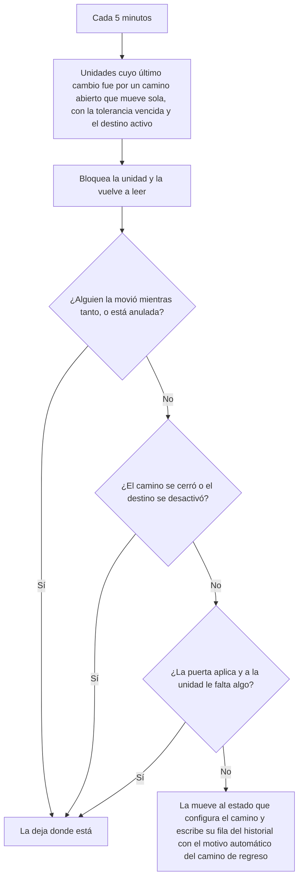

# Contexto `fleet` — ERP Millennium Mobility

**Fuente:** el diccionario de datos (§2.5 a §2.7, §5.6, §7.5, §8.1 a §8.6, §11, §12, §13.1 y las decisiones de §14 que nombra cada regla), el [mapa de contextos](../mapa-de-contextos-millennium-mobility.md), las [convenciones de la API](../convenciones-de-la-api-millennium-mobility.md), [procesos y pantallas](../procesos-y-pantallas-millennium-mobility.md) (P6 a P9 y el apartado 3), la [especificación de las tolerancias de los caminos](../especificacion-tolerancias-de-los-caminos-2026-11-09.md), los [patrones de persistencia](../patrones-de-persistencia-millennium-mobility.md) y el código. Si este documento y el diccionario no coinciden, manda el diccionario.

**Cómo leerlo.** Las rutas, los códigos de error con su orden y su `context`, y las exportaciones están en las convenciones (§2.2, §7.2 y §8.1); las pantallas, en procesos y pantallas y en el `DESIGN.md` del frontend; el orden de los candados, en los patrones de persistencia. Lo marcado **(propuesta)** no lo decide nadie todavía: las propuestas para el diccionario están juntas en la sección 6 b, y las decide el responsable.

---

## 1. Qué es y qué no es

`fleet` responde qué unidades tiene cada empresa, en qué estado de su ciclo de vida está cada una, por qué llegó a él, cuánto tiempo se tolera que siga ahí, cuánto marca su odómetro y qué le falta para poder entregarse. Es el centro del modelo (§8): las compras, la habilitación, los fondos y, más adelante, los contratos cuelgan del vehículo. Usa a `organization`, `vehiclecatalog`, `equipment`, `iam`, `location` y `documents` por sus fachadas, y `procurement`, `financing` y `reporting` lo usan por la suya (sección 5).

**Las tablas que posee** (diccionario §8, §11 y §12). Las columnas están en el diccionario; las que el código agregó y el diccionario todavía no tiene están en la sección 6 b.

| Tabla | Qué guarda | Diccionario |
|---|---|---|
| `vehicle_statuses` | Los doce estados del ciclo de vida, cada uno con su familia, si genera ingresos, si es el inicial, si exige la habilitación completa para entrar, si exige los equipos de seguridad y si congela el equipamiento | §8.2 |
| `status_change_reasons` | Los caminos permitidos entre estados, cada uno con su motivo, su tolerancia, qué pasa al vencerse y el permiso que exige | §8.3, §8.6, D-100 |
| `vehicles` | Las unidades: empresa, marca comercial, modelo, color, VIN, número de motor, placa, año, ubicación y estado actual; los hitos de la habilitación; el número del Excel de la carga inicial; la anulación y el traspaso | §8.1, §11.1 |
| `vehicle_status_history` | Cada cambio de estado de cada unidad: de dónde, a dónde, por qué camino, quién, cuándo, hasta cuándo se tolera y si se confirmó la revisión física | §8.4 |
| `vehicle_mileage_readings` | Las lecturas del odómetro, con su momento, su origen, quién la registró y, si se escribió de más, su anulación (D-267) | §8.5 |
| `vehicle_document_types` | Los tipos de documento del vehículo, por país | §11.2 |
| `vehicle_documents` | Los documentos de cada unidad: el vigente de cada tipo y los anteriores | §11.3 |
| `vehicle_equipments` | Las instalaciones de equipamiento de cada unidad, con su período, quién instaló, su costo y el equipo del inventario que puso en la unidad (D-263) | §11.4 |
| `vehicle_equipment_requirements` | Qué equipo exige la habilitación y cuál es de seguridad, por tipo de equipo (FLT-R148) | §11.4 |
| `vehicle_keys` | Las llaves de cada unidad | §11.5 |
| `vehicle_tax_declarations` | Las declaraciones del impuesto vehicular que trae el archivo del SAT | §11.7 |

**Los doce estados** (los trae la semilla; su código no cambia, FLT-R14):

| Código | Nombre | Familia | Genera ingresos | Exige la habilitación para entrar |
|---|---|---|---|---|
| `HABILITACION` | En habilitación | comercial | No | No: es el estado inicial, y el inicial nunca la exige |
| `DISPONIBLE` | Disponible | comercial | No | Sí, siempre (D-170) |
| `CONTRATO_FIRMADO` | Contrato firmado | comercial | No | Sí en la semilla; se puede desmarcar (D-184) |
| `ACTIVO` | Activo | productivo | Sí | No |
| `MECANICA` | Mecánica | recuperación | No | No |
| `SINIESTRO` | Siniestro | recuperación | No | No |
| `CUSTODIA` | Custodia | recuperación | No | No |
| `PAP` | Puesta a punto | recuperación | No | No |
| `ROBADO` | Robado | terminal | No | No |
| `PERDIDA_TOTAL` | Pérdida total | terminal | No | No |
| `EN_TRASPASO` | En traspaso | terminal | No | No |
| `INACTIVO` | Inactivo | terminal | No | No |

La semilla marca además Contrato firmado y Activo con `requires_security_equipment`, y Robado con `blocks_equipment_changes` (D-260; FLT-R150, FLT-R151).

Las reglas leen algunos estados por su código: `ACTIVO` es la entrega (§11.9), `PAP` cierra la entrega (D-216), `CONTRATO_FIRMADO` es el único que regresa solo a un estado con puerta (FLT-R57), `DISPONIBLE` no se desmarca (FLT-R55) y, con `HABILITACION`, es el camino de una unidad que pierde un requisito (FLT-R149), y `EN_TRASPASO` e `INACTIVO` son la salida de la flota (FLT-R142, FLT-R143).

**Lo que parece suyo y no lo es**

| Parece de `fleet` | Es de | Por qué |
|---|---|---|
| El costo de la unidad: valor de factura, notas de crédito, valor del vehículo y costo sin IGV | `procurement`, que lo calcula y lo sirve en `GET /vehicles/{id}/purchase-cost`, con `stock.ver_costos` (D-203, D-280); a `fleet` solo le pregunta qué unidad ve la sesión y si lee sus costos (`fetchSeenUnit`) | La unidad no conoce facturas (mapa §6.1). El recurso de la unidad nunca trae montos (FLT-R97) |
| El estado de pago de la unidad, los montos de su pago, la inicial congelada, lo pendiente, lo que pasó a saldo y en qué pagos se usó cada nota | `procurement`, que los calcula: el estado y la fecha base, sin montos, se los responde a `fleet` por `UnitPurchases`, y los montos los sirve en el costo de compra, con `stock.ver_costos`; `fleet` muestra el estado sin montos con `stock.ver` y cuenta la brecha de días (D-199, D-212, D-248, D-249, D-280) | La unidad no conoce pagos (mapa §6.1). La brecha no se guarda: se recalcula en cada lectura (FLT-R131) |
| El proveedor de la unidad | `procurement` | Es un dato de la compra, no de la unidad (§8, introducción) |
| Una columna con el kilometraje de la unidad | Nadie: no existe | El kilometraje de la unidad es su última lectura (D-165, FLT-R31) |
| Quién corrigió una placa, un VIN, un hito o el costo de una instalación, y por qué | `audit` (`change_logs`, §13.1; D-262) | `fleet` escribe la fila en la misma transacción que el cambio (FLT-R03, FLT-R90) |
| El registro de las cargas de archivos y la pantalla Herramientas › Cargas de archivos | `imports` (D-200, D-262) | Cada carga de `fleet` registra su lote por `imports::acl`; la carga inicial la orquesta `procurement` (F13 y F15) |
| Los fondos, las cesiones de las unidades a ellos y la carga de la lista de garantía mobiliaria | `financing` (§12; D-279) | `financing` lee y bloquea la unidad por la fachada de `fleet`, con el candado de toda escritura de la unidad (FLT-R84), y `fleet` pregunta por su puerto `UnitFundAssignments` si una unidad tiene una cesión abierta (FLT-R54) y si la sesión puede cederla. Ver [financing.md](financing.md) |
| El número que la unidad tenía en el Excel | `fleet`, solo por la carga inicial (D-18) | La API no lo recibe ni lo genera (FLT-R11, FLT-R125) |
| Los indicadores de la flota y el Excel de stock | `reporting` (D-232) | Los arma la capa de lectura con lo que `fleet` le responde por su fachada, sin reescribir sus reglas (sección 5) |
| La marca del vehículo (Chevrolet, TVS), el modelo y el color | `vehiclecatalog` (§7) | La unidad apunta a ellos; no los modifica |
| El tipo de equipamiento, su marca, su modelo y el inventario de los equipos físicos de cada empresa | `equipment` (§7.5, §11.4; D-254, D-278) | La instalación apunta al tipo de equipamiento. El inventario era de `fleet` hasta la fase 2 del plan de migración, y desde la fase 4 del plan del ciclo del GPS la instalación nombra el equipo del inventario que puso en la unidad, que `equipment` bloquea, instala y libera por su fachada (FLT-R152) |
| Si un equipo aplica a una unidad y si su modelo lo trae de fábrica | `equipment` (VCT-R28), con el tipo de vehículo y la pantalla de fábrica del modelo, que son de `vehiclecatalog` | `fleet` decide, con su configuración, qué de eso se exige y qué es de seguridad (FLT-R148) |
| La empresa, la marca comercial (Lizzo, Lima Bikes), la ubicación y el colaborador que instaló un equipo | `organization` (§6) | Ídem |
| El país de un tipo de documento y la moneda del costo de un equipo | `location` | Ídem |
| El nombre de quien cambió un estado, registró una lectura o cargó un documento | `iam` y `organization` | `iam` entrega el identificador público de la cuenta y el nombre de su colaborador (mapa, decisión 6) |

**Palabras con un significado preciso aquí**

| Palabra | Significa | No confundir con |
|---|---|---|
| Unidad | Un vehículo físico de una empresa, identificado por su VIN | La línea de factura con ese VIN, que es de `procurement` (mapa §1) |
| Estado | En qué punto del ciclo de vida está la unidad. Cada estado es de una familia (comercial, productivo, recuperación o terminal) y dice si la unidad genera ingresos en él (§8.2) | Que un estado esté activo en el catálogo, que solo dice si se sigue ofreciendo; y el estado de habilitación, que se calcula |
| Estado inicial | Donde nace toda unidad registrada: En habilitación. Hay uno solo | — |
| Camino | Un paso permitido de un estado a otro, por un motivo. Solo existen los caminos cargados (D-19); lo demás se rechaza | — |
| Motivo | Por qué se recorre un camino: Firma de contrato, Choque, Morosidad. Cada motivo es un camino propio: Mantenimiento preventivo y Falla van de Activo a Mecánica con tolerancias distintas (§8.3) | — |
| Camino de alta | El que no parte de ningún estado: el motivo con que nace una unidad, Registro de compra. Los tres de «Migración inicial» los recorre solo la carga inicial (FLT-R120) | — |
| Cerrar un camino | Desactivar su motivo. El historial que lo nombra se conserva | Borrarlo, que no existe |
| Tolerancia | Cuántas horas se acepta que la unidad siga en el estado por ese motivo. Vacía, ese caso no se mide (§8.3) | Un plazo del contrato |
| Vence, vencida | El momento en que se acaba la tolerancia de un cambio, que se calcula y se guarda al registrarlo (§8.4); vencida es la unidad cuya tolerancia del último cambio ya pasó | — |
| Avisar, al vencerse | La unidad aparece entre las vencidas del Inventario y en los indicadores de Reportes. No se envía ningún aviso aparte | — |
| Mover sola, al vencerse | El sistema mueve la unidad a otro estado y firma como `SYSTEM`: una unidad en Contrato firmado vuelve a Disponible a las 48 horas. Es la única transición que ocurre sola (§8.3) | — |
| Motivo automático | El motivo reservado con que el sistema registra un regreso automático, «Regreso automático por vencimiento» (`REGRESO_AUTOMATICO`), del camino que va del destino al estado configurado. Lo crea el sistema; nadie lo elige ni lo edita (§8.3, D-110) | El motivo del camino que venció |
| Lectura | Lo que marcaba el odómetro en un momento, con su origen: GPS, taller, entrega, devolución o manual (§8.5). Las de GPS las trae el dispositivo, sin autor; una persona registra las demás | El kilometraje de la unidad, que es su última lectura |
| Sustitución de odómetro | La primera lectura de un tablero nuevo. Es el único hecho que admite una lectura menor que la anterior (§8.5) | Corregir una lectura, que no existe: una lectura no se edita |
| Alta | Registrar una unidad: nace en el estado inicial por el camino de alta (§8.3) | — |
| Ubicación | El lugar físico donde está la unidad (§6.5). Vacía mientras no ha ingresado | La geografía de `location` |
| Ingreso | El hito de la llegada física de la unidad a una ubicación de la empresa, que fija esa ubicación (§11.1, D-165). Antes de él la unidad está «Fuera de tienda» | El alta, que la registra antes de que llegue |
| Estado de habilitación | Lo que le falta a una unidad para entregarse, calculado en cada lectura en seis filas (§11.9; F8 a F12). Nunca se guarda | El estado del ciclo de vida |
| Puerta | La exigencia de la habilitación completa para entrar a un estado que la exige: Disponible y, en la semilla, Contrato firmado (D-164, D-170) | El permiso del camino, que se revisa antes |
| Equipo exigido | El que la unidad tiene que tener instalado para pasar a Disponible: aplica a su tipo de vehículo, la configuración de `fleet` lo exige y su modelo no lo trae de fábrica. Hoy, el GPS y la pantalla (FLT-R148) | Un equipo que solo aplica, que se instala sin que se exija |
| Equipo de seguridad | El que permite vigilar la unidad, cortarle el motor y recuperarla, que la configuración marca como tal. Hoy, el GPS. Entrar a mano a Contrato firmado o a Activo lo exige instalado (FLT-R150) | Un equipo exigido, que dice si la unidad se puede ofrecer |
| Camino retenido | Un camino que la sesión podría recorrer y que espera algo de la unidad: la habilitación completa o el traspaso registrado. Se ofrece deshabilitado, con lo que falta | Un camino que la sesión no puede recorrer, que no se ofrece |
| Placas físicas | Las placas recibidas e instaladas, que exigen la placa registrada (FLT-R66) | La placa, el número registrado |
| En traspaso | El tiempo en que la notaría inscribe el traspaso de una unidad que salió de la flota (D-239). Sigue siendo de la empresa hasta que se registra su traspaso | Inactivo, que dice que ya no es de la empresa |
| Anular | Dar de baja una unidad que no debió existir: su valor es cero, no tiene ni tuvo contratos y no tiene una cesión abierta (D-104, D-250). Después no admite ninguna escritura | Traspasar, que es la salida de una unidad que sí existió |

---

## 2. Ciclo de vida de cada agregado

Nada de `fleet` se borra: ni las unidades, ni los estados, ni los caminos, ni el historial, ni las lecturas, ni los documentos, los equipos, las llaves o las declaraciones. La API no tiene `DELETE` (convenciones §3.1) y la cuenta de la aplicación no puede borrar (FLT-R09).

### Unidad

| Momento | Qué pasa |
|---|---|
| Alta | La registra quien tiene `stock.crear_vehiculo` (F1); nace también con la factura de compra que la trae (D-153; sección 5) o con la carga inicial (F15). Lleva su empresa, su marca comercial, su modelo, su color, su VIN y su año; el número de motor y la ubicación son opcionales, y nace sin placa (FLT-R02). Nace en el estado inicial por el camino de alta, firmada por quien la registró (FLT-R12), con su modelo, la marca y el tipo de este, activos (FLT-R07); desde entonces `vehiclecatalog`, que se lo pregunta a `fleet`, encuentra el modelo con unidades (FLT-R44) |
| Qué cambia | Con `stock.editar_vehiculo`: el color, el número de motor, el año —salvo con una línea de factura vigente (FLT-R50)—, la marca comercial y la ubicación (F2). El estado, por un camino y con su permiso (F3). El kilometraje, con cada lectura (F5). Los hitos, los documentos, el equipamiento y las llaves, con los permisos de la habilitación (F9, F10). El VIN y la placa se corrigen con `stock.corregir_vin` y `stock.corregir_placa` y su motivo, y la placa solo si ya tiene una (FLT-R03). El traspaso se registra y se corrige con `stock.recuperar` (FLT-R138) |
| Qué queda fijo | La empresa, su país y el modelo, desde el alta; con el modelo, el tipo de vehículo (FLT-R08) |
| Retiro | La unidad que no debió existir se anula, por acción explícita o por la nota de crédito que la devuelve (FLT-R48, FLT-R94). La que sale de la flota pasa por En traspaso, y a Inactivo solo con su traspaso registrado (FLT-R142, FLT-R144). La que tuvo contrato y el proveedor se llevó sale de Puesta a punto a Inactivo por «Devolución al proveedor», solo si una nota vigente la devolvió (FLT-R155). Ninguna se anula ni pasa a Inactivo con equipos del inventario instalados: se retiran antes (FLT-R154) |
| Nunca | Se borra (FLT-R09); cambia de empresa; contradice el tipo de vehículo de su modelo; recibe un número del Excel por la API (FLT-R11); recibe una escritura después de anulada (FLT-R49) |

### Estado del vehículo

| Momento | Qué pasa |
|---|---|
| Alta | Lo crea el superadministrador, con `catalogos.crear_estados` (FLT-R27). La semilla trae los doce de la sección 1. Un estado nuevo nace sin exigir la habilitación ni los equipos de seguridad y sin congelar el equipamiento; las tres marcas se ponen al editarlo (FLT-R55, FLT-R150, FLT-R151) |
| Qué cambia | Con `catalogos.editar_estados`: el nombre, la familia, si genera ingresos, si es el inicial (FLT-R13), si exige la habilitación (FLT-R55), si exige los equipos de seguridad (FLT-R150) y si congela el equipamiento (FLT-R151) |
| Qué queda fijo | El código, desde el alta (FLT-R14) |
| Retiro | Se desactiva y se puede reactivar: las unidades que ya están en él se quedan y ninguna entra nueva (FLT-R15). No se desactivan el estado inicial ni el estado al que un camino abierto mueve unidades solas (FLT-R16), ni En habilitación mientras «Pierde un requisito» llegue a él (FLT-R93), ni En traspaso e Inactivo (FLT-R143) |
| Nunca | Se borra (FLT-R25); hay dos estados iniciales, aunque uno esté desactivado (FLT-R13); el inicial exige la habilitación o los equipos de seguridad (FLT-R55, FLT-R150) |

### Camino (motivo)

| Momento | Qué pasa |
|---|---|
| Alta | Lo crea el superadministrador desde un estado de origen, o como camino de alta, sin origen, hacia el estado inicial (FLT-R42). Nombra el permiso que exige; un camino de alta no nombra ninguno (FLT-R19). La semilla trae los caminos de F3. Al guardar un camino que mueve sola la unidad, el sistema asegura en la misma operación el motivo automático del camino de regreso (FLT-R43). El código de los caminos «Migración inicial» es reservado (FLT-R120), y el de «Pierde un requisito», fuera de su camino (FLT-R93) |
| Qué cambia | El nombre, la tolerancia, qué hacer al vencerse y a qué estado mover la unidad (FLT-R22), y el permiso. El motivo automático no se edita ni se cierra (FLT-R43) |
| Qué queda fijo | El origen, el destino y el código: son el camino (FLT-R20) |
| Retiro | Se cierra, desactivando su motivo; desactivar todos los motivos de un par cierra el paso entre esos dos estados (§8.3, FLT-R25). «Pierde un requisito» no se cierra (FLT-R93). Se reabre, salvo que haya ya otro camino de alta abierto hacia el mismo estado (FLT-R21), que sea un camino de alta hacia un estado que ya no es el inicial (FLT-R42), o que mueva unidades solas a un estado desactivado (FLT-R16), a un estado con puerta desde otro estado que Contrato firmado (FLT-R57) o a un estado que exige los equipos de seguridad, desde cualquiera (FLT-R150) |
| Nunca | Se borra; lleva a su propio estado de origen (FLT-R20) |

### Fila del historial

| Momento | Qué pasa |
|---|---|
| Alta | La escribe el sistema con cada cambio, en la misma operación que el estado actual de la unidad: el alta, cada cambio que hace una persona, cada regreso automático, este con el motivo automático de su camino (FLT-R18, FLT-R24), y el paso de una unidad de Disponible que pierde un requisito, firmado por quien escribió y con el requisito en su detalle (FLT-R149) |
| Qué guarda | De qué estado a cuál, por qué camino, quién, cuándo, cuándo vence la tolerancia (FLT-R23), un detalle opcional de hasta 2 000 caracteres, si se confirmó la revisión física al salir de Puesta a punto (FLT-R134) y la empresa de la unidad (FLT-R45) |
| Qué cambia | Nada. Un error se corrige con un cambio nuevo (FLT-R26) |
| Nunca | Se edita ni se borra (FLT-R26) |

### Lectura de kilometraje

| Momento | Qué pasa |
|---|---|
| Alta | La registra quien tiene `stock.registrar_kilometraje`; una sustitución de odómetro, que es una lectura marcada, quien tiene `stock.registrar_sustitucion_odometro` (FLT-R30). Lleva los kilómetros, el momento de la lectura, que no puede ser futuro, el origen —taller, entrega, devolución o manual— y un detalle opcional, y la empresa de la unidad (FLT-R45). Las de GPS las trae el dispositivo, sin autor (FLT-R32); esa integración no existe todavía (sección 6 c) |
| Qué cambia | Solo su anulación, una vez: quién la anuló, cuándo y por qué (FLT-R156). Lo que marcó, su momento y su origen quedan como se escribieron |
| Retiro | Una lectura escrita de más se anula con su motivo, por quien tiene `stock.anular_lectura_kilometraje` donde está la unidad: sigue en la lista, tachada, y sale de la serie y del kilometraje de la unidad (FLT-R156) |
| Nunca | Se edita ni se borra (FLT-R26); entra menor que la lectura anterior sin ser una sustitución, ni mayor que la siguiente (FLT-R28, FLT-R29); se anula dejando la lectura siguiente por debajo de la anterior (FLT-R156) |

### Fondo y cesión de una unidad a un fondo

Son del contexto `financing` desde la fase 4 del plan de migración (D-279): su ciclo de vida y sus reglas están en [financing.md](financing.md). `fleet` le da la unidad y su candado por su fachada, y su anulación pregunta por el puerto `UnitFundAssignments` si la unidad tiene una cesión abierta (FLT-R54).

### Equipo del inventario de equipamiento

Es del contexto `equipment` desde la fase 2 del plan de migración (D-278): su ciclo de vida y sus reglas están en [equipment.md](equipment.md). `fleet` lo pasa a Instalado y lo saca de ahí, por la fachada de `equipment` y en la transacción de la instalación (FLT-R152, FLT-R153), y sirve en qué unidades estuvo (FLT-R159).

### Requisito de equipamiento

Lo que la configuración de `fleet` dice de un tipo de equipo del catálogo de equipos: si se exige para pasar a Disponible y si es de seguridad (§11.4, D-260; FLT-R148). Es un catálogo general, sin empresa.

| Momento | Qué pasa |
|---|---|
| Alta | La primera marca de un tipo crea su fila, con `catalogos.editar_tipos_documento`, en Catálogos › Requisitos de equipos (F8); la semilla trae las del GPS y la pantalla (FLT-R148). Un tipo sin fila no se exige ni es de seguridad: el catálogo de equipos no escribe aquí, así que un tipo nuevo nace sin requisito |
| Qué cambia | Las dos marcas, con el `updatedAt` que se leyó |
| Qué queda fijo | El tipo de equipo de la fila |
| Retiro | No tiene: se desmarca. Un tipo que el catálogo de equipos desactiva conserva su fila y deja de exigirse, porque ya no aplica a ninguna unidad (VCT-R28, en [equipment.md](equipment.md)) |
| Nunca | Se borra; hay dos filas de un mismo tipo; marcarla mueve las unidades que ya están en Disponible: la puerta se aplica al entrar (FLT-R91) |

---

## 3. Flujos funcionales

En cada flujo, «el sistema revisa» es lo que el backend comprueba, en ese orden. Toda ruta exige un permiso del catálogo (§5.6, D-95), y el servicio decide dónde actúa con la asignación que lo trae (D-99): una unidad que la cuenta no ve con `stock.ver` no existe para ella (`404`), y una que ve pero sobre la que su permiso no actúa responde `403`. El stock se ve en toda la empresa (D-14); un rol de sede actúa solo sobre las unidades de la ubicación propia de su sede (D-101), y una asignación limitada a una marca, solo sobre las de esa marca (D-102) (FLT-R33 a FLT-R35). Escribir exige leer. Una unidad anulada no admite ninguna escritura (FLT-R49). La ficha y la habilitación de la unidad dicen qué puede hacer la sesión en ella, y la pantalla ofrece solo eso; el backend lo vuelve a revisar en cada operación (FLT-R36, FLT-R87).

**Las pantallas** están en procesos y pantallas: Flota › Inventario y la ficha de cada unidad, Flota › Habilitación y la habilitación de cada unidad, Catálogos › Estados y motivos, Catálogos › Tipos de documento y Catálogos › Requisitos de equipos. Cada una se abre por el permiso que usa (procesos, apartado 3.1): las de Flota, con `stock.ver`; cada uno de los tres catálogos, con `catalogos.ver` y alguna escritura de esa pantalla, porque Catálogos se muestra a quien lo escribe (D-141). Finanzas › Fondos es de `financing` ([financing.md](financing.md)).

**Los candados.** El orden de los candados de la habilitación, del cambio de estado, de la anulación y de las cargas está en los [patrones de persistencia](../patrones-de-persistencia-millennium-mobility.md).

### F1 · Registrar una unidad

**Quién:** `stock.crear_vehiculo` (en la semilla, superadministrador, administrador de empresa y Operaciones), en Flota › Inventario (`POST /vehicles`). Una unidad también nace con la factura de compra que la trae (sección 5) o con la carga inicial (F15).

1. Elige la empresa, la marca comercial, el modelo, el color y, si ya ingresó, la ubicación; escribe el VIN, el año del modelo y el número de motor, opcional. No da la placa: el primer registro de la placa es un hito de la habilitación (FLT-R02; F10).
2. El sistema revisa, en orden: que la empresa exista y la cuenta la alcance; que la marca comercial sea de esa empresa y esté activa, y la empresa también (FLT-R06, FLT-R07); que la ubicación, si la da, sea de la empresa y esté activa; que `stock.crear_vehiculo` actúe en esa empresa, en esa marca y, si la ubicación es la propia de una sede, en esa sede (FLT-R34, FLT-R35); que el modelo y el color estén activos, y también la marca y el tipo del modelo (FLT-R07); la forma del VIN y que ninguna unidad de ninguna empresa lo tenga, con una consulta que solo responde sí o no (FLT-R01); y que haya un estado inicial con un camino de alta abierto hacia él (FLT-R12).
3. Escribe la unidad y su primera fila del historial. Desde entonces el tipo de su modelo queda fijo: `vehiclecatalog` se lo pregunta a `fleet`, y un alta que falla no deja ninguna unidad que contar (FLT-R44).

**Si falla:** un VIN repetido responde `409 VEHICLE_VIN_CONFLICT`; una referencia inactiva, inexistente o de otra empresa, su `404` o `422`; sin estado inicial o sin camino de alta, `422 VEHICLESTATUS_INITIAL_MISSING` o `STATUSCHANGEREASON_REGISTRATION_MISSING`.
**Resultado:** la unidad queda En habilitación, sin placa y Fuera de tienda, y su historial empieza con «Registro de compra», firmado por quien la registró.

### F2 · Editar los datos generales de una unidad

**Quién:** `stock.editar_vehiculo` (en la semilla, superadministrador, administrador de empresa y Operaciones), donde actúa su asignación, desde la ficha de la unidad (`PUT /vehicles/{id}`).

1. Cambia el color, el número de motor, el año, la marca comercial o la ubicación. La empresa y el modelo no cambian (FLT-R08); el VIN y la placa tienen su propia corrección, con motivo (FLT-R03).
2. Lo que la unidad ya tenía y se desactivó después se conserva; lo nuevo tiene que ser de la empresa y estar activo (FLT-R07).
3. El sistema revisa: que la cuenta vea la unidad; que el permiso actúe donde la unidad está y, si cambia la marca o la ubicación, también donde termina: un rol de sede no manda una unidad a otra sede, a un tercero ni a ninguna ubicación, y nadie la pasa a una marca sobre la que no actúa (FLT-R34); que no esté anulada (FLT-R49); y, bajo el candado de la unidad, que el año no cambie si tiene una línea de factura vigente (FLT-R50) y que una unidad que ya ingresó no quede sin ubicación (FLT-R63).

**Si falla:** `403 ACCESS_DENIED`; `422 VEHICLE_MODEL_YEAR_LOCKED`, `VEHICLE_ARRIVED_WITHOUT_LOCATION` o `VEHICLE_ANNULLED`; y los de las referencias de F1.

### F3 · Mover la unidad por un camino

**Quién:** quien tenga el permiso del camino, desde la ficha de la unidad (`POST /vehicles/{id}/status-changes`).

**Los caminos.** Los siembra el sistema, con el permiso de §5.6 (D-100, D-221). Hay 47 abiertos. Sus tolerancias son las propuestas de la [especificación de las tolerancias](../especificacion-tolerancias-de-los-caminos-2026-11-09.md), que el responsable aceptó todas (D-240) y que fijó V144 (FLT-R158): la tabla las dice. Inactivo no tiene salida.

| Camino | Motivos | Tolerancia y al vencerse | Permiso |
|---|---|---|---|
| *(alta)* → En habilitación | Registro de compra | — | Ninguno: el alta pide `stock.crear_vehiculo` |
| *(alta, solo la carga inicial)* → En habilitación, Disponible y Activo | Migración inicial (FLT-R120) | — | Ninguno: la carga pide `stock.cargar_migracion_inicial` |
| En habilitación → Disponible | Habilitación completa | 720 h y avisar | `stock.habilitar` |
| Disponible → En habilitación | Pierde un requisito (FLT-R93); también lo recorre, sin pedir este permiso, la escritura que deja la unidad sin un requisito (FLT-R149) | 72 h y avisar | `stock.habilitar` |
| Disponible → Contrato firmado | Firma de contrato | 48 h; mover sola a Disponible | `stock.vender` |
| Contrato firmado → Disponible | Regreso automático por vencimiento | — | Solo el sistema (FLT-R43) |
| Contrato firmado → Activo | Entrega al cliente | — | `stock.entregar` (D-238) |
| Disponible → En traspaso | Venta directa | 720 h y avisar | `stock.recuperar` |
| Activo → Mecánica | Mantenimiento preventivo; Falla, Alerta de sistema, Kilometraje y Tiempo | 120 h y avisar en Falla; 72 h y avisar en los demás | `stock.atender_en_taller` |
| Activo → Siniestro | Choque; Accidente, Robo frustrado y Daños a terceros | 480 h y avisar en todos | `stock.atender_en_taller` |
| Activo → Custodia | Morosidad; Incautación, Comisaría, Depósito, Devolución voluntaria y Otros incumplimientos | 168 h y avisar en Comisaría y Devolución voluntaria; 720 h y avisar en los demás | `stock.recuperar` |
| Activo → Robado | Robo, Autorrobo y Fraude | 720 h y avisar | `stock.recuperar` |
| Activo → En traspaso | Contrato completado y Venta directa | 720 h y avisar | `stock.recuperar` |
| Mecánica → Activo | Mantenimiento finalizado | — | `stock.atender_en_taller` |
| Mecánica → Puesta a punto | No asumida | 168 h y avisar | `stock.atender_en_taller` |
| Siniestro → Activo | Reparación finalizada | — | `stock.atender_en_taller` |
| Siniestro → Puesta a punto | No asumida | 168 h y avisar | `stock.atender_en_taller` |
| Siniestro → Pérdida total | Pérdida total | 720 h y avisar | `stock.recuperar` |
| Custodia → Activo | Cliente regulariza | — | `stock.recuperar` |
| Custodia → Puesta a punto | Resolución de contrato | 168 h y avisar | `stock.recuperar` |
| Custodia → Robado | Robo, Autorrobo y Fraude | 720 h y avisar | `stock.recuperar` |
| Robado → Puesta a punto | Recuperado | 168 h y avisar | `stock.recuperar` |
| Robado → Inactivo | Baja definitiva | — | `stock.recuperar` |
| Pérdida total → Puesta a punto | Recupera valor | 168 h y avisar | `stock.recuperar` |
| Pérdida total → Inactivo | Baja definitiva | — | `stock.recuperar` |
| Puesta a punto → Disponible | Reacondicionada | 720 h y avisar | `stock.atender_en_taller` |
| Puesta a punto → Inactivo | Devolución al proveedor: solo la unidad que una nota de crédito vigente devolvió al proveedor (FLT-R155) | — | `stock.recuperar` |
| En traspaso → Inactivo | Traspaso inscrito | — | `stock.recuperar` |

Están cerrados, con su historial: Activo → Mecánica por «Choque» (el choque va a Siniestro, D-221) y las salidas directas a Inactivo por «Contrato completado» y «Venta directa», de Activo y de Disponible (la salida pasa por En traspaso, D-239). El diagrama está en procesos y pantallas, P7.

1. La ficha ofrece los caminos abiertos que salen del estado actual hacia un estado activo y que la sesión puede recorrer en esa unidad, nunca el motivo automático (FLT-R15, FLT-R17). Así, sobre la misma unidad Activo de su sede, el taller ve los caminos a Mecánica y a Siniestro y el asesor de ventas ninguno; sobre una Disponible, al revés. Muestra retenidos los caminos a un estado con puerta mientras a la unidad le falta algo, con lo que falta (F11); los caminos a un estado que exige los equipos de seguridad mientras le falta uno (FLT-R150); los de En traspaso a Inactivo mientras falta el traspaso (FLT-R142); y todos los que llevan a Inactivo mientras la unidad tiene equipos del inventario instalados (FLT-R154), salvo desde Robado, cuya baja definitiva se ofrece como cualquier camino y avisa que los retira (FLT-R161).
2. Elige el destino, el motivo, con su tolerancia, y un detalle opcional. Al salir de Puesta a punto hacia un estado con puerta, confirma la revisión física (FLT-R134).
3. El sistema revisa, en este orden, y la unidad misma se niega a moverse por un camino que no lo permite:
   1. la unidad, bloqueada y vista con `stock.ver`;
   2. el destino, que exista y esté activo (FLT-R15), y el motivo, que exista y esté abierto;
   3. el camino: que el motivo no sea automático, que lleve a ese destino y que salga del estado en que está la unidad; un cambio que no está declarado se rechaza, no se advierte (FLT-R17);
   4. el permiso del camino donde está la unidad (FLT-R19, FLT-R34);
   5. que la unidad no esté anulada (FLT-R49);
   6. la revisión física, al salir de Puesta a punto hacia un estado con puerta (FLT-R134);
   7. al ir a Inactivo, por cualquier camino —también «Devolución al proveedor» y el cierre del traspaso—, que la unidad no tenga equipos del inventario instalados (FLT-R154), salvo desde Robado, donde se bloquean sus instalaciones con equipo y sus equipos y se revisa que ninguna empezó ese día (FLT-R161); y el traspaso registrado, al salir de En traspaso hacia Inactivo: es una regla de la unidad, que cerrar o editar un camino no apaga (FLT-R142);
   8. la puerta: si el destino exige la habilitación, que a la unidad no le falte nada, leído después del candado (FLT-R56);
   9. los equipos de seguridad: si el destino los exige, que a la unidad no le falte instalado ninguno de los que le aplican, leído con los mismos hechos que la puerta (FLT-R150).
4. Escribe el estado de la unidad y su fila del historial en la misma operación, con el vencimiento calculado desde ese momento (FLT-R18, FLT-R23); de Robado a Inactivo, antes retira cada equipo del inventario, por robo (FLT-R161).

**Si falla:** responde el código del primer paso que falla (convenciones §7.2); el traspaso, la puerta y los equipos de seguridad dejan el destino retenido: la puerta con todo lo que falta (`422 VEHICLE_ENABLEMENT_INCOMPLETE`), los equipos de seguridad con los que faltan (`422 VEHICLE_SECURITY_EQUIPMENT_MISSING`). El paso a Inactivo con equipos del inventario instalados se rechaza nombrándolos (`422 VEHICLE_DEVICES_INSTALLED`, con `context.devices`) y deja el destino retenido (FLT-R154).
**Resultado:** el historial de estados muestra el cambio con su camino, su motivo, quién, cuándo, cuándo vence y, si la hubo, la revisión física.

### F4 · El regreso automático al vencer la tolerancia

**Quién:** un proceso programado, cada 5 minutos por omisión, contados desde el final de la corrida anterior, con alcance `SYSTEM` (sección 6 a). Corre en una sola instancia a la vez: si otra la tiene, salta la corrida, y la siguiente recoge lo que quede. Si pierde un interbloqueo, repite una vez la corrida entera (D-128; FLT-R24).

1. Una unidad en Contrato firmado hace más de 48 horas, que nadie movió desde la firma, vuelve a Disponible.
2. La fila dice Contrato firmado → Disponible, con el motivo automático de ese camino, firmada por `SYSTEM` y sin vencimiento, y la unidad también queda firmada por `SYSTEM` (D-42; FLT-R24, FLT-R43). Si el motivo falta, el proceso lo crea; si en ese camino una persona declaró un motivo con el código `REGRESO_AUTOMATICO`, deja la unidad donde está y lo registra en el log (sección 6 b, propuesta 13).
3. El proceso respeta el catálogo como una persona: un camino cerrado o un destino desactivado no mueve nada, tampoco si cambiaron mientras corría.
4. **La puerta** (FLT-R57). El regreso desde Contrato firmado no lee la habilitación mientras Contrato firmado la exija: esa marca sostuvo los requisitos de la unidad mientras esperaba (D-184), y el regreso deshace un contrato que no se entregó (D-164). Desmarcado, el proceso deja en Contrato firmado a la unidad a la que le falta algo (D-170). Cada unidad retenida se avisa en el log como advertencia solo en la primera corrida después del vencimiento.
5. **Los equipos de seguridad** no los revisa: el catálogo no deja que un camino que mueve sola la unidad lleve a un estado que los exige (FLT-R150).

**Resultado:** en el historial, la fila del regreso con `SYSTEM` como autor; la unidad deja de figurar entre las vencidas.

### F5 · Registrar una lectura y una sustitución de odómetro

**Quién:** `stock.registrar_kilometraje` (en la semilla, superadministrador, administrador de empresa, Operaciones, asesor de ventas y taller); para una sustitución, `stock.registrar_sustitucion_odometro` (superadministrador, administrador de empresa y taller) (FLT-R30). Desde la ficha de la unidad (`POST /vehicles/{id}/mileage-readings`).

1. Escribe los kilómetros y el momento de la lectura, que se propone ahora en la zona de la empresa (FLT-R41) y puede ser anterior —una lectura de taller puede cargarse días después (§8.5)—; el origen, entre los que registra una persona: taller, entrega, devolución o manual (FLT-R32); un detalle opcional; y, si se cambió el tablero, la marca de sustitución.
2. El sistema revisa: que la cuenta vea la unidad; que la lectura no sea futura; que su origen no sea GPS; que el permiso —el de la lectura o el de la sustitución— actúe donde está la unidad; que no sea menor que la lectura más cercana tomada en ese momento o antes, salvo que sea una sustitución (FLT-R28); y que no sea mayor que la más cercana tomada después, tampoco si es una sustitución, salvo que esa siguiente sea una sustitución: un tablero nuevo no acota lo que se leyó en el anterior (FLT-R29).

**Si falla:** `422 MILEAGE_BELOW_PREVIOUS` o `MILEAGE_ABOVE_NEXT`, con la lectura vecina; `MILEAGE_READ_AT_IN_FUTURE`; `MILEAGE_SOURCE_NOT_ALLOWED`; `403 ACCESS_DENIED`.
**Resultado:** el kilometraje de la unidad es el de su lectura más reciente por momento: una lectura cargada tarde, entre otras dos, no lo cambia (FLT-R31).

**Anular una lectura escrita de más** (FLT-R156). Quien tiene `stock.anular_lectura_kilometraje` donde está la unidad (en la semilla, superadministrador y administrador de empresa) la anula desde el menú de su fila, con su motivo (`POST /mileage-readings/{id}/annulment`). La lectura sigue en la lista, tachada, con quién la anuló, cuándo y por qué; sale de la serie y del kilometraje de la unidad, y su fila queda en la bitácora. Se rechaza ya anulada (`422 MILEAGE_ALREADY_ANNULLED`), en una unidad anulada (`422 VEHICLE_ANNULLED`) y cuando, sin ella, la lectura siguiente quedaría por debajo de la anterior (`422 MILEAGE_ANNULMENT_BREAKS_SERIES`): solo una sustitución entre dos tableros puede estar ahí, y se corrige registrando primero la sustitución correcta y anulando después la equivocada.

### F6 · Mantener los estados y los caminos

**Quién:** el superadministrador, con `catalogos.crear_estados`, `editar_estados` o `desactivar_estados` (FLT-R27), en Catálogos › Estados y motivos. Los caminos se leen por su origen, o los de alta (FLT-R46).

1. **Estado nuevo o editado:** código, nombre, familia, si genera ingresos y si es el inicial; al editarlo, además, si exige la habilitación completa para entrar (FLT-R55), si exige los equipos de seguridad (FLT-R150) y si congela el equipamiento (FLT-R151).
2. **Camino nuevo**, desde el estado elegido o como camino de alta: destino, código y nombre del motivo, tolerancia en horas, qué hacer al vencerse —nada, avisar o mover la unidad sola, con el estado al que moverla— y el permiso, entre los permisos `stock` del catálogo (FLT-R19, FLT-R22).
3. **Desactivar o activar** un estado o un motivo; si era el último motivo de su camino, el camino se cierra. El historial se conserva (FLT-R25).

El sistema revisa: que el código del estado no se repita, y el del motivo no se repita en su camino (FLT-R14, FLT-R20); que el código `MIGRACION_INICIAL` no se use en un camino nuevo ni se cambie (FLT-R120), ni `PIERDE_REQUISITO` fuera del suyo, que no se cierra, y que En habilitación no se retire mientras ese camino llegue a él (FLT-R93); que haya un solo estado inicial, activo o no (FLT-R13); que no se desactive el inicial, ni el estado al que un camino abierto mueve unidades solas, ni En traspaso ni Inactivo (FLT-R16, FLT-R143); que un camino lleve a otro estado y que lo que pasa al vencerse tenga tolerancia y, si mueve la unidad, un estado distinto del destino y activo mientras el camino esté abierto (FLT-R16, FLT-R22); que el permiso exista en el catálogo; que un camino de alta no nombre permiso y lleve al estado inicial, también al reabrirlo (FLT-R19, FLT-R42); y que no haya dos caminos de alta abiertos hacia un mismo estado, tampoco si dos pedidos llegan a la vez (FLT-R21).

**La puerta no se apaga desde el catálogo** (FLT-R55, FLT-R57): un camino abierto que espera en otro estado que Contrato firmado no mueve solas las unidades a un estado que exige la habilitación —se revisa al crearlo, al editarlo abierto y al reabrirlo—; un estado no pasa a exigirla mientras un camino así lo tenga como destino; el estado inicial no la exige, ni un estado que la exige pasa a ser el inicial; y Disponible no se desmarca. Marcar un estado y guardar o reabrir un camino hacia él no se cruzan: el segundo pedido espera y ve lo que confirmó el primero.

**Los equipos de seguridad tampoco** (FLT-R150). A un estado que los exige se entra solo a mano, que los revisa (F3), así que el estado inicial no los exige ni un estado que los exige pasa a ser el inicial; un estado no pasa a exigirlos mientras un camino abierto mueva solas unidades a él; y un camino abierto que mueve solas las unidades no lleva a un estado que los exige —se revisa al crearlo, al editarlo abierto y al reabrirlo—. A diferencia de la puerta, no hay excepción para el regreso desde Contrato firmado: Disponible no los exige mientras «Firma de contrato» devuelva sola la unidad. Marcar un estado y guardar un camino hacia él no se cruzan, con los mismos candados que la puerta.

**Si falla:** responde el código de la regla, de la familia `VEHICLESTATUS_*`, `STATUSCHANGEREASON_*` o `PERMISSION_NOT_FOUND` (convenciones §7.2).
**Resultado:** el catálogo cambia para todas las empresas: los estados y los caminos son del sistema, no de cada empresa. Lo que ya está en el historial no cambia, y una tolerancia nueva vale para los movimientos siguientes (D-240).

### F7 · Consultar el inventario, las vencidas y la ficha de una unidad

**Quién:** los seis roles del sistema con `stock.ver`; el administrador de accesos no lo tiene (D-56). Flota › Inventario (`GET /vehicles`) y la ficha de la unidad (`GET /vehicles/{id}`).

1. **Buscar y filtrar.** Busca por parte del VIN, de la placa o del número de motor, sin distinguir mayúsculas ni tildes (D-142). Filtra por empresa, marca comercial, estado, motivo del último cambio y estado por el que pasó alguna vez (FLT-R137), solo vencidas —las unidades cuya tolerancia del último cambio ya pasó, digan lo que digan al vencerse (FLT-R23)—, factura vigente (FLT-R51), ubicación y modelo.
2. **La lista** nombra cada unidad por su VIN, porque toda unidad lo tiene y la placa llega al final de la habilitación, y marca la unidad sin factura vigente (FLT-R51) y la devuelta al proveedor (FLT-R98).
3. **La ficha** muestra los datos de la unidad, con su marca, su modelo y su color, activos o no (FLT-R145); su estado de pago y su brecha de días (FLT-R131); su estado de habilitación, que lleva a su página; su kilometraje (FLT-R31); su propietaria (FLT-R140); y quién la registró, por su nombre (FLT-R40), con las fechas en la zona del país de su empresa (FLT-R41). Debajo, su historial de estados y sus lecturas, de lo más nuevo a lo más viejo, y sus cesiones a fondos, que da `financing` ([financing.md](financing.md), F2).
4. **Exportar** el Inventario a Excel, con la búsqueda, los filtros y el orden de la pantalla (FLT-R47; convenciones §8.1).

El sistema revisa: la lista trae solo las unidades de las empresas donde `stock.ver` actúa y, dentro de cada una, las de las marcas de las asignaciones que lo traen; un rol de sede ve toda su empresa (FLT-R33, FLT-R35). Un filtro que nombra algo fuera del alcance o que no existe da una lista vacía, nunca una pista de lo que hay en otra parte.

**Compra y costo, y la unidad devuelta** (D-203, D-204, D-280). Quien tiene `stock.ver_costos` en la empresa y la marca de la unidad ve en la ficha su costo de compra, por su propia ruta, que sirve `procurement` y la ficha lee por `ProcurementFacade` (FLT-R97; [procurement.md](procurement.md)): la factura vigente, el valor de factura menos cada nota de crédito vigente, igual al valor del vehículo, y el costo sin IGV calculado sobre ese valor (NIC 2, párrafo 11), en la moneda de la factura y en la de la empresa; y, bajo cada nota, lo que pasó a saldo y en qué pagos se usó (FLT-R146). Sin línea vigente, su valor es cero. Una unidad que una nota con «anulación de unidad» devolvió y que no se pudo anular queda «Devuelta al proveedor», que se calcula y no se guarda: si tiene una cesión abierta, se cierra y se anula; si tuvo un contrato, no se anula (FLT-R98, FLT-R99, FLT-R48).

**El pago de la unidad** (D-199, D-212). Quien ve la unidad con `stock.ver` ve su estado de pago —Sin pago, Pago parcial, Pagada o Saldada— y su brecha de días, sin montos (FLT-R131, FLT-R132): de 50 motos pagadas en dos bloques de 25, cada bloque cuenta desde su propio pago. Sin línea de factura vigente, la ficha no muestra ninguno de los dos. Quien tiene `stock.ver_costos` ve además el pago como una resta, con la inicial del cliente congelada al saldar, y cada pago de su factura con lo que le tocó a la unidad (FLT-R146; PRC-R121 de [procurement.md](procurement.md)).

**El traspaso de la unidad** (D-223, D-239). Quien tiene `stock.recuperar` sobre una unidad no anulada en En traspaso o en Inactivo registra su traspaso (`PUT /vehicles/{id}/transfer`): la fecha, no posterior a hoy en la zona de la empresa; el motivo —fin de contrato, venta directa u otro—; y la nueva propietaria, como figura en el traspaso, un texto hasta que existan los clientes (FLT-R138, FLT-R141). Una corrección pide su justificación; un traspaso registrado se corrige, pero no se deshace. Desde la fecha de traspaso la unidad deja de ser de la empresa (FLT-R140), y sin traspaso su camino a Inactivo espera retenido (FLT-R142). **Si falla:** `422 VEHICLE_TRANSFER_NOT_ALLOWED` o `VEHICLE_TRANSFER_DATE_IN_FUTURE`.

**Anular una unidad** (D-104, D-182, D-250). Quien tiene `stock.anular_vehiculo` anula una unidad no anulada, de valor cero —sin línea de factura vigente, o con notas vigentes que la dejan en cero—, sin contratos, sin una cesión abierta y sin equipos del inventario instalados (`POST /vehicles/{id}/annulment`; FLT-R48, FLT-R54, FLT-R154). Tiene contratos la unidad que espera en Contrato firmado y la que entró alguna vez a Activo, aunque haya vuelto; no los tiene la que solo pasó por Contrato firmado y volvió sola a Disponible. No escribe en la bitácora, porque es una baja (§13.1). Desde entonces la unidad no admite ninguna escritura, el regreso automático la salta y la habilitación la deja fuera de sus listas (FLT-R49, FLT-R89). **Si falla:** `422 VEHICLE_VALUE_NOT_ZERO`, `VEHICLE_HAS_CONTRACTS`, `VEHICLE_FUND_ASSIGNMENT_OPEN` o, al final, `VEHICLE_DEVICES_INSTALLED`, que nombra los equipos.

### F8 a F12 · La habilitación

Lo que hay que completar para que una unidad pueda entregarse (§11): que ingrese físicamente a una ubicación, se inmatricule, tenga su placa y sus placas físicas, sus documentos vigentes, su equipamiento instalado y sus llaves registradas. El estado de habilitación lo dice, y la puerta lo exige al entrar a Disponible y a los demás estados marcados (D-164, D-170). Las reglas son FLT-R55 a FLT-R93, FLT-R148 a FLT-R154 y FLT-R159, y, por construir, FLT-R157.

**El estado de habilitación** (§11.9, D-171, D-183). Se calcula en cada lectura y nunca se guarda: cambia solo cuando cambia una condición —un documento, un equipo, un hito o el catálogo— (FLT-R58, FLT-R91). Responde la primera de estas seis filas que aplica:

| Orden | Si… | Código | Nombre | Detalle |
|---|---|---|---|---|
| 1 | la unidad no ingresó | `FUERA_DE_TIENDA` | Fuera de tienda | — |
| 2 | le falta el documento vigente de un tipo que bloquea y le aplica | `SIN_DOCUMENTO` | Sin documento vehicular | Los documentos que faltan |
| 3 | le falta instalado un equipo que exige su modelo | `SIN_EQUIPO` | Sin equipo | Los equipos que faltan |
| 4 | no tiene las placas físicas | `SIN_PLACAS` | Sin placas | — |
| 5 | su entrega no está vigente | `LISTO_PARA_ENTREGA` | Listo para entrega | — |
| 6 | su entrega está vigente | `ENTREGADO` | Entregado | — |

- **Lo que bloquea sale de los datos** (FLT-R60): los tipos de documento activos del país de la unidad que bloquean, salvo los que piden la conversión a gas cuando el modelo no es a GNV ni GLP (FLT-R70); y los equipos que aplican al tipo de vehículo de la unidad y que la configuración de `fleet` exige para Disponible, menos el que su modelo trae de fábrica: la pantalla de un modelo que la trae (FLT-R148, VCT-R28). Lo que se exige y lo que es de seguridad lo decide un solo lugar, `ModelRequirements`, que cruza lo que dice el catálogo con la configuración: la habilitación, su lista, la puerta, lo que retiene un estado y la carga inicial le preguntan a él. Marcar otro tipo como bloqueante —un documento en Tipos de documento, un equipo en Requisitos de equipamiento (F8)— lo suma a la fila 2 o a la 3 sin programar.
- **Un documento vigente cuenta aunque haya vencido** (D-188): el vencimiento se sigue en Vencimientos (F12).
- **La entrega es el paso a Activo**, vigente si la unidad no entró a Puesta a punto después, por el orden de su historial; su momento es el de la primera vez (FLT-R133).
- **El cuadro completo.** El estado lleva, además del código y el detalle de su fila, todo lo que falta, para que la puerta y la pantalla lo nombren de una vez. La unidad está completa cuando no aplica ninguna de las filas 1 a 4: Listo para entrega o Entregado (D-183). Así una unidad reacondicionada, que ya se entregó alguna vez, vuelve a Disponible por «Reacondicionada».
- **La lista dice lo mismo** que la política, para cada combinación de las seis filas, sin leer las tablas de otro contexto (FLT-R59).

**La puerta** (D-164, D-170, D-183; FLT-R56). Un cambio de estado a mano hacia un estado que exige la habilitación —Disponible y, mientras la tenga, Contrato firmado— exige que la unidad esté completa, por cualquier camino: «Habilitación completa», «Reacondicionada», «Firma de contrato». Las revisiones van en este orden: el camino, su permiso, la unidad anulada, la revisión física, el traspaso y, al final, la puerta (FLT-R142): a una unidad anulada se le dice que está anulada, y a quien no puede recorrer el camino, que no puede, antes de nombrarle lo que falta. La única exención es el regreso automático desde Contrato firmado mientras Contrato firmado tenga la marca (F4, FLT-R57). Las unidades que ya están en un estado con puerta se quedan donde están si un cambio del catálogo las deja incompletas: la puerta se aplica al entrar (FLT-R91).

**Lo que retiene el estado de la unidad** (D-184, D-260). Cada escritura del equipamiento y de los hitos lee, después del candado de la unidad, el estado en que está, y decide en este orden:
- **Robado no admite cambios de equipamiento** (FLT-R151): en un estado que congela el equipamiento —Robado en la semilla— no se instala, reemplaza ni retira ningún equipo (`422 VEHICLE_EQUIPMENT_CHANGES_BLOCKED_BY_STATUS`). Corregir el costo y completar el serial no son actos físicos y se permiten. La baja definitiva, de Robado a Inactivo, retira sola los equipos del inventario, por robo (FLT-R161).
- **La puerta se sostiene fuera de Disponible** (FLT-R85): en un estado con puerta que no es Disponible —Contrato firmado, mientras la tenga— se rechaza lo que dejaría a la unidad sin un requisito (`422 VEHICLE_ENABLEMENT_HELD_BY_STATUS`): retirar sin reemplazo un equipo abierto que la unidad exige, vaciar las placas físicas y vaciar el ingreso. Sin repuesto, la unidad espera el regreso automático y pierde el requisito ya en Disponible.
- **Una unidad con un cliente no se queda sin sus equipos de seguridad** (FLT-R150): en un estado que los exige —Contrato firmado y Activo en la semilla— un equipo de seguridad se reemplaza y no se retira sin reemplazo (`422 VEHICLE_SECURITY_EQUIPMENT_HELD_BY_STATUS`). Para retirarlo sin repuesto, la unidad sale antes de Activo —a Mecánica, a Siniestro o a Custodia— y ahí se registra.
- **En Disponible, perder un requisito se registra** (FLT-R149): retirar sin reemplazo un equipo que la unidad exige, vaciar las placas físicas o vaciar el ingreso se guarda, y en la misma operación la unidad pasa a En habilitación por «Pierde un requisito» (FLT-R93), con una fila del historial firmada por quien escribió que nombra el requisito. Lo autoriza el permiso de la escritura, no el del camino; y si el camino no está abierto o En habilitación está retirado, no se guarda nada (`422 VEHICLE_REQUIREMENT_LOSS_PATH_MISSING`). La unidad vuelve por «Habilitación completa» cuando está completa otra vez.

Reemplazar un equipo se permite en todos los estados salvo en el congelado, porque cierra uno y abre otro en la misma operación. Un documento no se retira, se reemplaza (FLT-R67), y el título no se vacía mientras la unidad tiene placa (FLT-R64). En un estado sin ninguna de esas marcas, el retiro de un GPS que falló se registra igual. Qué equipo es requisito y cuál es de seguridad lo dice la configuración de `fleet` (FLT-R148).

**La instalación y el inventario** (D-263, D-264, D-286; fase 4 del plan del ciclo del GPS). Instalar y reemplazar eligen un equipo Disponible del inventario, de la empresa de la unidad y del tipo, que `equipment` pasa a Instalado en la misma operación; la instalación abierta es la fuente de verdad de qué equipo está en qué unidad (FLT-R152). Desde la fase 5, un tipo del inventario —telemático y que el modelo no trae de fábrica, hoy el GPS— se instala y se reemplaza solo con su equipo, sin serial escrito; lo de fábrica y los demás tipos, como antes (FLT-R160). El motivo del retiro decide adónde vuelve el equipo, con un cuarto motivo, «Sin falla», para el equipo sano, en la ubicación de la unidad o en la que pide el retiro (FLT-R153). Una unidad con equipos del inventario instalados no se anula ni pasa a Inactivo, y al traspasarla al cliente el GPS se retira antes de cerrar el traspaso (FLT-R154). Los GPS ya instalados se enlazan a su equipo al arrancar la aplicación, y los que esperan su serial, al completarlo (FLT-R152); cada equipo muestra en qué unidades estuvo (FLT-R159). En Robado el GPS no se retira (FLT-R151), así que la baja definitiva de una unidad Robada, a Inactivo, retira ella misma sus equipos del inventario, por robo, en el mismo cambio (FLT-R161).

**La concurrencia** (FLT-R84). Toda escritura de la habilitación y el cambio de estado bloquean primero la unidad y leen lo que deciden después del candado: si una persona mueve la unidad a Disponible mientras otra retira su GPS, una espera a la otra, y ningún orden deja una unidad Disponible sin GPS: si el retiro confirma primero, el cambio se rechaza por la puerta; si el cambio confirma primero, el retiro lleva la unidad a En habilitación. Las ediciones del ingreso, de los hitos y de una llave llevan además el `updatedAt` que leyeron, y uno distinto responde `422 VEHICLE_OUTDATED` o `VEHICLEKEY_OUTDATED` sin guardar nada; las escrituras que se suman o se cierran —un documento, un equipo, la placa, el ingreso en lote— las serializa el candado, y su conflicto dice que otro llegó antes.

**Lo que la sesión puede hacer** (FLT-R86, FLT-R87). La habilitación de la unidad dice qué acciones aplican, con las mismas reglas que cada operación, y no repite los `422`: la pantalla explica con los datos del mismo recurso por qué una acción no aplica todavía. Ninguna se ofrece sobre una unidad anulada.

**La bitácora** (§13.1). Los hitos, el primer registro de la placa, la edición de una llave, el costo de una instalación y el serial completado de un GPS migrado dejan su fila (FLT-R90, FLT-R127); la corrección de una placa, además, su motivo (FLT-R03). Los documentos y las instalaciones no necesitan más filas: sus registros ya son su historia (§13.2).

### F8 · Mantener los tipos de documento del vehículo y los requisitos de equipamiento

**Quién:** el superadministrador, con `catalogos.crear_tipos_documento`, `editar_tipos_documento` y `desactivar_tipos_documento` (FLT-R73), en Catálogos › Tipos de documento, que se abre con `catalogos.ver` y alguno de esos tres permisos (D-141).

1. Crea un tipo con su país, su código, su nombre y si vence, si bloquea la disponibilidad, si lo ve el cliente y si es solo de unidades a gas (GNV o GLP) (D-139, D-166).
2. Lo edita sin cambiar el país: un tipo de otro país es otro tipo. El código queda fijo en `TIVE`, que leen las reglas, y en un tipo que un documento ya usa (FLT-R72).
3. Lo desactiva o lo activa: desactivado deja de pedirse y de bloquear a las unidades, y los documentos ya cargados se conservan.

La semilla de Perú trae cuatro tipos, todos visibles para el cliente: `TIVE` (Tarjeta de identificación vehicular; no vence, bloquea), `SOAT` (Seguro obligatorio; vence, no bloquea), `CERT_GAS` (Certificado de conversión a gas; vence, no bloquea, solo a gas) y `REV_TECNICA` (Revisión técnica; vence, no bloquea). Es un catálogo general, sin empresa. La lista se exporta (FLT-R72).

**Si falla:** `409 VEHICLEDOCUMENTTYPE_CONFLICT`, también en una carrera; `422 VEHICLEDOCUMENTTYPE_CODE_LOCKED`; `404 COUNTRY_NOT_FOUND`.

**Los requisitos de equipamiento** (D-260, FLT-R148): la otra mitad de los requisitos, qué equipo exige la habilitación y cuál es de seguridad. Los marca quien tiene `catalogos.editar_tipos_documento` —con la semilla, solo el superadministrador—, el mismo permiso que marca los documentos que bloquean, en Catálogos › Requisitos de equipos (`GET /vehicle-equipment-requirements`), que leen todos los que tienen `catalogos.ver`.

1. La lista trae cada tipo de equipo del catálogo, activo o no, por su código, con sus dos marcas: si se exige para pasar a Disponible y si es de seguridad. Un tipo sin fila sale con las dos en falso.
2. Marca o desmarca una de las dos (`PUT /vehicle-equipment-requirements/{equipmentTypeId}`), con el `updatedAt` que leyó, nulo si el tipo no tenía fila: la primera marca de un tipo crea su fila y las siguientes la corrigen. Ninguna se borra.
3. El sistema revisa que el tipo exista en el catálogo y, con la fila del tipo bloqueada, que siga como se leyó: dos marcas del mismo tipo se esperan, y la segunda ve lo que confirmó la primera.

La semilla trae el GPS con las dos marcas y la pantalla con la primera, lo mismo que se exigía antes. Marcar un equipo no mueve las unidades que ya están en Disponible: la puerta se aplica al entrar (FLT-R91).

**Si falla:** `422 VEHICLEEQUIPMENTREQUIREMENT_OUTDATED`, si la fila cambió desde que se leyó o si otra persona la creó mientras tanto; `404 EQUIPMENTTYPE_NOT_FOUND`.

### F9 · Registrar el ingreso de las unidades

**Quién:** `habilitacion.registrar_hitos` (en la semilla, superadministrador, administrador de empresa y Operaciones), en Flota › Habilitación.

1. Elige hasta 100 unidades Fuera de tienda de una empresa, la fecha —hoy en la zona de la empresa por omisión, nunca futura— y la ubicación, entre las activas de la empresa: el ingreso la fija (FLT-R62).
2. Guarda (`POST /vehicle-arrivals`), todas o ninguna. El sistema revisa, en este orden: el pedido, de 1 a 100 unidades distintas; las unidades, bloqueadas, que existan y se vean; que sean de una sola empresa; la ubicación, que se vea, sea de esa empresa y esté activa; que el permiso actúe sobre cada unidad donde está y en la ubicación de destino —un rol de sede no recibe una unidad sin ubicación, que es de los roles de empresa, ni la manda fuera de su sede—; ninguna anulada; ninguna ingresada; y la fecha no futura en la zona de la empresa (FLT-R62).
3. Una sola unidad se registra o se corrige desde su habilitación (`PUT /vehicles/{id}/arrival`): la fecha no queda después del inicio de un equipo de la unidad, y volver a «no ingresada» solo corrige un error, sin instalaciones; la ubicación queda como está (FLT-R63). En Contrato firmado el ingreso no se vacía (FLT-R85), y en Disponible vaciarlo lleva la unidad a En habilitación en la misma operación (FLT-R149). La API lo admite y la pantalla no lo ofrece.
4. Desde la ficha de una factura de compra no anulada se registra el ingreso de las unidades de sus líneas vigentes que no ingresaron, con el mismo permiso, por la fachada de `fleet` (sección 5).

**Si falla:** `422 VEHICLE_ALREADY_ARRIVED` —las unidades que ingresaron mientras tanto salen de la selección y se registran las demás—, `VEHICLE_ARRIVAL_COMPANY_MISMATCH`, `VEHICLE_MILESTONE_IN_FUTURE`, `VEHICLE_ARRIVAL_AFTER_INSTALLATION`, `VEHICLE_ARRIVAL_HAS_INSTALLATIONS`, `VEHICLE_ENABLEMENT_HELD_BY_STATUS`, `VEHICLE_REQUIREMENT_LOSS_PATH_MISSING` o `VEHICLE_OUTDATED`; `403` si el permiso no actúa donde está o adonde va la unidad.

### F10 · Completar la habilitación de una unidad

**Quién:** los permisos de cada escritura (FLT-R86): `habilitacion.registrar_hitos` y `habilitacion.gestionar_documentos` (superadministrador, administrador de empresa y Operaciones), `habilitacion.gestionar_equipos` y `habilitacion.gestionar_llaves` (además, el taller), donde está la unidad y en su marca. **Dónde:** la habilitación de la unidad, con `stock.ver` (`GET /vehicles/{id}/enablement`; FLT-R61), que trae la unidad, su estado actual y si exige la habilitación, su estado de habilitación, sus hitos, los documentos y los equipos que le aplican, su estado SAT (F13) y sus acciones.

1. **Los requisitos.** La página los lista como tareas, con lo cumplido y lo que falta; la primera que la sesión puede hacer es el siguiente paso, y lo que espera dice qué espera: un equipo espera el ingreso (FLT-R76); la placa, el título y la TIVE (FLT-R65). Si el estado actual exige la habilitación y no está completa, lo dice: solo pasa por un cambio del catálogo (FLT-R91). No hay paso a Disponible: esa decisión es de la ficha (F11).
2. **Los hitos:** ingreso, ubicación, inicio de inmatriculación, número y fecha de título, placa y placas recibidas (`PUT /vehicles/{id}/milestones`; FLT-R64, FLT-R66). Vaciar las placas físicas no se hace en Contrato firmado (FLT-R85), y en Disponible lleva la unidad a En habilitación (FLT-R149). La primera placa se registra aparte, cuando la unidad tiene su título y su TIVE vigente (`POST /vehicles/{id}/plate`; FLT-R65), y después se corrige con su motivo (FLT-R03).
3. **Los documentos:** uno vigente por tipo que aplica a la unidad, con sus anteriores (FLT-R69, FLT-R70). Cargar uno (`POST /vehicles/{id}/documents`) revisa en este orden: el formato; la unidad, su permiso y que no esté anulada; el tipo, que exista, sea del país de la unidad, esté activo y le aplique; las fechas (FLT-R68); y el archivo (FLT-R71). Después retira el vigente de ese tipo, que pasa al historial, y guarda el nuevo en la misma operación (D-28; FLT-R67).
4. **El equipamiento:** los equipos que aplican a la unidad, con su período. Instalar (`POST /vehicles/{id}/equipments`) pide el tipo de equipo (FLT-R74, FLT-R75) y el equipo del inventario —uno Disponible de la empresa y del tipo, con su ICCID si es telemático, cuyo serial toma (FLT-R152)— o, en un tipo que no es del inventario, el serial escrito si el tipo lo exige (FLT-R77, FLT-R160), la fecha (FLT-R76), quién instaló (FLT-R78) y el costo con su moneda, solo a quien ve los costos (FLT-R79, FLT-R80); desde entonces `equipment`, que se lo pregunta a `fleet`, encuentra el tipo de equipo con instalaciones (FLT-R81). Reemplazar cierra el anterior el mismo día en que abre el nuevo, también en un estado con puerta o que exige los equipos de seguridad, porque la unidad nunca queda sin el equipo (FLT-R78). Retirar, por falla, robo o sin falla, revisa al final lo que retiene el estado: en Contrato firmado, un requisito (FLT-R85); en Contrato firmado y Activo, un equipo de seguridad (FLT-R150); y en Disponible, retirar un requisito lleva la unidad a En habilitación (FLT-R149). El equipo del inventario que sale, al retirar o reemplazar, va al estado de su motivo, en la ubicación de la unidad o, si no tiene, en la que dice el pedido (FLT-R153). En Robado no se instala, reemplaza ni retira nada (FLT-R151). El costo se registra o se corrige después, también en un equipo cerrado (FLT-R80), y el serial de un GPS migrado se completa una sola vez, lo que lo enlaza a su equipo (FLT-R127, FLT-R152).
5. **Las llaves:** la etiqueta, el tipo —entregada, duplicado u otra—, dónde está —en la empresa, con el cliente o perdida—, su caja si está en la empresa y el serial de fábrica, opcional, que sirve para pedir una copia (D-29; FLT-R82).
6. **El impuesto vehicular:** el estado SAT, la fecha de inscripción y el historial de declaraciones, cada una con su carga (F13).

**Si falla:** responde el código de la regla citada (convenciones §7.2), o el de lo que retiene el estado: `422 VEHICLE_EQUIPMENT_CHANGES_BLOCKED_BY_STATUS`, `VEHICLE_ENABLEMENT_HELD_BY_STATUS`, `VEHICLE_SECURITY_EQUIPMENT_HELD_BY_STATUS` o, en Disponible, `VEHICLE_REQUIREMENT_LOSS_PATH_MISSING`. Con un equipo del inventario: `404 EQUIPMENT_NOT_FOUND`, `422 VEHICLEEQUIPMENT_DEVICE_OTHER_COMPANY`, `VEHICLEEQUIPMENT_DEVICE_TYPE_MISMATCH`, `EQUIPMENT_NOT_AVAILABLE`, `EQUIPMENT_SIM_REQUIRED` o `VEHICLEEQUIPMENT_LOCATION_REQUIRED`; al completar el serial de un GPS, también `VEHICLEEQUIPMENT_UNREGISTERED_MODEL_MISSING` o `409 EQUIPMENT_SERIAL_NUMBER_CONFLICT`.

### F11 · Pasar una unidad a Disponible

1. En el cambio de estado de la ficha, un destino que exige la habilitación —Disponible y, mientras la tenga, Contrato firmado— se ofrece solo si a la unidad no le falta nada: el ingreso, los documentos que bloquean, la pantalla cuando corresponde, el GPS y las placas físicas (FLT-R56). Si falta algo, el camino se muestra retenido, con lo que falta en el orden de las filas: por ejemplo, «a la unidad le falta la tarjeta de identificación vehicular, el GPS y las placas físicas».
2. Si la puerta rechaza el destino porque algo cambió mientras tanto, la ficha vuelve a leer la unidad y deja el destino retenido.
3. El regreso automático desde Contrato firmado no pasa por la puerta mientras Contrato firmado la exige; desmarcado, la unidad incompleta se queda en Contrato firmado (F4, FLT-R57). Una unidad entregada y reacondicionada vuelve a Disponible si no le falta nada, y salir de Puesta a punto pide además la revisión física (FLT-R134).
4. En Contrato firmado no se retira un requisito sin reemplazo: el equipo se reemplaza (FLT-R85). En Disponible, retirarlo o vaciar las placas físicas o el ingreso lleva la unidad a En habilitación por «Pierde un requisito», y vuelve por «Habilitación completa», a través de la puerta, cuando está completa otra vez (FLT-R149, FLT-R93).

### F12 · Seguir la habilitación y los vencimientos

**Quién:** los roles con `stock.ver`, en Flota › Habilitación.

1. **Unidades** (`GET /vehicle-enablements`): las unidades no anuladas de una empresa que se ven con `stock.ver`, marca incluida (FLT-R61, FLT-R89), con su estado del ciclo de vida, su ubicación, su ingreso, su estado de habilitación con lo que falta y el próximo vencimiento de sus documentos vigentes. Se ordena por las filas de la habilitación y después por VIN; se busca, se filtra por empresa, marca comercial, código de habilitación, ubicación y, con `catalogos.ver`, modelo y documento; se pagina en el servidor y se exporta (FLT-R88; convenciones §8.1). El filtro por estado del ciclo de vida está en Inventario (FLT-R61).
2. **Vencimientos** (`GET /vehicle-documents`, D-167): los documentos vigentes que vencen en los próximos días, contados desde hoy en la zona de la empresa, o los ya vencidos, de las unidades no anuladas que se ven (FLT-R88). No se exporta. El aviso de renovación por correo está decidido y por construir con el proveedor de correo (FLT-R157, D-272); la pantalla lo sigue mostrando.
3. La ficha de la unidad muestra su estado de habilitación y lleva a su página.

### F13 a F15 · Las cargas de archivos

Tres cargas tocan las unidades (D-200 a D-202): el impuesto vehicular, de `fleet`; la lista de garantía mobiliaria, de `financing` desde la fase 4 del plan de migración (D-279; [financing.md](financing.md), F3); y la carga inicial, que orquesta `procurement` y que escribe las unidades por la fachada de `fleet` (sección 5). Ningún archivo auxiliar crea unidades: solo la carga inicial las da de alta (§11.8). Cada carga registra su lote por `imports::acl`, en su misma transacción, con su archivo, sus conteos y su informe de errores. El registro, la pantalla Herramientas › Cargas de archivos (con `habilitacion.ver_cargas`), la lectura y la forma del archivo y el orden de las respuestas son de `imports` (diccionario §11.8; convenciones §2.2 y §7.2). Lo que aplican las tres:

- **Una carga a la vez** de cada tipo por empresa: la segunda responde `409 IMPORTBATCH_CONFLICT` sin esperar. Dos empresas no se esperan.
- **Los topes:** 5 000 filas por archivo en el SAT y en la garantía; 400 en la carga inicial (D-231). Del SAT y de la garantía se leen las columnas que se usan, encontradas por su encabezado, y las demás se ignoran.
- **Los conteos**, iguales en las tres: entraron, si la fila escribió algo; sin cambios, si todo lo que pide ya estaba; fallaron, si está en el informe. El informe devuelve las filas que fallaron tal como llegaron, con su fallo en español; corregidas, se vuelven a subir. Una carga en la que todas las filas fallan se registra igual: el lote existe y su informe dice por qué.
- **Escribir exige leer:** cada carga pide también `habilitacion.ver_cargas`, y actúa sobre toda la empresa y todas sus marcas, sin sede (D-134).

Hasta perfilar un archivo real del SAT, sus encabezados son provisionales (sección 6 c); los de la garantía, en [financing.md](financing.md).

### F13 · Cargar el archivo del impuesto vehicular (SAT)

**Quién:** `habilitacion.cargar_archivo_sat` y `habilitacion.ver_cargas` en toda la empresa y en todas sus marcas, con la empresa activa (FLT-R108): en la semilla, superadministrador y administrador de empresa. Desde Herramientas › Cargas de archivos (`POST /tax-declaration-imports`).

1. Elige el archivo que exporta la plataforma del SAT; la empresa es la del filtro de la lista.
2. El sistema revisa la empresa y los permisos, toma el candado de la carga y cruza cada fila por su placa normalizada con las unidades de la empresa (FLT-R100). Cada fila queda no encontrada, no es un auto (FLT-R101), anulada (FLT-R103), sin TIVE (FLT-R102), sin cambios o nueva. Una placa repetida en el archivo hace fallar todas sus filas (FLT-R105).
3. Guarda una declaración nueva —el estado del archivo y la fecha de inscripción si viene, no futura— solo si el estado o la fecha difieren de la última de la unidad; si no, la fila cuenta como sin cambios (FLT-R104). Una declaración no se edita: una lista equivocada se corrige cargando la buena, cuya declaración pasa a ser la última.

**El estado SAT de una unidad se calcula, no se guarda** (FLT-R106; guía, columnas 31 y 32), con la primera de estas filas que aplica:

| Orden | Si… | Código | Fecha |
|---|---|---|---|
| 1 | el tipo de vehículo del modelo no es `AUTO` | `NO_CORRESPONDE` | — |
| 2 | no tiene la TIVE vigente | `SIN_TIVE` | — |
| 3 | no tiene ninguna declaración | `PENDIENTE` | — |
| 4 | tiene declaraciones | `DECLARADA`, con el estado del archivo de la última (`INSCRITO`, `COMPLETADO`…) | La de inscripción de la última |

La última es la de la carga más reciente: las cargas de una empresa no se cruzan. Se lee con `stock.ver` donde se ve la unidad (`GET /vehicles/{id}/tax-declarations`), con las declaraciones de la más reciente a la más antigua, cada una con su carga (FLT-R109), y en la habilitación de la unidad (F10).

**Si falla una fila**, va al informe con su código (convenciones §7.2). **Resultado:** las cifras de la carga y su ficha, donde se descarga el informe.

### F14 · Cargar la lista de garantía mobiliaria

Es de `financing` desde la fase 4 del plan de migración (D-279): [financing.md](financing.md), F3. Sus reglas conservan sus números, FLT-R110 a FLT-R118, y están allí.

### F15 · Las unidades de la carga inicial

**Quién:** `stock.cargar_migracion_inicial` en toda la empresa y en la marca comercial elegida, y `habilitacion.ver_cargas`: en la semilla, superadministrador y administrador de empresa. La carga es de `procurement`: el Excel de stock del cliente, con su factura, sus notas de crédito y sus pagos ([procurement.md](procurement.md)); corre en producción una sola vez (D-208). Lo que hace `fleet`, por su fachada:

1. **Qué es cada VIN** (FLT-R121): nuevo; ya migrado, con número del Excel; registrado fuera de la migración, por una factura o en Inventario; o de otra empresa, de la que no dice nada más.
2. **La ubicación del ingreso**, de la empresa y activa; hace falta solo si alguna fila ingresó.
3. **Las unidades de una factura**, en la transacción de la factura (FLT-R122): valida todas las líneas antes de escribir y escribe todas o ninguna, con las reglas del alta y las de la habilitación a mano (FLT-R124). La pantalla se instala solo si el modelo la exige; si la exige y la línea dice «de fábrica», la línea falla. No pide `stock.crear_vehiculo` ni los permisos de la habilitación: quien llama ya exigió `stock.cargar_migracion_inicial`.
4. **El estado de cada unidad** (D-202, FLT-R123): Activo si se entregó, con la fecha de primera entrega a las 00:00 en la zona de la empresa como momento de su fila; si no, Disponible si no le falta nada, con el momento de la declaración de stock si viene o el de la carga; si no, En habilitación, con el momento de la carga. Llega por el camino «Migración inicial» hacia ese estado (FLT-R120), sin vencimiento, firmado por la cuenta de la sesión.
5. **Lo que escribe:** cada unidad con su número del Excel (FLT-R125), sus hitos, su estado y su fila del historial; la TIVE y el SOAT sin archivo, rotulados «Migrado, sin archivo» —la TIVE con su emisión en la fecha del título, el SOAT con su inicio y su fin— (D-206); el GPS sin serial y la pantalla, con costo cero en la moneda funcional de la empresa; y la llave duplicada, con su etiqueta provisional (el código de la marca comercial y el N°, `LIZZO-1050`), su caja y su serial. No avisa a los catálogos: que sus modelos ya tienen unidades y sus tipos de equipo instalaciones se lo preguntan ellos a `fleet` (FLT-R44, FLT-R81). Nada deja fila en la bitácora: son altas (FLT-R126).
6. **Otro propietario** (D-225, enmendada por D-239; FLT-R139). Una unidad cuyo propietario en el Excel no es la empresa entra en Activo con su entrega y, en la misma carga, pasa a En traspaso por «Contrato completado», con una nota en esa fila. Los campos del traspaso quedan vacíos, porque el Excel no trae su fecha; se completan con el registro del traspaso (F7), y solo entonces la unidad pasa a Inactivo. Sin entrega, la fila falla. Una unidad recuperada entra en Activo, porque el Excel no la distingue de una entregada, y se corrige por sus caminos.
7. **Lo que queda para después** (D-206). Un documento migrado se completa subiendo su archivo, que lo reemplaza y lo conserva en el historial (FLT-R67); el serial de un GPS migrado se completa una sola vez (FLT-R127). Son las dos únicas excepciones de la carga inicial: la API de la habilitación sigue exigiendo el archivo y el serial.

**Si falla:** un camino «Migración inicial», o «Contrato completado» de Activo a En traspaso, cerrado hace fallar sus filas (`422 STATUSCHANGEREASON_INITIAL_MIGRATION_MISSING`); un VIN o una placa que otra carga tomó mientras tanto revierte la transacción (`VEHICLE_VIN_CONFLICT`, `VEHICLE_PLATE_CONFLICT`). Los rechazos de las líneas viajan con su fila y su campo: `fleet` no conoce las columnas del Excel.

---

## 4. Reglas de negocio

Capas y marcas según el [README de esta carpeta](README.md). Las pruebas del backend están en `src/test/java/.../fleet` salvo que sean de otro paquete; las del frontend, junto a cada archivo de `src/app/fleet`; y las de extremo a extremo, en `e2e/`.

| Id | Regla | Fuente | Capa | Prueba | Estado |
|---|---|---|---|---|---|
| FLT-R01 | El VIN tiene 17 caracteres, sin I, O ni Q, se guarda en mayúsculas y no se repite en todo el sistema | §8.1, D-9, D-160 | Base, Dominio, Servicio, Frontend | `VehicleTests`, `VehiclesIntegrationTests`, `VehicleLockTests`, `VehicleRacedIdentifierTests`, `vehicle-form-dialog.spec.ts`, `e2e/fleet.spec.ts` | ✅ |
| FLT-R02 | La unidad se registra sin placa: el primer registro de la placa es un hito de la habilitación (FLT-R65). La placa es de 3 a 10 letras o números, se guarda en mayúsculas y sin guiones, espacios ni puntos, y no se repite en el país | §8.1, §5.6, §11.1, §2.2, D-16, D-86 | Base, Dominio, Servicio, Frontend | `VehiclesIntegrationTests`, `VehicleTests`, `VehicleLockTests`, `vehicle-form-dialog.spec.ts`, `e2e/fleet.spec.ts` | ✅ |
| FLT-R03 | Corregir un VIN o una placa ya registrados deja quién, cuándo y por qué | §8.1, §13.1, D-129; convenciones §3.2 | Servicio, Frontend | `VehicleChangeLogIntegrationTests`, `VehicleAllowedActionsTests`, `VehicleTests`, `e2e/change-log.spec.ts`, `e2e/fleet.spec.ts` | ✅ |
| FLT-R04 | El año del modelo va de 2017 al año siguiente al actual | §8.1 | Base, Dominio, Servicio, Frontend | `VehicleTests`, `vehicle-form-dialog.spec.ts`, `e2e/fleet.spec.ts` | ✅ |
| FLT-R05 | El número de motor es opcional, de hasta 50 caracteres, y se guarda en mayúsculas | §8.1 | Dominio, Servicio, Frontend | `VehicleTests`, `vehicle-form-dialog.spec.ts` | ✅ |
| FLT-R06 | La marca comercial y la ubicación de una unidad son de su empresa, y su país es el de su empresa | §8.1 | Base, Servicio, Frontend | `VehicleRetiredReferencesTests`, `FleetRowLevelSecurityTests`, `vehicle-form-dialog.spec.ts` | ✅ |
| FLT-R07 | A una empresa, una marca comercial o una ubicación inactiva no se le pone una unidad nueva, ni se elige un modelo o un color inactivo, ni un modelo cuya marca o tipo estén inactivos; lo que la unidad ya tiene se conserva y se sigue editando mientras no cambie | D-84, D-108, §7.3, §7.4 | Servicio, Frontend | `VehicleRetiredReferencesTests`, `vehicle-form-dialog.spec.ts`, `vehicles.store.spec.ts`, `e2e/fleet.spec.ts` | ✅ |
| FLT-R08 | El tipo de vehículo sale del modelo y no se contradice desde la unidad; el modelo no cambia después del alta | §8.1 | Base, Dominio, Servicio | No hace falta: la columna no existe y la API no recibe el modelo al editar | ✅ |
| FLT-R09 | La unidad no se borra nunca; se anula o se traspasa | §8.1, D-104, D-20 | Base, Servicio | `FleetRowsAreNeverDeletedTests` | ✅ |
| FLT-R10 | El propietario vigente se deduce: sin fecha de traspaso, es la empresa; con ella, quien la recibió | §8.1, D-20, D-223 | Dominio, Frontend | `VehicleTests`, `VehicleTransferIntegrationTests`, `vehicle-profile-view.spec.ts` | ✅ |
| FLT-R11 | El número del Excel llega solo con la carga inicial: la API no lo recibe ni genera correlativos | §8.1, D-18; decisión del 19/10/2026 | Dominio, Servicio | No hace falta: la API no recibe el campo | ✅ |
| FLT-R12 | Una unidad nace en el estado inicial por el camino de alta abierto hacia él, y esa primera fila del historial la firma quien la registró | §8.2, §8.3, §8.4 | Servicio | `VehiclesIntegrationTests` | ✅ |
| FLT-R13 | Hay un solo estado inicial, activo o desactivado; para cambiarlo, primero se desmarca el anterior | §8.2 | Base, Servicio | `VehicleStatusCatalogTests`, `vehicle-statuses.store.spec.ts` | ✅ |
| FLT-R14 | El código de un estado no se repite y no cambia; es de letras mayúsculas, números y guion bajo. Su familia es una de las cuatro de §8.2. La única excepción la decidió D-251, por migración y no por la API: el código del contrato firmado es `CONTRATO_FIRMADO` (FLT-R147) | §8.2, §2.4, D-251 | Base, Dominio, Servicio, Frontend | `VehicleStatusCatalogTests`, `vehicle-status-form-dialog.spec.ts` | ✅ |
| FLT-R15 | Un estado se retira desactivándolo: las unidades que ya están en él se quedan y ninguna entra nueva | §8.2 | Servicio, Frontend | `VehicleStatusCatalogTests`, `VehicleAllowedActionsTests`, `change-vehicle-status-dialog.spec.ts` | ✅ |
| FLT-R16 | No se desactiva el estado inicial, ni el estado al que un camino abierto mueve unidades solas; un camino abierto no mueve unidades solas a un estado desactivado (**propuesta**, sección 6 b) | §8.2, §8.3 | Servicio, Frontend | `VehicleStatusCatalogTests`, `vehicle-statuses.store.spec.ts`, `e2e/fleet.spec.ts` | ✅ |
| FLT-R17 | Solo existen los caminos declarados: un cambio que no figura se rechaza, no se advierte. El motivo tiene que llevar al destino pedido y salir del estado en que está la unidad, y una persona nunca elige el motivo automático de un regreso (D-110) | §8.3, D-19, D-110 | Dominio, Servicio, Frontend | `StatusPathPolicyTests`, `VehicleTests`, `VehicleStatusTransitionTests`, `change-vehicle-status-dialog.spec.ts` | ✅ |
| FLT-R18 | Todo cambio registra fecha, hora, quién y motivo, y el estado de la unidad y su fila del historial se escriben en la misma operación. Quién es siempre la cuenta de la sesión, o `SYSTEM` en lo automático; nunca se supone | §8.3, §8.4, D-42 | Base, Servicio | `VehiclesIntegrationTests`, `VehicleStatusTransitionTests` | ✅ |
| FLT-R19 | Cada camino nombra el permiso que exige; sin permiso propio, exige `stock.cambiar_estado`. Un camino de alta no nombra ninguno: registrar exige `stock.crear_vehiculo` (**propuesta**, sección 6 b) | D-100, §8.6, §5.6 | Base, Servicio, Frontend | `VehicleStatusTransitionTests`, `VehicleStatusCatalogTests`, `StatusChangeReasonRegistrationIndexTests`, `status-change-reason-form-dialog.spec.ts`, `e2e/fleet.spec.ts` | ✅ |
| FLT-R20 | El origen, el destino y el código de un camino no cambian; un camino lleva a otro estado, y su código no se repite dentro del camino (**propuesta**, sección 6 b) | §8.3 | Base, Dominio, Servicio | `StatusChangeReasonTests`, `VehicleStatusCatalogTests` | ✅ |
| FLT-R21 | Un estado tiene a lo sumo un camino de alta abierto, sin contar los de «Migración inicial» (**propuesta**, sección 6 b) | §8.3 | Base, Servicio, Frontend | `VehicleStatusCatalogTests`, `StatusChangeReasonRegistrationIndexTests`, `StatusChangeReasonRacedRegistrationTests`, `status-change-reason-form-dialog.spec.ts` | ✅ |
| FLT-R22 | La tolerancia son horas positivas, o vacía si el caso no se mide; qué hacer al vencerse exige tolerancia; mover la unidad sola exige el estado al que moverla, y solo entonces, distinto del destino del camino | §8.3 | Base, Dominio, Frontend | `StatusChangeReasonTests`, `status-change-reason-form-dialog.spec.ts` | ✅ |
| FLT-R23 | La tolerancia se cuenta desde el cambio: el vencimiento se calcula y se guarda al registrarlo, y la unidad aparece entre las vencidas cuando la tolerancia de su último cambio pasó | §8.3, §8.4, D-240 | Dominio, Servicio, Frontend | `StatusChangeReasonTests`, `VehiclesIntegrationTests`, `vehicles.store.spec.ts` | ✅ |
| FLT-R24 | La única transición que ocurre sola es la del camino con un estado configurado al vencerse. La hace un proceso programado con alcance `SYSTEM`, que firma como `SYSTEM` la fila y la unidad, respeta los caminos cerrados y los estados desactivados, salta las unidades anuladas y deja la unidad que alguien movió mientras tanto. La fila nombra el motivo automático reservado de su camino y no lleva vencimiento (D-110). Corre en una sola instancia a la vez | §8.3, §8.4, D-42, D-110; decisión del 19/10/2026 | Dominio, Servicio | `VehicleStatusTransitionTests`, `StatusToleranceBreachTaskTests`, `PostgresAdvisoryLockSingleInstanceRunTests`, `VehicleTests`, `AutomaticReturnPolicyTests` | ✅ |
| FLT-R25 | Un estado o un motivo no se borra: se desactiva, y el historial sigue siendo explicable | §8.2, §8.3 | Servicio, Frontend | `vehicle-statuses.store.spec.ts`, `status-change-reasons.store.spec.ts`, `vehicle-statuses-view.spec.ts`, `e2e/fleet.spec.ts` | ✅ |
| FLT-R26 | El historial de estados y las lecturas no se editan ni se borran: un error se corrige con un hecho nuevo | §8.4, §8.5 | Base, Servicio | `FleetRowLevelSecurityTests` | ✅ |
| FLT-R27 | Los estados y los caminos los lee quien tiene `catalogos.ver` (los siete roles) y los escribe quien tiene `catalogos.crear_estados`, `editar_estados` o `desactivar_estados` (en la semilla, solo el superadministrador, D-130); la pantalla se abre con `catalogos.ver` y alguno de los tres, porque Catálogos se muestra a quien lo escribe (D-141) | §5.6, D-43, D-100, D-130, D-141 | Servicio, Frontend | `VehicleStatusCatalogTests`, `vehicle-statuses-view.spec.ts`, `fleet.routes.spec.ts` | ✅ |
| FLT-R28 | Una lectura no puede ser menor que la anterior, salvo que sea una sustitución de odómetro, ni futura | §8.5 | Base, Dominio, Servicio, Frontend | `MileageSeriesPolicyTests`, `VehicleMileageReadingTests`, `register-mileage-dialog.spec.ts`, `e2e/fleet.spec.ts` | ✅ |
| FLT-R29 | Una lectura cargada tarde encaja entre las de alrededor de su momento: tampoco puede ser mayor que la siguiente, ni siquiera como sustitución, y una sustitución posterior no acota lo leído en el tablero anterior | §8.5 | Dominio, Servicio | `MileageSeriesPolicyTests`, `VehicleMileageReadingTests`, `register-mileage-dialog.spec.ts`, `e2e/fleet.spec.ts` | ✅ |
| FLT-R30 | La sustitución de odómetro es un hecho distinto: una lectura marcada como la primera de un tablero nuevo, sin tabla ni ruta propias, con su propio permiso | §8.5, §5.6; convenciones §14.22 | Base, Servicio, Frontend | `VehicleMileageReadingTests`, `register-mileage-dialog.spec.ts` | ✅ |
| FLT-R31 | El kilometraje de la unidad es el de su última lectura por momento; no hay columna que lo guarde | §8.5, §11.1, D-165 | Servicio | `VehicleMileageReadingTests`, `vehicle-profile-view.spec.ts` | ✅ |
| FLT-R32 | Una persona registra las lecturas de taller, entrega, devolución y manuales, a su nombre; las de GPS las trae el dispositivo, sin autor, y la API no las recibe de una persona | §8.5, §5.6 | Servicio, Frontend | `VehicleMileageReadingTests`, `vehicle-profile-view.spec.ts` | ✅ |
| FLT-R33 | El stock es visible en toda la empresa: una lectura ve las empresas donde `stock.ver` actúa y, dentro de cada una, las marcas de las asignaciones que lo traen; un rol de sede lee toda su empresa. Una unidad fuera de eso no existe para quien consulta, y un filtro que la nombra da una lista vacía | §2.5, D-14, D-99, D-102 | Base, Servicio | `VehiclesIntegrationTests`, `VehicleOutOfReachTests`, `VehicleStatusTransitionTests`, `VehicleAccessPolicyTests` | ✅ |
| FLT-R34 | Un rol de sede actúa solo sobre las unidades de la ubicación propia de su sede; las de una ubicación de terceros, o sin ubicación, las tocan los roles de empresa. Si cambia la marca o la ubicación, el permiso tiene que actuar también donde la unidad termina | D-101, D-99, §2.5 | Servicio, Frontend | `VehiclesIntegrationTests`, `VehicleAllowedActionsTests`, `AccessScopeTests`, `vehicle-profile-view.spec.ts` | ✅ |
| FLT-R35 | La marca de una asignación acota lo que se ve y lo que se toca de las unidades; una asignación sin marca alcanza todas | D-102, §5.7 | Base, Servicio, Frontend | `VehiclesIntegrationTests`, `AccessScopeTests` | ✅ |
| FLT-R36 | Cada operación exige su permiso: leer, `stock.ver`; registrar, `stock.crear_vehiculo`; editar, `stock.editar_vehiculo`; mover, el del camino; una lectura, `stock.registrar_kilometraje` o `stock.registrar_sustitucion_odometro`; anularla, `stock.anular_lectura_kilometraje`. La ficha dice qué puede hacer la sesión en esa unidad, y la pantalla ofrece solo eso | §5.6, D-95, D-100 | Servicio, Frontend | `VehicleAllowedActionsTests`, `VehicleStatusTransitionTests`, `vehicle-profile-view.spec.ts`, `e2e/fleet.spec.ts` | ✅ |
| FLT-R37 | Los permisos `stock` y `catalogos` de los estados y sus marcas siguen la matriz de §5.6; `stock.entregar` lo tienen también el asesor de ventas, que actúa en su sede (D-238) | §5.6, D-95, D-238 | Base, Servicio | `PermissionsMigrationTests`, `AuthenticatedUserIntegrationTests`, `RolesIntegrationTests`, `VehicleAllowedActionsTests`, `e2e/permission-matrix.spec.ts` | ✅ |
| FLT-R38 | La frontera entre empresas la defiende también la base: una unidad la ven y la escriben solo quienes alcanzan su empresa; el historial y las lecturas, por su propia empresa, la de su unidad | §2.5, D-66, D-111 | Base | `FleetRowLevelSecurityTests`, `RowLevelSecurityMigrationTests` | ✅ |
| FLT-R39 | La unidad registra cuándo y quién la creó y la cambió; un proceso automático firma como `SYSTEM` de forma explícita. Los estados y los caminos no llevan columnas de registro | D-42, §8.1, §8.2, §8.3 | Servicio | `VehicleAuditTests`, `VehicleStatusAuditTests`, `StatusChangeReasonAuditTests`, `VehicleTests`, `VehicleStatusTransitionTests` | ✅ |
| FLT-R40 | Una cuenta sale del servidor como su identificador público y el nombre de su colaborador, nunca por su número interno; la cuenta automática se llama `SYSTEM` | §2.4; mapa, decisión 6 (opción B) | Servicio | `IamContextFacadeTests`, `vehicle-profile-view.spec.ts` | ✅ |
| FLT-R41 | Las fechas se muestran en la zona del país de la empresa de la unidad, como `dd/mm/aaaa hh:mm`, también si la empresa dejó la sesión; una lectura propone hoy y ahora en esa zona | §2.6, D-40 | Frontend | `vehicle-profile-view.spec.ts`, `register-mileage-dialog.spec.ts`, `e2e/fleet.spec.ts` | ✅ |
| FLT-R42 | Un camino de alta lleva al estado inicial, donde nace una unidad registrada; tampoco se reabre si la marca de inicial pasó a otro estado. El destino de un camino no cambia al editarlo. Los caminos «Migración inicial» son la excepción (FLT-R120) | §8.2, §8.3 | Servicio, Frontend | `VehicleStatusCatalogTests`, `status-change-reason-form-dialog.spec.ts`, `e2e/fleet.spec.ts` | ✅ |
| FLT-R43 | Un camino que mueve sola la unidad al vencerse tiene, en el camino de regreso, su motivo automático reservado: `REGRESO_AUTOMATICO`, «Regreso automático por vencimiento», abierto, sin permiso ni tolerancia. Lo crea el sistema y uno solo por camino; nadie lo elige, lo edita ni lo cierra | §8.3, D-110 | Base, Servicio, Frontend | `AutomaticReturnReasonTests`, `StatusChangeReasonTests`, `StatusChangeReasonAuditTests`, `StatusChangeReasonRacedPathCodeTests`, `status-change-reasons.store.spec.ts`, `change-vehicle-status-dialog.spec.ts`, `vehicle-statuses-view.spec.ts`, `e2e/fleet.spec.ts` | ✅ |
| FLT-R44 | Desde que se registra una unidad, o un lote, el tipo de su modelo queda fijo: `vehiclecatalog` se lo pregunta a `fleet` por `VehicleModelUsage`, que `fleet` implementa contando las unidades de todas las empresas, también las anuladas (`VehicleModelUsageAdapter`). El alta no le avisa nada: su llave foránea toma el modelo `FOR KEY SHARE`, así que espera a una corrección del tipo en curso | §7.3, §8.1, D-282 | Servicio | `VehicleRetiredReferencesTests`, `VehicleModelUsageAdapterTests`, `VehicleModelTypeLockTests` (`vehiclecatalog`) | ✅ |
| FLT-R45 | El historial y las lecturas llevan la empresa de su unidad, copiada al escribirlos; como la empresa de una unidad no cambia, nunca discrepan | §8.4, §8.5, D-111 | Base, Dominio | `FleetRowLevelSecurityTests` | ✅ |
| FLT-R46 | Los estados y los caminos se leen enteros, sin página; los caminos se filtran en el servidor por su origen, `?fromStatusId=` o `?origin=registration`, y los dos juntos se rechazan | D-113; convenciones §6.2, §14.23 | Servicio, Frontend | `VehicleStatusCatalogTests`, `status-change-reasons.store.spec.ts`, `vehicle-statuses-view.spec.ts`, `e2e/fleet.spec.ts` | ✅ |
| FLT-R47 | El Inventario se exporta a Excel desde su propio endpoint, `GET /vehicles`, con la búsqueda, los filtros y el orden de la pantalla, y los nombres de sus referencias resueltos en lote por las fachadas | D-116, D-125, D-128; convenciones §8 | Servicio, Frontend | `VehicleInventoryExportTests`, `vehicles.store.spec.ts`, `vehicles-view.spec.ts`, `e2e/exports.spec.ts` | ✅ |
| FLT-R48 | Una unidad se anula por acción explícita con `stock.anular_vehiculo`, solo si su valor es cero, no tiene contratos, no tiene una cesión abierta (FLT-R54) y no tiene equipos del inventario instalados (FLT-R154). El contrato se lee también del historial de la unidad, mientras ventas no existe y después: lo tiene la que espera en Contrato firmado y la que entró alguna vez a Activo, aunque haya vuelto; no lo tiene la que solo pasó por Contrato firmado y volvió sola a Disponible. La misma guarda vale para la nota que devuelve la unidad (FLT-R94) y para `allowedActions.annul` | D-104, D-161, D-250, §9.6 | Dominio, Servicio | `VehicleTests`, `VehicleAnnulmentsIntegrationTests`, `FleetContextFacadeImplTests`, `UnitPurchaseFactsTests`, `FundAssignmentAllowedActionsTests` | ✅ |
| FLT-R49 | Una unidad anulada no admite ninguna escritura, sin excepción —tampoco ceder ni cerrar una cesión, que `financing` rechaza (FIN-R20 de [financing.md](financing.md))—, y su `allowedActions` no ofrece ninguna; el regreso automático la salta | D-104, D-182 | Servicio | `VehicleAnnulmentsIntegrationTests`, `FundAssignmentAnnulmentRaceTests`, `vehicle-profile-view.spec.ts` | ✅ |
| FLT-R50 | Una unidad con línea de factura vigente no cambia de año, y su modelo ya no cambia por ninguna ruta | D-160 | Servicio, Frontend | `VehiclesIntegrationTests`, `VehicleInvoiceFactsIntegrationTests`, `VehicleLockTests`, `vehicle-form-dialog.spec.ts` | ✅ |
| FLT-R51 | Inventario muestra y filtra las unidades sin factura vigente, también en su exportación | D-175 | Servicio, Frontend | `VehicleInvoiceFactsIntegrationTests`, `VehicleInventoryExportTests`, `vehicles-view.spec.ts`, `e2e/purchase-invoices.spec.ts` | ✅ |
| FLT-R52 | El alta y el vínculo por lote de una factura validan todo antes de escribir, exigen una transacción abierta, elevan el alcance una vez por llamada y bloquean las unidades existentes por `id`; las unidades que el candado responde se leen en una sola sentencia | PRC-R65 | Servicio | `FleetContextFacadeImplTests`, `FleetContextFacadeTransactionTests`, `PurchaseInvoiceRegistrationStatementsTests`, `FleetContextFacadeLockTests` | ✅ |
| FLT-R53 | `fleet` no depende de `procurement`, ni de su fachada, que cerraría un ciclo: lo que necesita de compras para sus reglas lo pregunta por `UnitPurchases`, y una sola implementación lo responde | Mapa §5, regla 1.1; D-280 | Servicio | `ModularityTests`, `UnitPurchasesWiringTests` | ✅ |
| FLT-R54 | Una unidad con una cesión abierta a un fondo, sin fecha de fin, no se anula: primero se cierra la cesión. La cesión se pregunta, bajo el candado de la unidad, el mismo que toman ceder y cerrar, por el puerto `UnitFundAssignments`, que responde `financing` con un solo bean | D-182, §12.2, D-279 | Servicio, Frontend | `VehicleAnnulmentsIntegrationTests`, `FundAssignmentAnnulmentRaceTests`, `UnitFundAssignmentsWiringTests` (`financing`), `vehicle-profile-view.spec.ts`, `e2e/purchase-invoices.spec.ts` | ✅ |
| FLT-R55 | `requires_enablement` marca los estados a los que solo se entra con la habilitación completa; nace en falso. La semilla lo marca en Disponible, donde no se desmarca, y en Contrato firmado, donde sí; en cualquier estado salvo Disponible se marca y se desmarca con `catalogos.editar_estados`. El estado inicial no se marca ni un estado marcado pasa a inicial, y un estado no se marca mientras un camino abierto que espera en otro estado que Contrato firmado mueve solas unidades a él. Marcar un estado y guardar un camino hacia él no se cruzan | §8.2, D-164, D-170, D-184 | Base, Dominio, Servicio, Frontend | `VehicleStatusTests`, `VehicleStatusCatalogTests`, `EnablementGateMigrationTests`, `AutomaticReturnGateTests`, `StatusCatalogLockTests`, `vehicle-status-form-dialog.spec.ts`, `vehicle-statuses.store.spec.ts`, `e2e/fleet.spec.ts` | ✅ |
| FLT-R56 | Un cambio de estado a mano hacia un estado con `requires_enablement` exige que a la unidad no le falte nada —ninguna de las filas 1 a 4—, esté Listo para entrega o Entregado, por cualquier camino —«Habilitación completa», «Reacondicionada», «Firma de contrato»—, y si no, se rechaza nombrando todo lo que falta. La puerta va después del permiso del camino, de la unidad anulada, de la revisión física y del traspaso | §8.2, §11.9, D-164, D-183 | Dominio, Servicio, Frontend | `VehicleTests`, `EnablementGateIntegrationTests`, `change-vehicle-status-dialog.spec.ts`, `vehicles.store.spec.ts`, `e2e/enablement.spec.ts` | ✅ |
| FLT-R57 | El regreso automático de Contrato firmado a Disponible no pasa por la puerta mientras Contrato firmado tenga `requires_enablement`: deshace un contrato que no se entregó, y la marca sostuvo los requisitos mientras esperaba. Desmarcado, el proceso lee la habilitación y deja en Contrato firmado a la unidad a la que le falta algo. Ningún otro camino mueve sola una unidad a un estado con puerta: el catálogo no lo guarda, por el código `CONTRATO_FIRMADO`, y el proceso deja donde está a una unidad incompleta que un camino así movería. El aviso sale una vez por unidad retenida | D-164, D-110, D-184, D-170 | Dominio, Servicio, Frontend | `EnablementGateIntegrationTests`, `AutomaticReturnGateTests`, `AutomaticReturnGateRuleTests`, `AutomaticReturnsBreachWarningTests`, `status-change-reason-form-dialog.spec.ts`, `status-change-reasons.store.spec.ts`, `e2e/fleet.spec.ts` | ✅ |
| FLT-R58 | El estado de habilitación se calcula, nunca se guarda: seis filas en orden, la primera que aplica, con su código estable y su detalle (F8 a F12). Entregado es tener la entrega vigente (FLT-R133); su momento, el de la primera vez. Un documento vigente cuenta aunque haya vencido | §11.9, D-171, D-183, D-188 | Dominio, Servicio, Frontend | `EnablementPolicyTests`, `VehicleEnablementFactsReaderTests`, `enablement-status-badge.spec.ts` | ✅ |
| FLT-R59 | La consulta de la lista responde lo mismo que la política para cada unidad | §7.5 («escrita una sola vez») | Servicio | `VehicleEnablementProjectionTests` | ✅ |
| FLT-R60 | Lo que bloquea sale de los datos: los tipos de documento con `blocks_availability` y los equipos que la configuración de `fleet` marca con `blocks_availability` (FLT-R148), activos y que aplican a la unidad. Marcar otro como bloqueante lo suma a la fila 2 o a la 3 sin programar | §11.2, §11.4, §11.9, D-165, D-260 | Servicio | `EnablementGateIntegrationTests`, `VehicleEnablementProjectionTests`, `EquipmentContextFacadeTests`, `ModelRequirementsTests` | ✅ |
| FLT-R61 | La habilitación de una unidad se lee con `stock.ver` donde se ve, marca incluida; su lista exige la empresa. El recurso y la fila traen el código de su estado y si exige la habilitación, así que la pantalla no lee el catálogo de estados, que pide `catalogos.ver`. La API filtra la lista también por el estado del ciclo de vida (`currentStatusId`); la pantalla no ofrece ese filtro, que está en Inventario, y ofrece Modelo y Documento solo con `catalogos.ver` | §5.6 (`stock.ver`), D-14, D-99, D-102 | Servicio, Frontend | `VehicleEnablementIntegrationTests`, `VehicleEnablementListIntegrationTests`, `fleet.routes.spec.ts`, `enablement-view.spec.ts` | ✅ |
| FLT-R62 | El ingreso físico se registra por unidad o en lote, hasta 100, todo o nada, y fija la ubicación, activa y de la empresa de las unidades; su fecha no es futura en la zona de la empresa. El permiso actúa donde está cada unidad y en la ubicación de destino | §11.1, D-165, D-160, D-101, D-163, D-186 | Dominio, Servicio, Frontend | `VehicleArrivalBatchIntegrationTests`, `EnablementDatesInLimaTests`, `register-arrival-dialog.spec.ts`, `vehicle-enablements.store.spec.ts`, `e2e/enablement.spec.ts` | ✅ |
| FLT-R63 | El ingreso se conserva como hito: corregirlo no lo lleva después de una instalación, y volver a «no ingresada» solo corrige un error, sin instalaciones. Una unidad ingresada no queda sin ubicación, tampoco al editarla en Inventario | §11.1, §8.1, D-165, D-188; guía, columna 13 | Base, Dominio, Servicio, Frontend | `VehicleArrivalIntegrationTests`, `EnablementGateMigrationTests`, `EnablementDatesInLimaTests`, `vehicle-form-dialog.spec.ts`, `register-arrival-dialog.spec.ts` | ✅ |
| FLT-R64 | El número de título no es único; la fecha del título existe solo con título; el título no se quita mientras la unidad tiene placa; ninguna fecha de los hitos es futura en la zona de la empresa | §11.1, D-186; guía, columnas 14 y 15 | Base, Dominio, Servicio, Frontend | `VehicleMilestonesTests`, `VehicleMilestonesIntegrationTests`, `EnablementDatesInLimaTests`, `EnablementGateMigrationTests`, `vehicle-milestones-form.spec.ts` | ✅ |
| FLT-R65 | La primera placa la registra `habilitacion.registrar_hitos`, solo con el título y la TIVE vigente del país de la unidad; se normaliza y no se repite en el país. En un país sin el tipo `TIVE`, no se registra hasta decidirlo con su primera empresa. Corregirla sigue siendo `stock.corregir_placa` con motivo | §11.1, §7.6, §5.6, D-139, D-188, D-52 | Dominio, Servicio | `VehiclePlateRegistrationIntegrationTests`, `VehicleLockTests`, `register-plate-dialog.spec.ts`, `vehicle-enablement-view.spec.ts` | ✅ |
| FLT-R66 | Tener placas es tener las placas físicas (`plates_received_date`), que exigen la placa registrada | §11.1, §11.9, D-165; guía, columna 17 | Base, Dominio, Servicio | `VehicleMilestonesTests`, `EnablementPolicyTests`, `EnablementGateMigrationTests`, `vehicle-milestones-form.spec.ts` | ✅ |
| FLT-R67 | Un solo documento vigente de cada tipo por unidad; cargar uno nuevo retira el anterior y lo conserva. Un documento no se borra ni se edita: se reemplaza | §11.3, D-28 | Base, Servicio | `VehicleDocumentTests`, `VehicleDocumentIntegrationTests`, `VehicleDocumentCurrentIndexTests`, `FleetRowLevelSecurityTests`, `upload-vehicle-document-dialog.spec.ts`, `vehicle-documents.store.spec.ts` | ✅ |
| FLT-R68 | Si el tipo vence, el vencimiento es obligatorio; si no vence, no lleva; el vencimiento es posterior a la emisión, y la emisión no es futura en la zona de la empresa | §11.2, §11.3, D-186 | Base, Dominio, Servicio | `VehicleDocumentTests`, `VehicleDocumentIntegrationTests`, `EnablementDatesInLimaTests`, `upload-vehicle-document-dialog.spec.ts` | ✅ |
| FLT-R69 | Una unidad usa los tipos activos del país de su empresa | §11.2, D-139, D-108 | Servicio | `VehicleDocumentIntegrationTests` | ✅ |
| FLT-R70 | El certificado de gas se pide, y se carga, solo en las unidades cuyo modelo usa GNV o GLP; un modelo sin combustible no es a gas | §11.2, D-166, D-109 | Servicio | `VehicleDocumentTypeTests`, `VehicleDocumentIntegrationTests`, `VehicleEnablementProjectionTests`, `VehicleCatalogContextFacadeTests` | ✅ |
| FLT-R71 | El archivo de un documento es PDF, PNG, JPEG o WebP, de a lo sumo 5 MB, con el tipo leído de sus bytes; se guarda con la empresa de la unidad, bajo una llave de su contenido, y lo que una transacción revertida escribió primero se descarta | D-174, D-189, §2.7, §11.3 | Base, Servicio | `VehicleDocumentIntegrationTests`, `VehicleDocumentFilesTests`, `KeptFileStoreUpsertTests`, `SpacesKeptFileStoreTests`, `UploadedFileTypeTests`, `upload-vehicle-document-dialog.spec.ts`, `e2e/enablement.spec.ts` | ✅ |
| FLT-R72 | Un tipo de documento es por país, con el código único en él; `TIVE` no se corrige, y el código de otro tipo queda fijo desde su primer documento; el país no cambia; no se borra, se desactiva. Se exporta | §11.2, §2.4, D-74, D-139, D-106 | Base, Dominio, Servicio, Frontend | `VehicleDocumentTypeTests`, `VehicleDocumentTypeCatalogTests`, `VehicleDocumentTypeAuditTests`, `vehicle-document-type-form-dialog.spec.ts`, `vehicle-document-types.store.spec.ts`, `e2e/vehicle-document-types.spec.ts` | ✅ |
| FLT-R73 | Los tipos de documento se leen con `catalogos.ver` y se escriben con `catalogos.crear_tipos_documento`, `editar_tipos_documento` y `desactivar_tipos_documento`, que solo un rol de alcance `SYSTEM` incluye | §5.6, D-139, D-141, D-150 | Servicio, Frontend | `VehicleDocumentTypeCatalogTests`, `RolePermissionsSystemScopeTests`, `fleet.routes.spec.ts`, `vehicle-document-types-view.spec.ts`, `vehicle-document-types.store.spec.ts`, `e2e/vehicle-document-types.spec.ts` | ✅ |
| FLT-R74 | Dos equipos del mismo tipo nunca están instalados a la vez en una unidad, tampoco con períodos que se crucen en el pasado | §11.4, §2.2 | Base, Servicio | `VehicleEquipmentIntegrationTests`, `VehicleEquipmentOverlapTests`, `VehicleEquipmentTests` | ✅ |
| FLT-R75 | Un equipo se instala solo en un tipo de vehículo al que aplica hoy, y solo si está activo | §7.5, §11.4, D-108 | Servicio | `VehicleEquipmentIntegrationTests` | ✅ |
| FLT-R76 | Nada se instala en una unidad que no ingresó, ni en un día anterior a su ingreso; ni la instalación ni el retiro son futuros en la zona de la empresa. La ventana de ±20 días y el «no antes de la factura» de la guía no se aplican | §11.1, §11.4, D-186; guía, columnas 13, 19 y 21 | Servicio | `VehicleEquipmentIntegrationTests`, `EnablementDatesInLimaTests`, `vehicle-equipment-dialog.spec.ts`, `remove-vehicle-equipment-dialog.spec.ts`, `vehicle-enablement-view.spec.ts` | ✅ |
| FLT-R77 | Un equipo que exige serial no se instala sin él; la carga inicial es la única excepción (FLT-R124) | §7.5, §11.4, D-206 | Dominio, Servicio | `VehicleEquipmentTests`, `VehicleEquipmentIntegrationTests`, `vehicle-equipment-dialog.spec.ts` | ✅ |
| FLT-R78 | Reemplazar cierra el período del anterior, con motivo `reemplazo`, el mismo día en que abre el nuevo; retirar cierra con `falla`, `robo` o `sin_falla` (FLT-R153). Ni el período ni la fila se borran. Quien instaló es un colaborador de la empresa de la unidad, que viaja por su nombre | §11.4, §2.6, D-105 | Base, Servicio | `VehicleEquipmentTests`, `VehicleEquipmentIntegrationTests`, `VehicleEquipmentAuditTests`, `remove-vehicle-equipment-dialog.spec.ts`, `vehicle-equipment-dialog.spec.ts` | ✅ |
| FLT-R79 | El costo de una instalación viaja con su moneda, con a lo sumo sus decimales; la moneda se lee en modo compartido antes de escribir; desde la primera instalación, los decimales de esa moneda quedan fijos | §2.2, §11.4, D-146 | Base, Servicio, Frontend | `VehicleEquipmentIntegrationTests`, `VehicleEquipmentCurrencyUsageTests`, `vehicle-equipment-dialog.spec.ts` | ✅ |
| FLT-R80 | El costo de una instalación lo ve y lo escribe solo quien tiene `stock.ver_costos` en la empresa y en la marca de la unidad; sin él, el campo no viaja y se guarda en cero en la moneda funcional, y quien lo ve lo registra o lo corrige después, con `habilitacion.gestionar_equipos` y su fila en la bitácora | §2.5, §5.6, D-102, D-134, D-187, D-203 | Servicio, Frontend | `VehicleEquipmentIntegrationTests`, `vehicle-equipment-dialog.spec.ts`, `vehicle-enablement-view.spec.ts`, `vehicle-equipments.store.spec.ts` | ✅ |
| FLT-R81 | Desde la primera instalación de un tipo de equipo, su código queda fijo: `equipment` se lo pregunta a `fleet` por `EquipmentTypeUsage`, que `fleet` implementa contando las instalaciones de todas las empresas, también las cerradas (`VehicleEquipmentTypeUsageAdapter`). Instalar no le avisa nada: su llave foránea toma el tipo `FOR KEY SHARE`, así que espera a una corrección del código en curso | D-74, D-282 | Servicio | `VehicleEquipmentIntegrationTests`, `VehicleEquipmentTypeUsageAdapterTests`, `EquipmentTypeCodeLockTests` (`equipment`) | ✅ |
| FLT-R82 | La etiqueta de una llave es única en la empresa; el serial de fábrica se repite; solo una llave en la empresa tiene caja; las listas cerradas en minúsculas | §11.5, D-29, D-86 | Base, Servicio | `VehicleKeyTests`, `VehicleKeyIntegrationTests`, `VehicleKeyRacedTagTests`, `VehicleKeyAuditTests`, `vehicle-key-form-dialog.spec.ts`, `vehicle-keys.store.spec.ts` | ✅ |
| FLT-R83 | Los documentos, los equipos y las llaves llevan la empresa de su unidad, que la base defiende, y ninguna fila se borra. De un documento solo cambia si es el vigente, y de un equipo, el período, el motivo del retiro, el costo, la moneda y el serial | §2.5, D-165, D-66, D-229 | Base | `FleetRowLevelSecurityTests`, `FleetRowsAreNeverDeletedTests`, `RowLevelSecurityMigrationTests` | ✅ |
| FLT-R84 | Toda escritura de la habilitación y el cambio de estado bloquean la unidad antes de leer lo que deciden; retirar el GPS mientras otra persona habilita la unidad nunca deja una unidad Disponible sin GPS | Patrones de persistencia | Servicio | `EnablementConcurrencyTests` | ✅ |
| FLT-R85 | La puerta se sostiene fuera de Disponible: en un estado con `requires_enablement` que no es Disponible —Contrato firmado, mientras la tenga— no se retira sin reemplazo un equipo que la unidad exige —el GPS, la pantalla que corresponde—, ni se quitan las placas físicas ni el ingreso; el equipo se reemplaza. En Disponible rige FLT-R149 | D-184, D-170, D-260 | Dominio, Servicio, Frontend | `RequirementHoldPolicyTests`, `EnablementGateIntegrationTests`, `vehicle-equipments.store.spec.ts`, `vehicle-enablement.store.spec.ts`, `remove-vehicle-equipment-dialog.spec.ts`, `enablement-texts.spec.ts`, `vehicle-enablement-view.spec.ts` | ✅ |
| FLT-R86 | Cada escritura de la habilitación exige su permiso —`registrar_hitos`, `gestionar_documentos`, `gestionar_equipos`, `gestionar_llaves`— donde está la unidad y en su marca; un rol de sede, solo sobre las unidades de su sede | §5.6, D-99, D-101, D-102 | Servicio | `EnablementPermissionsIntegrationTests`, `VehicleDocumentIntegrationTests`, `vehicle-enablement-view.spec.ts` | ✅ |
| FLT-R87 | La ficha y la habilitación de una unidad dicen qué puede hacer la sesión, con las mismas reglas que cada operación; los caminos que la puerta retiene salen de `walkableReasonIds` y van a `heldReasonIds` | Convenciones §4.2 | Servicio | `VehicleAllowedActionsTests`, `VehicleEnablementAllowedActionsTests`, `VehicleEnablementIntegrationTests`, `vehicle-enablement-view.spec.ts`, `vehicle-profile-view.spec.ts`, `change-vehicle-status-dialog.spec.ts` | ✅ |
| FLT-R88 | La lista de habilitación es de una empresa, se busca, se filtra por el código de su estado y se pagina en el servidor, y se exporta; los vencimientos se listan aparte y la ventana de días se cuenta desde hoy en la zona de la empresa | D-167, D-171, D-106; convenciones §6.2, §8.1 | Servicio | `VehicleEnablementListIntegrationTests`, `ExpiringVehicleDocumentsIntegrationTests`, `VehicleEnablementExportTests`, `vehicle-enablements.store.spec.ts`, `enablement-view.spec.ts`, `e2e/enablement.spec.ts` | ✅ |
| FLT-R89 | Una unidad anulada no entra a la lista de habilitación ni a la de vencimientos, ni recibe ninguna escritura de la habilitación (FLT-R49) | D-104, D-182 | Servicio | `VehicleEnablementListIntegrationTests`, `EnablementAnnulledUnitTests` | ✅ |
| FLT-R90 | Cada hito que cambia deja una fila en la bitácora, sin motivo, con la marca de la unidad; también el primer registro de la placa. La edición de una llave deja una fila por campo. Los valores de `cost` y `currency_id` de una instalación los ve en la bitácora solo quien tiene `stock.ver_costos` en la empresa y la marca de la fila; los demás ven que cambiaron, con `valuesWithheld` | §13.1, D-102, D-105, D-187 | Servicio, Frontend | `VehicleMilestonesIntegrationTests`, `VehicleKeyIntegrationTests`, `VehicleEquipmentIntegrationTests`, `ChangeLogAccessPolicyTests`, `change-logs-view.spec.ts` | ✅ |
| FLT-R91 | Un cambio del catálogo —la pantalla de fábrica o el combustible de un modelo, un tipo que pasa a bloquear— cambia el estado de habilitación en la lectura siguiente, sin escribir nada; las unidades ya en un estado con puerta no se mueven | §11.9, D-165 | Dominio | `VehicleEnablementListIntegrationTests`, `EnablementGateIntegrationTests`, `vehicle-enablement-view.spec.ts` | ✅ |
| FLT-R92 | Los permisos de la habilitación siguen la matriz de §5.6: siete códigos y diecisiete marcas | §5.6, D-139 | Base | `EnablementPermissionsMigrationTests`, `PermissionsMigrationTests`, `PermissionCatalogConsistencyTests`, `permission-matrix-groups.spec.ts` | ✅ |
| FLT-R93 | La semilla trae el camino «Pierde un requisito» (`PIERDE_REQUISITO`), de Disponible a En habilitación, con `stock.habilitar` y sin tolerancia, y queda abierto en toda base: por él pasa la unidad de Disponible que pierde un requisito (FLT-R149), y una persona lo sigue recorriendo a mano. Su código queda fijo en ese camino —declararlo en otro, también en uno de alta, se rechaza nombrando el código—; el camino no se cierra, y En habilitación no se retira mientras el camino llegue a él, aunque ya no sea el estado inicial. Su nombre, su tolerancia y su permiso se editan | D-184, D-19, D-100, D-260 | Base, Servicio, Frontend | `EnablementGateMigrationTests`, `VehicleEquipmentRequirementsMigrationTests`, `EnablementGateIntegrationTests`, `VehicleStatusCatalogTests`, `PermissionsMigrationTests`, `VehicleStatusTransitionTests`, `status-change-reasons.store.spec.ts`, `change-vehicle-status-dialog.spec.ts`, `e2e/enablement.spec.ts` | ✅ |
| FLT-R94 | `fleet` anula las unidades que una nota devuelve por la primera vía de D-104, sin pedir `stock.anular_vehiculo`, con la misma guarda que la ruta explícita: valor cero, sin contratos, sin cesión abierta y sin equipos del inventario instalados (FLT-R154), estos leídos una vez para todas las unidades de la nota. La que no pasa se devuelve retenida con su causa y no se escribe | D-104, D-191, D-182, D-250, D-264, §9.6 | Servicio | `FleetContextFacadeImplTests`, `FleetContextFacadeTransactionTests`, `InstalledDevicesHoldsIntegrationTests` | ✅ |
| FLT-R95 | La anulación de una nota bloquea las unidades de las líneas que vuelven, por `id` ascendente y con el candado de toda escritura de la unidad, y una unidad de otra empresa no aparece | D-193 | Servicio | `FleetContextFacadeImplTests`, `FleetContextFacadeLockTests` | ✅ |
| FLT-R96 | `fleet` pregunta a compras por `UnitPurchases` las unidades devueltas, sin depender de `procurement`, y una sola implementación responde. El costo de compra ya no lo pregunta: lo sirve `procurement` (D-280) | Mapa §5, regla 1.1; FLT-R53 | Servicio | `ModularityTests`, `UnitPurchasesWiringTests`, `UnitPurchaseFactsTests` | ✅ |
| FLT-R97 | El costo de compra de una unidad lo lee solo quien tiene `stock.ver_costos` en su empresa y su marca, por su propia ruta, que sirve `procurement` después de que `fleet` dice que la sesión ve la unidad con `stock.ver` (`fetchSeenUnit`); el recurso de la unidad nunca lleva montos, y `allowedActions.viewPurchaseCost` lo anuncia | §5.6, D-102, D-203, D-280 | Servicio | `VehiclePurchaseCostIntegrationTests` y `PurchaseCostCharacterizationTests`, de `procurement`; `VehicleAllowedActionsTests` (`viewPurchaseCostFollowsTheCostsOfItsBrand`), `FleetContextFacadeSeenUnitTests`, `vehicle-profile-view.spec.ts`, `vehicle-purchase-cost-panel.spec.ts` | ✅ |
| FLT-R98 | El Inventario y la ficha de la unidad dicen qué unidad volvió al proveedor y sigue sin anular, sin guardarlo. Una unidad que una factura vigente vuelve a vincular después de su devolución ya no es «Devuelta al proveedor»: se compró otra vez | D-191, D-204 | Servicio, Frontend | `VehiclesIntegrationTests`, `PurchaseInvoiceUnitPurchasesAdapterTests`, `vehicles-view.spec.ts`, `vehicle-profile-view.spec.ts` | ✅ |
| FLT-R99 | Una unidad devuelta y retenida por una cesión abierta se anula después por la vía explícita, con `stock.anular_vehiculo`, en cuanto se cierra su cesión: su valor ya es cero. La retenida por un contrato no se anula (D-250): sale de la flota por «Devolución al proveedor» (FLT-R155) | D-104, D-182, D-191, D-250 | Servicio | `VehicleAnnulmentsIntegrationTests` | ✅ |
| FLT-R100 | El archivo del SAT solo actualiza unidades de la empresa que ya existen, cruzadas por su placa normalizada; nunca crea una. Una placa sin unidad va al informe | §11.7, §11.8 | Servicio | `TaxDeclarationRowPolicyTests`, `FleetImportsIntegrationTests` | ✅ |
| FLT-R101 | La declaración solo aplica a autos: el tipo del modelo es `AUTO` | §11.7; guía, columna 31 | Dominio | `TaxDeclarationRowPolicyTests` | ✅ |
| FLT-R102 | Una unidad sin la TIVE vigente no tiene declaración | §11.7 | Dominio, Servicio | `TaxDeclarationRowPolicyTests` | ✅ |
| FLT-R103 | Ninguna carga escribe sobre una unidad anulada | D-104, D-182, FLT-R49 | Dominio | `TaxDeclarationRowPolicyTests`, solo la del SAT; la de la garantía, de `financing`, sin prueba propia | ⚠️ |
| FLT-R104 | Una declaración guarda el estado del archivo, recortado y en mayúsculas, y la fecha si viene, no futura; se escribe solo si difiere de la última de la unidad; una por unidad y carga; no se edita | §11.7, D-186 | Base, Dominio | `TaxDeclarationRowPolicyTests`, `FleetImportsIntegrationTests` | ✅ |
| FLT-R105 | Una placa repetida en el archivo del SAT o de la garantía hace fallar todas sus filas; cada carga la aplica en su contexto, la del SAT en `fleet` y la de la garantía en `financing` | Guía, columna 31 («no se espera duplicidad») | Dominio | `TaxDeclarationRowPolicyTests`, `FleetImportsIntegrationTests`, `GuaranteeListPolicyTests` (`financing`) | ✅ |
| FLT-R106 | El estado SAT de una unidad se calcula: `NO_CORRESPONDE`, `SIN_TIVE`, `PENDIENTE` o `DECLARADA` con el estado y la fecha de su última declaración; no se guarda | §11.7, §2.2; guía, columnas 31 y 32 | Dominio, Servicio | `TaxDeclarationRowPolicyTests` | ✅ |
| FLT-R107 | Las declaraciones llevan la empresa de su unidad, que la base defiende hacia la unidad y hacia la carga, y solo se insertan | §11.7, D-165, §2.5 | Base | `RowLevelSecurityMigrationTests`; la empresa hacia la unidad y la carga, sin prueba propia | ⚠️ |
| FLT-R108 | Cargar el SAT exige `habilitacion.cargar_archivo_sat` y `habilitacion.ver_cargas` en toda la empresa y en todas sus marcas, y la empresa activa | §5.6, D-134, D-84 | Servicio | `FleetImportsIntegrationTests`, sin `habilitacion.ver_cargas`; la sede, la marca y la empresa inactiva, sin prueba propia | ⚠️ |
| FLT-R109 | La declaración de una unidad dice de qué carga salió | §11.7 | Servicio | Sin prueba propia | ⚠️ |
| FLT-R120 | Los caminos «Migración inicial», hacia En habilitación, Disponible y Activo, llevan un código reservado: no cuentan para el camino de alta único ni para el estado inicial, no nombran permiso, y la API no deja usar ni cambiar su código | §8.3, D-202, D-229 | Base, Dominio, Servicio | `FileLoadsMigrationTests`, `InitialMigrationIntegrationTests` | ✅ |
| FLT-R121 | La carga inicial sabe de cada VIN si es nuevo, ya migrado, registrado fuera de la migración o de otra empresa, sin revelar nada de la otra | D-153, D-201 | Servicio | `InitialMigrationIntegrationTests`; la unidad de otra empresa, sin prueba propia | ⚠️ |
| FLT-R122 | El alta de las unidades de una factura migrada valida todas antes de escribir y escribe todas o ninguna, con su número del Excel y las reglas del alta (modelo, marca, tipo y color activos) | D-202, D-108, D-18 | Servicio | `InitialMigrationIntegrationTests` | ✅ |
| FLT-R123 | La unidad migrada entra a Activo si se entregó, con la fecha de entrega como momento; si no, a Disponible si no le falta nada; si no, a En habilitación. Después de escribir, el estado de habilitación leído coincide con el decidido | D-202, D-183, §11.9 | Dominio | `MigrationTargetPolicyTests`, `InitialMigrationIntegrationTests` | ✅ |
| FLT-R124 | Los datos de la habilitación migrados cumplen las reglas de la habilitación a mano —título, placa con título y TIVE, placas físicas con placa, ingreso con ubicación, instalaciones no anteriores al ingreso, fechas no futuras, pantalla solo si el modelo la exige—, salvo dos excepciones de la carga inicial: la TIVE y el SOAT sin archivo, y el GPS sin serial | §11.1, §11.3, §11.4, D-186, D-188, D-206 | Base, Dominio, Servicio | `InitialMigrationIntegrationTests`, `FileLoadsMigrationTests`; las reglas de la habilitación de cada línea, sin prueba propia de la carga | ⚠️ |
| FLT-R125 | El número del Excel es un entero positivo, único entre las unidades migradas de la empresa y la marca | D-18, D-229 | Servicio | `InitialMigrationIntegrationTests` | ✅ |
| FLT-R126 | Una unidad migrada tiene una sola fila en el historial, y dos si otro es su propietario (FLT-R139), y no deja filas en la bitácora: es un alta | §8.4, §13.1 | Servicio | `InitialMigrationIntegrationTests`; que no deje filas en la bitácora, sin prueba propia | ⚠️ |
| FLT-R127 | El serial de un GPS migrado sin él se completa una sola vez, con `habilitacion.gestionar_equipos` donde está la unidad y su fila en la bitácora; uno que ya tiene serial no se cambia así: se reemplaza el equipo. El de un GPS lo enlaza a su equipo en la misma operación, o no escribe nada (FLT-R152) | D-206, D-229, D-286, §11.4 | Base, Dominio, Servicio | `VehicleEquipmentTests`, `InitialMigrationIntegrationTests`, `SerialCompletionLinkIntegrationTests` | ✅ |
| FLT-R130 | `fleet` sabe el estado de pago y la fecha base de una unidad, sin montos, solo por `UnitPurchases`, que responde una sola implementación, y no depende de `procurement` | Mapa §5, regla 1.1, FLT-R53, D-280 | Servicio | `ModularityTests`, `UnitPurchasesWiringTests`, `PurchaseInvoiceUnitPurchasesAdapterTests` | ✅ |
| FLT-R131 | La ficha de la unidad trae su estado de pago y su brecha de días: desde la fecha base de la unidad —el primer pago que la cubre o, sin ninguno, su factura (PRC-R123 de [procurement.md](procurement.md))— hasta su primer paso a Activo, o hasta hoy en la zona de la empresa; se recalcula en cada lectura y no trae montos | D-199, D-27, FLT-R58, convenciones §9.2 | Dominio, Servicio, Frontend | `DayGapPolicyTests`, `VehiclesIntegrationTests`, `vehicle-profile-view.spec.ts`, `e2e/fleet.spec.ts` | ✅ |
| FLT-R132 | El estado y la brecha se ven con `stock.ver`, donde se ve la unidad, sin montos | D-212, D-102 | Servicio | `VehiclesIntegrationTests`, `e2e/supplier-payments.spec.ts` | ✅ |
| FLT-R133 | La entrega de una unidad sigue vigente hasta que entra a Puesta a punto: *Entregado* exige un paso a Activo sin un paso a Puesta a punto después, por el orden de las filas de su historial, en la ficha y en la lista por la misma regla. La fecha de entrega sigue siendo la primera | D-216 | Dominio, Servicio | `VehicleEnablementFactsReaderTests`, `VehicleEnablementProjectionTests`, `EnablementGateIntegrationTests`, `e2e/enablement.spec.ts` | ✅ |
| FLT-R134 | Salir de Puesta a punto hacia un estado con `requires_enablement` exige `physicallyVerified`, y la fila del cambio lo guarda; ningún otro camino lo pide ni lo registra aunque llegue | D-217 | Base, Dominio, Servicio, Frontend | `EnablementGateIntegrationTests`, `change-vehicle-status-dialog.spec.ts`, `e2e/enablement.spec.ts` | ✅ |
| FLT-R135 | Los nombres del estado del contrato firmado, de su motivo y del permiso `stock.vender` hablan de contrato, y un nombre que alguien ya cambió en el catálogo se conserva; sus códigos, desde D-251, también (FLT-R147) | D-218, D-251 | Base | `LeasingCycleSeedTests` | ✅ |
| FLT-R136 | Robado y Pérdida total son de familia terminal, no generan ingresos y no exigen la habilitación; salen a Puesta a punto o a Inactivo. Inactivo no tiene salida | D-219, D-220 | Base | `LeasingCycleSeedTests` | ✅ |
| FLT-R137 | Inventario y su Excel filtran por el código del motivo del último cambio, en cualquier camino, y por un estado en que la unidad estuvo alguna vez | D-222 | Servicio, Frontend | `VehiclesIntegrationTests`, `vehicles-view.spec.ts`, `e2e/fleet.spec.ts` | ✅ |
| FLT-R138 | Solo se traspasa una unidad que salió de la flota, en En traspaso o en Inactivo, no anulada, con `stock.recuperar` donde está, en un día no posterior a hoy en la zona de su empresa | D-223, D-239 | Dominio, Servicio, Frontend | `VehicleTransferIntegrationTests`, `VehicleStatusTests`, `register-vehicle-transfer-dialog.spec.ts`, `e2e/fleet.spec.ts` | ✅ |
| FLT-R139 | Una unidad de la carga inicial con otro propietario entra en Activo con su entrega y pasa a En traspaso por «Contrato completado» en la misma carga, con la nota «Propietario en el Excel: … Traspaso por registrar.» en esa fila; los campos del traspaso quedan vacíos, y sin entrega la fila falla. Queda En traspaso hasta que alguien registra su traspaso y la pasa a Inactivo por «Traspaso inscrito» (FLT-R142). Sin el camino «Contrato completado» de Activo a En traspaso abierto, la carga responde `422 STATUSCHANGEREASON_INITIAL_MIGRATION_MISSING`, que nombra `EN_TRASPASO` | D-225, D-223, D-239 | Servicio | `InitialMigrationIntegrationTests` | ✅ |
| FLT-R140 | La propietaria vigente es la empresa o quien recibió el traspaso, en la ficha y en el Excel de Inventario. Una unidad En traspaso es de la empresa hasta que se registra su traspaso | D-20, D-223, D-239 | Dominio, Servicio, Frontend | `VehicleTransferIntegrationTests`, `VehicleInventoryExportTests`, `ReportsIntegrationTests` | ✅ |
| FLT-R141 | Fecha, motivo y nueva propietaria van juntos, también en la base. Lo registrado se corrige con justificación, y solo lo que cambió deja fila en la bitácora | D-223, §13.1 | Base, Dominio, Servicio, Frontend | `VehicleTransferIntegrationTests`, `register-vehicle-transfer-dialog.spec.ts` | ✅ |
| FLT-R142 | Una unidad sale de En traspaso hacia Inactivo solo con su traspaso registrado: Inactivo dice que ya no es de la empresa, y solo el traspaso dice de quién. Es una regla de la unidad, no del catálogo: ningún camino la apaga. Las revisiones de un cambio de estado van en este orden: el camino, su permiso, la unidad anulada, la revisión física, la devolución al proveedor, los equipos del inventario instalados (FLT-R154), el traspaso y la puerta de la habilitación | D-239, D-223 | Dominio, Servicio, Frontend | `VehicleTests`, `VehicleTransferIntegrationTests`, `change-vehicle-status-dialog.spec.ts`, `vehicle-profile-view.spec.ts`, `vehicle-assembler.spec.ts`, `e2e/fleet.spec.ts` | ✅ |
| FLT-R143 | En traspaso e Inactivo no se desactivan nunca: por ellos una unidad sale de la flota y se traspasa, y las reglas los leen por su código | D-223, D-239 | Base, Dominio, Servicio, Frontend | `VehicleStatusTests`, `VehicleStatusCatalogTests`, `vehicle-statuses.store.spec.ts` | ✅ |
| FLT-R144 | Una unidad sale de la flota por En traspaso: «Contrato completado» y «Venta directa» la llevan de Activo, y «Venta directa» de Disponible, a En traspaso, y de ahí sale a Inactivo por «Traspaso inscrito»; las salidas directas a Inactivo por esos motivos están cerradas, con su historial. En traspaso es de familia terminal, sin ingresos, no es el inicial y no exige la habilitación. Los cuatro caminos piden `stock.recuperar`; los tres que llegan a En traspaso avisan a las 720 horas (V144, D-240) | D-239, D-240, §8.2, §8.3 | Base | `LeasingCycleSeedTests`, `VehicleTransferIntegrationTests`, `StatusPathTolerancesMigrationTests` | ✅ |
| FLT-R145 | El recurso de la unidad nombra su marca, su modelo y su color, activos o no, en la ficha y en cada fila de la lista: la pantalla no lee los catálogos para nombrarlos | Convenciones §4.2 | Servicio, Frontend | `VehiclesIntegrationTests`, `vehicle-profile-view.spec.ts`, `vehicle-assembler.spec.ts` | ✅ |
| FLT-R146 | El costo de compra de una unidad dice, por cada nota, lo que pasó a saldo (`passedToBalance`), con `stock.ver_costos`, y en qué pagos se usó (`usedIn`), solo con `pagos.ver`; y su pago, la inicial congelada, lo pendiente y lo que pasó a saldo, con la identidad valor − cubierto − inicial + pasó a saldo = pendiente. Lo calcula y lo sirve `procurement` (D-280), y la ficha lo dibuja; `usedIn` es de la nota entera y viaja solo en la lectura de una unidad: la fachada de `procurement` no lo publica | D-248, D-249, D-212, D-203, D-280 | Servicio, Frontend | `BalanceTraceIntegrationTests`, `PurchaseCostCharacterizationTests`, `UnitPurchaseCostsTests`, `vehicle-purchase-cost-panel.spec.ts`, `vehicle-purchase-cost-assembler.spec.ts` (de `procurement` en el frontend), `e2e/supplier-payments.spec.ts` | ✅ |
| FLT-R147 | El estado del contrato firmado es `CONTRATO_FIRMADO` y el motivo de su camino desde Disponible, `FIRMA_CONTRATO`; `VENDIDO` y `VENTA` no existen. El camino conserva su tolerancia de 48 h, su regreso solo a Disponible con `REGRESO_AUTOMATICO`, su permiso `stock.vender` y su puerta; las reglas lo reconocen por el código, en el backend y en el frontend | D-251 | Base, Dominio, Frontend | `LeasingCycleSeedTests`, `AutomaticReturnGateRuleTests`, `EnablementGateMigrationTests`, `status-change-reason-form-dialog.spec.ts` | ✅ |
| FLT-R148 | Qué equipo es requisito lo dice una configuración de `fleet` por tipo de equipo, con dos marcas: `blocks_availability`, sin él la unidad no pasa a Disponible, y `secures_unit`, es un equipo de seguridad. La semilla marca el GPS con las dos y la pantalla con la primera. Un tipo sin fila no se exige ni es de seguridad. La aplicabilidad y la regla de la pantalla de fábrica son del catálogo de equipos (`equipment`, VCT-R28), que la responde con la pantalla de fábrica de cada modelo de `vehiclecatalog`, y `fleet` las cruza con su configuración en un solo lugar | D-260, §11.4 | Base, Servicio, Frontend | `ModelRequirementsTests`, `VehicleEquipmentRequirementTests`, `VehicleEquipmentRequirementAuditTests`, `VehicleEquipmentRequirementsControllerTests`, `VehicleEquipmentRequirementsMigrationTests`, `vehicle-equipment-requirements.store.spec.ts`, `vehicle-equipment-requirements-view.spec.ts`, `e2e/vehicle-equipment-requirements.spec.ts` | ✅ |
| FLT-R149 | En Disponible, retirar sin reemplazo un equipo que la unidad exige, vaciar las placas físicas o vaciar el ingreso se registra y, en la misma operación, lleva la unidad a En habilitación por «Pierde un requisito», con el permiso de la escritura y no el del camino, y una fila del historial firmada por quien escribió que nombra el requisito. Si el camino no está abierto o En habilitación está retirado, no se escribe nada. Vuelve a Disponible solo por una persona, a través de la puerta. Enmienda FLT-R85 en Disponible | D-260, D-184, §8.2, §8.4 | Dominio, Servicio, Frontend | `RequirementHoldPolicyTests`, `RequirementLossIntegrationTests`, `EnablementGateIntegrationTests`, `EnablementConcurrencyTests`, `VehicleStatusCatalogTests`, `VehicleEnablementAllowedActionsTests`, `vehicle-equipments.store.spec.ts`, `vehicle-enablement.store.spec.ts`, `remove-vehicle-equipment-dialog.spec.ts`, `vehicle-milestones-form.spec.ts`, `vehicle-status-history.spec.ts`, `change-vehicle-status-dialog.spec.ts`, `e2e/enablement.spec.ts` | ✅ |
| FLT-R150 | En un estado con `requires_security_equipment` —la semilla: Contrato firmado y Activo— un equipo de seguridad que aplica a la unidad se reemplaza y no se retira sin reemplazo; en Contrato firmado responde antes la puerta (FLT-R85). Entrar a mano a uno de esos estados exige instalados sus equipos de seguridad, salvo el que el modelo trae de fábrica, y el rechazo nombra el que falta, después de la puerta; la ficha retiene el camino mientras falte. La marca nace en falso y se pone al editar el estado. El alta, la carga inicial y el regreso automático no revisan los equipos de seguridad, así que el estado inicial no la lleva ni un estado marcado pasa a inicial, y ningún camino abierto mueve solas unidades a un estado marcado, desde ningún estado | D-260, §8.2, §8.3 | Base, Dominio, Servicio, Frontend | `SecurityEquipmentIntegrationTests`, `RequirementHoldPolicyTests`, `VehicleTests`, `VehicleStatusTests`, `VehicleStatusCatalogTests`, `VehicleAllowedActionsTests`, `VehicleEnablementAllowedActionsTests`, `ModelRequirementsTests`, `vehicle-status-form-dialog.spec.ts`, `vehicle-statuses.store.spec.ts`, `status-change-reason-form-dialog.spec.ts`, `change-vehicle-status-dialog.spec.ts`, `vehicles.store.spec.ts`, `remove-vehicle-equipment-dialog.spec.ts`, `vehicle-enablement-view.spec.ts`, `e2e/enablement.spec.ts`, `e2e/fleet.spec.ts` | ✅ |
| FLT-R151 | En un estado con `blocks_equipment_changes` —la semilla: Robado— no se instala, reemplaza ni retira ningún equipo; corregir el costo y completar el serial se permiten. La marca nace en falso y se pone al editar el estado | D-260, §8.2 | Base, Dominio, Servicio, Frontend | `RequirementHoldPolicyTests`, `EquipmentChangesBlockedTests`, `VehicleEnablementAllowedActionsTests`, `VehicleStatusTests`, `vehicle-equipments.store.spec.ts`, `vehicle-enablement-view.spec.ts`, `enablement-texts.spec.ts`, `e2e/enablement.spec.ts` | ✅ |
| FLT-R152 | La instalación se une al inventario: instalar y reemplazar eligen un equipo del inventario (`equipmentId`), que se bloquea después de la unidad y de la instalación —en un reemplazo, en una sentencia con el que sale— y se revisa antes de escribir nada: que se vea, que sea de la empresa de la unidad y del tipo de la instalación, que un serial escrito sea el suyo, que esté Disponible y, si es telemático, que tenga su ICCID. `equipment` lo pasa a Instalado en la misma transacción; la instalación abierta es la fuente de verdad de qué equipo está en qué unidad, y su serial es el del equipo. Un equipo está en una sola unidad (índice único parcial de V156) y está Instalado si y solo si tiene una instalación abierta. Solo `fleet` instala, reemplaza y retira: el inventario ya no saca un equipo de Instalado (`422 EQUIPMENT_INSTALLED`). Un tipo del inventario se instala solo con su equipo (FLT-R160); los demás, también por el serial escrito, sin equipo. Lo de fábrica no apunta a un equipo. Un GPS ya instalado se enlaza por su serial a su equipo, o lo registra, al arrancar la aplicación (`InstalledGpsInventoryLinkingTask`, una vez, en una sola instancia y con el alcance `SYSTEM`) o al completar su serial, con los casos del diccionario (§11.4) | §11.4, D-263, D-286; plan de migración, fase 2 §2.6 | Base, Dominio, Servicio, Frontend | `VehicleEquipmentInventoryIntegrationTests`, `VehicleEquipmentTests`, `EquipmentContextFacadeInstallationTests` (`equipment`), `InstalledGpsInventoryLinkingTaskTests`, `SerialCompletionLinkIntegrationTests`, `InstallationCharacterizationTests`, `FleetRowLevelSecurityTests`, `DeadlockRetryTests`, `vehicle-equipment-dialog.spec.ts`, `complete-equipment-serial-dialog.spec.ts`, `vehicle-equipments.store.spec.ts` | ✅ |
| FLT-R153 | El motivo del retiro decide adónde vuelve el equipo del inventario: «Falla», a Mantenimiento; «Robo», a Baja; «Reemplazo» y «Sin falla», a Disponible; en la ubicación de la unidad o, si no tiene, en la que nombra el pedido, de su empresa y activa (`VEHICLEEQUIPMENT_LOCATION_REQUIRED`). «Sin falla» (`sin_falla`, V156), un cuarto motivo que una persona elige como «Falla» y «Robo», es el de todo retiro de un equipo sano. Un equipo que volvería a Disponible sin los identificadores que exige su tipo queda en Mantenimiento, con el motivo en su historia | §11.4, D-263 | Base, Dominio, Servicio, Frontend | `VehicleEquipmentInventoryIntegrationTests`, `EquipmentTests` (`equipment`), `remove-vehicle-equipment-dialog.spec.ts`, `vehicle-equipment-dialog.spec.ts` | ✅ |
| FLT-R154 | Una unidad con equipos del inventario instalados no se anula ni pasa a Inactivo: `422 VEHICLE_DEVICES_INSTALLED`, con los equipos en `context.devices`, y cada uno se retira antes, con el destino de su motivo (FLT-R153), «Sin falla» si está sano. Vale para la anulación explícita, que lo revisa al final; para todo camino a Inactivo que no sale de Robado (FLT-R161), revisado después de la devolución al proveedor y antes del traspaso, también «Devolución al proveedor»; y para la nota que devuelve la unidad, que la retiene con `ReturnedUnitHold.DEVICES_INSTALLED`. `allowedActions.devicesHeldReasonIds` lista esos caminos, nunca uno que sale de Robado, que la ficha muestra deshabilitados, y `annul` no se ofrece. Lo de fábrica y un GPS sin su equipo no retienen. Al traspasar la unidad al cliente, el GPS se retira antes de cerrar el traspaso y vuelve al inventario | §8.3, §11.4, D-264 | Servicio, Frontend | `InstalledDevicesHoldsIntegrationTests`, `InstallationCharacterizationTests`, `change-vehicle-status-dialog.spec.ts`, `vehicle-profile-view.spec.ts`, `vehicles.store.spec.ts`, `vehicle-assembler.spec.ts` | ✅ |
| FLT-R155 | Una unidad que tuvo contrato y que una nota devolvió al proveedor sale de la flota por «Devolución al proveedor» (`DEVOLUCION_PROVEEDOR`), de Puesta a punto a Inactivo, y conserva su historial: no se anula (FLT-R99). Lo recorre `stock.recuperar`, como toda salida de la flota (D-221), y llega a Inactivo, así que no tiene tolerancia; lo sembró V144. Solo lo recorre una unidad que una nota de crédito vigente devolvió al proveedor: a otra no se le ofrece, ni deshabilitado, y el cambio responde `422 VEHICLE_SUPPLIER_RETURN_REQUIRED` sin escribir nada. La regla lee el código, que no se declara en otro camino | §8.3, D-265, D-250, D-221 | Base, Servicio | `StatusPathTolerancesMigrationTests`, `SupplierReturnIntegrationTests`, `VehicleStatusCatalogTests` | ✅ |
| FLT-R156 | Una lectura de kilometraje escrita de más se anula, con un motivo obligatorio, su propio permiso, `stock.anular_lectura_kilometraje`, del superadministrador y del administrador de empresa en la semilla, y su fila en la bitácora: la anulada no se borra ni se edita, sigue en la lista y sale de la serie y del kilometraje de la unidad. Se anula una vez, y no se anula cuando, sin ella, la lectura siguiente, que no es una sustitución, quedaría por debajo de la anterior (`MILEAGE_ANNULMENT_BREAKS_SERIES`). Se construyó antes del módulo de monitoreo, porque con el GPS un solo valor equivocado frenaría cada lectura siguiente con `MILEAGE_BELOW_PREVIOUS` | §8.5, §13.1, D-267 | Servicio, Frontend, BD | `MileageReadingAnnulmentTests`, `MileageSeriesPolicyTests`, `VehicleMileageReadingEntityTests`, `RowLevelSecurityMigrationTests`, `vehicles.store.spec.ts`, `vehicle-mileage-readings.spec.ts`, `annul-mileage-reading-dialog.spec.ts` | ✅ |
| FLT-R157 | Un documento vigente que vence se avisa por correo a quien gestiona los documentos de la empresa de su unidad, con `habilitacion.gestionar_documentos`, 30 y 7 días antes de su vencimiento; `fleet` decide a quién y cuándo, y `notifications` lo envía. Vencimientos lo sigue mostrando. Se construye cuando haya un proveedor de correo | §11.3, D-143, D-167, D-272 | Servicio | — | ❌ Por construir |
| FLT-R158 | Cada camino manual nace con la tolerancia que aceptó el responsable: «avisar» después de las horas de la especificación de las tolerancias, sin tolerancia los que llegan a Activo o a Inactivo, y las cuatro de antes sin cambios. V144 la fijó solo en los caminos que no tenían una, así que una que el superadministrador ya hubiera fijado se conserva | §8.3, D-240 | Base | `StatusPathTolerancesMigrationTests`, `LeasingCycleSeedTests`, `RequirementLossIntegrationTests` | ✅ |
| FLT-R159 | `fleet` sirve las instalaciones de un equipo del inventario, porque son suyas y `equipment` no las lee: `GET /equipments/{id}/installations`, con `stock.ver`, en `EquipmentInstallationsController`, después de que `equipment` dice que la sesión ve el equipo (`fetchSeenDevice`; `404 EQUIPMENT_NOT_FOUND`), con su unidad —VIN y placa—, su tipo, su serial, su período, el motivo del retiro y quién instaló, la abierta primero y después de la más nueva a la más vieja; sus unidades, sus tipos y quienes instalaron, en una lectura cada uno. Quién retiró no lo guarda la instalación (sección 7). La ficha del equipo las muestra en «Instalaciones», por `FleetFacade` | D-286, C13 | Servicio, Frontend | `EquipmentInstallationsIntegrationTests`, `fleet.facade.spec.ts`, `equipment-installations.spec.ts` (`equipment`) | ✅ |
| FLT-R160 | **Un tipo del inventario se instala solo con su equipo** (el tercer paso del cuerpo de la instalación). Es un tipo telemático que el modelo de la unidad no trae de fábrica —hoy, el GPS—, leído en el tipo como lo admite el modelo (`EquipmentTypeReference.requiresDevice`: `requiresTelematics && !factoryFitted`), el criterio con que se enlaza lo ya instalado (FLT-R152). Instalar y reemplazar lo piden en `VehicleEquipmentInstallations.check`, después del tipo activo y aplicable y antes del serial: sin `equipmentId`, `422 VEHICLEEQUIPMENT_DEVICE_REQUIRED` (campo `equipmentId`), también al reemplazar un GPS que se instaló por su serial escrito; con un `serial` escrito, `400 VALIDATION_ERROR` (campo `serial`), aunque coincida. Lo de fábrica y los demás tipos siguen con su serial escrito o con un equipo. Completar el serial sigue, solo para lo instalado sin él, y enlaza un GPS; retirar un GPS instalado por su serial no cambia. La habilitación dice de cada equipo si se instala así (`requiresDevice` en `equipmentRequirements`), y el diálogo, con él, no pide el serial y exige el equipo | §11.4, D-263 | Servicio, Frontend | `VehicleEquipmentInventoryIntegrationTests`, `VehicleEquipmentIntegrationTests`, `InstallationCharacterizationTests`, `VehicleEnablementIntegrationTests` | ✅ |
| FLT-R161 | **La baja definitiva de una unidad Robada retira sola sus equipos del inventario, por robo.** El paso de Robado a Inactivo —hoy, «Baja definitiva»—, decidido por el par de estados y no por el motivo (`StolenUnitExitPolicy`, como `TransferExitPolicy`), no lo retienen sus equipos (FLT-R154), porque en Robado nadie los retira (FLT-R151): `StolenUnitDeviceRemovals` bloquea, después de la unidad, sus instalaciones abiertas que nombran un equipo, en una sentencia (`findOpenWithDevicesByVehicleIdForUpdate`, `FOR NO KEY UPDATE`), y después sus equipos, por identificador ascendente, por la fachada de `equipment`; revisa todo antes de escribir, y escribe cuando la unidad ya aceptó el cambio, antes de su estado y de su fila del historial. Cada instalación se cierra con `robo` en el día del cambio, en la zona de la empresa de la unidad, y el equipo pasa a Baja en la ubicación de la unidad, con «Retirado de la unidad {VIN} por robo, en la baja definitiva de la unidad» en su historia. Una instalación que empezó ese día responde `422 VEHICLEEQUIPMENT_END_NOT_AFTER_START`, con la instalación en `details`, y no se escribe nada. Lo de fábrica y un GPS sin su equipo quedan abiertos; la anulación de una unidad Robada sigue retenida; y Pérdida total, que no congela el equipamiento, sigue reteniendo su baja hasta que su GPS se retira a mano. `allowedActions.devicesRetiredReasonIds` lista esos caminos, que se recorren como cualquier otro y nunca están en `devicesHeldReasonIds`, y el diálogo «Cambiar estado», al elegir uno, avisa «Los equipos del inventario instalados se retiran con el motivo «Robo» y pasan a Baja.», sin impedir el cambio | §8.3, §11.4, D-289, D-260, D-264 | Dominio, Servicio, Frontend | `StolenUnitWriteOffIntegrationTests`, `StolenUnitExitPolicyTests`, `change-vehicle-status-dialog.spec.ts`, `vehicle-profile-view.spec.ts`, `vehicles.store.spec.ts`, `vehicle-assembler.spec.ts` | ✅ |

Los números FLT-R119, FLT-R128 y FLT-R129 no se usaron. FLT-R110 a FLT-R118, las de la lista de garantía mobiliaria, están en [financing.md](financing.md), que es su contexto desde la fase 4 del plan de migración (D-279).

---

## 5. Relación con otros contextos

**Las dependencias.** `fleet` usa a `organization`, `vehiclecatalog`, `equipment`, `iam`, `documents`, `location`, `audit` e `imports` por sus fachadas, y a `shared`; `ModularityTests` lo verifica. Depender de `iam` es la opción B de la decisión 6 del mapa, resuelta el 19/11/2026 (sección 6 a). Ninguna forma un ciclo: `iam`, `location`, `vehiclecatalog`, `equipment`, `audit` e `imports` no llaman a `fleet`. Lo que `vehiclecatalog` y `equipment` saben de las unidades —si un modelo tiene unidades, si un tipo de equipo se instaló y la unidad de un equipo— lo preguntan por puertos suyos que `fleet` implementa, no por su fachada (D-282; [vehiclecatalog.md](vehiclecatalog.md) y [equipment.md](equipment.md), sección 5). Al revés con `financing`: la llama por su fachada, y `fleet` sabe de las cesiones por un puerto suyo que `financing` implementa (abajo), así que no depende de `financing`.

**Lo que ofrece: `FleetContextFacade`.** La llaman `procurement`, para sus facturas, sus notas de crédito, la carga inicial y el costo de compra de una unidad; `financing`, para las unidades que cede, cuya cesión cierra o que la lista de garantía nombra; y `reporting`, para la capa de lectura. Ninguno escribe en `vehicles`.

| Miembro | Quién y para qué |
|---|---|
| `matchPurchasedUnits` | `procurement`: qué es cada VIN de una factura para una empresa —nuevo, una unidad suya o una de otra, de la que no dice nada más—; dentro de una transacción bloquea las suyas, y sin ella solo lee, como la vista previa del formulario (FLT-R52) |
| `registerOrLinkPurchasedUnits` | `procurement`: da de alta las unidades nuevas de una factura y vincula las existentes de la misma empresa y no anuladas, todo o nada y en la transacción de la factura (D-153, FLT-R52). Las nuevas nacen en el estado inicial, sin ubicación, firmadas por la cuenta de la sesión, sin pedir `stock.crear_vehiculo`; de una unidad que vincula no escribe nada (D-179) |
| `fetchUnitsByIds` | `procurement`: las unidades de las líneas de una factura |
| `annulReturnedUnits` | `procurement`: anula las unidades que una nota con «anulación de unidad» devuelve, con la guarda de la anulación explícita, y devuelve retenidas, sin escribirlas, las que no pasan (FLT-R94). Hoy `procurement` descarta esa respuesta; la leerá para que la nota diga qué unidades quedaron retenidas y por qué (D-266, por construir; [procurement.md](procurement.md)) |
| `lockUnitsByIds` | `procurement`: bloquea las unidades de una nota que se anula (FLT-R95) |
| `matchMigratedUnits`, `resolveMigrationLocation`, `registerMigratedUnits` | `procurement`: la carga inicial (F15; FLT-R120 a FLT-R127, FLT-R139) |
| `fetchReportFacts` | `reporting`: lo que las reglas de `fleet` dicen de las unidades no anuladas de una empresa —el código de su fila de habilitación y lo que falta, el momento de su primera entrega, si su entrega sigue vigente, su fecha base y su brecha de días— (D-232). No pide permiso: quien llama decide quién lee el reporte y qué marcas |
| `fetchSeenUnit` | `procurement`: la unidad que la sesión ve con `stock.ver` en su empresa y su marca, con si está anulada y si `stock.ver_costos` actúa ahí (`SeenUnit`), para servir su costo de compra sin leer `vehicles` ni copiar la regla de quién la ve (D-280, FLT-R97). Lee en la transacción de quien llama |
| `lockVisibleUnitByPublicId`, `lockVisibleUnitById` | `financing`: la unidad que cede o cuya cesión cierra, con su empresa, su marca, su placa, su VIN y si está anulada, bloqueada con el candado de toda escritura de la unidad (FLT-R84) en la transacción de quien llama, y solo si la sesión la ve con `stock.ver`, marca incluida (D-102); si no, no la encuentra |
| `fetchVisibleUnitByPublicId`, `fetchVisibleUnitById` | `financing`: la misma unidad sin candado, para listar sus cesiones y responder una escritura, también en la transacción de quien llama |
| `lockUnitsOfCompanyByPlatesOrIds` | `financing`: las unidades de la empresa con las placas de una lista de garantía y las que tienen una cesión abierta al fondo, bloqueadas en una sentencia por `id` ascendente (FLT-R117, en [financing.md](financing.md)). No filtra por quien las ve: quien llama ya exigió su permiso en toda la empresa y en todas sus marcas |
| `normalizePlate` | `financing`: la placa de una fila de la lista, con la regla de la placa de una unidad (FLT-R02), sin copiarla |

En el frontend, `FleetFacade` ofrece a `change-log` el resumen de una unidad, a Herramientas › Cargas de archivos el diálogo de la carga del SAT, a `procurement` el ingreso de las unidades de una factura (F9), y a `equipment` las instalaciones de un equipo, con su propia carga y su propio error (`loadDeviceInstallations`, `deviceInstallations`, de `DeviceInstallationsStore`; FLT-R159). La instalación busca los equipos Disponibles por `EquipmentFacade.searchAvailableDevices`. La ficha de la unidad dibuja su pestaña de cesiones con lo que le da `FinancingFacade` (opción A1 de la decisión 6 de la fase 0 del plan; [financing.md](financing.md), sección 5), y su panel «Compra y costo» con lo que le da `ProcurementFacade`, con su propia carga y su propio error (fase 5 del plan; [procurement.md](procurement.md)).

**Los puertos que declara.** `fleet` no depende de `procurement` ni de ventas: lo que necesita de ellos lo pregunta por puertos propios, que otro contexto implementa.
- **`UnitPurchases`**, que implementa `procurement` (FLT-R53): si una unidad tiene una línea de factura vigente (`hasCurrentLine`, `withCurrentLine`, `unitIdsWithCurrentLine`), si su valor es cero (`valueIsZero`), qué unidades devolvió una nota y siguen devueltas (`returnedUnitIds`), el estado de pago y la fecha base de cada unidad, sin montos (`paymentFacts`, `UnitPaymentFacts`), y su versión (`fetchDataVersion`). Con él el año de una unidad facturada queda fijo, el Inventario filtra las unidades sin factura vigente, una unidad de valor cero se anula, la ficha marca la unidad devuelta y cuenta la brecha (FLT-R50, FLT-R51, FLT-R96, FLT-R98, FLT-R130 a FLT-R132). El costo de compra, con sus notas, sus montos y sus pagos, salió del puerto en la fase 5 del plan de migración: lo sirve y lo publica `procurement` (D-280), y `fleet` ya no lo nombra. Se quedan en `fleet` `allowedActions.viewPurchaseCost`, `hasCurrentInvoice`, `returnedToSupplier` y `payment` del recurso de la unidad, el filtro `hasCurrentInvoice` del Inventario, `DayGapPolicy` y `fetchReportFacts`.
- **`UnitContracts`**, que implementará ventas: si una unidad tiene contratos. Mientras no exista, se lee del historial de la unidad; cuando exista, se juntan las dos respuestas (D-250, FLT-R48).
- **`UnitFundAssignments`**, que implementa `financing` (`VehicleFundAssignmentUnitFundAssignmentsAdapter`; FIN-R21 de [financing.md](financing.md)): si una unidad tiene una cesión abierta, que le impide anularse (FLT-R54), y si la sesión puede cederla ahora, que la ficha ofrece en `allowedActions.registerFundAssignment` (opción A de la decisión 5 de la fase 0 del plan). `fleet` inyecta un solo bean, obligatorio: sin él, una unidad cedida se anularía sin aviso (D-182).

**Los puertos que implementa.** `CurrencyUsage`, de `location`: si alguna instalación, de cualquier empresa, tiene un costo en una moneda, para que sus decimales queden fijos (D-146, FLT-R79). El de `audit` que marca los campos confidenciales de la bitácora: el costo y la moneda de una instalación (FLT-R90). `EquipmentUnits`, de `equipment` (`VehicleEquipmentUnitsAdapter`): la unidad en que está instalado un equipo del inventario, con su identificador público y su placa, en lote y bajo el alcance de quien llama (EQP-R18, en [equipment.md](equipment.md)). Y, desde la fase 8 del plan de migración (D-282), `VehicleModelUsage`, de `vehiclecatalog` (`VehicleModelUsageAdapter`), y `EquipmentTypeUsage`, de `equipment` (`VehicleEquipmentTypeUsageAdapter`): cuáles de un lote de modelos tienen unidades y cuáles de un lote de tipos de equipo se instalaron, de cualquier empresa, también anuladas o cerradas, con una consulta por lote sobre `vehicles` y `vehicle_equipments` —la segunda, sobre el índice de V146— (FLT-R44, FLT-R81). Los catálogos preguntan solo desde sus pantallas: sus fachadas, que `fleet` lee dentro de sus transacciones, nunca preguntan, así que ninguna escritura de `fleet` entra por ellas al alcance `SYSTEM`, que escribiría y vaciaría lo que leyó (`FleetContextFacadeImplTests` cuenta una sola elevación por llamada).

**Lo que usa de otros contextos**, por sus fachadas:

| Contexto | Para qué |
|---|---|
| `organization` | La empresa del alta, si existe y quien llama la alcanza, su país, su zona (§2.6) y su moneda funcional (D-187); la marca comercial y la ubicación de un alta, una edición o un ingreso, activas y de la empresa (D-84), con la sede de la ubicación (D-101); y quién instaló un equipo, sin sus datos personales (D-105) |
| `vehiclecatalog` | El modelo y el color, con si están activos, y la marca y el tipo del modelo (D-108); sus nombres para la ficha, las listas y las exportaciones (FLT-R145); si cada modelo es a gas (VCT-R29), para el certificado de gas y el perfil de habilitación del modelo; la versión de lo que la habilitación nombra de los modelos (VCT-R31); y la escritura del modelo con unidades (FLT-R44) |
| `equipment` | Lo que admite cada modelo —el equipo que aplica a su tipo y el que trae de fábrica (VCT-R28)—, que `fleet` cruza con su configuración (FLT-R148); el tipo de equipo que se instala, los de una lista y todos, para Requisitos de equipos; la versión de lo que la habilitación nombra del equipamiento (EQP-R10); y la escritura del tipo de equipo con instalaciones (FLT-R81). Desde la fase 4 del plan del ciclo del GPS, en la transacción de la instalación: los equipos que bloquea, instala y libera, y el enlace de un GPS ya instalado (`lockDevicesForInstallation`, `installDevice`, `releaseDevice`, `linkLegacyInstalledDevice`; FLT-R152, FLT-R153); y si la sesión ve un equipo y el identificador público del equipo de cada instalación (`fetchSeenDevice`, `fetchPurchasedDevicesByIds`; FLT-R159). Ver [equipment.md](equipment.md), sección 5 |
| `location` | El país de un tipo de documento, por su código ISO (D-13), y la moneda del costo de un equipo, con sus decimales |
| `iam` | Quién hizo cada cosa, como identificador público y nombre (FLT-R40); la cuenta `SYSTEM` que firma el regreso automático (D-42); el permiso que exige cada camino (D-100); y, en el frontend, los permisos de la sesión y la zona de cada empresa |
| `documents` | Las exportaciones del Inventario, de la lista de habilitación y de los tipos de documento (D-125), y los archivos de los documentos de las unidades (D-189) |
| `audit` | La bitácora (D-129, D-262) |
| `imports` | El registro de la carga del SAT, con su lector y su escritor de libros (F13; D-200, D-262) |
| `shared` | El alcance de quien llama (D-99, D-101, D-102), el proceso programado en una sola instancia y el reintento de un interbloqueo (D-128) |

---

## 6. Estado y pendientes para cerrar

**Estado.** Todo lo que describe este documento está construido, salvo la regla que su fila marca ❌ por construir: FLT-R157, que decidió el responsable el 19/11/2026 (D-272). FLT-R152 a FLT-R154 y FLT-R159 se construyeron el 23/11/2026, con la fase 4 del [plan del ciclo del GPS](../plan-de-areas-menu-y-ciclo-del-gps-2026-11-22.md) (D-263, D-264, D-286), y FLT-R160, el tercer paso del cuerpo de la instalación, con su fase 5, backend y pantallas, integrada el mismo día; y FLT-R161, la baja definitiva de una unidad Robada, el mismo día, backend y pantallas, con la respuesta a Q33 (D-289). Siguen abiertos las propuestas para el diccionario (b), los pendientes de c —entre ellos el ensayo de las cargas con los archivos reales— y las diferencias con las convenciones (d). Quedan dos preguntas abiertas (sección 7).

### a) Decisiones

Las decisiones que este contexto aplica están en el diccionario, y cada regla de la sección 4 nombra las suyas. Quedan aquí las del responsable que el diccionario no registra:

1. **Las referencias a cuentas** (mapa, decisión 6, resuelta el 19/11/2026 con la opción B): `fleet` depende de `iam` y recibe de cada cuenta su identificador público y el nombre de la persona. La bitácora (`audit`) y el registro de cargas (`imports`) las nombran por el puerto `AuditActorLookupPort`, que implementa `iam`.
2. **El regreso automático** es un proceso programado que firma como `SYSTEM` (FLT-R24).
3. **El número del Excel** llega solo con la carga inicial (FLT-R11, FLT-R125).

### b) Propuestas para el diccionario

Lo que el código hace y el diccionario no dice, o dice de otra manera. Si el responsable del diccionario las acepta, el diccionario las registra; si no, el código cambia.

2. El código de un motivo no se repite dentro de su camino, y puede repetirse en caminos distintos; §8.3 no le da unicidad.
3. Un camino de alta lleva al estado inicial, y un estado tiene a lo sumo uno abierto, sin contar los de «Migración inicial»; §8.2 y §8.3 lo dan a entender, pero no lo dicen.
4. Un camino de alta no nombra permiso: registrar una unidad exige `stock.crear_vehiculo`, frente a D-100, que da a todo camino sin permiso `stock.cambiar_estado`.
5. Las listas cerradas se guardan en minúsculas y sin tildes: `comercial`, `productivo`, `recuperacion`, `terminal`; `avisar`, `mover_sola`; `gps`, `taller`, `entrega`, `devolucion`, `manual`; §8.2, §8.3 y §8.5 las escriben con tildes y en prosa.
6. Sin efecto: la sustituyó D-110, el motivo reservado `REGRESO_AUTOMATICO` del camino de regreso (lo cita V51).
7. Un rol de sede lee toda su empresa y actúa solo sobre las unidades de la ubicación propia de su sede; una asignación alcanza a la vez la sede y la marca de una escritura, y una edición se mide también donde la unidad termina. D-14, D-99 y D-101 lo dicen por separado.
8. No se desactiva el estado inicial, ni el estado al que un camino abierto mueve unidades solas; un camino abierto no mueve unidades solas a un estado desactivado; hay un solo estado inicial, activo o desactivado. §8.2 no lo dice.
9. §5.6 escribe las descripciones de `stock.ver` y `stock.ver_costos` más largas que los 150 caracteres de su columna; se propone que adopte las sembradas: «Inventario y ficha de la unidad: datos, historial, lecturas, documentos, equipos, llaves y cesiones; vencidas; habilitación. Sin costos (D-14)» y «El costo visto desde la unidad: valor de factura, notas de crédito y valor del vehículo, la columna de costo del exportable y sus indicadores».
12. Los códigos de estados y de motivos son de letras mayúsculas, números y guion bajo; §8.2 y §8.3 dan ejemplos, no la forma.
13. Si en el camino de regreso una persona ya declaró un motivo con el código `REGRESO_AUTOMATICO`, ese motivo no se vuelve automático: guardar el camino que mueve sola la unidad responde `409 STATUSCHANGEREASON_CODE_CONFLICT`, y el proceso programado deja la unidad donde está y lo registra en el log; §8.3 y D-110 no dicen qué pasa en ese caso.

### c) Pendientes, cada uno con su momento

| Qué | Quién y cuándo |
|---|---|
| Las propuestas de la sección b | El responsable del diccionario |
| El tercer paso del cuerpo de la instalación en las pantallas: con `requiresDevice`, el diálogo quita el serial, exige el equipo y dice `VEHICLEEQUIPMENT_DEVICE_REQUIRED`; los e2e de la habilitación eligen un equipo, y `e2e-live` necesita en `dev` un GPS Disponible con su ICCID (FLT-R160, D-263) | El equipo, integrado el 23/11/2026 con el frontend de la fase 5 del plan del ciclo del GPS; queda en `dev` el GPS Disponible con su ICCID que `e2e-live` necesita |
| `FLEET_INSTALLED_GPS_LINKING_INITIAL_DELAY` está solo en `application.yaml`: falta en `.env.example`, en `.do/app.yaml` y en la tabla de variables del README, como pide el plan del ciclo del GPS (§4) para toda variable nueva | El equipo, con el próximo cambio del backend |
| El aviso de renovación de los documentos por correo (FLT-R157) | El equipo, cuando haya un proveedor de correo ([notifications.md](notifications.md), F3) |
| El catálogo maestro de modelos de `vehiclecatalog` (§7.3, D-273), que necesitan la carga inicial y las facturas reales | El equipo prepara la lista de diferencias de los dos catálogos entregados; el negocio elige el nombre de cada modelo y lo valida |
| Perfilar un archivo real del SAT: sus encabezados son provisionales, y el perfil dice si trae una fila por placa y por año —entonces FLT-R105 pasaría a «vale la fila más reciente»—. La lista de garantía, en [financing.md](financing.md) | El negocio entrega el archivo |
| Ensayar las tres cargas con los archivos reales sobre una base de verificación | El equipo, antes de la única corrida de la carga inicial en producción |
| Las reglas de las cargas sin prueba propia (FLT-R103, FLT-R107 a FLT-R109, FLT-R121, FLT-R124 y FLT-R126, en ⚠️; las de la garantía, en [financing.md](financing.md)) | El equipo, antes de la corrida de la carga inicial en producción |
| Deshacer una carga no existe; el lote guarda su archivo y sus filas lo nombran, así que se puede construir sin cambiar tablas | Sin paso asignado |
| Un `REGRESO_AUTOMATICO` que declaró una persona responde el mismo texto que cualquier código repetido, que no dice que el choque está en el camino de regreso (propuesta 13) | Seguimiento del frontend, cuando el responsable decida la propuesta |
| Una sesión limitada a una marca ve todas las marcas de la empresa al registrar una unidad, porque la sesión del frontend no lleva el alcance por marca; el backend la rechaza con `403` | Seguimiento del frontend |
| Los rechazos `MILEAGE_BELOW_PREVIOUS` y `MILEAGE_ABOVE_NEXT` podrían nombrar la lectura vecina, que ya viaja en la respuesta | Seguimiento del frontend |
| El año siguiente del año del modelo se calcula con el año del servidor, no en la zona de la empresa (§2.6); importa solo en la noche de Año Nuevo | Menor; con el próximo cambio de la unidad |
| La lectura de GPS que trae el dispositivo, sin autor | Con su integración, sin paso asignado |
| La nueva propietaria de un traspaso es un texto: cuando existan los clientes, se vinculará a ellos | Con el bloque de clientes |
| **Candidato:** el serial de una instalación se completa una sola vez (D-206, D-229) y hoy solo lo defiende el servicio (FLT-R127); la base podría rechazar cambiar un serial ya escrito | El responsable, con la próxima migración de `fleet` |

### d) Diferencias con las convenciones de la API

Lo que no coincide lo decide el responsable, ajustando las convenciones o el código:

- No hay rutas de elemento `/status-changes/{id}` ni `/mileage-readings/{id}` (§2.2).
- `POST /vehicles/{id}/status-changes` responde `201` sin `Location` y con la unidad en su estado nuevo, no el hecho. Por §14.9, ya decidida, suma el `Location` de su colección cuando se toque su controlador; que responda la unidad y no el hecho sigue siendo una diferencia. `POST /vehicles/{id}/mileage-readings` ya responde `201` con la lectura y el `Location` de la colección, como pide §14.9 para un hecho sin ruta de elemento.
- `POST /vehicle-arrivals` y la colección `GET /vehicle-documents` son nombres de ruta que las convenciones registran como propuesta (§2.2).

---

## 7. Preguntas abiertas

Quedan dos del [plan del ciclo del GPS](../plan-de-areas-menu-y-ciclo-del-gps-2026-11-22.md) (§2, 23/11/2026): Q35, de la fase 4, y Q38, que dejó la respuesta a Q33.

- **Q35 · ¿La instalación guarda quién la retiró?** Hoy no: guarda quién la instaló, un colaborador. Quién la retiró lo dice la historia del equipo, en el cambio que lo sacó de Instalado, con la cuenta que lo hizo, y «Instalaciones» no lo muestra (FLT-R159). Guardarlo pide una columna nueva en `vehicle_equipments`.
- **Q38 · ¿Puede otro estado congelar el equipamiento?** La marca `blocks_equipment_changes` se edita en Estados y motivos (FLT-R151), pero la baja definitiva retira sola los equipos solo de Robado a Inactivo, por el código de los dos estados (FLT-R161). Puesta en otro estado, como Pérdida total, una unidad con un GPS del inventario no saldría a Inactivo, como Robado antes de D-289: ahí el GPS no se retira, y su paso a Inactivo lo exige retirado (FLT-R154). Podría fijarse la marca en Robado o hacer que la regla siga a la marca y no al código.

Q33 la respondió el responsable el 23/11/2026: la baja definitiva de una unidad Robada retira sola sus equipos del inventario, por robo (FLT-R161, D-289). Las anteriores las respondió el responsable el 19/11/2026, y sus respuestas están en las reglas FLT-R29, FLT-R30 y FLT-R152 a FLT-R156, en la sección 6 d, en las convenciones §14.9 y §14.22 y, para la nota de crédito que dice sus unidades retenidas, en [procurement.md](procurement.md) (D-266).
