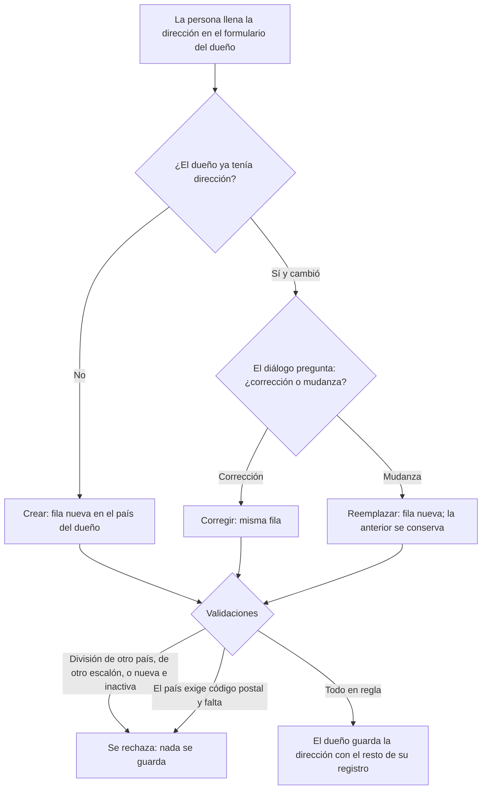

# Contexto `location` — ERP Millennium Mobility

**Actualizado:** 15/10/2026 (paso 1 construido para Perú) · **Estado:** borrador para validar · **Fuente:** diccionario de datos v1.15 (§2, §3, §4.1 a §4.8 y las decisiones D-2, D-3, D-8, D-13, D-40, D-42 a D-49 y D-51), [mapa de contextos](../mapa-de-contextos-millennium-mobility.md), [convenciones de la API](../convenciones-de-la-api-millennium-mobility.md), [procesos y pantallas](../procesos-y-pantallas-millennium-mobility.md), [orden de implementación](../orden-de-implementacion-millennium-mobility.md), las revisiones del [30/09/2026](../retroalimentacion/2026-09-30-location.md) y del [05/10/2026](../retroalimentacion/2026-10-05-location.md), y el código de la rama `feature/location` del backend y del frontend al 14/10/2026. Si este documento y el diccionario no coinciden, manda el diccionario.

**Cómo leerlo.** Las secciones 1 a 3 están escritas para quien conoce el negocio. La 4 y la 6 nombran archivos del código para el equipo. Lo marcado **(propuesta)** no lo decide nadie todavía.

---

## 1. Qué es y qué no es

`location` guarda los datos que comparten todas las empresas y la localización de cada país: con qué monedas se opera, qué países existen, cómo se divide su territorio, con qué documento se identifican ante su Estado las empresas y las personas, y las direcciones físicas (D-44). Es el paso 1 del orden de implementación y no depende de ningún otro contexto.

**Las seis tablas que posee**

| Tabla | Qué guarda | Diccionario |
|---|---|---|
| `currencies` | Las monedas: PEN, USD, COP, MXN | §4.1 |
| `countries` | Los países, con su moneda sugerida, su zona horaria y su impuesto general | §4.2 |
| `geo_division_levels` | Los escalones de cada país: Departamento, Provincia, Distrito | §4.4 |
| `geo_divisions` | Las divisiones concretas, con su código oficial (el ubigeo en Perú) | §4.5 |
| `addresses` | Las direcciones de empresas, sedes, ubicaciones y, más adelante, proveedores | §4.6 |
| `tax_id_types` | Los tipos de documento tributario de cada país: RUC, DNI, NIT, RFC | §4.7 |

Cómo se relacionan las tres tablas de geografía está en §4.3. Las columnas están en el diccionario y no se repiten aquí.

**Lo que parece suyo y no lo es**

| Parece de `location` | Es de | Por qué |
|---|---|---|
| La tabla `locations` (patio, sede, dealer) | `organization` (§6.5, D-6) | "Ubicación" ahí es el lugar donde puede haber vehículos, no un punto del mapa (mapa §1) |
| Si un país opera | `organization` | Se deduce de si tiene una empresa activa; no se guarda en el país (D-3) |
| Los tipos de cambio por día y la moneda de grupo | Nadie todavía | Están diseñados en §4.8 y se construyen justo antes de compras (paso 7) y con los reportes (paso 11) (D-46) |
| La moneda funcional de una empresa | `organization` | La empresa apunta a una moneda de `location`, pero elegirla es una decisión de la empresa (§6.2) |
| El número de RUC de una empresa o el DNI de un colaborador | `organization` | `location` define el tipo de documento; el número lo guarda quien se identifica con él |
| La zona horaria de una sede | `organization` | El país solo propone una zona por defecto; la hora real es la de cada sede (§4.2) |

**Palabras con un significado preciso aquí**

| Palabra | Significa | No confundir con |
|---|---|---|
| Escalón | Cada nivel en que un país divide su territorio: Departamento (1), Provincia (2), Distrito (3). Es la palabra del diccionario y de las pantallas | "Nivel", que es solo el nombre de la columna (`level`). En pantalla no se usa |
| División | Un pedazo concreto del territorio: Lima, Chorrillos. Cuelga de una división del escalón inmediato superior | El escalón, que es la categoría |
| Escalón más bajo | El último escalón que declaró el país: el distrito en Perú, el municipio en Colombia. Una dirección apunta a una división de ese escalón | — |
| Corregir una dirección | Se escribió mal: se modifica la misma fila y todo lo que apunta a ella sigue apuntando (D-8) | Mudar |
| Mudar una dirección | El dueño se fue a otro lugar: se crea una fila nueva y la anterior se conserva para los documentos que la citan (D-8) | Corregir |
| Tipo de documento tributario | El documento con que una empresa o una persona se identifica ante el Estado: RUC, DNI, NIT, RFC | "Documento de identidad", que es el dato del colaborador |
| Moneda sugerida | La que el país propone al registrar algo en él. Es solo una sugerencia | Moneda funcional, la de los libros de una empresa |

---

## 2. Ciclo de vida de cada agregado

Ninguna fila de `location` se borra. Lo que deja de usarse se desactiva, salvo los países y los escalones, que no tienen estado. Todas las tablas registran cuándo se creó y cuándo cambió cada fila, pero no quién: son catálogos generales (D-42).

### Moneda

| Momento | Qué pasa |
|---|---|
| Alta | El superadministrador la crea en Catálogos › Monedas (D-43). Llegan sembradas PEN, USD, COP y MXN |
| Qué cambia | El nombre, el símbolo y los decimales |
| Qué queda fijo | El código ISO, desde el alta: es de una norma externa y no se edita nunca (§2.4, D-48). Los decimales deberían quedar fijos desde el primer monto que use la moneda (§4.1); **hoy no se aplica**: se pueden cambiar siempre. Está previsto antes del paso 7 (orden, pendientes) |
| Retiro | Se desactiva. Una moneda inactiva no se elige en operaciones nuevas, pero el país o la empresa que ya la tenía la conserva (§4.1, LOC-R06) |
| Nunca | Se borra |

### País y su estructura territorial

El país incluye sus escalones: se guardan y se validan con él (D-45).

| Momento | Qué pasa |
|---|---|
| Alta | El superadministrador lo registra en su propia ficha, `/location/countries/new`. Llegan sembrados Perú, Colombia y México, con sus escalones |
| Qué cambia | El nombre, el código telefónico, la moneda sugerida, la zona horaria, el impuesto y su tasa, y si exige código postal. Los escalones se declaran uno por uno, siempre debajo del último, y se renombran |
| Qué queda fijo | Los dos códigos ISO, desde que algo cuelga del país: un escalón, una dirección o un tipo de documento. Antes se pueden corregir, por ejemplo un error de tipeo (D-47). El número de cada escalón, desde que se declara |
| Retiro | No tiene. Un país deja de operar cuando se desactivan sus empresas (D-3) |
| Nunca | Se borra un país; se borra o se retira un escalón (D-45); se guarda si el país opera |

### División territorial

| Momento | Qué pasa |
|---|---|
| Alta | La migración V24 carga la lista oficial completa de Perú (D-2): el ubigeo del INEI, edición 2022, con 25 departamentos, 196 provincias y 1 891 distritos. Las de Colombia y México se cargan antes de registrar su primera empresa. Después, el superadministrador crea divisiones una por una en la ficha del país, sección Estructura territorial |
| Qué cambia | Solo el nombre |
| Qué queda fijo | El código oficial, el escalón, la división superior y el país, desde el alta |
| Retiro | Se desactiva cuando se fusiona o desaparece. Las direcciones ya registradas siguen apuntando a ella |
| Nunca | Se borra |

### Tipo de documento tributario

| Momento | Qué pasa |
|---|---|
| Alta | El superadministrador lo crea en la ficha del país, sección Documentos tributarios. Llegan sembrados RUC, DNI, CE y PAS en Perú; NIT y CC en Colombia; RFC y CURP en México |
| Qué cambia | El nombre, a quién aplica (empresa, persona o ambos), la longitud y si tiene dígito de control |
| Qué queda fijo | La sigla y el país, desde el alta |
| Retiro | Se desactiva. Quien ya lo usa sigue siendo válido; un registro nuevo no puede elegirlo |
| Nunca | Se borra |

### Dirección

La dirección no tiene pantalla, menú ni ruta propia. Vive dentro de su dueño y se escribe con el permiso del dueño (mapa §6.3, convenciones §3.3).

| Momento | Qué pasa |
|---|---|
| Alta | La crea el dueño al registrarse o al poner su primera dirección: hoy empresas, sedes y ubicaciones; después proveedores y plantillas de orden |
| Qué cambia | En una corrección, la calle, el número, el interior, la referencia, el código postal y la división, sobre la misma fila (D-8) |
| Qué queda fijo | El país: es el del dueño, y quien escribe la dirección no lo elige **(propuesta: el diccionario todavía no lo registra)** |
| Retiro | No tiene. En una mudanza el dueño pasa a apuntar a una fila nueva y la anterior queda para los documentos que la citan |
| Nunca | Se comparte entre dos dueños, aunque el texto coincida; se borra |

---

## 3. Flujos funcionales

Todos los flujos de escritura los hace el superadministrador (D-43), salvo F5, que sigue el permiso del dueño. Cualquier cuenta con un rol vigente puede consultar los catálogos, porque toda pantalla con un selector los necesita. El grupo Catálogos del menú hoy solo lo ve el superadministrador.

### F1 · Mantener las monedas

**Rol:** superadministrador. **Pantalla:** Catálogos › Monedas (`/location/currencies`), construida.

1. Abre la lista, que busca por código, nombre o símbolo y filtra por estado.
2. Crea una moneda con su código, nombre, símbolo y decimales. El sistema revisa que el código sea de la norma ISO 4217, que no exista ya y que los decimales estén entre 0 y 4.
3. Edita el nombre, el símbolo o los decimales. El código ya no se puede tocar.
4. Exporta la lista a Excel con la misma búsqueda.

**Errores que ve:** "Ya existe una moneda con ese código ISO"; "El código no corresponde a ninguna moneda de la norma ISO 4217". El diálogo queda abierto con lo escrito.
**Resultado:** la moneda queda disponible en los selectores de países y empresas.

### F2 · Registrar un país y su estructura

**Rol:** superadministrador. **Pantalla:** Catálogos › Países y la ficha del país (`/location/countries/new` y `/location/countries/{id}`), construidas.

1. **Alta.** Escribe los dos códigos ISO, el nombre, el código telefónico, la moneda sugerida, la zona horaria, el impuesto y su tasa, y si exige código postal. El sistema revisa que los dos códigos nombren un mismo país de ISO 3166 (`PE` con `PER`, nunca con `PRI`), que ningún otro país los tenga, que el código telefónico sea `+` y de 1 a 5 dígitos, que la zona horaria exista y que la tasa esté entre 0 y 100 %. Al guardar, la ficha abre las demás secciones.
2. **Escalones.** Declara el primero por su nombre (Departamento), después el segundo, hasta cuatro. El número lo pone el sistema: siempre el que sigue al último. No hay botón para borrar un escalón; solo se renombra.
3. **Divisiones.** Elige el escalón, la división superior (solo se ofrecen las del escalón de arriba), el código oficial y el nombre. El sistema revisa que el país declare ese escalón, que el código no se repita en el país, que una división del escalón 1 no tenga superior y que cualquier otra cuelgue de una del mismo país en el escalón inmediato superior.
4. **Documentos tributarios.** Crea cada tipo con su sigla, nombre, a quién aplica, longitud y dígito de control. El sistema revisa que la sigla no se repita en el país.

**Errores que ve:** "Los códigos ISO no son de un mismo país de la norma ISO 3166"; "Otro país ya tiene ese código ISO de dos letras" (o de tres); "El país ya declara cuatro escalones"; "El país ya tiene una división con ese código"; "La división no encaja en la estructura: revise el escalón y la división superior"; "El país ya tiene un documento con esa sigla".
**Resultado:** el país queda listo para registrar empresas en él. Para que una dirección pueda elegir distrito, además hacen falta sus divisiones (F6).

### F3 · Corregir los códigos ISO de un país

**Rol:** superadministrador. **Pantalla:** ficha del país, sección Datos.

1. Mientras nada cuelga del país, los campos de los códigos dicen "Corregible mientras nada dependa del país".
2. Corrige los códigos. El sistema revisa otra vez la norma ISO 3166 y que otro país no los tenga.
3. Si el país ya tiene un escalón, una dirección o un tipo de documento, los campos aparecen bloqueados con "Ya no cambia: hay datos del país que dependen de él", y la API rechaza el cambio igual.

**Errores que ve:** "Los códigos ISO ya no se pueden corregir: el país tiene escalones, direcciones o documentos tributarios".
**Resultado:** los códigos corregidos. Dentro del sistema nada se rompe, porque las demás tablas apuntan al país por su número interno (§4.2).

### F4 · Retirar una moneda, una división o un tipo de documento

**Rol:** superadministrador. **Pantallas:** Monedas, y la ficha del país para divisiones y documentos.

1. Elige "Desactivar" en el menú de la fila. El sistema pregunta antes de hacerlo, como en las pantallas de `organization`.
2. El registro sigue en la lista, marcado como inactivo, y se puede volver a activar.
3. Lo que ya lo usaba sigue válido: una dirección conserva su división, un país o una empresa su moneda y una empresa su tipo de documento.

**Resultado:** el registro deja de ofrecerse en los formularios nuevos, y la API rechaza elegirlo como nuevo. Para la moneda, el error es `CURRENCY_INACTIVE` (LOC-R06).

### F5 · Capturar una dirección desde su dueño

**Rol:** el del dueño; hoy, superadministrador para empresas, sedes y ubicaciones. **Pantalla:** el diálogo del dueño (Empresas, Sedes y Ubicaciones, construidas), con el componente de dirección que presta `location`.

1. El país de la dirección es el del dueño (el de la empresa). La persona no lo elige.
2. La división es opcional. Si la elige, va de arriba hacia abajo, un selector por escalón del país: Departamento, después Provincia, después Distrito. Cada selector ofrece solo las divisiones activas que cuelgan de lo elegido arriba, y cambiar un escalón borra los de abajo. Hay que llegar al último escalón o dejar la división sin elegir; quedarse a medio camino no deja guardar.
3. La calle es obligatoria en cuanto se escribe algo. El código postal aparece y es obligatorio solo en los países que lo exigen (México).
4. Al cambiar la dirección de un dueño ya guardado, los diálogos de empresa y de sede preguntan si es una corrección o una mudanza (D-8). El de ubicación envía la dirección dentro del registro y no pregunta. Quitar la dirección no se permite: solo corregirla o mudarla.
5. Al editar un dueño, el formulario reconstruye la cadena de su división (Lima › Lima › Chorrillos). Una división que ya tenía la dirección se acepta aunque se haya desactivado después, y aparece marcada "(inactiva)"; una que se elige ahora tiene que estar activa (LOC-R26).

**Errores que ve:** "Elija también Distrito, o deje la división sin elegir"; "Elija una división activa del último escalón del país"; "La división que tenía la dirección ya no encaja en los escalones del país: elija una nueva o deje la división sin elegir"; "No se pudieron cargar las divisiones del país"; y, desde el backend, "La dirección no es válida: revise la división territorial y el código postal".
**Resultado:** el dueño apunta a su dirección. Si algo del dueño falla después, la dirección tampoco se guarda: las dos van en la misma transacción.

### F6 · Cargar el ubigeo

**Hecho para Perú.** La lista oficial de divisiones de Perú (ubigeo del INEI, edición 2022) se carga completa con la migración `V24__load_peru_ubigeo.sql` (D-2, procesos P1 paso 1). La genera `scripts/ubigeo/` del backend desde el archivo tal como lo publica el INEI, que se guarda byte por byte en `scripts/ubigeo/fuente/` con su fuente y su SHA-256: así se puede volver a generar y comparar con una edición nueva. La migración inserta departamentos, provincias y distritos en ese orden y falla entera si falta un superior; `PeruUbigeoMigrationTests` comprueba los conteos y la cadena. Los nombres quedan como los publica el INEI: en mayúsculas, sin tildes y con la Ñ.

Una edición nueva no reemplaza a V24, porque una migración aplicada no se edita: los distritos que se creen se agregan con una migración nueva o desde la ficha del país, y los que se fusionen se desactivan. Volver a cargar la lista desde la aplicación no tiene mecanismo (procesos, apartado 5, pregunta 7).

---

## 4. Reglas de negocio

Capas y marcas según el [README de esta carpeta](README.md). En la columna **Dónde se aplica**, los nombres de la base son restricciones de las migraciones V4 a V21; los demás, clases del backend o archivos del frontend.

| ID | Regla | Fuente | Dónde se aplica | Prueba | Estado |
|---|---|---|---|---|---|
| LOC-R01 | El código de una moneda son tres letras de una moneda real de ISO 4217 | §4.1, §2.4 | Base: `currencies_iso_code_format_ck` (solo la forma). Dominio: `IsoCurrencyCode`. Servicio: `CurrencyCommandServiceImpl`. Frontend: patrón en `currency-form-dialog` | `IsoCurrencyCodeTests`, `CurrencyTest`, `CurrenciesControllerTests` | ✅ |
| LOC-R02 | Dos monedas no tienen el mismo código | §4.1 | Base: `UNIQUE (iso_code)` (V4). Servicio: `CurrencyCommandServiceImpl` | `CurrencyCommandServiceImplTest`, `CurrenciesControllerTests` | ✅ |
| LOC-R03 | El código de una moneda no se edita nunca | §2.4, D-48 | Dominio: `Currency` (el código no tiene cambio). Frontend: campo bloqueado al editar | `CurrencyTest` | ✅ |
| LOC-R04 | Una moneda tiene de 0 a 4 decimales | §4.1 | Base: `currencies_decimal_places_range_ck`. Dominio: `Currency`. Servicio: `@Min`/`@Max` del recurso. Frontend: `currency-form-dialog` | `CurrencyTest` | ✅ |
| LOC-R05 | Los decimales quedan fijos desde el primer monto que usa la moneda | §4.1 | No se aplica: `Currency.update` los cambia siempre. Previsto como puerto de `location` antes del paso 7 (orden, pendientes) | Sin prueba | ❌ |
| LOC-R06 | Una moneda inactiva no se usa en operaciones nuevas; quien ya la tenía la conserva | §4.1 | Servicio: `CountryCommandServiceImpl` para la moneda sugerida del país y, en `organization`, `FunctionalCurrency` para la moneda funcional de la empresa, que recibe el estado por `CurrencySummary.isActive`. Las dos responden `CURRENCY_INACTIVE` (`422`). Frontend: los formularios de país y de empresa ofrecen las activas más la actual, marcada "(inactiva)" | `CountryCommandServiceImplTest`, `CountriesControllerTests`, `FunctionalCurrencyTests`, `CompanyCommandServiceImplTests`, `CompaniesControllerTests`, e2e `country-profile` | ✅ |
| LOC-R07 | Una moneda, un país, una división o un tipo de documento no se borran | §4.1, §4.5, §4.7 | Servicio: los controladores no tienen `DELETE` y los repositorios del dominio no tienen borrado | `CurrencyAuditTests`, `GeoDivisionCommandServiceImplTests`, `TaxIdTypeAuditTests` (desactivar conserva la fila) | ✅ |
| LOC-R08 | Los dos códigos ISO de un país nombran un mismo país de ISO 3166 | §4.2, D-47 | Base: `countries_iso_alpha_2_format_ck` y `countries_iso_alpha_3_format_ck` (solo la forma). Dominio: `IsoCountryCodes`. Servicio: `CountryCommandServiceImpl`. Frontend: patrón en `country-data-form` | `IsoCountryCodesTests`, `CountryTest`, `CountryCommandServiceImplTest`, `CountriesControllerTests` | ✅ |
| LOC-R09 | Dos países no comparten código ISO de dos ni de tres letras | §4.2 | Base: `UNIQUE` de cada código (V5). Servicio: `CountryCommandServiceImpl`, con un error propio para cada código | `CountryCommandServiceImplTest` | ✅ |
| LOC-R10 | Los códigos ISO se corrigen solo mientras el país no tenga escalones, direcciones ni tipos de documento | §4.2, D-47 | Dominio: `CountryIsoCodesPolicy`, `Country.correctIsoCodes`. Servicio: `CountryCommandServiceImpl`, que responde `COUNTRY_ISO_CODES_LOCKED` (`422`). Frontend: `country-data-form` bloquea los campos con `isoCodesLocked`, que la ficha vuelve a leer al declarar un escalón o crear una división o un tipo de documento | `CountryIsoCodesPolicyTests`, `CountryCommandServiceImplTest`, `CountriesControllerTests`, e2e `country-profile` | ✅ |
| LOC-R11 | El código telefónico es `+` seguido de 1 a 5 dígitos | §4.2 | Base: `countries_calling_code_format_ck`. Dominio: `Country`. Servicio: `@Pattern` del recurso. Frontend: `country-data-form` | `CountryTest` | ✅ |
| LOC-R12 | La zona horaria del país es un nombre IANA que existe | §4.2, §2.6 | Dominio: `Country`. Servicio: `@ValidTimezone` | `CountryTest` | ✅ |
| LOC-R13 | La tasa del impuesto va de 0 a 1, con hasta cuatro decimales | §4.2 | Base: `countries_tax_rate_range_ck` y `NUMERIC(5,4)`. Dominio: `Country`. Servicio: `@DecimalMin`, `@DecimalMax` y `@Digits(integer = 1, fraction = 4)`. Frontend: 0 a 100 % | `CountryTest`, `CountriesControllerTests` (un quinto decimal se rechaza) | ✅ |
| LOC-R14 | Un país declara de 1 a 4 escalones | §4.4 | Base: `CHECK (level >= 1 AND level <= 4)` (V8). Dominio: `Country.canDeclareLevel`, `HierarchyTier`. Servicio: `CountryCommandServiceImpl` | `CountryTest`, `GeoDivisionLevelAuditTests`, `GeoDivisionLevelsControllerTests` | ✅ |
| LOC-R15 | Los escalones se declaran en orden, sin saltos: el siguiente es siempre el que sigue al último | §4.4, D-45 | Dominio: `Country.declareLevel` pone el número. La base solo impide repetirlo (`geo_division_levels_country_level_uq`), no el salto | `CountryTest`, `GeoDivisionLevelsControllerTests` | ✅ |
| LOC-R16 | Un escalón no se borra ni se retira; solo se renombra | §4.4, D-45 | Dominio: `Country` (solo declara y renombra). Servicio: no hay `DELETE`. Frontend: sin botón | `GeoDivisionLevelsControllerTests` (`levelsCannotBeDeleted`) | ✅ |
| LOC-R17 | Una división va en un escalón que su país declaró | §4.5 | Base: `geo_divisions_country_level_fk`. Servicio: `GeoDivisionCommandServiceImpl` | `GeoDivisionCommandServiceImplTests`, `GeoDivisionsControllerTests` | ✅ |
| LOC-R18 | El código oficial de una división no se repite en el país | §4.5 | Base: `geo_divisions_country_code_uq`. Servicio: `GeoDivisionCommandServiceImpl` | `GeoDivisionCommandServiceImplTests`, `GeoDivisionsControllerTests` | ✅ |
| LOC-R19 | El código, el escalón, la división superior y el país de una división no cambian | §2.4, §4.5 | Dominio: `GeoDivision` (campos fijos; solo se renombra y se activa). Servicio: la edición solo recibe el nombre | No hace falta: la API no recibe esos campos al editar | ✅ |
| LOC-R20 | Solo las divisiones del escalón 1 no tienen división superior | §4.5 | Base: `geo_divisions_root_parent_ck`. Dominio: `GeoDivision`. Servicio: `GeoDivisionCommandServiceImpl` | `GeoDivisionTests`, `GeoDivisionCommandServiceImplTests` | ✅ |
| LOC-R21 | La división superior es del mismo país | §4.5 | Base: `geo_divisions_parent_same_country_fk` (V15). Servicio: `GeoDivisionCommandServiceImpl` | `GeoDivisionCommandServiceImplTests` | ✅ |
| LOC-R22 | La división superior es del escalón inmediato superior: un distrito no cuelga directo del departamento | §4.5 | Servicio: `GeoDivisionCommandServiceImpl` con `HierarchyTier.isImmediateChildOf`. Frontend: `geo-division-form-dialog` solo ofrece el escalón de arriba. La base no lo puede impedir | `GeoDivisionCommandServiceImplTests`, `GeoDivisionsControllerTests`, `HierarchyTierTests` | ✅ |
| LOC-R23 | Una división retirada se desactiva y sigue existiendo | §4.5 | Dominio: `GeoDivision.deactivate` | `GeoDivisionCommandServiceImplTests`, `GeoDivisionsControllerTests` | ✅ |
| LOC-R24 | Toda dirección tiene calle | §4.6 | Base: `CHECK` de `street_name` (V10). Dominio: `Address`. Frontend: `address-fields` en cuanto se escribe algo | `AddressTests`, `address-fields.spec` | ✅ |
| LOC-R25 | La división de una dirección es del mismo país que la dirección | §4.6 | Base: `addresses_geo_division_same_country_fk` (V15). Dominio: `AddressDivisionPolicy` | `AddressDivisionPolicyTests` | ✅ |
| LOC-R26 | La división de una dirección es del escalón más bajo del país, y está activa si se elige ahora; la que la dirección ya tenía se conserva aunque se haya desactivado | §4.6 | Dominio: `AddressDivisionPolicy`. Servicio: `AddressCommandServiceImpl`. Frontend: `mm-address-fields` elige en cascada, ofrece solo activas para elegir y conserva, marcada "(inactiva)", la que la dirección ya tenía | `AddressDivisionPolicyTests`, `AddressCommandServiceImplTests`, `address-fields.spec`, `address-options.store.spec`, e2e `companies` | ✅ |
| LOC-R27 | El código postal es obligatorio en los países que lo exigen | §4.2, §4.6 | Dominio: `Address`. Servicio: `AddressCommandServiceImpl`. Frontend: `address-fields`. La base no lo cubre | `AddressTests`, `address-fields.spec` | ✅ |
| LOC-R28 | La dirección está en el país de su dueño; quien la escribe no elige el país | Mapa §6.3 **(propuesta)** | Servicio: la fachada recibe el país del dueño (`createAddress`, `replaceAddress`) y `AddressData` no trae país. Base: `companies_fiscal_address_same_country_fk` (V18) y `branches_address_same_country_fk` (V20); `locations.address_id` no tiene esa llave (V21) | `LocationContextFacadeImplTest`, `BranchesIntegrationTests` | ⚠️ |
| LOC-R29 | Una dirección no se comparte: cada dueño tiene su propia fila | §4.6 | Base: `companies_fiscal_address_id_uq` (V18), `uq_branches_address_id` (V20); `locations.address_id` no es único (V21). Servicio: los dueños solo crean, corrigen o reemplazan la suya | Sin prueba de la unicidad | ⚠️ |
| LOC-R30 | Corregir modifica la misma fila; mudarse crea una fila nueva y conserva la anterior | §4.6, D-8 | Servicio: `LocationContextFacadeImpl` (`correctAddress`, `replaceAddress`). Frontend: los diálogos de empresa y de sede preguntan cuál de las dos es | `LocationContextFacadeImplTest`, `BranchesIntegrationTests` | ✅ |
| LOC-R31 | La sigla de un tipo de documento no se repite en el país | §4.7 | Base: `tax_id_types_country_code_uq`. Servicio: `TaxIdTypeCommandServiceImpl` | `TaxIdTypeCommandServiceImplTests`, `TaxIdTypesControllerTests` | ✅ |
| LOC-R32 | La sigla y el país de un tipo de documento no se editan | §4.7 | Dominio: `TaxIdType` (campos fijos). Frontend: campos bloqueados al editar | `TaxIdTypeTests`, `TaxIdTypesControllerTests` | ✅ |
| LOC-R33 | Un tipo aplica a empresa, persona o ambos, y solo se usa para lo que aplica: una empresa no se registra con un DNI | §4.7 | Base: `tax_id_types_applies_to_ck`. Dominio: `TaxIdApplicability`. El uso lo revisa `organization` con `TaxIdTypeRules`, que recibe la decisión ya tomada (`coversCompanies`, `coversPeople`) | `TaxIdApplicabilityTests`, `TaxIdTypeRulesTests` | ✅ |
| LOC-R34 | Cuando el tipo declara una longitud (de 1 a 30), el número tiene exactamente esa longitud | §4.7 | Base: `tax_id_types_length_ck`. Dominio: `TaxIdType`. El uso lo revisa `TaxIdTypeRules` en `organization`. El dato no alcanza para el RFC, el NIT o la CC (sección 6) | `TaxIdTypeTests`, `TaxIdTypeRulesTests` | ✅ |
| LOC-R35 | El dígito de control se verifica al registrar el número | §4.7 | No se aplica: `has_check_digit` se guarda, pero ningún código calcula el dígito. No está decidido qué contexto lo hace | Sin prueba | ❌ |
| LOC-R36 | Un tipo de documento inactivo no se elige en registros nuevos; quien ya lo usa sigue válido | §4.7 | Dominio: `TaxIdType.changeStatus`. El uso lo revisa `TaxIdTypeRules` en `organization` | `TaxIdTypeRulesTests`, `TaxIdTypesControllerTests` | ✅ |
| LOC-R37 | Quien usa un tipo de documento es de su mismo país | §4.7 | Base: `companies_tax_id_type_same_country_fk` (V15); los colaboradores no tienen esa llave (V22). El uso lo revisa `TaxIdTypeRules` | `TaxIdTypeRulesTests` | ⚠️ |
| LOC-R38 | Los catálogos los lee cualquier cuenta con un rol vigente; solo el superadministrador los crea o modifica | D-43 | Servicio: `@AnyRoleRequired` en los siete controladores y `hasRole('SUPERADMIN')` en cada escritura | Los cinco `*ControllerTests`, con el `403` de cada escritura | ✅ |
| LOC-R39 | Un archivo exportado lleva códigos y nombres, nunca el número interno ni el `public_id` | §2.4, D-51 | Servicio: las columnas de cada exportación en `CurrenciesController`, `CountriesController`, `CountryGeoDivisionsController` y `CountryTaxIdTypesController`. Las divisiones y los tipos de documento llevan el país, y las divisiones el código de su superior | Las cuatro exportaciones tienen prueba | ✅ |
| LOC-R40 | Las seis tablas registran cuándo se creó y cambió cada fila, sin autor | D-42 | Base: V6 retira `created_by`. Las entidades extienden `AuditableAbstractPersistenceEntity` | Los seis `*AuditTests` | ✅ |

---

## 5. Relación con otros contextos

`location` no depende de ningún contexto: declara `allowedDependencies = {}` y `ModularityTests` lo verifica. Los demás lo usan por su fachada, nunca por sus tablas (§3).

**Fachada del backend: `LocationContextFacade`.** El detalle de lo que ofrece está en mapa §5.1. Hoy su único consumidor es `organization`, a través de `ExternalLocationService`.

| Miembro | Para qué | Quién lo usa |
|---|---|---|
| `fetchCurrencySummaryByPublicId` | Resolver la moneda funcional de una empresa, con si está activa | Empresas (`CompanyCommandServiceImpl`, por `FunctionalCurrency`) |
| `fetchCurrencySummariesByIds` | Mostrar la moneda en listas, en lote | Vistas de empresas |
| `fetchCountrySummaryByPublicId` | Resolver el país de una empresa | Empresas |
| `fetchCountrySummaryByIsoAlpha2` | Buscar un país por su código | **Nadie en producción**; lo usan las pruebas de integración de `organization` para resolver los países sembrados. Su Javadoc lo dice, para que nadie lo retire sin revisarlas |
| `fetchCountrySummariesByIds` | Mostrar el país en listas, en lote | Vistas de `organization` |
| `fetchTaxIdTypeSummaryByPublicId` | Las reglas del tipo de documento de una empresa o un colaborador | Empresas y colaboradores (`TaxIdTypeRules`) |
| `fetchTaxIdTypeSummariesByIds` | Mostrar el tipo de documento en listas, en lote | Vistas de empresas y colaboradores |
| `createAddress`, `correctAddress`, `replaceAddress` | Crear, corregir y mudar la dirección del dueño, en su transacción (mapa §6.3) | Empresas, sedes y ubicaciones |
| `fetchAddressSummariesByIds` | Mostrar la dirección embebida en el dueño, en lote | Vistas de empresas, sedes y ubicaciones |

Lo que la fachada no ofrece y mapa §5.1 deja como propuesta: la división por su identificador público y la zona horaria del país. Ningún contexto los pide todavía.

**Frontend.** `LocationFacade` entrega vistas mínimas (`CountryOption`, `CurrencyOption`, `TaxIdTypeOption`), nunca entidades. La única pieza de pantalla que `location` presta es `mm-address-fields` (`presentation/public/address-fields`), un control de formulario que produce el valor de la dirección; guardarla le toca al dueño. Lo usan los diálogos de empresa, sede y ubicación de `organization`.

**Contextos que llegarán.** `vehiclecatalog` puede usar `location` y hoy no lo necesita. `fleet` usará la moneda del costo de equipamiento, y `procurement` las monedas, las direcciones de proveedores y plantillas, y el tipo de documento del proveedor (mapa §4).

---

## 6. Estado y pendientes para cerrar

**Estado al 15/10/2026: construido para Perú**, el único país que opera hoy (D-5). En `feature/location` están las monedas, los países con sus escalones, las divisiones con el ubigeo del INEI cargado (V24), las direcciones con su división en cascada y los tipos de documento tributario, con su API, sus pantallas y sus pruebas: 625 del backend, 667 unitarias del frontend, 15 del conversor del ubigeo y las e2e de `location`, todas en verde. Las únicas e2e que fallan son las de Usuarios y Colaboradores, que no son de este contexto. El detalle está en la [revisión de cierre](../retroalimentacion/2026-10-15-location.md).

### a) Decisiones (responsable del diccionario)

| Qué | Bloquea |
|---|---|
| Registrar en el diccionario las cuatro reglas que el código ya cumple: el orden de los escalones solo en la aplicación (§4.4), el `CHECK` de raíz de las divisiones y la edición del ubigeo cargada (§4.5), la dirección en el país de su dueño (§4.6, LOC-R28) y las semillas CE, PAS, CC y CURP (§4.7). El texto propuesto está en la revisión de cierre | Es el último criterio del paso; no cambia código |

### b) Código

No queda código de `location` pendiente. Lo que sigue abierto tiene su momento asignado:

| Qué | Cuándo |
|---|---|
| Longitudes del RFC, el NIT, el DNI y la CC, y las listas oficiales de Colombia (DANE) y México (INEGI) | Antes de registrar la primera empresa de Colombia o México (orden, pendientes transversales) |
| Verificar el dígito de control (LOC-R35) | Paso 3 |
| Fijar los decimales de una moneda desde su primer monto (LOC-R05) | Antes del paso 7 |
| `locations.address_id` único y con la llave del mismo país, y `employees.document_type_id` con la llave del mismo país (LOC-R28, R29, R37) | Con los pendientes de `organization` |

### c) Integración

`feature/location` también trae trabajo de `organization` e `iam` que no está revisado, con hallazgos críticos (ver [organization.md](organization.md) e [iam.md](iam.md), sección 6). La rama va a `develop` cuando esos estén corregidos; el paso 1 no depende de eso.

---

## 7. Preguntas abiertas

| Pregunta | Dónde se lleva |
|---|---|
| ¿El dígito de control del NIT se escribe aparte o forma parte del número? ¿Cómo se modela el RFC de 12 y de 13? | [Revisión del 05/10/2026](../retroalimentacion/2026-10-05-location.md), "Lo que queda abierto" |
| ¿Se puede volver a cargar la lista oficial de divisiones desde la aplicación? | [Procesos y pantallas](../procesos-y-pantallas-millennium-mobility.md), apartado 5, pregunta 7 |
| ¿`taxRate` viaja como texto decimal? | [Convenciones](../convenciones-de-la-api-millennium-mobility.md) §14.2 (§13 fila 7) |
| ¿Las altas responden `201` con `Location`? | Convenciones §14.9 (§13 fila 8) |
| ¿Los códigos de error llevan guion bajo entre palabras (`GEO_DIVISION_*`)? | Convenciones §14.11 (§13 fila 13) |
| ¿Cómo obtiene el registro público, sin sesión, los tipos de documento de las personas? | Convenciones §14.16 |
| ¿Cómo sabe `location` que un monto ya usa una moneda, para fijar sus decimales? | [Orden de implementación](../orden-de-implementacion-millennium-mobility.md), pendientes transversales |
| ¿Qué tipo de tasa propone cada país para sus compras? | Diccionario §4.8; lo confirma Contabilidad antes del paso 7 |
