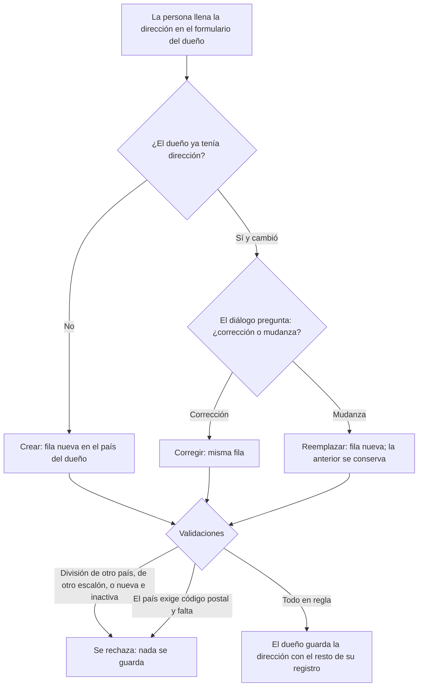
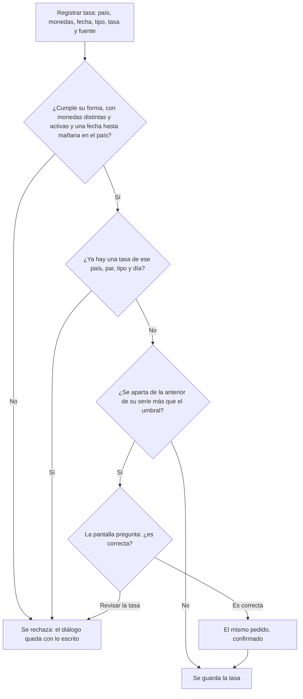

# Contexto `location` — ERP Millennium Mobility

**Actualizado:** 15/11/2026 (la limpieza del 15/11/2026, merge del backend `43542240`, sin cambio del contrato REST: lo que `AddressSummary`, `CurrencySummary` y `EffectiveRate` llevaban y nadie leía, en la sección 5, y los constructores que solo usaban las pruebas y los inventarios de antes de V39 a V43, que se quitaron, en la sección 6). Antes, 12/11/2026 (después: el día del diálogo «Registrar tipo de cambio» muestra «dd/mm/aaaa» mientras está vacío, como toda fecha con etiqueta, revisión 95 de `DESIGN.md` —frontend `334b4f1d`, merge `7cc55425`, publicado en `develop`—). Antes, el mismo día (la limpieza del backend, merge `c87aa50d`: `fetchCurrencySummaryByPublicId` sale de la fachada, en la sección 5; y `latestDate` de `EXCHANGERATE_DATE_TOO_LATE`, que el frontend no lee, como pregunta abierta en la sección 7). Antes, 09/11/2026 (la auditoría de punta a punta de ese día: el texto de `COUNTRY_ISO_CODES_LOCKED` en la pantalla nombra las tasas desde el 02/11/2026, frontend `166004f8`, en F3 y en la sección 6 b; y la moneda de grupo, decidida fuera de los reportes, en la sección 6 b) · 03/11/2026 (con la habilitación, integrada en `develop` ese día —backend `8bfdb938`, frontend `2659126a`—: `fleet` usa la fachada por su `ExternalLocationService` desde el commit `7dd80e2b`, e implementa `CurrencyUsage` con `VehicleEquipmentCurrencyUsageAdapter`, en la sección 5, sin cambiar este contexto) · 03/11/2026 (con las facturas de compra, integradas en `develop` ese día —backend `16f69af3`, con V93; frontend `2dc6505c`—, D-151, D-152 y D-181: `countries.purchase_exchange_rate_type` y la tasa vigente de un día por la fachada, `fetchEffectiveRate`, en la sección 5; LOC-R53 y LOC-R54 en ✅; la fila de la sección 6 b, resuelta) · 02/11/2026 (los tipos de cambio, construidos e integrados en `develop` ese día —backend `b1264ed5`, frontend `3d1e5b90`—, diccionario v1.37, D-148 a D-150, D-155 y D-156: `exchange_rates` en la sección 1; la tasa de cambio y su ciclo de vida en la sección 2; F7, registrar y corregir una tasa, y la nota de F3; LOC-R42 a LOC-R52, y LOC-R06, LOC-R07, LOC-R10 y LOC-R38 a LOC-R40 al día; la tasa de un documento, que llega con las facturas, en la sección 5; el estado y lo que queda en la sección 6; la pregunta del tipo de tasa de las compras, resuelta por D-152, en la sección 7) · 31/10/2026 (cierre de la revisión del 31/10/2026, diccionario v1.34, D-146: una moneda tiene de 0 a 2 decimales, la escala de todos los montos, en la base, V88, en el dominio, en la API y en la pantalla, backend `1917101f`, `e6aa2094` y `8799bc96`, frontend `c86fb25d`; LOC-R04 y F1 al día, y la fila de la sección 6 b; [plan de cierre](../plan-de-cierre-de-la-revision-2026-10-31.md), S7) · 30/10/2026 (diccionario v1.33 y `develop` del 30/10/2026, backend `a54ee29b` y frontend `88484481`, publicados el 30/10/2026: Monedas, Países y la ficha del país se abren solo con `catalogos.ver`, y `countries/new` además con `catalogos.crear_paises`, D-141, que resuelve el hallazgo de quien solo escribe; la búsqueda de monedas, países, divisiones y documentos tributarios no distingue tildes, D-142, V86; la prueba del store de monedas dice que solo una orden de compra fija los decimales, `ec7bd7cc`; la decisión del 29/10/2026 sobre los decimales citada como D-138) · 29/10/2026 (los decimales de una moneda quedan fijos desde el primer monto que la usa, por decisión del responsable del 29/10/2026: `422 CURRENCY_DECIMAL_PLACES_IN_USE`, con el puerto `CurrencyUsage` de `location.interfaces.acl`, que implementa `procurement` con sus órdenes de compra, backend `7b8db0ee`, frontend `f9a23d0b` y `da457b00`; LOC-R05 se aplica; la fachada, con sus dos consumidores, la moneda por su código ISO y leída en modo compartido, y el símbolo en `CurrencySummary` desde el 27/10/2026, `42ecdfa2`; los permisos partidos de D-130 en los flujos, en LOC-R38 y en la sección 5; el grupo Catálogos, por permiso) · 26/10/2026 (cierre de la auditoría del 25/10/2026, diccionario v1.31: `addresses` bajo Row Level Security por el país de la dirección, con rama `SYSTEM`, V78, D-80 y D-134; las preguntas «tiene direcciones» en `SystemAccessScope`; `copyAddress` en la fachada, la copia fiel del domicilio del emisor de una plantilla) · 19/10/2026 (cada escalón de la dirección se elige escribiendo, con `mm-search-select` (DESIGN.md, revisión 21), y la zona horaria del país también; el padre de una división se busca en el servidor mientras se escribe, y ya se alcanzan Puno, San Martín, Tacna, Tumbes y Ucayali; merges `60cdb93` (placeholders), `bced274` (padre) y `dec9ddd` (buscador) en el frontend) · 19/10/2026 (paso 3b, diccionario v1.23: los catálogos se leen con `catalogos.ver` y se escriben con `catalogos.gestionar_generales`, D-43, D-95; LOC-R38; integrado en `develop` el 19/10/2026) · 18/10/2026 (integrado en `develop` dentro de `feature/organization-closure`; el inventario de V39 sale de los pendientes) · 18/10/2026 (validación: las correcciones de la auditoría de `organization` a este documento; LOC-R28 y LOC-R37 con su prueba, LOC-R36 también en la pantalla, el inventario de V39 antes de integrar en `develop`) · 18/10/2026 (cierre del paso 1: dígito de control, edición del ubigeo, longitud de 1 a 20 y direcciones de las ubicaciones, D-75 a D-80; V36 a V39) · 16/10/2026 (LOC-R29: V26 hace única la dirección de una ubicación) · 15/10/2026 (paso 1 construido para Perú) · **Estado:** Validado por el responsable el 18/10/2026 · **Fuente:** diccionario de datos v1.23 (§2, §3, §4.1 a §4.8, §5.6 y las decisiones D-2, D-3, D-5, D-6, D-8, D-13, D-40, D-42 a D-49, D-51 a D-54, D-75 a D-80, D-86 y D-95), [mapa de contextos](../mapa-de-contextos-millennium-mobility.md), [convenciones de la API](../convenciones-de-la-api-millennium-mobility.md), [procesos y pantallas](../procesos-y-pantallas-millennium-mobility.md), [orden de implementación](../orden-de-implementacion-millennium-mobility.md), las revisiones del [30/09/2026](../retroalimentacion/2026-09-30-location.md), del [05/10/2026](../retroalimentacion/2026-10-05-location.md), del [15/10/2026](../retroalimentacion/2026-10-15-location.md) y del [18/10/2026](../retroalimentacion/2026-10-18-location.md), la auditoría de `organization` del 18/10/2026 ([revisión](../retroalimentacion/2026-10-18-organization.md)), el código de la rama `feature/location-closure` del backend y del frontend al 18/10/2026, con lo que `feature/organization-closure` agregó para `location`, y el de `feature/permissions-matrix` al 19/10/2026 (backend `9f6c1d8`; [revisión](../retroalimentacion/2026-10-19-permisos.md)); desde el 29/10/2026, la decisión del responsable de ese día sobre los decimales y el código de `develop` al 29/10/2026 (backend `5ec83065`, frontend `bda96499`); desde el 02/11/2026, el diccionario v1.37 (§4.8, D-148 a D-150, D-155 y D-156) y el código de `develop` al 02/11/2026 (backend `b1264ed5`, frontend `3d1e5b90`). Si este documento y el diccionario no coinciden, manda el diccionario.

**Cómo leerlo.** Las secciones 1 a 3 están escritas para quien conoce el negocio. La 4 y la 6 nombran archivos del código para el equipo. Lo marcado **(propuesta)** no lo decide nadie todavía.

---

## 1. Qué es y qué no es

`location` guarda los datos que comparten todas las empresas y la localización de cada país: con qué monedas se opera, qué países existen, cómo se divide su territorio, con qué documento se identifican ante su Estado las empresas y las personas, y las direcciones físicas (D-44). Desde el 02/11/2026 guarda también los tipos de cambio: la tasa de cada día que publica la autoridad de un país, con la que un documento de ese país convierte una moneda en otra (§4.8, D-148). Es el paso 1 del orden de implementación y no depende de ningún otro contexto.

**Las siete tablas que posee**

| Tabla | Qué guarda | Diccionario |
|---|---|---|
| `currencies` | Las monedas: PEN, USD, COP, MXN | §4.1 |
| `countries` | Los países, con su moneda sugerida, su zona horaria y su impuesto general | §4.2 |
| `geo_division_levels` | Los escalones de cada país: Departamento, Provincia, Distrito | §4.4 |
| `geo_divisions` | Las divisiones concretas, con su código oficial (el ubigeo en Perú) | §4.5 |
| `addresses` | Las direcciones de empresas, sedes, ubicaciones y, más adelante, proveedores | §4.6 |
| `tax_id_types` | Los tipos de documento tributario de cada país: RUC, DNI, NIT, RFC | §4.7 |
| `exchange_rates` | Los tipos de cambio de cada país por día, con su tipo y su fuente: el dólar en soles, de venta, que publica la SBS para Perú. Desde el 02/11/2026 (V91) | §4.8 |

Cómo se relacionan las tres tablas de geografía está en §4.3. Las columnas están en el diccionario y no se repiten aquí.

**Lo que parece suyo y no lo es**

| Parece de `location` | Es de | Por qué |
|---|---|---|
| La tabla `locations` (patio, sede, dealer) | `organization` (§6.5, D-6) | "Ubicación" ahí es el lugar donde puede haber vehículos, no un punto del mapa (mapa §1) |
| Si un país opera | `organization` | Se deduce de si tiene una empresa activa; no se guarda en el país (D-3) |
| La moneda de grupo | Nadie todavía | Está diseñada en §4.8 y se construye con los reportes (paso 11) (D-46). Los tipos de cambio, que esta fila juntaba con ella, son de `location` desde el 02/11/2026 (D-148) |
| La moneda funcional de una empresa | `organization` | La empresa apunta a una moneda de `location`, pero elegirla es una decisión de la empresa (§6.2) |
| El número de RUC de una empresa o el DNI de un colaborador | `organization` | `location` define el tipo de documento; el número lo guarda quien se identifica con él |
| La zona horaria de una sede | `organization` | El país solo propone una zona por defecto; la hora real es la de cada sede (§4.2) |

**Palabras con un significado preciso aquí**

| Palabra | Significa | No confundir con |
|---|---|---|
| Escalón | Cada nivel en que un país divide su territorio: Departamento (1), Provincia (2), Distrito (3). Es la palabra del diccionario y de las pantallas | "Nivel", que es solo el nombre de la columna (`level`). En pantalla no se usa |
| División | Un pedazo concreto del territorio: Lima, Chorrillos. Cuelga de una división del escalón inmediato superior | El escalón, que es la categoría |
| Escalón más bajo | El último escalón que declaró el país: el distrito en Perú, el municipio en Colombia. Una dirección apunta a una división de ese escalón | — |
| Corregir una dirección | Se escribió mal: se modifica la misma fila y todo lo que apunta a ella sigue apuntando (D-8) | Mudar |
| Mudar una dirección | El dueño se fue a otro lugar: se crea una fila nueva y la anterior se conserva para los documentos que la citan (D-8) | Corregir |
| Tipo de documento tributario | El documento con que una empresa o una persona se identifica ante el Estado: RUC, DNI, NIT, RFC | "Documento de identidad", que es el dato del colaborador |
| Moneda sugerida | La que el país propone al registrar algo en él. Es solo una sugerencia | Moneda funcional, la de los libros de una empresa |
| Tasa | Cuántas unidades de la moneda de destino vale una de la de origen, un día, en un país: 3.752 soles por dólar. Se registra con su tipo —compra, venta u oficial— y la autoridad que la publicó (§4.8) | Un monto: la tasa no lleva moneda propia, la nombra su par |
| Serie | Las tasas de un mismo país, par de monedas y tipo: el dólar en soles de venta de Perú. La tasa anterior de una tasa es la más reciente de su serie de un día anterior al suyo | La llave de una tasa, que suma el día |

---

## 2. Ciclo de vida de cada agregado

Ninguna fila de `location` se borra. Lo que deja de usarse se desactiva, salvo los países, los escalones y las tasas de cambio, que no tienen estado. Todas las tablas registran cuándo se creó y cuándo cambió cada fila, pero no quién: son catálogos generales (D-42). La excepción es `exchange_rates`, que guarda además quién registró cada tasa y quién la corrigió por última vez (§4.8, D-149).

### Moneda

| Momento | Qué pasa |
|---|---|
| Alta | El superadministrador la crea en Catálogos › Monedas (D-43). Llegan sembradas PEN, USD, COP y MXN |
| Qué cambia | El nombre, el símbolo y, mientras ningún monto use la moneda, los decimales |
| Qué queda fijo | El código ISO, desde el alta: es de una norma externa y no se edita nunca (§2.4, D-48). Los decimales, desde el primer monto que use la moneda (§4.1): hoy, desde la primera orden de compra en esa moneda, de cualquier empresa y en cualquier estado, también anulada o cumplida, porque sus montos y su PDF enviado se conservan. Los fondos no cuentan: no tienen moneda (§12.1). Se aplica desde el 29/10/2026, por decisión del responsable (LOC-R05); hasta entonces se podían cambiar siempre |
| Retiro | Se desactiva. Una moneda inactiva no se elige en operaciones nuevas, pero el país o la empresa que ya la tenía la conserva (§4.1, LOC-R06) |
| Nunca | Se borra |

### País y su estructura territorial

El país incluye sus escalones: se guardan y se validan con él (D-45).

| Momento | Qué pasa |
|---|---|
| Alta | El superadministrador lo registra en su propia ficha, `/location/countries/new`. Llegan sembrados Perú, Colombia y México, con sus escalones |
| Qué cambia | El nombre, el código telefónico, la moneda sugerida, la zona horaria, el impuesto y su tasa, y si exige código postal. Los escalones se declaran uno por uno, siempre debajo del último, y se renombran |
| Qué queda fijo | Los dos códigos ISO, desde que algo cuelga del país: un escalón, una dirección o un tipo de documento. Antes se pueden corregir, por ejemplo un error de tipeo (D-47). El número de cada escalón, desde que se declara |
| Retiro | No tiene. Un país deja de operar cuando se desactivan sus empresas (D-3) |
| Nunca | Se borra un país; se borra o se retira un escalón (D-45); se guarda si el país opera |

### División territorial

| Momento | Qué pasa |
|---|---|
| Alta | La migración V24 carga la lista oficial de Perú (D-2): el ubigeo del INEI, edición 2022, con 25 departamentos, 196 provincias y 1 891 distritos. Cada distrito que una ley crea después entra activo con su propia migración en cuanto el INEI o SUNAT publican su código, y el distrito del que se separó sigue activo (D-77). El primero es Santa Rosa de Loreto (Ley 32403, 03/07/2025), que todavía no tiene código publicado: hasta entonces no se puede elegir. Las de Colombia y México se cargan antes de registrar su primera empresa. El superadministrador también crea divisiones una por una en la ficha del país, pestaña Estructura territorial |
| Qué cambia | Solo el nombre |
| Qué queda fijo | El código oficial, el escalón, la división superior y el país, desde el alta. El código se guarda en mayúsculas y sin guiones, espacios ni puntos (§2.2) |
| Retiro | Se desactiva cuando se fusiona o desaparece. Las direcciones ya registradas siguen apuntando a ella |
| Nunca | Se borra |

### Tipo de documento tributario

| Momento | Qué pasa |
|---|---|
| Alta | El superadministrador lo crea en la ficha del país, pestaña Documentos. Llegan sembrados RUC, DNI, CE y PAS en Perú; NIT y CC en Colombia; RFC y CURP en México |
| Qué cambia | El nombre, a quién aplica (empresa, persona o ambos), la longitud, de 1 a 20 (D-78), y si tiene dígito de control |
| Qué queda fijo | La sigla y el país, desde el alta |
| Retiro | Se desactiva. Quien ya lo usa sigue siendo válido; un registro nuevo no puede elegirlo |
| Nunca | Se borra |

### Dirección

La dirección no tiene pantalla, menú ni ruta propia. Vive dentro de su dueño y se escribe con el permiso del dueño (mapa §6.3, convenciones §3.3).

| Momento | Qué pasa |
|---|---|
| Alta | La crea el dueño al registrarse o al poner su primera dirección: hoy empresas, sedes y ubicaciones de terceros; después proveedores y plantillas de orden. Una ubicación propia usa la dirección de su sede (D-79) |
| Qué cambia | En una corrección, la calle, el número, el interior, la referencia, el código postal y la división, sobre la misma fila (D-8) |
| Qué queda fijo | El país: es el del dueño, y quien escribe la dirección no lo elige (§4.6) |
| Retiro | No tiene. En una mudanza el dueño pasa a apuntar a una fila nueva y la anterior queda para los documentos que la citan |
| Nunca | Se comparte entre dos dueños, aunque el texto coincida; se borra |

### Tasa de cambio

Una tasa es de un país, el de la autoridad que la publica, y la usan todas sus empresas (D-148). La identifican su país, su par de monedas, su tipo y su día.

| Momento | Qué pasa |
|---|---|
| Alta | La registra a mano, cuando un documento la necesita, quien tiene `catalogos.registrar_tipo_cambio`, en Catálogos › Tipos de cambio (D-148, D-149); con la semilla, el superadministrador. No hay que cargar una cada día, y no llega ninguna sembrada. La carga automática desde la fuente oficial espera una fuente con acceso permitido para un sistema (D-148) |
| Qué cambia | La tasa y su fuente, en una corrección con motivo que queda en la bitácora, con `catalogos.corregir_tipo_cambio` (D-149) |
| Qué queda fijo | El país, las dos monedas, el tipo y el día, desde el alta: una tasa del día equivocado es otra tasa. Corregir una tasa no cambia los documentos que ya la copiaron (§4.8); hoy ninguno la copia, porque las facturas no tienen código |
| Retiro | No tiene: una tasa no tiene estado |
| Nunca | Se borra; se registra para un día posterior a mañana en la zona horaria de su país (D-156); lleva la fuente `manual`, porque quién la registró ya lo dice su autor (D-148) |

---

## 3. Flujos funcionales

Los flujos de escritura exigen el permiso de la operación —`catalogos.crear_monedas`, `editar_monedas`, `desactivar_monedas`, `crear_paises`, `editar_paises`, que también declara y corrige los escalones y crea y corrige las divisiones y los documentos tributarios, o `desactivar_paises`, que activa y desactiva las divisiones y los documentos tributarios—, que la semilla da solo al superadministrador (D-130, V62), salvo F5, que sigue el permiso del dueño; las lecturas exigen `catalogos.ver`, que tienen los siete roles del sistema, porque toda pantalla con un selector los necesita (LOC-R38). `catalogos.gestionar_generales` ya no abre ninguna ruta. Hasta el paso 3b las lecturas las hacía cualquier cuenta con un rol vigente. Desde el 30/10/2026, Monedas, Países y la ficha de un país se abren solo con `catalogos.ver`: escribir exige leer, y un permiso de escritura no abre la pantalla (D-141; procesos, apartado 3.1). La ficha de un país nuevo (`/location/countries/new`) pide `catalogos.ver` y además `catalogos.crear_paises`, porque lee sus opciones y abre la ficha que guardó. Con la semilla los ven los siete roles, y solo el superadministrador escribe. Desde la segunda ronda de la auditoría (20/10/2026) hasta el 30/10/2026 se abrían también con un permiso de escritura de su catálogo, y un rol propio que solo escribía veía la opción pero su lista le respondía `403` (sección 6 b); antes de esa ronda el grupo Catálogos solo lo veía el superadministrador. Las tasas de cambio tienen sus dos permisos desde el 02/11/2026: `catalogos.registrar_tipo_cambio` y `catalogos.corregir_tipo_cambio` (D-149, V90), que la semilla da solo al superadministrador y que, como toda escritura de un catálogo general, solo se marcan en roles de alcance sistema (D-150): la persona de Contabilidad que carga las tasas los recibe por un rol propio general (F7).

### F1 · Mantener las monedas

**Rol:** superadministrador. **Pantalla:** Catálogos › Monedas (`/location/currencies`), construida.

1. Abre la lista, que busca por código, nombre o símbolo, sin distinguir mayúsculas ni tildes (D-142), y filtra por estado.
2. Crea una moneda con su código, nombre, símbolo y decimales. El sistema revisa que el código sea de la norma ISO 4217, que no exista ya y que los decimales estén entre 0 y 2, la escala de los montos (D-146, LOC-R04): con 3 o más, el diálogo dice «Debe ser como máximo 2.» y no guarda, y la API responde `400 VALIDATION_ERROR` en `decimalPlaces`. Hasta el 31/10/2026 admitía de 0 a 4.
3. Edita el nombre, el símbolo o los decimales. El código ya no se puede tocar. Los decimales se corrigen solo mientras ningún monto use la moneda: si una orden de compra ya la usa, la API responde `422 CURRENCY_DECIMAL_PLACES_IN_USE` y nada cambia; el nombre y el símbolo se corrigen siempre (LOC-R05).
4. Exporta la lista a Excel con la misma búsqueda.

**Errores que ve:** "Ya existe una moneda con ese código ISO"; "El código no corresponde a ninguna moneda de la norma ISO 4217"; "Los decimales no se pueden cambiar: una orden de compra ya usa esta moneda con los que tiene." (`CURRENCY_DECIMAL_PLACES_IN_USE`). El diálogo queda abierto con lo escrito.
**Resultado:** la moneda queda disponible en los selectores de países y empresas.

### F2 · Registrar un país y su estructura

**Rol:** superadministrador. **Pantalla:** Catálogos › Países y la ficha del país (`/location/countries/new` y `/location/countries/{id}`), construidas.

1. **Alta.** Escribe los dos códigos ISO, el nombre, el código telefónico, la moneda sugerida, la zona horaria, el impuesto y su tasa, y si exige código postal. El sistema revisa que los dos códigos nombren un mismo país de ISO 3166 (`PE` con `PER`, nunca con `PRI`), que ningún otro país los tenga, que el código telefónico sea `+` y de 1 a 5 dígitos, que la zona horaria sea el nombre IANA de una región (`America/Lima`; no un desfase fijo como `Etc/GMT+5` o `UTC` ni un alias sin continente como `US/Eastern`, §2.6) y que la tasa esté entre 0 y 100 %. Los códigos se aceptan en minúsculas y se guardan en mayúsculas. Al guardar, la ficha abre las pestañas de su estructura territorial y sus documentos tributarios.
2. **Escalones.** Declara el primero por su nombre (Departamento), después el segundo, hasta cuatro. El número lo pone el sistema: siempre el que sigue al último. No hay botón para borrar un escalón; solo se renombra.
3. **Divisiones.** Elige el escalón, busca la división superior por su nombre o su código, en el servidor y desde el 30/10/2026 sin distinguir tildes (solo se ofrecen las del escalón de arriba), y escribe el código oficial y el nombre. El código se guarda en mayúsculas y sin guiones, espacios ni puntos. El sistema revisa que el país declare ese escalón, que el código no se repita en el país, que una división del escalón 1 no tenga superior y que cualquier otra cuelgue de una del mismo país en el escalón inmediato superior.
4. **Documentos tributarios.** Crea cada tipo con su sigla, nombre, a quién aplica, longitud y dígito de control. El sistema revisa que la sigla no se repita en el país y que la longitud, si la declara, vaya de 1 a 20 (D-78). La pestaña filtra los documentos por estado y por a quién identifican.

**Errores que ve:** "Los códigos ISO no son de un mismo país de la norma ISO 3166"; "Otro país ya tiene ese código ISO de dos letras" (o de tres); "El país ya declara cuatro escalones"; "El país ya tiene una división con ese código"; "La división no encaja en la estructura: revise el escalón y la división superior"; "El país ya tiene un documento con esa sigla".
**Resultado:** el país queda listo para registrar empresas en él. Para que una dirección pueda elegir distrito, además hacen falta sus divisiones (F6).

### F3 · Corregir los códigos ISO de un país

**Rol:** superadministrador. **Pantalla:** ficha del país, sección Datos.

1. Mientras nada cuelga del país, los campos de los códigos dicen "Corregible mientras nada dependa del país".
2. Corrige los códigos. El sistema revisa otra vez la norma ISO 3166 y que otro país no los tenga.
3. Si el país ya tiene un escalón, una dirección, un tipo de documento o, desde el 02/11/2026, una tasa de cambio (D-155), los campos aparecen bloqueados con "Ya no cambia: hay datos del país que dependen de él", y la API rechaza el cambio igual. Una tasa es de la autoridad de su país, y su exportación nombra el país por su código: corregirlo cambiaría de qué país dice ser una tasa que ya movió montos.

**Errores que ve:** "Los códigos ISO ya no se pueden corregir: el país tiene escalones, direcciones, documentos tributarios o tipos de cambio." Nombra las tasas desde el 02/11/2026 (frontend `166004f8`), como el texto del backend (sección 6 b). Como la ficha ya bloquea los campos con `isoCodesLocked`, solo se ve en una carrera.
**Resultado:** los códigos corregidos. Dentro del sistema nada se rompe, porque las demás tablas apuntan al país por su número interno (§4.2).

### F4 · Retirar una moneda, una división o un tipo de documento

**Rol:** superadministrador. **Pantallas:** Monedas, y la ficha del país para divisiones y documentos.

1. Elige "Desactivar" en el menú de la fila. El sistema pregunta antes de hacerlo, como en las pantallas de `organization`.
2. El registro sigue en la lista, marcado como inactivo, y se puede volver a activar.
3. Lo que ya lo usaba sigue válido: una dirección conserva su división, un país o una empresa su moneda y una empresa su tipo de documento.

**Resultado:** el registro deja de ofrecerse en los formularios nuevos, y la API rechaza elegirlo como nuevo. Para la moneda, el error es `CURRENCY_INACTIVE` (LOC-R06).

### F5 · Capturar una dirección desde su dueño

**Rol:** el del dueño; hoy, superadministrador para empresas, sedes y ubicaciones. **Pantalla:** el diálogo del dueño (Empresas, Sedes y Ubicaciones, construidas), con el componente de dirección que presta `location`.

1. El país de la dirección es el del dueño (el de la empresa). La persona no lo elige.
2. La división es obligatoria cuando el país tiene sus divisiones cargadas, como Perú, y opcional en un país sin ellas (D-53). El formulario lo decide con el mismo criterio que la API; si no pudo leer las reglas del país, lo dice, ofrece reintentar y deja guardar los demás datos del dueño mientras la dirección no cambie. Se elige de arriba hacia abajo, un selector por escalón del país: Departamento, después Provincia, después Distrito. Cada selector ofrece solo las divisiones activas que cuelgan de lo elegido arriba, y cambiar un escalón borra los de abajo. Hay que llegar al último escalón; donde la división es opcional, también se puede dejar sin elegir. Una dirección vacía del todo sigue permitida si el dueño no la exige.
3. La calle es obligatoria en cuanto se escribe algo. El código postal aparece y es obligatorio solo en los países que lo exigen (México).
4. Al cambiar la dirección de un dueño ya guardado, los diálogos de empresa, sede y ubicación preguntan si es una corrección o una mudanza (D-8, D-79), y la guardan por el subrecurso de dirección del dueño, aparte de sus demás datos. Una ubicación de terceros que todavía no tiene dirección registra la primera sin preguntar. Quitar la dirección no se permite: solo corregirla o mudarla.
5. Al editar un dueño, el formulario reconstruye la cadena de su división (Lima › Lima › Chorrillos). Una división que ya tenía la dirección se acepta aunque se haya desactivado después, y aparece marcada "(inactiva)"; una que se elige ahora tiene que estar activa (LOC-R26).

**Errores que ve:** "Elija la división hasta Distrito, el último escalón del país" (donde es obligatoria); "Elija también Distrito, o deje la división sin elegir" (donde es opcional); "Elija una división activa del último escalón del país"; "La división que tenía la dirección ya no encaja en los escalones del país: elija una nueva o deje la división sin elegir"; "No se pudieron cargar las divisiones del país"; "No se pudieron leer las reglas de dirección del país: una dirección nueva o cambiada espera a que se lean"; y, desde el backend, un mensaje por cada código `ADDRESS_*` (convenciones §3.3), como "Elija la división de la dirección: su país tiene sus divisiones cargadas" o "La división elegida está inactiva: elija una activa".
**Resultado:** el dueño apunta a su dirección. Al registrar el dueño, si algo falla después, la dirección tampoco se guarda: las dos van en la misma transacción. Al editarlo, la dirección se guarda por su subrecurso antes que los demás datos, en otra petición; si después falla el `PUT`, la dirección ya quedó guardada.

### F6 · Cargar el ubigeo

**Hecho para Perú.** La lista oficial de divisiones de Perú (ubigeo del INEI, edición 2022) se carga completa con la migración `V24__load_peru_ubigeo.sql` (D-2, procesos P1 paso 1). La genera `scripts/ubigeo/` del backend desde el archivo tal como lo publica el INEI, que se guarda byte por byte en `scripts/ubigeo/fuente/` con su fuente y su SHA-256: así se puede volver a generar y comparar con una edición nueva. La migración inserta departamentos, provincias y distritos en ese orden y falla entera si falta un superior; `PeruUbigeoMigrationTests` comprueba los conteos y la cadena. Los nombres quedan como los publica el INEI: en mayúsculas, sin tildes y con la Ñ, y así se muestran en las pantallas (`LIMA › LIMA › CHORRILLOS`), por decisión del responsable del diccionario.

Una edición nueva no reemplaza a V24, porque una migración aplicada no se edita. Cada distrito que una ley crea después entra activo con su propia migración, cuyo número se reserva con el equipo como pide el README de `scripts/ubigeo/`, en cuanto el INEI o SUNAT publican su código; el distrito del que se separó sigue activo, y los que se fusionen se desactivan (D-77). Santa Rosa de Loreto (Ley 32403, 03/07/2025) es el primero y espera ese código. La lista se revisa en el cierre de cada paso, contra las leyes nuevas y las ediciones nuevas del INEI, como la que puede salir del Censo 2025; la última revisión es del 17/10/2026. Volver a cargar la lista desde la aplicación no tiene mecanismo (procesos, apartado 5, pregunta 7).

### F7 · Registrar y corregir un tipo de cambio

**Rol:** registra quien tiene `catalogos.registrar_tipo_cambio` y corrige quien tiene `catalogos.corregir_tipo_cambio`; con la semilla, el superadministrador, y la persona de Contabilidad que carga las tasas, por un rol propio general de alcance sistema (D-149, D-150). Ver la lista pide `catalogos.ver`, que tienen los siete roles del sistema; quien solo registra o corrige, sin `catalogos.ver`, no ve la opción ni abre la pantalla (D-141). **Pantalla:** Catálogos › Tipos de cambio (`/location/exchange-rates`), después de Monedas en el menú, construida el 02/11/2026.

1. **La lista.** Empieza en Perú, si el catálogo lo tiene, con sus tasas del día más reciente al más antiguo, y se filtra por país, moneda de origen, tipo y un período Desde–Hasta: Desde solo es ese día; Desde y Hasta, el intervalo completo, con los dos días; Hasta solo, todo hasta ese día. No tiene buscador: la ruta no busca texto. Cada fila muestra la fecha tal como es, el país, el par (`USD → PEN`), el tipo, la tasa con hasta seis decimales, la fuente y su última corrección —«dd/mm/aaaa hh:mm · Nombre», o «—» si nunca se corrigió—. «Exportar» descarga en Excel lo que la lista muestra, sin quien corrigió (LOC-R52).
2. **Registrar.** «Registrar tasa», que aparece solo con su permiso, abre el diálogo en el país que muestra la lista y en hoy en la zona horaria de ese país. Pide el país, la moneda de origen y la de destino —solo las activas, y distintas—, la fecha, el tipo (Compra, Venta u Oficial), la tasa —mayor que cero, menor que 1 000 000 y con hasta seis decimales— y la fuente (SBS, BCRP, BANREP o BANXICO). La fecha llega a lo sumo hasta mañana en la zona del país elegido (D-156): el calendario no ofrece un día posterior, y uno escrito después dice «Elija una fecha hasta mañana,» seguido de ese día. El sistema revisa, en este orden, la forma de cada campo, que el país y las monedas existan, que las monedas sean distintas y estén activas, la fecha y, con la serie de la tasa bloqueada, que esa tasa no exista ya y cuánto se aparta de la anterior (LOC-R51).
3. **Un salto grande.** Si la tasa se aparta de la anterior de su serie —la más reciente del mismo país, par y tipo de un día anterior— más que el umbral, 3 % por omisión, el backend responde `422 EXCHANGERATE_LARGE_CHANGE_UNCONFIRMED` con la anterior, y la pantalla pregunta, por ejemplo, «La tasa se aparta 4.8 % de la anterior (3.75 del 30/10/2026). ¿Es correcta?». «Revisar la tasa» vuelve al diálogo con lo escrito, sin guardar nada; «Es correcta» manda el mismo pedido otra vez, con `confirmLargeChange: true`. Sin tasa anterior no se pregunta, y un cambio de exactamente el umbral tampoco (LOC-R46).
4. **Corregir.** «Corregir», en el menú de la fila y solo con su permiso, abre el diálogo con la tasa y la fuente que tiene, y la nombra por su país, par, día y tipo. Se corrigen la tasa, la fuente o las dos, con un motivo de 1 a 500 caracteres; un motivo sin cambio no se envía, porque no corregiría nada. El país, el par, el tipo y el día no se corrigen: una tasa del día equivocado es otra tasa, que se registra aparte. El diálogo manda el `updatedAt` que leyó: si otra corrección guardó la tasa después, el backend responde `422 EXCHANGERATE_OUTDATED`, no guarda nada y la lista se vuelve a leer, para abrirla como está. Una tasa corregida que se aparta mucho de la anterior de su serie pregunta igual que el alta.
5. **La bitácora.** Cada campo que cambia queda en Seguridad › Bitácora de cambios, entidad «Tipos de cambio», campo «Tasa» o «Fuente», con el valor anterior, el nuevo —la tasa sin ceros a la derecha: `3.85`, no `3.850000`—, el motivo y quién la corrigió, como un cambio delicado y sin empresa (§13.1, D-149). Una fila sin empresa la ve solo quien tiene `bitacora.ver` sobre todas las empresas. La lista de tasas muestra la corrección en su fila.

**Errores que ve:** "Ya hay una tasa de ese país, par de monedas, fecha y tipo."; "La moneda de origen y la de destino deben ser distintas."; "Una de las monedas está inactiva: no se registran tasas nuevas con ella."; "La fecha de la tasa puede ser a lo sumo mañana en su país."; "La tasa cambió mientras la corregía. Cierre este diálogo y ábrala de nuevo para ver la actual."; "Su rol no le permite registrar tasas." o "Su rol no le permite corregir tasas.". El diálogo queda abierto con lo escrito.
**Resultado:** la tasa queda en la lista de su país, para los documentos de su día. Hoy ningún documento la lee: la factura, la nota de crédito y el pago la usarán al construirse (D-151, D-152; sección 5).

---

## 4. Reglas de negocio

Capas y marcas según el [README de esta carpeta](README.md). En la columna **Dónde se aplica**, los nombres de la base son restricciones de las migraciones V4 a V39 y, las de las tasas de cambio, de V91; los demás, clases del backend o archivos del frontend.

| ID | Regla | Fuente | Dónde se aplica | Prueba | Estado |
|---|---|---|---|---|---|
| LOC-R01 | El código de una moneda son tres letras de una moneda real de ISO 4217 | §4.1, §2.4 | Base: `currencies_iso_code_format_ck` (solo la forma). Dominio: `IsoCurrencyCode`. Servicio: `CurrencyCommandServiceImpl`; el recurso acepta minúsculas y espacios alrededor y guarda el código en mayúsculas (convenciones §5.3). Frontend: patrón en `currency-form-dialog` | `IsoCurrencyCodeTests`, `CurrencyTest`, `CurrenciesControllerTests` | ✅ |
| LOC-R02 | Dos monedas no tienen el mismo código | §4.1 | Base: `UNIQUE (iso_code)` (V4). Servicio: `CurrencyCommandServiceImpl`; una carrera que la base detiene responde el mismo `CURRENCY_CONFLICT`, traducido en `CurrencyRepositoryImpl` | `CurrencyCommandServiceImplTest`, `CurrenciesControllerTests`, `LocationRacedDuplicatesTests` | ✅ |
| LOC-R03 | El código de una moneda no se edita nunca | §2.4, D-48 | Dominio: `Currency` (el código no tiene cambio). Frontend: campo bloqueado al editar | `CurrencyTest` | ✅ |
| LOC-R04 | Una moneda tiene de 0 a 2 decimales, la escala con que se guardan todos los montos (`NUMERIC(14,2)`): así ningún monto en una moneda se redondea en silencio al guardarse. Una moneda de 3 decimales reabre la decisión, junto con la escala de los montos. Hasta el 31/10/2026 admitía de 0 a 4 (V4) | §4.1, D-146 | Base: `currencies_decimal_places_range_ck`, que V88 cambió a `BETWEEN 0 AND 2` (`e6aa2094`): bloquea `currencies` en modo `SHARE ROW EXCLUSIVE` y se detiene, nombrándolas, si alguna moneda tiene más de 2; las tres bases se revisaron antes. Dominio: `Currency` rechaza más de 2 al crearla y al corregirla (su constante `MAX_DECIMAL_PLACES`, en 2). Servicio: `@Min(0)` y `@Max(2)` en `CreateCurrencyResource` y `UpdateCurrencyResource`, con «entre 0 y 2» en los dos `messages*.properties` (`1917101f`). Frontend: `currency-form-dialog` valida `max(2)` antes de enviar (`c86fb25d`) | `CurrencyTest.aCurrencyHasAtMostTwoDecimalPlaces`; `CurrenciesControllerTests.threeDecimalPlacesAreRejected`; `CurrencyDecimalPlacesMigrationTests` (`aCurrencyOfThreeDecimalPlacesViolatesTheCheck`, `aCurrencyOfTwoDecimalPlacesIsAccepted`, `theCheckAdmitsFromZeroToTwo`, `theMigrationStartsWithTheSystemScope`); `currency-form-dialog.spec` ("refuses three decimals, more than an amount keeps, and accepts two"). La detención de V88 no tiene prueba automática: necesitaba quitar la restricción, que solo puede el dueño de la tabla, y las pruebas corren como la cuenta de la aplicación (`8799bc96`); la cubre la revisión de las tres bases antes de integrar | ✅ |
| LOC-R05 | Los decimales quedan fijos desde el primer monto que usa la moneda; antes se corrigen. Hoy cuenta cualquier orden de compra en esa moneda, de cualquier empresa y en cualquier estado; los fondos no tienen moneda. El nombre y el símbolo se corrigen siempre | §4.1, D-138 | Dominio: `Currency.update` rechaza el cambio con `CurrencyDecimalPlacesInUseException`. Puerto: `CurrencyUsage` (`location.interfaces.acl`), que cada contexto que guarda montos implementa; `location` recibe los que haya sin depender de ninguno, y hoy lo implementa `procurement` con `PurchaseOrderCurrencyUsageAdapter`. Servicio: `CurrencyCommandServiceImpl` bloquea la moneda (`FOR NO KEY UPDATE`) antes de leerla y, solo si cambian los decimales, pregunta a cada `CurrencyUsage` con alcance `SYSTEM`, para contar las órdenes de todas las empresas; responde `422 CURRENCY_DECIMAL_PLACES_IN_USE` y la moneda queda como estaba. Una orden lee su moneda en modo compartido (`fetchCurrencySummaryByIsoCodeForShare`, `914cac1a`) antes de revisar sus precios, así que ningún primer monto se cuela entre la pregunta y el cambio (`7b8db0ee`). Frontend: `currencies.store` dice su propio texto y el diálogo queda abierto con lo escrito (`f9a23d0b`, `da457b00`) | `CurrencyTest.theDecimalPlacesOfACurrencyAnAmountUsesAreFixed` y `anUpdateChangesTheDecimalPlacesOnlyWithAnotherValue`; `CurrencyCommandServiceImplTest.updateRefusesToChangeTheDecimalPlacesOfACurrencyAnAmountUses`, `updateChangesTheDecimalPlacesOfACurrencyNoAmountUses` y `updateChangesTheNameAndTheSymbolOfACurrencyAnAmountUses`; `CurrencyDecimalPlacesIntegrationTests` (`theDecimalPlacesOfACurrencyNoAmountUsesAreCorrected`, `theDecimalPlacesOfACurrencyAnOrderOfAnotherCompanyUsesAreFixed`, `anAnnulledOrderFixesTheDecimalPlacesToo`, `theNameAndTheSymbolOfACurrencyAnOrderUsesStillChange`); en `procurement`, `CurrencyDecimalPlacesLockTests` (`aCorrectionOfTheDecimalPlacesWaitsForAnOpenOrderInTheCurrency`, `anOrderWaitsForAnOpenCorrectionAndChecksItsPricesWithTheNewDecimalPlaces`); `currencies.store.spec` ("says the decimals cannot change once a purchase order uses the currency", así desde `ec7bd7cc`: los fondos no tienen moneda); e2e `currencies` ("says the decimals of a currency an order uses cannot change, and keeps the dialog open") | ✅ |
| LOC-R06 | Una moneda inactiva no se usa en operaciones nuevas; quien ya la tenía la conserva | §4.1 | Servicio: `CountryCommandServiceImpl` para la moneda sugerida del país y, en `organization`, `FunctionalCurrency` para la moneda funcional de la empresa, que recibe el estado por `CurrencySummary.isActive`, y, en `procurement`, `PurchaseOrderReferences` para la moneda de una orden de compra, que el borrador conserva si ya la tenía. Desde el 02/11/2026 también `ExchangeRate`, que rechaza una tasa nueva con una moneda inactiva; `ExchangeRateCommandServiceImpl` lee las dos monedas en modo compartido, así que una desactivación a la vez espera o se ve (LOC-R51). Las cuatro responden `CURRENCY_INACTIVE` (`422`). Frontend: los formularios de país y de empresa ofrecen las activas más la actual, marcada "(inactiva)", y el diálogo de una tasa, solo las activas | `CountryCommandServiceImplTest`, `CountriesControllerTests`, `FunctionalCurrencyTests`, `CompanyCommandServiceImplTests`, `CompaniesControllerTests`, e2e `country-profile`; en `procurement`, `PurchaseOrdersIntegrationTests.anInactiveCurrencyAnswersCurrencyInactive` y `aDraftKeepsTheCurrencyItHasAfterItIsRetired`; de las tasas, `ExchangeRateTests.anInactiveCurrencyTakesNoNewRate`, `ExchangeRatesIntegrationTests.aRateWithAnInactiveCurrencyIsRefused`, `ExchangeRateLockTests.aRegistrationInACurrencyDeactivatedMeanwhileIsRefusedAndWritesNothing` y `register-exchange-rate-dialog.spec` ("offers only the active currencies: nothing new hangs from an inactive one") | ✅ |
| LOC-R07 | Una moneda, un país, una división, un tipo de documento o, desde el 02/11/2026, una tasa de cambio no se borran (LOC-R49) | §4.1, §4.5, §4.7, §4.8 | Servicio: los controladores no tienen `DELETE` y los repositorios del dominio no tienen borrado. Base: la cuenta de la aplicación no tiene permiso de borrar en las siete tablas, `exchange_rates` desde V91 | `CurrencyAuditTests`, `GeoDivisionCommandServiceImplTests`, `TaxIdTypeAuditTests` (desactivar conserva la fila); `LocationRowsAreNeverDeletedTests` (la base responde `42501` a un `DELETE` de `erp_mm_app` en cada tabla, también `exchange_rates`) | ✅ |
| LOC-R08 | Los dos códigos ISO de un país nombran un mismo país de ISO 3166 | §4.2, D-47 | Base: `countries_iso_alpha_2_format_ck` y `countries_iso_alpha_3_format_ck` (solo la forma). Dominio: `IsoCountryCodes`. Servicio: `CountryCommandServiceImpl`. Frontend: patrón en `country-data-form` | `IsoCountryCodesTests`, `CountryTest`, `CountryCommandServiceImplTest`, `CountriesControllerTests` | ✅ |
| LOC-R09 | Dos países no comparten código ISO de dos ni de tres letras | §4.2 | Base: `UNIQUE` de cada código (V5). Servicio: `CountryCommandServiceImpl`, con un error propio para cada código, también en una carrera que la base detiene (`CountryRepositoryImpl` la traduce) | `CountryCommandServiceImplTest`, `CountriesControllerTests`, `LocationRacedDuplicatesTests` | ✅ |
| LOC-R10 | Los códigos ISO se corrigen solo mientras el país no tenga escalones, direcciones, tipos de documento ni, desde el 02/11/2026, tasas de cambio (D-155) | §4.2, §4.8, D-47, D-155 | Dominio: `CountryIsoCodesPolicy`, que desde `2c86d0c1` cuenta también las tasas, y `Country.correctIsoCodes`. Servicio: `CountryCommandServiceImpl`, que bloquea primero la fila del país, con un `FOR UPDATE` completo, y después lee sus dependientes —las tasas, con `ExchangeRateRepository.findCountryIdsWithExchangeRates`—, así un escalón que se declara al mismo tiempo espera, y una tasa que se registra a la vez también, porque su llave foránea toma `FOR KEY SHARE` sobre el país; responde `COUNTRY_ISO_CODES_LOCKED` (`422`), cuyo texto del backend nombra las tasas. `isoCodesLocked` (`CountryViewFactory`) las cuenta igual. Frontend: `country-data-form` bloquea los campos con `isoCodesLocked`, que la ficha vuelve a leer al declarar un escalón o crear una división o un tipo de documento | `CountryIsoCodesPolicyTests` (desde D-155, `anExchangeRateFixesTheCodes`), `CountryCommandServiceImplTest` (`theIsoCodesStayFixedOnceTheCountryHasExchangeRates`), `CountriesControllerTests`, `ExchangeRatesIntegrationTests.aRateFreezesTheIsoCodesOfItsCountry` (un país cuyo único dependiente es una tasa dice `isoCodesLocked` en su ficha y en la lista, y rechaza la corrección), e2e `country-profile`. Que una tasa registrada a la vez espere a la corrección no tiene prueba propia | ✅ |
| LOC-R11 | El código telefónico es `+` seguido de 1 a 5 dígitos | §4.2 | Base: `countries_calling_code_format_ck`. Dominio: `Country`. Servicio: `@Pattern` del recurso. Frontend: `country-data-form` | `CountryTest` | ✅ |
| LOC-R12 | La zona horaria del país es el nombre IANA de una región, de la forma Área/Lugar: no un desfase fijo (`Etc/GMT+5`, `UTC`) ni un alias sin continente (`US/Eastern`) | §4.2, §2.6, D-40 | Dominio: `Country`, con `RegionTimezone` de `shared`, que también usa la sede en `organization`. Servicio: `@ValidTimezone` (`shared`). Frontend: `country-data-form` ofrece solo esas zonas, y una zona guardada que ya no lo es se marca para elegir otra | `RegionTimezoneTests`, `CountryTest`, `CountriesControllerTests` | ✅ |
| LOC-R13 | La tasa del impuesto va de 0 a 1, con hasta cuatro decimales | §4.2 | Base: `countries_tax_rate_range_ck` y `NUMERIC(5,4)`. Dominio: `Country`. Servicio: `@DecimalMin`, `@DecimalMax` y `@Digits(integer = 1, fraction = 4)`. Frontend: 0 a 100 % | `CountryTest`, `CountriesControllerTests` (un quinto decimal se rechaza) | ✅ |
| LOC-R14 | Un país declara de 1 a 4 escalones | §4.4 | Base: `CHECK (level >= 1 AND level <= 4)` (V8). Dominio: `Country.canDeclareLevel`, `HierarchyTier`. Servicio: `CountryCommandServiceImpl` | `CountryTest`, `GeoDivisionLevelAuditTests`, `GeoDivisionLevelsControllerTests` | ✅ |
| LOC-R15 | Los escalones se declaran en orden, sin saltos: el siguiente es siempre el que sigue al último | §4.4, D-45 | Dominio: `Country.declareLevel` pone el número. Servicio: `CountryCommandServiceImpl` bloquea la fila del país antes de declarar, así dos declaraciones a la vez van una después de la otra. La base solo impide repetirlo (`geo_division_levels_country_level_uq`), no el salto | `CountryTest`, `GeoDivisionLevelsControllerTests`, `CountryLockTests` | ✅ |
| LOC-R16 | Un escalón no se borra ni se retira; solo se renombra | §4.4, D-45 | Dominio: `Country` (solo declara y renombra). Servicio: no hay `DELETE`. Frontend: sin botón | `GeoDivisionLevelsControllerTests` (`levelsCannotBeDeleted`) | ✅ |
| LOC-R17 | Una división va en un escalón que su país declaró | §4.5 | Base: `geo_divisions_country_level_fk`. Servicio: `GeoDivisionCommandServiceImpl` | `GeoDivisionCommandServiceImplTests`, `GeoDivisionsControllerTests` | ✅ |
| LOC-R18 | El código oficial de una división no se repite en el país; se guarda en mayúsculas y sin guiones, espacios ni puntos, así `t-2`, `T 2` y `T2` son el mismo código | §4.5, §2.2 | Base: `geo_divisions_country_code_uq`; V39 normalizó los códigos ya guardados y falla si dos quedan iguales. Dominio: `GeoDivisionCode`, con `TextIdentifier` de `shared`. Servicio: `GeoDivisionCommandServiceImpl`, también en una carrera que la base detiene (`GEODIVISION_CONFLICT`). Frontend: el diálogo limpia el código con la misma regla antes de medirlo | `GeoDivisionCodeTests`, `TextIdentifierTest`, `TextIdentifiersMigrationTests`, `GeoDivisionCommandServiceImplTests`, `GeoDivisionsControllerTests`, `LocationRacedDuplicatesTests` | ✅ |
| LOC-R19 | El código, el escalón, la división superior y el país de una división no cambian | §2.4, §4.5 | Dominio: `GeoDivision` (campos fijos; solo se renombra y se activa). Servicio: la edición solo recibe el nombre | No hace falta: la API no recibe esos campos al editar | ✅ |
| LOC-R20 | Solo las divisiones del escalón 1 no tienen división superior | §4.5 | Base: `geo_divisions_root_parent_ck`. Dominio: `GeoDivision`. Servicio: `GeoDivisionCommandServiceImpl` | `GeoDivisionTests`, `GeoDivisionCommandServiceImplTests` | ✅ |
| LOC-R21 | La división superior es del mismo país | §4.5 | Base: `geo_divisions_parent_same_country_fk` (V15). Servicio: `GeoDivisionCommandServiceImpl` | `GeoDivisionCommandServiceImplTests`, `SameCountryReferencesMigrationTests.theParentOfADivisionIsOfItsCountry` | ✅ |
| LOC-R22 | La división superior es del escalón inmediato superior: un distrito no cuelga directo del departamento | §4.5, D-54 | Base: `geo_divisions_parent_immediate_level_fk` sobre la columna generada `parent_level` (V25), que protege también las cargas en SQL. Servicio: `GeoDivisionCommandServiceImpl` con `HierarchyTier.isImmediateChildOf`. Frontend: `geo-division-form-dialog` solo ofrece el escalón de arriba | `GeoDivisionParentLevelMigrationTests`, `GeoDivisionCommandServiceImplTests`, `GeoDivisionsControllerTests`, `HierarchyTierTests` | ✅ |
| LOC-R23 | Una división retirada se desactiva y sigue existiendo | §4.5 | Dominio: `GeoDivision.deactivate` | `GeoDivisionCommandServiceImplTests`, `GeoDivisionsControllerTests` | ✅ |
| LOC-R24 | Toda dirección tiene calle | §4.6 | Base: `CHECK` de `street_name` (V10). Dominio: `Address`. Frontend: `address-fields` en cuanto se escribe algo | `AddressTests`, `address-fields.spec` | ✅ |
| LOC-R25 | La división de una dirección es del mismo país que la dirección | §4.6 | Base: `addresses_geo_division_same_country_fk` (V15). Dominio: `AddressDivisionPolicy`. Servicio: `AddressCommandServiceImpl` responde `422 ADDRESS_DIVISION_OTHER_COUNTRY` | `AddressDivisionPolicyTests`, `SameCountryReferencesMigrationTests.theDivisionOfAnAddressIsOfItsCountry` | ✅ |
| LOC-R26 | La división de una dirección es del escalón más bajo del país, y está activa si se elige ahora; la que la dirección ya tenía se conserva aunque se haya desactivado | §4.6 | Dominio: `AddressDivisionPolicy`. Servicio: `AddressCommandServiceImpl`, que responde `422 ADDRESS_DIVISION_NOT_DEEPEST_LEVEL` o `422 ADDRESS_DIVISION_INACTIVE`. Frontend: `mm-address-fields` elige en cascada, ofrece solo activas para elegir y conserva, marcada "(inactiva)", la que la dirección ya tenía | `AddressDivisionPolicyTests`, `AddressCommandServiceImplTests`, `address-fields.spec`, `address-options.store.spec`, e2e `companies` | ✅ |
| LOC-R27 | El código postal es obligatorio en los países que lo exigen | §4.2, §4.6 | Dominio: `Address`. Servicio: `AddressCommandServiceImpl`, que responde `422 ADDRESS_POSTAL_CODE_REQUIRED`. Frontend: `address-fields`. La base no lo cubre | `AddressTests`, `AddressCommandServiceImplTests`, `address-fields.spec` | ✅ |
| LOC-R28 | La dirección está en el país de su dueño; quien la escribe no elige el país | §4.6 | Servicio: la fachada recibe el país del dueño (`createAddress`, `replaceAddress`) y `AddressData` no trae país. Base: `companies_fiscal_address_same_country_fk` (V18) y `branches_address_same_country_fk` (V20). En las ubicaciones lo asegura solo la aplicación, como permite §4.6: `locations` no tiene columna de país, y su dirección se crea en el país de la empresa | `LocationContextFacadeImplTest`, `BranchesIntegrationTests`, `SameCountryReferencesMigrationTests.theFiscalAddressOfACompanyIsOfItsCountry`, `CompanyFiscalAddressConstraintTests`; la parte de las ubicaciones, `LocationCommandServiceImplTests.theAddressOfANewLocationIsCreatedInTheCountryOfItsCompany` y `aMoveOfTheAddressCreatesTheNewOneInTheCountryOfItsCompany` (`99f410d`), que comprueban que `createAddress` y `replaceAddress` reciben el país de la empresa | ✅ |
| LOC-R29 | Una dirección no se comparte: cada dueño tiene su propia fila | §4.6 | Base: un `UNIQUE` en cada tabla dueña, que impide que dos filas de la misma tabla apunten a la misma dirección: `companies_fiscal_address_id_uq` (V18), `uq_branches_address_id` (V20) y `locations_address_uq` (V26). Entre tablas distintas —una empresa y una sede con la misma fila— la base no lo impide: lo asegura la aplicación, porque cada dueño solo crea, corrige o reemplaza la suya y la fachada nunca entrega una dirección para que otro la use | `SameCountryReferencesMigrationTests.twoCompaniesCannotShareAFiscalAddress`, `BranchConstraintTests.twoBranchesCannotShareAnAddress`, `OrganizationOwnershipKeysMigrationTests.twoLocationsCannotShareAnAddress` | ✅ |
| LOC-R30 | Corregir modifica la misma fila; mudarse crea una fila nueva y conserva la anterior | §4.6, D-8, D-79 | Servicio: `LocationContextFacadeImpl` (`correctAddress`, `replaceAddress`); empresas, sedes y ubicaciones cambian la dirección solo por su subrecurso, y el `PUT` del dueño no la toca. Frontend: los diálogos de empresa, sede y ubicación preguntan cuál de las dos es | `LocationContextFacadeImplTest`, `BranchesIntegrationTests`, `LocationsIntegrationTests`, `location-form-dialog.spec`, e2e `locations` | ✅ |
| LOC-R31 | La sigla de un tipo de documento no se repite en el país | §4.7 | Base: `tax_id_types_country_code_uq`. Servicio: `TaxIdTypeCommandServiceImpl` | `TaxIdTypeCommandServiceImplTests`, `TaxIdTypesControllerTests` | ✅ |
| LOC-R32 | La sigla y el país de un tipo de documento no se editan | §4.7 | Dominio: `TaxIdType` (campos fijos). Frontend: campos bloqueados al editar | `TaxIdTypeTests`, `TaxIdTypesControllerTests` | ✅ |
| LOC-R33 | Un tipo aplica a empresa, persona o ambos, y solo se usa para lo que aplica: una empresa no se registra con un DNI | §4.7 | Base: `tax_id_types_applies_to_ck`. Dominio: `TaxIdApplicability`. El uso lo revisa `organization` con `TaxIdTypeRules`, que recibe la decisión ya tomada (`coversCompanies`, `coversPeople`) | `TaxIdApplicabilityTests`, `TaxIdTypeRulesTests` | ✅ |
| LOC-R34 | Cuando el tipo declara una longitud, va de 1 a 20 —lo que caben las columnas que guardan los números— y el número, ya normalizado, tiene exactamente esa longitud | §4.7, D-78 | Base: `tax_id_types_length_ck` (V38, antes hasta 30). Dominio: `TaxIdType`. Servicio: `@Max(20)` del recurso, con su propio texto. Frontend: el campo admite de 1 a 20. El uso lo revisa `TaxIdTypeRules` en `organization`. El dato no alcanza para el RFC, el NIT o la CC (sección 6) | `TaxIdTypeTests`, `TaxIdTypeLengthMigrationTests`, `TaxIdTypesControllerTests`, `TaxIdTypeRulesTests` | ✅ |
| LOC-R35 | Cuando el tipo tiene dígito de control, el número lo cumple. Se verifica al crear el registro y cuando cambian el número o el tipo; un número ya guardado sigue siendo válido | §4.7, D-75 | Dominio: `TaxIdCheckDigitPolicy` calcula el dígito según la sigla del tipo dentro de su país; hoy solo el RUC de Perú, con el módulo 11 de SUNAT. Un tipo con dígito de control cuyo cálculo todavía no existe —el NIT, el RFC y la CURP— acepta sus números sin verificar (`NOT_VERIFIED`). Fachada: `verifyTaxIdCheckDigit`. El uso lo aplica `organization` con `TaxIdTypeRules`: `COMPANY_TAX_ID_CHECK_DIGIT_INVALID` y `EMPLOYEE_DOCUMENT_NUMBER_CHECK_DIGIT_INVALID` (`422`). Frontend: los diálogos de empresa y colaborador verifican el RUC antes de enviar, con la misma regla (`location/domain/model/tax-id-check-digit.ts`); la API decide igual. V37 deja el DNI sin dígito de control (D-76) | `TaxIdCheckDigitPolicyTests`, `LocationContextFacadeImplTest`, `PeruTaxIdTypesMigrationTests`, `TaxIdTypeRulesTests`, `CompanyCommandServiceImplTests`, `EmployeeCommandServiceImplTests`, `tax-id-check-digit.spec` | ✅ |
| LOC-R36 | Un tipo de documento inactivo no se elige en registros nuevos; quien ya lo usa sigue válido | §4.7 | Dominio: `TaxIdType.changeStatus`. El uso lo revisa `TaxIdTypeRules` en `organization`, que exige el tipo activo solo cuando es nuevo para el registro: un colaborador cuyo tipo se desactivó se sigue editando. Frontend: el diálogo de colaborador ofrece los tipos activos más el que el colaborador ya tiene, rotulado "(inactivo)" si se desactivó (`9842ea8`, rama `feature/organization-closure`) | `TaxIdTypeRulesTests`, `TaxIdTypesControllerTests`, `EmployeeCommandServiceImplTests.anUnchangedDocumentTypeThatWasDeactivatedStillAllowsTheUpdate` y `changingToAnInactiveDocumentTypeIsRejected`; `employee-form-dialog.spec` ("keeps the document type the employee has, said inactive when it was deactivated") | ✅ |
| LOC-R37 | Quien usa un tipo de documento es de su mismo país | §4.7 | Base: `companies_tax_id_type_same_country_fk` (V15). En los colaboradores lo asegura solo la aplicación: `employees` no tiene columna de país, y el país es el de su empresa. El uso lo revisa `TaxIdTypeRules` | `TaxIdTypeRulesTests`, `SameCountryReferencesMigrationTests.theTaxIdTypeOfACompanyIsOfItsCountry`; el país del documento del colaborador, `TaxIdTypeRulesTests.aTypeOfAnotherCountryIsRejectedForAnEmployee` (`99f410d`), con un colaborador nuevo y con uno que conserva su tipo y su número | ✅ |
| LOC-R38 | Los catálogos los lee quien tiene `catalogos.ver` por un rol vigente, y los crea, corrige o desactiva quien tiene el permiso de esa operación (D-130); la semilla da la lectura a los siete roles del sistema y las escrituras solo al superadministrador (D-43). Las tasas de cambio se registran con `catalogos.registrar_tipo_cambio` y se corrigen con `catalogos.corregir_tipo_cambio` (D-149); como toda escritura de un catálogo general, esos permisos solo se marcan en roles de alcance sistema (D-150; [iam.md](iam.md), IAM-R80). Un rol propio sin el permiso recibe `403`, también con sesión y rol, y un permiso desmarcado del rol deja de valer en la petición siguiente. Las pantallas también piden la lectura: desde el 30/10/2026 se abren solo con `catalogos.ver`, y el alta de un país además con `catalogos.crear_paises` | §5.6, D-43, D-95, D-130, D-141, D-149, D-150 | Servicio: `@PermissionRequired("catalogos.ver")` en los nueve controladores, con `ExchangeRatesController` desde el 02/11/2026, y, en cada escritura, el permiso de esa operación desde V62: `catalogos.crear_monedas`, `editar_monedas` y `desactivar_monedas`; `crear_paises` para registrar un país; `editar_paises` para corregirlo y para declarar y corregir sus escalones y crear y corregir sus divisiones y sus documentos tributarios; `desactivar_paises` para activar y desactivar divisiones y documentos tributarios; y, desde V90 (02/11/2026), `registrar_tipo_cambio` en `POST /exchange-rates` y `corregir_tipo_cambio` en `PUT /exchange-rates/{id}`. Hasta el 21/10/2026, `catalogos.gestionar_generales` en cada escritura (`9f6c1d8`), que ya no pide ninguna ruta. Ningún servicio de `location` decide por empresa, porque sus tablas no llevan `company_id`. Frontend: `location.routes.ts` y `app-navigation.ts`, con `catalogos.ver` (`71765c0b`); Catálogos › Tipos de cambio también, y su pantalla ofrece registrar y corregir solo con su permiso (`96cad0a3`, `02b89302`); la matriz pone los dos permisos en Catálogos › Generales › Tipos de cambio (`3da17b85`) | `LocationReadAccessTests` (cada lectura y exportación: `401` sin sesión, `403` sin rol, la leen `ADMIN_EMPRESA` y `ADMIN_ACCESOS`, y `aRoleOfItsOwnWithoutThePermissionGets403`); `LocationPermissionIntegrationTests` (`aRoleOfItsOwnReadsTheCatalogsWithThePermissionAndNotWithoutIt`, `aRoleOfItsOwnWithoutThePermissionReadsNoCatalog`, `aPermissionUnmarkedFromTheRoleStopsOnTheNextRequest`, `aRetiredPermissionWritesNothing`, `aRoleOfItsOwnWritesTheCatalogsWithTheWritePermission`); los `*ControllerTests`, con el `403` de cada escritura; `location.routes.spec` ("opens no catalog nor the record of a country to a session that only writes them: every GET asks catalogos.ver (owner, 30/10/2026)", "opens the catalogs and the record of a country with catalogos.ver alone", "opens the form of a new country with the reading and the permission it saves with", "opens no exchange rates to a session that only registers and corrects them (D-149)"); de las tasas, `ExchangeRatesIntegrationTests.anyAccountWithCatalogsViewReadsTheRatesButOnlyItsPermissionRegistersOne` y `withoutSessionTheRatesAreNotReadable`, `ExchangeRateCorrectionsIntegrationTests.eachWriteAsksForItsOwnPermission` y e2e `exchange-rates` ("refuses the rates to a role of the whole system that writes them but does not read the catalogs") | ✅ |
| LOC-R39 | Un archivo exportado lleva códigos y nombres, nunca el número interno ni el `public_id` | §2.4, D-51 | Servicio: las columnas de cada exportación en `CurrenciesController`, `CountriesController`, `CountryGeoDivisionsController`, `CountryTaxIdTypesController` y, desde el 02/11/2026, `ExchangeRatesController` (LOC-R52). Las divisiones y los tipos de documento llevan el país, y las divisiones el código de su superior | Las cinco exportaciones tienen prueba en el backend —la de las tasas, `ExchangeRatesIntegrationTests.theListIsExportedAsAnExcelFileWithTheSameFiltersAndOrder`—, y e2e `exports` | ✅ |
| LOC-R40 | Las seis tablas del paso 1 registran cuándo se creó y cambió cada fila, sin autor. `exchange_rates` registra además quién registró cada tasa y quién la corrigió por última vez, que su pantalla muestra (§4.8, D-149) | D-42, §4.8 | Base: V6 retira `created_by`; V91 da a `exchange_rates` `created_by` y `updated_by`, con llave a `users`. Las entidades extienden `AuditableAbstractPersistenceEntity`, y la de las tasas, `RevisedAbstractPersistenceEntity`, con la cuenta de la sesión como autor | Los seis `*AuditTests`; `ExchangeRateAuditTests.aCorrectionKeepsTheIdentifiersTheKeyTheCreationAndItsAuthorAndRecordsWhoCorrectedIt` y `ExchangeRatesIntegrationTests.aSuperAdministratorRegistersARateAndItsAuthorIsTheAccountOfTheSession` | ✅ |
| LOC-R41 | Una dirección tiene su división cuando su país tiene divisiones cargadas; solo puede faltar en un país sin ellas | §4.6, D-53 | Servicio: `AddressCommandServiceImpl` (crear, corregir y mudar) responde `422 ADDRESS_DIVISION_REQUIRED` cuando el país tiene alguna división, de cualquier escalón y estado. Frontend: `mm-address-fields` usa el mismo criterio, y mientras no conoce las reglas del país no da por válida una dirección nueva o cambiada. La base no lo cubre: depende de qué países tienen su lista cargada | `AddressCommandServiceImplTests`, `CompaniesControllerTests`, `address-fields.spec`, `address-options.store.spec`, e2e `companies` y `locations` | ✅ |
| LOC-R42 | El país, las dos monedas, el tipo y el día de una tasa no se repiten: una tasa de compra y una de venta del mismo día son dos tasas | §4.8, D-148 | Base: `exchange_rates_country_pair_type_date_uq` (V91), que termina en el día y sirve también para buscar la tasa anterior (LOC-R46). Dominio: `ExchangeRate.key()` (`ExchangeRateKey`), que la corrección no cambia. Servicio: `ExchangeRateCommandServiceImpl` lo revisa con la serie bloqueada (LOC-R51) y responde `409 EXCHANGERATE_CONFLICT`; una carrera que la base detiene responde el mismo código, traducido en `ExchangeRateRepositoryImpl` (`884de08b`). Frontend: el diálogo dice «Ya hay una tasa de ese país, par de monedas, fecha y tipo.» y queda abierto con lo escrito | `ExchangeRateTests.aRateIsRegisteredForItsCountryPairTypeAndDay`; `ExchangeRatesIntegrationTests.aRateOfTheSameCountryPairTypeAndDayIsAConflict` y `theOtherTypeOfTheSameDayIsAnotherRate`; `ExchangeRateRacedDuplicateTests` (`aRateRegisteredMeanwhileAnswersTheConflictOfTheRate`, `aRateThatRacesToTheSameKeyMeetsTheUniqueConstraintAndAnswersTheConflictOfTheRate`); `register-exchange-rate-dialog.spec` ("keeps what was typed and says why a registration was refused"); e2e `exchange-rates` ("registers a rate, and says why one cannot be registered while keeping what was typed") | ✅ |
| LOC-R43 | Una tasa convierte una moneda en otra distinta, es mayor que cero, y su tipo y su fuente son de listas cerradas: `compra`, `venta` u `oficial`; `SBS`, `BCRP`, `BANREP` o `BANXICO`. No hay fuente `manual`: quién registró la tasa lo dice `created_by` | §4.8, D-148 | Base: `exchange_rates_different_currencies_ck`, `exchange_rates_rate_positive_ck`, `exchange_rates_rate_type_ck` y `exchange_rates_source_ck` (V91). Dominio: `ExchangeRate` (`ExchangeRateSameCurrenciesException`), `ConversionRate`, `ExchangeRateType` y `ExchangeRateSource`, que aceptan cualquier mayúscula y espacios alrededor y guardan el tipo en minúsculas y la fuente en mayúsculas. Servicio: `@DecimalMin` y `@Pattern` en `RegisterExchangeRateResource` y `CorrectExchangeRateResource` (`400 VALIDATION_ERROR`); las mismas monedas responden `422 EXCHANGERATE_SAME_CURRENCIES`. Frontend: `register-exchange-rate-dialog` ofrece solo las listas y rechaza la misma moneda a los dos lados («Elija una moneda distinta de la de origen.») | `ExchangeRateTests` (`theTwoCurrenciesOfARateAreDifferent`, `aRateIsGreaterThanZeroWithAtMostSixDecimalsAndBelowOneMillion`, `theTypeAndTheSourceAreClosedLists`); `ExchangeRatesIntegrationTests.aRateBetweenTheSameCurrencyIsRefused` y `aMalformedRateIsRejected`; `ExchangeRateCorrectionsIntegrationTests.aMalformedCorrectionIsRejected`; `register-exchange-rate-dialog.spec` ("refuses the same currency on both sides, and judges it again when the origin changes") | ✅ |
| LOC-R44 | Una tasa tiene a lo sumo seis decimales y es menor que 1 000 000, lo que guarda `NUMERIC(12,6)`, la misma precisión que el `exchange_rate` de facturas, notas y pagos. No es un monto: no lleva moneda propia, y `3.750000` y `3.75` son la misma tasa | §4.8, D-146 | Base: `rate NUMERIC(12, 6)` (V91). Dominio: `ConversionRate` (`MAX_DECIMALS` y el tope de 1 000 000), que guarda la tasa sin ceros a la derecha y nunca en notación exponencial; así la escribe la bitácora (`3.85`, no `3.850000`). Servicio: `@Digits(integer = 6, fraction = 6)` en los dos recursos (`400 VALIDATION_ERROR`). Frontend: `rate-validators.ts`, en el alta y en la corrección; la lista la muestra con hasta seis decimales | `ExchangeRateTests.aRateIsGreaterThanZeroWithAtMostSixDecimalsAndBelowOneMillion`; `ExchangeRatesIntegrationTests.aMalformedRateIsRejected` (siete decimales, un millón); `register-exchange-rate-dialog.spec` ("says the limits of a rate: above zero, below 1 000 000 and six decimals at most"); `exchange-rates-view.spec` ("shows each rate: its day as it is, its pair, its rate with up to six decimals, and its last correction"); `change-logs-view.spec` ("the corrections of an exchange rate (D-149)", sin ceros a la derecha desde `87c7997c`) | ✅ |
| LOC-R45 | Una tasa la registra a mano, cuando un documento la necesita, quien tiene `catalogos.registrar_tipo_cambio`; no hay que cargar una cada día. Su autor es la cuenta de la sesión | §4.8, D-42, D-148, D-149 | Servicio: `@PermissionRequired(PermissionCodes.Catalogs.REGISTER_EXCHANGE_RATES)` en `POST /exchange-rates` (`ExchangeRatesController`), sobre el `catalogos.ver` de la clase; sin él, `403 ACCESS_DENIED`. V90 siembra el permiso, de la categoría `crear`, y lo marca solo al superadministrador, firmado por `SYSTEM`. El país y las monedas viajan por su código ISO (`404 COUNTRY_NOT_FOUND`, `404 CURRENCY_NOT_FOUND`). Frontend: «Registrar tasa» aparece solo con el permiso, y el diálogo empieza en el país que muestra la lista y en hoy en su zona | `ExchangeRatesIntegrationTests` (`aSuperAdministratorRegistersARateAndItsAuthorIsTheAccountOfTheSession`, `aCodeThatNamesNothingIsNotFound`, `anyAccountWithCatalogsViewReadsTheRatesButOnlyItsPermissionRegistersOne`); `PermissionsMigrationTests` (`theCatalogHoldsThePermissionsOfTheStepsAlreadyBuilt`, `everyPermissionHasTheCategoryOfTheDictionary`, `theMatrixOfTheSevenRolesIsTheOneOfTheDictionary`); `exchange-rates-view.spec` ("offers to register and to correct only with their permissions", "opens the register dialog on the country shown"); `register-exchange-rate-dialog.spec` ("starts on the country shown and on today in its zone", "registers what was typed and closes once it is saved"); e2e `exchange-rates` ("offers neither registering nor correcting to an account that only reads the catalogs, and the API refuses both") | ✅ |
| LOC-R46 | Una tasa que se aparta de la anterior de su serie —el mismo país, par y tipo— más que el umbral pide confirmación antes de guardarse, al registrarla y al corregirla. La anterior es la más reciente de un día anterior al suyo, así que una tasa nunca se compara consigo misma, y sin anterior no hay nada que confirmar. El umbral es configuración, 3 % por omisión, y un cambio de exactamente el umbral no pregunta | §4.8, D-148 | Dominio: `LargeRateChangePolicy`, que cruza dos tasas de la serie con `ConversionRate.relativeChangeFrom`, la diferencia entre las dos, sin signo, dividida entre la anterior; el porcentaje que lee la persona se redondea hacia arriba a un decimal, así un cambio rechazado nunca se muestra como el umbral mismo (`fcfc5e1b`). Servicio: `ExchangeRateCommandServiceImpl`, con `location.exchange-rates.confirmation-threshold` (`LOCATION_EXCHANGE_RATE_CONFIRMATION_THRESHOLD`, `0.03` por omisión; la aplicación no arranca con un umbral de cero o negativo), busca la anterior con `ExchangeRateRepository.findPreviousOf` y responde `422 EXCHANGERATE_LARGE_CHANGE_UNCONFIRMED`, con `context.previousRate`, `context.previousRateDate` y `context.changePercent`, hasta que el pedido trae `confirmLargeChange: true`. Una corrección que conserva la tasa no pregunta. Frontend: `LargeRateChangeQuestion` dice «La tasa se aparta {changePercent} % de la anterior ({previousRate} del {previousRateDate}). ¿Es correcta?», con «Revisar la tasa» enfocado; confirmar manda el mismo pedido otra vez, confirmado, y declinar deja el diálogo con lo escrito | `ExchangeRateTests.aLargeChangeFromThePreviousRateAsksForConfirmation`; `ExchangeRatesIntegrationTests` (`aLargeChangeIsRefusedWithThePreviousRateUntilItIsConfirmed`, `aChangeWithinTheThresholdIsRegisteredWithoutConfirmation`, `withoutAPreviousRateThereIsNoCheck`: ni una tasa de un día posterior, ni de otro tipo, otro par u otro país es la anterior); `ExchangeRateCorrectionsIntegrationTests.aLargeChangeOfACorrectionAsksForConfirmation`; `large-rate-change-question.spec` (dos casos); `exchange-rates.store.spec` ("keeps how much a large change departs, for the dialog to ask, and sends the confirmation again"); `register-exchange-rate-dialog.spec` ("asks before a large change and, confirmed, sends the same request again with the confirmation", "keeps the dialog with what was typed when the large change is declined"); `correct-exchange-rate-dialog.spec` ("asks before a large change and, confirmed, sends the same correction again with the confirmation", "keeps what was typed when the large change is declined"); e2e `exchange-rates` ("asks before a rate that departs much from the previous one: declining keeps it, confirming saves it", "asks before a correction that departs much from the previous rate, and saves it confirmed") | ✅ |
| LOC-R47 | Corregir una tasa es un cambio delicado: lo hace quien tiene `catalogos.corregir_tipo_cambio`, con un motivo de 1 a 500 caracteres, y cambia solo la tasa y su fuente, nunca el país, el par, el tipo ni el día. Cada campo que cambia deja su fila en la bitácora, con el valor anterior, el nuevo y el motivo, en la misma transacción; sin sus filas la corrección no se guarda. Una corrección sobre un guardado posterior al que se abrió se rechaza, y una que no cambia nada no escribe nada. La lista muestra la última corrección de cada tasa: cuándo y por quién | §4.8, §13.1, D-149 | Dominio: `ExchangeRate.correct`, que devuelve los campos que cambian, en el orden tasa y fuente; `isAsOpenedAt`, al milisegundo; `wasCorrected`; `CorrectionReason`. Servicio: `@PermissionRequired(PermissionCodes.Catalogs.CORRECT_EXCHANGE_RATES)` en `PUT /exchange-rates/{id}`, sobre el `catalogos.ver` de la clase (V90, categoría `acciones_especiales`); `ExchangeRateCommandServiceImpl` bloquea la fila (`FOR NO KEY UPDATE`), compara `updatedAt` antes que nada más de su estado (`422 EXCHANGERATE_OUTDATED`) y registra con `ChangeLogCommandService` cada campo en `exchange_rates`, `rate` o `source`, como delicado, sin empresa ni marca y por la cuenta de la sesión (`LocationSessionAccount`). `ExchangeRateViewFactory` da `correctedAt` y `correctedBy`, este con el nombre del colaborador de la cuenta entre los que ve quien lee, por `AuditActorLookupPort`, en lote. Frontend: «Corregir» en el menú de la fila, solo con el permiso; `correct-exchange-rate-dialog` pide un cambio de la tasa o de la fuente y el motivo, y ante `EXCHANGERATE_OUTDATED` lo dice, queda abierto y la lista se vuelve a leer; Seguridad › Bitácora de cambios ofrece «Tipos de cambio» con sus campos «Tasa» y «Fuente» (`73125372`) | `ExchangeRateTests` (`aCorrectionChangesTheRateAndTheSourceAndNamesWhatItChanged`, `aCorrectionThatChangesNothingNamesNothing`, `aRateIsAsOpenedWhenItsLastSaveIsTheMomentReadInMilliseconds`, `theReasonOfACorrectionHasOneToFiveHundredCharactersOnceTrimmed`, `aRateWasCorrectedWhenItsLastSaveCameAfterItsRegistration`); `ExchangeRateCorrectionsIntegrationTests` (`aCorrectionWithItsReasonLeavesOneRowOfTheChangeLogPerField`, `aCorrectionOfTheSourceAloneLeavesOneRow`, `aCorrectionThatChangesNothingWritesNothing`, `aCorrectionOpenedBeforeTheLastSaveIsOutdatedAndKeepsNothing`, `anUnknownRateIsNotFound`, `eachWriteAsksForItsOwnPermission`); `ExchangeRateAuditTests.aCorrectionKeepsTheIdentifiersTheKeyTheCreationAndItsAuthorAndRecordsWhoCorrectedIt`; `ExchangeRateLockTests.aCorrectionOverAnotherThatCommittedMeanwhileIsOutdatedAndKeepsTheOther`; `ExchangeRateQueryServiceImplTests.theListNamesWhoCorrectedEachRate`; `correct-exchange-rate-dialog.spec` (siete casos); `exchange-rates.store.spec` ("corrects a rate with the updatedAt read, asks again for the page and says it was corrected", "reads the page again when the rate changed meanwhile, so it opens as it is now"); `change-logs-view.spec` ("the corrections of an exchange rate (D-149)"); e2e `exchange-rates` ("corrects a rate with its reason, and Seguridad › Bitácora de cambios keeps the change", "says a rate changed meanwhile and must be opened again, which shows it as it is now") | ✅ |
| LOC-R48 | La fecha de una tasa no pasa de mañana en la zona horaria de su país (`countries.default_timezone`): la tasa de un día se conoce desde la tarde anterior, y un año mal escrito, como 2062, no queda registrado. La corrección no cambia la fecha | §4.8, D-156 | Dominio: `RateDatePolicy` (`latestRateDate`, mañana en la zona del país, y `admits`). Servicio: `ExchangeRateCommandServiceImpl`, con su reloj, lo revisa después de los códigos que no nombran nada, de las monedas iguales y de la moneda inactiva, y antes del duplicado y del salto grande; responde `422 EXCHANGERATE_DATE_TOO_LATE` con el último día admitido en `context.latestDate` (`6c59029d`). Frontend: `register-exchange-rate-dialog` empieza en hoy en la zona del país elegido, su calendario no ofrece un día posterior a mañana y un día escrito después dice «Elija una fecha hasta mañana,» seguido de ese día (`463b41f6`). La base no lo cubre: mañana depende del momento | `ExchangeRateTests.theDayOfARateIsAtMostTomorrowInTheZoneOfItsCountry`; `ExchangeRatesIntegrationTests.theDayOfARateIsAtMostTomorrowInItsCountry` y `theLatestDayFollowsTheZoneOfTheCountry`; `register-exchange-rate-dialog.spec` ("takes a day up to tomorrow in the zone of the country, and says the latest of a later one (D-156)", "dates the rate in the zone of the country chosen: its today and its tomorrow"); e2e `exchange-rates` ("dates a rate at most tomorrow in its country, and the API refuses a later day (D-156)", `1011cd73`) | ✅ |
| LOC-R49 | Una tasa no se borra ni se desactiva: no tiene estado, y lo que se escribió mal se corrige en su fila, con su motivo (LOC-R47) | §4.8, D-149 | Base: V91 da a la cuenta de la aplicación `SELECT`, `INSERT` y `UPDATE` sobre `exchange_rates`, sin `DELETE`, y la tabla no tiene `is_active`. Servicio: `ExchangeRatesController` no tiene `DELETE` ni `PATCH /{id}/status`, y `ExchangeRateRepository` no tiene borrado. Frontend: la fila solo ofrece «Corregir», y solo con su permiso | `LocationRowsAreNeverDeletedTests` (la base responde `42501` a un `DELETE` de `erp_mm_app` en `exchange_rates`, como en las otras seis); `NoDeleteEndpointsTests` | ✅ |
| LOC-R50 | Las tasas son un catálogo general: no llevan empresa ni Row Level Security, cada tasa sirve a todas las empresas de su país, y la lee cualquiera con `catalogos.ver`, con cualquier alcance. Sus filas de la bitácora no llevan empresa, así que solo las ve quien tiene `bitacora.ver` sobre todas las empresas | §2.5, §4.8, §13.1, D-148, D-149 | Base: `exchange_rates` sin `company_id` ni políticas (V91), como `currencies` y `countries`. Servicio: `ExchangeRateQueryServiceImpl` no filtra por alcance; la exportación tiene el alcance de un catálogo general (`DocumentScopes.holding(scope, catalogos.ver)`); `ExchangeRateCommandServiceImpl` registra la corrección sin empresa ni marca, y `ChangeLogAccessPolicy`, de `shared`, deja una fila sin empresa solo al alcance de todo el sistema. Frontend: la pantalla no elige empresa: filtra por país | `ExchangeRatesIntegrationTests.anyAccountWithCatalogsViewReadsTheRatesButOnlyItsPermissionRegistersOne` (una cuenta de `OPERACIONES`, uno de los siete roles del sistema, lee las tasas) y `theListFiltersSortsAndPagesTheRates`; `ExchangeRateCorrectionsIntegrationTests.aCorrectionWithItsReasonLeavesOneRowOfTheChangeLogPerField` (la fila no lleva empresa ni marca) | ✅ |
| LOC-R51 | Las escrituras de una misma serie van de a una: un registro de un día y la corrección del día anterior, o dos registros de días seguidos, no se cruzan, así que ninguno se salta la confirmación comparando con una tasa que otro está cambiando. Un registro lee sus dos monedas en modo compartido, así que una moneda que se desactiva a la vez espera o se ve | §4.8, D-148 | Servicio: `ExchangeRateCommandServiceImpl` toma el candado de la serie (`ExchangeRateRepository.lockSeriesOf`) antes de buscar el duplicado y la tasa anterior; la corrección bloquea primero su fila (`FOR NO KEY UPDATE`) y toma el de la serie solo si cambia la tasa (`6975f3a3`). El candado es un `pg_advisory_xact_lock` de `ExchangeRateRepositoryImpl` sobre `hashtextextended` del prefijo `location.exchange-rates.series:` con el país, las dos monedas y el tipo, y se suelta al terminar la transacción; las monedas se leen con `findByIsoCodeForShare` (`FOR SHARE`). La base no lo cubre: la tasa anterior de un día puede no existir todavía, así que ningún candado de fila la sostiene | `ExchangeRateLockTests` (`aRegistrationOfADayWaitsForACorrectionOfTheDayBeforeAndComparesWithTheCorrectedRate`, `aRegistrationHoldsItsCurrenciesInSharedModeUntilItEnds`, `aRegistrationInACurrencyDeactivatedMeanwhileIsRefusedAndWritesNothing`), con dos transacciones reales (`d15fe648`) | ✅ |
| LOC-R52 | La exportación de las tasas lleva el país, las dos monedas, la fecha, el tipo, la tasa y la fuente, con sus códigos y nunca el número interno ni el `public_id`, y nunca quién corrigió una tasa: el archivo lo comparten todos los que tienen `catalogos.ver`, y el nombre de quien corrigió se resuelve entre los colaboradores que ve cada uno | §2.4, §4.8, D-51, D-106 | Servicio: `ExchangeRatesController` (las siete columnas, el tipo traducido y la fecha como celda de fecha), con el tipo de documento `exchange-rates` de `LocationDocumentKinds` y su versión, la de `exchange_rates`, `countries` y `currencies` (`LocationDataVersions.exchangeRates`); `ExchangeRateQueryServiceImpl` lee sus filas con `ExportExchangeRatesQuery`, por `ExchangeRateViewFactory.toViewsWithoutCorrectors`, que no consulta las cuentas (`747c6f85`). Frontend: «Exportar» manda los filtros y el orden de la pantalla, sin página | `ExchangeRatesIntegrationTests.theListIsExportedAsAnExcelFileWithTheSameFiltersAndOrder`; `ExchangeRateQueryServiceImplTests.theRowsOfTheExportSayWhenARateWasCorrectedButNeverByWhom`; `exchange-rates-api-endpoint.spec` ("exports with the filters and the order on screen, and no page"); `exchange-rates-view.spec` ("exports what it shows, once the country is decided"); e2e `exchange-rates` ("exports the rates it shows as the Excel file the backend generates") | ✅ |
| LOC-R53 | Cada país dice qué tipo de tasa propone para sus compras; Perú, `venta` | D-152 | Base: V(n+1). `Country`, `CountrySummary`, `CountryResource` | `CountriesControllerTests.peruProposesTheSellRateForItsPurchases`, `aNewCountryProposesTheOfficialRateForItsPurchases` | ✅ |
| LOC-R54 | La fachada da la tasa vigente de un día: la más reciente de ese día o anterior | D-151 | `LocationContextFacadeImpl.fetchEffectiveRate`, `ExchangeRateRepository.findEffective`. La fachada la lee por `EffectiveExchangeRateQueryService`, para no formar un ciclo de beans | `LocationContextFacadeImplTest.theEffectiveRateOfASundayIsTheOneOfFriday`, `aTypeOutsideTheListHasNoEffectiveRate` | ✅ |

---

## 5. Relación con otros contextos

`location` no depende de ningún contexto de negocio, y `ModularityTests` lo verifica. Desde la primera fase de la segunda ronda de la auditoría, integrada en `develop` (merge `e245186`), declara `allowedDependencies = {"documents::acl"}`, porque sus exportaciones —cuatro, y cinco desde el 02/11/2026 con la de las tasas— las pide al módulo `documents` (D-125); hasta entonces, `{}`. Sus 24 `@PermissionRequired` —21 hasta el 02/11/2026— nombran constantes de `PermissionCodes.Catalogs`, de `shared`: `VIEW` en los nueve controladores y, desde D-130 (V62), `CREATE_CURRENCIES`, `EDIT_CURRENCIES`, `DEACTIVATE_CURRENCIES`, `CREATE_COUNTRIES`, `EDIT_COUNTRIES` y `DEACTIVATE_COUNTRIES` en las escrituras, y, desde V90, `REGISTER_EXCHANGE_RATES` y `CORRECT_EXCHANGE_RATES` en las de las tasas; hasta D-130, `MANAGE_GENERAL`. La versión de los datos de sus exportaciones y de su fachada la da `LocationDataVersions`, implementado en `infrastructure` y leído de los contadores de `data_versions` (D-128); la de las tasas, `exchangeRates()`, es la de `exchange_rates`, `countries` y `currencies`, y V91 crea sus contadores. Dentro del contexto, los agregados se referencian por su identificador: la división y el tipo de documento guardan el país, y el país guarda su moneda sugerida por identificador; el código ISO de la moneda lo agrega la vista del país. Los demás lo usan por su fachada, nunca por sus tablas (§3).

**El puerto `CurrencyUsage`** (29/10/2026, `7b8db0ee`; LOC-R05). `location` declara en `interfaces.acl` la pregunta «¿algún registro de este contexto guarda un monto en esta moneda, en cualquier empresa?» (`anyAmountIn`), y cada contexto que guarda montos la responde con un bean propio. `location` recibe todos los que haya sin depender de ninguno: la dependencia va de quien implementa hacia `location`, como con la fachada. Hoy la implementan `procurement`, con `PurchaseOrderCurrencyUsageAdapter`, que cuenta las órdenes de compra de cualquier estado, y desde el 03/11/2026 con `PurchaseInvoiceCurrencyUsageAdapter`, las facturas de cualquier estado; y `fleet`, desde el mismo día, con `VehicleEquipmentCurrencyUsageAdapter`, el costo de una instalación de cualquier empresa (backend `5aefa129`). Un fondo no tiene moneda (§12.1). Las notas de crédito y los pagos la implementarán cuando se construyan.

**Lo que usan las tasas de `shared`** (02/11/2026). La corrección de una tasa escribe en la bitácora por `ChangeLogCommandService`, y la lista nombra a quien la corrigió por `AuditActorLookupPort`, el puerto de `shared/changelog` que implementa `iam`, en lote: `location` no depende de `iam` ni de `organization`, y `allowedDependencies` no cambia. La cuenta de la sesión, autora de la corrección, la da `LocationSessionAccount`, sobre `CurrentAccessScope`.

**Fachada del backend: `LocationContextFacade`.** El detalle de lo que ofrece está en mapa §5.1. Sus consumidores son `organization`; desde el paso 7, `procurement`; y desde el 03/11/2026, con la habilitación, `fleet` (backend `7dd80e2b` y `5aefa129`), cada uno por su `ExternalLocationService`. `fleet` declara `location::acl` desde ese día.

| Miembro | Para qué | Quién lo usa |
|---|---|---|
| ~~`fetchCurrencySummaryByPublicId`~~ | ~~Resolver una moneda por su identificador público, con si está activa~~ | ~~**Nadie en producción** desde el 18/10/2026, cuando la empresa pasó a nombrar su moneda por el código ISO (`d5a84474`); lo prueba `LocationContextFacadeImplTest`~~ Salió el 12/11/2026 con la limpieza del backend (backend `a34aeda2`, merge `c87aa50d`), con `GeoDivision#isRoot` y `CountrySummary#taxName`, que nadie leía; sus dos pruebas comprueban el resumen por `fetchCurrencySummaryByIsoCode`, el que se usa |
| `fetchCurrencySummaryByIsoCode` | Resolver una moneda por su código ISO, como la nombra un mensaje (D-13), con si está activa | Empresas: la moneda funcional (`CompanyCommandServiceImpl`, por `FunctionalCurrency`) |
| `fetchCurrencySummaryByIsoCodeForShare` | La moneda de un registro que escribe un monto en ella, leída en modo compartido hasta el fin de la transacción de quien llama: su estado y sus decimales no cambian entre la revisión y la escritura, y una corrección de los decimales espera o ve el monto (LOC-R05, LOC-R06; `914cac1a`) | Órdenes de compra (`PurchaseOrderReferences`), que desde el 29/10/2026 nombran su moneda por el código ISO; desde el 03/11/2026, el costo de un equipo de una unidad (`fleet`, `VehicleEquipmentInstallations`) |
| `fetchCurrencySummariesByIds` | Mostrar la moneda en listas, en lote. `CurrencySummary` lleva el código, el símbolo —desde el 27/10/2026, que la orden de compra imprime antes de un monto (`42ecdfa2`)—, los decimales y si está activa; su identificador público, que nadie leía, salió el 15/11/2026 (backend `8cee3afb`, merge `43542240`) | Vistas de empresas; vistas y PDF de las órdenes de compra; desde el 03/11/2026, los equipos de una unidad y la bitácora de la corrección de su costo, que nombra las monedas por su código ISO (`fleet`) |
| `fetchEffectiveRate` (03/11/2026) | La tasa de un país, un par y un tipo, la más reciente de un día o anterior, como `EffectiveRate`: la tasa y su día, desde el 15/11/2026 sin su tipo ni su fuente, que nadie leía (backend `8cee3afb`) (D-151, LOC-R54). `CountrySummary` suma desde el mismo día el nombre y la tasa del impuesto y `purchaseExchangeRateType` (D-181) | Facturas de compra: la tasa que copia el registro (`PurchaseInvoiceRates`) |
| `fetchCountrySummaryByPublicId` | Resolver un país por su identificador público | Empresas: el filtro por país de la lista (`CompanyQueryServiceImpl`) |
| `fetchCountrySummaryByIsoAlpha2` | Resolver un país por su código de dos letras, como lo nombra la empresa (D-13) | Empresas: el alta (`CompanyCommandServiceImpl`), desde el 18/10/2026 (`d5a84474`); también las pruebas de integración de `organization`, para resolver los países sembrados. Desde el 03/11/2026, el país de un tipo de documento del vehículo, en su alta y en el filtro de su lista (`fleet`) |
| `fetchCountrySummariesByIds` | Mostrar el país en listas, en lote, y su zona horaria (`CountrySummary.defaultTimezone`) | Vistas de `organization`; la zona, para el "hoy" de un colaborador sin sede (`EmployeeAffiliationPolicy`) y para la zona de cada empresa que `iam` entrega en `/me`. Desde el 03/11/2026, el código y el nombre del país de cada tipo de documento del vehículo (`fleet`) |
| `fetchTaxIdTypeSummaryByPublicId` | Las reglas del tipo de documento de una empresa, un colaborador o un proveedor | Empresas, colaboradores y proveedores (`TaxIdTypeRules`) |
| `fetchTaxIdTypeSummariesByIds` | Mostrar el tipo de documento en listas, en lote | Vistas de empresas, colaboradores, proveedores y plantillas; el PDF de la orden de compra |
| `verifyTaxIdCheckDigit` | Verificar el dígito de control de un número por la sigla de su tipo en su país (LOC-R35, D-75): `VALID`, `INVALID`, `NOT_APPLICABLE` o `NOT_VERIFIED` | Empresas, colaboradores y proveedores, por `TaxIdTypeRules` |
| `createAddress`, `correctAddress`, `replaceAddress` | Crear, corregir y mudar la dirección del dueño, en su transacción (mapa §6.3) | Empresas, sedes, ubicaciones y proveedores |
| `copyAddress` | Copiar tal cual una dirección de otro dueño a una fila nueva: mismo país, misma división aunque esté inactiva y mismas partes; no vuelve a revisar las reglas de una dirección nueva porque nada se elige | Plantillas de orden de compra (domicilio del emisor, copiado del domicilio fiscal de la empresa; D-134) |
| `fetchAddressSummariesByIds` | Mostrar la dirección embebida en el dueño, en lote. Desde el 15/11/2026 `AddressSummary` no lleva el identificador público del país, que nadie leía (backend `8cee3afb`) | Vistas de empresas, sedes, ubicaciones, proveedores y plantillas; el PDF de la orden de compra |
| `fetchDataVersion` | La versión de los datos de `location` que muestra una exportación de quien llama, para no servir un documento viejo (D-128) | Las exportaciones de `organization` y de `procurement`, y desde el 03/11/2026 la de los tipos de documento del vehículo de `fleet` |

Lo que la fachada no ofrece y mapa §5.1 deja como propuesta: la división por su identificador público. Ningún contexto la pide todavía. La zona horaria del país ya viaja en `CountrySummary`, y `organization` la usa.

**La tasa de un documento** (D-151, D-152). **Construida el 03/11/2026** con las facturas (backend `16f69af3`): V93 da a cada país `purchase_exchange_rate_type` —`venta` en Perú y `oficial` en los demás, también en los que se creen después (D-181)—, que la API del país devuelve de solo lectura y `CountrySummary` lleva junto con el nombre y la tasa de su impuesto; y `LocationContextFacade.fetchEffectiveRate` da la tasa del país, el par y el tipo, la más reciente de un día o anterior, sin tomar el candado de la serie (LOC-R53, LOC-R54). La fachada la lee por `EffectiveExchangeRateQueryService`, una consulta aparte de la de la lista de tasas, que no necesita las cuentas de `iam` y así no forma un ciclo de beans. La usa `procurement` en la factura; en el frontend, `LocationFacade` propone la tasa con `GET /exchange-rates`, que pide `catalogos.ver`, y abre el diálogo de la tasa en modo fijado para registrar la que falta. Lo que sigue es lo que se decidió antes de construirla. La factura y el pago propondrán la tasa del país de su empresa, del tipo que ese país usa para sus compras —`countries.purchase_exchange_rate_type`, `venta` en Perú (D-152), una columna que tampoco existe todavía—, la más reciente de su fecha o anterior, con el día del que viene, y la copiarán; la nota de crédito no la busca: copia la de la factura que descuenta (D-152). Esa búsqueda llega con las facturas como un miembro de la fachada de `location`: `LocationContextFacade` en el backend y, para el aviso que ofrece registrar la tasa que falta desde el formulario del documento (D-151), `LocationFacade` en el frontend. Registrarla ahí sigue las reglas de F7, con su permiso y la confirmación de un salto grande.

**Frontend.** `LocationFacade` entrega vistas mínimas (`CountryOption`, `CurrencyOption`, `TaxIdTypeOption`), nunca entidades, y presta `checkDigitHolds`, la misma regla del dígito de control que aplica el backend, para que los diálogos de `organization` avisen antes de enviar. La única pieza de pantalla que `location` presta es `mm-address-fields` (`presentation/public/address-fields`), un control de formulario que produce el valor de la dirección; guardarla le toca al dueño. Lo usan los diálogos de empresa, sede y ubicación de `organization` y el del proveedor de `procurement`. Desde el 19/10/2026 cada escalón se elige escribiendo, con `mm-search-select` de `shared` (DESIGN.md, revisión 21): busca dentro del nombre y del código, sin distinguir mayúsculas ni tildes ("nepena" encuentra NEPEÑA), y solo la opción elegida es el valor; salir sin elegir deja la anterior, y un escalón no se vacía por una tecla suelta. La zona horaria del país usa el mismo campo, y una zona guardada que el navegador no lista se sigue mostrando. En el diálogo de la estructura territorial, el padre de una división se busca en el servidor mientras se escribe (`q`): hasta ese día la búsqueda no corría, solo se ofrecían las primeras 20 divisiones, y Puno, San Martín, Tacna, Tumbes y Ucayali no podían ser padres.

**Contextos que llegarán.** `vehiclecatalog` puede usar `location` y hoy no lo necesita. `fleet` la usa desde el 03/11/2026 (arriba); sus fondos no tienen moneda (§12.1). `procurement` ya usa las monedas, las direcciones de proveedores y plantillas y el tipo de documento del proveedor desde el paso 7 (arriba), y sus facturas, notas de crédito y pagos implementarán `CurrencyUsage` (mapa §4) y leerán la tasa de su fecha por la fachada (arriba).

---

## 6. Estado y pendientes para cerrar

**Estado al 18/10/2026: cerrado para Perú**, el único país que opera hoy (D-5). El responsable validó este documento el 18/10/2026, después de las correcciones que pidió la auditoría de `organization`. El cierre se hizo en `feature/location-closure`: 44 commits del backend sobre `ee4df37`, con las migraciones V36 a V39, y 57 del frontend sobre `a8ab115`. `feature/organization-closure`, que sale de ella, corrigió además V39 (`aade406`) y la capa de pantalla de LOC-R36 (`9842ea8`). Partió de la auditoría del 17/10/2026, que encontró 60 hallazgos —ninguno bloqueante, cinco importantes—, y de las decisiones D-75 a D-80 del diccionario v1.20. Lo que hizo:

- **Dígito de control** (LOC-R35, D-75, D-76): `location` lo calcula por la sigla del tipo en su país y lo ofrece por su fachada; hoy, el RUC de Perú con el módulo 11 de SUNAT. `organization` lo aplica en empresas y colaboradores, y los diálogos verifican el RUC antes de enviar. Un tipo cuyo cálculo todavía no existe acepta sus números sin verificar. V37 deja el DNI sin dígito de control.
- **El tipo inactivo en su consumidor** (LOC-R36): editar un colaborador ya no rechaza el tipo de documento que tenía cuando ese tipo se desactivó. El diálogo de colaborador ya no deja el campo en blanco: ofrece ese tipo junto con los activos, rotulado "(inactivo)" (`9842ea8`).
- **Direcciones:** un código propio para cada regla (`ADDRESS_*`, `422`) en lugar de `VALIDATION_ERROR` y `BUSINESS_RULE_VIOLATION`; el mismo criterio de división obligatoria en el frontend y en la API (D-53); y las ubicaciones, como las sedes, corrigen o mudan su dirección solo por `/locations/{id}/address`, con la pregunta de corrección o mudanza en su diálogo, y no pasan de propias a terceros (D-79).
- **Identificadores normalizados** (§2.2, D-86): el código de una división y el número de documento de un colaborador se guardan en mayúsculas y sin guiones, espacios ni puntos, como ya se guardaba el de una empresa, también con los separadores de Unicode. V39 normalizó lo que ya estaba guardado y registra el cambio en las filas que reescribe (`f111262`); en `feature/organization-closure` quita exactamente los separadores que quita la aplicación (`aade406`). El inventario de solo lectura `scripts/database/inventory-text-identifiers.sql` ~~dice~~ decía qué filas reescribiría y si se detendría (`c94a4bf`); se quitó el 15/11/2026, porque toda base ya pasó V39 (backend `a5d2479b`, merge `43542240`). V39 llegó a la base desplegada con la integración del 18/10/2026 y no encontró ninguna colisión: el despliegue terminó sin errores (sección c).
- **Zonas horarias:** el país y la sede aceptan solo nombres IANA de región (§2.6), y una sede guardada con una zona que antes valía se sigue leyendo.
- **Longitud de un tipo de documento** de 1 a 20 (D-78, V38).
- **Carreras:** un duplicado que llega a la base responde el código de su recurso, traducido en el adaptador, y la corrección de los ISO y la declaración de un escalón bloquean primero la fila del país.
- **API:** los errores inesperados ya no exponen el mensaje interno (convenciones §13 fila 14), `size=0` responde una página de una fila, la API responde en español cuando la petición no nombra un idioma que hable, y las exportaciones declaran sus respuestas. V36 quitó tres índices redundantes.
- **Pruebas:** las llaves del mismo país, la dirección fiscal única y la falta de `DELETE` contra PostgreSQL; cada lectura con `401`, `403` y los roles sembrados; `ExternalLocationService` campo por campo; las exportaciones de países y documentos; la accesibilidad de las pestañas y los diálogos; y Ubicaciones con su flujo, su captura y su accesibilidad. El comando del README del backend corre de verdad las pruebas del paquete. Las pruebas de `organization` que leían empresas ya no suponen una base de verificación vacía (`da52323`), y LOC-R28 y LOC-R37 tienen su prueba (`99f410d`).
- **README del backend:** dice que `location` carga el ubigeo con V24 y que `vehiclecatalog` existe desde V35 (`9346134`); antes decía que faltaba el archivo del INEI.
- **Frontend:** textos según el diccionario ("Moneda sugerida", "dígito de control"), decimales y longitudes enteros sin redondeo, la búsqueda de la división superior, los filtros de la pestaña Documentos, los fallos de red que ya no se muestran como datos vacíos, y los selects deshabilitados de un país sin divisiones que dicen por qué.
- **Sonda contra el backend real:** el spec `e2e-live/location.live.spec.ts`, con su propia configuración (`playwright.live.config.ts`), sin la API simulada, y una cuenta de verificación con contraseña permanente creada fuera de Flyway (`scripts/database/create-verification-superadmin.sql`). Su resultado está en la [revisión del 18/10/2026](../retroalimentacion/2026-10-18-location.md).

**Verificación final:** 18/10/2026, sobre `feature/organization-closure` —backend `26bc1e6`, 93 commits sobre `ee4df37`, con las migraciones V36 a V44; frontend `0a40211`, 119 commits sobre `a8ab115`—. La suite completa del backend: 1 576 pruebas sin fallos. Las unitarias del frontend: 1 273 sin fallos. La suite e2e completa: 641 pasan y 22 se omiten por proyecto, en tres corridas seguidas sin fallos. Las sondas contra el backend real: `location`, 8 de 8; `organization`, 8 de 10, con 2 omitidas porque la base tiene una sola empresa (el vínculo entre empresas de D-82 y la frontera del administrador de empresa). Las sondas corrieron sobre `erp_mm_db_verify`, por decisión del responsable, porque `erp_mm_db_live` todavía no existía. Las unitarias y las e2e corrieron sobre `68936ad`; los dos commits siguientes (`e9759d2`, `0a40211`) solo tocan los specs de la sonda.

El detalle de los hallazgos, la sonda y la revisión independiente de las correcciones está en la [revisión del 18/10/2026](../retroalimentacion/2026-10-18-location.md).

**Los tipos de cambio** (02/11/2026; diccionario v1.37, D-148 a D-150, D-155 y D-156). Se construyeron en `feature/location-exchange-rates`, en el backend y en el frontend, antes de las facturas del paso 7, y se integraron en `develop` el 02/11/2026: merge `b1264ed5` en el backend y `3d1e5b90` en el frontend. D-150, de `iam`, llegó a la rama antes que los permisos de las tasas, que nacen bajo su regla ([iam.md](iam.md), IAM-R80). Lo que hicieron:

- **Backend:** `9d6ea509`, V90, los dos permisos; `593edfa2`, el registro, con V91, la tabla y sus contadores de `data_versions`; `70fda895`, la corrección con su motivo en la bitácora; `7c51e893`, la exportación; `6975f3a3`, el candado de la serie antes de revisar el salto grande, y `d15fe648`, que lo prueba con dos transacciones reales; `884de08b`, el duplicado en carrera, que responde `409`; `fcfc5e1b`, el porcentaje redondeado hacia arriba; `747c6f85`, la exportación sin quien corrigió; `c0085496`, pruebas más estrictas de la lista y de la tasa anterior; `6c59029d`, la fecha hasta mañana (D-156), en `RateDatePolicy`; y `2c86d0c1`, los códigos ISO que fijan las tasas (D-155), en `CountryIsoCodesPolicy`. `7bbb2c72` y su reversión, `2393a960`, no cambian nada. El umbral del salto grande es `location.exchange-rates.confirmation-threshold` (`LOCATION_EXCHANGE_RATE_CONFIRMATION_THRESHOLD`, `0.03` por omisión), en `application.yaml`, en `.env.example` y en el README del backend.
- **Frontend:** `7a0bee07`, la lista; `02b89302`, el registro y la corrección; `96cad0a3`, la opción Catálogos › Tipos de cambio, después de Monedas; `73125372` y `87c7997c`, los nombres y los valores de la bitácora; `3da17b85`, los dos permisos en Catálogos › Generales › Tipos de cambio de la matriz; `463b41f6`, la fecha hasta mañana en el diálogo; las pruebas e2e contra el simulador (`9087499e`, `075de991` y `1011cd73`); y los cinco casos de la sonda en vivo (`20828df2`).

**Verificación:** la sonda en vivo del 02/11/2026, sobre `erp_mm_db_verify` migrada de V1 a V91: `location`, 13 de 13 —los ocho de antes y los cinco de los tipos de cambio—, en las cuatro corridas completas de las ocho sondas; en las dos últimas, seguidas, 79 pasan, 0 fallan y 0 omitidas ([sondas del 02/11/2026](../retroalimentacion/2026-11-02-sondas.md)).

**La limpieza del 15/11/2026** (backend, merge `43542240` de `chore/cleanup-2026-11-15`; sin migración ni cambio del contrato REST). `8cee3afb`: salen el constructor de `Country` sin el tipo de tasa de compra y los dos de `GeoDivision` con valores primitivos, que solo llamaban las pruebas —que pasan `ExchangeRateType.OFICIAL`, `HierarchyTier.of` y `GeoDivisionCode.of` ellas mismas—; y, de los records de la fachada, `AddressSummary#countryPublicId`, `CurrencySummary#publicId` y `EffectiveRate#rateType` y `#source`, que ningún contexto lee (sección 5). Los inventarios de antes de V39, V40, V41 y V43, `inventory-text-identifiers.sql` e `inventory-organization-checks.sql`, con sus secciones del README, se quitaron porque toda base ya pasó esas migraciones (`0ca3b952`, `a5d2479b`). Verificación: 1 484 pruebas sin base y, contra una base PostgreSQL 18 nueva, de V1 a V135 y con las dos cuentas, 997 pruebas de 140 clases sin fallos —2 omitidas por sus propias suposiciones— y después 307 de 12 clases para los dos últimos commits.

### a) Decisiones

Ninguna pendiente para el paso 1. El diccionario v1.20 registró el dueño del dígito de control (D-75), el DNI sin dígito (D-76), la edición del ubigeo (D-77), la longitud de 1 a 20 (D-78), las direcciones de las ubicaciones (D-79), el momento de acotar `addresses` (D-80) y las redacciones de D-53 y D-54. Después, el responsable del diccionario decidió además que los identificadores se guardan sin guiones, espacios ni puntos (§2.2), que el ubigeo se muestra en mayúsculas como lo publica el INEI, que el formulario también verifica el dígito del RUC, que Santa Rosa de Loreto espera su código oficial y que la sonda contra el backend real es un criterio de cierre ([orden de implementación](../orden-de-implementacion-millennium-mobility.md), "Cuándo un paso está terminado"). El diccionario v1.21 precisó además que la normalización sin guiones es de los identificadores que fija una norma externa, como el código de ubigeo, y que los códigos propios conservan sus guiones (D-86). La única decisión abierta del paso 1 con disparo propio son las longitudes y el dígito de control de los documentos de Colombia y México, con su momento fijado (abajo); las demás preguntas abiertas están en la sección 7.

### b) Código

No queda código de `location` pendiente para el paso 1. Lo que sigue abierto tiene su momento asignado:

| Qué | Cuándo |
|---|---|
| ~~Leer los catálogos con un permiso propio y no con cualquier rol vigente (D-43). Toca los ocho controladores y sus pruebas (LOC-R38)~~ | Construido el 19/10/2026 en `feature/permissions-matrix` (paso 3b, `9f6c1d8`): `catalogos.ver` y `catalogos.gestionar_generales`. Llega a `develop` con esa rama |
| ~~Fijar los decimales de una moneda desde su primer monto (LOC-R05)~~ | Resuelto el 29/10/2026, por decisión del responsable (D-138): el puerto `CurrencyUsage`, que implementa `procurement` con sus órdenes de compra, y `422 CURRENCY_DECIMAL_PLACES_IN_USE` (backend `7b8db0ee`; frontend `f9a23d0b` y `da457b00`). Cada contexto que guarde montos después, como las facturas, los pagos o el costo de equipamiento, implementa el puerto con su paso |
| ~~Un rol propio que solo escribe Monedas o Países, sin `catalogos.ver`, ve la opción del menú y abre la pantalla, pero la lista le responde `403`: toda lectura exige `catalogos.ver`~~ | Resuelto el 30/10/2026 por D-141 (frontend `71765c0b`): las dos pantallas y la ficha del país se abren solo con `catalogos.ver`, y `countries/new` además con `catalogos.crear_paises` (LOC-R38) |
| ~~La búsqueda `q` distingue tildes: "peru" no encuentra "Perú" (convenciones §6.2)~~ | Resuelto el 30/10/2026 por D-142 (`145fc104`, `a54ee29b`): las búsquedas de monedas, países, divisiones y documentos tributarios pliegan los dos lados con `fold_search_text`, de V86. Lo prueba `CountriesControllerTests.theSearchFindsACountryWhateverItsAccents` |
| ~~Una moneda admite cuatro decimales, y todos los montos se guardan con dos (`NUMERIC(14,2)`): un monto en una moneda de más de dos se redondearía al guardarse (revisión del 31/10/2026, H3)~~ | Resuelto el 31/10/2026 por D-146: de 0 a 2 decimales en la base (V88, `e6aa2094`), en el dominio y en la API (`1917101f`) y en la pantalla (`c86fb25d`) (LOC-R04). Ninguna moneda sembrada ni de los países previstos tiene más: PEN y USD tienen 2, y COP, 0. En `procurement`, la orden ya rechazaba una moneda de más de 2 con `422 PURCHASEORDER_CURRENCY_SCALE`, así que el redondeo no ocurría: el defecto era que esa moneda se podía crear y no usar. Esa revisión quedó inalcanzable y salió (`4e2379bd`; [procurement.md](procurement.md), PRC-R16) |
| ~~Los tipos de cambio por día (D-46, §4.8)~~ | Construidos e integrados en `develop` el 02/11/2026, por país y cargados a mano (D-148 a D-150, D-155 y D-156; LOC-R42 a LOC-R52; arriba) |
| ~~El tipo de tasa que propone cada país para sus compras (`countries.purchase_exchange_rate_type`; en Perú, `venta`, D-152) y la tasa que propone un documento por la fachada (D-151; sección 5)~~ | Resuelto el 03/11/2026 con las facturas (backend `16f69af3`, V93; LOC-R53, LOC-R54) |
| La carga automática de las tasas desde la fuente oficial, a nombre de `SYSTEM` (D-46, D-148) | Cuando haya una fuente con acceso permitido para un sistema: la API del BCRP respondió el 01/11/2026 con una página contra robots |
| La moneda de grupo (D-46, §4.8) | ~~Con el paso 11~~. Los reportes del paso 11 no la usan: un reporte es de una empresa y se lee en su moneda funcional (D-233). Decidida fuera del alcance de los reportes el 09/11/2026; pendiente para cuando haya dos monedas funcionales que reunir en un reporte ([reporting.md](reporting.md)) |
| ~~El texto de `COUNTRY_ISO_CODES_LOCKED` en `es.json` del frontend dice «el país tiene escalones, direcciones o documentos tributarios» y no nombra las tasas, que desde D-155 también fijan los códigos; el `message` del backend sí las nombra (`2c86d0c1`)~~ | Resuelto el 02/11/2026 (frontend `166004f8`, en `develop`): dice «…escalones, direcciones, documentos tributarios o tipos de cambio». La auditoría del 09/11/2026 encontró la fila sin tachar |
| ~~Acotar `addresses` por empresa, con Row Level Security (D-80, §2.5)~~ | Construido en V78 (26/10/2026, D-134): por el país de la dirección, con rama `SYSTEM` (`access_scope_reaches_country`), tres políticas y ningún `DELETE`; V78 se detiene, nombrando las filas, si la dirección de una empresa, una sede, una ubicación, un proveedor o un emisor de plantilla está en otro país que su empresa; antes de revisar bloquea contra escrituras `addresses` y las tablas de sus dueños, y espera el candado a lo sumo cinco segundos. Las lecturas de «tiene direcciones» —la corrección de los ISO en `CountryCommandServiceImpl` y `isoCodesLocked` en `CountryViewFactory`— van en `SystemAccessScope`. `addresses.company_id` queda como candidato si D-5 o el proveedor local cambian (diccionario §4.8) |
| Colombia y México: las longitudes de sus documentos y el cálculo del dígito de control del NIT, el RFC y la CURP (D-75), y sus listas oficiales (DANE, INEGI). **Riesgo aceptado:** hasta entonces nada en el código impide registrar una empresa de esos países, y sus tipos con dígito de control aceptan cualquier número. No hay que crear a mano divisiones de Colombia ni de México: con una sola división cargada, toda dirección de ese país pasa a exigir la suya (D-53) | Antes de registrar la primera empresa de Colombia o México (D-52) |
| Dar de alta Santa Rosa de Loreto (Ley 32403) con su propia migración | Cuando el INEI o SUNAT publiquen su código (D-77) |
| Revisar la lista de divisiones de Perú contra las leyes nuevas y las ediciones nuevas del INEI | En el cierre de cada paso (D-77); la última revisión es del 17/10/2026 |
| El alta manual de una división acepta cualquier forma de código, que después queda fija: solo se limpia y se pasa a mayúsculas, sin comparar con la forma del código oficial del país (G02-b) | Si el alta manual vuelve a usarse para un país con lista oficial |
| Los nombres de las pruebas: conviven los sufijos `*Test` y `*Tests`, y los `*AuditTests` están repartidos en dos paquetes. Es deuda cosmética de todo el proyecto, no de `location` | Cuando se unifique en todos los contextos |

La fila de las llaves del mismo país en `locations.address_id` y `employees.document_type_id` salió: no se podía hacer como estaba escrita, porque ninguna de las dos tablas tiene columna de país, y el diccionario deja esos dos controles a la aplicación (§4.6, §4.7). Quedan como LOC-R28 y LOC-R37, con su prueba (`99f410d`).

Las propuestas de las convenciones de la API que el contrato de `location` todavía no sigue —`taxRate` y, desde el 02/11/2026, la `rate` de un tipo de cambio como texto decimal (§14.2), el campo `rule` en los `422` (§14.5), `If-Match` para dos ediciones simultáneas (§14.7), `201` con `Location` (§14.9), que tampoco da el alta de una tasa, y el guion bajo en los códigos de error (§14.11)— cambian el contrato cuando el responsable las valide, y §14.2 antes del primer monto (auditoría del 17/10/2026, F62). Las listas públicas del registro (§14.16) esperan a que se encienda el registro (F61). Están en la sección 7.

### c) Integración

`feature/location-closure` sale de `ee4df37` en el backend y de `a8ab115` en el frontend, y trae también los cambios de `organization` que el cierre necesitó: el tipo de documento del colaborador (LOC-R36), el dígito de control, el documento normalizado, la zona de la sede y las direcciones de las ubicaciones (D-79). No se integra sola: `feature/organization-closure` sale de ella, y la última versión de V39 (`aade406`) y la pantalla de LOC-R36 (`9842ea8`) están solo en esa rama. Se integró en `develop` dentro de `feature/organization-closure`, entera, el 18/10/2026, con la verificación final de arriba: el merge es `96b2d04` en el backend y `64e8565` en el frontend. El responsable confirmó que el despliegue terminó sin errores, así que V39 no encontró ninguna colisión. No consta que se corrieran antes del push los dos inventarios de solo lectura (`inventory-text-identifiers.sql` e `inventory-organization-checks.sql`), que se quitaron el 15/11/2026 (backend `0ca3b952` y `a5d2479b`). El registro está en el [orden de implementación](../orden-de-implementacion-millennium-mobility.md), paso 2.

**El buscador de listas largas y el padre de una división** (19/10/2026, solo frontend). `feature/searchable-select` agrega `mm-search-select` a `shared` y lo usa en los escalones de `mm-address-fields` y en la zona horaria del país y de la sede; después de una revisión adversarial —cuatro lentes, un verificador por lente—, cinco defectos menores corregidos. `feature/location-parent-division-search` corrige la búsqueda del padre: con `requireSelection`, Material no pasa lo escrito a `valueChanges`, así que se lee del campo. Verificación del buscador: 1 524 pruebas unitarias y la suite e2e completa, 797 pasan y 22 se omiten por proyecto. Integrados en `develop` el mismo día: merges `60cdb93` (placeholders), `bced274` (padre) y `dec9ddd` (buscador) en el frontend. ~~La búsqueda en el servidor todavía distingue tildes (convenciones de la API, §6.2, pendiente).~~ Desde el 30/10/2026 tampoco las distingue (D-142, V86; sección 6 b).

---

## 7. Preguntas abiertas

| Pregunta | Dónde se lleva |
|---|---|
| ¿El dígito de control del NIT se escribe aparte o forma parte del número? ¿Cómo se modela el RFC de 12 y de 13? | [Revisión del 05/10/2026](../retroalimentacion/2026-10-05-location.md), "Lo que queda abierto" |
| ¿Se puede volver a cargar la lista oficial de divisiones desde la aplicación? | [Procesos y pantallas](../procesos-y-pantallas-millennium-mobility.md), apartado 5, pregunta 7 |
| ¿`taxRate` viaja como texto decimal? | [Convenciones](../convenciones-de-la-api-millennium-mobility.md) §14.2 (§13 fila 7) |
| ¿Un `422` dice qué regla falló, en un campo `rule`? | Convenciones §14.5 (§13 fila 15) |
| ¿Dos ediciones simultáneas del mismo registro se detectan con `If-Match`? | Convenciones §14.7 |
| ¿Las altas responden `201` con `Location`? | Convenciones §14.9 (§13 fila 8) |
| ¿Los códigos de error llevan guion bajo entre palabras (`GEO_DIVISION_*`)? | Convenciones §14.11 (§13 fila 13; auditoría del 17/10/2026, F62) |
| ¿Cómo obtiene el registro público, sin sesión, los tipos de documento de las personas? | Convenciones §14.16 (F61); antes de encender el registro (D-83) |
| ~~¿Cómo sabe `location` que un monto ya usa una moneda, para fijar sus decimales?~~ | Resuelto el 29/10/2026: se lo dice cada contexto que guarda montos, por el puerto `CurrencyUsage` (LOC-R05, sección 5) |
| ~~¿Qué tipo de tasa propone cada país para sus compras?~~ | Resuelto el 01/11/2026 para Perú por D-152: la de venta que SUNAT muestra para la fecha del comprobante. Se guarda en `countries.purchase_exchange_rate_type`, que llega con las facturas (sección 6 b) |
| ¿Se quita `latestDate` del contexto de `EXCHANGERATE_DATE_TOO_LATE` (`RateDateTooLate`)? El frontend nunca lo lee; la limpieza del backend del 12/11/2026 (merge `c87aa50d`) lo dejó para no cambiar el contrato | El responsable ([orden de implementación](../orden-de-implementacion-millennium-mobility.md), pendientes transversales) |
