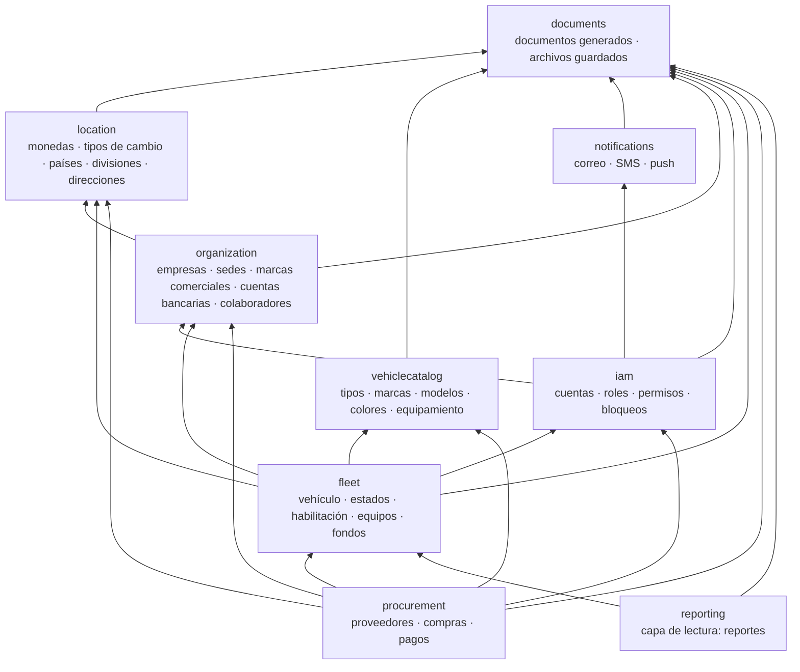

# Mapa de contextos — ERP Millennium Mobility

**Fuente:** diccionario de datos v1.61 (§2.7, §3, §4.1, §4.6, §5 y las decisiones de §14), [patrones de persistencia](patrones-de-persistencia-millennium-mobility.md) y las reglas de arquitectura de la skill `backend-module`. Si este documento y el diccionario no coinciden, manda el diccionario.

El diccionario (§3) fija dos cosas: qué contexto es dueño de cada bloque, y que un contexto usa a otro únicamente a través de su fachada, sin consultar ni escribir sus tablas. Este documento desarrolla esas reglas: qué posee cada contexto, quién puede llamar a quién, qué ofrece cada fachada y cómo se resuelven las fronteras delicadas.

**Cómo leerlo.** Lo que cita una sección o una decisión del diccionario (§n, D-n) o una regla de arquitectura está decidido. Lo marcado **(propuesta)** no lo decide nadie todavía y figura en las decisiones pendientes (§11).

**Hacia dónde va.** El [mapa de contextos objetivo](mapa-de-contextos-objetivo-millennium-mobility.md) propone la estructura de contextos que sigue a esta, incluido el bloque 12, y el [plan de migración](plan-de-migracion-a-los-contextos-objetivo-2026-11-18.md) dice cómo llegar por fases. Este documento sigue describiendo lo que rige hoy; cada fase que se integra actualiza aquí su parte.

---

## 1. El criterio

Un contexto termina **donde una palabra cambia de significado**. Estas son las palabras que marcan las fronteras de este proyecto:

| Palabra | Significado A | Significado B |
|---|---|---|
| Marca | Lizzo, Lima Bikes: bajo qué nombre se coloca la unidad (`organization`, §6.3). En pantalla, siempre «Marca comercial» (D-252) | Chevrolet, TVS: quién fabricó la unidad (`vehiclecatalog`, §7.2). En pantalla, «Marca» sola (D-252) |
| Entregado | La unidad salió físicamente hacia el cliente (`fleet`, §11.9) | Ventas no usa la palabra (D-253): la unidad cuyo contrato terminó y pasó a su cliente está «Traspasada», y su contrato, «Completado». El contrato es de ventas (bloque 12, fuera del alcance actual); el traspaso se registra en `vehicles.transfer_date` y `transfer_reason` (`fleet`, D-20, D-223) |
| Activo | La unidad genera ingresos (`fleet`, §8.2) | Un contrato nunca está «Activo»: está «Vigente», «Completado» o «Resuelto» (ventas, bloque 12; D-253). La palabra queda para la unidad |
| Tipo de vehículo | Auto, moto, trimoto (`vehiclecatalog`, §7.1) | Nuevo o semi-nuevo, que se deduce de si hubo contratos (§7.1, §5.11) |
| Vehículo | Una unidad que se mueve, se habilita y se entrega (`fleet`) | Una línea de comprobante con un VIN y un monto (`procurement`) |
| Ubicación | El país, sus divisiones territoriales y las direcciones (`location`) | El lugar físico donde puede haber vehículos: patio, sede, dealer (`organization`, tabla `locations`, D-6) |

El vocabulario de personas es el del diccionario (D-39): **rol** es el conjunto de permisos de una cuenta, **puesto** el trabajo del colaborador y **perfil** sus datos personales. "Cargo" no se usa.

---

## 2. Arquitectura

**Un solo despliegue, módulos separados** (Spring Modulith). No hay microservicios.

| Regla | Cómo se sostiene |
|---|---|
| Cada contexto es dueño de sus tablas. Nadie escribe en las de otro (§3; regla 1.3) | Las escrituras pasan por la fachada del dueño, que es quien escribe |
| Nadie consulta las tablas de otro (§3; regla 1.2) | Las lecturas pasan por la fachada del dueño. La única excepción es la capa de lectura, `reporting` (§7), que solo lee |
| Las llaves foráneas entre contextos sí están permitidas (regla 1.2) | Es una sola base de datos y protegen la integridad |
| Las dependencias entre contextos van en un solo sentido | `ModularityTests` falla ante un ciclo, ante el uso del interior de otro contexto y ante una dependencia que el `package-info.java` del contexto no declara en sus `allowedDependencies`; lo que declara cada uno está en §4. `shared` es un módulo abierto (`ApplicationModule.Type.OPEN`): todos usan sus paquetes, y `fleet`, `procurement` y `reporting` lo nombran además en su lista. Un puerto que un contexto declara en su `acl` y otro implementa no invierte la flecha: el dueño de la regla declara la pregunta y no conoce a quien responde (§5.1, §6.6) |
| El dominio es solo dominio, en todos los contextos | Agregado en `domain`; entidad de persistencia, ensamblador y adaptador en `infrastructure`, también en los catálogos ([patrones de persistencia](patrones-de-persistencia-millennium-mobility.md)). `LayerDependencyTests` vigila las capas |

---

## 3. Los contextos

La asignación de bloques sigue el cuadro "A qué contexto pertenece cada bloque" del diccionario (§3), que también reparte el bloque 3b (D-92): `employees` es de `organization`; `user_roles` y `employee_account_link_events`, de `iam`, igual que `user_access_suspensions` y el resto del bloque 2. **(propuesta)** El diccionario no fija el tipo de cada contexto ni los límites de los agregados; esas dos columnas son propuesta de este documento (decisión 4). Los agregados son los que tiene el código.

| Contexto | Tipo **(propuesta)** | Bloques | Tablas que posee | Agregados **(propuesta)** |
|---|---|---|---|---|
| `location` | Genérico | 1 · Geografía y localización | `currencies`, `countries`, `geo_division_levels`, `geo_divisions`, `addresses`, `tax_id_types` (D-44) y `exchange_rates`, una tasa por país (D-148) | `Currency`, `Country` (con sus escalones, D-45), `GeoDivision`, `Address`, `TaxIdType`, `ExchangeRate` |
| `iam` | Genérico | 2 · Seguridad; del 3b, `user_roles` y `employee_account_link_events` (D-92, D-82) | `users`, `user_access_suspensions`, `roles`, `permissions`, `role_permissions`, `permission_incompatibilities` (D-119), `user_roles`, `employee_account_link_events` y tres tablas de control que se purgan: `sign_in_throttles` (D-144), `password_reset_tokens` (D-243) y `account_activation_codes` (D-255) | `User` (con sus asignaciones de rol), `AccessSuspension`, `Role` (con sus permisos), `Permission` (un catálogo que solo se lee, como los pares incompatibles), `EmployeeAccountLinkEvent` (se escribe una vez y nunca cambia), `SignInThrottle` (un contador del freno, de una cuenta o de una cuenta y un navegador), `PasswordResetToken` (un enlace de un solo uso para restablecer la contraseña) y `AccountActivationCode` (un código de seis dígitos de un solo uso para activar la cuenta) |
| `organization` | Soporte | 3 · Empresas; del 3b, `employees` (D-92) | `companies`, `commercial_brands`, `branches`, `locations`, `company_bank_accounts` (D-214), `employees` y `employee_tenure_periods` (D-241) | `Company`, `CommercialBrand`, `Branch`, `Location`, `BankAccount`, `Employee`, `EmployeeTenurePeriod` (se escribe una vez y nunca cambia) |
| `vehiclecatalog` | Soporte | 4 · Catálogos de flota | `vehicle_types`, `vehicle_brands`, `vehicle_models`, `colors`, `equipment_types`, `equipment_type_vehicle_types`, `equipment_models` (D-254) | `VehicleType`, `VehicleBrand`, `VehicleModel`, `Color`, `EquipmentType` (con los tipos de vehículo a los que aplica), `EquipmentModel` |
| `fleet` | Central | 6 · Vehículo y estados; 9 · Habilitación (salvo `import_batches`); 10 · Fondos | `vehicle_statuses`, `status_change_reasons`, `vehicles`, `vehicle_status_history`, `vehicle_mileage_readings`, `vehicle_document_types` (D-139), `vehicle_documents`, `vehicle_equipments`, `fleet_equipments` (D-254), `vehicle_keys`, `vehicle_tax_declarations`, `funds`, `vehicle_fund_assignments` | `VehicleStatus`, `StatusChangeReason`, `Vehicle`, `VehicleKey`, `VehicleDocumentType`, `VehicleDocument`, `VehicleEquipment`, `Equipment` (el equipo físico del almacén de una empresa), `VehicleTaxDeclaration`, `Fund`, `VehicleFundAssignment`; el historial de estados (`VehicleStatusHistoryEntry`) y las lecturas de kilometraje (`VehicleMileageReading`), cada uno con su propio repositorio |
| `procurement` | Central | 7 · Compras (incluye el 5); 8 · Pagos | `suppliers`, `supplier_contacts`, `purchase_order_types`, `purchase_order_templates`, `purchase_order_template_document_types`, `purchase_order_template_documents`, `purchase_orders`, `purchase_order_items`, `purchase_invoices`, `purchase_invoice_items`, `credit_notes`, `credit_note_items`, `supplier_payments`, `payment_applications`, `payment_allocations` y `supplier_balance_uses` (D-249) | `Supplier` (con sus contactos), `PurchaseOrderType`, `PurchaseOrderTemplate`, `PurchaseOrderTemplateDocumentType`, `PurchaseOrderTemplateDocument`, `PurchaseOrder` (con sus líneas), `PurchaseInvoice` (con sus líneas por unidad), `CreditNote` (con su reparto), `SupplierPayment` (con sus aplicaciones, sus imputaciones y los usos del saldo) |
| `shared` | Transversal | 11 · Bitácora y cargas de archivos | `change_logs` (D-129), `import_batches` (D-200) y la tabla técnica `data_versions` (D-128) | `ChangeLogEntry`, `ImportBatch` |
| `documents` | Transversal, de la plataforma (D-125) | Ninguno: son tablas técnicas de §2.7 | `generated_documents`, `kept_files` (D-189) | `GeneratedDocument`; los bytes que no vencen, por `KeptFileStore`, sin agregado propio |
| `notifications` | Transversal, de la plataforma (D-143, D-242; §6.7) | Ninguno: son tablas técnicas de §2.7 | `notifications` y `notification_attempts` (V125); prevista, `push_devices` (D-143) | `Notification`, con sus intentos; previsto, el dispositivo registrado para push |
| `reporting` | Capa de lectura (D-232; §7) | Ninguno | Ninguna: lee por SQL las de los demás y nunca escribe | Ninguno |

**`permissions` y `role_permissions`** (§5.6) son de `iam` y las cargan sus migraciones: cada permiso llega con la migración que lo siembra con sus marcas en la matriz de los siete roles del sistema, y ningún otro contexto las escribe (D-95). `permissions` es un catálogo general, igual para todas las empresas (§2.5), sin Row Level Security ni columnas de registro, que la aplicación solo lee; lo mismo `permission_incompatibilities`, los pares que ningún rol propio ni ninguna cuenta junta (D-119). `role_permissions` lleva la historia de cada marca (D-96) y no tiene `public_id`, porque la API nunca direcciona una fila suya. `roles` lleva `company_id` e `is_active` (D-97, D-98) y Row Level Security: un rol general lo ve toda cuenta con alcance, uno de una empresa quien la alcanza y, siempre, la cuenta que lo tiene asignado, porque la cuenta se lee al comenzar cada petición antes de conocer sus empresas; `role_permissions` la hereda de su rol. Los demás contextos no leen esas tablas: exigen un permiso con `@PermissionRequired` y una constante de `PermissionCodes`, de `shared` (§5.3), y deciden dónde actúa con el alcance.

**`employee_account_link_events`** (§5.4, V44) registra las dos decisiones sobre el vínculo de un colaborador con una cuenta que solo toma un superadministrador (D-82): vincular la cuenta de otra persona después de ver a sus titulares, y desvincular una cuenta para corregir un vínculo equivocado. Se escribe en la misma transacción que el cambio, nunca se edita ni se borra, y solo un vínculo confirmado guarda los titulares que vio el superadministrador. Lleva la empresa del colaborador: la escritura respeta la frontera de su empresa (`access_scope_reaches(company_id)`), y la lectura queda para un superadministrador vigente o un proceso automático con alcance `SYSTEM`, porque esos titulares son personas de otras empresas. La cuenta de la aplicación solo lee e inserta.

**`employee_tenure_periods`** (§5.3, D-241) guarda los períodos cerrados de un colaborador: cada regreso escribe, en la misma transacción, el ingreso y la salida del período que cierra. Es de solo inserción y lleva la empresa del colaborador; el período vigente sigue en `employees`.

**`company_bank_accounts`** (§6.2.1, D-214) guarda las cuentas con que cada empresa paga. Es de `organization`; `procurement` las lee por la fachada para los pagos, y `organization` sabe si una cuenta ya tiene pagos por el puerto `BankAccountPayments` (§5.1).

**`advisor_assignments`** también es del bloque 3b, así que el diccionario la asigna a `organization` e `iam`; según el ajuste 2 de §3 se construye con el bloque 12, pero eso no cambia a quién pertenece.

**Tablas técnicas** (§2.2, §2.7): `flyway_schema_history`, `event_publications` y `spring_session*` las administran sus librerías. Las de sesiones las usa `iam`. `generated_documents` y `kept_files` son del módulo `documents`: la primera la piden los contextos que exportan, por `DocumentService`; la segunda guarda los bytes que no vencen —el logo, la firma y el PDF enviado de compras, los archivos de las facturas, de las notas de crédito, de los pagos y de los documentos de una unidad, y los archivos de las cargas—, que `procurement` y `fleet` guardan por `KeptFileStore` y `shared` por su puerto `ImportBatchFileStore`, que implementa `documents` (D-125, D-189). Ningún contexto lee esas tablas. `kept_files` lleva la empresa de cada archivo y Row Level Security como toda tabla de empresa (V84); `KeptFileStore.put` la recibe de quien guarda. `notifications` y `notification_attempts` las lee solo el alcance `SYSTEM` (D-242).

**Fuera del alcance actual:** el bloque 12, ventas y contratos (clientes, contratos y cobros), y la aplicación del cliente con sus propias identidades (§5.1). El diccionario no les asigna contexto. **(propuesta)** Llamarlos `sales` y `customerportal`.

### Por qué cada agregado tiene ese límite (propuesta)

Un agregado es lo que se guarda y se valida como un todo.

- **`PurchaseInvoice` incluye sus líneas.** Que la suma de las líneas coincida con el total es una regla del comprobante (§9.3): al guardar la factura se validan todas sus líneas de una vez.
- **`CreditNote` incluye su reparto**, por la misma razón: lo repartido debe coincidir con el total (§9.5).
- **`SupplierPayment` incluye sus aplicaciones, sus imputaciones y los usos del saldo**: un pago se aplica completo, así que sus aplicaciones se guardan con él (D-210), y lo que usa del saldo queda fijo con el pago (D-249).
- **El historial de estados y las lecturas de kilometraje van aparte de `Vehicle`.** Crecen sin límite y se consultan por sí solos. El estado actual y el último kilometraje se guardan además en la unidad, y se escriben en la misma operación que su historial (§8.4, §8.5; regla 4.1).
- **`VehicleKey`, `VehicleDocument`, `VehicleEquipment` y `VehicleFundAssignment` van aparte**: cada uno tiene su propio ciclo (vencimientos, períodos, cargas masivas).
- **`Company` no incluye sedes, marcas, ubicaciones ni cuentas bancarias**: son agregados propios que apuntan a la empresa.
- **`Country` incluye sus escalones** (D-45). Que se declaren en orden, que sean cuatro como máximo y que no se borren son reglas del país: se guardan con él. Las divisiones van aparte, porque son miles y se consultan solas.
- **`User` incluye sus asignaciones de rol, y `AccessSuspension` va aparte.** Que el mismo rol no se dé dos veces sobre el mismo alcance y que la salida retire los roles de una empresa son reglas de la cuenta: se guardan con ella. Los bloqueos crecen con el tiempo, tienen su propia ruta y su propio ciclo (programado, en curso, terminado, cancelado), y la regla que los cruza —dos de la misma línea no se pisan— la protege la base. Las operaciones que leen los bloqueos de una cuenta y después los cambian bloquean primero la fila de la cuenta ([patrones de persistencia](patrones-de-persistencia-millennium-mobility.md)).

---

## 4. Quién puede llamar a quién (propuesta)

El diccionario no fija el sentido de las dependencias. Lo que sí está decidido y se respeta aquí: el acceso solo por fachada (§3), D-32, D-38 y D-42; que `iam` llama a `organization` y nunca al revés (decisión 4); las dependencias de los módulos de la plataforma, `documents` (D-125) y `notifications` (D-143), y las de `reporting` (D-232). Que no haya ciclos lo exige Spring Modulith; la dirección de cada otro par es propuesta de este documento (decisión 4).

La flecha va de quien llama hacia quien es llamado. Nunca al revés: `location` no sabe que existe `fleet`. Todos usan `shared`, un módulo abierto, y el diagrama no lo dibuja.

`reporting` lee además por SQL las tablas de todos los contextos, nunca escribe y ningún contexto lo llama (§7).

| Contexto | Declara (`allowedDependencies`) | Para qué |
|---|---|---|
| `location` | `documents::acl` | Pedir sus exportaciones a `documents` (D-125). Antes de cambiar los decimales de una moneda, preguntar a cada `CurrencyUsage` si algún monto la usa: es un puerto que `location` declara en su propio `acl` y que implementan los contextos con montos, sin que `location` los conozca (§6.6) |
| `vehiclecatalog` | `documents::acl` | Pedir la exportación de sus catálogos (D-125). No llama a ningún contexto de negocio: que un modelo ya tiene unidades o un tipo de equipo instalaciones se lo avisa `fleet` (§6.4) |
| `organization` | `location::acl`, `documents::acl` | Países, monedas funcionales, tipos de documento tributario de las empresas (D-44) y direcciones de empresas, sedes y ubicaciones; pedir sus exportaciones a `documents` (D-125). Si una cuenta bancaria ya tiene pagos lo pregunta a `BankAccountPayments`, un puerto que declara en su `acl` y que implementa `procurement` (§5.1) |
| `iam` | `organization::acl`, `documents::acl`, `notifications::acl` | Pedir la exportación de las cuentas a `documents` (D-125). Pedirle a `notifications` el correo con el enlace para restablecer una contraseña y el del código para activar una cuenta, con la dirección y el enlace o el código ya resueltos (D-242, D-243, D-255; §6.7). De `organization`: comprobar, al otorgar un rol de empresa o de sede, que la cuenta está vinculada a un colaborador activo de esa empresa, y para uno de alcance sistema, de alguna empresa (§5.3, §5.7, D-38) —que la sede y la marca pertenezcan a la empresa lo impide la base (§5.7)—; leer y bloquear el colaborador y vincularlo a su cuenta al dar acceso (D-38), una cuenta existente solo si es de la misma persona, y mostrar quién la tiene cuando no lo es (D-82); desvincular una cuenta (D-82); registrar la salida y el regreso (decisión 2, opción A); resolver el alcance de una asignación, que no se otorga sobre una empresa, sede o marca inactiva (D-84); nombrar empresas, sedes y marcas en lote, dar la zona de cada empresa y las empresas donde cada cuenta tiene un colaborador activo; leer la empresa de un rol propio, que tiene que existir y estar activa (D-98); comparar el documento de identidad de quien activa su cuenta con el de sus colaboradores (D-258); y nombrar en lote a la persona de cada cuenta, para `fleet` y para la bitácora y las cargas de `shared` (decisión 6, D-129). Registrar el colaborador del registro público (D-32) llega con el registro con perfil (D-83) |
| `fleet` | `shared`, `location::acl`, `vehiclecatalog::acl`, `organization::acl`, `iam::acl` **(propuesta, decisión 6)**, `documents::acl` | De `location`: el país de un tipo de documento del vehículo, por su código ISO; la moneda del costo de un equipo, leída en modo compartido; y la versión de sus datos para la exportación del Inventario. De `vehiclecatalog`: el modelo y el color de la unidad, el perfil de habilitación de un lote de modelos, los tipos y los modelos de equipamiento, y avisar que sus modelos ya tienen unidades (`markModelsInUse`, D-107) y que un tipo de equipo ya tiene instalaciones (`markEquipmentTypeInUse`, D-185). De `organization`: la empresa, con su país y su moneda funcional, la marca comercial y la ubicación de la unidad, y el colaborador que instaló un equipo. De `iam`: el identificador público y el nombre de quien creó o cambió una unidad, movió un estado o registró una lectura; la cuenta `SYSTEM`, que firma el regreso automático (D-42); y el permiso que exige cada camino (D-100). De `documents`: sus exportaciones y los archivos de los documentos de la unidad, por `KeptFileStore` (D-189). De `shared`: registrar las cargas del impuesto vehicular y de la garantía mobiliaria (D-200). Implementa `CurrencyUsage` de `location` con el costo de las instalaciones, y declara los puertos `UnitPurchases`, `UnitContracts` y `EquipmentSuppliers`, que implementan otros (§5.1) |
| `procurement` | `shared`, `organization::acl`, `location::acl`, `vehiclecatalog::acl`, `iam::acl`, `documents::acl`, `fleet::acl` | De `location`: el domicilio del proveedor y de la plantilla, copiado de la empresa (D-134); el tipo de documento; la moneda, leída con `FOR SHARE` al emitir una orden (§6.6); y la tasa de un día (`fetchEffectiveRate`, D-151). De `vehiclecatalog`: el modelo y el color de las líneas de orden y de factura, y los activos que lista la plantilla de las líneas de una factura. De `organization`: el emisor de la plantilla, la empresa y la marca de una orden o una factura, leídas con `FOR SHARE`, el colaborador de Atención y las cuentas bancarias de un pago (D-214). De `fleet`: el VIN de cada línea de una factura, el alta de sus unidades nuevas y el vínculo de las existentes (decisión 5), la ficha de sus unidades, la anulación de las que una nota devuelve y el candado de las de una nota que se anula (D-191, D-193), y la carga inicial: el cruce de sus VIN, su ubicación y el alta de sus unidades con su habilitación (D-201, D-202). De `documents`: los bytes del logo, la firma y el PDF enviado y los archivos de facturas, notas y pagos, por `KeptFileStore`, y sus exportaciones. De `shared`: registrar el lote de la carga inicial (D-200) y leer la historia de sus propias aplicaciones de pago (`ChangeLogHistoryLookup`). Declara `iam::acl`, que hoy no usa (decisión 6). Implementa `UnitPurchases` y `EquipmentSuppliers` de `fleet`, `CurrencyUsage` de `location` y `BankAccountPayments` de `organization` |
| `documents` | Ninguna (`{}`) | Nada de ningún contexto: el alcance lo lee del puerto `CurrentAccessScope` (§5.3), y lo que cada tipo de documento necesita —sus filas, su versión de los datos— se lo da el contexto que lo declara (D-125). Implementa el puerto `ImportBatchFileStore` de `shared`, que guarda en `kept_files` los archivos de las cargas: si `shared` importara `documents`, que ya depende de él, cerraría un ciclo |
| `notifications` | `documents::acl` | `documents`: un archivo guardado que viaje adjunto, como el PDF de una orden enviada; declarado, sin uso todavía. De `shared`: el alcance `SYSTEM` y la corrida en una sola instancia (`SingleInstanceRun`). Ningún contexto de negocio: quien avisa le pasa el destino (§6.7) |
| `reporting` | `shared`, `documents::acl`, `fleet::acl` | Leer por SQL las tablas de los contextos, sin escribir nunca (§7); pedir a `fleet::acl` lo que tiene una regla con dueño —el estado de habilitación, la entrega, la brecha de días y los montos de una unidad (`fetchReportFacts`, `fetchPurchaseCosts`)— para no escribirlo dos veces (D-232); y el Excel del stock por `documents` |

Lo que se resuelve con este sentido único:

- **`organization` no llama a `iam`.** Cuando hay sesión, el autor de sus registros lo llena el auditor que aporta `iam` (`CurrentUserAuditorAware`) a partir de la cuenta de la sesión (D-42), y el alcance de quien llama lo lee del puerto `CurrentAccessScope`; qué cuentas son protegidas y cuáles esperan su activación, de `ProtectedAccounts` y `PendingAccountActivations` (§5.3). Spring inyecta los puertos, así que no hay dependencia de código. En el registro público no hay sesión y el auditor no supone `SYSTEM` (D-42): es `iam` quien entrega el identificador de `SYSTEM` cuando le pide a `organization` registrar el colaborador. La salida de un colaborador la registra `iam`, que le pide a `organization` cerrar el colaborador (decisión 2, opción A): no hace falta un evento.
- **`location` no llama a `procurement` ni a `fleet`.** Para saber si una moneda ya tiene montos, pregunta a los `CurrencyUsage` que haya, un puerto suyo que implementan los contextos con montos, sin saber de quién son (§6.6).
- **`organization` no llama a `procurement`.** Si una cuenta bancaria ya tiene pagos lo pregunta a los `BankAccountPayments` que haya, un puerto suyo que implementa `procurement`.
- **`fleet` no llama a `procurement`.** Cuando una nota de crédito deja en cero el valor de una unidad, es `procurement` quien le pide a `fleet` que la anule. Lo que la ficha de la unidad dice de su compra y de su pago, y el proveedor de un equipo del inventario, `fleet` lo pregunta por puertos suyos que `procurement` implementa, `UnitPurchases` y `EquipmentSuppliers` (§5.1, §6.1).
- **Lo que llega de otra fachada se queda en la capa de traducción.** `ForeignAclStaysInTranslationLayerTests`, al estilo de `LayerDependencyTests`, falla si una clase de cualquier contexto nombra un tipo de la fachada de otro contexto de negocio fuera de `application/internal/outboundservices/acl` y `application/acl`: su `External<Contexto>Service` lo traduce a un objeto de valor de su dominio, si llega a una vista o a REST, o a un record de su capa de traducción, si lo usa solo un servicio. Quedan fuera los contratos de la plataforma, `documents::acl` (D-125) y `notifications::acl` (D-143), y el puerto de otro contexto que una clase implementa, como `CurrencyUsage` (§6.6). No tiene deuda: la regla vale para todos los contextos.
- **Cómo se muestran las referencias a cuentas fuera de `iam`** (`changed_by`, `uploaded_by`, `imported_by`) es la decisión pendiente 6. `fleet` llama a `iam` por su fachada, sin ciclo, porque `iam` no llama a `fleet`: es la opción B, **(propuesta, pendiente de validar por el responsable)**.

---

## 5. Fachadas y eventos

### 5.1 Lo que expone cada contexto

Cada contexto expone una fachada en `interfaces.acl`, anotada como `@NamedInterface("acl")` (regla 1.1), e implementada en `application.acl` sobre sus servicios de consulta y de comandos, nunca sobre los repositorios. Devuelve tipos simples o `record` definidos en el propio paquete `acl`, nunca agregados (regla 1.4). Puede devolver el `id` interno, porque no sale del servidor. En el mismo paquete viven los puertos que el contexto declara para que otros le respondan: el dueño de la regla declara la pregunta, cada contexto que sabe la respuesta la implementa con un bean, y el dueño pregunta a todos los que haya sin depender de ellos.

Quien la consume lo hace desde `application.internal.outboundservices.acl`, con un servicio `External<Contexto>Service` que traduce la respuesta a su propio vocabulario (skill `backend-module`). Las referencias de una lista se leen **en lote**: un método recibe todos los identificadores internos y responde un mapa, nunca una llamada por fila; un solo registro se lee con el método en lote y un solo identificador.

| Contexto | Fachada o puerto | Qué ofrece | Quién la usa |
|---|---|---|---|
| `iam` | `IamContextFacade` | Cuatro miembros: las cuentas que nombra una lista, en una lectura, con su identificador público y el nombre de la persona, que `iam` lee en lote de `organization`, y `SYSTEM` para la cuenta de los procesos automáticos (`fetchAccountReferencesByIds`, `AccountReference`); el identificador de la cuenta `SYSTEM`, que firma lo automático (`fetchSystemAccountId`, D-42); y un permiso del catálogo por su código o varios por su identificador (`fetchPermissionByCode`, `fetchPermissionReferencesByIds`, `PermissionReference`), para el permiso que exige cada camino de estado (D-100). Lo que los demás necesitan de la cuenta de la petición —el autor de sus registros y el alcance de quien llama— lo reciben por puertos de `shared` que `iam` implementa (§5.3); `organization` y `location` no dependen de `iam` | `fleet`, por su `ExternalIamService` (decisión 6, opción B, **propuesta**); dentro de `iam`, el adaptador del puerto `AuditActorLookupPort` de la bitácora y de las cargas (D-129) |
| `location` | `LocationContextFacade` | El resumen de una moneda (`CurrencySummary`, con si está activa, para que el consumidor no elija una inactiva en una operación nueva, §4.1): en lote (`fetchCurrencySummariesByIds`), por su código ISO (`fetchCurrencySummaryByIsoCode`), y por su código con la fila leída con `FOR SHARE` hasta que termina la transacción (`fetchCurrencySummaryByIsoCodeForShare`), para el documento que escribe un monto en ella, así una corrección de sus decimales no se cruza con él (§6.6). El resumen de un país (`CountrySummary`, con su zona horaria, su tasa de impuesto y el tipo de tasa de sus compras) por identificador público, por su código ISO y en lote, para el "hoy" de un colaborador sin sede y la zona de cada empresa (§2.6). El resumen de un tipo de documento tributario (`TaxIdTypeSummary`) por identificador público y en lote, con a quién cubre, su longitud, si tiene dígito de control y si está activo, y la verificación del dígito de control de un número (`verifyTaxIdCheckDigit`), que `location` calcula según la sigla del tipo en su país para que ningún consumidor copie el cálculo (§4.7, D-75). Las direcciones de los dueños (§6.3): `createAddress` en el país que fija el dueño, `correctAddress` y `replaceAddress`, que devuelven `Result` con el error de `location`; `copyAddress`, que copia tal cual la dirección de otro dueño en una fila nueva —el domicilio fiscal de la empresa que la plantilla de orden de compra guarda como emisor (D-134)— sin revisar de nuevo la división ni el código postal; y `fetchAddressSummariesByIds` para leerlas. La tasa vigente de un día para un país, un par de monedas y un tipo (`fetchEffectiveRate`, D-151): la más reciente de ese día o de antes. Y la versión de los datos que resuelve (`fetchDataVersion`): un documento generado de otro contexto que nombra países, monedas, divisiones, tipos de documento o direcciones la suma a la suya, para que un cambio en `location` no se sirva desde un documento viejo (D-106) | `organization`, `fleet` y `procurement`, cada uno por su `ExternalLocationService` |
| `location` | `CurrencyUsage` (puerto, en `location::acl`) | `anyAmountIn(currencyId)`: si algún registro del contexto guarda un monto en esa moneda, en cualquier empresa. `PUT /currencies/{id}` pregunta a todos los que haya solo cuando cambian los decimales, con la moneda bloqueada y con alcance `SYSTEM`, y responde `422 CURRENCY_DECIMAL_PLACES_IN_USE` si alguno dice que sí (§4.1, LOC-R05; §6.6) | Lo implementan `procurement`, con sus órdenes (`PurchaseOrderCurrencyUsageAdapter`), sus facturas (`PurchaseInvoiceCurrencyUsageAdapter`) y sus pagos (`SupplierPaymentCurrencyUsageAdapter`), de cualquier estado, y `fleet`, con el costo de las instalaciones de una unidad (`VehicleEquipmentCurrencyUsageAdapter`). Las notas de crédito no, porque su moneda la fijan sus facturas; los fondos no guardan moneda (§12.1) |
| `organization` | `OrganizationContextFacade` | **Para `iam`:** el resumen de una empresa por su identificador público (`fetchCompanySummaryByPublicId`); el colaborador por su identificador público, leído con su fila bloqueada hasta que termina la transacción (`fetchEmployeeSummaryForUpdate`); los colaboradores de una cuenta (`fetchEmployeeSummariesByUserId`) y quién la tiene, con nombre, documento y empresa, para que un superadministrador lo vea antes de confirmar (`fetchAccountHoldersByUserId`, D-82); las empresas donde una cuenta, o cada cuenta de una lista en una sola lectura, tiene un colaborador activo (`fetchActiveEmployeeCompanyIdsByUserId`, `fetchActiveEmployeeCompanyIdsByUserIds`); las cuentas con colaborador en una empresa (`fetchLinkedEmployeePublicIdsByCompanyId`); el nombre del colaborador de cada cuenta de una lista (`fetchEmployeeNamesByUserIds`, decisión 6, D-129); vincular un colaborador a una cuenta nueva (`linkUserToEmployee`) o a una existente, que tiene que ser de la misma persona por la sigla y el número de su documento (`linkExistingUserToEmployee`, D-82), y deshacer un vínculo (`unlinkUserFromEmployee`), todos con `Result`; registrar la salida y el regreso, con sus reglas de fechas y el "hoy" de la sede o del país (`terminateEmployee`, `reactivateEmployee`, §2.6, D-241); resolver la empresa, la sede y la marca de una asignación, de esa empresa y activas (`resolveScope`, §5.7, D-84); nombres de empresas, sedes y marcas en lote (`fetchCompanyReferencesByIds`, `fetchBranchReferencesByIds`, `fetchCommercialBrandReferencesByIds`); las empresas activas (`fetchActiveCompanyReferences`) y la zona de cada una (`fetchCompanyTimeZonesByIds`). **Para `fleet`:** una marca comercial por su identificador público, activa o no y sin bloqueo (`fetchCommercialBrandReferenceByPublicId`, `CommercialBrandReference`, con su código), y las de las unidades nuevas de un lote, leídas en modo compartido (`fetchCommercialBrandReferencesByIdsForShare`); una ubicación por su identificador público y varias en lote, con su código, su empresa, si está activa y, si es propia, su sede (`fetchLocationReferenceByPublicId`, `fetchLocationReferencesByIds`, `LocationReference`); la empresa con su país, su zona y su moneda funcional (`fetchPurchasingCompaniesByIds`); el colaborador que instaló un equipo (`fetchEmployeeAttentionByPublicId`, `fetchEmployeeAttentionsByIds`); y además `fetchCompanySummaryByPublicId`, `resolveScope` para la marca de una unidad, y los nombres y la zona en lote. **Para `procurement`:** el emisor de la plantilla, copiado de la empresa (`fetchCompanyIssuerByPublicId`, D-134); el colaborador de Atención (`fetchEmployeeAttentionByPublicId`, `fetchEmployeeAttentionsByIds`); la empresa que registra una factura, leída en modo compartido, y la de varias en una lectura (`fetchPurchasingCompanyForShare`, `fetchPurchasingCompaniesByIds`); las marcas de una empresa que nombra un pedido (`fetchCommercialBrandReferencesByPublicIds`); las cuentas bancarias de un pago, la que nombra leída en modo compartido, las de una lista y todas las de una empresa (`fetchBankAccountForShare`, `fetchBankAccountsByIds`, `fetchBankAccountsByPublicIds`, `fetchBankAccountsOfCompany`; D-214); `resolveScope`, que lee la empresa y la marca de una orden con `FOR SHARE`; y los nombres y la zona de empresas y marcas. **Para todos:** la versión de los datos que resuelve (`fetchDataVersion`), para las exportaciones que nombran empresas, sedes, marcas, ubicaciones y colaboradores (D-106). Si un país opera lo responde la API, no la fachada (D-3) | `iam`, `fleet` y `procurement`, cada uno por su `ExternalOrganizationService`; dentro de `organization`, el adaptador del puerto `AuditCompanyLookupPort` de la bitácora (D-129) |
| `organization` | `BankAccountPayments` (puerto, en `organization::acl`) | `withPayments(cuentas)`: cuáles de unas cuentas tienen un pago, vigente o anulado, porque un pago anulado también salió de su cuenta y conserva el número y la moneda con que se registró (§6.2.1, D-214). Con pagos, una cuenta no cambia su moneda ni su número. Responde con el alcance de quien llama; sin ningún bean, ninguna cuenta tiene pagos | Lo implementa `procurement` (`SupplierPaymentBankAccountPaymentsAdapter`) |
| `organization` | (misma fachada) **(propuesta)** | Registrar el colaborador del registro público con el autor que indica `iam` (D-42) | Llega con el registro público con perfil (D-32, D-83) |
| `vehiclecatalog` | `VehicleCatalogContextFacade` | El modelo (`VehicleModelSummary`: `id`, `publicId`, `name`, si está activo y si lo están su marca y su tipo, `brandIsActive` y `vehicleTypeIsActive`, D-108, y el nombre de la marca y el código y el nombre del tipo, que escriben las exportaciones) y el color (`ColorSummary`, con si está activo): por su identificador público, en lote por identificador interno y por identificador público, y los activos (`fetchVehicleModelSummaryByPublicId`, `fetchColorSummaryByPublicId`, `fetchVehicleModelSummariesByIds`, `fetchColorSummariesByIds`, `fetchVehicleModelSummariesByPublicIds`, `fetchColorSummariesByPublicIds`, `fetchActiveVehicleModelSummaries`, `fetchActiveColorSummaries`). Que los modelos de un alta o de un lote ya tienen unidades (`markModelsInUse(Set<Long>)`), desde lo cual su tipo queda fijo (D-107): es idempotente y corre en la transacción de quien llama. El perfil de habilitación de un lote de modelos (`fetchEnablementProfilesByModelIds`, `ModelEnablementProfile`), con la regla de la pantalla escrita una sola vez: el equipo aplica a su tipo **y** el modelo no la trae de fábrica (§7.5). Los tipos de equipo y los modelos de equipamiento por su identificador (`fetchEquipmentTypeReferenceByPublicId`, `fetchEquipmentTypeReferencesByIds`, `fetchEquipmentModelReferenceByPublicId`, `fetchEquipmentModelReferencesByIds`). Que un tipo de equipo ya tiene instalaciones (`markEquipmentTypeInUse`), desde lo cual su código queda fijo (D-185). Y la versión de los datos que resuelve: la de tipos, marcas, modelos y colores (`fetchDataVersion`, D-106, D-116) y la de la habilitación (`fetchEnablementDataVersion`) | `fleet`, por su `ExternalVehicleCatalogService`; `procurement`, por el suyo, para el modelo y el color de las líneas de orden y de factura y los activos que lista la plantilla de las líneas de una factura |
| `fleet` | `FleetContextFacade` | Para las facturas de compra (D-153, D-160): qué es cada VIN para una empresa —nuevo, una unidad suya o de otra empresa—, con la opción de bloquear las suyas (`matchPurchasedUnits`); el alta de las unidades nuevas y el vínculo de las existentes, en la transacción de quien llama (`registerOrLinkPurchasedUnits`); y las unidades de las líneas, en una lectura (`fetchUnitsByIds`). Para las notas de crédito: la anulación de las unidades que una nota con «anulación de unidad» devuelve, con la misma guarda que la anulación explícita (`annulReturnedUnits`, D-191), y el candado de las de una nota que se anula (`lockUnitsByIds`, D-193). Para la carga inicial (D-201, D-202): qué es cada VIN (`matchMigratedUnits`), la ubicación en que quedan sus unidades (`resolveMigrationLocation`) y el alta de las unidades de una factura migrada, cada una con su habilitación y en su estado (`registerMigratedUnits`). Para la capa de lectura (D-232): lo que las reglas de `fleet` dicen de las unidades de una empresa (`fetchReportFacts`) y su costo de compra (`fetchPurchaseCosts`). La anulación explícita es su propia ruta, `POST /vehicles/{id}/annulment` | `procurement` (facturas, notas de crédito y carga inicial) y `reporting`, cada uno por su `ExternalFleetService` |
| `fleet` | `UnitPurchases` (puerto, en `fleet::acl`) | Lo que compras sabe de la unidad (D-160, §9.6): si está en una línea vigente de una factura, que fija su modelo y su año, y cuáles de una lista o de una empresa lo están (`hasCurrentLine`, `withCurrentLine`, `unitIdsWithCurrentLine`, D-175); si su valor es cero (`valueIsZero`); su costo de compra, con sus notas y su pago (`purchaseCostOf`, `purchaseCostsOf`; D-199, D-203); cuáles devolvió al proveedor una nota vigente (`returnedUnitIds`, D-191); su estado de pago y la fecha base de su brecha, sin montos (`paymentFacts`, D-199); y la versión de lo que responde (`fetchDataVersion`). Responde con el alcance de quien llama | Lo implementa `procurement` (`PurchaseInvoiceUnitPurchasesAdapter`) |
| `fleet` | `UnitContracts` (puerto, en `fleet::acl`) | `hasContracts(unidad)`: si la unidad tiene un contrato, que le impide anularse (§9.6) | Lo implementará ventas. Mientras ningún bean lo implemente, `fleet` sabe de un contrato por el historial de la unidad (D-250, §6.1) |
| `fleet` | `EquipmentSuppliers` (puerto, en `fleet::acl`) | El proveedor de un equipo del inventario, por su identificador público y en lote, con su empresa, su razón social y si está activo (D-254) | Lo implementa `procurement` (`SupplierEquipmentSuppliersAdapter`) |
| `procurement` | — | No tiene fachada: lo que otros saben de compras lo preguntan por puertos que declaran ellos y `procurement` implementa —`UnitPurchases` y `EquipmentSuppliers` de `fleet`, `CurrencyUsage` de `location` y `BankAccountPayments` de `organization`—, y los indicadores de toda la flota los lee `reporting` (D-232) | — |
| `documents` | `DocumentService` y `KeptFileStore`, en `documents::acl` (D-125) | El único contrato público del módulo, el paquete `documents/interfaces/acl` con `@NamedInterface("acl")`. `DocumentService.request(DocumentRequest, DocumentContent)` recibe el pedido —el tipo, el formato y los criterios— y lo que escribe el archivo, y devuelve un `Result<DocumentSeeOther, ApplicationError>`, nunca el agregado `GeneratedDocument`; `DocumentSeeOther.toResponse` arma el `303` que devuelve cada controlador que exporta; y el contrato publica también `DocumentFormat`, `DocumentKind`, `DocumentScopes` y `DocumentContent`. `DocumentFormat` del contrato tiene su gemelo en el dominio, con el tipo de contenido y la extensión, y la fachada, `DocumentServiceImpl` en `documents/application/acl`, traduce uno al otro. `KeptFileStore` guarda y abre los bytes que no vencen (`kept_files`): `put` recibe la empresa del archivo, su llave, sus bytes y su tipo, y dice si esa escritura insertó la llave; `discardRolledBack` borra la que una transacción revertida escribió primero ([patrones de persistencia](patrones-de-persistencia-millennium-mobility.md)). No abre su dominio ni su API | `DocumentService`: los contextos que exportan, cada uno desde sus controladores con exportación y su registro de tipos (`<Contexto>DocumentKinds`). `KeptFileStore`: `procurement` y `fleet` (D-189) |
| `notifications` | `NotificationService`, en `notifications::acl` (§6.7) | `requestEmail(EmailNotificationRequest)`: el pedido de un correo —su tipo, su destinatario ya resuelto, su plantilla, sus parámetros, cuáles son sensibles y su vencimiento— y nunca el agregado; responde el identificador público de la notificación. `NotificationServiceImpl`, en `application/acl`, lo guarda con el alcance `SYSTEM` en la transacción de quien lo pide, que exige (`@Transactional(MANDATORY)`), y lo envía después el despachador. `deliversEmail()`: si los correos de este entorno llegan a la persona —sí con `sendgrid` y `smtp`, y con `capturing` solo fuera del perfil `prod`—, para que una operación que depende de uno se niegue antes de cambiar nada (D-258) | `iam`, por su `ExternalNotificationService`: el enlace para restablecer la contraseña (D-243) y el código de activación (D-255) |
| `shared` | — (módulo abierto) | No tiene fachada: los contextos usan sus servicios directamente. La bitácora: `ChangeLogCommandService`, con que escriben sus cambios `location`, `fleet` y `procurement`, y `ChangeLogHistoryLookup.latestOldValues`, la historia de las entidades propias de un contexto, sin el alcance de `bitacora.ver`, que usa `procurement` para decir de qué orden pasó la aplicación de un pago, sin nombrar la tabla `change_logs`. Las cargas de archivos (D-200): `ImportBatchCommandService`, `ImportBatchQueryService`, `ImportLocks` y los lectores y escritores de sus hojas, que usan `fleet` y `procurement`. Y la versión de los datos (`JdbcDataVersions`), los escritores de hojas de cálculo (`SpreadsheetExporter`), la corrida en una sola instancia (`SingleInstanceRun`) y los puertos de §5.3 | Todos los contextos |

### 5.2 Eventos entre contextos

El diccionario exige que la salida de un colaborador, el retiro de sus roles y el bloqueo de su cuenta ocurran **en la misma operación** (§5.3, D-38), y que se impida la salida si no quedaría ningún superadministrador activo (§5.9). No fija el mecanismo.

**Decidido: sin evento** (decisión 2, opción A). La salida y el regreso los registra un caso de uso de `iam`: valida quién puede, protege al último superadministrador, le pide a `organization` por su fachada que registre el hecho y, en la misma transacción, retira los roles y cierra o reabre la cuenta. Un fallo esperado vuelve como `Result`, nunca como excepción (regla 3.1).

No hay eventos entre contextos. `spring-modulith-starter-jpa` y su tabla `event_publications` siguen en el proyecto sin eventos que registrar: si se conservan es una pregunta abierta para el responsable.

### 5.3 Puertos del núcleo compartido

Hay datos que todos los contextos, y `shared` mismo, necesitan de otro contexto sin poder depender de él: quién hace la petición, qué empresas alcanza, cómo se nombra una cuenta o una empresa en la bitácora. Se resuelven con un puerto en `shared` que el dueño del dato implementa, el mismo patrón que Spring usa para el autor de los registros. Nadie importa código del que implementa, y Spring Modulith no ve dependencia.

| Puerto (`shared`) | Lo implementa | Qué responde | Quién lo usa |
|---|---|---|---|
| `AuditorAware` de Spring | `iam` (`CurrentUserAuditorAware`) | La cuenta de la sesión, para `created_by` y `updated_by` (D-42) | Todos los contextos, a través de las clases base de persistencia |
| `CurrentAccessScope` | `iam` (`CurrentUserAccessScope`) | El alcance de la cuenta de la petición (`AccessScope`), que lleva `userId`, `global` (un rol de alcance sistema vigente), `companyIds` (las empresas donde tiene una asignación vigente) y `grants`: cada permiso de los roles vigentes con la empresa, la sede y la marca de la asignación que lo trae (`PermissionGrant`), porque el permiso dice qué y la asignación dice dónde (§5.8 regla 6, D-99). Responde `may(permiso)`; `actsOn(permiso, empresa[, sede])` y `actsOnWholeCompany`; `actsWhere(permiso, empresa, sede o ninguna)`, la forma de una escritura sobre un colaborador —sin sede, toda la empresa; con sede, esa sede o toda la empresa—; `actsEverywhere(permiso)`, un permiso traído por una asignación de alcance sistema, el único lugar desde el que cuentan los once de accesos y roles (D-122, D-130); por marca (D-102), `actsOnBrand`, `actsOnWholeCompanyBrand`, `actsOnBranchBrand` y `actsOnWholeCompanyEveryBrand`, y una sola asignación tiene que alcanzar a la vez la sede y la marca de una escritura; y, para una lista, `companyReach(permiso)` y `brandReach(permiso, empresa)`, que devuelven `CompanyReach` y `BrandReach` —interfaces selladas, cada una `Every()` o `Some` con su conjunto, quizá vacío—, para que un alcance vacío no se confunda con «todas». Administrar una empresa no es una propiedad del alcance, sino tener sus permisos de seguridad donde actúan (D-117, D-122). El alcance `SYSTEM` tiene todos los permisos en todas partes. Sin sesión, o con la cuenta bloqueada, un alcance vacío; nunca falla. La cuenta se lee una vez por petición | Todos los contextos con tablas de empresa, para decidir dónde actúa cada lectura y cada escritura: `organization`, `fleet` por la empresa, la sede de la ubicación y la marca de cada unidad (D-99, D-101, D-102), `procurement` y `reporting`; `documents`, para las exportaciones; y la base, a través del punto central que fija el alcance de cada transacción. `location` y `vehiclecatalog` no lo necesitan: sus tablas no son de una empresa, y les basta `@PermissionRequired` |
| `@PermissionRequired` | `shared`; la autoridad la pone `iam` (`UserDetailsImpl`) | Exige en un controlador, en la clase o en el método, un permiso del catálogo: `@PreAuthorize("hasAuthority('PERM_{value}')")`, resuelta por el bean `AnnotationTemplateExpressionDefaults`. `iam` convierte en cada petición los permisos de los roles vigentes en autoridades `PERM_<código>`, así ningún contexto importa `iam` para exigir uno (D-95). El valor es siempre una constante de `PermissionCodes` (fila siguiente), nunca un literal | Los controladores de todos los contextos, también los de las cuentas, los accesos, los colaboradores y los roles, con los permisos `seguridad.*`; ninguna ruta se autoriza por rol (§5.8 regla 7, D-117). `NoRoleAnnotationTests` falla ante un `hasRole`, un `hasAnyRole`, una autoridad `ROLE_` nombrada en una expresión o un `@Secured`, y ante un controlador sin permiso fuera de las dos excepciones: el de la autenticación (`AuthenticationController`, con el inicio de sesión y las rutas públicas de la cuenta) y el de los documentos generados (`DocumentsController`) |
| `PermissionCodes` | `shared` (`shared/application/security`) | Los códigos de los permisos del catálogo, en una sola clase final, con un grupo de constantes por módulo: `Catalogs`, `Configuration`, `Reports`, `Stock`, `Enablement`, `ChangeLog`, `Security`, `Procurement`, `Payments` y `Funds`. `Security` lleva además tres conjuntos: `SYSTEM_SCOPE_ONLY`, los once de accesos y roles (D-130); `RETIRED`, los once permisos gruesos que ninguna ruta pide; y `NOT_MARKED_ON_OWN_ROLES`, los tres que ningún rol propio incluye (D-117, D-120, D-122). `PermissionCatalogConsistencyTests`, junto a la clase, comprueba que cada valor de `@PermissionRequired` y cada constante existe en `permissions`, que cada permiso sembrado tiene su constante —salvo los que nombra un camino de estado y se recorren como dato (`stock.atender_en_taller`, `stock.entregar`, `stock.habilitar` y `stock.vender`, D-100), que no tienen constante—, que ninguna ruta pide un permiso retirado (D-130) y que no queda ningún literal en `@PermissionRequired("…")`. **Es una excepción nombrada a la regla 6.1**, como la segunda excepción de la regla 5.8: el catálogo de permisos es vocabulario de `iam`, pero todos los contextos lo nombran en sus rutas, y una sola clase en `shared` es el único punto de configuración de los permisos | Todos los `@PermissionRequired`, y `PathPermissions` de `fleet` para el permiso por omisión de un camino (`PermissionCodes.Stock.CHANGE_STATUS`, D-100). En el frontend, su gemelo es `PermissionCodes`, en `iam/application/permission-codes.ts` |
| `SystemAccessScope` | `shared` (`DatabaseAccessScope`) | Ejecuta un trabajo con alcance `SYSTEM` y vuelve al de quien llama, también si el trabajo falla | El arranque, los procesos programados y las pocas comprobaciones que deben ver más allá de las empresas de quien opera, como qué cuentas de una lista son protegidas (`ProtectedAccountsReader`), la activación de una cuenta, que no tiene sesión (D-258), o, en `fleet`, si un VIN ya existe en otra empresa; cada una devuelve datos sueltos, nunca agregados ([contextos/iam.md](contextos/iam.md), §5). En `fleet`, el regreso automático al vencer una tolerancia corre con él ([contextos/fleet.md](contextos/fleet.md), F4) |
| `ProtectedAccounts` | `iam` (`ProtectedAccountsService`) | `protectedAmong(cuentas)`, cuáles de unas cuentas son protegidas —tienen vigente un rol reservado, en cualquier empresa—, y `actsOnReserved(cuenta)`, si una cuenta actúa sobre lo reservado, hoy si es superadministrador (D-121). Las mismas reglas que aplican las negativas de `iam` (`AccountAdministrationPolicy`). Lee las cuentas con `SystemAccessScope`, porque la regla mira todas sus asignaciones, y solo salen identificadores y un booleano | `organization`, en `EmployeeAllowedActions`, para ofrecer en cada fila de Colaboradores solo las acciones sobre la cuenta que el backend admitiría (`allowedActions`, D-122), una vez por lista |
| `PendingAccountActivations` | `iam` (`PendingAccountActivationsService`) | `pendingAmong(cuentas)`, cuáles de unas cuentas esperan su activación —`users.activated_at` vacío; `SYSTEM` nunca espera— (D-259). Una consulta por lista, solo de `users`, que no tiene Row Level Security, así que no eleva el alcance; solo salen identificadores | `organization`, en `EmployeeAllowedActions`, para ofrecer a una cuenta pendiente reenviar el código y corregir el correo en lugar del restablecimiento (`resendActivationCode` y `correctAccountEmail`), una vez por lista |
| `AuditActorLookupPort` | `iam` (`IamAuditActorLookupAdapter`) | De cada cuenta que nombra la bitácora o una carga, su identificador público y su nombre —el de su colaborador, que `iam` lee por la fachada de `organization`—; `SYSTEM` para la cuenta de los procesos automáticos; ninguno para una cuenta sin colaborador (D-129) | `shared`, en la bitácora de cambios y en las cargas de archivos |
| `AuditCompanyLookupPort` | `organization` (`OrganizationAuditCompanyLookupAdapter`) | Traduce la empresa de cada fila entre su identificador público y el interno, y da su zona (D-129). Lee con el alcance de quien consulta | `shared`, en la bitácora de cambios y en las cargas de archivos |
| `ConfidentialChangeLogFieldsPort` | `fleet` y `procurement` | Los campos que el contexto escribe en la bitácora cuyos valores ve solo quien tiene su permiso donde actúa sobre la empresa de la fila (D-105, §13.1). Se lee al leer la bitácora, así que cubre también las filas ya escritas | `shared`, en la bitácora de cambios |
| `ImportBatchFileStore` | `documents` (`ImportBatchFileStoreAdapter`) | Guarda, abre y descarta los archivos de las cargas en `kept_files` (D-189) | `shared`, en las cargas de archivos |

Ver una empresa y actuar en ella son dos cosas distintas en el alcance: el administrador de accesos ve todas y no registra colaboradores en ninguna (D-57), porque no tiene `seguridad.registrar_colaboradores` ni `seguridad.modificar_colaboradores`. Lo dice el permiso, con la asignación que lo trae (D-99, D-122). `reporting` usa el mismo puerto para filtrar por empresa y marca sin depender de `iam` (§7).

---

## 6. Fronteras delicadas

### 6.1 `fleet` y `procurement`

Es la más delicada porque ambos hablan del vehículo.

| | `fleet` | `procurement` |
|---|---|---|
| Qué es un vehículo | Una unidad física que se mueve, se habilita y se entrega | Una línea de comprobante con un VIN y un monto |
| Qué conoce | Estado, ubicación, GPS, placa, documentos, equipos, fondos | VIN, empresa, valor de factura, notas de crédito, pagos |
| Qué **no** conoce | Facturas, notas de crédito, pagos: los pregunta por `UnitPurchases` cuando los muestra, y cuenta la brecha de días | Estado de habilitación, GPS, ubicación |

- `procurement` valida que el VIN exista preguntando a `fleet`, no consultando su tabla. La unidad nace al registrar la factura (D-153): `procurement` le pide a `fleet` que la dé de alta o, si ya existe, la vincula; en los dos casos la dependencia va de `procurement` a `fleet` y `procurement` nunca escribe en `vehicles`. La carga inicial sigue el mismo camino: `procurement` la orquesta y `fleet` da de alta sus unidades con su habilitación (D-201, D-202).
- El valor del vehículo es el valor de factura menos sus notas de crédito vigentes (§9.6), un cálculo de compras. Una línea que sus notas dejan en cero se anula; la unidad, solo con el motivo «anulación de unidad»: `procurement` le pide a `fleet` que la anule por `annulReturnedUnits`, y `fleet` aplica su guarda —valor cero, sin contratos, sin cesión abierta— o la deja «Devuelta al proveedor» (D-191, D-204). Los contratos los lee `fleet` de su propio historial (D-250): una unidad que espera en Contrato firmado o que entró alguna vez a Activo tiene un contrato; cuando ventas exista, sus contratos se sumarán por el puerto `UnitContracts`, sin quitar lo que dice el historial.
- El recurso de la unidad en `fleet` no lleva montos de compra. En la ficha de la unidad, el valor de factura, las notas, el valor del vehículo, el costo sin IGV y los montos del pago los trae `GET /vehicles/{id}/purchase-cost`, de `fleet`, que los pregunta a compras por `UnitPurchases` y solo responde con `stock.ver_costos` (D-203, que cerró la decisión 7). El estado de pago y la brecha de días, sin montos, los ve quien tiene `stock.ver` (D-199, D-212): `procurement` responde el estado y la fecha base por `UnitPurchases.paymentFacts`, y `fleet` cuenta los días hasta la entrega.
- El exportable de 52 columnas cruza cinco contextos y se arma en la capa de lectura (§7; regla 1.2), nunca con `join` desde un contexto.

### 6.2 `iam` y `organization`

`iam` es dueño de las cuentas, sus roles, sus bloqueos, sus códigos de activación y el registro de vínculos, y `organization` de los colaboradores y de sus períodos (reparto del 3b, D-92). El colaborador pasa a un contexto propio cuando lleguen los contratos laborales, la planilla o la asistencia (D-92). La columna que los une, `employees.user_id`, es de `organization` (§5.3), y solo cambia cuando `iam` pide vincular. `iam` llama a `organization`, nunca al revés (decisión 4).

| Operación | Dónde vive | Cómo cruza la frontera |
|---|---|---|
| Dar acceso a un colaborador (D-38, D-58, D-255) | `iam` (`POST /access-grants`) | Lee de `organization` el colaborador con su fila bloqueada, crea la cuenta pendiente de activación —y pide a `notifications`, en la misma transacción, el correo con su código— o toma la que ya tiene ese correo, sin cambiarle roles ni contraseña y sin enviar nada, y pide a `organization` que vincule el colaborador a la cuenta. Todo en una transacción: si el vínculo falla, la cuenta nueva y su correo se deshacen |
| Activar la cuenta (D-255, D-258) | `iam` (`POST /authentication/account-activations`) | Sin sesión: con el código correcto, `iam` compara el número de documento que escribe la persona con el de los colaboradores vinculados a la cuenta, que lee por la fachada de `organization` con alcance `SYSTEM` |
| Vincular la cuenta existente de otra persona (D-82) | `iam` decide quién confirma; `organization` compara el documento | `organization` vincula una cuenta existente solo si ya pertenece a un colaborador con la misma sigla y el mismo número de documento (`linkExistingUserToEmployee`). Si no, `iam` lee de la fachada quién la tiene y solo se lo muestra a un superadministrador, que confirma con la huella de los titulares que vio; si cambiaron mientras tanto, no vincula y los muestra otra vez. La confirmación deja una fila en `employee_account_link_events`, en la misma transacción |
| Desvincular una cuenta (D-82) | `iam` (`POST /employees/{id}/account-unlinking`) | Solo un superadministrador vinculado a un colaborador activo. Pide a `organization` deshacer el vínculo (`unlinkUserFromEmployee`) y, en la misma transacción, retira los roles de la cuenta en esa empresa con motivo `retiro` y, si no le queda colaborador activo, la cierra como una salida (D-60, D-69), con la protección del último superadministrador (D-65). Deja una fila en `employee_account_link_events` |
| Registro público (D-32) | `iam` | Pide a `organization` registrar el colaborador a nombre de `SYSTEM`, crea la cuenta y los vincula en la misma transacción. Si algo falla, no queda ninguno de los dos. Hoy el registro crea solo la cuenta: el registro con perfil se construye antes de encenderlo en un entorno (D-83) |
| Otorgar un rol de empresa o de sede (§5.7) | `iam` | Pide a `organization` resolver la empresa, la sede y la marca, que tienen que estar activas (D-84), y saber en qué empresas tiene la cuenta un colaborador activo |
| Salida y regreso de un colaborador (D-38, D-60) | `iam`, en las rutas `/employees/{id}/termination` y `/reactivation` (decisión 2, opción A) | `iam` valida quién puede y protege al último superadministrador, pide a `organization` registrar el hecho con sus reglas de fechas y, en la misma transacción, retira los roles de esa empresa y, si era el último colaborador activo, cierra la cuenta; el regreso cierra la `baja`, y `organization` guarda el período que cierra en `employee_tenure_periods` (D-241) |
| Proteger al último superadministrador (§5.9, D-65) | `iam` (`LastSuperadminGuard`) | No cruza: cuenta superadministradores en `user_roles`, con alcance `SYSTEM` y de a una operación por vez |
| Saber qué empresas ve quien llama y dónde actúa cada permiso suyo | `iam` lo calcula; `organization` lo lee | Por el puerto `CurrentAccessScope` de `shared` (§5.3), sin dependencia de código |
| Ofrecer en Colaboradores las acciones sobre la cuenta | `organization` calcula `allowedActions`; `iam` responde qué cuentas son protegidas y cuáles esperan su activación | Por los puertos `ProtectedAccounts` y `PendingAccountActivations` de `shared` (§5.3; D-122, D-259) |
| Registrar y modificar colaboradores | `organization` | Exige `seguridad.registrar_colaboradores` o `seguridad.modificar_colaboradores` donde actúa, según `CurrentAccessScope`: un colaborador sin sede, en toda la empresa; un cambio de sede, en las dos (D-122). Con la semilla, el superadministrador o el administrador de esa empresa (D-57). La pantalla recibe las acciones de cada fila en `allowedActions` |

**Quién hace qué, del lado del negocio** (D-55, D-57): el administrador de una empresa registra a su gente y sus salidas y regresos, y no maneja cuentas; el administrador de accesos maneja las cuentas de todas las empresas y no registra colaboradores; el superadministrador hace las dos cosas. Cada función es un permiso `seguridad.*`, y los pares incompatibles impiden que un rol propio o una cuenta junte las dos (D-117, D-119). La frontera técnica coincide con esa separación: lo que es del colaborador vive en `organization` y lo que es de la cuenta, en `iam`.

### 6.3 Las direcciones y sus dueños

`addresses` es de `location` (§3), pero cada dirección pertenece a una empresa, una sede, una ubicación, un proveedor o una plantilla de orden de compra (§4.6). La base la acota por su país (V78, diccionario §2.5, D-134): se ve donde se alcanza una empresa de ese país, o con alcance `SYSTEM`.

- La dirección se edita dentro del formulario de su dueño: no tiene pantalla ni menú propio, y tampoco ruta propia en la API. Se escribe y se lee solo a través del dueño, así que su permiso es el del dueño ([convenciones de la API](convenciones-de-la-api-millennium-mobility.md) §3.3).
- El contexto dueño pide a `location`, por su fachada y **dentro de su propia transacción**, una de estas operaciones, y guarda el `address_id` que le devuelve:

| Operación | Cuándo | Qué hace `location` |
|---|---|---|
| Crear | Se registra el dueño con su dirección | Crea la fila en el país que fija el dueño y devuelve su identificador interno. El dueño comprueba sus propios conflictos antes de pedirla, así un fallo no deja direcciones sueltas |
| Corregir | Se escribió mal (D-8) | Modifica la misma fila |
| Reemplazar | El dueño se mudó o registra su primera dirección (D-8) | Crea una fila nueva y devuelve su identificador; la anterior se conserva para los documentos que la citan |
| Copiar | La plantilla de orden de compra guarda como emisor el domicilio fiscal de su empresa (D-134) | Copia tal cual la dirección de otro dueño en una fila nueva, sin revisar de nuevo la división ni el código postal |

- Para leer, la fachada devuelve el resumen de una dirección (país, división y los datos de la calle) por su identificador interno, y el de varias en una sola llamada. La lista de un dueño pide las de toda la página juntas, nunca una por fila.
- El país no lo elige quien escribe la dirección: la de una empresa, una sede o una ubicación está en el país de la empresa (diccionario §4.6). En la empresa y la sede lo exige la base con una llave foránea compuesta (`fiscal_address_id`, `country_id`) hacia `addresses (id, country_id)`, como las demás referencias del mismo país; en la ubicación lo valida la aplicación, porque `locations` no guarda el país. El proveedor es solo local y su domicilio está en el país de su empresa (D-133); la plantilla copia el de su empresa (D-134).
- Corregir modifica la fila; una mudanza crea una fila nueva (D-8). La fachada ofrece las dos operaciones por separado.
- Las direcciones no se comparten entre entidades (§4.6): cada dueño tiene su propia fila aunque el texto coincida. La columna de la dirección en el dueño es `UNIQUE` (empresa, sede, ubicación y proveedor, V77). En los documentos que citan una dirección (contratos, órdenes) nunca lo es, porque D-8 los hace apuntar a la misma fila que su dueño.

### 6.4 `vehiclecatalog` y `fleet`

Los catálogos de flota son del sistema, no de cada empresa (D-15). Los estados del vehículo, los motivos de cambio y los tipos de documento son de `fleet`, porque pertenecen a los bloques 6 y 9 (§3), no a `vehiclecatalog`. Los tipos y los modelos de equipamiento son del catálogo; cada equipo físico del almacén (`fleet_equipments`) y cada instalación en una unidad (`vehicle_equipments`), de `fleet` (D-254).

**Cuándo un modelo ya tiene unidades** (D-107). El tipo de vehículo de un modelo queda fijo desde su primera unidad, y las unidades son de `fleet`. `vehiclecatalog` no las cuenta: leer `vehicles` sería consultar las tablas de otro contexto (§3). Es `fleet` quien le avisa, por la fachada, al registrar una unidad o un lote: `markModelsInUse`, en la misma transacción del alta, así que si el alta falla el modelo tampoco queda marcado. `vehiclecatalog` guarda el hecho en `vehicle_models.has_units`, y con él decide solo si el tipo todavía se corrige. **Cuándo un tipo de equipo ya tiene instalaciones** (D-185) sigue el mismo camino: `fleet` avisa con `markEquipmentTypeInUse` en la transacción de la instalación, `vehiclecatalog` lo guarda en `equipment_types.has_installations`, y desde entonces el código del equipo queda fijo.

**Por qué no crea un ciclo.** Una escritura por la fachada no invierte el sentido de la dependencia: la flecha va de quien llama a quien es llamado (§4), y `fleet` ya llamaba a `vehiclecatalog` para leer. `vehiclecatalog` no llama a `fleet` ni lee sus tablas, y su `allowedDependencies` no lo nombra. No es la única escritura entre contextos: `iam` vincula y desvincula cuentas por la fachada de `organization` (§5.1). La única lectura de `vehicles` desde `vehiclecatalog` es la de la migración V49, que llena `has_units` con los modelos que ya tienen unidades: es parte del esquema, corre una vez y lo dice en su comentario, y ningún código del contexto la repite. La alternativa —que `vehiclecatalog` preguntara a `fleet` si un modelo tiene unidades— sí habría creado el ciclo.

### 6.5 `shared` y las cargas de archivos

Entra a `shared` lo que cumple **las dos** condiciones: lo usan dos o más contextos **y** no pertenece al vocabulario de ninguno (regla 6.1).

| Contiene | Ejemplos |
|---|---|
| Núcleo de aplicación | `Result`, `ApplicationError` |
| Persistencia base | Las clases base de las columnas de registro (`AuditableAbstractPersistenceEntity` y sus hermanas, [patrones de persistencia](patrones-de-persistencia-millennium-mobility.md)), la estrategia de nombres, el alcance de cada transacción (`AccessScopeJpaTransactionManager`, `DatabaseAccessScope`), la búsqueda que pliega las tildes (`PageRequests`, `SearchTextFunctionContributor`) y el reintento de una operación que perdió un interbloqueo (`DeadlockRetry`, `shared/infrastructure/persistence/transactions`) |
| REST común | Manejador global de errores, `ErrorResource`, `@PermissionRequired` y, como excepción nombrada a la regla 6.1, `PermissionCodes` (§5.3) |
| Plataforma | La bitácora de cambios (`change_logs`), que `shared` escribe y sirve —`GET /api/v1/change-logs` con `bitacora.ver` y la pantalla Seguridad › Bitácora de cambios—, con quién hizo cada cambio por `AuditActorLookupPort`, que implementa `iam`, su empresa por `AuditCompanyLookupPort`, que implementa `organization` (D-129), y los campos confidenciales por `ConfidentialChangeLogFieldsPort`; la lectura de la historia de sus propias entidades que hace un contexto dueño (`ChangeLogHistoryLookup`). El registro de las cargas de archivos (`import_batches`: archivo, filas totales, entradas y fallidas, archivo de errores), con `GET /api/v1/imports` y la pantalla Logística › Cargas de archivos (D-200), y sus archivos por `ImportBatchFileStore`, que implementa `documents`. Los escritores genéricos de hojas de cálculo (`SpreadsheetExporter`, `SpreadsheetColumn`) y la consulta genérica de la versión de los datos (`JdbcDataVersions`), con su tabla técnica `data_versions` y la función `bump_data_version()` que la sube (diccionario §2.7, D-128). La corrida de un proceso programado en una sola instancia (`SingleInstanceRun`). Los documentos generados y los archivos guardados no: tienen su tabla, sus reglas y su vocabulario, y son del módulo `documents` (D-125) |

| Tentación | Dónde va |
|---|---|
| Una clase con una regla de negocio | Al contexto dueño de la regla |
| Un DTO que usan dos contextos | A la fachada del contexto que lo produce |
| Una utilidad de un solo contexto | Dentro de ese contexto |
| `Helpers`, `Utils` sin tema | A ninguna parte |

**Las cargas de archivos.** Las fuentes externas (impuesto vehicular, garantía mobiliaria y la migración desde el Excel) entran por un adaptador que traduce su formato y registra lo que no pudo vincular. Si el formato ajeno se cuela hacia adentro, el modelo vuelve a parecerse al Excel.

- Ningún archivo auxiliar (impuesto vehicular, garantía mobiliaria) crea vehículos: solo actualiza los que ya existen (§11.7, §11.8). La migración inicial, en cambio, es la que da de alta las unidades existentes, que conservan su `legacy_number` como referencia (§8.1, D-18).
- `import_batches` es de `shared` (§3, bloque 11). Las tablas que actualizan las cargas (`vehicle_tax_declarations`, `vehicle_fund_assignments`, `vehicles`) son de `fleet` (bloques 6, 9 y 10).
- Cada carga vive en el contexto dueño de lo que actualiza y registra su lote en `shared` (D-200): el impuesto vehicular y la garantía mobiliaria, en `fleet`, dueño de lo que actualizan y de sus reglas —solo autos, documento vehicular previo, la historia de cesiones de D-30—; la carga inicial la orquesta `procurement`, porque las unidades nacen con su factura (D-153), y da de alta las unidades y su habilitación por la fachada de `fleet`. Un adaptador en `shared` escribiría tablas de `fleet`, que la regla 1.3 prohíbe, o tendría que llamar a `fleet` y formaría un ciclo.

### 6.6 `location` y los contextos con montos

Las monedas son de `location`; los montos, de los contextos que los guardan: las órdenes, las facturas, las notas de crédito y los pagos de `procurement`, y el costo de los equipos de `fleet`.

**Cuándo una moneda ya tiene montos** (§4.1, LOC-R05; D-138). Los decimales de una moneda se corrigen mientras ningún monto la usa y quedan fijos desde el primero: cambiarlos redondearía de otra forma los montos ya guardados. `location` no los cuenta: leer `purchase_orders` sería consultar las tablas de otro contexto (§3). Tampoco le pregunta a `procurement` por una fachada, porque `procurement` ya llama a `location` y la pregunta cerraría un ciclo.

`location` declara en su `acl` el puerto `CurrencyUsage`, con un solo método, `anyAmountIn(currencyId)`, y cada contexto que guarda montos lo implementa con un bean: en `procurement`, las órdenes (`PurchaseOrderCurrencyUsageAdapter`), que cuentan las de cualquier estado, también las anuladas y las cumplidas, porque sus montos y su hoja enviada se conservan, las facturas (`PurchaseInvoiceCurrencyUsageAdapter`) y los pagos (`SupplierPaymentCurrencyUsageAdapter`); en `fleet`, el costo de los equipos de una unidad, de cualquier empresa (`VehicleEquipmentCurrencyUsageAdapter`), que lee su moneda con `FOR SHARE` antes de escribir el monto, como una orden. Las notas de crédito no lo implementan: su moneda la fijan sus facturas. Un fondo no guarda moneda (§12.1). `PUT /currencies/{id}` bloquea la moneda (`FOR NO KEY UPDATE`) y, solo cuando cambian los decimales, pregunta a todos los `CurrencyUsage` que haya con alcance `SYSTEM` —para contar los montos de todas las empresas, que quien corrige la moneda puede no ver— y vuelve a leer la moneda con su bloqueo, porque cambiar de alcance vacía lo leído. Si alguno dice que sí, responde `422 CURRENCY_DECIMAL_PLACES_IN_USE` y la moneda queda como estaba; el nombre y el símbolo sí cambian. Del otro lado, una orden lee su moneda con `FOR SHARE` (`fetchCurrencySummaryByIsoCodeForShare`) antes de revisar sus precios: o confirma antes de la pregunta y cuenta, o espera a la corrección y revisa sus precios con los decimales nuevos ([patrones de persistencia](patrones-de-persistencia-millennium-mobility.md)).

**Por qué no crea un ciclo.** La flecha va de quien llama a quien es llamado (§4), y aquí el único código que cruza la frontera es de `location`: `procurement` y `fleet` importan la interfaz `CurrencyUsage` de `location::acl`, que ya declaraban para leer monedas, y `location` recibe la lista de beans que haya sin importar nada de ellos; su `allowedDependencies` sigue siendo `{"documents::acl"}`. Es el patrón de los puertos de `shared` que implementa `iam` (§5.3), con el puerto en el contexto que pregunta, porque la regla es de las monedas y no de todos los contextos. La alternativa —que `location` llamara a una fachada de `procurement`— sí habría creado el ciclo, como en §6.4.

### 6.7 `notifications` y quienes avisan

Avisarle algo a una persona —por correo, SMS o push— es un módulo de la plataforma, `notifications`, como `documents` (D-143; [contextos/notifications.md](contextos/notifications.md)). Tiene construido el canal de correo, con la bandeja de salida (V125), su despachador con reintentos y tres proveedores: `capturing`, para desarrollo y pruebas, `sendgrid`, la API v3 por HTTP (D-242, D-256), y `smtp`, un relay como el de Google Workspace (D-257); `NOTIFICATIONS_EMAIL_PROVIDER` elige uno. Sus casos son el correo con el enlace para restablecer la contraseña (D-243) y el del código para activar una cuenta (D-255). `iam` declara `notifications::acl` y es su único consumidor: le pide cada correo por `ExternalNotificationService`, en su propia transacción. El SMS, el push y los webhooks tienen solo sus paquetes, y llegan con su primer caso.

**Por qué un módulo y no uno por proveedor ni uno de "integraciones".** SendGrid, Twilio y Firebase Cloud Messaging comparten un modelo —un pedido, un destinatario, un canal, una plantilla, un estado y sus intentos—, así que cada proveedor es un adaptador de un puerto por canal, no un contexto. Y las integraciones que traen datos de un dominio van con el dueño del dato, como las cargas de archivos (D-200): el tipo de cambio en `location`, la consulta de un RUC en `organization` y `procurement`, la telemetría en `fleet`. Un contexto de "integraciones" dependería de todos.

**Por qué no crea un ciclo.** Los contextos que avisan llaman a `notifications::acl` y le pasan el destino que ya resolvieron: una dirección, un teléfono o una cuenta para push. `notifications` declara solo `documents::acl`, para adjuntar un archivo guardado, y no llama a ningún contexto de negocio. Si leyera de `iam` el correo de una cuenta mientras `iam` le pide el enlace para restablecer su contraseña, habría un ciclo: por eso `iam` le pasa la dirección y el enlace o el código ya resueltos, y `ModularityTests` lo vigila. Tampoco escucha los eventos de los contextos: dependería de todos y se llevaría sus reglas de a quién se avisa.

---

## 7. Capa de lectura

Los indicadores calculados (§10.5) y el exportable de stock cruzan varios contextos. Se arman en el módulo `reporting`, la capa de lectura declarada como tal, que no pertenece a ningún contexto, consulta las tablas directamente y **nunca escribe** (regla 1.2; D-232).

- Lee por SQL los datos de los contextos, y pide a `fleet::acl` las reglas que tienen dueño —el estado de habilitación, la entrega vigente, la brecha de días y los montos de una unidad—, para que un reporte nunca diga otra cosa que la ficha (D-232). Cada consulta suya corre contra el esquema en una prueba de integración.
- Respeta los mismos permisos que el resto: sus rutas exigen `reportes.ver` y dónde actúa lo decide el alcance, por empresa y por marca; los montos de una unidad salen solo para quien tiene `stock.ver_costos` en su empresa y su marca. Un campo que el usuario no puede ver no sale de la base (§2.5; regla 5.4).
- Sus rutas: `GET /reports/indicators`, `/day-gaps`, `/initial-differences`, `/initial-differences/totals` y el Excel `/stock` (D-233, D-234).
- No guarda resultados: si un reporte mensual debe ser reproducible, se conserva el archivo del reporte, no un campo (§10.5).

---

## 8. Frontend

El frontend tiene los mismos contextos, con las mismas capas dentro de cada uno (skill `frontend-feature`):

- La carpeta lleva el nombre del contexto; la URL del navegador, el mismo en kebab-case (`vehiclecatalog` → `/vehicle-catalog/...`).
- Un contexto nunca importa el store ni el interior de otro: usa su fachada (`<contexto>.facade.ts`), que devuelve vistas mínimas, no entidades (frontend-rules 1.1 a 1.3). Tienen fachada `location`, `organization`, `iam`, `vehiclecatalog`, `fleet` y `procurement`. Las piezas de pantalla que un contexto presta a otros viven en su `presentation/public` (frontend-rules 1.2), y son dos: `mm-address-fields`, de `location`, un control de formulario que solo produce el valor de una dirección, y `mm-company-filter`, de `organization`, el filtro de empresa de las listas de compras, de pagos, de habilitación, de equipos, de fondos y de cargas, con su propio estado y alimentado por `OrganizationFacade.loadCompanyOptions`; avisa con `noCompany` cuando no tiene ninguna empresa que ofrecer, y la lista deja de esperarla y se muestra vacía.
- `app-shell` es el único que compone varios contextos: el marco, el menú (`app-navigation.ts`) y la sección de sesión. Implementa el puerto `AccessScopeOptions` de `iam` con las empresas de `organization` (`organization-access-scope-options.ts`), así `iam` no importa `organization`.
- Las pantallas de la plataforma y de la capa de lectura no llevan prefijo de contexto: `/home`; `/change-log`, de la carpeta `change-log`, que lee por las fachadas de `iam`, `organization` y `fleet` (D-129); `/imports`, de la carpeta `imports` (D-200); y `/reports`, de la carpeta `reporting` (D-232).

---

## 9. Estado del código frente a este mapa

| Tema | Hoy | Según este mapa |
|---|---|---|
| Dependencias entre contextos | Cada `package-info.java` declara las `allowedDependencies` de §4, y `ModularityTests` lo verifica; `shared` es un módulo abierto | Cumple (§2, §4) |
| Capas y traducción | `LayerDependencyTests` vigila las capas de cada contexto, y `ForeignAclStaysInTranslationLayerTests` que lo leído de otra fachada no salga de la capa de traducción, sin deuda | Cumple (§2, §4) |
| Permisos | Toda ruta exige un permiso con `@PermissionRequired` y una constante de `PermissionCodes`, salvo las dos excepciones de `NoRoleAnnotationTests`; `PermissionCatalogConsistencyTests` compara las constantes con el catálogo | Cumple (§5.3) |
| Puertos de alcance | `CurrentAccessScope`, `SystemAccessScope`, `ProtectedAccounts` y `PendingAccountActivations` en `shared`; `iam` implementa el primero y los dos últimos, y `shared` el segundo. Cada contexto con tablas de empresa filtra cada lectura con el alcance de quien llama, y una empresa fuera del alcance responde `404` | Cumple (§5.3) |
| Frontera entre empresas en la base | Row Level Security forzada en `companies` y en cada tabla con `company_id`, con las políticas de V29 —leer, insertar y, salvo en las de solo inserción, actualizar, ninguna para borrar—, y el alcance fijado en cada transacción desde un solo punto (`AccessScopeJpaTransactionManager`); en `roles`, con la rama de la cuenta que tiene el rol, y en `role_permissions` a través del rol; `addresses`, por su país (V78); `kept_files`, por la empresa de cada archivo (V84); `notifications` y `notification_attempts`, solo para el alcance `SYSTEM`. `RowLevelSecurityMigrationTests` exige esa forma en cada tabla de empresa. La aplicación se conecta con una cuenta que no es dueña de nada, y las pruebas también; fuera de `dev`, no arranca si PostgreSQL dice que esa cuenta es superusuario o tiene `BYPASSRLS` (`DatabaseAccountsConfiguration`) | Cumple (reglas 5.1 a 5.3 y 5.7) |
| Funciones de la base | Las crean las migraciones y son de la cuenta de Flyway; en una base ya migrada, `hand-over-database.sql` las pasa a `erp_mm_owner`: las de Row Level Security (`access_scope_reaches(bigint)`, `access_scope_user_id()` y `access_scope_is_set()`, V29; `access_scope_reaches_country(bigint)`, V78), el disparador de la versión de los datos (`bump_data_version()`, V53), los disparadores de las tablas de solo inserción y de los descuentos de las órdenes, y `fold_search_text(text)` (V86, D-142), con la que toda búsqueda `q` pliega las tildes de los dos lados y que la cuenta de la aplicación ejecuta por su nombre. `HandOverDatabaseScriptTests` falla si una función de las migraciones no tiene su línea en el script | Cumple (reglas 5.1 a 5.3). La de la búsqueda la usan las consultas de todos los contextos, por `PageRequests.containsFolded` de `shared` o en su `@Query`, y `SearchTextFunctionContributor`, de `shared`, la declara a Hibernate |
| Escalones y divisiones territoriales | En `location`, en el backend y en el frontend. Los escalones se guardan con el país, no tienen `DELETE` y se leen y declaran en `/countries/{id}/geo-division-levels` | Cumple (D-45) |
| Las filas no se borran | Ninguna ruta es un `DELETE`, y `NoDeleteEndpointsTests` lo vigila; los repositorios del dominio no tienen `delete` | Cumple (regla 4.2) |
| Eventos | Ningún contexto publica ni escucha eventos de otro | Cumple (§5.2) |
| Rutas de la API | Ninguna lleva prefijo de contexto | Cumple: el prefijo se rechazó ([convenciones de la API](convenciones-de-la-api-millennium-mobility.md) §2.1) |

---

## 10. Decisiones de forma del mapa

| Tema | Regla | Por qué |
|---|---|---|
| Persistencia de los catálogos | Patrón completo en todos los contextos, sin un camino corto para los catálogos | El dominio no depende de la persistencia ([patrones de persistencia](patrones-de-persistencia-millennium-mobility.md)) |
| Vocabulario | "Roles", nunca "cargos" | D-39 |
| `tax_id_types` | En `location` | D-44: es localización del país, como sus escalones |
| Estados, motivos y tipos de documento del vehículo | En `fleet`, no en `vehiclecatalog` | §3: son de los bloques 6 y 9 |
| `organization` → `iam` | No existe | Con las dos direcciones hay un ciclo, y Spring Modulith lo rechaza. `iam` llama a `organization` y orquesta la salida (decisión 2, opción A); `organization` lee el alcance y las cuentas protegidas o pendientes por puertos de `shared` (§5.3) |
| `procurement` → `vehiclecatalog` | Permitida | Las líneas de orden y de factura apuntan a `vehicle_models` (§9.2) |
| `fleet` → `procurement` | No existe | La anulación la ordena `procurement`, y lo que `fleet` sabe de compras lo pregunta por puertos suyos que `procurement` implementa (§6.1). Evita el ciclo con `procurement` → `fleet` |
| Adaptadores de archivos externos | En el contexto dueño de lo que actualizan; `shared` guarda el registro de la carga | D-200, la regla 1.3 y el ciclo con `fleet` (§6.5) |
| Paquete raíz | `ky.millennium.mobility.erp` | Dominio `millennium.ky` |
| Rutas de la API | Sin prefijo por contexto | Un solo despliegue y un solo cliente, sin recursos repetidos entre contextos ([convenciones de la API](convenciones-de-la-api-millennium-mobility.md) §2.1) |

---

## 11. Decisiones pendientes

1. **Un esquema de base de datos por contexto o uno solo.** Uno por contexto haría visible la frontera también en la base; hoy todo está en el esquema `public`. Cambiarlo después obliga a mover tablas con migraciones.
2. **Dónde se registra la salida de un colaborador y cómo se protege al último superadministrador** (§5.3, §5.9). Resuelta con la opción A: la salida y el regreso los registra un caso de uso de `iam`, que valida, protege al último superadministrador y pide a `organization` registrar el hecho, en la misma transacción; las rutas son `/employees/{id}/termination` y `/reactivation` (§5.2, §6.2). La opción B, un evento con un oyente que revierte, convertía un fallo esperado en una excepción (regla 3.1).
3. **Dónde viven la capa de lectura y las pantallas de la plataforma.** Resuelta por D-232: el módulo `reporting`, que lee por SQL y nunca escribe, y pide a `fleet::acl` las reglas que tienen dueño, para no escribirlas dos veces (§7). En el frontend, la carpeta `reporting`. Cargas de archivos la sirve `shared` (D-200; decisión 8).
4. **Tipo de cada contexto, límites de los agregados y sentido de las dependencias** (§3, §4): son propuesta de este documento. Está decidido el sentido entre `iam` y `organization`: `iam` depende de `organization` y nunca al revés, y el código lo cumple; y el reparto del bloque 3b (D-92). Lo demás sigue como propuesta, igual que los nombres `sales` y `customerportal`.
5. **Dónde nace la unidad.** Resuelta por D-153: al registrar la factura. `procurement` le pide a `fleet`, por `FleetContextFacade`, darla de alta o, si el VIN ya está en Inventario, vincularla ([contextos/procurement.md](contextos/procurement.md), PRC-R43 y PRC-R44; [contextos/fleet.md](contextos/fleet.md), FLT-R52).
6. **Cómo se muestran las referencias a cuentas fuera de `iam`** (`changed_by`, `uploaded_by`, `imported_by` en `fleet`, `procurement` y `shared`). El `id` interno no sale del servidor; el identificador público lo traduce `iam` y el nombre de la persona está en `employees`, de `organization` (§5.4). Opción A: las resuelve la capa de lectura, sin dependencias de código. Opción B: `fleet` y `procurement` agregan `iam` a sus dependencias, sin ciclo porque `iam` no los llama. En el código, `fleet` sigue la opción B: declara `iam::acl`, e `IamContextFacade.fetchAccountReferencesByIds` devuelve de cada cuenta su identificador público y el nombre de la persona, que `iam` lee en lote de `organization`; la cuenta de los procesos automáticos se nombra `SYSTEM` (§5.1; [contextos/fleet.md](contextos/fleet.md), FLT-R40). `procurement` declara `iam::acl` sin usarlo. La bitácora y las cargas de `shared` las resuelven por el puerto `AuditActorLookupPort`, que implementa `iam` (D-129). **Abierta:** el responsable valida la opción B para `fleet` y `procurement`.
7. **Costos en la ficha de la unidad.** Resuelta por D-203: `fleet` lee el costo de compras por el puerto `UnitPurchases` (`GET /vehicles/{id}/purchase-cost`), con `stock.ver_costos` ([contextos/fleet.md](contextos/fleet.md), FLT-R96 y FLT-R97; [contextos/procurement.md](contextos/procurement.md), PRC-R90 y PRC-R91).
8. **Dónde viven los adaptadores de las cargas de archivos.** Resuelta por D-200: cada carga vive en el contexto dueño de lo que actualiza —el impuesto vehicular y la garantía mobiliaria en `fleet`; la carga inicial la orquesta `procurement`, porque las unidades nacen con su factura— y registra su lote en `shared`, que sirve la pantalla Cargas de archivos (§6.5).
