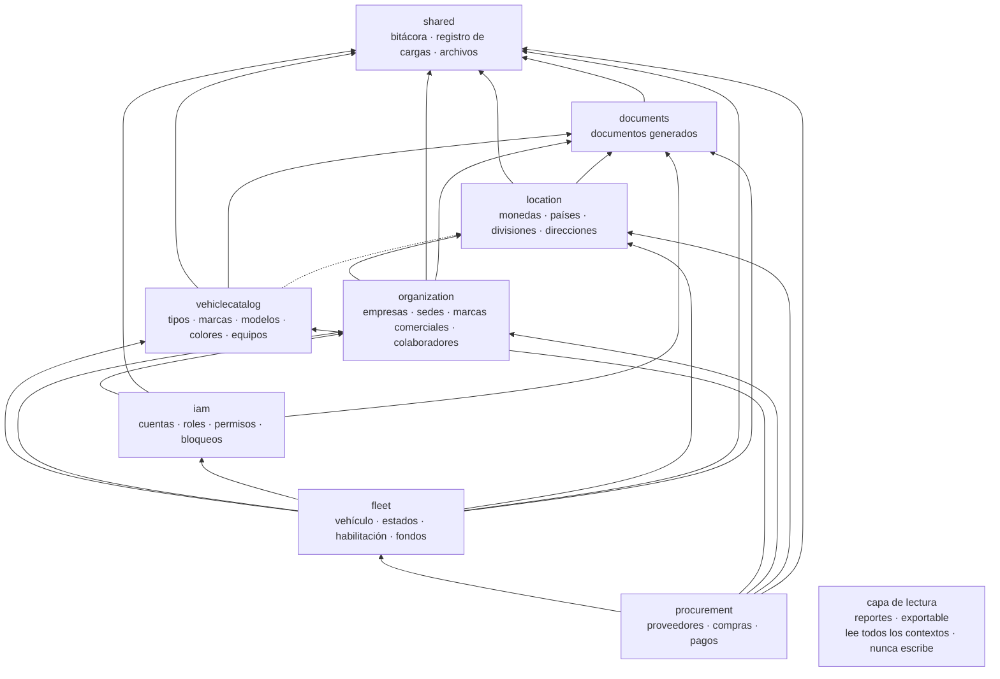

# Mapa de contextos — ERP Millennium Mobility

**Actualizado:** 20/10/2026 (segunda ronda de la auditoría, diccionario v1.25: `AccessScope` sin `administers*` y con `CompanyReach` y `BrandReach`; `PermissionCodes` en `shared`, como excepción nombrada a la regla 6.1; Seguridad por permisos, D-117, y `permission_incompatibilities` en `iam`, D-119; en construcción en `audit2/phase1` y `audit2/phase2`) · 20/10/2026 (segunda ronda de la auditoría, primera fase, diccionario v1.25, en construcción en `audit2/phase1`: el módulo `documents`, dueño de `generated_documents`, con su contrato `documents::acl`, que declaran los cinco contextos que exportan, D-125) · 20/10/2026 (lo que construyó la auditoría, verificado contra `audit/be-integration`: `markModelInUse` y el resumen del modelo con su marca y su tipo, sin los campos que nadie leía; `fetchDataVersion()` en las fachadas de `location` y `organization` para los documentos generados, D-106, y en la de `vehiclecatalog`, con la segunda fase) · 20/10/2026 (auditoría del 20/10/2026, diccionario v1.24: `VehicleCatalogContextFacade` suma su primera escritura, `markModelInUse`, que `fleet` llama al registrar una unidad, sin ciclo, D-107; su resumen del modelo dice si su marca y su tipo están activos, D-108) · 20/10/2026 (paso 5, construido en `feature/fleet` e integrado en `develop` el mismo día, merges `32d4996` en el backend y `28ffe6a` en el frontend: `fleet` llama a `iam` por la decisión 6, opción B, registrada como propuesta pendiente de validar; `IamContextFacade` vuelve, para `fleet`; `OrganizationContextFacade` suma el nombre de la persona de cada cuenta, para `iam`, y la marca y las ubicaciones de una unidad, para `fleet` (G3.2); `VehicleCatalogContextFacade` construida; el alcance decide también por marca, D-102) · 19/10/2026 (paso 3b: `permissions` y `role_permissions` construidas, V45; el puerto `CurrentAccessScope` lleva los permisos con dónde actúa cada uno, D-99; `@PermissionRequired` en `shared`; `IamFacade.hasPermission` y `AccessScopeOptions.companies` en el frontend) · 18/10/2026 (§9: el cierre de `organization` integrado en `develop`; quién lee los colaboradores, D-93) · 18/10/2026 (cierre de `organization`: el reparto del bloque 3b queda decidido, D-92; la fachada de `organization` para `iam` tal como quedó, con el vínculo de la misma persona y el desvínculo, D-82; `employee_account_link_events` en `iam`) · 18/10/2026 (§5.1: la fachada de `location` entrega la zona horaria del país y verifica el dígito de control, D-75) · 17/10/2026 (la fuente pasa a ser el diccionario v1.18) · 16/10/2026 (paso 3: `iam` depende de `organization`, puertos de alcance en `shared`, decisiones 2 y 4) · 14/10/2026 (la fachada de `location` entrega la moneda con su estado) · 06/10/2026 (direcciones con dueño, fachadas construidas, capa de lectura) · **Estado:** borrador para validar · **Fuente:** diccionario de datos v1.25 (§2.7, §3, §4.6, §5 y decisiones cerradas, entre ellas las del modelo de acceso, D-55 a D-72, las del cierre de `organization`, D-81 a D-92, las de su seguimiento, D-93 y D-94, las de la matriz de permisos, D-95 a D-105, las de la auditoría del 20/10/2026, D-106 a D-116, y las de su segunda ronda, D-117 a D-127), [patrones de persistencia](patrones-de-persistencia-millennium-mobility.md), reglas de arquitectura de la skill `backend-module` y el documento *Contextos delimitados* escrito sobre la v1.8, que este reemplaza. Si este documento y el diccionario no coinciden, manda el diccionario.

El diccionario (§3) fija dos cosas: qué contexto es dueño de cada bloque, y que un contexto usa a otro únicamente a través de su fachada, sin consultar ni escribir sus tablas. Este documento propone cómo desarrollar esas reglas: qué posee cada contexto, quién puede llamar a quién, qué ofrece cada fachada y cómo se resuelven las fronteras delicadas.

**Cómo leerlo.** Lo que cita una sección o una decisión del diccionario (§n, D-n) o una regla de arquitectura está decidido. Lo marcado **(propuesta)** no lo decide nadie todavía y figura en las decisiones pendientes (§11).

---

## 1. El criterio

Un contexto termina **donde una palabra cambia de significado**. Estas son las palabras que marcan las fronteras de este proyecto:

| Palabra | Significado A | Significado B |
|---|---|---|
| Marca | Lizzo, Lima Bikes: bajo qué nombre se coloca la unidad (`organization`, §6.3) | Chevrolet, TVS: quién fabricó la unidad (`vehiclecatalog`, §7.2) |
| Entregado | La unidad salió físicamente hacia el cliente (`fleet`) | El contrato terminó y la unidad se traspasó al cliente. El contrato es de ventas (bloque 12, fuera del alcance actual); el traspaso se registra en `vehicles.transfer_date` y `transfer_reason` (`fleet`, D-20) |
| Activo | La unidad genera ingresos (`fleet`, §8.2) | El contrato está vigente (ventas, bloque 12) |
| Tipo de vehículo | Auto, moto, trimoto (`vehiclecatalog`, §7.1) | Nuevo o semi-nuevo, que se deduce de si hubo contratos (§7.1, §5.11) |
| Vehículo | Una unidad que se mueve, se habilita y se entrega (`fleet`) | Una línea de comprobante con un VIN y un monto (`procurement`) |
| Ubicación | El país, sus divisiones territoriales y las direcciones (`location`) | El lugar físico donde puede haber vehículos: patio, sede, dealer (`organization`, tabla `locations`, D-6) |

El vocabulario de personas es el del diccionario (D-39): **rol** es el conjunto de permisos de una cuenta, **puesto** el trabajo del colaborador y **perfil** sus datos personales. "Cargo" no se usa.

---

## 2. Arquitectura

**Un solo despliegue, módulos separados** (Spring Modulith). No hay microservicios.

| Regla | Cómo se sostiene |
|---|---|
| Cada contexto es dueño de sus tablas. Nadie escribe en las de otro (§3; regla 1.3) | Las escrituras pasan por la fachada del dueño, que es quien escribe |
| Nadie consulta las tablas de otro (§3; regla 1.2) | Las lecturas pasan por la fachada del dueño. La única excepción es la capa de lectura (§7), que solo lee |
| Las llaves foráneas entre contextos sí están permitidas (regla 1.2) | Es una sola base de datos y protegen la integridad |
| Las dependencias entre contextos van en un solo sentido | `ModularityTests` falla ante un ciclo o ante el uso del interior de otro contexto. Además, cada `package-info.java` debe declarar sus `allowedDependencies` según §4; hoy lo hacen los cinco contextos construidos: `location` y `vehiclecatalog`, sin ninguna; `organization`, con `location::acl`; `iam`, con `organization::acl`; y `fleet`, desde el 20/10/2026, con `organization::acl`, `vehiclecatalog::acl` e `iam::acl` (§9). Con la segunda ronda de la auditoría, el módulo `documents` declara `{}`, y los cinco suman `documents::acl`, porque exportan (D-125) |
| El dominio es solo dominio, en todos los contextos | Decisión del 01/10/2026: agregado en `domain`; entidad de persistencia, ensamblador y adaptador en `infrastructure`, también en los catálogos. El "camino corto" de la v1.8 quedó descartado |

---

## 3. Los contextos

La asignación de bloques sigue el cuadro "A qué contexto pertenece cada bloque" del diccionario (§3), que desde D-92 también reparte el bloque 3b: `employees` es de `organization`; `user_roles` y `employee_account_link_events`, de `iam`, igual que `user_access_suspensions` y el resto del bloque 2. **(propuesta)** El diccionario no fija el tipo de cada contexto ni los límites de los agregados; esas dos columnas son propuesta de este documento.

| Contexto | Tipo **(propuesta)** | Bloques | Tablas que posee | Agregados **(propuesta)** |
|---|---|---|---|---|
| `location` | Genérico | 1 · Geografía y localización | `currencies`, `countries`, `geo_division_levels`, `geo_divisions`, `addresses`, `tax_id_types` (D-44) | `Currency`, `Country` (con sus escalones, D-45), `GeoDivision`, `Address`, `TaxIdType` |
| `iam` | Genérico | 2 · Seguridad; del 3b, `user_roles` y `employee_account_link_events` (D-92, D-82) | `users`, `user_access_suspensions`, `roles`, `permissions`, `role_permissions`, `permission_incompatibilities` (D-119), `user_roles`, `employee_account_link_events` | `User` (con sus asignaciones de rol), `AccessSuspension`, `Role` (con sus permisos), `Permission`, `PermissionIncompatibility` (un catálogo que solo se lee), `EmployeeAccountLinkEvent` (se escribe una vez y nunca cambia) |
| `organization` | Soporte | 3 · Empresas; del 3b, `employees` (D-92) | `companies`, `commercial_brands`, `branches`, `locations`, `employees` | `Company`, `CommercialBrand`, `Branch`, `Location`, `Employee` |
| `vehiclecatalog` | Soporte | 4 · Catálogos de flota | `vehicle_types`, `vehicle_brands`, `vehicle_models`, `colors`, `equipment_types`, `equipment_type_vehicle_types` | `VehicleType`, `VehicleBrand`, `VehicleModel`, `Color`, `EquipmentType` (con los tipos de vehículo a los que aplica) |
| `fleet` | Central | 6 · Vehículo y estados; 9 · Habilitación (salvo `import_batches`); 10 · Fondos | `vehicle_statuses`, `status_change_reasons`, `vehicles`, `vehicle_status_history`, `vehicle_mileage_readings`, `document_types`, `vehicle_documents`, `vehicle_equipments`, `vehicle_keys`, `vehicle_tax_declarations`, `funds`, `vehicle_fund_assignments` | `VehicleStatus`, `StatusChangeReason`, `Vehicle` (con sus llaves), `VehicleStatusHistory`, `MileageReading`, `DocumentType`, `VehicleDocument`, `VehicleEquipment`, `TaxDeclaration`, `Fund`, `FundAssignment` |
| `procurement` | Central | 7 · Compras (incluye el 5); 8 · Pagos | `suppliers`, `purchase_order_types`, `purchase_order_templates`, `purchase_orders`, `purchase_order_items`, `purchase_invoices`, `purchase_invoice_items`, `credit_notes`, `credit_note_items`, `supplier_payments`, `payment_applications`, `payment_allocations` | `Supplier`, `PurchaseOrderType`, `PurchaseOrderTemplate`, `PurchaseOrder` (con sus líneas), `PurchaseInvoice` (con sus líneas por unidad), `CreditNote` (con su reparto), `SupplierPayment` (con sus aplicaciones e imputaciones) |
| `shared` | Transversal | 11 · Bitácora y cargas de archivos | `change_log`, `import_batches` | `ChangeLogEntry`, `ImportBatch` |
| `documents` | Transversal, de la plataforma (D-125) | Ninguno: es la tabla técnica de §2.7 | `generated_documents` | `GeneratedDocument` |

**`permissions` y `role_permissions`** (§5.6, V45, construidas el 19/10/2026 en el paso 3b) son de `iam` y las cargan sus migraciones: V45 trae los nueve permisos de los pasos 1 a 4 y la matriz de los siete roles del sistema, y cada paso siguiente agrega los suyos y sus marcas con una migración de `iam`; ningún otro contexto las escribe (D-95). V46 trajo los del paso 5, y la segunda ronda de la auditoría trae la categoría de cada permiso (D-118), los doce de seguridad con sus 22 marcas (D-117) y `permission_incompatibilities`, los catorce pares que ningún rol propio ni ninguna cuenta junta (D-119), que la aplicación solo lee <!-- verificar al integrar fase 2: V53 a V55 -->. `permissions` es un catálogo general, igual para todas las empresas (§2.5), sin Row Level Security ni columnas de registro, que la aplicación solo lee. `role_permissions` lleva la historia de cada marca (D-96) y no tiene `public_id`, porque la API nunca direcciona una fila suya. `roles` lleva desde V45 `company_id` e `is_active` (D-97, D-98) y Row Level Security: un rol general lo ve toda cuenta con alcance, uno de una empresa quien la alcanza y, siempre, la cuenta que lo tiene asignado, porque la cuenta se lee al comenzar cada petición antes de conocer sus empresas; `role_permissions` la hereda de su rol. Los demás contextos no leen esas tablas: exigen un permiso con `@PermissionRequired` y una constante de `PermissionCodes`, de `shared` (§5.3), y deciden dónde actúa con el alcance.

**`employee_account_link_events`** (§5.4, V44) registra las dos decisiones sobre el vínculo de un colaborador con una cuenta que solo toma un superadministrador (D-82): vincular la cuenta de otra persona después de ver a sus titulares, y desvincular una cuenta para corregir un vínculo equivocado. Se escribe en la misma transacción que el cambio, nunca se edita ni se borra, y solo un vínculo confirmado guarda los titulares que vio el superadministrador. Lleva la empresa del colaborador: la escritura respeta la frontera de su empresa (`access_scope_reaches(company_id)`), y la lectura queda para un superadministrador vigente o un proceso automático con alcance `SYSTEM`, porque esos titulares son personas de otras empresas. La cuenta de la aplicación solo lee e inserta.

**`advisor_assignments`** también es del bloque 3b, así que el diccionario la asigna a `organization` e `iam`; según el ajuste 2 de §3 se construye con el bloque 12, pero eso no cambia a quién pertenece.

**Tablas técnicas** (§2.2, §2.7): `flyway_schema_history`, `event_publications` y `spring_session*` las administran sus librerías. Las de sesiones las usa `iam`. `generated_documents` es la técnica propia de la plataforma: desde D-125 es del módulo `documents`, que la escribe y la lee; ningún contexto la toca, y los que exportan le piden su documento por `documents::acl` (§5.1). Hasta la segunda ronda de la auditoría era de `shared`.

**Fuera del alcance actual:** el bloque 12, ventas y contratos (clientes, contratos y cobros), y la aplicación del cliente con sus propias identidades (§5.1). El diccionario no les asigna contexto. **(propuesta)** Llamarlos `sales` y `customerportal`.

### Por qué cada agregado tiene ese límite (propuesta)

Un agregado es lo que se guarda y se valida como un todo.

- **`PurchaseInvoice` incluye sus líneas.** Que la suma de las líneas coincida con el total es una regla del comprobante (§9.3): al guardar la factura se validan sus ochenta líneas de una vez.
- **`CreditNote` incluye su reparto**, por la misma razón: lo repartido debe coincidir con el total (§9.5).
- **`VehicleStatusHistory` y `MileageReading` van aparte de `Vehicle`.** Crecen sin límite y se consultan por sí solos. El estado actual y el último kilometraje se guardan además en la unidad, y se escriben en la misma operación que su historial (§8.4, §8.5; regla 4.1).
- **`VehicleDocument`, `VehicleEquipment` y `FundAssignment` van aparte**: cada uno tiene su propio ciclo (vencimientos, períodos, cargas masivas).
- **`Company` no incluye sedes, marcas ni ubicaciones**: son agregados propios que apuntan a la empresa.
- **`Country` incluye sus escalones** (D-45). Que se declaren en orden, que sean cuatro como máximo y que no se borren son reglas del país: se guardan con él. Las divisiones van aparte, porque son miles y se consultan solas.
- **`User` incluye sus asignaciones de rol, y `AccessSuspension` va aparte.** Que el mismo rol no se dé dos veces sobre el mismo alcance y que la salida retire los roles de una empresa son reglas de la cuenta: se guardan con ella. Los bloqueos crecen con el tiempo, tienen su propia ruta y su propio ciclo (programado, en curso, terminado, cancelado), y la regla que los cruza —dos de la misma línea no se pisan— la protege la base. Las operaciones que leen los bloqueos de una cuenta y después los cambian bloquean primero la fila de la cuenta ([patrones de persistencia](patrones-de-persistencia-millennium-mobility.md)).

---

## 4. Quién puede llamar a quién (propuesta)

El diccionario no fija el sentido de las dependencias. Lo que sí está decidido y se respeta aquí: el acceso solo por fachada (§3), D-32, D-38 y D-42. Que no haya ciclos lo exige Spring Modulith; la dirección elegida en cada par es propuesta de este documento, salvo la de `iam` hacia `organization`, decidida el 15/10/2026 (decisión 4).

La flecha va de quien llama hacia quien es llamado. Nunca al revés: `location` no sabe que existe `fleet`.

La capa de lectura no se dibuja con flechas: lee las tablas de todos los contextos, nunca escribe y ningún contexto la llama (§7).

| Contexto | Puede llamar a | Para qué |
|---|---|---|
| `location` | `shared`, `documents` | Pedir sus exportaciones a `documents` (D-125) |
| `iam` | `shared`, `organization`, `documents` | Pedir la exportación de las cuentas a `documents` (D-125). Comprobar, al otorgar un rol de empresa o de sede, que la cuenta está vinculada a un colaborador activo de esa empresa, y para uno de alcance sistema, de alguna empresa (§5.3, §5.7, D-38). Es la validación de asignaciones que el diccionario deja a la aplicación: que la sede y la marca pertenezcan a la empresa lo impide la base (§5.7). Leer y bloquear el colaborador y vincularlo a su cuenta al dar acceso (D-38), una cuenta existente solo si es de la misma persona, y mostrar quién la tiene cuando no lo es (D-82); desvincular una cuenta (D-82); registrar la salida y el regreso (decisión 2, opción A); resolver el alcance de una asignación, que no se otorga sobre una empresa, sede o marca inactiva (D-84); nombrar empresas, sedes y marcas en lote, dar la zona de cada empresa y las empresas donde cada cuenta tiene un colaborador activo; leer la empresa de un rol propio, que tiene que existir y estar activa (D-98). Registrar el colaborador del registro público (D-32), cuando se construya: queda fuera del paso 3 (D-83). Desde el paso 5: nombrar en lote a la persona de cada cuenta que nombran los registros de `fleet` (decisión 6) |
| `organization` | `shared`, `location`, `documents` | Países, monedas funcionales, tipos de documento tributario de las empresas (D-44) y direcciones de empresas, sedes y ubicaciones; pedir sus cinco exportaciones a `documents` (D-125) |
| `vehiclecatalog` | `shared`, `location`, `documents` | `location`: permitida; hoy ninguna tabla del bloque 4 la necesita. `documents`: pedir la exportación de sus catálogos (D-125) |
| `fleet` | `shared`, `location`, `vehiclecatalog`, `organization`, `iam` **(propuesta, decisión 6)**, `documents` | Pedir la exportación del Inventario a `documents` (D-125). Moneda del costo de equipamiento; modelo, tipo y exigencia de pantalla, y avisar que un modelo ya tiene unidades (`markModelInUse`, D-107); empresa, marca comercial y ubicación de la unidad; registrar las cargas de archivos en `shared`. De `iam`, desde el paso 5: el identificador público y el nombre de quien creó o cambió una unidad, movió un estado o registró una lectura; la cuenta `SYSTEM` que firma el regreso automático (D-42); y el permiso que exige cada camino (D-100). Declara `organization::acl`, `vehiclecatalog::acl` e `iam::acl`, y con la segunda ronda `documents::acl`; todavía no usa `location` |
| `documents` | `shared` | Nada de ningún contexto: el alcance lo lee del puerto `CurrentAccessScope` (§5.3), y lo que cada tipo de documento necesita —sus filas, su versión de los datos— se lo da el contexto que lo declara (D-125) |
| `procurement` | `shared`, `location`, `vehiclecatalog`, `organization`, `fleet` | Monedas y direcciones; modelo de las líneas de orden; empresa y marca comercial de la plantilla; tipo de documento tributario del proveedor y del emisor, que es de `location`; VIN de las líneas de factura y anulación de la unidad |

Lo que se resuelve con este sentido único:

- **`organization` no llama a `iam`.** Cuando hay sesión, el autor de sus registros lo llena el auditor que aporta `iam` (`CurrentUserAuditorAware`) a partir de la cuenta de la sesión (D-42), y el alcance de quien llama lo lee del puerto `CurrentAccessScope` (§5.3). Spring inyecta los dos, así que no hay dependencia de código. En el registro público no hay sesión y el auditor no supone `SYSTEM` (D-42): es `iam` quien entrega el identificador de `SYSTEM` cuando le pide a `organization` registrar el colaborador. La salida de un colaborador la registra `iam`, que le pide a `organization` cerrar el colaborador (decisión 2, opción A): no hace falta un evento.
- **`fleet` no llama a `procurement`.** Cuando una nota de crédito deja en cero el valor de una unidad, es `procurement` quien le pide a `fleet` que la anule. Los costos que muestra la ficha de la unidad salen de la capa de lectura (§6.1).
- **Cómo se muestran las referencias a cuentas fuera de `iam`** (`changed_by`, `uploaded_by`, `imported_by`) es la decisión pendiente 6. El paso 5 eligió en el código la opción B para `fleet`: `fleet` llama a `iam` por su fachada, sin ciclo, porque `iam` no llama a `fleet`. Es **(propuesta, pendiente de validar por el responsable)**.

---

## 5. Fachadas y eventos

### 5.1 Lo que expone cada contexto

Cada contexto expone una fachada en `interfaces.acl`, anotada como `@NamedInterface("acl")` (regla 1.1), e implementada en `application.acl` sobre sus servicios de consulta y de comandos, nunca sobre los repositorios. Devuelve tipos simples o `record` definidos en el propio paquete `acl`, nunca agregados (regla 1.4). Puede devolver el `id` interno, porque no sale del servidor.

Quien la consume lo hace desde `application.internal.outboundservices.acl`, con un servicio `External<Contexto>Service` que traduce la respuesta a su propio vocabulario (skill `backend-module`).

| Contexto | Fachada | Qué ofrece | Estado |
|---|---|---|---|
| `iam` | `IamContextFacade` | Para `fleet`, que es su único consumidor, por su `ExternalIamService` (decisión 6, opción B, **propuesta**). Sus cuatro miembros: las cuentas que nombra una lista, en una lectura, con su identificador público y el nombre de la persona, que `iam` lee en lote de `organization`, y `SYSTEM` para la cuenta de los procesos automáticos (`fetchAccountReferencesByIds`, `AccountReference`); el identificador de la cuenta `SYSTEM`, que firma lo automático (`fetchSystemAccountId`, D-42); y un permiso del catálogo por su código o varios por su identificador (`fetchPermissionByCode`, `fetchPermissionReferencesByIds`, `PermissionReference`), para el permiso que exige cada camino de estado (D-100). Lo que los demás necesitan de la cuenta de la petición —el autor de sus registros y el alcance de quien llama— lo siguen recibiendo por puertos de `shared` que `iam` implementa (§5.3); `organization` y `location` no dependen de `iam` | Construida con el paso 5, integrado en `develop` el 20/10/2026. La anterior `IamContextFacade` se quitó el 16/10/2026, cuando `organization` dejó de llamar a `iam` |
| `location` | `LocationContextFacade` | Resumen de una moneda (`CurrencySummary`, con si está activa) por su identificador público, para que el consumidor no elija una moneda inactiva en una operación nueva (§4.1); resumen de país (`CountrySummary`) por identificador público o ISO, con su zona horaria, que `organization` usa para el "hoy" de un colaborador sin sede y para la zona de cada empresa (§2.6); resumen de un tipo de documento tributario (`TaxIdTypeSummary`) por identificador público, con a quién cubre, su longitud, si tiene dígito de control y si está activo, y la verificación del dígito de control de un número (`verifyTaxIdCheckDigit`), que `location` calcula según la sigla del tipo en su país para que ningún consumidor copie el cálculo (§4.7, D-75). Las referencias de una lista se leen **en lote** (`fetchCurrencySummariesByIds`, `fetchCountrySummariesByIds`, `fetchTaxIdTypeSummariesByIds`): un método recibe todos los identificadores internos y responde un mapa, nunca una llamada por fila. Las direcciones de los dueños: `createAddress` en el país que fija el dueño, `correctAddress` y `replaceAddress`, que devuelven `Result` con el error de `location`, más `fetchAddressSummariesByIds` para leerlas (§6.3). Un solo registro se lee con el método en lote y un solo identificador | Construida |
| `location` | (misma fachada) | La versión de los datos que resuelve, `fetchDataVersion()`: un documento generado de otro contexto que nombra países, monedas, divisiones, tipos de documento o direcciones la suma a la suya, para que un cambio en `location` no se sirva desde un documento viejo (D-106). La consume `organization` en sus cinco exportaciones | Construida con la auditoría del 20/10/2026 (`fc43584`), integrada en `audit/be-integration` |
| `location` | (misma fachada) **(propuesta)** | División territorial por identificador público | Pendiente; ningún contexto la pide todavía. La zona horaria del país, que figuraba aquí, ya viaja en `CountrySummary` |
| `organization` | `OrganizationContextFacade` | Para `iam`, por `ExternalOrganizationService`, y, desde el paso 5, también para `fleet`, por el suyo. Hasta el paso 5 tenía 18 miembros: el resumen de una empresa por su identificador público (`fetchCompanySummaryByPublicId`); el colaborador por su identificador público, leído con su fila bloqueada hasta que termina la transacción (`fetchEmployeeSummaryForUpdate`); los colaboradores de una cuenta (`fetchEmployeeSummariesByUserId`) y quién la tiene, con nombre, documento y empresa, para que un superadministrador lo vea antes de confirmar (`fetchAccountHoldersByUserId`, D-82); las empresas donde una cuenta, o cada cuenta de una lista en una sola lectura, tiene un colaborador activo (`fetchActiveEmployeeCompanyIdsByUserId`, `fetchActiveEmployeeCompanyIdsByUserIds`); las cuentas con colaborador en una empresa (`fetchLinkedEmployeePublicIdsByCompanyId`); vincular un colaborador a una cuenta nueva (`linkUserToEmployee`) o a una existente, que tiene que ser de la misma persona por la sigla y el número de su documento (`linkExistingUserToEmployee`, D-82), y deshacer un vínculo (`unlinkUserFromEmployee`), todos con `Result`; registrar la salida y el regreso, con sus reglas de fechas y el "hoy" de la sede o del país (`terminateEmployee`, `reactivateEmployee`, §2.6); resolver la empresa, la sede y la marca de una asignación, de esa empresa y activas (`resolveScope`, §5.7, D-84); nombres de empresas, sedes y marcas en lote (`fetchCompanyReferencesByIds`, `fetchBranchReferencesByIds`, `fetchCommercialBrandReferencesByIds`); las empresas activas (`fetchActiveCompanyReferences`) y la zona de cada una (`fetchCompanyTimeZonesByIds`). El paso 5 le sumó cuatro, hasta 22: para `iam`, el nombre del colaborador de cada cuenta de una lista, en una lectura (`fetchEmployeeNamesByUserIds`, decisión 6); y para `fleet`, una marca comercial por su identificador público, activa o no y sin bloqueo, para filtrar el inventario (`fetchCommercialBrandReferenceByPublicId`, `CommercialBrandReference`), y una ubicación por su identificador público y varias en lote, con su empresa, si está activa y, si es propia, su sede (`fetchLocationReferenceByPublicId`, `fetchLocationReferencesByIds`, `LocationReference`). `fleet` usa además `fetchCompanySummaryByPublicId`, `resolveScope` para la marca de una unidad, y los nombres en lote de empresas y marcas | Construida; la consumen `iam` y, desde el paso 5, `fleet`. Los nueve miembros que nadie llamaba se quitaron en el cierre de `organization`: entre ellos `existsCompanyByCountryId`, que no miraba si la empresa estaba activa, y los resúmenes de marca, sede y ubicación. Si un país opera lo responde la API, no la fachada (D-3). El paso 3b no agregó ninguno: la empresa de un rol propio (D-98) la lee `iam` con `fetchCompanySummaryByPublicId` y la traduce en `ExternalOrganizationService.fetchCompanyAccess` |
| `organization` | (misma fachada) | La versión de los datos que resuelve, `fetchDataVersion()`, para la exportación de las cuentas de `iam` y, desde la segunda fase, la del Inventario de `fleet`, que nombran empresas, sedes, marcas, ubicaciones y colaboradores (D-106). En la segunda fase, `LocationReference` suma el `code` de la ubicación | Construida con la auditoría del 20/10/2026 (`70ea29f`), integrada en `audit/be-integration` |
| `organization` | (misma fachada) **(propuesta)** | Registrar el colaborador del registro público con el autor que indica `iam` (D-42) | Pendiente; llega con el registro público con perfil, fuera del paso 3 (D-32, D-83) |
| `organization` | (misma fachada) | ~~Las ubicaciones de una empresa, en lote, para la ubicación de cada unidad~~ | Construida con el paso 5 (G3.2), como la lectura en lote de las ubicaciones de una lista de unidades (`fetchLocationReferencesByIds`) y la de una por su identificador público (fila anterior) |
| `vehiclecatalog` | `VehicleCatalogContextFacade` | El modelo (`VehicleModelSummary`: `id`, `publicId`, `name`, si está activo y, desde la auditoría del 20/10/2026, si lo están su marca y su tipo, `brandIsActive` y `vehicleTypeIsActive`, D-108) y el color (`ColorSummary`, con si está activo), por su identificador público y en lote: `fetchVehicleModelSummaryByPublicId`, `fetchColorSummaryByPublicId`, `fetchVehicleModelSummariesByIds`, `fetchColorSummariesByIds`. La auditoría quitó del modelo la marca, el tipo, la cilindrada, el combustible y la pantalla de fábrica, que nadie leía, y sumó la primera escritura de la fachada, `markModelInUse(Long modelId)`: marca que el modelo ya tiene unidades (`has_units`), desde lo cual su tipo queda fijo (D-107). Es idempotente y corre en la transacción de quien llama. La consume `fleet` | Construida con el paso 5, integrado en `develop` el 20/10/2026. `markModelInUse` y los dos campos nuevos, construidos con la auditoría e integrados en `audit/be-integration` (`040ad1e`) |
| `vehiclecatalog` | (misma fachada) | La versión de los datos que resuelve —tipos, marcas, modelos y colores—, `fetchDataVersion()`, para la exportación del Inventario de `fleet` (D-106, D-116); y, en `VehicleModelSummary`, el nombre de la marca y el código y el nombre del tipo (`brandName`, `vehicleTypeCode`, `vehicleTypeName`), que esa exportación escribe | Construida en la segunda fase de la auditoría (`be7bdb9`), integrada en `audit/be-integration` |
| `vehiclecatalog` | (misma fachada) **(propuesta)** | Si la unidad requiere pantalla: el equipo aplica a su tipo **y** el modelo no la trae de fábrica (§7.5) | Pendiente; llega con el equipamiento instalado, en el paso 9 |
| `fleet` | `FleetContextFacade` **(propuesta)** | Unidad por VIN; empresa propietaria; estado actual; anular la unidad cuando su valor llega a cero (§9.6); dar de alta la unidad desde la factura, solo si así se decide (decisión pendiente 5) | Pendiente; el paso 5 no la construyó, porque ningún contexto llama a `fleet` todavía. La pide `procurement` en el paso 7, y su forma depende de la decisión 5, que sigue abierta |
| `procurement` | — | Ningún contexto la necesita: costos y pagos se leen desde la capa de lectura | — |
| `documents` | `DocumentService`, en `documents::acl` (D-125) | El único contrato público del módulo: `DocumentService` recibe un `DocumentRequest` —el tipo, el formato, los criterios y lo que el tipo necesita para generarlo— y devuelve un tipo del contrato, nunca el agregado `GeneratedDocument`; `DocumentSeeOther` es la respuesta `303` que devuelve cada controlador que exporta; y el contrato publica también `DocumentFormat`, `DocumentKind`, `DocumentScopes` y `DocumentContent`. No abre su dominio ni su API. Lo usan los cinco contextos que exportan, cada uno desde los 16 controladores con exportación y su registro de tipos (`<Contexto>DocumentKinds`) | En construcción en la primera fase de la segunda ronda de la auditoría (`audit2/phase1`), que lo saca de `shared`: reemplaza a `DocumentCommandService`, a `RequestDocumentCommand` con `DocumentCriteria` y a `DocumentResourceFromEntityAssembler.toSeeOtherFromResult` <!-- verificar al integrar fase 1: nombres del contrato, cuántos controladores se migraron y el paquete documents/interfaces/acl --> |
| `shared` | `SharedContextFacade` **(propuesta)** | Registrar una carga de archivo (tipo, archivo, filas totales, entradas y fallidas, archivo de errores) y devolver su identificador; guardar y recuperar archivos | Pendiente; depende de la decisión pendiente 8 |

### 5.2 Eventos entre contextos

El diccionario exige que la salida de un colaborador, el retiro de sus roles y el bloqueo de su cuenta ocurran **en la misma operación** (§5.3, D-38), y que se impida la salida si no quedaría ningún superadministrador activo (§5.9). No fija el mecanismo.

**Decidido el 15/10/2026: sin evento** (decisión 2, opción A). La salida y el regreso los registra un caso de uso de `iam`: valida quién puede, protege al último superadministrador, le pide a `organization` por su fachada que registre el hecho y, en la misma transacción, retira los roles y cierra o reabre la cuenta. Un fallo esperado vuelve como `Result`, nunca como excepción (regla 3.1). El evento `EmployeeTerminated` que se había propuesto no se construyó, y hoy no hay eventos entre contextos.

### 5.3 Puertos del núcleo compartido

Hay datos que todos los contextos necesitan de `iam` sin poder depender de él: quién hace la petición y qué empresas alcanza. Se resuelven con un puerto en `shared` que `iam` implementa, el mismo patrón que Spring usa para el autor de los registros. Nadie importa código de `iam`, y Spring Modulith no ve dependencia.

| Puerto (`shared`) | Lo implementa | Qué responde | Quién lo usa |
|---|---|---|---|
| `AuditorAware` de Spring | `iam` (`CurrentUserAuditorAware`) | La cuenta de la sesión, para `created_by` y `updated_by` (D-42) | Todos los contextos, a través de las clases base de persistencia |
| `CurrentAccessScope` | `iam` (`CurrentUserAccessScope`) | El alcance de la cuenta de la petición (`AccessScope`): si ve todas las empresas (`global`, un rol de alcance sistema vigente) y las empresas donde tiene una asignación vigente; y, desde el paso 3b, `grants`: cada permiso de los roles vigentes con la empresa, la sede y la marca de la asignación que lo trae (`PermissionGrant`), que responde `may(permiso)`, `actsOn(permiso, empresa[, sede])` y `companiesActingOn(permiso)`, porque el permiso dice qué y la asignación dice dónde (§5.8 regla 6, D-99). El alcance `SYSTEM` tiene todos los permisos en todas partes. Desde el paso 5 decide también por marca (D-102): `actsOnBrand`, `actsOnWholeCompanyBrand`, `actsOnBranchBrand` y `brandsActingOn`, con `PermissionGrant.actsOnBrand`; una sola asignación tiene que alcanzar a la vez la sede y la marca de una escritura. Con la segunda ronda de la auditoría pierde `administersEveryCompany`, `administeredCompanyIds` y `administers()`: administrar una empresa ya no es una propiedad del alcance, sino tener sus permisos de seguridad donde actúan (D-117, D-122); y `companiesActingOn` y `brandsActingOn` devuelven `CompanyReach` y `BrandReach` —`Every` o `Some` con su conjunto—, para que un alcance vacío no se confunda con «todas» (F3) <!-- verificar al integrar fase 1: nombres de CompanyReach, BrandReach y sus dos variantes --> <!-- verificar al integrar fase 2: que AccessScope ya no tenga administers* -->. Sin sesión, o con la cuenta bloqueada, un alcance vacío; nunca falla. La cuenta se lee una vez por petición | `organization`, para decidir dónde actúa cada lectura y cada escritura y quién registra colaboradores; `fleet`, para lo que ve y toca de cada unidad por su empresa, la sede de su ubicación y su marca (D-99, D-101, D-102); la base, a través del punto central que fija el alcance de cada transacción. `location` y `vehiclecatalog` no lo necesitan: sus tablas no son de una empresa, y les basta `@PermissionRequired` |
| `@PermissionRequired` | `shared`; la autoridad la pone `iam` (`UserDetailsImpl`) | Exige en un controlador, en la clase o en el método, un permiso del catálogo: `@PreAuthorize("hasAuthority('PERM_{value}')")`, resuelta por el bean `AnnotationTemplateExpressionDefaults`. `iam` convierte en cada petición los permisos de los roles vigentes en autoridades `PERM_<código>`, así ningún contexto importa `iam` para exigir uno (D-95). El valor es siempre una constante de `PermissionCodes` (fila siguiente), nunca un literal | Los controladores de negocio y de datos de `location`, `vehiclecatalog`, `organization` y `fleet`; con la segunda ronda de la auditoría, también los de las cuentas, los accesos, los colaboradores y los roles de `iam` y `organization`, con los doce permisos `seguridad.*`, y ninguna ruta queda con `@PreAuthorize` por rol (§5.8 regla 7, D-117) |
| `PermissionCodes` | `shared` (`shared/application/security`) | Los códigos de los permisos del catálogo, en una sola clase, con un grupo de constantes por módulo: `Catalogs`, `Configuration` y `Stock`, y `Security` con la segunda fase. Reemplaza a `FleetPermissions`, `OrganizationPermissions`, las constantes `READ_CATALOGS` de cada contexto y los textos sueltos de los mensajes. `PermissionCatalogConsistencyTests` comprueba que cada valor de `@PermissionRequired` y cada constante existe en `permissions`, que cada permiso sembrado tiene su constante —salvo los que se recorren como dato, como el de cada camino de estado (D-100)— y que no queda ningún literal en `@PermissionRequired("…")`. **Es una excepción nombrada a la regla 6.1**, como la segunda excepción de la regla 5.8: el catálogo de permisos es vocabulario de `iam`, pero todos los contextos lo nombran en sus rutas, y una sola clase en `shared` es el único punto de configuración de los permisos (R2) <!-- verificar al integrar fase 1: paquete, nombres de los grupos y de la prueba --> | Los 64 `@PermissionRequired` de `location`, `vehiclecatalog`, `organization` y `fleet`, y `PathPermissions` de `fleet` para el permiso por omisión de un camino (`PermissionCodes.Stock.CHANGE_STATUS`, D-100) |
| `SystemAccessScope` | `shared` (`DatabaseAccessScope`) | Ejecuta un trabajo con alcance `SYSTEM` y vuelve al de quien llama, también si el trabajo falla | El arranque, los procesos programados y las pocas comprobaciones que deben ver más allá de las empresas de quien opera, como qué cuentas de una lista son protegidas (`ProtectedAccountsReader`) o, en `fleet`, si un VIN ya existe en otra empresa; cada una devuelve datos sueltos, nunca agregados ([contextos/iam.md](contextos/iam.md), §5). En `fleet`, el regreso automático al vencer una tolerancia corre con él ([contextos/fleet.md](contextos/fleet.md), F4) |

Ver una empresa y actuar en ella son dos cosas distintas en el alcance: el administrador de accesos ve todas y no registra colaboradores en ninguna (D-57), porque no tiene `seguridad.gestionar_colaboradores`. Hasta la segunda ronda de la auditoría el alcance lo decía con `administers`; desde ella lo dice el permiso, con la asignación que lo trae (D-99, D-122). La capa de lectura, cuando exista, puede usar el mismo puerto para filtrar por empresa sin depender de `iam` (decisión pendiente 3).

---

## 6. Fronteras delicadas

### 6.1 `fleet` y `procurement`

Es la más delicada porque ambos hablan del vehículo.

| | `fleet` | `procurement` |
|---|---|---|
| Qué es un vehículo | Una unidad física que se mueve, se habilita y se entrega | Una línea de comprobante con un VIN y un monto |
| Qué conoce | Estado, ubicación, GPS, placa, documentos, fondos | VIN, empresa, valor de factura, notas de crédito, pagos |
| Qué **no** conoce | Facturas, notas de crédito, pagos | Estado de habilitación, GPS, ubicación |

- `procurement` valida que el VIN exista preguntando a `fleet`, no consultando su tabla. **(propuesta)** Si se decide que la unidad nace al registrar la factura (decisión pendiente 5), `procurement` le pide a `fleet` que la dé de alta; en los dos casos la dependencia va de `procurement` a `fleet` y `procurement` nunca escribe en `vehicles`.
- El valor del vehículo es el valor de factura menos sus notas de crédito (§9.6), un cálculo de compras. Cuando llega a cero y la unidad no tiene contratos, la unidad queda anulada (§9.6). **(propuesta)** `procurement` le pide a `fleet` que la anule; la condición de los contratos quedará a cargo de ventas cuando exista.
- El recurso de la unidad en `fleet` no lleva montos de compra. **(propuesta)** En la ficha de la unidad, el valor de factura, las notas y el valor del vehículo vienen de una consulta de la capa de lectura que solo responde con el permiso `stock.ver_costos` (decisión pendiente 7).
- El exportable de 52 columnas cruza cinco contextos y se arma en la capa de lectura (§7; regla 1.2), nunca con `join` desde un contexto.

### 6.2 `iam` y `organization`

`iam` es dueño de las cuentas, sus roles, sus bloqueos y el registro de vínculos, y `organization` de los colaboradores (reparto del 3b, D-92). El colaborador pasa a un contexto propio cuando lleguen los contratos laborales, la planilla o la asistencia (D-92). La columna que los une, `employees.user_id`, es de `organization` (§5.3), y solo cambia cuando `iam` pide vincular. `iam` llama a `organization`, nunca al revés (decidido el 15/10/2026).

| Operación | Dónde vive | Cómo cruza la frontera |
|---|---|---|
| Dar acceso a un colaborador (D-38, D-58) | `iam` (`POST /access-grants`) | Lee de `organization` el colaborador con su fila bloqueada, crea la cuenta o toma la que ya tiene ese correo, sin cambiarle roles ni contraseña, y pide a `organization` que vincule el colaborador a la cuenta. Todo en una transacción: si el vínculo falla, la cuenta nueva se deshace |
| Vincular la cuenta existente de otra persona (D-82) | `iam` decide quién confirma; `organization` compara el documento | `organization` vincula una cuenta existente solo si ya pertenece a un colaborador con la misma sigla y el mismo número de documento (`linkExistingUserToEmployee`). Si no, `iam` lee de la fachada quién la tiene y solo se lo muestra a un superadministrador, que confirma con la huella de los titulares que vio; si cambiaron mientras tanto, no vincula y los muestra otra vez. La confirmación deja una fila en `employee_account_link_events`, en la misma transacción |
| Desvincular una cuenta (D-82) | `iam` (`POST /employees/{id}/account-unlinking`) | Solo un superadministrador vinculado a un colaborador activo. Pide a `organization` deshacer el vínculo (`unlinkUserFromEmployee`) y, en la misma transacción, retira los roles de la cuenta en esa empresa con motivo `retiro` y, si no le queda colaborador activo, la cierra como una salida (D-60, D-69), con la protección del último superadministrador (D-65). Deja una fila en `employee_account_link_events` |
| Registro público (D-32) | `iam` | Pide a `organization` registrar el colaborador a nombre de `SYSTEM`, crea la cuenta y los vincula en la misma transacción. Si algo falla, no queda ninguno de los dos. Pendiente: hoy el registro crea solo la cuenta, y el registro con perfil queda fuera del paso 3 (D-83) |
| Otorgar un rol de empresa o de sede (§5.7) | `iam` | Pide a `organization` resolver la empresa, la sede y la marca, que tienen que estar activas (D-84), y saber en qué empresas tiene la cuenta un colaborador activo |
| Salida y regreso de un colaborador (D-38, D-60) | `iam`, en las rutas `/employees/{id}/termination` y `/reactivation` (decisión 2, opción A) | `iam` valida quién puede y protege al último superadministrador, pide a `organization` registrar el hecho con sus reglas de fechas y, en la misma transacción, retira los roles de esa empresa y, si era el último colaborador activo, cierra la cuenta; el regreso cierra la `baja` |
| Proteger al último superadministrador (§5.9, D-65) | `iam` (`LastSuperadminGuard`) | No cruza: cuenta superadministradores en `user_roles`, con alcance `SYSTEM` y de a una operación por vez |
| Saber qué empresas ve quien llama y dónde actúa cada permiso suyo | `iam` lo calcula; `organization` lo lee | Por el puerto `CurrentAccessScope` de `shared` (§5.3), sin dependencia de código |
| Registrar y modificar colaboradores | `organization` | Exige `seguridad.gestionar_colaboradores` donde actúa, según `CurrentAccessScope`: un colaborador sin sede, en toda la empresa; un cambio de sede, en las dos (D-122). Con la semilla, el superadministrador o el administrador de esa empresa (D-57). Hasta la segunda ronda de la auditoría, que quien opera administrara la empresa. La pantalla recibe las acciones de cada fila en `allowedActions` |

**Quién hace qué, del lado del negocio** (D-55, D-57): el administrador de una empresa registra a su gente y sus salidas y regresos, y no maneja cuentas; el administrador de accesos maneja las cuentas de todas las empresas y no registra colaboradores; el superadministrador hace las dos cosas. Desde la segunda ronda de la auditoría, cada función es un permiso `seguridad.*`, y los pares incompatibles impiden que un rol propio o una cuenta junte las dos (D-117, D-119). La frontera técnica coincide con esa separación: lo que es del colaborador vive en `organization` y lo que es de la cuenta, en `iam`.

### 6.3 Las direcciones y sus dueños

`addresses` es de `location` (§3), pero cada dirección pertenece a una empresa, una sede, una ubicación, un proveedor o una plantilla de orden de compra (§4.6).

- La dirección se edita dentro del formulario de su dueño: no tiene pantalla ni menú propio (orden de implementación, paso 1), y tampoco ruta propia en la API. Se escribe y se lee solo a través del dueño, así que su permiso es el del dueño ([convenciones de la API](convenciones-de-la-api-millennium-mobility.md) §3.3). Decidido el 06/10/2026.
- El contexto dueño pide a `location`, por su fachada y **dentro de su propia transacción**, una de tres operaciones, y guarda el `address_id` que le devuelve:

| Operación | Cuándo | Qué hace `location` |
|---|---|---|
| Crear | Se registra el dueño con su dirección | Crea la fila en el país que fija el dueño y devuelve su identificador interno. El dueño comprueba sus propios conflictos antes de pedirla, así un fallo no deja direcciones sueltas |
| Corregir | Se escribió mal (D-8) | Modifica la misma fila |
| Reemplazar | El dueño se mudó o registra su primera dirección (D-8) | Crea una fila nueva y devuelve su identificador; la anterior se conserva para los documentos que la citan |

- Para leer, la fachada devuelve el resumen de una dirección (país, división y los datos de la calle) por su identificador interno, y el de varias en una sola llamada. La lista de un dueño pide las de toda la página juntas, nunca una por fila.
- El país no lo elige quien escribe la dirección: la de una empresa, una sede o una ubicación está en el país de la empresa (diccionario §4.6). En la empresa y la sede lo exige la base con una llave foránea compuesta (`fiscal_address_id`, `country_id`) hacia `addresses (id, country_id)`, como las demás referencias del mismo país; en la ubicación lo valida la aplicación, porque `locations` no guarda el país. El proveedor, cuando exista, fijará su propio país.
- Corregir modifica la fila; una mudanza crea una fila nueva (D-8). La fachada ofrece las dos operaciones por separado.
- Las direcciones no se comparten entre entidades (§4.6): cada dueño tiene su propia fila aunque el texto coincida. La columna de la dirección en el dueño es `UNIQUE` (empresa, sede, ubicación). En los documentos que citan una dirección (contratos, órdenes) nunca lo es, porque D-8 los hace apuntar a la misma fila que su dueño.

### 6.4 `vehiclecatalog` y `fleet`

Los catálogos de flota son del sistema, no de cada empresa (D-15). Los estados del vehículo, los motivos de cambio y los tipos de documento son de `fleet`, porque pertenecen a los bloques 6 y 9 (§3), no a `vehiclecatalog`.

**Cuándo un modelo ya tiene unidades** (D-107, construido con la auditoría: `040ad1e` y `7a792b9`). El tipo de vehículo de un modelo queda fijo desde su primera unidad, y las unidades son de `fleet`. `vehiclecatalog` no las cuenta: leer `vehicles` sería consultar las tablas de otro contexto (§3). Es `fleet` quien le avisa, por la fachada, al registrar una unidad: `markModelInUse`, en la misma transacción del alta, así que si el alta falla el modelo tampoco queda marcado. `vehiclecatalog` guarda el hecho en `vehicle_models.has_units`, y con él decide solo si el tipo todavía se corrige.

**Por qué no crea un ciclo.** Una escritura por la fachada no invierte el sentido de la dependencia: la flecha va de quien llama a quien es llamado (§4), y `fleet` ya llamaba a `vehiclecatalog` para leer. `vehiclecatalog` sigue sin llamar a `fleet` y sin leer sus tablas, y `allowedDependencies = {}` lo sigue declarando. No es la primera escritura entre contextos: `iam` vincula y desvincula cuentas por la fachada de `organization` (§5.1). La única lectura de `vehicles` desde `vehiclecatalog` es la de la migración V49, que llena `has_units` con los modelos que ya tienen unidades: es parte del esquema, corre una vez y lo dice en su comentario, y ningún código del contexto la repite. La alternativa —que `vehiclecatalog` preguntara a `fleet` si un modelo tiene unidades— sí habría creado el ciclo.

### 6.5 `shared` y las cargas de archivos

Entra a `shared` lo que cumple **las dos** condiciones: lo usan dos o más contextos **y** no pertenece al vocabulario de ninguno (regla 6.1).

| Contiene | Ejemplos |
|---|---|
| Núcleo de aplicación | `Result`, `ApplicationError` |
| Persistencia base | Las clases base de las columnas de registro (`AuditableAbstractPersistenceEntity` y sus hermanas, [patrones de persistencia](patrones-de-persistencia-millennium-mobility.md)), estrategia de nombres |
| REST común | Manejador global de errores, `ErrorResource`, `@AnyRoleRequired`, `@PermissionRequired` y, como excepción nombrada a la regla 6.1, `PermissionCodes` (§5.3) |
| Plataforma | Bitácora de cambios (`change_log`), registro de las cargas de archivos (`import_batches`: archivo, filas totales, entradas y fallidas, archivo de errores) y almacenamiento de archivos. Los escritores genéricos de hojas de cálculo (`SpreadsheetExporter`, `SpreadsheetColumn`) y la consulta genérica de la versión de los datos (`JdbcDataVersions`). Los documentos que genera el sistema ya no: tienen su tabla, sus reglas y su vocabulario, y son del módulo `documents` (D-125) |

| Tentación | Dónde va |
|---|---|
| Una clase con una regla de negocio | Al contexto dueño de la regla |
| Un DTO que usan dos contextos | A la fachada del contexto que lo produce |
| Una utilidad de un solo contexto | Dentro de ese contexto |
| `Helpers`, `Utils` sin tema | A ninguna parte |

**Las cargas de archivos.** Las fuentes externas (impuesto vehicular, garantía mobiliaria y la migración desde el Excel) entran por un adaptador que traduce su formato y registra lo que no pudo vincular. Si el formato ajeno se cuela hacia adentro, el modelo vuelve a parecerse al Excel.

- Ningún archivo auxiliar (impuesto vehicular, garantía mobiliaria) crea vehículos: solo actualiza los que ya existen (§11.7, §11.8). La migración inicial, en cambio, es la que da de alta las unidades existentes, que conservan su `legacy_number` como referencia (§8.1, D-18).
- `import_batches` es de `shared` (§3, bloque 11). Las tablas que actualizan las cargas (`vehicle_tax_declarations`, `vehicle_fund_assignments`, `vehicles`) son de `fleet` (bloques 6, 9 y 10).
- **(propuesta)** El adaptador de cada fuente vive en `fleet`, dueño de lo que actualiza y de sus reglas: solo autos, documento vehicular previo, la historia de cesiones de D-30. `fleet` registra la carga a través de `shared`. Un adaptador en `shared` escribiría tablas de `fleet`, que la regla 1.3 prohíbe, o tendría que llamar a `fleet` y formaría un ciclo (decisión pendiente 8).

---

## 7. Capa de lectura

Los indicadores calculados (§10.5) y el exportable de stock cruzan varios contextos. Se arman en una capa de lectura declarada como tal, que no pertenece a ningún contexto, consulta las tablas directamente y **nunca escribe** (regla 1.2).

- No depende del código de ningún contexto de negocio: lee sus tablas por SQL (decisión pendiente 3).
- Respeta los mismos permisos que el resto: un campo que el usuario no puede ver no sale de la base (§2.5; regla 5.4).
- No guarda resultados: si un reporte mensual debe ser reproducible, se conserva el archivo del reporte, no un campo (§10.5).

---

## 8. Frontend

El frontend tiene los mismos contextos, con las mismas capas dentro de cada uno (skill `frontend-feature`):

- La carpeta lleva el nombre del contexto; la URL del navegador, el mismo en kebab-case (`vehiclecatalog` → `/vehicle-catalog/...`).
- Un contexto nunca importa el store ni el interior de otro: usa su fachada (`<contexto>.facade.ts`), que devuelve vistas mínimas, no entidades (frontend-rules 1.1 a 1.3). La única pieza de pantalla que un contexto presta a otros es `mm-address-fields`, que `location` publica en `presentation/public` (frontend-rules 1.2).
- `app-shell` es el único que compone varios contextos: el marco, el menú y la sección de sesión.
- **(propuesta)** Las pantallas de la plataforma y de la capa de lectura (`/change-log`, `/reports`) no llevan prefijo de contexto, como ya figuran en `app-navigation.ts`. En qué carpeta del frontend viven está pendiente (decisión pendiente 3).

---

## 9. Estado del código frente a este mapa (20/10/2026)

| Tema | Hoy | Según este mapa |
|---|---|---|
| `shared`, `iam` | Construidos, con el paso 3 y su cierre, integrado en `develop` el 18/10/2026 junto con el de `location` (merge `96b2d04` en el backend y `64e8565` en el frontend): el vínculo de la misma persona, el desvínculo y `employee_account_link_events` (V44). En `feature/organization-followup`, integrada en `develop` el 19/10/2026 (`e1923a9` en el backend, `6011890` en el frontend), `hand-over-database.sql` le entrega también a la cuenta dueña las funciones de Row Level Security (`c41fecd`). En `feature/permissions-matrix`, sobre ella e integrada el mismo día (`6d73031`, `1713e78`), el paso 3b: `permissions`, `role_permissions`, `roles.company_id` e `is_active` (V45), `@PermissionRequired` y los `grants` del alcance en `shared`, los roles propios y su matriz en `iam`, y el permiso que exige cada controlador de `location`, `vehiclecatalog` y `organization` (backend `74714bd`, frontend `b621d74`). Del bloque 2 queda solo el registro público con perfil (D-83); [contextos/iam.md](contextos/iam.md) | Cumple (§3, §5.3) |
| Sentido entre `iam` y `organization` | `iam` declara `organization::acl` y usa la fachada solo desde `ExternalOrganizationService`, que llama a 19 de sus 22 miembros: los 18 que tenía antes del paso 5 y `fetchEmployeeNamesByUserIds`. `organization` declara solo `location::acl`; su `ExternalIamService` y la `IamContextFacade` que usaba ya no existen. Desde el paso 5 vuelve una `IamContextFacade`, que solo consume `fleet` (decisión 6), y `iam` le pide a `organization` el nombre de la persona de cada cuenta | Cumple (§4, §6.2) |
| Reparto del bloque 3b | `employees` en `organization`; `user_roles`, `user_access_suspensions` y `employee_account_link_events` en `iam` | Cumple (D-92) |
| Puertos de alcance | `CurrentAccessScope` y `SystemAccessScope` en `shared`; `iam` implementa el primero y `shared` el segundo. `organization` filtra cada lectura con el alcance de quien llama, y una empresa fuera del alcance responde `404`. En `feature/permissions-matrix`, el alcance lleva los permisos con dónde actúa cada uno, y `organization` decide cada lectura y cada escritura con `actsOn` y `companiesActingOn` (D-99): la estructura con `configuracion.ver_estructura` y sus tres `gestionar_*`, y los colaboradores con `configuracion.ver_colaboradores` y `configuracion.ver_datos_personales_colaboradores` (D-105). `readsEmployeesOf`, que D-93 había traído en `feature/organization-followup`, ya no existe. La segunda ronda de la auditoría, en construcción, cambia el alcance en dos fases: en la primera, `companiesActingOn` y `brandsActingOn` devuelven `CompanyReach` y `BrandReach`, y `PermissionCodes` reemplaza los códigos de cada contexto; en la segunda, `AccessScope` pierde `administers*`, con sus 36 llamadas en 11 archivos de prueba, y las cuentas, los accesos, los colaboradores y los roles pasan a sus permisos `seguridad.*` <!-- verificar al integrar fase 2: número de llamadas y archivos --> | Cumple (§5.3); la segunda ronda, en construcción |
| Frontera entre empresas en la base | Row Level Security forzada en `companies` y en cada tabla con `company_id` (V29), con el alcance fijado en cada transacción desde un solo punto (`AccessScopeJpaTransactionManager`); desde V45 también en `roles`, con la rama de la cuenta que tiene el rol, y en `role_permissions` a través del rol. La aplicación se conecta con una cuenta que no es dueña de nada, y las pruebas también | Cumple (reglas 5.1 a 5.3 y 5.7) |
| `location` | Monedas, países con sus escalones, divisiones, direcciones y tipos de documento tributario, con dominio y persistencia separados. Las direcciones no tienen API propia: las crean, corrigen y reemplazan sus dueños por la fachada (§6.3). Declara `allowedDependencies = {}` | Cumple (§3, §4, D-44, D-45) |
| `organization` | Empresas, con su dirección fiscal anidada, marcas comerciales, sedes, ubicaciones y colaboradores. Consulta a `location` solo desde `ExternalLocationService`, en lote para las listas, y la regla del tipo de documento (§6.2) es un objeto de valor de su dominio. Su fachada sirve solo lo que `iam` llama (§5.1). Declara `location::acl` | Cumple. Ya no publica un evento para marcar el país como operativo: eso lo responde el filtro de empresas por país (D-3) |
| Escalones y divisiones territoriales | En `location`, en el backend y en el frontend. Los escalones se guardan con el país, no tienen `DELETE` y se leen y declaran en `/countries/{id}/geo-division-levels` | Cumple. El contexto `geodivision` ya no existe |
| Frontend de `location` | Ficha del país en `/location/countries/{id}` con sus datos, su estructura territorial y sus documentos tributarios. `LocationFacade` devuelve vistas mínimas (`CountryOption`, `CurrencyOption`, `TaxIdTypeOption`). Los dueños llenan la dirección con `mm-address-fields` (`location/presentation/public`), un control de formulario que solo produce el valor: guardarla le toca al dueño | Cumple |
| `OrganizationFacade` del frontend | Ofrece `loadCompanyUnits`, las sedes activas con su zona y las marcas activas de una empresa (`CompanyUnits`, una vista mínima); `loadBranchTimeZones`, la zona de cada sede, activa o no; y, en `feature/permissions-matrix`, `loadCompanyOptions`, las empresas con su nombre y su estado, activas e inactivas (`CompanyOption`, una vista mínima nueva, distinta de la que se quitó en el cierre). Las usa `iam` sin importar `organization`: las une `app-shell` (`organization-access-scope-options.ts`), que implementa el puerto `AccessScopeOptions` de `iam` —`companies()` desde el paso 3b— y carga `organization` solo cuando se otorga un rol o se lista o crea uno propio | Cumple (§8) |
| `IamFacade` del frontend | Ofrece a los demás contextos los roles de la sesión y, desde el paso 3b, `hasPermission(code)`, que sale de `permissions` de `/me`: Colaboradores muestra los datos personales y el Excel solo con `configuracion.ver_datos_personales_colaboradores` (D-105). Dónde actúa cada permiso lo decide el backend (D-99) | Cumple (§8) |
| `iam` | `package-info.java` con `allowedDependencies = {"organization::acl"}`. No publica ni escucha eventos | Cumple (§4; decisión 2, opción A) |
| ~~`AbstractDomainAggregateRoot`~~ | Resuelto el 06/10/2026: la clase, que extendía una de Spring Data, ya no existe y `User` no hereda de ninguna. Un evento de integración lo publica el servicio de comandos después de guardar, dentro de la transacción (skill `backend-module`) | Cumple: el dominio no depende del marco de trabajo (regla 2.1) |
| `fleet` | Integrado en `develop` el 20/10/2026 (merge `32d4996` en el backend y `28ffe6a` en el frontend). Estados, caminos, unidades, historial de estados y lecturas de kilometraje (V46 a V48), con dominio y persistencia separados. Declara `organization::acl`, `vehiclecatalog::acl` e `iam::acl`, y usa cada fachada solo desde su `External<Contexto>Service`. Decide cada lectura y cada escritura con `CurrentAccessScope`, por empresa, sede y marca (D-99, D-101, D-102). Row Level Security en `vehicles` y, a través de la unidad, en el historial y las lecturas. No ofrece fachada: ningún contexto la llama todavía ([contextos/fleet.md](contextos/fleet.md)) | Cumple (§3, §4, §5.3), con la dependencia de `iam` como propuesta (decisión 6) |
| `documents` | En construcción en `audit2/phase1` (D-125): `GeneratedDocument`, su repositorio, sus servicios, `DocumentKinds`, `DocumentKeys`, `DocumentErrors`, el almacenamiento en la base y en Spaces, `GeneratedDocumentExpiryTask` y `DocumentsController` pasan de `shared` a `ky.millennium.mobility.erp.documents`, con `allowedDependencies = {}` y su contrato en `documents::acl`. `SpreadsheetExporter`, `SpreadsheetColumn` y el `410` y el `503` de `ErrorResponseAssembler` se quedan en `shared` <!-- verificar al integrar fase 1: lista de clases movidas y merge --> | Cumplirá (§3, §4, §5.1) |
| Rutas de la API | Ninguna lleva prefijo de contexto | Cumple: el prefijo se rechazó el 06/10/2026 ([convenciones de la API](convenciones-de-la-api-millennium-mobility.md) §2.1) |

---

## 10. Diferencias con *Contextos delimitados* (v1.8)

| Tema | v1.8 | Ahora | Por qué |
|---|---|---|---|
| Persistencia de los catálogos | Camino corto en `location`, `vehiclecatalog` y `organization` | Patrón completo en todos los contextos | Decisión del 01/10/2026 ([patrones de persistencia](patrones-de-persistencia-millennium-mobility.md)) |
| Vocabulario | "Cargos" | "Roles" | D-39 |
| `tax_id_types` | `location` | `location`, como en la v1.8 | D-44: es localización del país, como sus escalones. Estuvo un tiempo en `organization` |
| Estados, motivos y tipos de documento del vehículo | `vehiclecatalog` | `fleet` | §3: son de los bloques 6 y 9 |
| `organization` → `iam` | Permitida | Quitada (decidido el 15/10/2026) | Con las dos direcciones hay un ciclo, y Spring Modulith lo rechaza. `iam` llama a `organization` y orquesta la salida (decisión 2, opción A); `organization` lee el alcance por un puerto de `shared` (§5.3) |
| `procurement` → `vehiclecatalog` | No figuraba | Permitida **(propuesta)** | Las líneas de orden de compra apuntan a `vehicle_models` (§9.2) |
| `fleet` pide costos a `procurement` | Sí | No **(propuesta)**; la anulación la ordena `procurement` y los costos los lee la capa de lectura | Evita el ciclo con `procurement` → `fleet` |
| Adaptadores de archivos externos | `shared.dataimport` | En `fleet` **(propuesta)**; `shared` guarda el registro de la carga | La regla 1.3 y el ciclo con `fleet` (§6.5) |
| Paquete raíz | `com.millennium.erp` | `ky.millennium.mobility.erp` | Dominio `millennium.ky` |
| Rutas de la API | Prefijo por contexto | Sin prefijo | Un solo despliegue y un solo cliente, sin recursos repetidos entre contextos; rechazado el 06/10/2026 ([convenciones de la API](convenciones-de-la-api-millennium-mobility.md) §2.1) |
| Fases y plazos | Tabla propia de 9 fases y costo en días-persona | El [orden de implementación](orden-de-implementacion-millennium-mobility.md) | Es el documento vigente del plan |

---

## 11. Decisiones pendientes

1. **Un esquema de base de datos por contexto o uno solo.** La v1.8 proponía uno por contexto para que la frontera se vea también en la base; hoy todo está en el esquema `public`. Cambiarlo después obliga a mover tablas con migraciones.
2. ~~**Dónde se registra la salida de un colaborador y cómo se protege al último superadministrador**~~ (§5.3, §5.9). Resuelta el 15/10/2026 con la opción A: la salida y el regreso los registra un caso de uso de `iam`, que valida, protege al último superadministrador y pide a `organization` registrar el hecho, en la misma transacción; las rutas `/employees/{id}/termination` y `/reactivation` se mantienen (§5.2, §6.2). La opción B, un evento con un oyente que revierte, convertía un fallo esperado en una excepción (regla 3.1).
3. **Dónde viven la capa de lectura y las pantallas de la plataforma.** Propuesta: un módulo `reporting` declarado en Spring Modulith **sin ninguna dependencia de código hacia los contextos de negocio**: lee sus tablas por SQL y nunca escribe (regla 1.2). Si necesita el alcance por empresa de quien consulta, usa el puerto `CurrentAccessScope` de `shared` (§5.3), sin depender de `iam`. Como Modulith no avisa si cambia una columna ajena, cada consulta tiene una prueba de integración contra el esquema de Flyway. `shared` solo escribe la bitácora y el registro de las cargas; sus pantallas (`/change-log`, `/imports`, `/reports`) las lee `reporting`. En el frontend, una carpeta `reporting`, espejo del backend. Se decide antes del paso 6, junto con la 6; hasta entonces esas rutas no se construyen y siguen como pendientes en el menú.
4. **Tipo de cada contexto, límites de los agregados y sentido de las dependencias** (§3, §4): son propuesta de este documento. **El sentido entre `iam` y `organization` quedó decidido el 15/10/2026**: `iam` depende de `organization` y nunca al revés (decisión D1 del modelo de acceso), y el código lo cumple. ~~**El reparto del bloque 3b**~~ quedó decidido el 18/10/2026 (D-92): `employees` es de `organization`, y pasa a un contexto propio cuando lleguen los contratos laborales, la planilla o la asistencia; `user_roles` y `employee_account_link_events` son de `iam`, igual que `user_access_suspensions` y el resto del bloque 2. El diccionario lo registra en §3 y coincide con el código. Lo demás sigue como propuesta, igual que los nombres `sales` y `customerportal`.
5. **Dónde nace la unidad.** En Inventario antes de registrar la factura, y entonces `procurement` solo pregunta si el VIN existe; o al registrar la factura, y entonces `procurement` le pide a `fleet` crearla. Es la pregunta abierta 1 de [procesos y pantallas](procesos-y-pantallas-millennium-mobility.md).
6. **Cómo se muestran las referencias a cuentas fuera de `iam`** (`changed_by`, `uploaded_by`, `imported_by` en `fleet`, `procurement` y `shared`). El `id` interno no sale del servidor; el identificador público lo traduce `iam` y el nombre de la persona está en `employees`, de `organization` (§5.4). Opción A: las resuelve la capa de lectura, sin dependencias de código; es la única que sirve para `change_log` e `import_batches`, que son de `shared`. Opción B: `fleet` y `procurement` agregan `iam` a sus dependencias, sin ciclo porque `iam` no los llama. **Elegida en el código el 19/10/2026 (propuesta, pendiente de validar por el responsable):** la opción B para `fleet` y, cuando llegue, `procurement`, y la opción A para `change_log` e `import_batches`, de `shared`, que se decide con la 3. Desde el paso 5, integrado en `develop` el 20/10/2026, `fleet` declara `iam::acl`, e `IamContextFacade.fetchAccountReferencesByIds` devuelve de cada cuenta su identificador público y el nombre de la persona, que `iam` lee en lote de `organization` (`fetchEmployeeNamesByUserIds`); la cuenta de los procesos automáticos se nombra `SYSTEM` (§5.1; [contextos/fleet.md](contextos/fleet.md), FLT-R40). El responsable pidió validar esta redacción antes de darla por resuelta.
7. **Costos en la ficha de la unidad**: una consulta por unidad en la capa de lectura que solo responde con `stock.ver_costos` (§6.1).
8. **Dónde viven los adaptadores de las cargas de archivos**: en `fleet`, registrando la carga en `shared` (§6.5); o en `shared`, con un puerto por tipo de carga que `fleet` implementa.
