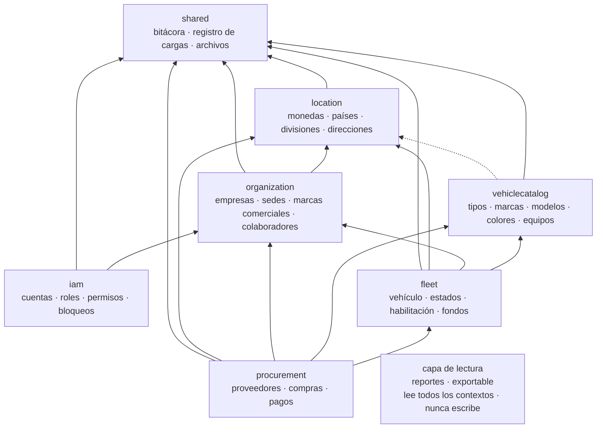

# Mapa de contextos — ERP Millennium Mobility

**Actualizado:** 02/10/2026 · **Estado:** borrador para validar · **Fuente:** diccionario de datos v1.12 (§3 y decisiones cerradas), [patrones de persistencia](patrones-de-persistencia-millennium-mobility.md), reglas de arquitectura de la skill `backend-module` y el documento *Contextos delimitados* escrito sobre la v1.8, que este reemplaza. Si este documento y el diccionario no coinciden, manda el diccionario.

El diccionario (§3) fija dos cosas: qué contexto es dueño de cada bloque, y que un contexto usa a otro únicamente a través de su fachada, sin consultar ni escribir sus tablas. Este documento propone cómo desarrollar esas reglas: qué posee cada contexto, quién puede llamar a quién, qué ofrece cada fachada y cómo se resuelven las fronteras delicadas.

**Cómo leerlo.** Lo que cita una sección o una decisión del diccionario (§n, D-n) o una regla de arquitectura está decidido. Lo marcado **(propuesta)** no lo decide nadie todavía y figura en las decisiones pendientes (§11).

---

## 1. El criterio

Un contexto termina **donde una palabra cambia de significado**. Estas son las palabras que marcan las fronteras de este proyecto:

| Palabra | Significado A | Significado B |
|---|---|---|
| Marca | Lizzo, Lima Bikes: bajo qué nombre se coloca la unidad (`organization`, §6.3) | Chevrolet, TVS: quién fabricó la unidad (`vehiclecatalog`, §7.2) |
| Entregado | La unidad salió físicamente hacia el cliente (`fleet`) | El contrato terminó y la unidad se traspasó al cliente. El contrato es de ventas (bloque 12, fuera del alcance actual); el traspaso se registra en `vehicles.transfer_date` y `transfer_reason` (`fleet`, D-20) |
| Activo | La unidad genera ingresos (`fleet`, §8.2) | El contrato está vigente (ventas, bloque 12) |
| Tipo de vehículo | Auto, moto, trimoto (`vehiclecatalog`, §7.1) | Nuevo o semi-nuevo, que se deduce de si hubo contratos (§7.1, §5.11) |
| Vehículo | Una unidad que se mueve, se habilita y se entrega (`fleet`) | Una línea de comprobante con un VIN y un monto (`procurement`) |
| Ubicación | El país, sus divisiones territoriales y las direcciones (`location`) | El lugar físico donde puede haber vehículos: patio, sede, dealer (`organization`, tabla `locations`, D-6) |

El vocabulario de personas es el del diccionario (D-39): **rol** es el conjunto de permisos de una cuenta, **puesto** el trabajo del colaborador y **perfil** sus datos personales. "Cargo" no se usa.

---

## 2. Arquitectura

**Un solo despliegue, módulos separados** (Spring Modulith). No hay microservicios.

| Regla | Cómo se sostiene |
|---|---|
| Cada contexto es dueño de sus tablas. Nadie escribe en las de otro (§3; regla 1.3) | Las escrituras pasan por la fachada del dueño, que es quien escribe |
| Nadie consulta las tablas de otro (§3; regla 1.2) | Las lecturas pasan por la fachada del dueño. La única excepción es la capa de lectura (§7), que solo lee |
| Las llaves foráneas entre contextos sí están permitidas (regla 1.2) | Es una sola base de datos y protegen la integridad |
| Las dependencias entre contextos van en un solo sentido | `ModularityTests` falla ante un ciclo o ante el uso del interior de otro contexto. Además, cada `package-info.java` debe declarar sus `allowedDependencies` según §4; hoy lo hacen `location`, sin ninguna, y `organization`, con `location::acl` (§9) |
| El dominio es solo dominio, en todos los contextos | Decisión del 01/10/2026: agregado en `domain`; entidad de persistencia, ensamblador y adaptador en `infrastructure`, también en los catálogos. El "camino corto" de la v1.8 quedó descartado |

---

## 3. Los contextos

La asignación de bloques sigue el cuadro "A qué contexto pertenece cada bloque" del diccionario (§3). **(propuesta)** El diccionario no fija el tipo de cada contexto, los límites de los agregados ni cómo se reparte el bloque 3b, que asigna a `organization` e `iam` sin separar tablas; esas columnas son propuesta de este documento.

| Contexto | Tipo **(propuesta)** | Bloques | Tablas que posee | Agregados **(propuesta)** |
|---|---|---|---|---|
| `location` | Genérico | 1 · Geografía y localización | `currencies`, `countries`, `geo_division_levels`, `geo_divisions`, `addresses`, `tax_id_types` (D-44) | `Currency`, `Country` (con sus escalones, D-45), `GeoDivision`, `Address`, `TaxIdType` |
| `iam` | Genérico | 2 · Seguridad; del 3b, `user_roles` **(propuesta)** | `users`, `user_access_suspensions`, `roles`, `permissions`, `role_permissions`, `user_roles` | `User` (con sus asignaciones de rol y sus bloqueos), `Role` (con sus permisos), `Permission` |
| `organization` | Soporte | 3 · Empresas; del 3b, `employees` **(propuesta)** | `companies`, `commercial_brands`, `branches`, `locations`, `employees` | `Company`, `CommercialBrand`, `Branch`, `Location`, `Employee` |
| `vehiclecatalog` | Soporte | 4 · Catálogos de flota | `vehicle_types`, `vehicle_brands`, `vehicle_models`, `colors`, `equipment_types`, `equipment_type_vehicle_types` | `VehicleType`, `VehicleBrand`, `VehicleModel`, `Color`, `EquipmentType` (con los tipos de vehículo a los que aplica) |
| `fleet` | Central | 6 · Vehículo y estados; 9 · Habilitación (salvo `import_batches`); 10 · Fondos | `vehicle_statuses`, `status_change_reasons`, `vehicles`, `vehicle_status_history`, `vehicle_mileage_readings`, `document_types`, `vehicle_documents`, `vehicle_equipments`, `vehicle_keys`, `vehicle_tax_declarations`, `funds`, `vehicle_fund_assignments` | `VehicleStatus`, `StatusChangeReason`, `Vehicle` (con sus llaves), `VehicleStatusHistory`, `MileageReading`, `DocumentType`, `VehicleDocument`, `VehicleEquipment`, `TaxDeclaration`, `Fund`, `FundAssignment` |
| `procurement` | Central | 7 · Compras (incluye el 5); 8 · Pagos | `suppliers`, `purchase_order_types`, `purchase_order_templates`, `purchase_orders`, `purchase_order_items`, `purchase_invoices`, `purchase_invoice_items`, `credit_notes`, `credit_note_items`, `supplier_payments`, `payment_applications`, `payment_allocations` | `Supplier`, `PurchaseOrderType`, `PurchaseOrderTemplate`, `PurchaseOrder` (con sus líneas), `PurchaseInvoice` (con sus líneas por unidad), `CreditNote` (con su reparto), `SupplierPayment` (con sus aplicaciones e imputaciones) |
| `shared` | Transversal | 11 · Bitácora y cargas de archivos | `change_log`, `import_batches` | `ChangeLogEntry`, `ImportBatch` |

**`advisor_assignments`** también es del bloque 3b, así que el diccionario la asigna a `organization` e `iam`; según el ajuste 2 de §3 se construye con el bloque 12, pero eso no cambia a quién pertenece.

**Tablas técnicas** (§2.2): `flyway_schema_history`, `event_publications` y `spring_session*` las administran sus librerías. Las de sesiones las usa `iam`.

**Fuera del alcance actual:** el bloque 12, ventas y contratos (clientes, contratos y cobros), y la aplicación del cliente con sus propias identidades (§5.1). El diccionario no les asigna contexto. **(propuesta)** Llamarlos `sales` y `customerportal`.

### Por qué cada agregado tiene ese límite (propuesta)

Un agregado es lo que se guarda y se valida como un todo.

- **`PurchaseInvoice` incluye sus líneas.** Que la suma de las líneas coincida con el total es una regla del comprobante (§9.3): al guardar la factura se validan sus ochenta líneas de una vez.
- **`CreditNote` incluye su reparto**, por la misma razón: lo repartido debe coincidir con el total (§9.5).
- **`VehicleStatusHistory` y `MileageReading` van aparte de `Vehicle`.** Crecen sin límite y se consultan por sí solos. El estado actual y el último kilometraje se guardan además en la unidad, y se escriben en la misma operación que su historial (§8.4, §8.5; regla 4.1).
- **`VehicleDocument`, `VehicleEquipment` y `FundAssignment` van aparte**: cada uno tiene su propio ciclo (vencimientos, períodos, cargas masivas).
- **`Company` no incluye sedes, marcas ni ubicaciones**: son agregados propios que apuntan a la empresa.
- **`Country` incluye sus escalones** (D-45). Que se declaren en orden, que sean cuatro como máximo y que no se borren son reglas del país: se guardan con él. Las divisiones van aparte, porque son miles y se consultan solas.

---

## 4. Quién puede llamar a quién (propuesta)

El diccionario no fija el sentido de las dependencias. Lo que sí está decidido y se respeta aquí: el acceso solo por fachada (§3), D-32, D-38 y D-42. Que no haya ciclos lo exige Spring Modulith; la dirección elegida en cada par es propuesta de este documento.

La flecha va de quien llama hacia quien es llamado. Nunca al revés: `location` no sabe que existe `fleet`.

La capa de lectura no se dibuja con flechas: lee las tablas de todos los contextos, nunca escribe y ningún contexto la llama (§7).

| Contexto | Puede llamar a | Para qué |
|---|---|---|
| `location` | `shared` | — |
| `iam` | `shared`, `organization` | Comprobar, al otorgar un rol de empresa o de sede, que la cuenta está vinculada a un colaborador activo de esa empresa, y para uno de alcance sistema, de alguna empresa (§5.3, §5.7, D-38). Es la validación de asignaciones que el diccionario deja a la aplicación: que la sede y la marca pertenezcan a la empresa lo impide la base (§5.7). Registrar y vincular el colaborador al dar acceso y en el registro público (D-32, D-38) |
| `organization` | `shared`, `location` | Países, monedas funcionales, tipos de documento tributario de las empresas (D-44) y direcciones de empresas, sedes y ubicaciones |
| `vehiclecatalog` | `shared`, `location` | Permitida; hoy ninguna tabla del bloque 4 la necesita |
| `fleet` | `shared`, `location`, `vehiclecatalog`, `organization` | Moneda del costo de equipamiento; modelo, tipo y exigencia de pantalla; empresa, marca comercial y ubicación de la unidad; registrar las cargas de archivos en `shared` |
| `procurement` | `shared`, `location`, `vehiclecatalog`, `organization`, `fleet` | Monedas y direcciones; modelo de las líneas de orden; empresa y marca comercial de la plantilla; tipo de documento tributario del proveedor y del emisor, que es de `location`; VIN de las líneas de factura y anulación de la unidad |

Lo que se resuelve con este sentido único:

- **`organization` no llama a `iam`.** Cuando hay sesión, el autor de sus registros lo llena el auditor que aporta `iam` (`CurrentUserAuditorAware`) a partir de la cuenta de la sesión (D-42). Spring lo inyecta, así que no hay dependencia de código. En el registro público no hay sesión y el auditor no supone `SYSTEM` (D-42): es `iam` quien entrega el identificador de `SYSTEM` cuando le pide a `organization` registrar el colaborador. Cómo se entera `iam` de la salida de un colaborador depende de la decisión pendiente 2; la propuesta es un evento (§5.2).
- **`fleet` no llama a `procurement`.** Cuando una nota de crédito deja en cero el valor de una unidad, es `procurement` quien le pide a `fleet` que la anule. Los costos que muestra la ficha de la unidad salen de la capa de lectura (§6.1).
- **Cómo se muestran las referencias a cuentas fuera de `iam`** (`changed_by`, `uploaded_by`, `imported_by`) queda en la decisión pendiente 6.

---

## 5. Fachadas y eventos

### 5.1 Lo que expone cada contexto

Cada contexto expone una fachada en `interfaces.acl`, anotada como `@NamedInterface("acl")` (regla 1.1), e implementada en `application.acl` sobre sus servicios de consulta y de comandos, nunca sobre los repositorios. Devuelve tipos simples o `record` definidos en el propio paquete `acl`, nunca agregados (regla 1.4). Puede devolver el `id` interno, porque no sale del servidor.

Quien la consume lo hace desde `application.internal.outboundservices.acl`, con un servicio `External<Contexto>Service` que traduce la respuesta a su propio vocabulario (skill `backend-module`).

| Contexto | Fachada | Qué ofrece | Estado |
|---|---|---|---|
| `iam` | `IamContextFacade` | Identificador interno de una cuenta a partir del público y al revés; cuenta de la petición actual | Construida |
| `location` | `LocationContextFacade` | Identificador interno de una moneda por su identificador público; si existe una moneda activa con un código ISO; resumen de país (`CountrySummary`) por identificador público, ISO o interno; identificadores de una dirección; resumen de un tipo de documento tributario (`TaxIdTypeSummary`), con a quién cubre, su longitud y si está activo | Construida |
| `location` | (misma fachada) **(propuesta)** | División territorial por identificador público; crear, corregir y reemplazar la dirección de un dueño (§6.3); zona horaria del país | Pendiente; ningún contexto lo pide todavía |
| `organization` | `OrganizationContextFacade` **(propuesta)** | El colaborador está activo en la empresa; la cuenta tiene algún colaborador activo, en cualquier empresa (§5.3); registrar el colaborador del registro público con el autor que indica `iam` (D-42); vincular un colaborador a una cuenta; zona horaria de la sede o del país de la empresa (§2.6) | Pendiente |
| `vehiclecatalog` | `VehicleCatalogContextFacade` **(propuesta)** | El modelo existe y está activo; tipo de vehículo del modelo; si la unidad requiere pantalla: el equipo aplica a su tipo **y** el modelo no la trae de fábrica (§7.5) | Pendiente |
| `fleet` | `FleetContextFacade` **(propuesta)** | Unidad por VIN; empresa propietaria; estado actual; anular la unidad cuando su valor llega a cero (§9.6); dar de alta la unidad desde la factura, solo si así se decide (decisión pendiente 5) | Pendiente |
| `procurement` | — | Ningún contexto la necesita: costos y pagos se leen desde la capa de lectura | — |
| `shared` | `SharedContextFacade` **(propuesta)** | Registrar una carga de archivo (tipo, archivo, filas totales, entradas y fallidas, archivo de errores) y devolver su identificador; guardar y recuperar archivos | Pendiente; depende de la decisión pendiente 8 |

### 5.2 Eventos entre contextos (propuesta)

El diccionario exige que la salida de un colaborador, el retiro de sus roles y el bloqueo de su cuenta ocurran **en la misma operación** (§5.3, D-38), y que se impida la salida si no quedaría ningún superadministrador activo (§5.9). No fija el mecanismo. La propuesta, pendiente de la decisión 2:

| Evento | Lo publica | Lo escucha | Qué hace quien escucha |
|---|---|---|---|
| `EmployeeTerminated` | `organization`, en `interfaces.events`, al registrar la fecha de salida | `iam` | Retira los roles de la cuenta en esa empresa con motivo `baja_colaborador`. Si a la cuenta no le queda ningún colaborador activo, la bloquea con motivo `baja`, lo que revoca en la misma operación todas sus asignaciones con motivo `baja_cuenta` y cierra sus sesiones (§5.3, §5.9, D-12) |

El oyente es síncrono y corre dentro de la transacción de quien publica, para cumplir la misma operación: si falla, se revierte todo. Por eso no deja registro en `event_publications`, que Spring Modulith usa solo para los oyentes que corren después del commit. Si se elige la opción A de la decisión 2, la salida se registra desde `iam` y este evento no hace falta.

---

## 6. Fronteras delicadas

### 6.1 `fleet` y `procurement`

Es la más delicada porque ambos hablan del vehículo.

| | `fleet` | `procurement` |
|---|---|---|
| Qué es un vehículo | Una unidad física que se mueve, se habilita y se entrega | Una línea de comprobante con un VIN y un monto |
| Qué conoce | Estado, ubicación, GPS, placa, documentos, fondos | VIN, empresa, valor de factura, notas de crédito, pagos |
| Qué **no** conoce | Facturas, notas de crédito, pagos | Estado de habilitación, GPS, ubicación |

- `procurement` valida que el VIN exista preguntando a `fleet`, no consultando su tabla. **(propuesta)** Si se decide que la unidad nace al registrar la factura (decisión pendiente 5), `procurement` le pide a `fleet` que la dé de alta; en los dos casos la dependencia va de `procurement` a `fleet` y `procurement` nunca escribe en `vehicles`.
- El valor del vehículo es el valor de factura menos sus notas de crédito (§9.6), un cálculo de compras. Cuando llega a cero y la unidad no tiene contratos, la unidad queda anulada (§9.6). **(propuesta)** `procurement` le pide a `fleet` que la anule; la condición de los contratos quedará a cargo de ventas cuando exista.
- El recurso de la unidad en `fleet` no lleva montos de compra. **(propuesta)** En la ficha de la unidad, el valor de factura, las notas y el valor del vehículo vienen de una consulta de la capa de lectura que solo responde con el permiso `stock.ver_costos` (decisión pendiente 7).
- El exportable de 52 columnas cruza cinco contextos y se arma en la capa de lectura (§7; regla 1.2), nunca con `join` desde un contexto.

### 6.2 `iam` y `organization`

`iam` es dueño de las cuentas y `organization` de los colaboradores **(propuesta, reparto del 3b)**. La columna que los une, `employees.user_id`, es de `organization` (§5.3).

| Operación | Dónde vive **(propuesta)** | Cómo cruza la frontera |
|---|---|---|
| Dar acceso a un colaborador (D-38) | `iam` | Pregunta a `organization` si el colaborador existe y está activo, crea la cuenta o reutiliza la que ya tiene ese correo, y pide a `organization` que vincule el colaborador a la cuenta. Todo en una transacción |
| Registro público (D-32) | `iam` | Pide a `organization` registrar el colaborador a nombre de `SYSTEM`, crea la cuenta y los vincula en la misma transacción. Si algo falla, no queda ninguno de los dos |
| Otorgar un rol de empresa o de sede (§5.7) | `iam` | Pregunta a `organization` si el colaborador está activo en esa empresa |
| Salida de un colaborador (D-38) | Depende de la decisión pendiente 2; propuesta: `organization` | Propuesta: publica `EmployeeTerminated` y `iam` retira roles y, si corresponde, bloquea la cuenta (§5.2). Con la opción A, `iam` registra la salida y pide a `organization` cerrar el colaborador |
| Proteger al último superadministrador al registrar una salida (§5.9) | Depende de la decisión pendiente 2 | — |

### 6.3 Las direcciones y sus dueños

`addresses` es de `location` (§3), pero cada dirección pertenece a una empresa, una sede, una ubicación, un proveedor o una plantilla de orden de compra (§4.6).

- La dirección se edita dentro del formulario de su dueño: no tiene pantalla ni menú propio (orden de implementación, paso 1).
- **(propuesta)** El contexto dueño pide a `location` crear, corregir o reemplazar la dirección y guarda el `address_id` que le devuelve.
- Corregir modifica la fila; una mudanza crea una fila nueva (D-8). La fachada ofrece las dos operaciones por separado.
- Las direcciones no se comparten entre entidades (§4.6): cada dueño tiene su propia fila aunque el texto coincida.

### 6.4 `vehiclecatalog` y `fleet`

Los catálogos de flota son del sistema, no de cada empresa (D-15). Los estados del vehículo, los motivos de cambio y los tipos de documento son de `fleet`, porque pertenecen a los bloques 6 y 9 (§3), no a `vehiclecatalog`.

### 6.5 `shared` y las cargas de archivos

Entra a `shared` lo que cumple **las dos** condiciones: lo usan dos o más contextos **y** no pertenece al vocabulario de ninguno (regla 6.1).

| Contiene | Ejemplos |
|---|---|
| Núcleo de aplicación | `Result`, `ApplicationError` |
| Persistencia base | `AuditableAbstractPersistenceEntity`, `AuthoredAbstractPersistenceEntity`, estrategia de nombres |
| REST común | Manejador global de errores, `ErrorResource`, `@AnyRoleRequired` |
| Plataforma | Bitácora de cambios (`change_log`), registro de las cargas de archivos (`import_batches`: archivo, filas totales, entradas y fallidas, archivo de errores) y almacenamiento de archivos |

| Tentación | Dónde va |
|---|---|
| Una clase con una regla de negocio | Al contexto dueño de la regla |
| Un DTO que usan dos contextos | A la fachada del contexto que lo produce |
| Una utilidad de un solo contexto | Dentro de ese contexto |
| `Helpers`, `Utils` sin tema | A ninguna parte |

**Las cargas de archivos.** Las fuentes externas (impuesto vehicular, garantía mobiliaria y la migración desde el Excel) entran por un adaptador que traduce su formato y registra lo que no pudo vincular. Si el formato ajeno se cuela hacia adentro, el modelo vuelve a parecerse al Excel.

- Ningún archivo auxiliar (impuesto vehicular, garantía mobiliaria) crea vehículos: solo actualiza los que ya existen (§11.7, §11.8). La migración inicial, en cambio, es la que da de alta las unidades existentes, que conservan su `legacy_number` como referencia (§8.1, D-18).
- `import_batches` es de `shared` (§3, bloque 11). Las tablas que actualizan las cargas (`vehicle_tax_declarations`, `vehicle_fund_assignments`, `vehicles`) son de `fleet` (bloques 6, 9 y 10).
- **(propuesta)** El adaptador de cada fuente vive en `fleet`, dueño de lo que actualiza y de sus reglas: solo autos, documento vehicular previo, la historia de cesiones de D-30. `fleet` registra la carga a través de `shared`. Un adaptador en `shared` escribiría tablas de `fleet`, que la regla 1.3 prohíbe, o tendría que llamar a `fleet` y formaría un ciclo (decisión pendiente 8).

---

## 7. Capa de lectura

Los indicadores calculados (§10.5) y el exportable de stock cruzan varios contextos. Se arman en una capa de lectura declarada como tal, que no pertenece a ningún contexto, consulta las tablas directamente y **nunca escribe** (regla 1.2).

- Respeta los mismos permisos que el resto: un campo que el usuario no puede ver no sale de la base (§2.5; regla 5.4).
- No guarda resultados: si un reporte mensual debe ser reproducible, se conserva el archivo del reporte, no un campo (§10.5).

---

## 8. Frontend

El frontend tiene los mismos contextos, con las mismas capas dentro de cada uno (skill `frontend-feature`):

- La carpeta lleva el nombre del contexto; la URL del navegador, el mismo en kebab-case (`vehiclecatalog` → `/vehicle-catalog/...`).
- Un contexto nunca importa el store ni el interior de otro: usa su fachada (`<contexto>.facade.ts`), que devuelve vistas mínimas, no entidades (frontend-rules 1.1 a 1.3).
- `app-shell` es el único que compone varios contextos: el marco, el menú y la sección de sesión.
- **(propuesta)** Las pantallas de la plataforma y de la capa de lectura (`/change-log`, `/reports`) no llevan prefijo de contexto, como ya figuran en `app-navigation.ts`. En qué carpeta del frontend viven está pendiente (decisión pendiente 3).

---

## 9. Estado del código frente a este mapa (05/10/2026)

| Tema | Hoy | Según este mapa |
|---|---|---|
| `shared`, `iam` | Construidos; lo que falta de `iam` está en §5.13 del diccionario | — |
| `location` | Monedas, países con sus escalones, divisiones, direcciones y tipos de documento tributario, con dominio y persistencia separados. Declara `allowedDependencies = {}` | Cumple (§3, §4, D-44, D-45) |
| `organization` | Empresas. Consulta a `location` solo desde `ExternalLocationService`, y la regla del tipo de documento de la empresa (§6.2) es un objeto de valor de su dominio. Declara `location::acl` | Cumple. Ya no publica un evento para marcar el país como operativo: eso lo responde el filtro de empresas por país (D-3) |
| Escalones y divisiones territoriales | En `location`, en el backend y en el frontend. Los escalones se guardan con el país, no tienen `DELETE` y se leen y declaran en `/countries/{id}/geo-division-levels` | Cumple. El contexto `geodivision` ya no existe |
| Frontend de `location` | Ficha del país en `/location/countries/{id}` con sus datos, su estructura territorial y sus documentos tributarios. `LocationFacade` devuelve vistas mínimas (`CountryOption`, `CurrencyOption`, `AddressOption`, `TaxIdTypeOption`) | Cumple |
| `OrganizationFacade` del frontend | Devuelve `CompanyOption`, una vista mínima | Cumple |
| `iam` | Sin `package-info.java` con `allowedDependencies` | Declara `organization::acl` (y `organization::events` si se elige el evento) cuando exista `organization` |
| `AbstractDomainAggregateRoot` | Extiende una clase de Spring Data, así que los agregados que la usan dependen de `org.springframework` | El dominio no depende del marco de trabajo (regla 2.1) |
| Rutas de la API | Ninguna lleva prefijo de contexto | Ver [convenciones de la API](convenciones-de-la-api-millennium-mobility.md), decisión pendiente 1 |

---

## 10. Diferencias con *Contextos delimitados* (v1.8)

| Tema | v1.8 | Ahora | Por qué |
|---|---|---|---|
| Persistencia de los catálogos | Camino corto en `location`, `vehiclecatalog` y `organization` | Patrón completo en todos los contextos | Decisión del 01/10/2026 ([patrones de persistencia](patrones-de-persistencia-millennium-mobility.md)) |
| Vocabulario | "Cargos" | "Roles" | D-39 |
| `tax_id_types` | `location` | `location`, como en la v1.8 | D-44: es localización del país, como sus escalones. Estuvo un tiempo en `organization` |
| Estados, motivos y tipos de documento del vehículo | `vehiclecatalog` | `fleet` | §3: son de los bloques 6 y 9 |
| `organization` → `iam` | Permitida | Quitada **(propuesta)** | Con las dos direcciones hay un ciclo, y Spring Modulith lo rechaza. Cómo se entera `iam` de una salida queda en la decisión pendiente 2 |
| `procurement` → `vehiclecatalog` | No figuraba | Permitida **(propuesta)** | Las líneas de orden de compra apuntan a `vehicle_models` (§9.2) |
| `fleet` pide costos a `procurement` | Sí | No **(propuesta)**; la anulación la ordena `procurement` y los costos los lee la capa de lectura | Evita el ciclo con `procurement` → `fleet` |
| Adaptadores de archivos externos | `shared.dataimport` | En `fleet` **(propuesta)**; `shared` guarda el registro de la carga | La regla 1.3 y el ciclo con `fleet` (§6.5) |
| Paquete raíz | `com.millennium.erp` | `ky.millennium.mobility.erp` | Dominio `millennium.ky` |
| Rutas de la API | Prefijo por contexto | Propuesta pendiente; hoy ninguna ruta lo lleva | Ninguna decisión lo fija ([convenciones de la API](convenciones-de-la-api-millennium-mobility.md)) |
| Fases y plazos | Tabla propia de 9 fases y costo en días-persona | El [orden de implementación](orden-de-implementacion-millennium-mobility.md) | Es el documento vigente del plan |

---

## 11. Decisiones pendientes

1. **Un esquema de base de datos por contexto o uno solo.** La v1.8 proponía uno por contexto para que la frontera se vea también en la base; hoy todo está en el esquema `public`. Cambiarlo después obliga a mover tablas con migraciones.
2. **Dónde se registra la salida de un colaborador y cómo se protege al último superadministrador** (§5.3, §5.9), sin que `organization` llame a `iam`. Opción A: la salida la registra un caso de uso de `iam`, que valida y luego pide a `organization` cerrar el colaborador. Opción B: `organization` publica `EmployeeTerminated` y el oyente síncrono de `iam` rechaza el evento y revierte la transacción cuando no quedaría ningún superadministrador; es más simple, pero convierte un fallo esperado en una excepción (regla 3.1).
3. **Dónde viven la capa de lectura y las pantallas de la plataforma.** Propuesta: un módulo `reporting` declarado en Spring Modulith, con dependencias de solo lectura hacia todos, y una carpeta del frontend para la plataforma y los reportes.
4. **Tipo de cada contexto, límites de los agregados, reparto del bloque 3b y sentido de las dependencias** (§3, §4): son propuesta de este documento. Si se aceptan, el reparto del 3b (`employees` → `organization`, `user_roles` → `iam`) se registra en el diccionario; ya coincide con el código, donde `user_roles` está en `iam`. Lo mismo vale para los nombres `sales` y `customerportal`.
5. **Dónde nace la unidad.** En Inventario antes de registrar la factura, y entonces `procurement` solo pregunta si el VIN existe; o al registrar la factura, y entonces `procurement` le pide a `fleet` crearla. Es la pregunta abierta 1 de [procesos y pantallas](procesos-y-pantallas-millennium-mobility.md).
6. **Cómo se muestran las referencias a cuentas fuera de `iam`** (`changed_by`, `uploaded_by`, `imported_by` en `fleet`, `procurement` y `shared`). El `id` interno no sale del servidor; el identificador público lo traduce `iam` y el nombre de la persona está en `employees`, de `organization` (§5.4). Opción A: las resuelve la capa de lectura, sin dependencias de código; es la única que sirve para `change_log` e `import_batches`, que son de `shared`. Opción B: `fleet` y `procurement` agregan `iam` a sus dependencias, sin ciclo porque `iam` no los llama.
7. **Costos en la ficha de la unidad**: una consulta por unidad en la capa de lectura que solo responde con `stock.ver_costos` (§6.1).
8. **Dónde viven los adaptadores de las cargas de archivos**: en `fleet`, registrando la carga en `shared` (§6.5); o en `shared`, con un puerto por tipo de carga que `fleet` implementa.
