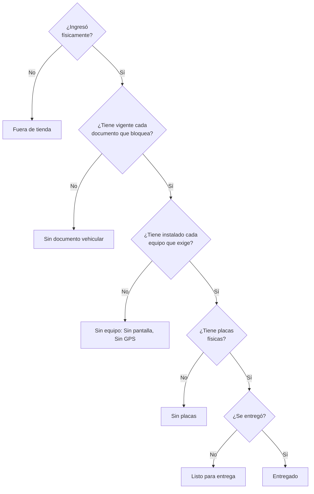
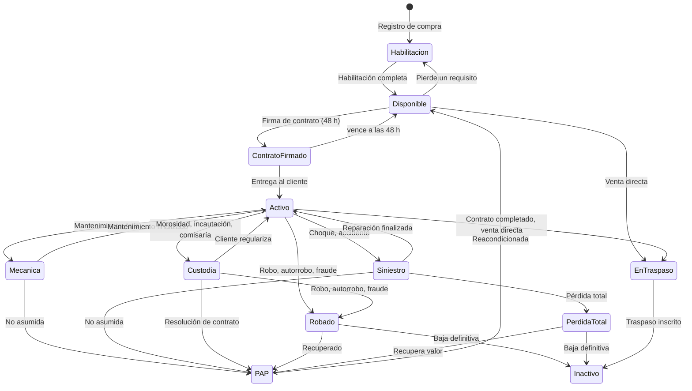

# Procesos y pantallas — ERP Millennium Mobility

**Actualizado:** 09/11/2026 (la revisión de las facturas que pidió el responsable ese día, integrada en `develop` y desplegada en dev: el estado de pago de una factura, D-244, en P4 y en Facturas, con la franja sobre sus datos, «Pagos» como la tabla de sus pagos, la columna «Pago» y los filtros «Tipo» y «Pago» de la lista, frontend `cf862569`; y las acciones de una ficha, dos botones y el menú ⋮, en todas las fichas, frontend `2fcbecbe` (DESIGN.md, revisiones 62 y 63). Antes, el mismo día: el cierre de la auditoría del 09/11/2026, en `integration/audit-2026-11-09`, ~~todavía sin merge a `develop`~~ integrado en `develop` y desplegado ese día (backend `f4e025f7`, frontend `0f797b69`): el asesor de ventas entrega la unidad, D-238, en el apartado 1 y la pregunta 4, resuelta; En traspaso, D-239, en el flujograma de P7 y en la carga inicial de P9, con la enmienda de D-225; restablecer la contraseña con un enlace, D-243, en P2 y en el inventario, con Restablecer la contraseña y Elegir una contraseña nueva, frontend `06ba1c4d`; el historial de ingresos, D-241, en P2 y en Colaboradores, frontend `478047ea`; Empresas, su ficha y Ubicaciones solo con `configuracion.ver_estructura`, frontend `bd0b60c6`, y el menú sin roles, frontend `43e0329f`, en el apartado 3.1 y en el 4). Antes, 06/11/2026 (Logística › Cargas de archivos: backend `7f01d0b2`, frontend `94ed5925`). Antes, 05/11/2026 (la cuenta de origen y el voucher del pago, y las cuentas bancarias en la ficha de la empresa, frontend `90b50ff6`; antes, Registrar pago usa lo que ya sabe, frontend `d9c732e9`; antes, Registrar nota de crédito y Registrar pago sobre el formulario de la factura, frontend `3a78ba49`; antes, Registrar factura en tres filas con el comprobante al lado, frontend `bd0e4a54`; antes, la regla de Desde y Hasta y el período de las órdenes, frontend `bcfb4c93`, backend `7c8cd891`; antes, un solo flujo en la barra y solo los filtros necesarios, frontend `4593514f`; antes, la barra de las listas y las tarjetas iguales, frontend `863817c3`, y la segunda revisión de punta a punta y los tres pedidos del responsable, integrados en `develop` ese día —backend `851b4d09`, frontend `3a49f141`; [plan de compras y habilitación](plan-de-implementacion-compras-y-habilitacion-2026-11-02.md), §2.11—: en P4, «Importar desde Excel», que reemplaza «Pegar columnas», y lo corregido de la factura y de la nota; en P5, lo que se puede pagar de un dealer, la diferencia de cambio del formulario y la copia; en P6, el regreso desde un Vendido desmarcado y la barra de Habilitación; en el apartado 3.2, la barra de las listas con varios filtros y las tarjetas de datos en grupos de los tres formularios; y en el 3.4, sus dos reglas) · 04/11/2026 (las correcciones de la revisión de punta a punta, integradas en `develop` ese día —backend `44136ae1`, frontend `cc782649`; [plan de compras y habilitación](plan-de-implementacion-compras-y-habilitacion-2026-11-02.md), §2.10—: en P4, «Pegar columnas» con la marca, el modelo y el año para todas las líneas; en P5, el equivalente que absorbe el redondeo; en P6, la puerta que ningún camino automático salvo el regreso desde Vendido alcanza; y en el apartado 3.2, el formulario del pago, Estados y motivos y las dos pantallas de la habilitación) · 03/11/2026 (los pagos a proveedores, construidos e integrados en `develop` ese día —backend `601cc177`, frontend `e0ed0f68`—: P5 construido, con lo que fijó el código; en el apartado 3.1, la opción Pagos a proveedores con `pagos.ver`; en el apartado 3.2, Logística › Pagos a proveedores, su formulario y su ficha, y lo que cambia en Órdenes de compra, la ficha de la factura, la ficha de la unidad y Proveedores con su ficha; en el apartado 3.3, el pago en la ficha de la unidad) · 03/11/2026 (las notas de crédito, construidas e integradas en `develop` ese día —backend `e213c01c`, frontend `d579211a`—: P4, con sus pasos 4 y 5 construidos y las facturas para los roles de la matriz desde V104; en el apartado 3.2, Logística › Notas de crédito, su formulario y su ficha, y lo que cambia en Facturas, Inventario y la ficha de la unidad; en el apartado 3.3, el costo de compra en la ficha de la unidad, D-203) · 03/11/2026 (la habilitación, construida e integrada en `develop` ese día —backend `8bfdb938`, frontend `2659126a`—: P6 construido, con el estado de habilitación por sus códigos; en el apartado 3.2, Logística › Habilitación, la habilitación de una unidad y Catálogos › Tipos de documento, y lo que cambia en Estados y motivos, Inventario, la ficha de la unidad y la ficha de la factura) · 03/11/2026 (las facturas de compra, construidas e integradas en `develop` ese día —backend `16f69af3`, frontend `2dc6505c`—: P4, con sus pasos 2, 3 y 6 construidos; Logística › Facturas, su formulario y su ficha en el apartado 3.2, y lo que cambia en Órdenes de compra, Inventario y la ficha de la unidad) · 03/11/2026 (D-190 a D-202: la nota de crédito que reduce lo que se debe, anula unidades solo cuando vuelven al proveedor y copia la tasa de cada factura; el pago en cualquier moneda, con saldo por moneda, retención y canal de dealers; las cargas de archivos) · 02/11/2026 (D-157 a D-168: la factura registrada a mano, con el ISC por factura, el precio con impuestos, su número y sus líneas, la anulación que no anula unidades y su orden; la puerta de Disponible, las placas físicas, el gas según el modelo y los vencimientos en Habilitación; pregunta 3 reabierta y resuelta) · 01/11/2026 (D-152 a D-154: la tasa de venta de la fecha, la nota de crédito con la de su factura, la unidad que nace con la factura y la factura cargada desde su XML; preguntas 1 y 3 resueltas) · 01/11/2026 (D-151: la factura y el pago proponen la tasa de su fecha y la registran ahí mismo cuando falta) · 01/11/2026 (diccionario v1.35, D-148 a D-150: los tipos de cambio en P3 y la pantalla Catálogos › Tipos de cambio en el inventario, pendiente) · 31/10/2026 (el cierre de la revisión del 31/10/2026, diccionario v1.34, D-144 a D-146, [plan de cierre](plan-de-cierre-de-la-revision-2026-10-31.md), sección 15: Inicio de sesión y Cambio de contraseña dicen cuántos minutos espera un intento frenado y piden repetirlo cuando el sistema compara muchas contraseñas a la vez, frontend `a1b01aa4`, D-144; la contraseña, de 8 a 72 caracteres, con las letras con tilde y la ñ contando doble, frontend `11d31aa5`, D-145; Monedas, de 0 a 2 decimales, frontend `c86fb25d`, D-146) · 30/10/2026 (diccionario v1.33, D-136 a D-142, y el código del 30/10/2026 en `develop`, backend `a54ee29b` y frontend `88484481`, publicados el 30/10/2026: quién mantiene los tipos de documento del vehículo, resuelto por D-139 —sus tres permisos propios, del superadministrador—, y la pregunta 6 cerrada; las pantallas de Catálogos se abren solo con `catalogos.ver`, D-141, que resuelve el hallazgo del apartado 4; Plantillas de OC dibuja su hoja con las bandas de la hoja de la orden, D-140 y DESIGN.md revisión 32; Proveedores, con el alta sin contactos también en la API, D-137; Marcas y modelos exporta solo los modelos, y la API ya no exporta las marcas, D-136; las decisiones del 29/10/2026 citadas por su número) · 29/10/2026 (decisiones del responsable del 28 y del 29/10/2026 sobre las pantallas, en DESIGN.md, revisiones 28 a 31: Órdenes de compra dibujada sobre su hoja impresa, sin hoja ni acciones hasta elegir la plantilla, DESIGN.md revisión 28; Plantillas de OC con el botón «Gestionar tipos», que crea y corrige los tipos en su lugar, revisión 29; la ficha del proveedor con su panel Contactos, y el diálogo del proveedor sin contactos, revisión 31; Marcas y modelos lista todos los modelos y gestiona las marcas en «Gestionar marcas», y la ficha de la marca sale y redirige a la lista filtrada, revisión 30, en lugar de D-112, que el diccionario cambia cuando el responsable apruebe el texto nuevo; los decimales de una moneda, fijos desde la primera orden de compra; la regla de que un diálogo no abre otro de formulario encima; los permisos partidos de D-130 en P3 y en Colaboradores; quién mantiene los tipos de documento del vehículo, abierto hasta el paso 9, pregunta 6; las pantallas de Catálogos se abren por permiso desde el 20/10/2026, y quien solo escribe un catálogo ve la opción pero no lee la lista, hallazgo abierto en el apartado 4; verificado contra `develop`: backend `5ec83065`, frontend `bda96499`) · 26/10/2026 (cierre de la auditoría del 25/10/2026, diccionario v1.31: las tres opciones de compras se ven solo con `compras.ver`; cada acción de plantillas, tipos y órdenes con su propio permiso, D-130; activar o desactivar una plantilla por su propia ruta; la hoja de la plantilla con el emisor copiado y los archivos en el mismo guardado; Configuración › Fondos y la pestaña Cesiones de la ficha de la unidad, construidas como avance del paso 10, D-133 y D-134) · 23/10/2026 (paso 7, en curso: Órdenes de compra y Plantillas de OC construidas; el menú de compras por permiso; [contextos/procurement.md](contextos/procurement.md)) · 20/10/2026 (la segunda fase de la segunda ronda, integrada en `develop`, merges `007151dd` en el backend y `11235e0` en el frontend, y verificada contra el código: el menú y las rutas por permiso, con `systemAllOf` para Usuarios; las acciones de Colaboradores por `allowedActions`; la matriz, con sus pistas leídas de `grantableForGeneralRoles` y `grantableForCompanyRoles`) · 20/10/2026 (segunda ronda de la auditoría, diccionario v1.25, en construcción: Seguridad por permisos, D-117 a D-122; el menú y las acciones por el permiso de cada pantalla, y las de Colaboradores por fila; Seguridad › Roles y permisos con las pestañas Roles y Matriz de permisos, D-126, y la copia de un rol, D-124) · 20/10/2026 (lo que construyó la auditoría en la ficha de la marca y en Estados y motivos, verificado contra `audit/fe-integration`) · 20/10/2026 (auditoría del 20/10/2026, diccionario v1.24: Marcas y modelos es una lista con la ficha de cada marca, no un maestro-detalle, D-112; las cuatro pantallas de los catálogos de flota, construidas, con su documento de contexto) · 20/10/2026 (paso 5, integrado en `develop`: Logística › Inventario con la ficha de la unidad, y Catálogos › Estados y motivos, construidas; merges `32d4996` en el backend y `28ffe6a` en el frontend) · 19/10/2026 (la ficha de la empresa empieza en sus datos: "Ver ubicaciones" y "Ver colaboradores" en el menú ⋮ "Más acciones de la empresa" de la cabecera de los datos, y el aviso de empresa inactiva, "No se le registra nada nuevo.", en la celda Estado; merge `6b9b2c5` en el frontend) · 19/10/2026 (el administrador de empresa ve los datos de su empresa (decisión del responsable del 19/10/2026): Empresas abre la ficha de cada empresa, con sus sedes y sus marcas comerciales en pestañas; Sedes y Marcas comerciales salen del menú; Ubicaciones y Colaboradores llevan la empresa en la URL; "Corregir documento" sin leyenda) · 19/10/2026 (paso 3b, diccionario v1.23: las tareas de cada rol según la matriz, D-95; los roles propios y Seguridad › Roles y permisos, construida, D-97, D-98; la fila mínima de los colaboradores para todos y sus datos personales por permiso, D-105; los estados y motivos y los tipos de documento del vehículo con `catalogos.gestionar_estados`, D-100; las preguntas 5 y 6 resueltas) · 18/10/2026 (seguimiento de `organization`: Colaboradores la leen solo los roles globales y el administrador de la empresa, D-93; nada se reactiva ni regresa bajo una empresa inactiva, D-94) · 18/10/2026 (cierre de `organization`: confirmar la cuenta de otra persona y desvincularla, D-82; las empresas inactivas, de solo lectura para el superadministrador, D-84; corregir el documento de una empresa, D-85; la caducidad de un rol como día completo, D-87; la fecha de ingreso hasta hoy, D-88; el superadministrador sin vincular, D-89; la reactivación de una ubicación propia, D-90) · 18/10/2026 (cierre de `location`: Ubicaciones pregunta si la dirección se corrige o se muda, D-79; "pestaña" y "dígito de control" en todo el documento) · 16/10/2026 (modelo de acceso del paso 3: el administrador de accesos da acceso y maneja cuentas, el de empresa registra a su gente) · 14/10/2026 (Sedes, Marcas comerciales, Ubicaciones y Colaboradores construidas; la dirección elige su división en cascada) · 06/10/2026 (Empresas construida; todo formulario pregunta antes de descartar cambios) · **Estado:** borrador para validar · **Fuente:** diccionario de datos v1.32, con las decisiones del modelo de acceso de la v1.18 (D-55 a D-72), de la v1.21 (D-81 a D-92), de la v1.22 (D-93 y D-94) de la matriz de permisos de la v1.23 (§5.6, D-95 a D-105) de la auditoría de la v1.24 (D-106 a D-116) y de su segunda ronda en la v1.25 (D-117 a D-127), y hasta la v1.32 (D-128 a D-135), las decisiones del responsable del 28 y del 29/10/2026 sobre las pantallas (DESIGN.md, revisiones 28 a 31), la política de acceso de [convenciones de la API](convenciones-de-la-api-millennium-mobility.md) §9.2, [orden de implementación](orden-de-implementacion-millennium-mobility.md) (pantallas de cada paso), menú del frontend (`app-shell/app-navigation.ts`) y los diagramas escritos sobre la v1.8. Si este documento y el diccionario no coinciden, manda el diccionario.

El diccionario documenta los datos y sus reglas, pero no los procesos ni las pantallas (§1). Este documento cubre ese hueco: qué hace la empresa con el sistema, en qué orden, quién lo hace y en qué pantalla.

**Cómo leerlo.**
- Las reglas citadas vienen del diccionario. Una referencia **§n** o **D-n** sin más señala una sección o una decisión del diccionario. Las secciones de este documento se citan como "apartado n", y las de los otros documentos con su nombre (mapa §n, convenciones §n).
- Lo marcado **(propuesta)** no lo decide nadie todavía.
- Las preguntas de negocio que el diccionario no resuelve están en el apartado 5.

---

## 1. Quién usa el sistema

El diccionario fija siete roles del sistema, con su código, su nombre y su alcance (§5.5); el séptimo, `ADMIN_ACCESOS`, lo agregó la v1.18 (D-55). Lo que puede hacer cada uno lo deciden sus permisos (§5.6), y la matriz de permisos por rol quedó fijada el 19/10/2026 (D-95): la última columna sigue su lectura, y las migraciones la cargan paso a paso, hoy la de los pasos 1 a 5 (V45, V46) y la de seguridad (V57). Las tareas de `SUPERADMIN`, `ADMIN_ACCESOS` y `ADMIN_EMPRESA` sobre cuentas, accesos y colaboradores vienen además del arranque (§5.2) y de la política de acceso ([convenciones de la API](convenciones-de-la-api-millennium-mobility.md) §9.2; D-55, D-57). Desde la segunda ronda de la auditoría también van por permiso, con los doce permisos `seguridad.*` (§5.8 regla 7, D-117): los de accesos y roles solo valen con alcance sistema, y los de colaboradores, en la empresa o la sede de la asignación (D-122). Un permiso actúa donde la asignación que lo trae dice: en toda la empresa por un rol de empresa; en su sede, leyendo toda la empresa, por un rol de sede (D-14, D-99).

| Rol (`code`) | Alcance | Qué hace |
|---|---|---|
| `SUPERADMIN` | Todo el sistema | Tiene el conjunto completo de permisos (§5.6): todo lo que hacen los demás, en todas las empresas. Crea las empresas, sus sedes, marcas y ubicaciones, y configura los catálogos que el diccionario le reserva (D-43, §7). Tiene once de los doce permisos de seguridad, todos salvo `seguridad.asignar_roles_sin_tenerlos`, y otorga cualquier rol (D-117, D-121). Es el único que otorga y retira los roles reservados —entre ellos `SUPERADMIN`, `ADMIN_ACCESOS` y `ADMIN_EMPRESA`—, el único que maneja las cuentas que los tienen (§5.2, pasos 4 a 7; D-55, D-121), el único que confirma la cuenta de otra persona y desvincula (D-82), y el único que crea, copia, renombra, activa o desactiva y marca los roles propios (`seguridad.crear_roles`, `editar_roles`, `desactivar_roles` y `marcar_permisos_de_roles`, D-130) |
| `ADMIN_ACCESOS` | Todo el sistema | Da acceso a los colaboradores de cualquier empresa, otorga y retira los roles no reservados —también los que incluyen permisos que no tiene (`seguridad.asignar_roles_sin_tenerlos`, D-120)—, bloquea cuentas y restablece contraseñas (D-55): siete permisos de seguridad, con alcance sistema (D-117). No otorga los roles reservados ni actúa sobre una cuenta que tenga uno, y no registra colaboradores: quien da acceso no crea a quien lo recibe, y los pares incompatibles lo sostienen (D-57, D-119). Lee los catálogos, la estructura de las empresas y sus colaboradores con sus datos personales, porque lo necesita para dar acceso y fijar el alcance de un rol, y nada del negocio (D-56, D-105). Lee los roles y lo que incluye cada uno |
| `ADMIN_EMPRESA` | Una empresa | Hace todo lo operativo de su empresa, incluidas las excepciones controladas —las facturas atrasadas, anular una unidad o una factura, corregir una placa o un VIN, la migración inicial, la sustitución de odómetro—, y no escribe empresas, sedes, marcas, ubicaciones ni catálogos, que son del superadministrador. Registra y modifica a los colaboradores de su empresa y registra sus salidas y regresos (§5.2, paso 8; D-57), y lee sus datos personales (D-105). Lee las cuentas de su empresa, pero no da acceso, no otorga roles y no bloquea cuentas: sus permisos de seguridad son leer las cuentas y los roles, registrar colaboradores, modificarlos y registrar sus salidas y regresos (D-117, D-130). Lee los roles del sistema, los generales y los de su empresa (D-98, D-122). Registra la entrega al cliente (`stock.entregar`), ~~hasta que el negocio decida la pregunta abierta 4~~ y la conserva desde que esa pregunta se resolvió, el 09/11/2026, cuando también la recibió el asesor de ventas, en su sede (D-238) |
| `OPERACIONES` | Una empresa | Compra y recibe unidades y las habilita: da de alta, edita y mueve de estado las unidades y las habilita; gestiona proveedores y órdenes de compra y registra facturas, no las atrasadas; registra los hitos, los documentos, los equipos y las llaves de la habilitación; registra lecturas de kilometraje. Ve los importes de los documentos que registra, pero no el costo por unidad; lee las cargas y los reportes |
| `CONTABILIDAD` | Una empresa | Lleva el dinero: facturas, también las de más de 20 días, su anulación, las notas de crédito, los pagos y su anulación, los fondos con sus cesiones y el archivo de garantía mobiliaria; ve los costos por unidad (`stock.ver_costos`), las cargas y los reportes. No da de alta unidades ni las mueve |
| `ASESOR_VENTAS` | Una sede | Ve el stock de toda la empresa (D-14) y, en su sede, vende (`stock.vender`), registra la entrega al cliente (`stock.entregar`, de Contrato firmado a Activo; D-238, V122, desde el 09/11/2026: ~~espera a la pregunta abierta 4~~) y registra las lecturas de entrega y devolución |
| `TALLER` | Una sede | En su sede, mueve unidades a mecánica y puesta a punto y de vuelta a disponible, registra lecturas y sustituciones de odómetro, y gestiona los equipos y las llaves |

Los siete leen los catálogos (`catalogos.ver`), la estructura de las empresas (`configuracion.ver_estructura`) y la fila mínima de los colaboradores —nombre, puesto, sede, si está activo— con `configuracion.ver_colaboradores`, para los selectores y los nombres de autor (D-105). El documento, el teléfono, la foto y la exportación de los colaboradores los ven solo los dos roles globales y el administrador de la empresa, con `configuracion.ver_datos_personales_colaboradores`: quien atiende un local no necesita la planilla de toda la empresa. Un rol propio, general o de una empresa, hace lo que el superadministrador le marque de entre lo que él mismo posee (§5.5 regla 1, D-98), o lo que traiga la copia exacta de otro rol (D-124). Los once permisos de accesos y roles (D-130) solo se marcan en un rol general de alcance sistema, y nunca las dos partes de un par incompatible (D-119, D-122). Un rol propio con un permiso de seguridad que no es de ver es reservado: lo otorga solo el superadministrador (D-121).

Además existe la cuenta `SYSTEM`. No es una persona ni un rol: firma las cargas masivas y los procesos automáticos, y no puede iniciar sesión (§5.9). No hay que confundirla con el alcance `SYSTEM` de `scope_level`, que es el de los roles `SUPERADMIN` y `ADMIN_ACCESOS` (§5.5, D-55).

---

## 2. Procesos

Cada proceso lista sus pasos, las reglas del diccionario que lo gobiernan y las pantallas donde ocurre.

### P1 · Puesta en marcha (§5.2)

| Paso | Qué ocurre | Quién | Pantalla |
|---|---|---|---|
| 1 | Se cargan las monedas, los países y las divisiones territoriales | Migración inicial | — |
| 2 | Se crean los roles del sistema y, con cada paso, sus permisos y la matriz: V1 trae los roles, V45 los permisos de los pasos 1 a 4 y las marcas de los siete roles (§5.6, D-95) | Migraciones de `iam` | — |
| 3 | Se crean `SYSTEM` y el primer superadministrador, con contraseña provisional, que debe cambiar en su primer ingreso | Migración (`SYSTEM`) y la aplicación al arrancar (superadministrador, D-34) | Cambio de contraseña |
| 4 | El superadministrador crea las empresas, una por país (D-5) | Superadministrador | Configuración › Empresas |
| 5 | Crea las sedes y las marcas comerciales de cada empresa | Superadministrador | Configuración › Empresas › ficha de la empresa, pestañas Sedes y Marcas comerciales |
| 6 | Se registra como colaborador de la empresa para la que trabaja y vincula su cuenta a ese perfil: da acceso a su propio colaborador con su propio correo | Superadministrador | Configuración › Colaboradores |
| 7 | Registra como colaboradores al administrador de cada empresa y al administrador de accesos, que son personas distintas (D-71), y les da acceso. Cuando cada uno cambió su contraseña provisional (D-72), le otorga `ADMIN_EMPRESA` sobre su empresa o `ADMIN_ACCESOS` | Superadministrador | Configuración › Colaboradores |
| 8 | Cada administrador de empresa registra a los colaboradores de su empresa | Administrador de empresa | Configuración › Colaboradores |
| 9 | El administrador de accesos da acceso a quienes usan el sistema y les otorga los roles de su puesto y su sede | Administrador de accesos | Configuración › Colaboradores |

**Reglas.** Hasta vincularse a su perfil (paso 6), el primer superadministrador configura el sistema (empresas, sedes, catálogos) y registra y modifica colaboradores, porque tiene que crear el suyo, pero no puede dar acceso a nadie, otorgar roles ni registrar salidas o regresos (§5.2, §5.9, D-89). Configuración › Colaboradores le muestra "Dar de baja", "Reincorporar colaborador" y "Desvincular cuenta" deshabilitados y le dice por qué: "Su cuenta todavía no está vinculada a un colaborador activo: puede registrar y corregir colaboradores, pero las bajas, las reincorporaciones y los desvínculos de cuentas se registran cuando se vincule a su perfil". "Dar acceso al sistema" sigue ofrecido, porque con él se vincula, y en cuanto se vincula la pantalla vuelve a leer la sesión y habilita lo demás. Es la única cuenta que se vincula a sí misma, y solo mientras no tiene un colaborador activo (D-70). Lo mismo vale después para todos: quien no está vinculado a un colaborador activo no maneja cuentas.

### P2 · Acceso de las personas (§5.2 a §5.9, §5.12)

**Dar acceso a un colaborador (D-38, D-58).** Quien tiene `seguridad.dar_acceso` con alcance sistema —el administrador de accesos o un superadministrador (D-122)— da acceso a un colaborador activo ya registrado, en cualquier empresa, con su correo. El sistema genera la contraseña provisional y la muestra una sola vez. Si ese correo ya tiene cuenta, porque la persona trabaja para otra empresa del grupo, se vincula a esa cuenta en vez de crear otra, sin cambiarle los roles ni la contraseña; una cuenta protegida solo la vincula un superadministrador. Dar acceso no otorga roles. Se hace desde la fila del colaborador en Configuración › Colaboradores; la pantalla "Nuevo usuario" ya no existe. El administrador de empresa no da acceso (D-57).

**La cuenta tiene que ser de la misma persona (D-82).** Una cuenta existente se vincula sola cuando ya pertenece a un colaborador con la misma sigla y el mismo número de documento. Si no, el diálogo de dar acceso:
- al superadministrador le muestra, dentro del mismo diálogo, quién tiene la cuenta: el nombre, el documento (sigla y número) y la empresa de cada colaborador, con "(ya no trabaja ahí)" si salió, y le pide revisarlo: "Vincúlela solo si es la misma persona con otro documento. Si el correo está mal, corríjalo". Una cuenta que existe sin ningún colaborador, por ejemplo la que dejó un vínculo deshecho, también la vincula solo él: "Esta cuenta no tiene colaboradores: existe, pero no pertenece a ninguno". El botón pasa a "Vincular de todos modos". Al confirmar, la pantalla devuelve la huella de los titulares que mostró; si mientras tanto cambiaron, no se vincula nada, el diálogo muestra los de ahora con "Quién tiene la cuenta cambió mientras tanto: revíselo y confirme otra vez", y pide confirmar de nuevo. Cambiar el correo vuelve a empezar;
- al administrador de accesos le muestra solo el rechazo, sin titulares ni confirmación: "La cuenta es de otra persona: tiene otro tipo o número de documento. Revise el correo; solo un superadministrador puede vincularla igual, tras ver quién la tiene. No se vinculó nada".

Cada vínculo confirmado queda registrado con quién lo confirmó, cuándo y qué titulares vio (§5.4).

**Desvincular una cuenta (D-82).** Corrige un vínculo equivocado. Solo un superadministrador, con la acción "Desvincular cuenta" de la fila de un colaborador con cuenta en Configuración › Colaboradores, nunca sobre la suya. Pregunta antes: "La cuenta {correo} dejará de estar vinculada a {colaborador} y perderá sus roles en esta empresa. Si no tiene otro colaborador activo, quedará cerrada. Después podrá darle al colaborador su propio acceso". Funciona como una salida: los roles de esa empresa se retiran con motivo `retiro` y, si la cuenta no tiene otro colaborador activo, se cierra con una baja y sus sesiones se cierran (D-60, D-69); la pantalla lo dice ("Cuenta desvinculada y cerrada: no tenía otro colaborador activo"). No se desvincula si el sistema se quedaría sin superadministrador activo (D-65). El colaborador queda sin cuenta, listo para recibir la suya.

**Asignar y retirar roles (§5.5 a §5.8).**
- Otorgan y retiran roles quienes tienen `seguridad.asignar_roles` con alcance sistema (D-117, D-122): el superadministrador, cualquiera, y el administrador de accesos, cualquiera salvo los reservados, que solo otorga y retira un superadministrador (D-55, D-121). Un rol es reservado si incluye un permiso de seguridad que no es de ver: hoy, `SUPERADMIN`, `ADMIN_ACCESOS` y `ADMIN_EMPRESA`, y cualquier rol propio que incluya uno. El administrador de empresa no otorga roles (D-57).
- Una cuenta con un rol reservado vigente es protegida: solo la maneja un superadministrador. Nadie actúa sobre su propia cuenta, tampoco un superadministrador (D-70). El diálogo Roles lo sabe por `reserved` de cada rol y de cada asignación, y por `actsOnReserved` de la sesión.
- Un rol de empresa o de sede exige que la cuenta esté vinculada a un colaborador activo de esa empresa (D-38). El diálogo Roles ofrece solo las empresas donde la cuenta tiene un colaborador activo, y dice cuando no trabaja en ninguna.
- Se otorgan solo los roles activos, y en una empresa solo los generales y los de esa empresa: un rol propio desactivado ya no se ofrece, y lo que tenía asignado sigue vigente (D-97); un rol de una empresa no se otorga en otra (D-98). El diálogo no los ofrece, y la API los rechaza con su código.

**Roles propios (§5.5, D-97, D-98, D-123, D-124).** Los siete roles del sistema son el punto de partida: no se renombran, no se desactivan y su matriz la fijan las migraciones, también para el superadministrador. Para variarla, el superadministrador —quien tiene `seguridad.crear_roles` con alcance sistema— crea un rol propio en Seguridad › Roles y permisos, vacío o con "Crear rol propio a partir de este", que copia exactamente los permisos de otro y se rechaza nombrando lo que falta; la copia de `SUPERADMIN` y de `ADMIN_ACCESOS` sale deshabilitada, con su razón (D-124): general, que vale en todas las empresas, o de una empresa activa que elige al crearlo, con un código propio —nunca el de un rol del sistema— y un alcance que no cambia. En la pestaña Matriz de permisos marca los permisos de cada rol propio en su columna, solo los que él mismo posee: "Usted no tiene este permiso" (§5.5 regla 1); nunca las dos partes de un par: "No se marca junto con «X»" (D-119); los once de accesos y roles, solo en un rol de alcance sistema: "Solo en roles de alcance sistema" (D-122); y los tres que no se marcan en ningún rol propio quedan deshabilitados: `confirmar_vinculo` y `desvincular_cuentas`, con "Solo del superadministrador", y `asignar_roles_sin_tenerlos` (D-117), que no tiene pista propia: es uno de los once de accesos y roles, así que en un rol que no es de alcance sistema dice "Solo en roles de alcance sistema", y en uno de alcance sistema, "Usted no tiene este permiso", porque el superadministrador no lo tiene y el administrador de accesos, que lo tiene, no edita roles (D-120). Lo que la sesión puede marcar lo dice el backend en la misma respuesta de la matriz, contado como lo cuenta el guardado: `grantableForGeneralRoles` para un rol general y `grantableForCompanyRoles` para uno de la empresa elegida. Guarda cada columna por su cuenta. Un rol propio que ya no se usa se desactiva, no se borra. El administrador de accesos lee todos los roles, porque los otorga y necesita saber qué incluye cada uno; el administrador de empresa lee los del sistema, los generales y los de su empresa; los dos con `seguridad.ver_roles` ([contextos/iam.md](contextos/iam.md), F12; D-122).
- Un rol nuevo no se otorga sobre una empresa, una sede o una marca inactiva (D-84). El diálogo no ofrece sedes ni marcas inactivas, y si el backend rechaza el rol dice cuál de las tres está inactiva.
- Una cuenta nunca junta un par de permisos incompatibles entre sus roles vigentes, y por eso nunca tiene `ADMIN_ACCESOS` y `ADMIN_EMPRESA` a la vez (D-119, que reemplaza a D-71): el diálogo Roles ya no oculta el rol que chocaría, sino que muestra el rechazo con los pares que nombra. Un rol reservado solo va a una cuenta que ya cambió su contraseña provisional (D-72, D-121).
- La caducidad se elige como un día, que vale completo: el rol caduca al empezar el día siguiente en la zona de su empresa, también un rol de sede, y en `America/Lima` uno de todo el sistema (D-87). "Vence el 31/12/2026" en una empresa de Perú termina el 01/01/2027 a las 00:00 de Lima. El día más temprano que se puede elegir es hoy, y la lista muestra ese último día.
- Un rol se retira, no se borra, con uno de cuatro motivos: `retiro`, `caducidad`, `baja_colaborador` o `baja_cuenta` (D-41). Un acceso vencido se cierra con motivo `caducidad`. El historial de la cuenta dice, por su correo, quién otorgó cada rol y quién retiró uno pasado; no nombra a `SYSTEM`, porque el motivo ya dice que venció.

**Bloquear y reactivar una cuenta (§5.4).** Quien tiene `seguridad.bloquear_cuentas` con alcance sistema —un superadministrador o el administrador de accesos— la bloquea por vacaciones, licencia o seguridad, como un período que se abre y se cierra; la baja la abren solo la salida del colaborador o el desvínculo de su último colaborador activo (D-69, D-82). Un bloqueo que empieza cierra las sesiones de la cuenta (D-33). La salida que deja la cuenta sin colaborador activo retira además todos sus roles (D-12, §5.9); las vacaciones y las licencias no los tocan.

**Salida y regreso de un colaborador (D-38, D-60).** Los registra quien tiene `seguridad.registrar_salidas_y_regresos` donde trabaja el colaborador (D-122): con la semilla, un superadministrador vinculado a un colaborador activo (D-89) o el administrador de la empresa del colaborador; el administrador de accesos no, y nadie registra su propia salida ni su propio regreso (D-57, D-70). La salida pide solo la fecha, sin motivo, que es un candidato del diccionario (§5.10), y no es posterior a hoy. En la misma operación se retiran los roles de su cuenta en esa empresa, y si no le queda ningún colaborador activo, la cuenta se bloquea con una baja, también si es protegida. No se puede registrar la salida del último superadministrador activo (§5.9). El regreso, que tampoco es posterior a hoy, cierra esa baja; los roles no vuelven solos. Un colaborador regresa solo a una empresa activa y, si tiene sede, a una sede activa, porque el regreso le devuelve la cuenta (D-94): si no, no regresa y su cuenta sigue cerrada, y bajo una empresa inactiva la pantalla muestra "Reincorporar colaborador" deshabilitado, con el motivo "Su empresa está inactiva: reactive primero la empresa.". La salida y el regreso los orquesta `iam` (decisión 2 del [mapa de contextos](mapa-de-contextos-millennium-mobility.md), opción A). Desde el 09/11/2026 el regreso conserva el período que cierra —el ingreso y la salida anteriores— en el historial de ingresos del colaborador (D-241), que lee quien lee su fila mínima, con «Ver historial de ingresos» en la fila; y una corrección de la fecha de ingreso no la deja antes de la salida del período anterior ([contextos/organization.md](contextos/organization.md), F13, ORG-R60 a ORG-R62).

**Registro público (D-32).** Solo si está encendido. La persona elige su empresa y, si corresponde, su sede: se listan sin sesión, solo por nombre y solo mientras el registro está encendido. Completa los mismos datos obligatorios del registro de un colaborador, incluidos su tipo y número de documento, además de su correo y su contraseña. Se crean el perfil y la cuenta juntos, sin roles, a nombre de `SYSTEM`. Se rechaza si el documento ya está registrado en esa empresa o si el correo ya tiene cuenta. Cómo obtiene el formulario, sin sesión, las sedes y los tipos de documento está pendiente ([convenciones de la API](convenciones-de-la-api-millennium-mobility.md), §14.16). El registro con perfil queda fuera del paso 3: sigue apagado y se construye antes de encenderlo en cualquier entorno (D-83).

**Sesión (D-33).** Inicio y cierre de sesión. Una contraseña provisional obliga a cambiarla antes de usar el sistema (§5.4). Cambiar la contraseña cierra las demás sesiones. La contraseña tiene de 8 caracteres a 72 bytes (D-145): las pantallas de Registro y de Cambio de contraseña dicen «De 8 a 72 caracteres; las letras con tilde y la ñ cuentan doble.» y no envían una más larga.

**El freno del inicio de sesión (D-144, desde el 31/10/2026).** Después de cinco intentos fallidos seguidos, el siguiente espera: 1 minuto, que se duplica con cada fallo hasta 15, y nunca queda bloqueado para siempre. Los intentos desde un navegador donde la persona nunca entró comparten un solo contador por cuenta, también los de un correo que no existe, así que la pantalla no dice si la cuenta existe; el navegador desde donde la persona ya entró tiene el suyo, y nadie la deja afuera probando claves desde otro lugar. Inicio de sesión dice «Hubo demasiados intentos fallidos. Vuelva a intentarlo en 3 minutos.» con los minutos que faltan (`SIGN_IN_THROTTLED`), y Cambio de contraseña, «Hubo demasiados intentos con una contraseña actual incorrecta. Vuelva a intentarlo en 3 minutos.»: una contraseña actual equivocada cuenta como un intento fallido. Si el sistema ya está comparando muchas contraseñas a la vez, dice «El sistema está atendiendo muchos ingresos a la vez. Vuelva a intentarlo en unos segundos.» (`SIGN_IN_BUSY`), y el intento siguiente entra normalmente ([contextos/iam.md](contextos/iam.md), F2, F3, IAM-R73 a IAM-R76).

**Restablecer la contraseña con un enlace (D-243, desde el 09/11/2026).** Quien olvidó su contraseña pide un enlace desde «¿Olvidó su contraseña?», bajo el formulario de Inicio de sesión: escribe su correo, y la pantalla dice lo mismo para cualquier correo, tenga cuenta o no: «Si el correo corresponde a una cuenta, le enviamos un enlace para elegir una contraseña nueva.». El enlace llega a su correo, sirve una sola vez y vence a los 30 minutos; una cuenta recibe a lo sumo uno cada 5 minutos, y los pedidos tienen su propio freno, que nunca hace esperar al inicio de sesión. Un administrador ya no entrega una contraseña provisional: quien tiene `seguridad.restablecer_contrasenas` con alcance sistema —un superadministrador o el administrador de accesos— usa «Enviar enlace para restablecer» en Seguridad › Usuarios o en Configuración › Colaboradores; la contraseña anterior deja de valer en el acto, las sesiones de la cuenta se cierran, el enlace vence a las 24 horas y el diálogo dice a qué correo salió, enmascarado (`j***@millennium.ky`). Al abrir el enlace, la persona elige su nueva contraseña, con su confirmación, y entra con ella: nadie más la conoce, y se cierran todas sus sesiones. Un enlace vencido, ya usado o reemplazado dice «El enlace ya no sirve: venció, ya se usó o se pidió otro después. Pida un enlace nuevo.» y ofrece pedir otro. Los correos los envía el módulo `notifications` (D-242): sin un proveedor real en el entorno, no salen ([contextos/iam.md](contextos/iam.md), F8 y F13).

| Pantallas | Configuración › Colaboradores · Seguridad › Usuarios · Seguridad › Roles y permisos · Inicio de sesión · Registro · Cambio de contraseña · Restablecer la contraseña y Elegir una contraseña nueva (desde el 09/11/2026) |
|---|---|

### P3 · Catálogos (bloques 1, 3, 4, 6 y 9)

Los catálogos se cargan antes de registrar lo que los usa: un modelo antes de su primera unidad, un proveedor antes de su primera compra (§7, §9.1).

| Catálogo | Quién | Reglas clave | Pantalla |
|---|---|---|---|
| Monedas | Superadministrador, con `catalogos.crear_monedas`, `editar_monedas` o `desactivar_monedas` (D-130) | El código ISO no cambia; una moneda no se borra, se desactiva; tiene de 0 a 2 decimales, la escala de todos los montos (D-146, desde el 31/10/2026; antes, de 0 a 4); los decimales quedan fijos desde el primer monto que la usa (§4.1): hoy, desde la primera orden de compra en esa moneda, que hace responder `422 CURRENCY_DECIMAL_PLACES_IN_USE` a un cambio de decimales (D-138; [contextos/location.md](contextos/location.md), LOC-R05) | Catálogos › Monedas |
| Tipos de cambio | Quien tiene `catalogos.registrar_tipo_cambio` registra la tasa de un día y quien tiene `catalogos.corregir_tipo_cambio` la corrige; la semilla los da al superadministrador, y la persona de Contabilidad que carga las tasas los recibe por un rol propio general (D-149, D-150) | Una tasa por país, par de monedas, día y tipo; se registra a mano cuando un documento la necesita, y una que se aparta mucho de la anterior pide confirmación; corregirla exige motivo y queda en la bitácora; la carga automática espera una fuente con acceso permitido (§4.8, D-148) | Catálogos › Tipos de cambio |
| Países y sus escalones territoriales | Superadministrador (D-43), con `catalogos.crear_paises` para registrar un país y `editar_paises` para corregirlo y para declarar y renombrar sus escalones (D-130) | El país declara sus escalones en orden, hasta cuatro, antes de cargar sus divisiones; un escalón se renombra, no se retira (§4.4, D-45) | Catálogos › Países › ficha del país, pestaña Estructura territorial |
| Divisiones territoriales | La migración inicial, con el archivo oficial (§5.2, paso 1; D-2), y cada distrito que una ley crea después, con su propia migración en cuanto tiene código oficial (D-77). El superadministrador también las crea una por una y las corrige, con `catalogos.editar_paises`, y las activa o desactiva, con `desactivar_paises` (D-43, D-130) | El código oficial no se repite en el país; una división cuelga de una del escalón inmediato superior; se desactiva, no se borra (§4.5) | Catálogos › Países › ficha del país, pestaña Estructura territorial |
| Tipos de documento tributario | Superadministrador (D-43), con `catalogos.editar_paises` para crearlos y corregirlos y `desactivar_paises` para activarlos o desactivarlos (D-130) | Por país (D-44); longitud de 1 a 20 (D-78) y dígito de control, que verifica `location` según la sigla (D-75); se desactivan, no se borran (§4.7) | Catálogos › Países › ficha del país, pestaña Documentos |
| Tipos de vehículo, marcas, modelos, colores, equipamiento | Superadministrador, con crear, editar o desactivar de cada familia (D-130): `catalogos.crear_tipos_vehiculo`, `editar_tipos_vehiculo` y `desactivar_tipos_vehiculo`; `crear_marcas_y_modelos`, `editar_marcas_y_modelos` y `desactivar_marcas_y_modelos`; `crear_colores`, `editar_colores` y `desactivar_colores`; `crear_equipamiento`, `editar_equipamiento` y `desactivar_equipamiento` | Los catálogos de flota son del sistema; la misma marca no repite nombre de modelo; la exigencia de pantalla sale del catálogo (§7) | Catálogos › Tipos de vehículo, Marcas y modelos (las marcas, en «Gestionar marcas»), Colores, Equipamiento |
| Estados del vehículo y motivos de cambio | Superadministrador, con `catalogos.crear_estados`, `editar_estados` o `desactivar_estados` (D-130) | Los caminos permitidos son filas, no código (D-19), y cada camino nombra el permiso que exige; uno sin permiso propio exige `stock.cambiar_estado` (D-100); un motivo no se borra, se desactiva (§8.3) | Catálogos › Estados y motivos |
| Tipos de documento del vehículo | Superadministrador, con `catalogos.crear_tipos_documento`, `editar_tipos_documento` o `desactivar_tipos_documento` (D-139, que enmienda D-100), sembrados el 03/11/2026 con la habilitación (V95). Hasta el 30/10/2026 era la pregunta 6: D-100 se lo daba a `catalogos.gestionar_estados`, que desde V62 no pide ninguna ruta | Por país, con el código único dentro de él (`vehicle_document_types`, D-139); cuáles vencen, cuáles bloquean la disponibilidad, cuáles ve el cliente; `TIVE` queda fijo desde la semilla (§11.2, D-74). El certificado de gas se pide a las unidades de un modelo a GNV o GLP (D-166) | Catálogos › Tipos de documento |

Todos los catálogos se leen con `catalogos.ver`, que tienen los siete roles del sistema, porque toda pantalla con un selector los necesita (§5.6), y desde el 30/10/2026 cada pantalla de Catálogos se abre solo con `catalogos.ver`: escribir exige leer, y un permiso de escritura no la abre (D-141; apartado 3.1). Con la semilla las ven los siete roles y escribe solo el superadministrador. Las dos últimas filas siguen la regla del menú: sus tablas no llevan `company_id` y van en Catálogos. Los estados y los motivos los mantiene quien tiene `catalogos.crear_estados`, `editar_estados` o `desactivar_estados`, que con la semilla tiene solo el superadministrador (D-100, partido por D-130 en V62); los tipos de documento del vehículo, quien tenga sus tres permisos propios, que con la semilla tiene solo el superadministrador (D-139, V95).

### P4 · Compra de unidades (bloque 7)

1. **Orden de compra (opcional).** Se emite con una plantilla de la empresa, que fija lo que se imprime —el emisor, el texto de «Obs:», el logo y la firma cuando los tiene— y la serie de numeración (D-35, D-36, D-132). El logo y la firma son documentos de la plantilla, no columnas (§9.2). El número se asigna al crear la orden, aunque sea un borrador, y no se reutiliza (D-36). Las líneas piden vehículos —marca, modelo y año— y cantidades, o conceptos que no son vehículos, escritos libremente (D-37, D-135). Al emitir se elige el proveedor y se decide si esa orden incluye la columna de porcentaje de descuento (D-132). Estados guardados: `BORRADOR`, `ENVIADA`, `CUMPLIDA`, `ANULADA`. El sistema genera el PDF desde la plantilla, con el formato con que la empresa emite sus órdenes (D-135): mientras la orden es borrador refleja los cambios de la plantilla, y al enviarla se conserva en `kept_files` el PDF enviado, que ya no cambia aunque se edite la plantilla (§9.2, §2.7). Una orden enviada no se edita: se anula y se emite otra.
2. **Alta de las unidades** que llegan, con su VIN (17 caracteres, único, D-9). La unidad nace en el estado inicial, En habilitación, con el motivo "Registro de compra" (§8.3). Nace al registrar la factura, que la vincula si ya estaba en Inventario (D-153). La factura no pide ubicación: la unidad nace Fuera de tienda y la recibe con su ingreso físico (D-160).
3. **Factura de compra.** Se registra a mano desde el comprobante (D-157); en un lote de motos, desde la segunda revisión del 04/11/2026, las líneas se traen de un Excel con «Importar desde Excel»: se descarga la plantilla, se llena con una unidad por fila —VIN, motor, color, marca, modelo, año, valor y, si la factura lo incluye, ISC— y se elige; el formulario agrega las filas que vinieron bien y lista las que no, con su fila, su columna, su valor y su motivo, sin guardar nada hasta registrar la factura (contrato C10; DESIGN.md, revisión 41). Reemplaza a «Pegar columnas», que pegaba el VIN, el motor y el color desde el portapapeles y, desde la primera revisión, daba a todas las líneas la marca, el modelo y el año (revisión 39). Encabezado con proveedor, tipo (se prellena factura), comprobante, fecha, moneda, tipo de cambio de venta de la fecha del comprobante (D-152) —que la pantalla propone con el día del que viene y, si falta, registra ahí mismo (D-151)— y tasa de impuesto (D-24), y una línea por unidad con su VIN, su modelo, su año, su color y su marca comercial y su valor de factura con impuestos (D-159); si se marca «Incluye ISC», también su ISC (D-158); la unidad nace ahí o, si ya estaba en Inventario, se vincula (D-153). Vínculo opcional con la orden (D-21). Reglas (§9.3, §9.4):
   - la suma de las líneas cuadra con el total;
   - el número no se repite en el proveedor y el tipo entre las no anuladas, la fecha no es futura y la factura tiene hasta 100 líneas (D-160);
   - una unidad está en una sola línea vigente, y una que ya existía se vincula solo si es de la misma empresa y no está anulada; su modelo y su año mandan (D-160);
   - el vínculo con la orden es con una enviada del mismo proveedor; facturar de más o un modelo que no pide da un aviso que se confirma, y cumplirla sigue siendo manual (D-162);
   - una factura de más de 20 días exige el permiso `compras.registrar_factura_antigua`;
   - una unidad no aparece dos veces en el mismo comprobante;
   - el valor de factura no se modifica nunca.
4. **Nota de crédito.** Del mismo proveedor, la misma moneda y el mismo tipo de cambio que la factura que descuenta (D-152), con fecha no anterior a ella, repartida entre unidades concretas. La suma del reparto cuadra con el total. Nunca reemplaza a otra y puede descontar una compra de meses atrás (§9.5). Se registra a mano; el reparto puede hacerse en partes iguales entre las unidades elegidas (D-193). Cada línea copia la tasa de su factura, y desde el 01/01/2027 una nota descuenta una sola factura (D-192). **Reduce lo que se debe de su factura**: solo si esa factura ya estaba pagada, lo pagado de más queda como saldo a favor del proveedor (D-190).
5. **Anulación.** Una nota de crédito puede anular una línea de factura sin tocar las demás (§9.4). Si las notas dejan en cero el valor de una línea, la línea se anula. La unidad se anula solo con el motivo «anulación de unidad», si no tiene contratos ni una cesión abierta; con «anulación de la factura», que el proveedor emite para re-emitirla, la unidad queda sin factura vigente y la nueva factura la vincula (D-191). Una nota se anula con su motivo si, sin ella, el saldo del proveedor no queda negativo (D-193).
6. **Corrección de una factura.** Lo fiscal no se edita: se anula, con `compras.anular_factura` y su motivo, y se registra otra con «Anular y copiar». Solo procede si ninguna línea tiene notas de crédito ni pagos. Sus unidades no se anulan: se vinculan por su VIN a la nueva, y un VIN mal escrito se corrige en la unidad (D-161).

**Construido el 03/11/2026** (backend `16f69af3`, frontend `2dc6505c`; [contextos/procurement.md](contextos/procurement.md), F6): los pasos 2, 3 y 6 —la unidad que nace con la factura o se vincula por su VIN, la factura con su formulario, su lista y su ficha, y su anulación con «Anular y copiar»—, y lo pendiente de la orden por modelo y año.

**Construido el 03/11/2026, con las notas de crédito** (backend `e213c01c`, frontend `d579211a`; [contextos/procurement.md](contextos/procurement.md), F7; [especificación de notas de crédito](especificacion-notas-de-credito-2026-11-03.md)): los pasos 4 y 5 —la nota registrada a mano con su reparto, que baja el valor de cada unidad que nombra y anula la línea que deja en cero; la unidad devuelta con «anulación de unidad», anulada o, con contratos o una cesión abierta, «Devuelta al proveedor»; la anulación de la nota, que devuelve sus líneas a vigentes; y el cambio de su archivo—, y la factura con notas vigentes, que no se anula. Desde V104, del mismo día, los permisos de facturas siguen la matriz: `ADMIN_EMPRESA` y `CONTABILIDAD` registran y anulan facturas, y `OPERACIONES` las registra (D-176). Lo que la nota reduce de lo que se debe de su factura (D-190) lo usan los pagos, del P5.

**Corregido el 04/11/2026, en la segunda revisión** (backend `851b4d09`, frontend `3a49f141`; [plan de compras y habilitación](plan-de-implementacion-compras-y-habilitacion-2026-11-02.md), §2.11): las líneas de una factura se importan desde Excel (contrato C10, paso 3); el formulario de la factura retiene una línea que vincula una unidad de una marca que el permiso no alcanza; el de la nota ya no queda sin salida cuando otra nota restó valor a una línea de monto fijo, y nombra las facturas que una anulación de la factura dejaría con valor; y las listas de Facturas y Notas llevan la barra de varios filtros (DESIGN.md, revisión 40) y sus formularios, los datos en grupos (revisión 41).

**Revisado el 09/11/2026, a pedido del responsable** (D-244; backend `4d15256d`, frontend `2fcbecbe` y `cf862569`; [retroalimentación](retroalimentacion/2026-11-09-revision-de-facturas.md)): cada factura dice su estado de pago —Sin pago, Pago parcial, Pagada, Saldada o Anulada por notas— en su lista y en su ficha, con lo pagado y lo que se debe para quien tiene `pagos.ver`, y la lista se filtra por él; cada pago de la factura nombra la cuenta de la que salió; y las acciones de toda ficha son dos botones y un menú ⋮ (DESIGN.md, revisión 62).

| Pantallas | Logística › Órdenes de compra, Facturas y Notas de crédito (construidas el 03/11/2026) · Configuración › Proveedores (con la ficha de cada proveedor y sus contactos), Plantillas de OC |
|---|---|

### P5 · Pagos a proveedores (bloque 8)

1. Se registra el pago: proveedor, fecha, moneda, tipo de cambio de venta del día del pago (propuesto, o registrado ahí mismo si falta, D-151, D-152; 1 en la moneda funcional, D-169), monto, método y número de operación, único en el proveedor (D-198). Un pago con saldo a favor consume el saldo del proveedor en su moneda y no lo supera (D-195).
2. Se aplica a una o varias facturas, o a una orden enviada todavía sin facturar (§10.2, D-211), aunque estén en otra moneda: cada aplicación guarda su tasa, su día y su equivalente en la moneda del pago (D-194, D-210). Un pago se aplica completo: la suma de los equivalentes es su monto (D-210). Lo aplicado a una factura no supera lo que se debe de ella: su total menos sus notas menos lo ya aplicado (D-190). Si el comprobante trae la retención del IGV, se registra en la aplicación (D-196). Cuando una factura se vincula a una orden ya pagada, la aplicación pasa sola a la factura (D-198).
3. Opcionalmente, se imputa a unidades concretas (§10.3), sin pasar de lo que le falta a cada una. Lo que no se imputa se reparte en proporción a lo que le falta a cada unidad, que sin imputaciones es su valor (D-211). Con un proveedor del canal de dealers la imputación es obligatoria, y cada unidad puede quedar saldada: lo que le falta es la inicial del cliente (D-197).
4. Un pago mal registrado no se borra: se anula con su motivo y se vuelve a registrar, si sin él el saldo del proveedor no queda negativo (§10.1, D-198).
5. Cada unidad muestra sus cinco montos: valor de factura, notas, valor del vehículo, cubierto y diferencia (pendiente de pago, o la inicial del cliente en el canal de dealers), además del dinero entregado y la brecha de días desde el primer pago (D-199).

El saldo a favor con cada proveedor se calcula, no se guarda (§10.4).

**Construido el 03/11/2026** (backend `601cc177`, con V105 a V107; frontend `e0ed0f68`; [contextos/procurement.md](contextos/procurement.md), F8; [especificación de pagos](especificacion-pagos-a-proveedores-2026-11-03.md), versión 3): los cinco pasos —el pago registrado una sola vez por envío, en cualquier moneda, con la tasa de su día, que la pantalla registra ahí mismo si falta; sus aplicaciones a facturas y a órdenes enviadas, completas y hasta lo que se debe de cada factura, con la retención y su comprobante; las imputaciones, obligatorias en el canal de dealers, con la unidad saldada; el pago con saldo a favor, que consume el saldo de su moneda; la anulación con su motivo, que no deja el saldo negativo, y «Anular y copiar»; y los cinco montos de cada unidad, con el dinero entregado y la brecha de días—. Una factura con un pago aplicado no se anula, y una orden con pagos no se anula ni se cumple; cuando una factura se vincula a una orden pagada, lo aplicado pasa a ella. V105 da los tres permisos de pagos a `SUPERADMIN`, `ADMIN_EMPRESA` y `CONTABILIDAD`. Falta la sonda en vivo, que necesita la contraseña de verificación del responsable.

**Corregido el 04/11/2026** (la revisión de punta a punta; [plan de compras y habilitación](plan-de-implementacion-compras-y-habilitacion-2026-11-02.md), §2.10): el equivalente de una aplicación absorbe el redondeo, así que un pago en soles de una factura en dólares cuadra con el voucher; los céntimos del reparto entre unidades van de a uno, sin bajar a una unidad de cero ni pasar lo que le falta; una factura de dealers con todas sus unidades saldadas ya no se ofrece para pagar; y un proveedor con pagos en sus órdenes no pasa al canal de dealers.

**Corregido el 04/11/2026, en la segunda revisión** (backend `851b4d09`, frontend `3a49f141`; [plan de compras y habilitación](plan-de-implementacion-compras-y-habilitacion-2026-11-02.md), §2.11): de una factura de dealers se puede pagar lo que se debe menos las iniciales de sus unidades saldadas, así que una que solo debe esas iniciales ya no se ofrece ni ofrece «Registrar pago», aunque no todas sus unidades estén saldadas (D-197, D-199); la diferencia de cambio que muestra el formulario suma lo que absorbió el equivalente, como la que guarda el pago; «Anular y copiar» junta en una fila las dos aplicaciones de un pago a un mismo documento; y la lista lleva la barra de varios filtros y el formulario, los datos en los grupos Pago, Importe y Notas (DESIGN.md, revisiones 40 y 41).

| Pantallas | Logística › Por pagar (construida el 06/11/2026, D-224) · Logística › Pagos a proveedores (construida el 03/11/2026), con su formulario y su ficha |
|---|---|

### P6 · Habilitación (bloque 9)

Lo que hay que completar para que una unidad pueda entregarse:

1. **Ingreso físico** (`arrival_date`). Sin ingreso no se instala el GPS (§11.1). Se registra por unidad o en lote, como las unidades de una factura, y fija la ubicación (D-165).
2. **Inmatriculación**: inicio del trámite, título y fecha del título, placas recibidas (§11.1).
3. **Documentos**: cada carga es un archivo. Por unidad hay uno solo vigente de cada tipo; al cargar uno nuevo, el anterior deja de ser vigente y se conserva (D-28, §11.3). Si el tipo vence, la fecha de vencimiento es obligatoria. Solo el documento de identificación vehicular bloquea la disponibilidad (§11.2).
4. **Equipamiento**: cada instalación es un período; reemplazar un equipo cierra el anterior. No se instala en un tipo de vehículo al que no aplica (§11.4).
5. **Placa**: solo con título y documento de identificación vehicular cargado; se guarda normalizada; corregirla deja rastro en la bitácora (§7.6, §11.1).
6. **Llaves**: la entregada y el duplicado, con su etiqueta única en la empresa (D-29).

El **estado de habilitación** se calcula, no se guarda (§11.9). Se evalúa en este orden y devuelve el primero que aplica:

Cada estado tiene un código estable (D-171): `FUERA_DE_TIENDA`, `SIN_DOCUMENTO`, `SIN_EQUIPO`, `SIN_PLACAS`, `LISTO_PARA_ENTREGA` y `ENTREGADO`. Los equipos que faltan van juntos en `SIN_EQUIPO`, con su nombre en el detalle: «Sin pantalla», «Sin GPS». Hasta el 03/11/2026 este diagrama los mostraba como dos estados.

La pantalla y el GPS son los equipos que hoy bloquean; otro equipo o documento marcado como bloqueante se suma sin programar (D-165). Las placas que cuentan son las físicas, que exigen la placa registrada (D-165). Una unidad entra a mano a Disponible solo en *Listo para entrega*, por «Habilitación completa» o por «Reacondicionada»; el regreso automático de Vendido no lo exige (D-164). Desde el 04/11/2026 ningún otro camino mueve sola una unidad a un estado que exige la habilitación, y el estado inicial no la exige: Estados y motivos no deja configurarlo, así que la puerta no se apaga desde el catálogo (D-170). Pasa la unidad a la que no le falta nada, esté lista o ya entregada, así que una reacondicionada vuelve a Disponible (D-183). En Disponible y en Vendido no se retira un requisito sin reemplazo; si un GPS falla sin repuesto, la unidad sale por «Pierde un requisito» (D-184). El certificado de gas se pide a las unidades de un modelo a GNV o GLP (D-166), y la misma pantalla muestra los vencimientos y filtra los de los próximos 30 días (D-167).

**Construido el 03/11/2026** (backend `8bfdb938`, con V95 a V101; frontend `2659126a`; [contextos/fleet.md](contextos/fleet.md), F8 a F12 y sección 6 h): los seis pasos —el ingreso por unidad o en lote, que fija la ubicación; los hitos de la inmatriculación; los documentos, con el anterior conservado; el equipamiento por períodos, con su costo para quien ve los costos; la placa, con el título y la TIVE vigente; y las llaves—, el estado de habilitación calculado, que la lista filtra por su código, los vencimientos de los próximos 30 días y la puerta de Disponible y de Vendido, con su salida por «Pierde un requisito». Faltan las sondas en vivo, que necesitan la contraseña de verificación del responsable ([especificación de habilitación](especificacion-habilitacion-2026-11-02.md), §7.6). La declaración del impuesto vehicular llega con las cargas de archivos.

**Corregido el 04/11/2026, en la segunda revisión** (backend `851b4d09`, frontend `3a49f141`; [plan de compras y habilitación](plan-de-implementacion-compras-y-habilitacion-2026-11-02.md), §2.11): el regreso automático desde Vendido no pasa por la puerta solo mientras Vendido exige la habilitación; si el superadministrador lo desmarca, una unidad vendida a la que le falta algo se queda en Vendido (D-170, D-184). Marcar un estado y guardar un camino hacia él ya no se cruzan. En Habilitación, la barra va en dos filas, con Habilitación en «Todas» mientras no se elige un código, y Modelo y Documento, como Estado, solo con `catalogos.ver` (DESIGN.md, revisión 40); el ingreso en lote saca de la selección las unidades que ingresaron mientras tanto y registra las demás; y «Cambiar estado» retiene un destino que la puerta rechazó.

| Pantallas | Logística › Habilitación (construida el 03/11/2026), con la página de la habilitación de cada unidad · la ficha de la unidad en Logística › Inventario · Catálogos › Tipos de documento (construida el 03/11/2026) |
|---|---|

### P7 · Ciclo de estados del vehículo (bloque 6)

Todo cambio de estado registra fecha, hora, usuario y motivo, y solo existen los caminos cargados en `status_change_reasons` (§8.3). El estado actual y su historial se escriben en la misma operación (§8.4).

Los caminos cargados (§8.3, D-221; desde el 09/11/2026, la salida de la flota pasa por En traspaso, D-239, V123). Millennium coloca sus unidades en leasing, así que una unidad vuelve y se entrega a otra persona:

- La única transición automática es la que tiene configurado un estado de destino al vencer su tolerancia: Vendido vuelve a Disponible a las 48 horas (§8.3).
- Inactivo es final: no hay ninguna fila con ese origen. Lo que todavía puede volver queda en Robado o en Pérdida total (D-219, D-220); los caminos son datos (D-19). En traspaso e Inactivo no se retiran del catálogo, y sus códigos quedan fijos (D-239).
- La fecha de entrega es el momento en que la unidad pasó a Activo; no hay un campo aparte (§11.9). La registra quien tiene `stock.entregar`: el administrador de empresa y, desde el 09/11/2026, el asesor de ventas en su sede (D-238).
- ~~Al terminar el contrato, la unidad pasa a Inactivo y, cuando el notario firma, se registra su traspaso en la ficha: el día, el motivo y a quién (D-223).~~ Desde el 09/11/2026 (D-239, V123): al terminar el contrato, o con una venta directa, la unidad pasa a En traspaso, que no genera ingresos, mientras la notaría inscribe el traspaso. Cuando el notario firma se registra el traspaso en la ficha —el día, el motivo y a quién (D-223)—, y recién entonces pasa a Inactivo por «Traspaso inscrito»: sin el traspaso registrado, ese camino se rechaza. Los caminos directos de Activo y Disponible a Inactivo se cerraron; lo que ya los recorrió queda en el historial.
- Una unidad se recoloca: Puesta a punto cierra su entrega (D-216) y se sale de ahí con la revisión física de quien la mueve, que queda en el historial (D-217). No vuelve a En habilitación.
- Las unidades que superan la tolerancia de su motivo aparecen en una lista de vencidas (§8.3).

| Pantallas | Logística › Inventario (ficha de la unidad) · Catálogos › Estados y motivos |
|---|---|

### P8 · Kilometraje (§8.5)

Cada lectura se registra con su fecha y su origen: GPS, taller, entrega, devolución o manual. Una lectura no puede ser menor que la anterior ni futura; un cambio de tablero se registra como sustitución de odómetro. Las lecturas no se editan ni se borran. El kilometraje de la unidad es el de la última lectura y se escribe en la misma operación.

| Pantalla | Logística › Inventario (ficha de la unidad) |
|---|---|

### P9 · Cargas de archivos y fondos (§11.7, §11.8, §12)

| Carga | Qué hace | Reglas |
|---|---|---|
| Declaración del impuesto vehicular (SAT) | Actualiza la declaración de cada unidad | Solo autos; cruce por placa; una unidad sin documento vehicular no tiene declaración (§11.7) |
| Garantía mobiliaria | Actualiza las cesiones de cada unidad a un fondo | Actualiza la historia, no la reemplaza: una placa que desaparece del archivo cierra su cesión con esa fecha (D-30, §12.2) |
| Migración inicial | Da de alta las unidades que trae del Excel | El número del Excel se conserva solo como referencia, en `legacy_number` (§8.1, D-18) |

Los archivos auxiliares (impuesto vehicular y garantía mobiliaria) nunca crean vehículos: solo actualizan las unidades que ya existen (§11.8). La migración inicial es la única carga que da de alta unidades. En todas, las filas que fallan quedan en el archivo de errores, que se descarga para corregir y volver a subir, y cada carga queda registrada con quién la hizo y cuántas filas entraron y fallaron (§11.8).

Cada carga vive en el contexto dueño de lo que actualiza y registra su lote en `shared` (D-200). La migración inicial se revisa antes de cargar: la lista de precarga dice qué dejaría el archivo sin escribir nada, cuántas unidades dicen `ENTREGADO=SI` y qué traspasos quedan por registrar (D-225, D-226). Desde el 09/11/2026 (D-239, que enmienda D-225), una unidad cuyo propietario en el Excel no es la empresa entra en Activo por «Migración inicial» y pasa a En traspaso por «Contrato completado», no a Inactivo, con la nota «Propietario en el Excel: … Traspaso por registrar.»: queda ahí hasta que se registre su traspaso y pase a Inactivo por «Traspaso inscrito». La lista de precarga y el resultado las cuentan como En traspaso.

| Pantallas | Logística › Cargas de archivos · Configuración › Fondos · ficha de la unidad (cesiones) |
|---|---|

### P10 · Correcciones y bitácora (bloque 11)

Toda modificación de un registro deja una fila por campo, con el valor anterior y el nuevo. Corregir un VIN, una placa, el monto de una factura o una fecha ya reportada exige motivo (§13.1). La bitácora no se edita, y cada empresa ve solo la de sus registros.

| Pantalla | Seguridad › Bitácora de cambios |
|---|---|

### P11 · Reportes (§10.5)

La brecha de días se recalcula siempre con la mejor información disponible (D-27). La diferencia por inicial sale de compras y se valida contra la inicial registrada en el contrato del cliente (D-31); esa validación espera a ventas (bloque 12), fuera del alcance actual. Ninguno de los dos indicadores se guarda como campo (§10.5). El exportable de stock se genera desde la capa de lectura (mapa §7).

Logística › Reportes es de una empresa (D-233) y tiene tres pestañas: Indicadores, Brecha de días y, para quien tiene `stock.ver_costos`, Diferencia por inicial. «Exportar stock» baja las 52 columnas de la plantilla del cliente (D-234). Los indicadores están en §10.5; validar la inicial contra el contrato espera al bloque 12.

| Pantalla | Logística › Reportes |
|---|---|

---

## 3. Pantallas

### 3.1 El menú

El menú tiene cuatro grupos (skill `frontend-feature`, §6). Cada opción es un módulo con título y descripción propios.

| Grupo | Qué va ahí | Quién lo ve |
|---|---|---|
| Logística | La operación diaria | Quien tiene el permiso de alguna de sus pantallas |
| Configuración | Datos propios de cada empresa (tablas con `company_id`). Las sedes y las marcas comerciales no son opciones: son pestañas de la ficha de la empresa, porque las ve el mismo público que ve a la empresa y se trabajan dentro de ella (skill `frontend-feature`, §6) | Quien tiene el permiso de alguna de sus pantallas; la fila mínima de los colaboradores no abre la pantalla (D-105) |
| Catálogos | Datos del sistema, iguales para todas las empresas | Quien tiene `catalogos.ver` (D-141); hasta el 30/10/2026, también quien tenía crear, editar o desactivar de una familia (D-130) |
| Seguridad | Quién entra, qué puede hacer y quién cambió qué | Quien tiene el permiso de alguna de sus pantallas |

**El menú decide por los permisos que usa cada pantalla** (segunda ronda de la auditoría, integrada en `develop` el 20/10/2026; hasta ella, por los roles del sistema). Una opción se ve con:

| Opción | Se ve con |
|---|---|
| Inventario | `stock.ver` |
| Órdenes de compra | `compras.ver` |
| Por pagar | `pagos.ver` (desde el 06/11/2026, D-224) |
| Pagos a proveedores | `pagos.ver` (desde el 03/11/2026, frontend `40322418`): se ve con él, sin `compras.ver`; el saldo de un proveedor, la posición de una factura y registrar un pago piden además leer con `compras.ver` el proveedor, la factura o la orden (D-134) |
| Proveedores | `compras.ver` |
| Plantillas de OC | `compras.ver`. Desde el 26/10/2026 las tres opciones de compras se ven solo con él: las pantallas y las lecturas de compras exigen `compras.ver`, y un permiso de escritura no las abre (diccionario §5.6, D-134). Hasta entonces se veían también con un permiso de escritura, y la pantalla respondía `403` al abrirse ([contextos/procurement.md](contextos/procurement.md)) |
| Empresas | `configuracion.ver_estructura`, y solo él desde el 09/11/2026 (frontend `bd0b60c6`): la lista, la ficha de una empresa y sus lecturas exigen `configuracion.ver_estructura`, y un permiso de escritura no las abre, como en Catálogos (D-141). Hasta entonces, también ~~crear, editar o desactivar empresas, sedes o marcas comerciales, o `seguridad.registrar_colaboradores` o `seguridad.modificar_colaboradores` (D-130)~~ |
| Ubicaciones | `configuracion.ver_estructura`, y solo él desde el 09/11/2026 (frontend `bd0b60c6`), como Empresas. Hasta entonces, también ~~crear, editar o desactivar ubicaciones, o `seguridad.registrar_colaboradores` o `seguridad.modificar_colaboradores` (D-130)~~ |
| Colaboradores | `configuracion.ver_datos_personales_colaboradores` |
| Catálogos (cada uno) | `catalogos.ver`, y solo él desde el 30/10/2026: las pantallas y las lecturas de los catálogos exigen `catalogos.ver`, y un permiso de escritura no las abre, como en compras (D-141, frontend `71765c0b`). La ficha de un país nuevo pide además `catalogos.crear_paises`. Hasta entonces se veían también con crear, editar o desactivar esa familia (D-130), y la lista respondía `403` a quien solo escribía |
| Usuarios | `seguridad.ver_cuentas` con alcance sistema **y además** cualquiera de `seguridad.asignar_roles`, `seguridad.bloquear_cuentas` o `seguridad.restablecer_contrasenas`: la lista de todas las cuentas la lee el backend solo con `ver_cuentas` de alcance sistema, así que un `ver_cuentas` de una empresa no abre Usuarios |
| Roles y permisos | `seguridad.ver_roles` |

La ruta exige lo mismo que su opción (`RouteAccess` y `NavigationAccess`, con `anyOf`, `allOf` y `systemAllOf` de permisos: alguno, todos, y todos desde asignaciones de alcance sistema, que la sesión trae en `systemPermissions`), ~~y los enlaces pendientes conservan los roles de su grupo hasta que llegue su pantalla: los de Logística, cualquier rol vigente; los de Configuración y Seguridad, `SUPERADMIN` y `ADMIN_EMPRESA`; los de Catálogos, `SUPERADMIN` (`app-navigation.ts`)~~. Desde el 09/11/2026 (frontend `43e0329f`) ningún enlace se abre por rol: cada uno declara los permisos que pide su ruta, también uno pendiente, y un grupo no declara nada propio: se muestra mientras alguno de sus enlaces se muestra. Así un rol propio con `stock.ver` ve Inventario aunque no sea un rol del sistema, y uno con solo `catalogos.ver` ve Catálogos. Los códigos los nombra el frontend desde un solo lugar, `PermissionCodes` en `iam/application/permission-codes.ts`, que `iam.facade.ts` reexporta para los demás contextos.

El menú solo decide qué se muestra; el backend autoriza cada petición con el permiso de su ruta y la asignación que lo trae (D-99).

### 3.2 Inventario de pantallas

Patrones: **lista con diálogo** (tabla con alta y edición en `mm-create-and-edit-dialog`), **maestro-detalle** (`mm-master-detail`), **ficha** (página de un registro con su encabezado propio) y **formulario de página** (formularios largos que no caben en un diálogo).

Las rutas siguen la regla del frontend: el nombre del contexto en kebab-case y luego el recurso (mapa §8). `/home`, `/change-log` y `/reports` no llevan prefijo de contexto **(propuesta)**, como ya figuran en `app-navigation.ts`. El patrón de las pantallas pendientes es una propuesta de este documento.

| Grupo | Pantalla | Ruta | Contexto | Paso | Patrón | Estado |
|---|---|---|---|---|---|---|
| Acceso | Inicio de sesión | `/iam/sign-in` | `iam` | 0 | Pantalla de acceso | Construida; con los mensajes del freno desde el 31/10/2026 (D-144) |
| Acceso | Registro | `/iam/sign-up` | `iam` | 0 y 3 | Pantalla de acceso | Construida sin perfil y apagada; con perfil antes de encenderla en un entorno (D-32, D-83) |
| Acceso | Cambio de contraseña | `/iam/change-password` | `iam` | 0 | Pantalla de acceso | Construida; con el freno y el largo en bytes desde el 31/10/2026 (D-144, D-145) |
| Acceso | Restablecer la contraseña | `/iam/forgot-password` | `iam` | Cierre de la auditoría del 09/11/2026 | Pantalla de acceso | Construida el 09/11/2026 (D-243, frontend `06ba1c4d`): pide el enlace con el correo y dice lo mismo para cualquier correo. Solo sin sesión (`signedOutGuard`) |
| Acceso | Elegir una contraseña nueva | `/iam/reset-password` | `iam` | Cierre de la auditoría del 09/11/2026 | Pantalla de acceso | Construida el 09/11/2026 (D-243, frontend `06ba1c4d`): la abre el enlace del correo, con el token en el fragmento, que quita de la dirección en cuanto lo lee; sin guard, y sin `Referer` (`public/_headers`) |
| — | Inicio | `/home` | — | 0 | — | Construida |
| Logística | Órdenes de compra | `/procurement/purchase-orders` | `procurement` | 7 | Lista con formulario de página, dibujado sobre la hoja impresa de la orden (DESIGN.md, revisión 28; decisiones del responsable del 28 y del 29/10/2026): primero el panel «Datos de la orden», con lo que no se imprime —la empresa, la plantilla, la moneda y el concepto—, y debajo la «Hoja de la orden», donde cada dato va donde lo pone el PDF: el emisor que da la plantilla, el título con la fecha, el N° y la condición de pago, los recuadros Proveedor y Atención, las líneas, los totales con la observación, las instrucciones especiales y el soporte; el logo y la firma los imprime solo el PDF. Una orden nueva dibuja su hoja solo cuando tiene plantilla: hasta entonces el panel de la hoja pide elegirla («Elija la plantilla de la orden») o, si ninguna permite emitir, enlaza a Plantillas de OC, y la página no ofrece «Cancelar» ni «Registrar orden». Una orden de solo lectura dibuja la misma hoja con texto en lugar de campos. La moneda viaja por su código ISO; el borrador se guarda con el `updatedAt` que leyó, y si la orden cambió mientras tanto (`422 PURCHASEORDER_OUTDATED`) la pantalla la vuelve a mostrar y pide revisar y guardar otra vez; «Enviar» y «Descargar PDF» esperan mientras hay cambios sin guardar. Columna de descuento opcional al emitir; estados `BORRADOR`/`ENVIADA`/`CUMPLIDA`/`ANULADA`; PDF vivo en el borrador y congelado al enviar. Crear, editar el borrador, enviar, cumplir y anular piden cada uno su permiso, y las acciones de la orden salen de su `allowedActions` (D-130, D-132; [contextos/procurement.md](contextos/procurement.md), F4). Al emitir ofrece solo las plantillas con `issueOrder`; el borrador ofrece, marcados como inactivos, el proveedor, el contacto, la moneda y el modelo retirados que ya tiene (D-84, D-108); una orden con PDF enviado avisa que ese PDF es el documento del proveedor. Desde el 03/11/2026 la ficha de una orden enviada dice lo pendiente por modelo y año, o «Todo facturado», y no ofrece anular una orden con facturas vigentes (D-162) | Construida (23/10/2026); permisos partidos el 26/10/2026; hallazgos cerrados el 27/10/2026; sobre su hoja impresa desde el 28/10/2026, y sin hoja ni acciones hasta elegir la plantilla desde el 29/10/2026; con lo facturado desde el 03/11/2026; sin «Anular» ni «Dar por cumplida» con pagos aplicados desde el mismo día (`0c10fa14`) |
| Logística | Facturas | `/procurement/invoices` | `procurement` | 7 | Lista con formulario de página y ficha (DESIGN.md, revisión 34). La lista filtra por empresa, proveedor, estado y período, y exporta; «Registrar factura» solo con `compras.registrar_factura`. El formulario tiene dos paneles: «Datos del comprobante», con la tasa que propone el país y su día, o 1 en la moneda de la empresa, y «Unidades», una tabla de hasta 100 líneas que se cargan a mano o se pegan, con el estado de cada VIN —nueva, se vincula o rechazada—, los totales contra el del comprobante y la pregunta de las desviaciones de la orden. La ficha ofrece «Cambiar archivo u orden», «Anular», «Anular y copiar» y las descargas según su `allowedActions` ([contextos/procurement.md](contextos/procurement.md), F6). Desde la segunda revisión del 04/11/2026, la barra de la lista va en dos filas —la búsqueda con «Exportar» y «Registrar factura»; debajo Empresa, Proveedor, Tipo, Estado, Moneda, Desde y Hasta, cada uno con un valor—, con «Limpiar filtros» y, en el teléfono, «Filtros» (DESIGN.md, revisión 40); «Importar desde Excel» reemplaza «Pegar columnas» en «Unidades» (contrato C10; revisión 41); y «Datos del comprobante» agrupa sus campos en Comprobante, Importes, Orden de compra y Archivos (revisión 41). Desde el 09/11/2026 (D-244; DESIGN.md, revisiones 62 y 63): la lista muestra solo el número del comprobante, con «Boleta» u «Otro» cuando no es factura, la orden como enlace y la columna «Pago»; filtra además por «Tipo» y «Pago», y el menú de cada fila ofrece Registrar pago, Registrar nota de crédito y Descargar comprobante según su `allowedActions`. La ficha empieza por una franja con el estado de pago, el total, las notas, lo pagado, el saldo y la barra de lo pagado —sin `pagos.ver`, solo el total y el estado—; sus datos ya no repiten las notas; «Pagos» es la tabla de sus pagos, con la cuenta de origen; sus montos se escriben con el código de la moneda; y sus acciones son «Registrar pago» y «Descargar comprobante», con el resto en «Más acciones de la factura», lo destructivo al final | Construida e integrada en `develop` el 03/11/2026 (frontend `2dc6505c`); hasta las notas de crédito solo la usaba el superadministrador, y desde V104, del mismo día, los roles de la matriz (D-176). La barra, la importación y los grupos, el 04/11/2026 (frontend `71ccb43c`, `4e7d440b`, `94c1c6a3`; merge `3a49f141`) |
| Logística | Formulario y ficha de la factura (no son opciones del menú) | `/procurement/invoices/new` y `?copiaDe={id}`; `/procurement/invoices/{id}` | `procurement` | 7 | El formulario, de página, con el acceso de «Registrar factura»; «Anular y copiar» lo abre con la copia de la anulada y vuelve a proponer la tasa. La ficha, con el acceso de la lista, encabezada por el número y el proveedor: sus datos, con la base y el IGV calculados, y la tabla de sus unidades, de solo lectura, donde el VIN abre la ficha de la unidad. Desde la habilitación, la ficha ofrece «Registrar ingreso» de sus unidades que no ingresaron, a quien tiene `habilitacion.registrar_hitos` en su empresa, y no en una factura anulada (hallazgo M5). Desde las notas de crédito, la ficha suma lo que le restan sus notas, las columnas «Notas» y «Valor» de sus unidades y el panel «Notas de crédito», ofrece «Registrar nota de crédito» por su `allowedActions`, y no ofrece «Anular» ni «Anular y copiar» con notas vigentes (D-190, D-161). Desde los pagos, el mismo día: el estado de pago de cada unidad, sin montos, para quien la lee con `compras.ver`; con `pagos.ver`, el panel «Pagos», con lo que se debe como una resta y sus pagos, también los que pasaron de una orden; «Registrar pago» por su `allowedActions`; y no ofrece anularla con un pago aplicado (D-212, D-161) | Construidas e integradas en `develop` el 03/11/2026 (frontend `2dc6505c`; el ingreso, `d502c0aa`; las notas, `a143ae46`; los pagos, `0f96e2a1`) |
| Logística | Notas de crédito | `/procurement/credit-notes` | `procurement` | 7 | Lista con formulario de página y ficha (DESIGN.md, revisión 36). La lista filtra por empresa, proveedor, motivo, estado y período, y exporta; «Registrar nota» solo con `compras.registrar_nota_credito`. La abre `compras.ver` ([contextos/procurement.md](contextos/procurement.md), F7) | Construida e integrada en `develop` el 03/11/2026 (frontend `7946b5df`; la opción del menú, sin `pending`, `1148e082`) |
| Logística | Formulario y ficha de la nota (no son opciones del menú) | `/procurement/credit-notes/new` y `?facturaId={id}`; `/procurement/credit-notes/{id}` | `procurement` | 7 | El formulario, de página, con el acceso de «Registrar nota»: «Datos de la nota», con el motivo y su efecto debajo, y «Unidades», con «Agregar unidades» por factura, «Repartir en partes iguales» y los totales al pie; desde la ficha de una factura llega con esa factura. La ficha, con el acceso de la lista, encabezada por el número y el proveedor: sus datos, con el total en la moneda de la empresa «(calculado)», el aviso de una unidad devuelta sin anular y la tabla de sus unidades; ofrece «Cambiar archivo», «Anular» y la descarga según su `allowedActions` (D-193, D-204). Desde la segunda revisión del 04/11/2026, «Datos de la nota» agrupa sus campos en Comprobante, Motivo, Importe —con la moneda de su factura leída como un dato— y Archivo (DESIGN.md, revisión 41); un rechazo por el valor de una línea de monto fijo toma lo que le queda y deja volver a registrar; y decir que no a «Cambiar empresa» conserva el proveedor | Construidas e integradas en `develop` el 03/11/2026 (frontend `63b21566`, `4cf478be` y `48bfd89f`). Los grupos y el formulario después de un rechazo, el 04/11/2026 (frontend `c288a00d`, `4aef618a`, `b5511c54`; merge `3a49f141`) |
| Logística | Por pagar | `/procurement/payables` | `procurement` | 8 | Lista de las facturas que la empresa todavía puede pagar, de la más antigua a la más nueva, con su resumen por moneda y tramo y su Excel. Cada fila abre la factura o el pago (D-224) |
| Logística | Pagos a proveedores | `/procurement/supplier-payments` | `procurement` | 8 | Lista con formulario de página y ficha (DESIGN.md, revisión 37). La lista filtra por empresa, proveedor, método, estado y período, busca por el número de operación, la razón social o el documento del proveedor, y exporta una fila por aplicación; «Registrar pago» solo con `pagos.registrar_pago`. La abre `pagos.ver` ([contextos/procurement.md](contextos/procurement.md), F8) | Construida e integrada en `develop` el 03/11/2026 (frontend `4c33bc63`; la opción del menú, sin `pending`, `40322418`) |
| Logística | Formulario y ficha del pago (no son opciones del menú) | `/procurement/supplier-payments/new`, con `?proveedor=`, `?factura=` o `?copiaDe={id}`; `/procurement/supplier-payments/{id}` | `procurement` | 8 | El formulario, de página, con el acceso de «Registrar pago»: «Datos del pago», con la tasa del día o «Registrar tasa»; «Aplicar a», una tabla editable de lo que se debe, con «Aplicar lo que se debe» y «Repartir el monto»; el diálogo de las unidades de una factura, con lo que le falta a cada una, «Repartir en proporción» y, en el canal de dealers, «Salda la unidad»; y la barra de totales, con lo que falta aplicar y la diferencia de cambio «(calculada)». No envía mientras falte aplicar algo o se pase un límite, y un reintento manda el mismo envío. Desde el 04/11/2026: el proveedor se busca en el servidor; la empresa es una donde la cuenta registra pagos en toda la empresa o en una marca, y «Saldo a favor» se retiene para quien registra solo en una marca; cada fila juzga su monto con su retención contra lo que se debe («Con la retención, supera lo que se debe»), «Aplicar lo que se debe» llena lo que se debe menos la retención y, en una factura de dealers, menos la inicial de sus unidades saldadas, y «Repartir el monto» llena desde el lado del pago, con los equivalentes que absorben el redondeo; un rechazo nombra lo que se debía o el saldo. Lo que se puede pagar no trae marcas, así que una aplicación de una marca que el permiso no alcanza la rechaza el backend. La ficha, con el acceso de la lista, encabezada por el proveedor y el número de operación —o por su método, si no tiene número (DESIGN.md, revisión 39)—: sus datos, sus aplicaciones con sus unidades, y «Anular» y «Anular y copiar» según su `allowedActions` (D-198, D-210 a D-212). Desde el 04/11/2026, «Anular y copiar» dice lo que dejó fuera, revisa las imputaciones contra lo que a cada unidad le falta ahora y nunca copia el número de operación de un pago vigente. Desde la segunda revisión del mismo día, «Datos del pago» agrupa sus campos en Pago, Importe —Moneda, Monto y el tipo de cambio leído como un dato— y Notas (DESIGN.md, revisión 41); la diferencia de cambio de una fila suma lo que absorbió su equivalente, como el backend; la copia junta dos aplicaciones a un mismo documento; y `?factura=` de una factura que no se debe lo dice | Construidas e integradas en `develop` el 03/11/2026 (frontend `2f0d3ef5`, `91c322c6` y `4c33bc63`). Los grupos, la diferencia y la copia, el 04/11/2026 (frontend `2da6c23f`, `fd6d0ca8`, `4ea36a0d`; merge `3a49f141`) |
| Logística | Inventario | `/fleet/vehicles` | `fleet` | 5 | Lista con diálogo y ficha de la unidad. La abren los seis roles del sistema con `stock.ver`, no el administrador de accesos. Busca por VIN, placa o número de motor y filtra por empresa, marca comercial, estado y "Solo vencidas"; "Nueva unidad" solo con `stock.crear_vehiculo`, sin placa, que llega con la habilitación (§11.1) ([contextos/fleet.md](contextos/fleet.md), F1 y F7). Desde el 03/11/2026, el filtro «Factura vigente» y, en cada unidad sin línea de factura vigente, la insignia «Sin factura vigente» (D-175); y, desde las notas de crédito, la insignia «Devuelta al proveedor» en una unidad que una nota devolvió y que sigue sin anular (D-204) | Construida (20/10/2026); con la factura vigente y la unidad devuelta desde el 03/11/2026 (frontend `bbf68e94`) |
| Logística | Ficha de la unidad (no es opción del menú) | `/fleet/vehicles/{id}` y `?seccion=kilometraje` | `fleet` | 5 | Los datos de la unidad arriba, encabezados por su placa o, sin placa, su VIN, con "Editar" y "Cambiar estado" solo donde la ficha dice que la sesión puede (`allowedActions`); debajo, tres pestañas: Historial de estados, la que abre por defecto, Kilometraje, con "Registrar lectura", y Cesiones, desde el 26/10/2026. La pestaña queda en la URL; en un teléfono las tres caben con nombres cortos, sin paginar. Cesiones lista las cesiones de la unidad, la abierta primero, por página; "Ceder a un fondo" se ofrece por `allowedActions.registerFundAssignment` de la unidad y "Cerrar" por `allowedActions` de cada cesión (D-134), y "Ver cambios" abre la bitácora de una cesión cerrada. El fin que se muestra es el que se guarda, excluido. Las fechas, en la zona del país de la empresa ([contextos/fleet.md](contextos/fleet.md), F2, F3, F5 y F7). Desde el 03/11/2026, «Anular unidad» según `allowedActions.annul`, que no se ofrece con una cesión abierta, y una unidad anulada lo dice junto a su insignia; el diálogo de edición deja fijo el año de una unidad con factura vigente (D-104, D-160, D-182). También desde el 03/11/2026, con la habilitación: la insignia de su estado de habilitación con lo que falta, «Ver habilitación» en el menú ⋮, que se muestra siempre, y, en «Cambiar estado», los destinos que la puerta retiene, deshabilitados con lo que falta (D-164, D-183); el diálogo de edición no ofrece «Sin ubicación» a una unidad que ya ingresó (D-188). Desde las notas de crédito, el mismo día: el panel «Compra y costo», entre sus datos y sus pestañas, para quien tiene `stock.ver_costos` en su empresa y su marca (D-203), y la línea de una unidad devuelta al proveedor que sigue sin anular (D-204). Desde los pagos, también el mismo día: la insignia de su estado de pago, después de «Estado», y la brecha de días, sin montos, con `stock.ver`; y la sección «Pago» de «Compra y costo», con sus montos y sus pagos (D-199, D-212) | Construida (20/10/2026); con la anulación y la habilitación desde el 03/11/2026 (frontend `2cf89e48`, `9094fc55`), con su costo de compra desde el mismo día (`bbf68e94`), y con su pago también (`f2e3b686`) |
| Logística | Habilitación | `/fleet/enablement` y `?seccion=vencimientos` | `fleet` | 9 | Módulo con dos pestañas, con la empresa en `?empresa=`. «Unidades»: Placa, VIN, Marca y modelo, Estado, Ubicación, Ingreso, la insignia de habilitación con lo que falta debajo y el próximo vencimiento; filtra por los seis códigos de habilitación, ubicación, marca comercial y modelo, busca por VIN, placa o motor y exporta; con `habilitacion.registrar_hitos` en la empresa, las filas «Fuera de tienda» se seleccionan, hasta 100, para «Registrar ingreso» en lote. «Vencimientos»: los documentos que vencen en los próximos 30 días, o los vencidos, contados en la zona de la empresa, sin exportar (D-167). La abre `stock.ver` ([contextos/fleet.md](contextos/fleet.md), F9 y F12) | Construida e integrada en `develop` el 03/11/2026 (frontend `538c1534`, `610efebd` y `9094fc55`) |
| Logística | Habilitación de una unidad (no es opción del menú) | `/fleet/enablement/{id}` | `fleet` | 9 | Página de un registro con cinco paneles apilados, encabezada por la placa o el VIN (DESIGN.md, revisión 35): Habilitación, con la lista de requisitos; Hitos, con el ingreso, la inmatriculación, la placa y las placas recibidas; Documentos, uno por tipo que aplica, con su historial; Equipamiento, con instalar, reemplazar, retirar y el costo para quien lo ve; y Llaves. Cada acción sale de su `allowedActions`. En Disponible o Vendido, un equipo que la unidad exige no se retira y su fila dice cómo hacerlo ([contextos/fleet.md](contextos/fleet.md), F10 y F11). Desde el 04/11/2026: el estado de la unidad y si exige la habilitación salen de su registro, sin leer el catálogo de estados; «Pierde un requisito» se ofrece solo en Disponible; el costo de las instalaciones sigue `allowedActions.viewPurchaseCost`, por la marca de la unidad; el diálogo del equipo pide la moneda de un costo escrito; y «Editar hitos» y el ingreso toman la unidad leída otra vez después de un rechazo por un cambio ajeno | Construida e integrada en `develop` el 03/11/2026 (frontend `5f66d62e`, `7354aee7`, `d2ad8cf4` y `38af9aaa`) |
| Logística | Cargas de archivos | `/imports` y `/imports/{id}` | Plataforma (`shared`); las cargas, de `fleet` y `procurement` | 9 | Lista con «Cargar archivo», que ofrece las cargas que la sesión puede hacer, y ficha de cada carga con sus cuatro cifras y sus dos archivos (DESIGN.md, revisiones 38 y 57) | Construida |
| Logística | Reportes | `/reports` | Capa de lectura | 11 | Filtros y exportación | Pendiente |
| Configuración | Empresas | `/organization/companies` | `organization` | 2 | Lista con ficha. La abren `SUPERADMIN` y `ADMIN_EMPRESA`, porque el administrador de empresa ve los datos de su empresa (decisión del responsable del 19/10/2026): la lista muestra las empresas del alcance y abre la ficha de cada una por su razón social o por "Ver empresa"; quien no puede crear empresas y alcanza una sola entra directo a su ficha, sin pasar por la lista. Crear, editar, activar y desactivar las ofrece solo a quien tiene el permiso de esa operación (D-130), y después del alta abre la ficha nueva. La dirección fiscal se llena en el mismo diálogo; al cambiarla en una empresa ya registrada, el diálogo pregunta si es una corrección o una mudanza (D-8). Al editar, el país queda fijo y el documento tributario se muestra cerrado, con el botón "Corregir documento", sin leyenda: el nombre del botón ya dice para qué sirve. Abre el tipo, entre los del país que aplican a empresas, y el número, y se guarda primero y por su cuenta (D-85). El backend lo verifica como en el alta: tipo del país que aplica a empresas, longitud, dígito de control y que el número no se repita en el país. El tipo inactivo que la empresa ya tiene se conserva, marcado "(inactivo)". Desactivar una empresa avisa que ya no se le podrán agregar sedes, marcas, ubicaciones ni colaboradores (D-84) | Construida |
| Configuración | Ficha de la empresa (no es opción del menú) | `/organization/companies/{id}` | `organization` | 2 | Los datos de la empresa arriba, siempre visibles —país, documento, razón social, nombre comercial, moneda, teléfono, domicilio fiscal y estado—, con "Editar" y "Activar"/"Desactivar" solo para quien tiene `configuracion.editar_empresas` o `configuracion.desactivar_empresas` (D-130); el administrador de empresa los lee. Debajo, dos pestañas: Sedes, la que abre por defecto, y Marcas comerciales (`?seccion=marcas`). La pestaña queda en la URL y cada una conserva su búsqueda, su filtro y su página. En las dos, la empresa es la de la ficha, también en sus diálogos, que la muestran fija; escribe quien tiene el permiso de esa operación (D-130), y a quien solo lee la lista vacía no lo invita a registrar. Una empresa inexistente o fuera del alcance dice "No encontramos esta empresa: no existe o no está a su alcance.". Nada va encima de los datos: el menú ⋮ "Más acciones de la empresa", al final de su cabecera, enlaza a Ubicaciones y a Colaboradores con la empresa en la URL, solo donde esas listas la ofrecerían. Las rutas viejas `/organization/branches` y `/organization/commercial-brands` llevan a la ficha de la única empresa, en su pestaña, o a la lista si hay varias | Construida |
| Configuración | Sedes y Marcas comerciales (pestañas de la ficha) | `/organization/companies/{id}` y `?seccion=marcas` | `organization` | 2 | Lista con diálogo dentro de la ficha; la dirección de una sede, como en Empresas. El superadministrador abre también las empresas inactivas, y el administrador de empresa la suya aunque esté inactiva, en solo lectura. Bajo una empresa inactiva la ficha lo dice una sola vez, en la celda Estado junto a la insignia: "No se le registra nada nuevo."; lo que tiene se consulta y se corrige (D-84). Tampoco se reactiva nada: "Activar" sale deshabilitado con el motivo "Su empresa está inactiva: reactive primero la empresa." (D-94). Lo mismo vale en Marcas comerciales, Ubicaciones y Colaboradores, donde lo deshabilitado es "Reincorporar colaborador" | Construida |
| Configuración | Colaboradores | `/organization/employees` | `organization` | 3 | Lista con diálogo. Desde la segunda ronda de la auditoría la abre quien tiene `configuracion.ver_datos_personales_colaboradores` (apartado 3.1), y las acciones de cada fila son las que el backend dice en su `allowedActions`, siempre en este orden: `edit`, `terminate`, `reactivate`, `grantAccess`, `manageRoles`, `suspend`, `resetPassword` y `unlink` (editar, salida, regreso, dar acceso, roles, bloquear, restablecer —desde el 09/11/2026, «Enviar enlace para restablecer», D-243—, desvincular), así un rol de sede ve acciones solo sobre los colaboradores de su sede (D-122). Desde el 09/11/2026 cada fila ofrece además «Ver historial de ingresos», de solo lectura, por el permiso de la sesión en la empresa (`configuracion.ver_colaboradores`) y no por `allowedActions` (D-241; [contextos/organization.md](contextos/organization.md), F13). Las cuatro acciones sobre la cuenta exigen un colaborador activo; uno que salió recibe a lo sumo su edición, para corregir sus datos sin que regrese (ORG-R21), y su regreso. Si la sesión no está vinculada a un colaborador activo y tiene aquí las salidas y regresos o una acción sobre las cuentas (`asignar_roles`, `bloquear_cuentas`, `restablecer_contrasenas` o `desvincular_cuentas`), la pantalla dice por qué faltan: "Su cuenta todavía no está vinculada a un colaborador activo: las bajas, las reincorporaciones y las acciones sobre las cuentas se habilitan cuando se vincule a su perfil." (D-89). La salida, el regreso y las acciones sobre la cuenta exigen además que quien opera esté vinculado a un colaborador activo y nunca recaen sobre su propio colaborador o su propia cuenta (D-70, D-89); una cuenta protegida, solo para quien actúa sobre lo reservado, hoy el superadministrador (D-121). El alta la ofrece a quien tiene `seguridad.registrar_colaboradores` en la empresa elegida (D-130; hasta V62, `seguridad.gestionar_colaboradores`), mientras la empresa opera; dónde dentro de ella, sin sede o en una sede, lo vuelve a decidir el backend. El selector ofrece las empresas cuyos colaboradores la sesión lee (D-93); si el backend rechaza la lectura, la pantalla dice "No administra esta empresa: no puede consultar sus colaboradores.". La empresa elegida queda en la URL (`?empresa=`); la ficha de la empresa enlaza aquí desde su menú "Más acciones". Con la semilla, el superadministrador y el administrador de empresa registran, editan y registran salidas y regresos; el superadministrador y el administrador de accesos dan acceso y actúan sobre las cuentas, y solo el superadministrador desvincula (D-82) ([contextos/organization.md](contextos/organization.md), F5 a F9). La fecha de ingreso propuesta es hoy en la zona de la sede elegida, o del país de la empresa, y no puede ser posterior a ese hoy, también al corregirla (D-88). Una sede o un tipo de documento que el colaborador ya tenía se ofrece aunque se haya desactivado, marcado "(inactiva)" o "(inactivo)"; uno nuevo tiene que estar activo (§4.7, D-84). Si no cargan los tipos de documento o los países, el diálogo lo dice y ofrece reintentar | Construida |
| Configuración | Ubicaciones | `/organization/locations` | `organization` | 2 | Lista con diálogo. La dirección de una ubicación de terceros, como en Empresas: al cambiarla, el diálogo pregunta si es una corrección o una mudanza (D-79); una sede propia usa la de su sede. El tipo se cambia solo dentro de su grupo, propio o de terceros. Una sede tiene a lo sumo una ubicación propia, activa o no (D-90). "Activar" una ubicación propia cuya sede está inactiva aparece deshabilitado con su motivo: "Su sede está inactiva: reactive primero la sede"; si las sedes no se pudieron leer, queda habilitado, decide el backend y la página lo avisa con un reintento. Las sedes las lee solo para quien puede escribir: el administrador de empresa solo lee la lista. Al crear, el diálogo sigue a la empresa elegida, también en el país de la dirección, y acepta el código en minúsculas. Las empresas inactivas, como en la ficha de la empresa: bajo una de ellas, ninguna ubicación se reactiva (D-94). La empresa elegida queda en la URL (`?empresa=`), y la ficha de la empresa enlaza aquí desde su menú "Más acciones" | Construida |
| Configuración | Proveedores | `/procurement/suppliers` | `procurement` | 7 | Lista con diálogo y ficha, como Empresas (DESIGN.md, revisión 31; D-137). La razón social de cada fila abre la ficha del proveedor, y "Ver ficha" va primero en el menú de cada fila, también para quien solo lee; "Editar", "Activar" y "Desactivar" salen del `allowedActions` del proveedor (D-115). El diálogo guarda la empresa, el documento, los nombres y el domicilio, sin contactos: la empresa y el documento quedan fijos al editar, y el domicilio se corrige o se muda en ese mismo diálogo (D-8). Un proveedor nuevo se guarda en el diálogo y la lista abre su ficha, donde se agregan sus contactos. Hasta el 29/10/2026 los contactos se agregaban, se corregían y se retiraban dentro del diálogo, y un Guardar guardaba todo; desde entonces el guardado del proveedor no recibe contactos, y desde el 30/10/2026 tampoco el alta en la API (`POST /suppliers`, D-137; [contextos/procurement.md](contextos/procurement.md)) | Construida (23/10/2026); la ficha y los contactos aparte, el 29/10/2026; el alta sin contactos también en la API, el 30/10/2026; la casilla «Canal de dealers» del diálogo, el 03/11/2026 (D-197; frontend `605b4343`) |
| Configuración | Ficha del proveedor (no es opción del menú) | `/procurement/suppliers/{id}` | `procurement` | 7 | Ficha con una colección, con el acceso de la lista (DESIGN.md, revisión 31). Empieza en sus datos, encabezada por la razón social, con el documento y la empresa debajo: el panel "Datos del proveedor" —documento tributario, razón social, nombre comercial, empresa, domicilio y estado—, con "Editar", que abre el diálogo de la lista, y "Desactivar" o "Activar" en su cabecera, según su `allowedActions`; un proveedor inactivo lo dice junto a su insignia: "No se elige en órdenes nuevas ni recibe contactos nuevos.". Debajo, el panel Contactos, sin pestañas: Nombre, Puesto, Teléfono, Correo y Estado, con búsqueda por nombre, puesto o correo, orden, filtro de estado y página en el servidor, sin Exportar. "Nuevo contacto" se ofrece a quien tiene `compras.editar_proveedores` en la empresa del proveedor, donde el backend le deja editarlo, y solo mientras el proveedor está activo (D-108); cada fila ofrece lo que dice su `allowedActions`: editar, desactivar, que pregunta antes nombrando el contacto, y activar. El diálogo de un contacto pide Nombre, Puesto, Teléfono y Correo, y un teléfono o un correo: "Indique un teléfono o un correo."; una corrección lleva el momento en que se leyó el contacto, y si cambió mientras tanto (`SUPPLIER_CONTACT_OUTDATED`) lo vuelve a leer y lo muestra como está. Los contactos se escriben por sus propias rutas: `/suppliers/{id}/contacts` y `/supplier-contacts/{id}` ([contextos/procurement.md](contextos/procurement.md)). Desde los pagos (03/11/2026): «Canal de dealers» en sus datos; «Registrar pago» por su `allowedActions`; y, con `pagos.ver`, el panel «Saldo y por pagar», bajo Contactos, con lo que se le debe y su saldo por moneda y «Ver pagos» (D-195, D-197) | Construida (29/10/2026); con su saldo desde el 03/11/2026 (frontend `13526ee1`) |
| Configuración | Plantillas de OC | `/procurement/purchase-order-templates` | `procurement` | 7 | Lista con formulario de página. Los tipos de orden se gestionan en «Gestionar tipos», un botón de la barra de la lista, delineado y compacto, antes de «Nueva plantilla»; el filtro de tipo solo filtra. Su diálogo lista los tipos y los crea y corrige en su lugar —«Nuevo tipo» abre Código y Nombre arriba de la lista, y «Editar» convierte la fila en el mismo formulario—, uno a la vez, sin abrir otro diálogo encima (DESIGN.md, revisión 29; decisión del responsable del 29/10/2026); el código queda fijo cuando una plantilla usa el tipo. El alta manda la ficha y, si se eligieron, el logo y la firma. Guardar corrige solo lo enviado; activar o desactivar, desde la lista, va por su propia ruta (`PATCH /{id}/status`) y no reescribe la ficha. Quitar una imagen vacía su referencia, en el mismo guardado que los campos y las imágenes nuevas (`removedDocuments`). El emisor se muestra como lo copió la plantilla al crearse, sin editarlo, y la Atención se elige entre los colaboradores de la empresa (D-134). Desde el 30/10/2026 la hoja de la plantilla se dibuja con las bandas de la hoja de la orden, como la imprime el PDF: el título en `primary` sobre la fecha y el número, el logo sobre el emisor, los recuadros Proveedor y Atención bajo su banda, la cabecera de las líneas en `primary`, los totales cerrados por TOTAL, la observación como «Obs: …» sobre las instrucciones especiales, la firma bajo los totales y el soporte en una línea (D-140; DESIGN.md, revisión 32). Las acciones de cada fila salen de su `allowedActions`, cada una por su permiso: crear, editar o desactivar plantillas (D-130; [contextos/procurement.md](contextos/procurement.md), F2 y F3) | Construida (23/10/2026); emisor copiado, archivos en el mismo guardado, estado por su ruta y permisos partidos el 26/10/2026; «Gestionar tipos» en la barra y los tipos en su lugar, el 29/10/2026; la hoja con las bandas de la orden, el 30/10/2026 |
| Configuración | Fondos | `/fleet/funds` | `fleet` | 10 | Lista con diálogo y exportación. Crear, editar, activar y desactivar se ofrecen por `allowedActions` del fondo, y solo a una asignación de toda la empresa y sin marca (D-134); el código se corrige mientras `codeLocked` es falso. La empresa se elige con `mm-company-filter` y queda en la URL; la lista espera a su empresa, y si no hay ninguna que ofrecer, o no se pudieron leer, deja de cargar y se muestra vacía (28/10/2026) ([contextos/fleet.md](contextos/fleet.md), sección 6 f) | Construida (26/10/2026), adelantada al paso 9 sin la carga de la garantía mobiliaria (D-133) |
| Catálogos | Monedas | `/location/currencies` | `location` | 1 | Lista con diálogo. Los decimales de una moneda se corrigen mientras ninguna orden de compra la usa; después el diálogo dice "Los decimales no se pueden cambiar: una orden de compra ya usa esta moneda con los que tiene." y queda abierto con lo escrito (`422 CURRENCY_DECIMAL_PLACES_IN_USE`; [contextos/location.md](contextos/location.md), F1 y LOC-R05). Los decimales van de 0 a 2: con 3, el diálogo dice «Debe ser como máximo 2.» y no guarda (D-146, LOC-R04) | Construida; decimales fijos desde la primera orden, el 29/10/2026; de 0 a 2, el 31/10/2026 |
| Catálogos | Tipos de cambio | `/location/exchange-rates` | `location` | 7 | Lista con diálogo, filtrada por país; cada tasa muestra quién la corrigió por última vez y cuándo (D-148, D-149) | Construida e integrada en `develop` el 02/11/2026; la fecha de una tasa no pasa de mañana en su país (D-156) |
| Catálogos | Países | `/location/countries` | `location` | 1 | Lista; registrar, ver y corregir un país se hace en su ficha | Construida |
| Catálogos | Ficha del país (no es opción del menú) | `/location/countries/{id}` y `/location/countries/new` | `location` | 1 | Los datos arriba, siempre visibles; debajo, dos pestañas: Estructura territorial (escalones y divisiones), la que abre por defecto, y Documentos (los documentos tributarios). La pestaña abierta queda en la dirección (`?seccion=documentos`) y cada una conserva su búsqueda, sus filtros y su página al cambiar de pestaña. Los datos se leen y se corrigen en su lugar, nunca dentro de una pestaña; un país nuevo empieza solo con sus datos y abre las pestañas al guardarse. Cada parte guarda por su propio endpoint. La ficha se abre con `catalogos.ver`, y la de un país nuevo pide además `catalogos.crear_paises` (D-141) | Construida |
| Catálogos | Tipos de vehículo | `/vehicle-catalog/vehicle-types` | `vehiclecatalog` | 4 | Lista con diálogo. El código queda fijo desde el alta ([contextos/vehiclecatalog.md](contextos/vehiclecatalog.md), F1) | Construida (17/10/2026) |
| Catálogos | Marcas y modelos | `/vehicle-catalog/brands-and-models` y `?marca=` | `vehiclecatalog` | 4 | Una sola lista con diálogo: todos los modelos del catálogo (`GET /vehicle-models`), con las columnas Marca, Modelo, Tipo de vehículo, Cilindraje, Combustible, Pantalla de fábrica y Estado, y los filtros Marca ("Todas las marcas", después las activas y las inactivas marcadas "(inactiva)"), Tipo de vehículo y Estado; la marca del filtro queda en la URL. "Exportar" descarga los modelos de la lista, cada uno con su marca; las marcas no se exportan por separado, y desde el 30/10/2026 tampoco la API ofrece ese archivo (D-136). «Gestionar marcas», delineado y compacto antes de "Nuevo modelo", abre un diálogo que lista las marcas, las busca y las pagina en el servidor, y las crea, corrige, activa y desactiva en su lugar, una a la vez, sin abrir otro diálogo encima (DESIGN.md, revisiones 29 y 30). "Nuevo modelo" elige su marca entre las activas, empezando en la del filtro si está activa (D-108); el diálogo bloquea el tipo de vehículo cuando el modelo ya tiene unidades (D-107), y el combustible de un modelo nuevo nace vacío (D-109). Cada acción, con su permiso (D-130); cabe a 1024 px. Hasta el 29/10/2026 era una lista de marcas con la ficha de cada una (D-112), reemplazada por D-136 ([contextos/vehiclecatalog.md](contextos/vehiclecatalog.md), F2 a F4) | Construida (17/10/2026); lista todos los modelos, con «Gestionar marcas», desde el 29/10/2026 |
| Catálogos | ~~Ficha de la marca (no es opción del menú)~~ | `/vehicle-catalog/brands-and-models/{id}` | `vehiclecatalog` | 4 | ~~Empieza en sus datos —nombre y estado—, con "Editar marca", "Activar" y "Desactivar" en la cabecera de su panel; debajo, los modelos de la marca.~~ Salió el 29/10/2026, por D-136: la ruta redirige a Marcas y modelos filtrada por esa marca (`?marca={id}`, con el identificador en mayúsculas o minúsculas), así un enlace guardado lleva a sus modelos; un identificador que no es de ninguna marca lleva a todos. Lo que la ficha hacía está en la lista y en «Gestionar marcas» | Retirada el 29/10/2026; construida el 17/10/2026, con sus datos arriba desde el 20/10/2026 |
| Catálogos | Colores | `/vehicle-catalog/colors` | `vehiclecatalog` | 4 | Lista con diálogo ([contextos/vehiclecatalog.md](contextos/vehiclecatalog.md), F5) | Construida (17/10/2026) |
| Catálogos | Equipamiento | `/vehicle-catalog/equipment-types` | `vehiclecatalog` | 4 | Lista con diálogo, con los tipos de vehículo a los que aplica; el código de `GPS` y de `PANTALLA` queda fijo (D-74) ([contextos/vehiclecatalog.md](contextos/vehiclecatalog.md), F6) | Construida (17/10/2026) |
| Catálogos | Estados y motivos | `/fleet/vehicle-statuses` | `fleet` | 5 | Maestro-detalle: estados y los motivos que salen de cada uno, más una entrada fija «Alta de la unidad» al inicio para los motivos sin estado de origen (`from_status_id` vacío, §8.3), que llevan siempre al estado inicial. Cada camino muestra su tolerancia, qué pasa al vencerse y el permiso que exige (D-100). Desde la auditoría del 20/10/2026, los caminos de cada estado los pide al servidor (D-113), un motivo automático se muestra con "Automático" y sin acciones (D-110), y cada panel dice que está cargando o que no pudo leer, con "Reintentar". La abre quien tiene `catalogos.ver` o un permiso de escritura de estados (apartado 3.1): con la semilla, los siete roles. Escribe quien tiene `catalogos.crear_estados`, `editar_estados` o `desactivar_estados` (D-130), con la semilla solo el superadministrador; debajo del ancho de escritorio, un panel a la vez ([contextos/fleet.md](contextos/fleet.md), F6). Desde el 03/11/2026, la insignia «Exige habilitación» de cada estado y su casilla en el diálogo, marcada y fija en Disponible y marcada en Vendido, que se desmarca (D-170, D-184); el alta de un estado no la muestra. El camino «Pierde un requisito» sale de Disponible con `stock.habilitar`. Desde el 04/11/2026 el diálogo del estado no deja marcar a la vez «Estado inicial» y «Exige habilitación»; «Mover a» de un camino que mueve sola la unidad retiene, con «Exige la habilitación completa», los estados que exigen la habilitación, salvo en un camino hacia Vendido; y un rechazo nombra el estado por su nombre del catálogo (D-164, D-170) | Construida (20/10/2026); con la marca de la habilitación desde el 03/11/2026 (frontend `1ee3f40d`) |
| Catálogos | Tipos de documento | `/fleet/document-types` | `fleet` | 9 | Lista con diálogo, por país, sobre `vehicle_document_types`, que filtra por país y estado, busca y exporta; cada acción con su permiso: `catalogos.crear_tipos_documento`, `editar_tipos_documento` o `desactivar_tipos_documento` (D-139). El país queda fijo al editar, y el código de `TIVE` y el de un tipo con documentos no se corrigen (`codeLocked`). La abre `catalogos.ver` (D-141) ([contextos/fleet.md](contextos/fleet.md), F8) | Construida e integrada en `develop` el 03/11/2026 (frontend `508b371f`) |
| Seguridad | Usuarios | `/iam/users` | `iam` | 0 y 3 | Lista de todas las cuentas, con los diálogos de roles, bloqueos y restablecer contraseña —desde el 09/11/2026, enviar el enlace para restablecerla (D-243)—; con la semilla, para `SUPERADMIN` y `ADMIN_ACCESOS`. Desde la segunda ronda de la auditoría, por permiso (apartado 3.1): la abre `seguridad.ver_cuentas` con alcance sistema, y cada acción se ofrece con su permiso —`seguridad.asignar_roles`, `seguridad.bloquear_cuentas`, `seguridad.restablecer_contrasenas`— y la regla de la cuenta protegida, que la sesión aplica con `actsOnReserved` ([contextos/iam.md](contextos/iam.md), F6 a F8) | Construida; por permiso desde el 20/10/2026 |
| Seguridad | Roles y permisos | `/iam/roles` | `iam` | 3b | Lista con ficha. La lista muestra cada rol con su alcance, su tipo —del sistema o propio—, su empresa ("General" para los del sistema y los generales) y si está activo, y se filtra por estado y empresa; desde la auditoría del 20/10/2026 busca, filtra, ordena y pagina en el servidor (convenciones §6.2), y la empresa no se ordena; el superadministrador crea desde ahí un rol general o de una empresa activa. La ficha (`/iam/roles/{id}`) mostraba hasta la segunda ronda la matriz como una lista de casillas por módulo y la guardaba en un solo envío; desde ella muestra los datos del rol y sus permisos por módulo, con "n de m", y enlaza a su columna de la matriz ("Abrir su columna en la matriz"), donde se marcan. Un rol del sistema es de solo lectura para todos, también para el superadministrador (D-97); el administrador de accesos y el de empresa leen y no escriben (D-98) ([contextos/iam.md](contextos/iam.md), F12). **Con la segunda ronda de la auditoría** la página tiene dos pestañas en `mat-tab-group`: "Roles", la lista de siempre, y "Matriz de permisos" (`?seccion=matriz`, D-126), y la empresa del filtro queda en `?empresa=`. La matriz es una tabla de módulos por roles: una fila por módulo, en el orden del menú —Stock, Configuración, Catálogos y Seguridad—, que empieza contraída con su "n/m" por rol y se expande en sus categorías y sus permisos ("Expandir todo", "Contraer todo"; la búsqueda, sin tildes, expande los módulos que coinciden); una columna por rol, cuyo encabezado lleva su alcance, un candado si es del sistema o no editable, "Inactivo" si lo está, "Guardar" y "Descartar" de esa columna y el menú ⋮ con "Abrir la ficha" y "Crear rol propio a partir de este", deshabilitado con su razón en `SUPERADMIN` y `ADMIN_ACCESOS` (D-124); creada la copia, la matriz trae su columna a la vista y le pone el foco (`?rol=`), para seguir con sus marcas. Cada celda es una casilla con su nombre ("<permiso> para <rol>"); las de un rol del sistema o no editable quedan deshabilitadas pero alcanzables, y en una columna editable la que no se puede marcar lleva una de cuatro pistas: "Solo del superadministrador", "Solo en roles de alcance sistema", "Usted no tiene este permiso" —lo que la sesión puede marcar llega en `grantableForGeneralRoles` y `grantableForCompanyRoles`— y "No se marca junto con «X»". Guardar una columna es su `PUT /roles/{id}/permissions`, y un rechazo marca las celdas que nombra su `context`. Con cambios sin guardar, la pantalla pregunta antes de cambiar de empresa o de pestaña, y no se recarga al volver a mostrarse. El encabezado y la primera columna quedan fijos dentro de su propio contenedor con desplazamiento, y la tabla cabe a 375 px (DESIGN.md, revisión 24). La ficha del rol muestra el resumen por módulo y enlaza a su columna | Construida (19/10/2026); las pestañas, la matriz y la copia, integradas en `develop` el 20/10/2026 |
| Seguridad | Bitácora de cambios | `/change-log` | `shared` | 6 | Lista con filtros por empresa, entidad, campo y días (`[desde, hasta)`, en la zona de la empresa); cada empresa ve la suya, y una asignación acotada a una marca, las filas de esa marca y las que no son de ninguna (D-102). Cada fila abre su detalle, que enlaza a la ficha del registro. La ficha de la unidad abre la bitácora de esa unidad (`?entidad=vehicles&registro=`). La abre quien tiene `bitacora.ver` (D-129) | Construida (21/10/2026) |

Las direcciones no tienen pantalla ni opción de menú: se llenan dentro del formulario de su dueño (empresa, sede, ubicación, proveedor, plantilla), según el orden de implementación (paso 1).

**La barra de las listas con varios filtros** (desde el 04/11/2026, pedido del responsable en la segunda revisión de punta a punta del plan v4; DESIGN.md, revisión 40; frontend `83a83cce` y un commit por contexto, merge `3a49f141`; reordenada por las revisiones 42 y 44, también pedidos del responsable, frontend `863817c3` y `4593514f`). Toda lista de esta tabla con varios filtros lleva la búsqueda y los filtros, en un orden fijo, y al final un bloque que no se separa: a la izquierda las fechas y «Limpiar filtros», y a la derecha «Exportar», delineado, las acciones propias como «Gestionar marcas» o «Gestionar tipos», y la principal, rellena. El bloque se queda en la línea si cabe entero y, si no, baja a la siguiente. Ningún filtro pasa de 25rem. En toda lista con fechas, desde solo es ese día; Desde y Hasta, el intervalo completo, con los dos días; Hasta solo, todo hasta ese día (frontend `bcfb4c93`). Cada filtro muestra un valor, nunca su etiqueta como texto de ayuda: «Todos …» o «Todas …», y los días con la etiqueta flotando. «Limpiar filtros» aparece mientras un filtro difiere de su valor inicial y los vuelve atrás, sin tocar la búsqueda ni la empresa que enmarca la lista. En el teléfono, los filtros y las fechas se pliegan detrás de «Filtros», con la cuenta de los que están puestos. La llevan Facturas, Notas de crédito, Pagos a proveedores, Inventario, Habilitación y Vencimientos, Tipos de cambio, Bitácora de cambios, Roles y permisos, Marcas y modelos, Plantillas de OC, Ubicaciones y Colaboradores; Órdenes de compra la lleva desde que filtra por fechas; las listas dentro de una ficha, de dos filtros o menos, conservan su barra. En Habilitación, el filtro Habilitación empieza en «Todas» (frontend `f5425b24`), y Modelo y Documento se muestran solo con `catalogos.ver`. En Inventario, Marca comercial aparece al elegir una empresa.

**Las tarjetas de datos y los archivos** (desde el 04/11/2026, pedido del responsable; DESIGN.md, revisión 43; frontend `863817c3`). Las tarjetas de la factura, de la nota y del pago se leen igual: cada campo vacío muestra un ejemplo real o una indicación, y los campos van de cuatro en cuatro columnas de doce. Todo archivo se toma en la misma zona, que dice sus tipos y su límite, también en «Importar desde Excel», en «Cambiar archivo u orden» y en «Cargar documento». En «Cambiar archivo u orden», cada zona dice lo que la factura conserva hasta que se elija otro archivo.

### 3.3 Pantallas que reúnen varios procesos (propuesta)

**Ficha de la unidad** (Logística › Inventario). Su encabezado es la placa sobre la marca y el VIN (`overridePageHeading`). Reúne:

- los datos de la unidad;
- el historial de estados con el botón para cambiar de estado (P7);
- las lecturas de kilometraje (P8);
- el estado de habilitación, con su insignia y lo que falta, y el enlace a la página de la habilitación de la unidad, que reúne sus hitos, documentos, equipos y llaves (P6; construida el 03/11/2026 en una página propia, porque cinco paneles no caben como pestañas a 375 px);
- las cesiones a fondos (P9);
- con el permiso `stock.ver_costos` (§5.6), el panel «Compra y costo»: su factura vigente, el valor de factura, las notas de crédito, el valor del vehículo y el costo sin IGV, en la moneda de la factura y en la de la empresa. Estos datos son de `procurement` y `fleet` no los guarda (mapa §6.1), así que no llegan en el recurso de la unidad: los trae `GET /vehicles/{id}/purchase-cost`, que `fleet` pregunta a compras por `UnitPurchases` (D-203, que cerró la decisión 7 del mapa; construido el 03/11/2026, frontend `bbf68e94`). Desde los pagos, del mismo día, el panel suma la sección «Pago», con los cinco montos y los pagos de su factura, y la ficha muestra a quien tiene `stock.ver`, sin montos, el estado de pago y la brecha de días (P5; frontend `f2e3b686`).

**Factura de compra** (Logística › Facturas). Es un formulario de página porque una factura de motos trae ochenta líneas. El total de las líneas contra el total del comprobante se muestra mientras se cargan, para encontrar la línea olvidada antes de guardar. Ver la pregunta abierta 3.

**Ficha del colaborador** (Configuración › Colaboradores). Perfil, puesto, sede, fecha de ingreso y salida. Hoy no hay ficha: la lista reúne, en las acciones de cada fila, dar acceso, los roles, los bloqueos, el restablecimiento de contraseña y el desvínculo de la cuenta (P2), y la salida y el regreso, cada uno para el rol que puede hacerlo (apartado 1). Desde el 09/11/2026, también el historial de ingresos, en un diálogo de solo lectura (D-241). Los vínculos confirmados y los desvínculos quedan registrados (§5.4), pero todavía no hay pantalla que los lea.

**Roles y permisos** (Seguridad). Construida en el paso 3b (19/10/2026). Solo se pueden marcar los permisos que quien edita ya tiene donde el rol actúa (§5.5, regla 1, D-122), y la matriz lo dice en cada casilla deshabilitada; el backend lo vuelve a revisar y nombra los que faltan (`ROLE_PERMISSIONS_NOT_HELD`). Desde la segunda ronda de la auditoría reúne en una sola página la lista de los roles y la matriz de módulos por roles (apartado 3.2), con la copia de un rol y los rechazos de los pares, del alcance sistema y de los titulares (D-119, D-121, D-122, D-124). Los roles del sistema no se renombran, no se desactivan ni cambian su matriz, que es de solo lectura también para el superadministrador (D-97); un rol propio se desactiva en vez de borrarse, y lo que tenía asignado sigue vigente. La matriz abre los cuatro grupos del menú —Logística, Configuración, Catálogos y Seguridad—, luego la sección (cuando el grupo la tiene), luego la pantalla y el tipo de acción; el módulo del código en el diccionario no cambia.

### 3.4 Reglas que valen para todas las pantallas

| Regla | Fuente |
|---|---|
| Los textos están en `es.json`, en español, con el vocabulario del diccionario (rol, puesto, perfil) | Skill `frontend-feature`, D-39 |
| Fechas en `dd/mm/aaaa` y `dd/mm/aaaa hh:mm`, en la zona de la sede; sin sede, la del país de la empresa; sin empresa, `America/Lima` | §2.6, D-40 |
| Los montos se muestran con su moneda y con los decimales de esa moneda | §2.2, §4.1 |
| No hay botones de borrar: se desactiva, se anula, se cierra o se retira | Regla 4.2 de arquitectura |
| Un campo que el usuario no puede ver no llega al navegador | §2.5 |
| En una dirección, la pantalla distingue corregir de mudarse: al cambiar la de un registro guardado, pregunta cuál de las dos es | D-8 |
| Los formularios (diálogos, fichas y formularios de página) guardan abiertos y preguntan antes de descartar cambios, también al navegar a otra pantalla o cerrar la pestaña | DESIGN.md, revisión 11; ampliado a todo formulario el 06/10/2026 |
| Ninguna pantalla de negocio se conforma con que haya sesión: exige un permiso, también las de Seguridad desde la segunda ronda de la auditoría; solo los módulos pendientes conservan sus roles | §5.2, D-117 |
| El menú, las rutas y las acciones deciden por permiso, y dónde actúa lo decide el backend: lo que una fila permite lo dice su `allowedActions`. Las reglas sobre la cuenta de destino —la propia, una protegida— las aplica la pantalla con `actsOnReserved` de la sesión y `reserved` de cada rol, y la API las vuelve a revisar | §5.8, D-99, D-122 |
| Una tabla de datos usa `mm-data-manager`; la única excepción es la matriz de permisos, con su propio contenedor fijo | D-126; DESIGN.md, revisión 24 |
| Una página con pestañas que tiene cambios sin guardar pregunta antes de cambiar de pestaña, y no recarga la pestaña al volver a ella | DESIGN.md, revisión 24 |
| Un diálogo nunca abre otro diálogo de formulario encima: un diálogo que lista registros los crea y los corrige en su lugar, arriba de la lista o en su fila, con un solo formulario abierto a la vez, como «Gestionar tipos» en Plantillas de OC y «Gestionar marcas» en Marcas y modelos. Una confirmación no es un formulario: desactivar sigue preguntando en su propio diálogo | DESIGN.md, revisiones 29 y 30; decisión del responsable del 29/10/2026, que D-136 registra para las marcas |
| Una lista con varios filtros lleva la búsqueda y los filtros, cada uno con un valor, y debajo las fechas a la izquierda y las acciones a la derecha; en el teléfono, «Filtros» (apartado 3.2) | DESIGN.md, revisiones 40, 42, 44 y 46; decisiones del responsable del 04 y del 05/11/2026 |
| La tarjeta de datos de un formulario agrupa sus campos por lo que dicen, cada grupo nombrado, sobre una grilla regular, con cada etiqueta flotando y lo que el formulario lee —la tasa, la moneda de una nota— como un dato, no como un campo | DESIGN.md, revisión 41; decisión del responsable del 04/11/2026 |

---

## 4. Diferencias con lo construido

| Tema | Hoy | Según el diccionario y este documento |
|---|---|---|
| ~~Nuevo usuario~~ | Resuelto el 16/10/2026: la pantalla `/iam/users/new` ya no existe; el acceso se da desde la fila del colaborador en Configuración › Colaboradores (P2) | Toda cuenta pertenece a un colaborador (D-38) |
| Fechas en pantalla | Las pantallas de cuentas y de colaboradores ya siguen el apartado 3.4: las fechas de una cuenta y de un bloqueo, en `America/Lima`; los días de un rol, en la zona de su sede, aunque se haya desactivado, o de su empresa, salvo la caducidad, que es el último día completo en la zona de la empresa (D-87); la fecha de ingreso, y los diálogos de salida y regreso, en la zona del colaborador. Desde el 03/11/2026 (frontend `62b86d3b`) ninguna pantalla usa la zona del navegador: cada una lee sus momentos en la zona de la sede, de la empresa o de `America/Lima`, y una prueba lo vigila | Apartado 3.4; las tres diferencias menores que quedan, en los pendientes transversales del orden de implementación |
| ~~Empresas y Ubicaciones para quien solo escribe la estructura~~ | ~~Un rol propio con un permiso de escritura de la estructura, o con registrar o modificar colaboradores, y sin `configuracion.ver_estructura` veía Empresas o Ubicaciones en el menú y abría la pantalla, pero sus lecturas le respondían `403 ACCESS_DENIED`~~ | Resuelto el 09/11/2026 (frontend `bd0b60c6`), como D-141: la lista de Empresas, la ficha de una empresa y Ubicaciones se abren solo con `configuracion.ver_estructura`; quien no lo tiene no las ve y vuelve a Inicio si las abre (apartado 3.1) |
| ~~Catálogos para quien solo escribe~~ | ~~Un rol propio con crear, editar o desactivar de un catálogo y sin `catalogos.ver` ve la opción del menú y abre la pantalla, porque la ruta acepta cualquiera de esos permisos (`anyOf`, apartado 3.1), pero la lista le responde `403 ACCESS_DENIED`: toda lectura de los catálogos exige `catalogos.ver`. Vale para todas las pantallas construidas de Catálogos. Con la semilla no pasa: los siete roles tienen `catalogos.ver`~~ | Resuelto el 30/10/2026 por D-141 (frontend `71765c0b`, `b8a28260`): las pantallas de Catálogos y sus opciones del menú se abren solo con `catalogos.ver`, como las de compras desde el 26/10/2026 (D-134), y la ficha de un país nuevo pide además `catalogos.crear_paises`. Un rol que solo escribe los catálogos no ve el grupo, y una pantalla abierta por su dirección lo lleva a Inicio (e2e `shell.spec.ts`; [contextos/vehiclecatalog.md](contextos/vehiclecatalog.md), sección 6 c) |

---

## 5. Preguntas abiertas

Son preguntas de negocio que el diccionario no resuelve. Hasta que se respondan, las pantallas afectadas no se diseñan en detalle.

1. ~~**¿Dónde nace la unidad?**~~ Resuelto el 01/11/2026 por D-153: al registrar la factura, que le pide a `fleet` darla de alta con el motivo "Registro de compra" (§8.3) o, si ya está en Inventario, la vincula por su VIN y no la duplica. El VIN se escribe una sola vez (mapa, decisión 5).
2. ~~**¿Qué caminos de estado se cargan además de los del ejemplo?**~~ Resuelto el 05/11/2026 por D-221: los del flujograma, salvo Puesta a punto → Activo e Inactivo → Puesta a punto. El 09/11/2026, D-239 cambió la salida de la flota: Activo y Disponible salen a En traspaso, y de ahí a Inactivo por «Traspaso inscrito» (P7).
3. ~~**¿Cómo se cargan las ochenta líneas de una factura?**~~ Resuelto el 01/11/2026 por D-154, desde el XML del comprobante, y cambiado el 02/11/2026 por D-157: primero a mano, pegando las columnas de VIN, motor y color de un lote de motos; el lector de XML vuelve a candidato (§9.3, §9.8).
4. ~~**¿Quién mueve la unidad de Vendido a Activo?** El asesor de ventas o el área que hace la entrega física. La matriz lo deja como el permiso `stock.entregar` (§5.6, D-95): hasta que el negocio decida, la semilla se lo da al administrador de la empresa, y la decisión solo cambia una marca de la matriz en una migración de `iam`, antes del paso 5 o con él.~~ Resuelta el 09/11/2026 por el responsable (D-238): quien firma el contrato con el cliente entrega la unidad. `stock.entregar` se marca también a `ASESOR_VENTAS`, que registra la entrega de Contrato firmado a Activo en su sede, sobre las unidades de la ubicación propia de su sede (D-101); el administrador de empresa la conserva. Construida ese día con V122 (backend `b7d846f3`).
5. ~~**¿Qué permisos tiene cada rol del sistema?**~~ Resuelto el 19/10/2026: la matriz está en §5.6 (D-95), cargada por las migraciones paso a paso (V45 para los pasos 1 a 4), y el apartado 1 la sigue; los roles propios los crea solo el superadministrador (D-98). Queda de ella la pregunta 4.
6. ~~**¿Quién crea y modifica los tipos de documento del vehículo?** Abierta hasta el paso 9.~~ Resuelto el 30/10/2026 por D-139, que enmienda D-100: quien tiene `catalogos.crear_tipos_documento`, `editar_tipos_documento` o `desactivar_tipos_documento`, sus tres permisos propios, que nacen con el paso 9 y que la semilla da solo al superadministrador (§5.6, §11.2). ~~¿Quién crea y modifica los estados del vehículo con sus motivos?~~ Resuelto el 19/10/2026 por D-100 y partido el 21/10/2026 por D-130 (V62): el superadministrador, con `catalogos.crear_estados`, `editar_estados` o `desactivar_estados`, que cubren los estados, los motivos y los caminos con el permiso que exige cada uno. Cada camino de estado nombra su permiso (`status_change_reasons.requires_permission_id`), y uno sin permiso propio exige `stock.cambiar_estado`. D-100 daba también los tipos de documento del vehículo a `catalogos.gestionar_estados`; desde D-130 ninguna ruta pide ese permiso, y una pantalla que todavía no existe no tiene permiso hasta el paso que la construye, que lo crea ya partido. Por eso quién mantiene los tipos de documento del vehículo quedaba para el paso 9, hasta que D-139 le dio sus tres permisos propios.
7. **¿Se puede volver a cargar el archivo oficial de divisiones desde la aplicación?** Por ejemplo, cuando se crean o se fusionan distritos. Hoy no hay mecanismo: `import_batches` exige `company_id` y solo contempla el impuesto vehicular, la garantía mobiliaria y la migración inicial (§11.8). Habría que permitir cargas sin empresa o crear otro registro. Mientras tanto, el superadministrador las mantiene una por una (P3).
