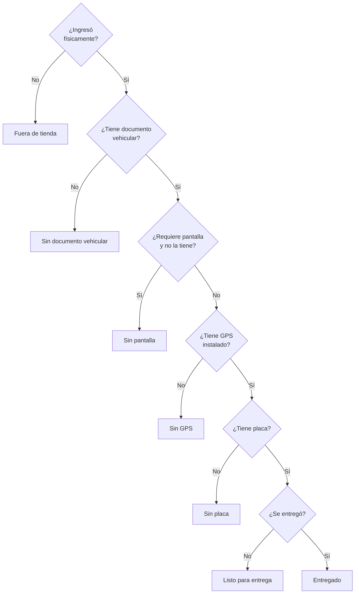
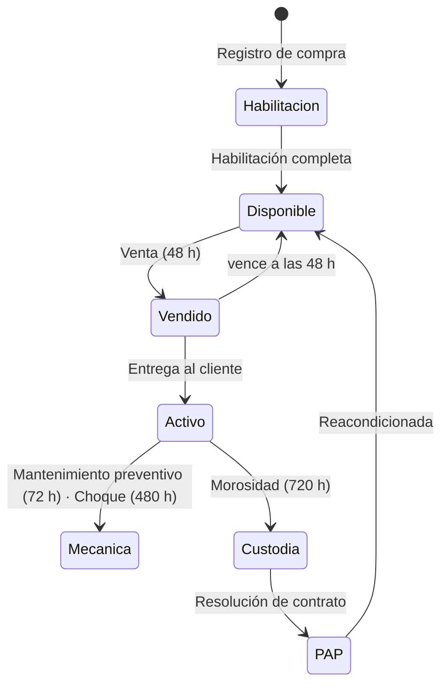

# Procesos y pantallas — ERP Millennium Mobility

**Actualizado:** 18/10/2026 (cierre de `location`: Ubicaciones pregunta si la dirección se corrige o se muda, D-79; "pestaña" y "dígito de control" en todo el documento) · 16/10/2026 (modelo de acceso del paso 3: el administrador de accesos da acceso y maneja cuentas, el de empresa registra a su gente) · 14/10/2026 (Sedes, Marcas comerciales, Ubicaciones y Colaboradores construidas; la dirección elige su división en cascada) · 06/10/2026 (Empresas construida; todo formulario pregunta antes de descartar cambios) · **Estado:** borrador para validar · **Fuente:** diccionario de datos v1.15 y, para el modelo de acceso, la v1.18 (D-55 a D-72) y la política de acceso de [convenciones de la API](convenciones-de-la-api-millennium-mobility.md) §9.2, [orden de implementación](orden-de-implementacion-millennium-mobility.md) (pantallas de cada paso), menú del frontend (`app-shell/app-navigation.ts`) y los diagramas escritos sobre la v1.8. Si este documento y el diccionario no coinciden, manda el diccionario.

El diccionario documenta los datos y sus reglas, pero no los procesos ni las pantallas (§1). Este documento cubre ese hueco: qué hace la empresa con el sistema, en qué orden, quién lo hace y en qué pantalla.

**Cómo leerlo.**
- Las reglas citadas vienen del diccionario. Una referencia **§n** o **D-n** sin más señala una sección o una decisión del diccionario. Las secciones de este documento se citan como "apartado n", y las de los otros documentos con su nombre (mapa §n, convenciones §n).
- Lo marcado **(propuesta)** no lo decide nadie todavía.
- Las preguntas de negocio que el diccionario no resuelve están en el apartado 5.

---

## 1. Quién usa el sistema

El diccionario fija siete roles del sistema, con su código, su nombre y su alcance (§5.5); el séptimo, `ADMIN_ACCESOS`, lo agregó la v1.18 (D-55). Lo que puede hacer cada uno lo deciden sus permisos (§5.6), y la matriz de permisos por rol todavía es un dato pendiente (§14). Por eso, salvo las tareas de `SUPERADMIN`, `ADMIN_ACCESOS` y `ADMIN_EMPRESA`, que vienen del arranque (§5.2) y de la política de acceso ([convenciones de la API](convenciones-de-la-api-millennium-mobility.md) §9.2; D-55, D-57), la última columna es una propuesta (pregunta abierta 5).

| Rol (`code`) | Alcance | Qué hace |
|---|---|---|
| `SUPERADMIN` | Todo el sistema | Todo lo que hacen los otros dos administradores, en todas las empresas. Crea las empresas, sus sedes, marcas y ubicaciones, y configura los catálogos que el diccionario le reserva (D-43, §7). Es el único que otorga y retira `SUPERADMIN`, `ADMIN_ACCESOS` y `ADMIN_EMPRESA`, y el único que maneja las cuentas que los tienen (§5.2, pasos 4 a 7; D-55) |
| `ADMIN_ACCESOS` | Todo el sistema | Da acceso a los colaboradores de cualquier empresa, otorga y retira los roles operativos, bloquea cuentas y restablece contraseñas (D-55). No otorga los tres roles reservados ni actúa sobre una cuenta que tenga uno, y no registra colaboradores: quien da acceso no crea a quien lo recibe (D-57). Lee los datos de todas las empresas |
| `ADMIN_EMPRESA` | Una empresa | Registra y modifica a los colaboradores de su empresa y registra sus salidas y regresos (§5.2, paso 8; D-57). Lee las cuentas de su empresa, pero no da acceso, no otorga roles y no bloquea cuentas |
| `OPERACIONES` | Una empresa | **(propuesta)** Compras y alta de unidades (el ejemplo de `role_permissions` le da registrar facturas y crear vehículos, §5.6); habilitación |
| `CONTABILIDAD` | Una empresa | **(propuesta)** Facturas, también las de más de 20 días (ejemplo de §5.6); notas de crédito y pagos |
| `ASESOR_VENTAS` | Una sede | **(propuesta)** Venta de unidades; la entrega depende de la pregunta abierta 4 |
| `TALLER` | Una sede | **(propuesta)** Mantenimiento y puesta a punto |

Además existe la cuenta `SYSTEM`. No es una persona ni un rol: firma las cargas masivas y los procesos automáticos, y no puede iniciar sesión (§5.9). No hay que confundirla con el alcance `SYSTEM` de `scope_level`, que es el de los roles `SUPERADMIN` y `ADMIN_ACCESOS` (§5.5, D-55).

---

## 2. Procesos

Cada proceso lista sus pasos, las reglas del diccionario que lo gobiernan y las pantallas donde ocurre.

### P1 · Puesta en marcha (§5.2)

| Paso | Qué ocurre | Quién | Pantalla |
|---|---|---|---|
| 1 | Se cargan las monedas, los países y las divisiones territoriales | Migración inicial | — |
| 2 | Se crean los permisos y los roles del sistema | Migración inicial | — |
| 3 | Se crean `SYSTEM` y el primer superadministrador, con contraseña provisional, que debe cambiar en su primer ingreso | Migración (`SYSTEM`) y la aplicación al arrancar (superadministrador, D-34) | Cambio de contraseña |
| 4 | El superadministrador crea las empresas, una por país (D-5) | Superadministrador | Configuración › Empresas |
| 5 | Crea las sedes de cada empresa | Superadministrador | Configuración › Sedes |
| 6 | Se registra como colaborador de la empresa para la que trabaja y vincula su cuenta a ese perfil: da acceso a su propio colaborador con su propio correo | Superadministrador | Configuración › Colaboradores |
| 7 | Registra como colaboradores al administrador de cada empresa y al administrador de accesos, que son personas distintas (D-71), y les da acceso. Cuando cada uno cambió su contraseña provisional (D-72), le otorga `ADMIN_EMPRESA` sobre su empresa o `ADMIN_ACCESOS` | Superadministrador | Configuración › Colaboradores |
| 8 | Cada administrador de empresa registra a los colaboradores de su empresa | Administrador de empresa | Configuración › Colaboradores |
| 9 | El administrador de accesos da acceso a quienes usan el sistema y les otorga los roles de su puesto y su sede | Administrador de accesos | Configuración › Colaboradores |

**Reglas.** Hasta vincularse a su perfil (paso 6), el primer superadministrador configura el sistema (empresas, sedes, catálogos y su propio perfil) pero no puede dar acceso a nadie ni otorgar roles (§5.2, §5.9). Es la única cuenta que se vincula a sí misma, y solo mientras no tiene un colaborador activo (D-70). Lo mismo vale después para todos: quien no está vinculado a un colaborador activo no maneja cuentas.

### P2 · Acceso de las personas (§5.2 a §5.9, §5.12)

**Dar acceso a un colaborador (D-38, D-58).** El administrador de accesos o un superadministrador da acceso a un colaborador activo ya registrado, en cualquier empresa, con su correo. El sistema genera la contraseña provisional y la muestra una sola vez. Si ese correo ya tiene cuenta, porque la persona trabaja para otra empresa del grupo, se vincula a esa cuenta en vez de crear otra, sin cambiarle los roles ni la contraseña; una cuenta protegida solo la vincula un superadministrador. Dar acceso no otorga roles. Se hace desde la fila del colaborador en Configuración › Colaboradores; la pantalla "Nuevo usuario" ya no existe. El administrador de empresa no da acceso (D-57).

**Asignar y retirar roles (§5.5 a §5.8).**
- Otorgan y retiran roles el superadministrador, cualquiera, y el administrador de accesos, cualquiera salvo los reservados: `SUPERADMIN`, `ADMIN_ACCESOS` y `ADMIN_EMPRESA`, que solo otorga y retira un superadministrador (D-55). El administrador de empresa no otorga roles (D-57).
- Una cuenta con un rol reservado vigente es protegida: solo la maneja un superadministrador. Nadie actúa sobre su propia cuenta, tampoco un superadministrador (D-70).
- Un rol de empresa o de sede exige que la cuenta esté vinculada a un colaborador activo de esa empresa (D-38).
- Una cuenta nunca tiene `ADMIN_ACCESOS` y `ADMIN_EMPRESA` a la vez (D-71), y un rol reservado solo va a una cuenta que ya cambió su contraseña provisional (D-72).
- Un rol se retira, no se borra, con uno de cuatro motivos: `retiro`, `caducidad`, `baja_colaborador` o `baja_cuenta` (D-41). Un acceso vencido se cierra con motivo `caducidad`.

**Bloquear y reactivar una cuenta (§5.4).** Un superadministrador o el administrador de accesos la bloquea por vacaciones, licencia o seguridad, como un período que se abre y se cierra; la baja la abre solo la salida del colaborador (D-69). Un bloqueo que empieza cierra las sesiones de la cuenta (D-33). La salida que deja la cuenta sin colaborador activo retira además todos sus roles (D-12, §5.9); las vacaciones y las licencias no los tocan.

**Salida y regreso de un colaborador (D-38, D-60).** Los registran un superadministrador o el administrador de la empresa del colaborador; el administrador de accesos no, y nadie registra su propia salida ni su propio regreso (D-57, D-70). La fecha de salida no es posterior a hoy. En la misma operación se retiran los roles de su cuenta en esa empresa, y si no le queda ningún colaborador activo, la cuenta se bloquea con una baja, también si es protegida. No se puede registrar la salida del último superadministrador activo (§5.9). El regreso, que tampoco es posterior a hoy, cierra esa baja; los roles no vuelven solos. La salida y el regreso los orquesta `iam` (decisión 2 del [mapa de contextos](mapa-de-contextos-millennium-mobility.md), opción A).

**Registro público (D-32).** Solo si está encendido. La persona elige su empresa y, si corresponde, su sede: se listan sin sesión, solo por nombre y solo mientras el registro está encendido. Completa los mismos datos obligatorios del registro de un colaborador, incluidos su tipo y número de documento, además de su correo y su contraseña. Se crean el perfil y la cuenta juntos, sin roles, a nombre de `SYSTEM`. Se rechaza si el documento ya está registrado en esa empresa o si el correo ya tiene cuenta. Cómo obtiene el formulario, sin sesión, las sedes y los tipos de documento está pendiente ([convenciones de la API](convenciones-de-la-api-millennium-mobility.md), §14.16).

**Sesión (D-33).** Inicio y cierre de sesión. Una contraseña provisional obliga a cambiarla antes de usar el sistema (§5.4). Cambiar la contraseña cierra las demás sesiones.

| Pantallas | Configuración › Colaboradores · Seguridad › Usuarios · Seguridad › Roles y permisos · Inicio de sesión · Registro · Cambio de contraseña |
|---|---|

### P3 · Catálogos (bloques 1, 3, 4, 6 y 9)

Los catálogos se cargan antes de registrar lo que los usa: un modelo antes de su primera unidad, un proveedor antes de su primera compra (§7, §9.1).

| Catálogo | Quién | Reglas clave | Pantalla |
|---|---|---|---|
| Monedas | Superadministrador (D-43) | El código ISO no cambia; una moneda no se borra, se desactiva; los decimales quedan fijos desde el primer monto que la usa (§4.1) | Catálogos › Monedas |
| Países y sus escalones territoriales | Superadministrador (D-43) | El país declara sus escalones en orden, hasta cuatro, antes de cargar sus divisiones; un escalón se renombra, no se retira (§4.4, D-45) | Catálogos › Países › ficha del país, pestaña Estructura territorial |
| Divisiones territoriales | La migración inicial, con el archivo oficial (§5.2, paso 1; D-2), y cada distrito que una ley crea después, con su propia migración en cuanto tiene código oficial (D-77). El superadministrador también las crea una por una, las corrige y las desactiva (D-43) | El código oficial no se repite en el país; una división cuelga de una del escalón inmediato superior; se desactiva, no se borra (§4.5) | Catálogos › Países › ficha del país, pestaña Estructura territorial |
| Tipos de documento tributario | Superadministrador (D-43) | Por país (D-44); longitud de 1 a 20 (D-78) y dígito de control, que verifica `location` según la sigla (D-75); se desactivan, no se borran (§4.7) | Catálogos › Países › ficha del país, pestaña Documentos |
| Tipos de vehículo, marcas, modelos, colores, equipamiento | Superadministrador (§7, D-15) | Los catálogos de flota son del sistema; la misma marca no repite nombre de modelo; la exigencia de pantalla sale del catálogo (§7) | Catálogos › Tipos de vehículo, Marcas y modelos, Colores, Equipamiento |
| Estados del vehículo y motivos de cambio | **(propuesta)** Superadministrador | Los caminos permitidos son filas, no código (D-19); un motivo no se borra, se desactiva (§8.3) | Catálogos › Estados y motivos |
| Tipos de documento del vehículo | **(propuesta)** Superadministrador | Cuáles vencen, cuáles bloquean la disponibilidad, cuáles ve el cliente (§11.2) | Catálogos › Tipos de documento |

Las tres filas marcadas siguen la regla del menú (apartado 3.1): sus tablas no llevan `company_id` y van en Catálogos. Pero el menú decide qué se muestra, no quién está autorizado, y el diccionario no fija quién las mantiene (pregunta abierta 6).

### P4 · Compra de unidades (bloque 7)

1. **Orden de compra (opcional).** Se emite con una plantilla de la empresa, que fija lo que se imprime y la serie de numeración (D-35, D-36). El número se asigna al crear la orden, aunque sea un borrador, y no se reutiliza (D-36). Las líneas piden modelos y cantidades, o conceptos que no son vehículos (D-37). Estados: borrador, enviada, cumplida, anulada. El sistema genera el PDF desde la plantilla: mientras la orden es borrador refleja los cambios de la plantilla, y al enviarla se conserva en `pdf_path` el PDF enviado, que ya no cambia aunque se edite la plantilla (§9.2). Una orden enviada no se edita: se anula y se emite otra.
2. **Alta de las unidades** que llegan, con su VIN (17 caracteres, único, D-9). La unidad nace en el estado inicial, En habilitación, con el motivo "Registro de compra" (§8.3). En qué momento y desde qué pantalla es la pregunta abierta 1.
3. **Factura de compra.** Encabezado con proveedor, comprobante, fecha, moneda, tipo de cambio de la fecha del comprobante y tasa de impuesto (D-24), y una línea por unidad con su valor de factura. Vínculo opcional con la orden (D-21). Reglas (§9.3, §9.4):
   - la suma de las líneas cuadra con el total;
   - una factura de más de 20 días exige el permiso `compras.registrar_factura_antigua`;
   - una unidad no aparece dos veces en el mismo comprobante;
   - el valor de factura no se modifica nunca.
4. **Nota de crédito.** Del mismo proveedor y la misma moneda que la factura que descuenta, con fecha no anterior a ella, repartida entre unidades concretas. La suma del reparto cuadra con el total. Nunca reemplaza a otra y puede descontar una compra de meses atrás (§9.5).
5. **Anulación.** Una nota de crédito puede anular una línea de factura sin tocar las demás (§9.4). Si las notas dejan en cero el valor de una unidad y no tiene contratos, la unidad queda anulada (§9.6).

| Pantallas | Logística › Órdenes de compra, Facturas, Notas de crédito · Configuración › Proveedores, Plantillas de OC |
|---|---|

### P5 · Pagos a proveedores (bloque 8)

1. Se registra el pago: proveedor, fecha, moneda, tipo de cambio del día del pago, monto, método y número de operación. Un pago con saldo a favor indica qué nota de crédito consume y no supera lo que queda de ella (§10.1).
2. Se aplica a una o varias facturas, o a una orden todavía sin facturar (§10.2). Lo aplicado no supera el pago ni el total de cada factura. Cuando llega la factura de una orden ya pagada, la aplicación se traslada a la factura.
3. Opcionalmente, se imputa a unidades concretas (§10.3). Sin imputación, se reparte proporcionalmente. En el canal de dealers la imputación es obligatoria.
4. Un pago mal registrado no se borra: se anula y se vuelve a registrar (§10.1).

El saldo a favor con cada proveedor se calcula, no se guarda (§10.4).

| Pantalla | Logística › Pagos a proveedores |
|---|---|

### P6 · Habilitación (bloque 9)

Lo que hay que completar para que una unidad pueda entregarse:

1. **Ingreso físico** (`arrival_date`). Sin ingreso no se instala el GPS (§11.1).
2. **Inmatriculación**: inicio del trámite, título y fecha del título, placas recibidas (§11.1).
3. **Documentos**: cada carga es un archivo. Por unidad hay uno solo vigente de cada tipo; al cargar uno nuevo, el anterior deja de ser vigente y se conserva (D-28, §11.3). Si el tipo vence, la fecha de vencimiento es obligatoria. Solo el documento de identificación vehicular bloquea la disponibilidad (§11.2).
4. **Equipamiento**: cada instalación es un período; reemplazar un equipo cierra el anterior. No se instala en un tipo de vehículo al que no aplica (§11.4).
5. **Placa**: solo con título y documento de identificación vehicular cargado; se guarda normalizada; corregirla deja rastro en la bitácora (§7.6, §11.1).
6. **Llaves**: la entregada y el duplicado, con su etiqueta única en la empresa (D-29).

El **estado de habilitación** se calcula, no se guarda (§11.9). Se evalúa en este orden y devuelve el primero que aplica:

| Pantallas | Logística › Habilitación · la ficha de la unidad en Logística › Inventario |
|---|---|

### P7 · Ciclo de estados del vehículo (bloque 6)

Todo cambio de estado registra fecha, hora, usuario y motivo, y solo existen los caminos cargados en `status_change_reasons` (§8.3). El estado actual y su historial se escriben en la misma operación (§8.4).

Caminos que el diccionario carga como ejemplo (§8.3):

- La única transición automática es la que tiene configurado un estado de destino al vencer su tolerancia: Vendido vuelve a Disponible a las 48 horas (§8.3).
- Inactivo es de categoría terminal en el ejemplo de §8.2. Con los caminos de ejemplo de §8.3 no tiene salida, porque no hay ninguna fila con ese origen; los caminos son datos (D-19).
- La fecha de entrega es el momento en que la unidad pasó a Activo; no hay un campo aparte (§11.9).
- Las unidades que superan la tolerancia de su motivo aparecen en una lista de vencidas (§8.3).

El diagrama de la v1.8 traía más caminos. Son datos, no reglas: se cargan como filas de `status_change_reasons` si el negocio los confirma (pregunta abierta 2).

| Desde | Hacia | Motivo en la v1.8 | Observación |
|---|---|---|---|
| Activo | Siniestro | — | |
| Mecánica | Activo | — | |
| Siniestro | Activo | — | |
| Siniestro | Puesta a punto | — | |
| Custodia | Activo | Regulariza | |
| Mecánica | Puesta a punto | No asumida | |
| Activo | Inactivo | Pérdida total | |
| Custodia | Inactivo | Robo | |
| Inactivo | Puesta a punto | Recuperado | Hoy no tiene salida porque no hay fila con origen Inactivo (§8.3). Habilitarlo es cargar una fila y revisar la categoría terminal del estado (§8.2) |

| Pantallas | Logística › Inventario (ficha de la unidad) · Catálogos › Estados y motivos |
|---|---|

### P8 · Kilometraje (§8.5)

Cada lectura se registra con su fecha y su origen: GPS, taller, entrega, devolución o manual. Una lectura no puede ser menor que la anterior ni futura; un cambio de tablero se registra como sustitución de odómetro. Las lecturas no se editan ni se borran. El kilometraje de la unidad es el de la última lectura y se escribe en la misma operación.

| Pantalla | Logística › Inventario (ficha de la unidad) |
|---|---|

### P9 · Cargas de archivos y fondos (§11.7, §11.8, §12)

| Carga | Qué hace | Reglas |
|---|---|---|
| Declaración del impuesto vehicular (SAT) | Actualiza la declaración de cada unidad | Solo autos; cruce por placa; una unidad sin documento vehicular no tiene declaración (§11.7) |
| Garantía mobiliaria | Actualiza las cesiones de cada unidad a un fondo | Actualiza la historia, no la reemplaza: una placa que desaparece del archivo cierra su cesión con esa fecha (D-30, §12.2) |
| Migración inicial | Da de alta las unidades que trae del Excel | El número del Excel se conserva solo como referencia, en `legacy_number` (§8.1, D-18) |

Los archivos auxiliares (impuesto vehicular y garantía mobiliaria) nunca crean vehículos: solo actualizan las unidades que ya existen (§11.8). La migración inicial es la única carga que da de alta unidades. En todas, las filas que fallan quedan en el archivo de errores, que se descarga para corregir y volver a subir, y cada carga queda registrada con quién la hizo y cuántas filas entraron y fallaron (§11.8).

Qué contexto ejecuta cada carga está pendiente (mapa §6.5 y decisión 8). **(propuesta)** `fleet`, que registra la carga en `shared`.

| Pantallas | Logística › Cargas de archivos · Configuración › Fondos · ficha de la unidad (cesiones) |
|---|---|

### P10 · Correcciones y bitácora (bloque 11)

Toda modificación de un registro deja una fila por campo, con el valor anterior y el nuevo. Corregir un VIN, una placa, el monto de una factura o una fecha ya reportada exige motivo (§13.1). La bitácora no se edita, y cada empresa ve solo la de sus registros.

| Pantalla | Seguridad › Bitácora de cambios |
|---|---|

### P11 · Reportes (§10.5)

La brecha de días se recalcula siempre con la mejor información disponible (D-27). La diferencia por inicial sale de compras y se valida contra la inicial registrada en el contrato del cliente (D-31); esa validación espera a ventas (bloque 12), fuera del alcance actual. Ninguno de los dos indicadores se guarda como campo (§10.5). El exportable de stock se genera desde la capa de lectura (mapa §7).

| Pantalla | Logística › Reportes |
|---|---|

---

## 3. Pantallas

### 3.1 El menú

El menú tiene cuatro grupos (skill `frontend-feature`, §6). Cada opción es un módulo con título y descripción propios.

| Grupo | Qué va ahí | Quién lo ve **(propuesta)** |
|---|---|---|
| Logística | La operación diaria | Cualquier rol de la empresa |
| Configuración | Datos propios de cada empresa (tablas con `company_id`) | `SUPERADMIN` y `ADMIN_EMPRESA`; Colaboradores, también `ADMIN_ACCESOS` |
| Catálogos | Datos del sistema, iguales para todas las empresas | `SUPERADMIN` |
| Seguridad | Quién entra, qué puede hacer y quién cambió qué | `SUPERADMIN` y `ADMIN_EMPRESA`; Usuarios, solo `SUPERADMIN` y `ADMIN_ACCESOS` |

El menú solo decide qué se muestra; el backend autoriza cada petición. Quién ve cada grupo depende de la matriz de permisos (pregunta abierta 5).

### 3.2 Inventario de pantallas

Patrones: **lista con diálogo** (tabla con alta y edición en `mm-create-and-edit-dialog`), **maestro-detalle** (`mm-master-detail`), **ficha** (página de un registro con su encabezado propio) y **formulario de página** (formularios largos que no caben en un diálogo).

Las rutas siguen la regla del frontend: el nombre del contexto en kebab-case y luego el recurso (mapa §8). `/home`, `/change-log` y `/reports` no llevan prefijo de contexto **(propuesta)**, como ya figuran en `app-navigation.ts`. El patrón de las pantallas pendientes es una propuesta de este documento.

| Grupo | Pantalla | Ruta | Contexto | Paso | Patrón | Estado |
|---|---|---|---|---|---|---|
| Acceso | Inicio de sesión | `/iam/sign-in` | `iam` | 0 | Pantalla de acceso | Construida |
| Acceso | Registro | `/iam/sign-up` | `iam` | 0 y 3 | Pantalla de acceso | Construida sin perfil; con perfil en el paso 3 (D-32) |
| Acceso | Cambio de contraseña | `/iam/change-password` | `iam` | 0 | Pantalla de acceso | Construida |
| — | Inicio | `/home` | — | 0 | — | Construida |
| Logística | Órdenes de compra | `/procurement/purchase-orders` | `procurement` | 7 | Lista con formulario de página | Pendiente |
| Logística | Facturas | `/procurement/invoices` | `procurement` | 7 | Lista con formulario de página | Pendiente |
| Logística | Notas de crédito | `/procurement/credit-notes` | `procurement` | 7 | Lista con formulario de página | Pendiente |
| Logística | Pagos a proveedores | `/procurement/supplier-payments` | `procurement` | 8 | Lista con formulario de página | Pendiente |
| Logística | Inventario | `/fleet/vehicles` | `fleet` | 5 | Lista y ficha de la unidad | Pendiente |
| Logística | Habilitación | `/fleet/enablement` | `fleet` | 9 | Lista con el estado de habilitación y ficha | Pendiente |
| Logística | Cargas de archivos | **(propuesta)** `/fleet/imports` | Pendiente (mapa, decisión 8); propuesta: `fleet` | 9 | Lista con carga de archivo | Pendiente |
| Logística | Reportes | `/reports` | Capa de lectura | 11 | Filtros y exportación | Pendiente |
| Configuración | Empresas | `/organization/companies` | `organization` | 2 | Lista con diálogo; solo `SUPERADMIN`. La dirección fiscal se llena en el mismo diálogo; al cambiarla en una empresa ya registrada, el diálogo pregunta si es una corrección o una mudanza (D-8) | Construida |
| Configuración | Sedes | `/organization/branches` | `organization` | 2 | Lista con diálogo; la dirección, como en Empresas | Construida |
| Configuración | Colaboradores | `/organization/employees` | `organization` | 3 | Lista con diálogo. Donde la sesión administra la empresa (`SUPERADMIN`, `ADMIN_EMPRESA`), alta, edición, salida y regreso; a quien maneja cuentas (`SUPERADMIN`, `ADMIN_ACCESOS`), las acciones de cuenta de cada fila: dar acceso, roles, bloqueos y restablecer contraseña ([contextos/organization.md](contextos/organization.md), F5 a F9) | Construida |
| Configuración | Marcas comerciales | `/organization/commercial-brands` | `organization` | 2 | Lista con diálogo | Construida |
| Configuración | Ubicaciones | `/organization/locations` | `organization` | 2 | Lista con diálogo. La dirección de una ubicación de terceros, como en Empresas: al cambiarla, el diálogo pregunta si es una corrección o una mudanza (D-79); una sede propia usa la de su sede. El tipo se cambia solo dentro de su grupo, propio o de terceros | Construida |
| Configuración | Proveedores | `/procurement/suppliers` | `procurement` | 7 | Lista con diálogo | Pendiente |
| Configuración | Plantillas de OC | `/procurement/purchase-order-templates` | `procurement` | 7 | Lista con formulario de página; los tipos de orden se gestionan dentro | Pendiente |
| Configuración | Fondos | `/fleet/funds` | `fleet` | 10 | Lista con diálogo | Pendiente |
| Catálogos | Monedas | `/location/currencies` | `location` | 1 | Lista con diálogo | Construida |
| Catálogos | Países | `/location/countries` | `location` | 1 | Lista; registrar, ver y corregir un país se hace en su ficha | Construida |
| Catálogos | Ficha del país (no es opción del menú) | `/location/countries/{id}` y `/location/countries/new` | `location` | 1 | Los datos arriba, siempre visibles; debajo, dos pestañas: Estructura territorial (escalones y divisiones), la que abre por defecto, y Documentos (los documentos tributarios). La pestaña abierta queda en la dirección (`?seccion=documentos`) y cada una conserva su búsqueda, sus filtros y su página al cambiar de pestaña. Los datos se leen y se corrigen en su lugar, nunca dentro de una pestaña; un país nuevo empieza solo con sus datos y abre las pestañas al guardarse. Cada parte guarda por su propio endpoint | Construida |
| Catálogos | Tipos de vehículo | `/vehicle-catalog/vehicle-types` | `vehiclecatalog` | 4 | Lista con diálogo | Pendiente |
| Catálogos | Marcas y modelos | `/vehicle-catalog/brands-and-models` | `vehiclecatalog` | 4 | Maestro-detalle: marcas a la izquierda, modelos de la marca a la derecha | Pendiente |
| Catálogos | Colores | `/vehicle-catalog/colors` | `vehiclecatalog` | 4 | Lista con diálogo | Pendiente |
| Catálogos | Equipamiento | `/vehicle-catalog/equipment-types` | `vehiclecatalog` | 4 | Lista con diálogo, con los tipos de vehículo a los que aplica | Pendiente |
| Catálogos | Estados y motivos | `/fleet/vehicle-statuses` | `fleet` | 5 | Maestro-detalle: estados y los motivos que salen de cada uno, más una entrada fija «Alta de la unidad» al inicio para los motivos sin estado de origen (`from_status_id` vacío, §8.3) | Pendiente |
| Catálogos | Tipos de documento | `/fleet/document-types` | `fleet` | 9 | Lista con diálogo | Pendiente |
| Seguridad | Usuarios | `/iam/users` | `iam` | 0 y 3 | Lista de todas las cuentas, con los diálogos de roles, bloqueos y restablecer contraseña; para `SUPERADMIN` y `ADMIN_ACCESOS` ([contextos/iam.md](contextos/iam.md), F6 a F8) | Construida |
| Seguridad | Roles y permisos | `/iam/roles` | `iam` | 3 | Maestro-detalle: roles y los permisos que incluye cada uno | Frontend construido, fuera del menú hasta que el backend sirva la matriz |
| Seguridad | Bitácora de cambios | `/change-log` | `shared` | 6 | Lista con filtros; cada empresa ve la suya | Pendiente |

Las direcciones no tienen pantalla ni opción de menú: se llenan dentro del formulario de su dueño (empresa, sede, ubicación, proveedor, plantilla), según el orden de implementación (paso 1).

### 3.3 Pantallas que reúnen varios procesos (propuesta)

**Ficha de la unidad** (Logística › Inventario). Su encabezado es la placa sobre la marca y el VIN (`overridePageHeading`). Reúne:

- los datos de la unidad;
- el historial de estados con el botón para cambiar de estado (P7);
- las lecturas de kilometraje (P8);
- el estado de habilitación con sus documentos, equipos, llaves y placa (P6);
- las cesiones a fondos (P9);
- con el permiso `stock.ver_costos` (§5.6), el valor de factura, las notas de crédito y el valor del vehículo. Estos datos son de `procurement` y `fleet` no los conoce (mapa §6.1), así que no llegan en el recurso de la unidad. Qué consulta los trae es la decisión pendiente 7 del mapa.

**Factura de compra** (Logística › Facturas). Es un formulario de página porque una factura de motos trae ochenta líneas. El total de las líneas contra el total del comprobante se muestra mientras se cargan, para encontrar la línea olvidada antes de guardar. Ver la pregunta abierta 3.

**Ficha del colaborador** (Configuración › Colaboradores). Perfil, puesto, sede, fecha de ingreso y salida. Hoy no hay ficha: la lista reúne, en las acciones de cada fila, dar acceso, los roles, los bloqueos y el restablecimiento de contraseña (P2), y la salida y el regreso, cada uno para el rol que puede hacerlo (apartado 1).

**Roles y permisos** (Seguridad). Solo se pueden marcar los permisos que quien edita ya tiene (§5.5, regla 1). Los roles del sistema no se editan ni se borran (§5.5).

### 3.4 Reglas que valen para todas las pantallas

| Regla | Fuente |
|---|---|
| Los textos están en `es.json`, en español, con el vocabulario del diccionario (rol, puesto, perfil) | Skill `frontend-feature`, D-39 |
| Fechas en `dd/mm/aaaa` y `dd/mm/aaaa hh:mm`, en la zona de la sede; sin sede, la del país de la empresa; sin empresa, `America/Lima` | §2.6, D-40 |
| Los montos se muestran con su moneda y con los decimales de esa moneda | §2.2, §4.1 |
| No hay botones de borrar: se desactiva, se anula, se cierra o se retira | Regla 4.2 de arquitectura |
| Un campo que el usuario no puede ver no llega al navegador | §2.5 |
| En una dirección, la pantalla distingue corregir de mudarse: al cambiar la de un registro guardado, pregunta cuál de las dos es | D-8 |
| Los formularios (diálogos, fichas y formularios de página) guardan abiertos y preguntan antes de descartar cambios, también al navegar a otra pantalla o cerrar la pestaña | DESIGN.md, revisión 11; ampliado a todo formulario el 06/10/2026 |
| Ninguna pantalla de negocio se conforma con que haya sesión: exige un rol o un permiso | §5.2 |

---

## 4. Diferencias con lo construido

| Tema | Hoy | Según el diccionario y este documento |
|---|---|---|
| ~~Nuevo usuario~~ | Resuelto el 16/10/2026: la pantalla `/iam/users/new` ya no existe; el acceso se da desde la fila del colaborador en Configuración › Colaboradores (P2) | Toda cuenta pertenece a un colaborador (D-38) |
| Fechas en pantalla | Las pantallas de cuentas ya siguen el apartado 3.4: las fechas de una cuenta y de un bloqueo, en `America/Lima`; la caducidad de un rol, en la zona de su sede o de su empresa; y los diálogos de salida y regreso, en la zona del colaborador. Las demás todavía usan la zona del navegador | Apartado 3.4; el orden de implementación lo lleva en sus pendientes transversales |

---

## 5. Preguntas abiertas

Son preguntas de negocio que el diccionario no resuelve. Hasta que se respondan, las pantallas afectadas no se diseñan en detalle.

1. **¿Dónde nace la unidad?** El motivo de alta es "Registro de compra" (§8.3) y el permiso es `stock.crear_vehiculo` (§5.6). Puede darse de alta en Inventario antes de registrar la factura, o puede crearla el registro de la factura al cargar cada VIN. Lo segundo evita cargar el VIN dos veces, pero hace que `procurement` le pida a `fleet` crear unidades (mapa, decisión 5).
2. **¿Qué caminos de estado se cargan además de los del ejemplo?** Los nueve estados existen, pero el diccionario solo trae como ejemplo los caminos de §8.3. La tabla de P7 lista los que traía la v1.8.
3. **¿Cómo se cargan las ochenta líneas de una factura?** A mano, por archivo o desde el XML del comprobante, que hoy es candidato (§9.8).
4. **¿Quién mueve la unidad de Vendido a Activo?** El asesor de ventas o el área que hace la entrega física.
5. **¿Qué permisos tiene cada rol del sistema?** El diccionario solo trae un ejemplo de `role_permissions` (§5.6): Operaciones registra facturas y da de alta unidades; Contabilidad registra facturas, también las de más de 20 días. Hasta que se cargue la matriz (§14), las tareas del apartado 1 para `OPERACIONES`, `CONTABILIDAD`, `ASESOR_VENTAS` y `TALLER` son una propuesta, y también quién ve cada grupo del menú (apartado 3.1).
6. **¿Quién crea y modifica los estados del vehículo con sus motivos y los tipos de documento del vehículo?** El diccionario reserva al superadministrador las monedas, los países, las divisiones territoriales y los tipos de documento tributario (D-43) y los catálogos de flota (§7). Para `vehicle_statuses` y `status_change_reasons` (§8.2, §8.3) y `document_types` (§11.2) no fija a nadie. Este documento propone al superadministrador; cuando se decida, se registra en el diccionario.
7. **¿Se puede volver a cargar el archivo oficial de divisiones desde la aplicación?** Por ejemplo, cuando se crean o se fusionan distritos. Hoy no hay mecanismo: `import_batches` exige `company_id` y solo contempla el impuesto vehicular, la garantía mobiliaria y la migración inicial (§11.8). Habría que permitir cargas sin empresa o crear otro registro. Mientras tanto, el superadministrador las mantiene una por una (P3).
