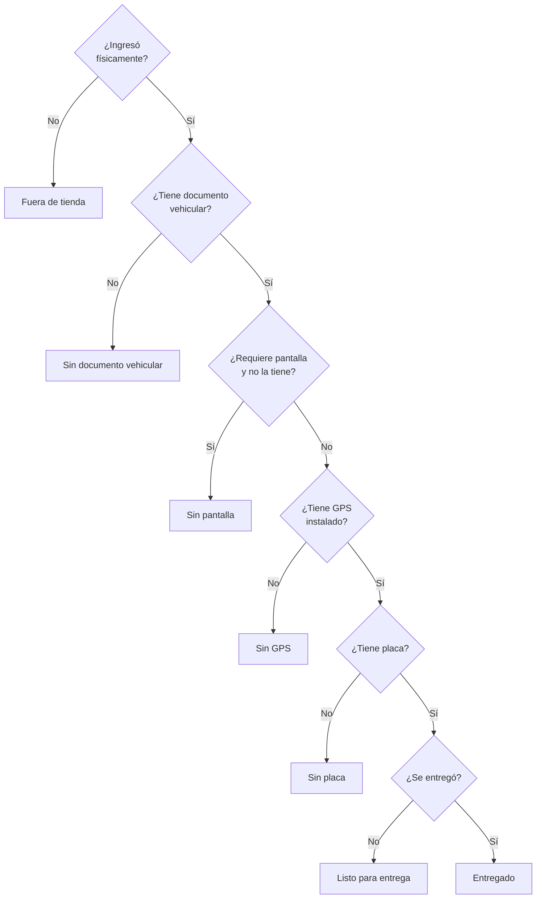
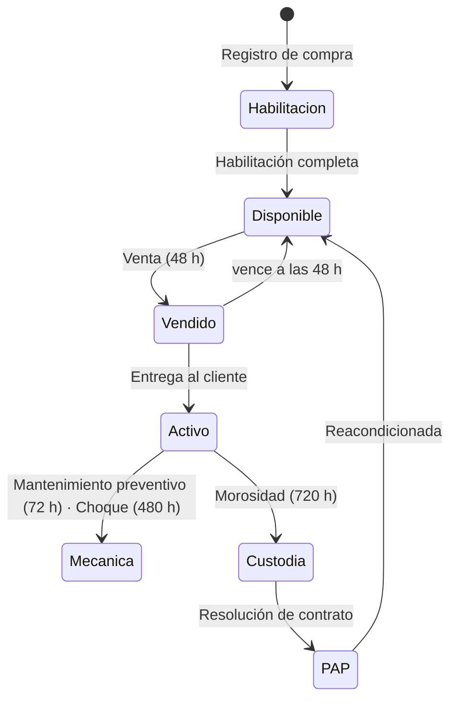

# Procesos y pantallas — ERP Millennium Mobility

**Actualizado:** 23/10/2026 (paso 7, en curso: Órdenes de compra y Plantillas de OC construidas; el menú de compras por permiso; [contextos/procurement.md](contextos/procurement.md)) · 20/10/2026 (la segunda fase de la segunda ronda, integrada en `develop`, merges `007151dd` en el backend y `11235e0` en el frontend, y verificada contra el código: el menú y las rutas por permiso, con `systemAllOf` para Usuarios; las acciones de Colaboradores por `allowedActions`; la matriz, con sus pistas leídas de `grantableForGeneralRoles` y `grantableForCompanyRoles`) · 20/10/2026 (segunda ronda de la auditoría, diccionario v1.25, en construcción: Seguridad por permisos, D-117 a D-122; el menú y las acciones por el permiso de cada pantalla, y las de Colaboradores por fila; Seguridad › Roles y permisos con las pestañas Roles y Matriz de permisos, D-126, y la copia de un rol, D-124) · 20/10/2026 (lo que construyó la auditoría en la ficha de la marca y en Estados y motivos, verificado contra `audit/fe-integration`) · 20/10/2026 (auditoría del 20/10/2026, diccionario v1.24: Marcas y modelos es una lista con la ficha de cada marca, no un maestro-detalle, D-112; las cuatro pantallas de los catálogos de flota, construidas, con su documento de contexto) · 20/10/2026 (paso 5, integrado en `develop`: Logística › Inventario con la ficha de la unidad, y Catálogos › Estados y motivos, construidas; merges `32d4996` en el backend y `28ffe6a` en el frontend) · 19/10/2026 (la ficha de la empresa empieza en sus datos: "Ver ubicaciones" y "Ver colaboradores" en el menú ⋮ "Más acciones de la empresa" de la cabecera de los datos, y el aviso de empresa inactiva, "No se le registra nada nuevo.", en la celda Estado; merge `6b9b2c5` en el frontend) · 19/10/2026 (el administrador de empresa ve los datos de su empresa (decisión del responsable del 19/10/2026): Empresas abre la ficha de cada empresa, con sus sedes y sus marcas comerciales en pestañas; Sedes y Marcas comerciales salen del menú; Ubicaciones y Colaboradores llevan la empresa en la URL; "Corregir documento" sin leyenda) · 19/10/2026 (paso 3b, diccionario v1.23: las tareas de cada rol según la matriz, D-95; los roles propios y Seguridad › Roles y permisos, construida, D-97, D-98; la fila mínima de los colaboradores para todos y sus datos personales por permiso, D-105; los estados y motivos y los tipos de documento del vehículo con `catalogos.gestionar_estados`, D-100; las preguntas 5 y 6 resueltas) · 18/10/2026 (seguimiento de `organization`: Colaboradores la leen solo los roles globales y el administrador de la empresa, D-93; nada se reactiva ni regresa bajo una empresa inactiva, D-94) · 18/10/2026 (cierre de `organization`: confirmar la cuenta de otra persona y desvincularla, D-82; las empresas inactivas, de solo lectura para el superadministrador, D-84; corregir el documento de una empresa, D-85; la caducidad de un rol como día completo, D-87; la fecha de ingreso hasta hoy, D-88; el superadministrador sin vincular, D-89; la reactivación de una ubicación propia, D-90) · 18/10/2026 (cierre de `location`: Ubicaciones pregunta si la dirección se corrige o se muda, D-79; "pestaña" y "dígito de control" en todo el documento) · 16/10/2026 (modelo de acceso del paso 3: el administrador de accesos da acceso y maneja cuentas, el de empresa registra a su gente) · 14/10/2026 (Sedes, Marcas comerciales, Ubicaciones y Colaboradores construidas; la dirección elige su división en cascada) · 06/10/2026 (Empresas construida; todo formulario pregunta antes de descartar cambios) · **Estado:** borrador para validar · **Fuente:** diccionario de datos v1.25, con las decisiones del modelo de acceso de la v1.18 (D-55 a D-72), de la v1.21 (D-81 a D-92), de la v1.22 (D-93 y D-94) de la matriz de permisos de la v1.23 (§5.6, D-95 a D-105) de la auditoría de la v1.24 (D-106 a D-116) y de su segunda ronda en la v1.25 (D-117 a D-127), la política de acceso de [convenciones de la API](convenciones-de-la-api-millennium-mobility.md) §9.2, [orden de implementación](orden-de-implementacion-millennium-mobility.md) (pantallas de cada paso), menú del frontend (`app-shell/app-navigation.ts`) y los diagramas escritos sobre la v1.8. Si este documento y el diccionario no coinciden, manda el diccionario.

El diccionario documenta los datos y sus reglas, pero no los procesos ni las pantallas (§1). Este documento cubre ese hueco: qué hace la empresa con el sistema, en qué orden, quién lo hace y en qué pantalla.

**Cómo leerlo.**
- Las reglas citadas vienen del diccionario. Una referencia **§n** o **D-n** sin más señala una sección o una decisión del diccionario. Las secciones de este documento se citan como "apartado n", y las de los otros documentos con su nombre (mapa §n, convenciones §n).
- Lo marcado **(propuesta)** no lo decide nadie todavía.
- Las preguntas de negocio que el diccionario no resuelve están en el apartado 5.

---

## 1. Quién usa el sistema

El diccionario fija siete roles del sistema, con su código, su nombre y su alcance (§5.5); el séptimo, `ADMIN_ACCESOS`, lo agregó la v1.18 (D-55). Lo que puede hacer cada uno lo deciden sus permisos (§5.6), y la matriz de permisos por rol quedó fijada el 19/10/2026 (D-95): la última columna sigue su lectura, y las migraciones la cargan paso a paso, hoy la de los pasos 1 a 5 (V45, V46) y la de seguridad (V57). Las tareas de `SUPERADMIN`, `ADMIN_ACCESOS` y `ADMIN_EMPRESA` sobre cuentas, accesos y colaboradores vienen además del arranque (§5.2) y de la política de acceso ([convenciones de la API](convenciones-de-la-api-millennium-mobility.md) §9.2; D-55, D-57). Desde la segunda ronda de la auditoría también van por permiso, con los doce permisos `seguridad.*` (§5.8 regla 7, D-117): los de accesos y roles solo valen con alcance sistema, y los de colaboradores, en la empresa o la sede de la asignación (D-122). Un permiso actúa donde la asignación que lo trae dice: en toda la empresa por un rol de empresa; en su sede, leyendo toda la empresa, por un rol de sede (D-14, D-99).

| Rol (`code`) | Alcance | Qué hace |
|---|---|---|
| `SUPERADMIN` | Todo el sistema | Tiene el conjunto completo de permisos (§5.6): todo lo que hacen los demás, en todas las empresas. Crea las empresas, sus sedes, marcas y ubicaciones, y configura los catálogos que el diccionario le reserva (D-43, §7). Tiene once de los doce permisos de seguridad, todos salvo `seguridad.asignar_roles_sin_tenerlos`, y otorga cualquier rol (D-117, D-121). Es el único que otorga y retira los roles reservados —entre ellos `SUPERADMIN`, `ADMIN_ACCESOS` y `ADMIN_EMPRESA`—, el único que maneja las cuentas que los tienen (§5.2, pasos 4 a 7; D-55, D-121), el único que confirma la cuenta de otra persona y desvincula (D-82), y el único que crea, copia, renombra, activa o desactiva y marca los roles propios (`seguridad.crear_roles`, `editar_roles`, `desactivar_roles` y `marcar_permisos_de_roles`, D-130) |
| `ADMIN_ACCESOS` | Todo el sistema | Da acceso a los colaboradores de cualquier empresa, otorga y retira los roles no reservados —también los que incluyen permisos que no tiene (`seguridad.asignar_roles_sin_tenerlos`, D-120)—, bloquea cuentas y restablece contraseñas (D-55): siete permisos de seguridad, con alcance sistema (D-117). No otorga los roles reservados ni actúa sobre una cuenta que tenga uno, y no registra colaboradores: quien da acceso no crea a quien lo recibe, y los pares incompatibles lo sostienen (D-57, D-119). Lee los catálogos, la estructura de las empresas y sus colaboradores con sus datos personales, porque lo necesita para dar acceso y fijar el alcance de un rol, y nada del negocio (D-56, D-105). Lee los roles y lo que incluye cada uno |
| `ADMIN_EMPRESA` | Una empresa | Hace todo lo operativo de su empresa, incluidas las excepciones controladas —las facturas atrasadas, anular una unidad o una factura, corregir una placa o un VIN, la migración inicial, la sustitución de odómetro—, y no escribe empresas, sedes, marcas, ubicaciones ni catálogos, que son del superadministrador. Registra y modifica a los colaboradores de su empresa y registra sus salidas y regresos (§5.2, paso 8; D-57), y lee sus datos personales (D-105). Lee las cuentas de su empresa, pero no da acceso, no otorga roles y no bloquea cuentas: sus permisos de seguridad son leer las cuentas y los roles, registrar colaboradores, modificarlos y registrar sus salidas y regresos (D-117, D-130). Lee los roles del sistema, los generales y los de su empresa (D-98, D-122). Hasta que el negocio decida la pregunta abierta 4, registra la entrega al cliente (`stock.entregar`) |
| `OPERACIONES` | Una empresa | Compra y recibe unidades y las habilita: da de alta, edita y mueve de estado las unidades y las habilita; gestiona proveedores y órdenes de compra y registra facturas, no las atrasadas; registra los hitos, los documentos, los equipos y las llaves de la habilitación; registra lecturas de kilometraje. Ve los importes de los documentos que registra, pero no el costo por unidad; lee las cargas y los reportes |
| `CONTABILIDAD` | Una empresa | Lleva el dinero: facturas, también las de más de 20 días, su anulación, las notas de crédito, los pagos y su anulación, los fondos con sus cesiones y el archivo de garantía mobiliaria; ve los costos por unidad (`stock.ver_costos`), las cargas y los reportes. No da de alta unidades ni las mueve |
| `ASESOR_VENTAS` | Una sede | Ve el stock de toda la empresa (D-14) y, en su sede, vende (`stock.vender`) y registra las lecturas de entrega y devolución. La entrega al cliente (`stock.entregar`) espera a la pregunta abierta 4 |
| `TALLER` | Una sede | En su sede, mueve unidades a mecánica y puesta a punto y de vuelta a disponible, registra lecturas y sustituciones de odómetro, y gestiona los equipos y las llaves |

Los siete leen los catálogos (`catalogos.ver`), la estructura de las empresas (`configuracion.ver_estructura`) y la fila mínima de los colaboradores —nombre, puesto, sede, si está activo— con `configuracion.ver_colaboradores`, para los selectores y los nombres de autor (D-105). El documento, el teléfono, la foto y la exportación de los colaboradores los ven solo los dos roles globales y el administrador de la empresa, con `configuracion.ver_datos_personales_colaboradores`: quien atiende un local no necesita la planilla de toda la empresa. Un rol propio, general o de una empresa, hace lo que el superadministrador le marque de entre lo que él mismo posee (§5.5 regla 1, D-98), o lo que traiga la copia exacta de otro rol (D-124). Los ocho permisos de accesos y roles solo se marcan en un rol general de alcance sistema, y nunca las dos partes de un par incompatible (D-119, D-122). Un rol propio con un permiso de seguridad que no es de ver es reservado: lo otorga solo el superadministrador (D-121).

Además existe la cuenta `SYSTEM`. No es una persona ni un rol: firma las cargas masivas y los procesos automáticos, y no puede iniciar sesión (§5.9). No hay que confundirla con el alcance `SYSTEM` de `scope_level`, que es el de los roles `SUPERADMIN` y `ADMIN_ACCESOS` (§5.5, D-55).

---

## 2. Procesos

Cada proceso lista sus pasos, las reglas del diccionario que lo gobiernan y las pantallas donde ocurre.

### P1 · Puesta en marcha (§5.2)

| Paso | Qué ocurre | Quién | Pantalla |
|---|---|---|---|
| 1 | Se cargan las monedas, los países y las divisiones territoriales | Migración inicial | — |
| 2 | Se crean los roles del sistema y, con cada paso, sus permisos y la matriz: V1 trae los roles, V45 los permisos de los pasos 1 a 4 y las marcas de los siete roles (§5.6, D-95) | Migraciones de `iam` | — |
| 3 | Se crean `SYSTEM` y el primer superadministrador, con contraseña provisional, que debe cambiar en su primer ingreso | Migración (`SYSTEM`) y la aplicación al arrancar (superadministrador, D-34) | Cambio de contraseña |
| 4 | El superadministrador crea las empresas, una por país (D-5) | Superadministrador | Configuración › Empresas |
| 5 | Crea las sedes y las marcas comerciales de cada empresa | Superadministrador | Configuración › Empresas › ficha de la empresa, pestañas Sedes y Marcas comerciales |
| 6 | Se registra como colaborador de la empresa para la que trabaja y vincula su cuenta a ese perfil: da acceso a su propio colaborador con su propio correo | Superadministrador | Configuración › Colaboradores |
| 7 | Registra como colaboradores al administrador de cada empresa y al administrador de accesos, que son personas distintas (D-71), y les da acceso. Cuando cada uno cambió su contraseña provisional (D-72), le otorga `ADMIN_EMPRESA` sobre su empresa o `ADMIN_ACCESOS` | Superadministrador | Configuración › Colaboradores |
| 8 | Cada administrador de empresa registra a los colaboradores de su empresa | Administrador de empresa | Configuración › Colaboradores |
| 9 | El administrador de accesos da acceso a quienes usan el sistema y les otorga los roles de su puesto y su sede | Administrador de accesos | Configuración › Colaboradores |

**Reglas.** Hasta vincularse a su perfil (paso 6), el primer superadministrador configura el sistema (empresas, sedes, catálogos) y registra y modifica colaboradores, porque tiene que crear el suyo, pero no puede dar acceso a nadie, otorgar roles ni registrar salidas o regresos (§5.2, §5.9, D-89). Configuración › Colaboradores le muestra "Dar de baja", "Reincorporar colaborador" y "Desvincular cuenta" deshabilitados y le dice por qué: "Su cuenta todavía no está vinculada a un colaborador activo: puede registrar y corregir colaboradores, pero las bajas, las reincorporaciones y los desvínculos de cuentas se registran cuando se vincule a su perfil". "Dar acceso al sistema" sigue ofrecido, porque con él se vincula, y en cuanto se vincula la pantalla vuelve a leer la sesión y habilita lo demás. Es la única cuenta que se vincula a sí misma, y solo mientras no tiene un colaborador activo (D-70). Lo mismo vale después para todos: quien no está vinculado a un colaborador activo no maneja cuentas.

### P2 · Acceso de las personas (§5.2 a §5.9, §5.12)

**Dar acceso a un colaborador (D-38, D-58).** Quien tiene `seguridad.dar_acceso` con alcance sistema —el administrador de accesos o un superadministrador (D-122)— da acceso a un colaborador activo ya registrado, en cualquier empresa, con su correo. El sistema genera la contraseña provisional y la muestra una sola vez. Si ese correo ya tiene cuenta, porque la persona trabaja para otra empresa del grupo, se vincula a esa cuenta en vez de crear otra, sin cambiarle los roles ni la contraseña; una cuenta protegida solo la vincula un superadministrador. Dar acceso no otorga roles. Se hace desde la fila del colaborador en Configuración › Colaboradores; la pantalla "Nuevo usuario" ya no existe. El administrador de empresa no da acceso (D-57).

**La cuenta tiene que ser de la misma persona (D-82).** Una cuenta existente se vincula sola cuando ya pertenece a un colaborador con la misma sigla y el mismo número de documento. Si no, el diálogo de dar acceso:
- al superadministrador le muestra, dentro del mismo diálogo, quién tiene la cuenta: el nombre, el documento (sigla y número) y la empresa de cada colaborador, con "(ya no trabaja ahí)" si salió, y le pide revisarlo: "Vincúlela solo si es la misma persona con otro documento. Si el correo está mal, corríjalo". Una cuenta que existe sin ningún colaborador, por ejemplo la que dejó un vínculo deshecho, también la vincula solo él: "Esta cuenta no tiene colaboradores: existe, pero no pertenece a ninguno". El botón pasa a "Vincular de todos modos". Al confirmar, la pantalla devuelve la huella de los titulares que mostró; si mientras tanto cambiaron, no se vincula nada, el diálogo muestra los de ahora con "Quién tiene la cuenta cambió mientras tanto: revíselo y confirme otra vez", y pide confirmar de nuevo. Cambiar el correo vuelve a empezar;
- al administrador de accesos le muestra solo el rechazo, sin titulares ni confirmación: "La cuenta es de otra persona: tiene otro tipo o número de documento. Revise el correo; solo un superadministrador puede vincularla igual, tras ver quién la tiene. No se vinculó nada".

Cada vínculo confirmado queda registrado con quién lo confirmó, cuándo y qué titulares vio (§5.4).

**Desvincular una cuenta (D-82).** Corrige un vínculo equivocado. Solo un superadministrador, con la acción "Desvincular cuenta" de la fila de un colaborador con cuenta en Configuración › Colaboradores, nunca sobre la suya. Pregunta antes: "La cuenta {correo} dejará de estar vinculada a {colaborador} y perderá sus roles en esta empresa. Si no tiene otro colaborador activo, quedará cerrada. Después podrá darle al colaborador su propio acceso". Funciona como una salida: los roles de esa empresa se retiran con motivo `retiro` y, si la cuenta no tiene otro colaborador activo, se cierra con una baja y sus sesiones se cierran (D-60, D-69); la pantalla lo dice ("Cuenta desvinculada y cerrada: no tenía otro colaborador activo"). No se desvincula si el sistema se quedaría sin superadministrador activo (D-65). El colaborador queda sin cuenta, listo para recibir la suya.

**Asignar y retirar roles (§5.5 a §5.8).**
- Otorgan y retiran roles quienes tienen `seguridad.asignar_roles` con alcance sistema (D-117, D-122): el superadministrador, cualquiera, y el administrador de accesos, cualquiera salvo los reservados, que solo otorga y retira un superadministrador (D-55, D-121). Un rol es reservado si incluye un permiso de seguridad que no es de ver: hoy, `SUPERADMIN`, `ADMIN_ACCESOS` y `ADMIN_EMPRESA`, y cualquier rol propio que incluya uno. El administrador de empresa no otorga roles (D-57).
- Una cuenta con un rol reservado vigente es protegida: solo la maneja un superadministrador. Nadie actúa sobre su propia cuenta, tampoco un superadministrador (D-70). El diálogo Roles lo sabe por `reserved` de cada rol y de cada asignación, y por `actsOnReserved` de la sesión.
- Un rol de empresa o de sede exige que la cuenta esté vinculada a un colaborador activo de esa empresa (D-38). El diálogo Roles ofrece solo las empresas donde la cuenta tiene un colaborador activo, y dice cuando no trabaja en ninguna.
- Se otorgan solo los roles activos, y en una empresa solo los generales y los de esa empresa: un rol propio desactivado ya no se ofrece, y lo que tenía asignado sigue vigente (D-97); un rol de una empresa no se otorga en otra (D-98). El diálogo no los ofrece, y la API los rechaza con su código.

**Roles propios (§5.5, D-97, D-98, D-123, D-124).** Los siete roles del sistema son el punto de partida: no se renombran, no se desactivan y su matriz la fijan las migraciones, también para el superadministrador. Para variarla, el superadministrador —quien tiene `seguridad.crear_roles` con alcance sistema— crea un rol propio en Seguridad › Roles y permisos, vacío o con "Crear rol propio a partir de este", que copia exactamente los permisos de otro y se rechaza nombrando lo que falta; la copia de `SUPERADMIN` y de `ADMIN_ACCESOS` sale deshabilitada, con su razón (D-124): general, que vale en todas las empresas, o de una empresa activa que elige al crearlo, con un código propio —nunca el de un rol del sistema— y un alcance que no cambia. En la pestaña Matriz de permisos marca los permisos de cada rol propio en su columna, solo los que él mismo posee: "Usted no tiene este permiso" (§5.5 regla 1); nunca las dos partes de un par: "No se marca junto con «X»" (D-119); los ocho de accesos y roles, solo en un rol de alcance sistema: "Solo en roles de alcance sistema" (D-122); y los tres que no se marcan en ningún rol propio quedan deshabilitados: `confirmar_vinculo` y `desvincular_cuentas`, con "Solo del superadministrador", y `asignar_roles_sin_tenerlos` (D-117), que no tiene pista propia: es uno de los ocho de accesos y roles, así que en un rol que no es de alcance sistema dice "Solo en roles de alcance sistema", y en uno de alcance sistema, "Usted no tiene este permiso", porque el superadministrador no lo tiene y el administrador de accesos, que lo tiene, no edita roles (D-120). Lo que la sesión puede marcar lo dice el backend en la misma respuesta de la matriz, contado como lo cuenta el guardado: `grantableForGeneralRoles` para un rol general y `grantableForCompanyRoles` para uno de la empresa elegida. Guarda cada columna por su cuenta. Un rol propio que ya no se usa se desactiva, no se borra. El administrador de accesos lee todos los roles, porque los otorga y necesita saber qué incluye cada uno; el administrador de empresa lee los del sistema, los generales y los de su empresa; los dos con `seguridad.ver_roles` ([contextos/iam.md](contextos/iam.md), F12; D-122).
- Un rol nuevo no se otorga sobre una empresa, una sede o una marca inactiva (D-84). El diálogo no ofrece sedes ni marcas inactivas, y si el backend rechaza el rol dice cuál de las tres está inactiva.
- Una cuenta nunca junta un par de permisos incompatibles entre sus roles vigentes, y por eso nunca tiene `ADMIN_ACCESOS` y `ADMIN_EMPRESA` a la vez (D-119, que reemplaza a D-71): el diálogo Roles ya no oculta el rol que chocaría, sino que muestra el rechazo con los pares que nombra. Un rol reservado solo va a una cuenta que ya cambió su contraseña provisional (D-72, D-121).
- La caducidad se elige como un día, que vale completo: el rol caduca al empezar el día siguiente en la zona de su empresa, también un rol de sede, y en `America/Lima` uno de todo el sistema (D-87). "Vence el 31/12/2026" en una empresa de Perú termina el 01/01/2027 a las 00:00 de Lima. El día más temprano que se puede elegir es hoy, y la lista muestra ese último día.
- Un rol se retira, no se borra, con uno de cuatro motivos: `retiro`, `caducidad`, `baja_colaborador` o `baja_cuenta` (D-41). Un acceso vencido se cierra con motivo `caducidad`. El historial de la cuenta dice, por su correo, quién otorgó cada rol y quién retiró uno pasado; no nombra a `SYSTEM`, porque el motivo ya dice que venció.

**Bloquear y reactivar una cuenta (§5.4).** Quien tiene `seguridad.bloquear_cuentas` con alcance sistema —un superadministrador o el administrador de accesos— la bloquea por vacaciones, licencia o seguridad, como un período que se abre y se cierra; la baja la abren solo la salida del colaborador o el desvínculo de su último colaborador activo (D-69, D-82). Un bloqueo que empieza cierra las sesiones de la cuenta (D-33). La salida que deja la cuenta sin colaborador activo retira además todos sus roles (D-12, §5.9); las vacaciones y las licencias no los tocan.

**Salida y regreso de un colaborador (D-38, D-60).** Los registra quien tiene `seguridad.registrar_salidas_y_regresos` donde trabaja el colaborador (D-122): con la semilla, un superadministrador vinculado a un colaborador activo (D-89) o el administrador de la empresa del colaborador; el administrador de accesos no, y nadie registra su propia salida ni su propio regreso (D-57, D-70). La salida pide solo la fecha, sin motivo, que es un candidato del diccionario (§5.10), y no es posterior a hoy. En la misma operación se retiran los roles de su cuenta en esa empresa, y si no le queda ningún colaborador activo, la cuenta se bloquea con una baja, también si es protegida. No se puede registrar la salida del último superadministrador activo (§5.9). El regreso, que tampoco es posterior a hoy, cierra esa baja; los roles no vuelven solos. Un colaborador regresa solo a una empresa activa y, si tiene sede, a una sede activa, porque el regreso le devuelve la cuenta (D-94): si no, no regresa y su cuenta sigue cerrada, y bajo una empresa inactiva la pantalla muestra "Reincorporar colaborador" deshabilitado, con el motivo "Su empresa está inactiva: reactive primero la empresa.". La salida y el regreso los orquesta `iam` (decisión 2 del [mapa de contextos](mapa-de-contextos-millennium-mobility.md), opción A).

**Registro público (D-32).** Solo si está encendido. La persona elige su empresa y, si corresponde, su sede: se listan sin sesión, solo por nombre y solo mientras el registro está encendido. Completa los mismos datos obligatorios del registro de un colaborador, incluidos su tipo y número de documento, además de su correo y su contraseña. Se crean el perfil y la cuenta juntos, sin roles, a nombre de `SYSTEM`. Se rechaza si el documento ya está registrado en esa empresa o si el correo ya tiene cuenta. Cómo obtiene el formulario, sin sesión, las sedes y los tipos de documento está pendiente ([convenciones de la API](convenciones-de-la-api-millennium-mobility.md), §14.16). El registro con perfil queda fuera del paso 3: sigue apagado y se construye antes de encenderlo en cualquier entorno (D-83).

**Sesión (D-33).** Inicio y cierre de sesión. Una contraseña provisional obliga a cambiarla antes de usar el sistema (§5.4). Cambiar la contraseña cierra las demás sesiones.

| Pantallas | Configuración › Colaboradores · Seguridad › Usuarios · Seguridad › Roles y permisos · Inicio de sesión · Registro · Cambio de contraseña |
|---|---|

### P3 · Catálogos (bloques 1, 3, 4, 6 y 9)

Los catálogos se cargan antes de registrar lo que los usa: un modelo antes de su primera unidad, un proveedor antes de su primera compra (§7, §9.1).

| Catálogo | Quién | Reglas clave | Pantalla |
|---|---|---|---|
| Monedas | Superadministrador, con `catalogos.crear_monedas`, `editar_monedas` o `desactivar_monedas` (D-130) | El código ISO no cambia; una moneda no se borra, se desactiva; los decimales quedan fijos desde el primer monto que la usa (§4.1) | Catálogos › Monedas |
| Países y sus escalones territoriales | Superadministrador (D-43) | El país declara sus escalones en orden, hasta cuatro, antes de cargar sus divisiones; un escalón se renombra, no se retira (§4.4, D-45) | Catálogos › Países › ficha del país, pestaña Estructura territorial |
| Divisiones territoriales | La migración inicial, con el archivo oficial (§5.2, paso 1; D-2), y cada distrito que una ley crea después, con su propia migración en cuanto tiene código oficial (D-77). El superadministrador también las crea una por una, las corrige y las desactiva (D-43) | El código oficial no se repite en el país; una división cuelga de una del escalón inmediato superior; se desactiva, no se borra (§4.5) | Catálogos › Países › ficha del país, pestaña Estructura territorial |
| Tipos de documento tributario | Superadministrador (D-43) | Por país (D-44); longitud de 1 a 20 (D-78) y dígito de control, que verifica `location` según la sigla (D-75); se desactivan, no se borran (§4.7) | Catálogos › Países › ficha del país, pestaña Documentos |
| Tipos de vehículo, marcas, modelos, colores, equipamiento | Superadministrador, con crear, editar o desactivar esa familia (D-130) | Los catálogos de flota son del sistema; la misma marca no repite nombre de modelo; la exigencia de pantalla sale del catálogo (§7) | Catálogos › Tipos de vehículo, Marcas y modelos, Colores, Equipamiento |
| Estados del vehículo y motivos de cambio | Superadministrador, con `catalogos.crear_estados`, `editar_estados` o `desactivar_estados` (D-130) | Los caminos permitidos son filas, no código (D-19), y cada camino nombra el permiso que exige; uno sin permiso propio exige `stock.cambiar_estado` (D-100); un motivo no se borra, se desactiva (§8.3) | Catálogos › Estados y motivos |
| Tipos de documento del vehículo | Superadministrador; la pantalla todavía no existe, así que no tiene casilla hasta su paso (D-130) | Cuáles vencen, cuáles bloquean la disponibilidad, cuáles ve el cliente (§11.2) | Catálogos › Tipos de documento |

Todos los catálogos se leen con `catalogos.ver`, que tienen los siete roles del sistema, porque toda pantalla con un selector los necesita (§5.6). Las dos últimas filas siguen la regla del menú (apartado 3.1): sus tablas no llevan `company_id` y van en Catálogos. Quién las mantiene lo fijó D-100 el 19/10/2026 (pregunta 6, resuelta); el permiso llega con el paso 5.

### P4 · Compra de unidades (bloque 7)

1. **Orden de compra (opcional).** Se emite con una plantilla de la empresa, que fija lo que se imprime —el emisor, el texto de «Obs:», el logo y la firma cuando los tiene— y la serie de numeración (D-35, D-36, D-132). El logo y la firma son documentos de la plantilla, no columnas (§9.2). El número se asigna al crear la orden, aunque sea un borrador, y no se reutiliza (D-36). Las líneas piden modelos y cantidades, o conceptos que no son vehículos (D-37). Al emitir se elige el proveedor y se decide si esa orden incluye la columna de porcentaje de descuento (D-132). Estados guardados: `BORRADOR`, `ENVIADA`, `CUMPLIDA`, `ANULADA`. El sistema genera el PDF desde la plantilla: mientras la orden es borrador refleja los cambios de la plantilla, y al enviarla se conserva en `kept_files` el PDF enviado, que ya no cambia aunque se edite la plantilla (§9.2, §2.7). Una orden enviada no se edita: se anula y se emite otra.
2. **Alta de las unidades** que llegan, con su VIN (17 caracteres, único, D-9). La unidad nace en el estado inicial, En habilitación, con el motivo "Registro de compra" (§8.3). En qué momento y desde qué pantalla es la pregunta abierta 1.
3. **Factura de compra.** Encabezado con proveedor, comprobante, fecha, moneda, tipo de cambio de la fecha del comprobante y tasa de impuesto (D-24), y una línea por unidad con su valor de factura. Vínculo opcional con la orden (D-21). Reglas (§9.3, §9.4):
   - la suma de las líneas cuadra con el total;
   - una factura de más de 20 días exige el permiso `compras.registrar_factura_antigua`;
   - una unidad no aparece dos veces en el mismo comprobante;
   - el valor de factura no se modifica nunca.
4. **Nota de crédito.** Del mismo proveedor y la misma moneda que la factura que descuenta, con fecha no anterior a ella, repartida entre unidades concretas. La suma del reparto cuadra con el total. Nunca reemplaza a otra y puede descontar una compra de meses atrás (§9.5).
5. **Anulación.** Una nota de crédito puede anular una línea de factura sin tocar las demás (§9.4). Si las notas dejan en cero el valor de una unidad y no tiene contratos, la unidad queda anulada (§9.6).

| Pantallas | Logística › Órdenes de compra, Facturas, Notas de crédito · Configuración › Proveedores, Plantillas de OC |
|---|---|

### P5 · Pagos a proveedores (bloque 8)

1. Se registra el pago: proveedor, fecha, moneda, tipo de cambio del día del pago, monto, método y número de operación. Un pago con saldo a favor indica qué nota de crédito consume y no supera lo que queda de ella (§10.1).
2. Se aplica a una o varias facturas, o a una orden todavía sin facturar (§10.2). Lo aplicado no supera el pago ni el total de cada factura. Cuando llega la factura de una orden ya pagada, la aplicación se traslada a la factura.
3. Opcionalmente, se imputa a unidades concretas (§10.3). Sin imputación, se reparte proporcionalmente. En el canal de dealers la imputación es obligatoria.
4. Un pago mal registrado no se borra: se anula y se vuelve a registrar (§10.1).

El saldo a favor con cada proveedor se calcula, no se guarda (§10.4).

| Pantalla | Logística › Pagos a proveedores |
|---|---|

### P6 · Habilitación (bloque 9)

Lo que hay que completar para que una unidad pueda entregarse:

1. **Ingreso físico** (`arrival_date`). Sin ingreso no se instala el GPS (§11.1).
2. **Inmatriculación**: inicio del trámite, título y fecha del título, placas recibidas (§11.1).
3. **Documentos**: cada carga es un archivo. Por unidad hay uno solo vigente de cada tipo; al cargar uno nuevo, el anterior deja de ser vigente y se conserva (D-28, §11.3). Si el tipo vence, la fecha de vencimiento es obligatoria. Solo el documento de identificación vehicular bloquea la disponibilidad (§11.2).
4. **Equipamiento**: cada instalación es un período; reemplazar un equipo cierra el anterior. No se instala en un tipo de vehículo al que no aplica (§11.4).
5. **Placa**: solo con título y documento de identificación vehicular cargado; se guarda normalizada; corregirla deja rastro en la bitácora (§7.6, §11.1).
6. **Llaves**: la entregada y el duplicado, con su etiqueta única en la empresa (D-29).

El **estado de habilitación** se calcula, no se guarda (§11.9). Se evalúa en este orden y devuelve el primero que aplica:

| Pantallas | Logística › Habilitación · la ficha de la unidad en Logística › Inventario |
|---|---|

### P7 · Ciclo de estados del vehículo (bloque 6)

Todo cambio de estado registra fecha, hora, usuario y motivo, y solo existen los caminos cargados en `status_change_reasons` (§8.3). El estado actual y su historial se escriben en la misma operación (§8.4).

Caminos que el diccionario carga como ejemplo (§8.3):

- La única transición automática es la que tiene configurado un estado de destino al vencer su tolerancia: Vendido vuelve a Disponible a las 48 horas (§8.3).
- Inactivo es de categoría terminal en el ejemplo de §8.2. Con los caminos de ejemplo de §8.3 no tiene salida, porque no hay ninguna fila con ese origen; los caminos son datos (D-19).
- La fecha de entrega es el momento en que la unidad pasó a Activo; no hay un campo aparte (§11.9).
- Las unidades que superan la tolerancia de su motivo aparecen en una lista de vencidas (§8.3).

El diagrama de la v1.8 traía más caminos. Son datos, no reglas: se cargan como filas de `status_change_reasons` si el negocio los confirma (pregunta abierta 2).

| Desde | Hacia | Motivo en la v1.8 | Observación |
|---|---|---|---|
| Activo | Siniestro | — | |
| Mecánica | Activo | — | |
| Siniestro | Activo | — | |
| Siniestro | Puesta a punto | — | |
| Custodia | Activo | Regulariza | |
| Mecánica | Puesta a punto | No asumida | |
| Activo | Inactivo | Pérdida total | |
| Custodia | Inactivo | Robo | |
| Inactivo | Puesta a punto | Recuperado | Hoy no tiene salida porque no hay fila con origen Inactivo (§8.3). Habilitarlo es cargar una fila y revisar la categoría terminal del estado (§8.2) |

| Pantallas | Logística › Inventario (ficha de la unidad) · Catálogos › Estados y motivos |
|---|---|

### P8 · Kilometraje (§8.5)

Cada lectura se registra con su fecha y su origen: GPS, taller, entrega, devolución o manual. Una lectura no puede ser menor que la anterior ni futura; un cambio de tablero se registra como sustitución de odómetro. Las lecturas no se editan ni se borran. El kilometraje de la unidad es el de la última lectura y se escribe en la misma operación.

| Pantalla | Logística › Inventario (ficha de la unidad) |
|---|---|

### P9 · Cargas de archivos y fondos (§11.7, §11.8, §12)

| Carga | Qué hace | Reglas |
|---|---|---|
| Declaración del impuesto vehicular (SAT) | Actualiza la declaración de cada unidad | Solo autos; cruce por placa; una unidad sin documento vehicular no tiene declaración (§11.7) |
| Garantía mobiliaria | Actualiza las cesiones de cada unidad a un fondo | Actualiza la historia, no la reemplaza: una placa que desaparece del archivo cierra su cesión con esa fecha (D-30, §12.2) |
| Migración inicial | Da de alta las unidades que trae del Excel | El número del Excel se conserva solo como referencia, en `legacy_number` (§8.1, D-18) |

Los archivos auxiliares (impuesto vehicular y garantía mobiliaria) nunca crean vehículos: solo actualizan las unidades que ya existen (§11.8). La migración inicial es la única carga que da de alta unidades. En todas, las filas que fallan quedan en el archivo de errores, que se descarga para corregir y volver a subir, y cada carga queda registrada con quién la hizo y cuántas filas entraron y fallaron (§11.8).

Qué contexto ejecuta cada carga está pendiente (mapa §6.5 y decisión 8). **(propuesta)** `fleet`, que registra la carga en `shared`.

| Pantallas | Logística › Cargas de archivos · Configuración › Fondos · ficha de la unidad (cesiones) |
|---|---|

### P10 · Correcciones y bitácora (bloque 11)

Toda modificación de un registro deja una fila por campo, con el valor anterior y el nuevo. Corregir un VIN, una placa, el monto de una factura o una fecha ya reportada exige motivo (§13.1). La bitácora no se edita, y cada empresa ve solo la de sus registros.

| Pantalla | Seguridad › Bitácora de cambios |
|---|---|

### P11 · Reportes (§10.5)

La brecha de días se recalcula siempre con la mejor información disponible (D-27). La diferencia por inicial sale de compras y se valida contra la inicial registrada en el contrato del cliente (D-31); esa validación espera a ventas (bloque 12), fuera del alcance actual. Ninguno de los dos indicadores se guarda como campo (§10.5). El exportable de stock se genera desde la capa de lectura (mapa §7).

| Pantalla | Logística › Reportes |
|---|---|

---

## 3. Pantallas

### 3.1 El menú

El menú tiene cuatro grupos (skill `frontend-feature`, §6). Cada opción es un módulo con título y descripción propios.

| Grupo | Qué va ahí | Quién lo ve |
|---|---|---|
| Logística | La operación diaria | Quien tiene el permiso de alguna de sus pantallas |
| Configuración | Datos propios de cada empresa (tablas con `company_id`). Las sedes y las marcas comerciales no son opciones: son pestañas de la ficha de la empresa, porque las ve el mismo público que ve a la empresa y se trabajan dentro de ella (skill `frontend-feature`, §6) | Quien tiene el permiso de alguna de sus pantallas; la fila mínima de los colaboradores no abre la pantalla (D-105) |
| Catálogos | Datos del sistema, iguales para todas las empresas | Quien tiene `catalogos.ver` o crear, editar o desactivar esa familia (D-130) |
| Seguridad | Quién entra, qué puede hacer y quién cambió qué | Quien tiene el permiso de alguna de sus pantallas |

**El menú decide por los permisos que usa cada pantalla** (segunda ronda de la auditoría, integrada en `develop` el 20/10/2026; hasta ella, por los roles del sistema). Una opción se ve con:

| Opción | Se ve con |
|---|---|
| Inventario | `stock.ver` |
| Órdenes de compra | `compras.ver` o `compras.gestionar_ordenes` |
| Proveedores | `compras.ver`, o crear, editar o desactivar proveedores |
| Plantillas de OC | `compras.ver`, `compras.gestionar_ordenes` o `compras.gestionar_plantillas`. El `GET` de la ruta pide `compras.ver` ([contextos/procurement.md](contextos/procurement.md)) |
| Empresas | `configuracion.ver_estructura`, o crear, editar o desactivar empresas, sedes o marcas comerciales, o `seguridad.registrar_colaboradores` o `seguridad.modificar_colaboradores` (D-130) |
| Ubicaciones | `configuracion.ver_estructura`, o crear, editar o desactivar ubicaciones, o `seguridad.registrar_colaboradores` o `seguridad.modificar_colaboradores` (D-130) |
| Colaboradores | `configuracion.ver_datos_personales_colaboradores` |
| Catálogos (cada uno) | `catalogos.ver`, o crear, editar o desactivar esa familia (D-130) |
| Usuarios | `seguridad.ver_cuentas` con alcance sistema **y además** cualquiera de `seguridad.asignar_roles`, `seguridad.bloquear_cuentas` o `seguridad.restablecer_contrasenas`: la lista de todas las cuentas la lee el backend solo con `ver_cuentas` de alcance sistema, así que un `ver_cuentas` de una empresa no abre Usuarios |
| Roles y permisos | `seguridad.ver_roles` |

La ruta exige lo mismo que su opción (`RouteAccess` y `NavigationAccess`, con `anyOf`, `allOf` y `systemAllOf` de permisos: alguno, todos, y todos desde asignaciones de alcance sistema, que la sesión trae en `systemPermissions`), y los enlaces pendientes conservan los roles de su grupo hasta que llegue su pantalla: los de Logística, cualquier rol vigente; los de Configuración y Seguridad, `SUPERADMIN` y `ADMIN_EMPRESA`; los de Catálogos, `SUPERADMIN` (`app-navigation.ts`). Así un rol propio con `stock.ver` ve Inventario aunque no sea un rol del sistema. Los códigos los nombra el frontend desde un solo lugar, `PermissionCodes` en `iam/application/permission-codes.ts`, que `iam.facade.ts` reexporta para los demás contextos.

El menú solo decide qué se muestra; el backend autoriza cada petición con el permiso de su ruta y la asignación que lo trae (D-99).

### 3.2 Inventario de pantallas

Patrones: **lista con diálogo** (tabla con alta y edición en `mm-create-and-edit-dialog`), **maestro-detalle** (`mm-master-detail`), **ficha** (página de un registro con su encabezado propio) y **formulario de página** (formularios largos que no caben en un diálogo).

Las rutas siguen la regla del frontend: el nombre del contexto en kebab-case y luego el recurso (mapa §8). `/home`, `/change-log` y `/reports` no llevan prefijo de contexto **(propuesta)**, como ya figuran en `app-navigation.ts`. El patrón de las pantallas pendientes es una propuesta de este documento.

| Grupo | Pantalla | Ruta | Contexto | Paso | Patrón | Estado |
|---|---|---|---|---|---|---|
| Acceso | Inicio de sesión | `/iam/sign-in` | `iam` | 0 | Pantalla de acceso | Construida |
| Acceso | Registro | `/iam/sign-up` | `iam` | 0 y 3 | Pantalla de acceso | Construida sin perfil y apagada; con perfil antes de encenderla en un entorno (D-32, D-83) |
| Acceso | Cambio de contraseña | `/iam/change-password` | `iam` | 0 | Pantalla de acceso | Construida |
| — | Inicio | `/home` | — | 0 | — | Construida |
| Logística | Órdenes de compra | `/procurement/purchase-orders` | `procurement` | 7 | Lista con formulario de página; plantilla de solo lectura, con su logo y su firma cuando los tiene; columna de descuento opcional al emitir; estados `BORRADOR`/`ENVIADA`/`CUMPLIDA`/`ANULADA`; PDF vivo en el borrador y congelado al enviar (D-132; [contextos/procurement.md](contextos/procurement.md), F4) | Construida (23/10/2026) |
| Logística | Facturas | `/procurement/invoices` | `procurement` | 7 | Lista con formulario de página | Pendiente |
| Logística | Notas de crédito | `/procurement/credit-notes` | `procurement` | 7 | Lista con formulario de página | Pendiente |
| Logística | Pagos a proveedores | `/procurement/supplier-payments` | `procurement` | 8 | Lista con formulario de página | Pendiente |
| Logística | Inventario | `/fleet/vehicles` | `fleet` | 5 | Lista con diálogo y ficha de la unidad. La abren los seis roles del sistema con `stock.ver`, no el administrador de accesos. Busca por VIN, placa o número de motor y filtra por empresa, marca comercial, estado y "Solo vencidas"; "Nueva unidad" solo con `stock.crear_vehiculo`, sin placa, que llega con la habilitación (§11.1) ([contextos/fleet.md](contextos/fleet.md), F1 y F7) | Construida (20/10/2026) |
| Logística | Ficha de la unidad (no es opción del menú) | `/fleet/vehicles/{id}` y `?seccion=kilometraje` | `fleet` | 5 | Los datos de la unidad arriba, encabezados por su placa o, sin placa, su VIN, con "Editar" y "Cambiar estado" solo donde la ficha dice que la sesión puede (`allowedActions`); debajo, dos pestañas: Historial de estados, la que abre por defecto, y Kilometraje, con "Registrar lectura". La pestaña queda en la URL. Las fechas, en la zona del país de la empresa ([contextos/fleet.md](contextos/fleet.md), F2, F3, F5 y F7) | Construida (20/10/2026) |
| Logística | Habilitación | `/fleet/enablement` | `fleet` | 9 | Lista con el estado de habilitación y ficha | Pendiente |
| Logística | Cargas de archivos | **(propuesta)** `/fleet/imports` | Pendiente (mapa, decisión 8); propuesta: `fleet` | 9 | Lista con carga de archivo | Pendiente |
| Logística | Reportes | `/reports` | Capa de lectura | 11 | Filtros y exportación | Pendiente |
| Configuración | Empresas | `/organization/companies` | `organization` | 2 | Lista con ficha. La abren `SUPERADMIN` y `ADMIN_EMPRESA`, porque el administrador de empresa ve los datos de su empresa (decisión del responsable del 19/10/2026): la lista muestra las empresas del alcance y abre la ficha de cada una por su razón social o por "Ver empresa"; quien no puede crear empresas y alcanza una sola entra directo a su ficha, sin pasar por la lista. Crear, editar, activar y desactivar las ofrece solo a quien tiene el permiso de esa operación (D-130), y después del alta abre la ficha nueva. La dirección fiscal se llena en el mismo diálogo; al cambiarla en una empresa ya registrada, el diálogo pregunta si es una corrección o una mudanza (D-8). Al editar, el país queda fijo y el documento tributario se muestra cerrado, con el botón "Corregir documento", sin leyenda: el nombre del botón ya dice para qué sirve. Abre el tipo, entre los del país que aplican a empresas, y el número, y se guarda primero y por su cuenta (D-85). El backend lo verifica como en el alta: tipo del país que aplica a empresas, longitud, dígito de control y que el número no se repita en el país. El tipo inactivo que la empresa ya tiene se conserva, marcado "(inactivo)". Desactivar una empresa avisa que ya no se le podrán agregar sedes, marcas, ubicaciones ni colaboradores (D-84) | Construida |
| Configuración | Ficha de la empresa (no es opción del menú) | `/organization/companies/{id}` | `organization` | 2 | Los datos de la empresa arriba, siempre visibles —país, documento, razón social, nombre comercial, moneda, teléfono, domicilio fiscal y estado—, con "Editar" y "Activar"/"Desactivar" solo para quien tiene `configuracion.editar_empresas` o `configuracion.desactivar_empresas` (D-130); el administrador de empresa los lee. Debajo, dos pestañas: Sedes, la que abre por defecto, y Marcas comerciales (`?seccion=marcas`). La pestaña queda en la URL y cada una conserva su búsqueda, su filtro y su página. En las dos, la empresa es la de la ficha, también en sus diálogos, que la muestran fija; escribe quien tiene el permiso de esa operación (D-130), y a quien solo lee la lista vacía no lo invita a registrar. Una empresa inexistente o fuera del alcance dice "No encontramos esta empresa: no existe o no está a su alcance.". Nada va encima de los datos: el menú ⋮ "Más acciones de la empresa", al final de su cabecera, enlaza a Ubicaciones y a Colaboradores con la empresa en la URL, solo donde esas listas la ofrecerían. Las rutas viejas `/organization/branches` y `/organization/commercial-brands` llevan a la ficha de la única empresa, en su pestaña, o a la lista si hay varias | Construida |
| Configuración | Sedes y Marcas comerciales (pestañas de la ficha) | `/organization/companies/{id}` y `?seccion=marcas` | `organization` | 2 | Lista con diálogo dentro de la ficha; la dirección de una sede, como en Empresas. El superadministrador abre también las empresas inactivas, y el administrador de empresa la suya aunque esté inactiva, en solo lectura. Bajo una empresa inactiva la ficha lo dice una sola vez, en la celda Estado junto a la insignia: "No se le registra nada nuevo."; lo que tiene se consulta y se corrige (D-84). Tampoco se reactiva nada: "Activar" sale deshabilitado con el motivo "Su empresa está inactiva: reactive primero la empresa." (D-94). Lo mismo vale en Marcas comerciales, Ubicaciones y Colaboradores, donde lo deshabilitado es "Reincorporar colaborador" | Construida |
| Configuración | Colaboradores | `/organization/employees` | `organization` | 3 | Lista con diálogo. Desde la segunda ronda de la auditoría la abre quien tiene `configuracion.ver_datos_personales_colaboradores` (apartado 3.1), y las acciones de cada fila son las que el backend dice en su `allowedActions`, siempre en este orden: `edit`, `terminate`, `reactivate`, `grantAccess`, `manageRoles`, `suspend`, `resetPassword` y `unlink` (editar, salida, regreso, dar acceso, roles, bloquear, restablecer, desvincular), así un rol de sede ve acciones solo sobre los colaboradores de su sede (D-122). Las cuatro acciones sobre la cuenta exigen un colaborador activo; uno que salió recibe a lo sumo su edición, para corregir sus datos sin que regrese (ORG-R21), y su regreso. Si la sesión no está vinculada a un colaborador activo y tiene aquí las salidas y regresos o una acción sobre las cuentas (`asignar_roles`, `bloquear_cuentas`, `restablecer_contrasenas` o `desvincular_cuentas`), la pantalla dice por qué faltan: "Su cuenta todavía no está vinculada a un colaborador activo: las bajas, las reincorporaciones y las acciones sobre las cuentas se habilitan cuando se vincule a su perfil." (D-89). La salida, el regreso y las acciones sobre la cuenta exigen además que quien opera esté vinculado a un colaborador activo y nunca recaen sobre su propio colaborador o su propia cuenta (D-70, D-89); una cuenta protegida, solo para quien actúa sobre lo reservado, hoy el superadministrador (D-121). El alta la ofrece a quien tiene `seguridad.gestionar_colaboradores` en la empresa elegida, mientras la empresa opera; dónde dentro de ella, sin sede o en una sede, lo vuelve a decidir el backend. El selector ofrece las empresas cuyos colaboradores la sesión lee (D-93); si el backend rechaza la lectura, la pantalla dice "No administra esta empresa: no puede consultar sus colaboradores.". La empresa elegida queda en la URL (`?empresa=`); la ficha de la empresa enlaza aquí desde su menú "Más acciones". Con la semilla, el superadministrador y el administrador de empresa registran, editan y registran salidas y regresos; el superadministrador y el administrador de accesos dan acceso y actúan sobre las cuentas, y solo el superadministrador desvincula (D-82) ([contextos/organization.md](contextos/organization.md), F5 a F9). La fecha de ingreso propuesta es hoy en la zona de la sede elegida, o del país de la empresa, y no puede ser posterior a ese hoy, también al corregirla (D-88). Una sede o un tipo de documento que el colaborador ya tenía se ofrece aunque se haya desactivado, marcado "(inactiva)" o "(inactivo)"; uno nuevo tiene que estar activo (§4.7, D-84). Si no cargan los tipos de documento o los países, el diálogo lo dice y ofrece reintentar | Construida |
| Configuración | Ubicaciones | `/organization/locations` | `organization` | 2 | Lista con diálogo. La dirección de una ubicación de terceros, como en Empresas: al cambiarla, el diálogo pregunta si es una corrección o una mudanza (D-79); una sede propia usa la de su sede. El tipo se cambia solo dentro de su grupo, propio o de terceros. Una sede tiene a lo sumo una ubicación propia, activa o no (D-90). "Activar" una ubicación propia cuya sede está inactiva aparece deshabilitado con su motivo: "Su sede está inactiva: reactive primero la sede"; si las sedes no se pudieron leer, queda habilitado, decide el backend y la página lo avisa con un reintento. Las sedes las lee solo para quien puede escribir: el administrador de empresa solo lee la lista. Al crear, el diálogo sigue a la empresa elegida, también en el país de la dirección, y acepta el código en minúsculas. Las empresas inactivas, como en la ficha de la empresa: bajo una de ellas, ninguna ubicación se reactiva (D-94). La empresa elegida queda en la URL (`?empresa=`), y la ficha de la empresa enlaza aquí desde su menú "Más acciones" | Construida |
| Configuración | Proveedores | `/procurement/suppliers` | `procurement` | 7 | Lista con diálogo. La empresa y el documento quedan fijos al editar. El domicilio se corrige o se muda en ese mismo diálogo (D-8), y los contactos del proveedor —nombre, puesto, teléfono y correo— se agregan, se corrigen o se retiran ahí. Un Guardar guarda la ficha completa | Construida |
| Configuración | Plantillas de OC | `/procurement/purchase-order-templates` | `procurement` | 7 | Lista con formulario de página. Los tipos de orden se gestionan dentro. El alta manda la ficha y, si se eligieron, el logo y la firma. Guardar corrige solo lo enviado; activar o desactivar es el mismo guardado parcial, desde la lista. Quitar una imagen vacía su referencia ([contextos/procurement.md](contextos/procurement.md), F2 y F3) | Construida (23/10/2026) |
| Configuración | Fondos | `/fleet/funds` | `fleet` | 10 | Lista con diálogo | Pendiente |
| Catálogos | Monedas | `/location/currencies` | `location` | 1 | Lista con diálogo | Construida |
| Catálogos | Países | `/location/countries` | `location` | 1 | Lista; registrar, ver y corregir un país se hace en su ficha | Construida |
| Catálogos | Ficha del país (no es opción del menú) | `/location/countries/{id}` y `/location/countries/new` | `location` | 1 | Los datos arriba, siempre visibles; debajo, dos pestañas: Estructura territorial (escalones y divisiones), la que abre por defecto, y Documentos (los documentos tributarios). La pestaña abierta queda en la dirección (`?seccion=documentos`) y cada una conserva su búsqueda, sus filtros y su página al cambiar de pestaña. Los datos se leen y se corrigen en su lugar, nunca dentro de una pestaña; un país nuevo empieza solo con sus datos y abre las pestañas al guardarse. Cada parte guarda por su propio endpoint | Construida |
| Catálogos | Tipos de vehículo | `/vehicle-catalog/vehicle-types` | `vehiclecatalog` | 4 | Lista con diálogo. El código queda fijo desde el alta ([contextos/vehiclecatalog.md](contextos/vehiclecatalog.md), F1) | Construida (17/10/2026) |
| Catálogos | Marcas y modelos | `/vehicle-catalog/brands-and-models` | `vehiclecatalog` | 4 | Lista con ficha, como Empresas (D-112; DESIGN.md, revisión 13): la lista de las marcas, cuyo nombre abre la ficha de cada una; no es un maestro-detalle ([contextos/vehiclecatalog.md](contextos/vehiclecatalog.md), F2) | Construida (17/10/2026) |
| Catálogos | Ficha de la marca (no es opción del menú) | `/vehicle-catalog/brands-and-models/{id}` | `vehiclecatalog` | 4 | Empieza en sus datos —nombre y estado—, con "Editar marca", "Activar" y "Desactivar" en la cabecera de su panel, que pregunta antes de desactivar; una marca inactiva lo dice en una línea corta junto a su insignia. Debajo, los modelos de la marca, con su búsqueda, su filtro de estado y "Nuevo modelo", que una marca inactiva no ofrece (D-108). El diálogo del modelo bloquea el tipo de vehículo cuando el modelo ya tiene unidades (D-107), y el combustible de un modelo nuevo nace vacío (D-109) ([contextos/vehiclecatalog.md](contextos/vehiclecatalog.md), F3 y F4) | Construida (17/10/2026); empieza en sus datos desde el 20/10/2026; el estado en su cabecera, el tipo bloqueado y el combustible vacío, con la auditoría del 20/10/2026, integrados en `audit/fe-integration` |
| Catálogos | Colores | `/vehicle-catalog/colors` | `vehiclecatalog` | 4 | Lista con diálogo ([contextos/vehiclecatalog.md](contextos/vehiclecatalog.md), F5) | Construida (17/10/2026) |
| Catálogos | Equipamiento | `/vehicle-catalog/equipment-types` | `vehiclecatalog` | 4 | Lista con diálogo, con los tipos de vehículo a los que aplica; el código de `GPS` y de `PANTALLA` queda fijo (D-74) ([contextos/vehiclecatalog.md](contextos/vehiclecatalog.md), F6) | Construida (17/10/2026) |
| Catálogos | Estados y motivos | `/fleet/vehicle-statuses` | `fleet` | 5 | Maestro-detalle: estados y los motivos que salen de cada uno, más una entrada fija «Alta de la unidad» al inicio para los motivos sin estado de origen (`from_status_id` vacío, §8.3), que llevan siempre al estado inicial. Cada camino muestra su tolerancia, qué pasa al vencerse y el permiso que exige (D-100). Desde la auditoría del 20/10/2026, los caminos de cada estado los pide al servidor (D-113), un motivo automático se muestra con "Automático" y sin acciones (D-110), y cada panel dice que está cargando o que no pudo leer, con "Reintentar". La abre solo `SUPERADMIN`, que escribe con `catalogos.crear_estados`, `editar_estados` o `desactivar_estados` (D-130); debajo del ancho de escritorio, un panel a la vez ([contextos/fleet.md](contextos/fleet.md), F6) | Construida (20/10/2026) |
| Catálogos | Tipos de documento | `/fleet/document-types` | `fleet` | 9 | Lista con diálogo | Pendiente |
| Seguridad | Usuarios | `/iam/users` | `iam` | 0 y 3 | Lista de todas las cuentas, con los diálogos de roles, bloqueos y restablecer contraseña; con la semilla, para `SUPERADMIN` y `ADMIN_ACCESOS`. Desde la segunda ronda de la auditoría, por permiso (apartado 3.1): la abre `seguridad.ver_cuentas` con alcance sistema, y cada acción se ofrece con su permiso —`seguridad.asignar_roles`, `seguridad.bloquear_cuentas`, `seguridad.restablecer_contrasenas`— y la regla de la cuenta protegida, que la sesión aplica con `actsOnReserved` ([contextos/iam.md](contextos/iam.md), F6 a F8) | Construida; por permiso desde el 20/10/2026 |
| Seguridad | Roles y permisos | `/iam/roles` | `iam` | 3b | Lista con ficha. La lista muestra cada rol con su alcance, su tipo —del sistema o propio—, su empresa ("General" para los del sistema y los generales) y si está activo, y se filtra por alcance, tipo, estado y empresa; desde la auditoría del 20/10/2026 busca, filtra, ordena y pagina en el servidor (convenciones §6.2), y la empresa no se ordena; el superadministrador crea desde ahí un rol general o de una empresa activa. La ficha (`/iam/roles/{id}`) mostraba hasta la segunda ronda la matriz como una lista de casillas por módulo y la guardaba en un solo envío; desde ella muestra los datos del rol y sus permisos por módulo, con "n de m", y enlaza a su columna de la matriz ("Abrir su columna en la matriz"), donde se marcan. Un rol del sistema es de solo lectura para todos, también para el superadministrador (D-97); el administrador de accesos y el de empresa leen y no escriben (D-98) ([contextos/iam.md](contextos/iam.md), F12). **Con la segunda ronda de la auditoría** la página tiene dos pestañas en `mat-tab-group`: "Roles", la lista de siempre, y "Matriz de permisos" (`?seccion=matriz`, D-126), y la empresa del filtro queda en `?empresa=`. La matriz es una tabla de módulos por roles: una fila por módulo, en el orden del menú —Stock, Configuración, Catálogos y Seguridad—, que empieza contraída con su "n/m" por rol y se expande en sus categorías y sus permisos ("Expandir todo", "Contraer todo"; la búsqueda, sin tildes, expande los módulos que coinciden); una columna por rol, cuyo encabezado lleva su alcance, un candado si es del sistema o no editable, "Inactivo" si lo está, "Guardar" y "Descartar" de esa columna y el menú ⋮ con "Abrir la ficha" y "Crear rol propio a partir de este", deshabilitado con su razón en `SUPERADMIN` y `ADMIN_ACCESOS` (D-124); creada la copia, la matriz trae su columna a la vista y le pone el foco (`?rol=`), para seguir con sus marcas. Cada celda es una casilla con su nombre ("<permiso> para <rol>"); las de un rol del sistema o no editable quedan deshabilitadas pero alcanzables, y en una columna editable la que no se puede marcar lleva una de cuatro pistas: "Solo del superadministrador", "Solo en roles de alcance sistema", "Usted no tiene este permiso" —lo que la sesión puede marcar llega en `grantableForGeneralRoles` y `grantableForCompanyRoles`— y "No se marca junto con «X»". Guardar una columna es su `PUT /roles/{id}/permissions`, y un rechazo marca las celdas que nombra su `context`. Con cambios sin guardar, la pantalla pregunta antes de cambiar de empresa o de pestaña, y no se recarga al volver a mostrarse. El encabezado y la primera columna quedan fijos dentro de su propio contenedor con desplazamiento, y la tabla cabe a 375 px (DESIGN.md, revisión 24). La ficha del rol muestra el resumen por módulo y enlaza a su columna | Construida (19/10/2026); las pestañas, la matriz y la copia, integradas en `develop` el 20/10/2026 |
| Seguridad | Bitácora de cambios | `/change-log` | `shared` | 6 | Lista con filtros por empresa, entidad, campo y días (`[desde, hasta)`, en la zona de la empresa); cada empresa ve la suya, y una asignación acotada a una marca, las filas de esa marca y las que no son de ninguna (D-102). Cada fila abre su detalle, que enlaza a la ficha del registro. La ficha de la unidad abre la bitácora de esa unidad (`?entidad=vehicles&registro=`). La abre quien tiene `bitacora.ver` (D-129) | Construida (21/10/2026) |

Las direcciones no tienen pantalla ni opción de menú: se llenan dentro del formulario de su dueño (empresa, sede, ubicación, proveedor, plantilla), según el orden de implementación (paso 1).

### 3.3 Pantallas que reúnen varios procesos (propuesta)

**Ficha de la unidad** (Logística › Inventario). Su encabezado es la placa sobre la marca y el VIN (`overridePageHeading`). Reúne:

- los datos de la unidad;
- el historial de estados con el botón para cambiar de estado (P7);
- las lecturas de kilometraje (P8);
- el estado de habilitación con sus documentos, equipos, llaves y placa (P6);
- las cesiones a fondos (P9);
- con el permiso `stock.ver_costos` (§5.6), el valor de factura, las notas de crédito y el valor del vehículo. Estos datos son de `procurement` y `fleet` no los conoce (mapa §6.1), así que no llegan en el recurso de la unidad. Qué consulta los trae es la decisión pendiente 7 del mapa.

**Factura de compra** (Logística › Facturas). Es un formulario de página porque una factura de motos trae ochenta líneas. El total de las líneas contra el total del comprobante se muestra mientras se cargan, para encontrar la línea olvidada antes de guardar. Ver la pregunta abierta 3.

**Ficha del colaborador** (Configuración › Colaboradores). Perfil, puesto, sede, fecha de ingreso y salida. Hoy no hay ficha: la lista reúne, en las acciones de cada fila, dar acceso, los roles, los bloqueos, el restablecimiento de contraseña y el desvínculo de la cuenta (P2), y la salida y el regreso, cada uno para el rol que puede hacerlo (apartado 1). Los vínculos confirmados y los desvínculos quedan registrados (§5.4), pero todavía no hay pantalla que los lea.

**Roles y permisos** (Seguridad). Construida en el paso 3b (19/10/2026). Solo se pueden marcar los permisos que quien edita ya tiene donde el rol actúa (§5.5, regla 1, D-122), y la matriz lo dice en cada casilla deshabilitada; el backend lo vuelve a revisar y nombra los que faltan (`ROLE_PERMISSIONS_NOT_HELD`). Desde la segunda ronda de la auditoría reúne en una sola página la lista de los roles y la matriz de módulos por roles (apartado 3.2), con la copia de un rol y los rechazos de los pares, del alcance sistema y de los titulares (D-119, D-121, D-122, D-124). Los roles del sistema no se renombran, no se desactivan ni cambian su matriz, que es de solo lectura también para el superadministrador (D-97); un rol propio se desactiva en vez de borrarse, y lo que tenía asignado sigue vigente. La matriz abre los cuatro grupos del menú —Logística, Configuración, Catálogos y Seguridad—, luego la sección (cuando el grupo la tiene), luego la pantalla y el tipo de acción; el módulo del código en el diccionario no cambia.

### 3.4 Reglas que valen para todas las pantallas

| Regla | Fuente |
|---|---|
| Los textos están en `es.json`, en español, con el vocabulario del diccionario (rol, puesto, perfil) | Skill `frontend-feature`, D-39 |
| Fechas en `dd/mm/aaaa` y `dd/mm/aaaa hh:mm`, en la zona de la sede; sin sede, la del país de la empresa; sin empresa, `America/Lima` | §2.6, D-40 |
| Los montos se muestran con su moneda y con los decimales de esa moneda | §2.2, §4.1 |
| No hay botones de borrar: se desactiva, se anula, se cierra o se retira | Regla 4.2 de arquitectura |
| Un campo que el usuario no puede ver no llega al navegador | §2.5 |
| En una dirección, la pantalla distingue corregir de mudarse: al cambiar la de un registro guardado, pregunta cuál de las dos es | D-8 |
| Los formularios (diálogos, fichas y formularios de página) guardan abiertos y preguntan antes de descartar cambios, también al navegar a otra pantalla o cerrar la pestaña | DESIGN.md, revisión 11; ampliado a todo formulario el 06/10/2026 |
| Ninguna pantalla de negocio se conforma con que haya sesión: exige un permiso, también las de Seguridad desde la segunda ronda de la auditoría; solo los módulos pendientes conservan sus roles | §5.2, D-117 |
| El menú, las rutas y las acciones deciden por permiso, y dónde actúa lo decide el backend: lo que una fila permite lo dice su `allowedActions`. Las reglas sobre la cuenta de destino —la propia, una protegida— las aplica la pantalla con `actsOnReserved` de la sesión y `reserved` de cada rol, y la API las vuelve a revisar | §5.8, D-99, D-122 |
| Una tabla de datos usa `mm-data-manager`; la única excepción es la matriz de permisos, con su propio contenedor fijo | D-126; DESIGN.md, revisión 24 |
| Una página con pestañas que tiene cambios sin guardar pregunta antes de cambiar de pestaña, y no recarga la pestaña al volver a ella | DESIGN.md, revisión 24 |

---

## 4. Diferencias con lo construido

| Tema | Hoy | Según el diccionario y este documento |
|---|---|---|
| ~~Nuevo usuario~~ | Resuelto el 16/10/2026: la pantalla `/iam/users/new` ya no existe; el acceso se da desde la fila del colaborador en Configuración › Colaboradores (P2) | Toda cuenta pertenece a un colaborador (D-38) |
| Fechas en pantalla | Las pantallas de cuentas y de colaboradores ya siguen el apartado 3.4: las fechas de una cuenta y de un bloqueo, en `America/Lima`; los días de un rol, en la zona de su sede, aunque se haya desactivado, o de su empresa, salvo la caducidad, que es el último día completo en la zona de la empresa (D-87); la fecha de ingreso, y los diálogos de salida y regreso, en la zona del colaborador. Las demás todavía usan la zona del navegador | Apartado 3.4; el orden de implementación lo lleva en sus pendientes transversales |

---

## 5. Preguntas abiertas

Son preguntas de negocio que el diccionario no resuelve. Hasta que se respondan, las pantallas afectadas no se diseñan en detalle.

1. **¿Dónde nace la unidad?** El motivo de alta es "Registro de compra" (§8.3) y el permiso es `stock.crear_vehiculo` (§5.6). Puede darse de alta en Inventario antes de registrar la factura, o puede crearla el registro de la factura al cargar cada VIN. Lo segundo evita cargar el VIN dos veces, pero hace que `procurement` le pida a `fleet` crear unidades (mapa, decisión 5).
2. **¿Qué caminos de estado se cargan además de los del ejemplo?** Los nueve estados existen, pero el diccionario solo trae como ejemplo los caminos de §8.3. La tabla de P7 lista los que traía la v1.8.
3. **¿Cómo se cargan las ochenta líneas de una factura?** A mano, por archivo o desde el XML del comprobante, que hoy es candidato (§9.8).
4. **¿Quién mueve la unidad de Vendido a Activo?** El asesor de ventas o el área que hace la entrega física. La matriz lo deja como el permiso `stock.entregar` (§5.6, D-95): hasta que el negocio decida, la semilla se lo da al administrador de la empresa, y la decisión solo cambia una marca de la matriz en una migración de `iam`, antes del paso 5 o con él.
5. ~~**¿Qué permisos tiene cada rol del sistema?**~~ Resuelto el 19/10/2026: la matriz está en §5.6 (D-95), cargada por las migraciones paso a paso (V45 para los pasos 1 a 4), y el apartado 1 la sigue; los roles propios los crea solo el superadministrador (D-98). Queda de ella la pregunta 4.
6. ~~**¿Quién crea y modifica los estados del vehículo con sus motivos y los tipos de documento del vehículo?**~~ Resuelto el 19/10/2026 por D-100: el superadministrador, con `catalogos.gestionar_estados`, que cubre los estados, los motivos y los caminos con el permiso que exige cada uno, y los tipos de documento del vehículo (§5.6). Cada camino de estado nombra su permiso (`status_change_reasons.requires_permission_id`), y uno sin permiso propio exige `stock.cambiar_estado`.
7. **¿Se puede volver a cargar el archivo oficial de divisiones desde la aplicación?** Por ejemplo, cuando se crean o se fusionan distritos. Hoy no hay mecanismo: `import_batches` exige `company_id` y solo contempla el impuesto vehicular, la garantía mobiliaria y la migración inicial (§11.8). Habría que permitir cargas sin empresa o crear otro registro. Mientras tanto, el superadministrador las mantiene una por una (P3).
