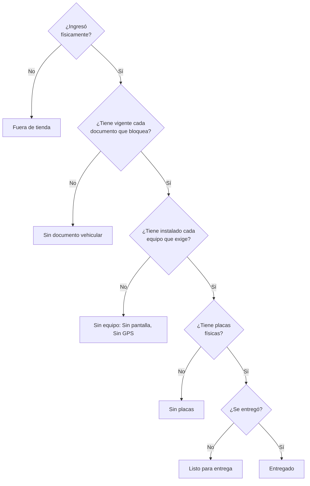
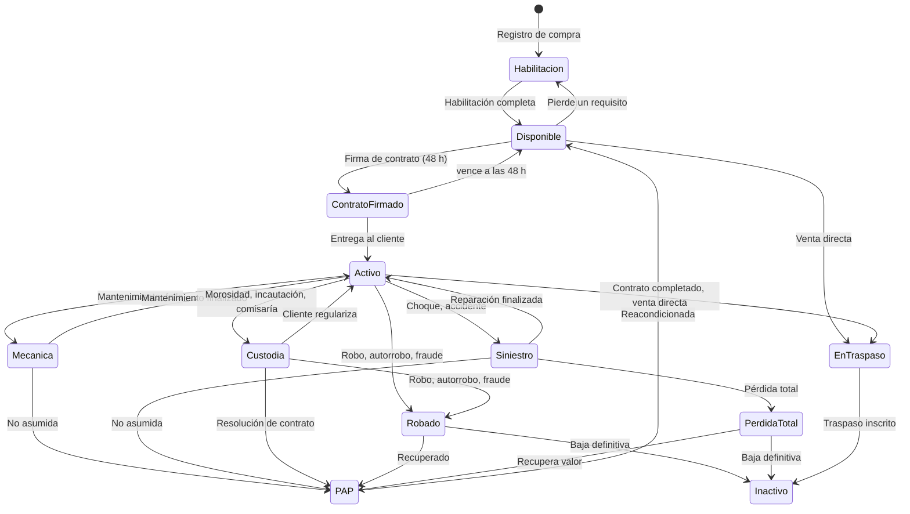

# Procesos y pantallas — ERP Millennium Mobility

**Fuente:** diccionario de datos v1.61 y sus decisiones (§14), la política de acceso de [convenciones de la API](convenciones-de-la-api-millennium-mobility.md) §9.2, el menú del frontend (`app-shell/app-navigation.ts`) y su `DESIGN.md`. Si este documento y el diccionario no coinciden, manda el diccionario.

El diccionario documenta los datos y sus reglas, pero no los procesos ni las pantallas (§1). Este documento cubre ese hueco: qué hace la empresa con el sistema, en qué orden, quién lo hace y en qué pantalla.

**Cómo leerlo.**
- Las reglas citadas vienen del diccionario. Una referencia **§n** o **D-n** sin más señala una sección o una decisión del diccionario. Las secciones de este documento se citan como "apartado n", y las de los otros documentos con su nombre (mapa §n, convenciones §n).
- Lo marcado **(propuesta)** no lo decide nadie todavía.
- Las preguntas de negocio que el diccionario no resuelve están en el apartado 5.

---

## 1. Quién usa el sistema

El diccionario fija siete roles del sistema, con su código, su nombre y su alcance (§5.5). Lo que puede hacer cada uno lo deciden sus permisos (§5.6), con la matriz por rol de D-95, que cargan las migraciones de `iam`; la última columna la sigue. Las tareas de `SUPERADMIN`, `ADMIN_ACCESOS` y `ADMIN_EMPRESA` sobre cuentas, accesos y colaboradores vienen además del arranque (§5.2) y de la política de acceso ([convenciones de la API](convenciones-de-la-api-millennium-mobility.md) §9.2; D-55, D-57), y también van por permiso, con los permisos `seguridad.*` (§5.8 regla 7, D-117): los de accesos y roles solo valen con alcance sistema, y los de colaboradores, en la empresa o la sede de la asignación (D-122). Un permiso actúa donde la asignación que lo trae dice: en toda la empresa por un rol de empresa; en su sede, leyendo toda la empresa, por un rol de sede (D-14, D-99).

| Rol (`code`) | Alcance | Qué hace |
|---|---|---|
| `SUPERADMIN` | Todo el sistema | Tiene el conjunto completo de permisos (§5.6): todo lo que hacen los demás, en todas las empresas. Crea las empresas, sus sedes, marcas y ubicaciones, y configura los catálogos que el diccionario le reserva (D-43, §7). Tiene todos los permisos de seguridad salvo `seguridad.asignar_roles_sin_tenerlos`, y otorga cualquier rol (D-117, D-121). Es el único que otorga y retira los roles reservados —entre ellos `SUPERADMIN`, `ADMIN_ACCESOS` y `ADMIN_EMPRESA`—, el único que maneja las cuentas que los tienen (§5.2, pasos 4 a 7; D-55, D-121), el único que confirma la cuenta de otra persona y desvincula (D-82), y el único que crea, copia, renombra, activa o desactiva y marca los roles propios (`seguridad.crear_roles`, `editar_roles`, `desactivar_roles` y `marcar_permisos_de_roles`, D-130) |
| `ADMIN_ACCESOS` | Todo el sistema | Da acceso a los colaboradores de cualquier empresa, otorga y retira los roles no reservados —también los que incluyen permisos que no tiene (`seguridad.asignar_roles_sin_tenerlos`, D-120)—, bloquea cuentas, restablece contraseñas y, a una cuenta que espera su activación, le reenvía el código y le corrige el correo (D-55, D-258): siete permisos de seguridad, con alcance sistema (D-117). No otorga los roles reservados ni actúa sobre una cuenta que tenga uno, y no registra colaboradores: quien da acceso no crea a quien lo recibe, y los pares incompatibles lo sostienen (D-57, D-119). Lee los catálogos, la estructura de las empresas y sus colaboradores con sus datos personales, porque lo necesita para dar acceso y fijar el alcance de un rol, y nada del negocio (D-56, D-105). Lee los roles y lo que incluye cada uno |
| `ADMIN_EMPRESA` | Una empresa | Hace todo lo operativo de su empresa, incluidas las excepciones controladas —las facturas atrasadas, anular una unidad o una factura, corregir una placa o un VIN, la migración inicial, la sustitución de odómetro—, y no escribe empresas, sedes, marcas, ubicaciones ni catálogos, que son del superadministrador; sí las cuentas bancarias de su empresa (D-214). Registra y modifica a los colaboradores de su empresa y registra sus salidas y regresos (§5.2, paso 8; D-57), y lee sus datos personales (D-105). Lee las cuentas de su empresa, pero no da acceso, no otorga roles y no bloquea cuentas: sus permisos de seguridad son leer las cuentas y los roles, registrar colaboradores, modificarlos y registrar sus salidas y regresos (D-117, D-130). Lee los roles del sistema, los generales y los de su empresa (D-98, D-122). Registra la entrega al cliente (`stock.entregar`), como el asesor de ventas en su sede (D-238) |
| `OPERACIONES` | Una empresa | Compra y recibe unidades y las habilita: da de alta, edita y mueve de estado las unidades y las habilita; gestiona proveedores y órdenes de compra y registra facturas, no las atrasadas (D-176); registra los hitos, los documentos, los equipos y las llaves de la habilitación; registra, edita y cambia de estado los equipos del inventario de equipamiento (D-254); registra lecturas de kilometraje. Ve los importes de los documentos que registra, pero no el costo por unidad; lee las cargas y los reportes |
| `CONTABILIDAD` | Una empresa | Lleva el dinero: facturas, también las de más de 20 días, su anulación, las notas de crédito, los pagos y su anulación, los fondos con sus cesiones y el archivo de garantía mobiliaria; ve los costos por unidad (`stock.ver_costos`), las cargas y los reportes. No da de alta unidades ni las mueve |
| `ASESOR_VENTAS` | Una sede | Ve el stock de toda la empresa (D-14) y, en su sede, firma el contrato (`stock.vender`), registra la entrega al cliente (`stock.entregar`, de Contrato firmado a Activo, sobre las unidades de la ubicación propia de su sede; D-101, D-238) y registra las lecturas de entrega y devolución |
| `TALLER` | Una sede | En su sede, mueve unidades a mecánica y puesta a punto y de vuelta a disponible, registra lecturas y sustituciones de odómetro, y gestiona los equipos y las llaves |

Los siete leen los catálogos (`catalogos.ver`), la estructura de las empresas (`configuracion.ver_estructura`) y la fila mínima de los colaboradores —nombre, puesto, sede, si está activo— con `configuracion.ver_colaboradores`, para los selectores y los nombres de autor (D-105). El documento, el teléfono, la foto y la exportación de los colaboradores los ven solo los dos roles globales y el administrador de la empresa, con `configuracion.ver_datos_personales_colaboradores`: quien atiende un local no necesita la planilla de toda la empresa. Un rol propio, general o de una empresa, hace lo que el superadministrador le marque de entre lo que él mismo posee (§5.5 regla 1, D-98), o lo que traiga la copia exacta de otro rol (D-124). Los once permisos de accesos y roles (D-130) solo se marcan en un rol general de alcance sistema, y nunca las dos partes de un par incompatible (D-119, D-122). Un rol propio con un permiso de seguridad que no es de ver es reservado: lo otorga solo el superadministrador (D-121).

Además existe la cuenta `SYSTEM`. No es una persona ni un rol: firma las cargas masivas y los procesos automáticos, y no puede iniciar sesión (§5.9). No hay que confundirla con el alcance `SYSTEM` de `scope_level`, que es el de los roles `SUPERADMIN` y `ADMIN_ACCESOS` (§5.5, D-55).

---

## 2. Procesos

Cada proceso lista sus pasos, las reglas del diccionario que lo gobiernan y las pantallas donde ocurre.

### P1 · Puesta en marcha (§5.2)

| Paso | Qué ocurre | Quién | Pantalla |
|---|---|---|---|
| 1 | Se cargan las monedas, los países y las divisiones territoriales | Migración inicial | — |
| 2 | Se crean los roles del sistema, los permisos del catálogo y la matriz que los une (§5.6, D-95) | Migraciones de `iam` | — |
| 3 | Se crean `SYSTEM` y el primer superadministrador, con contraseña provisional, que debe cambiar en su primer ingreso | Migración (`SYSTEM`) y la aplicación al arrancar (superadministrador, D-34) | Cambio de contraseña |
| 4 | El superadministrador crea las empresas, una por país (D-5) | Superadministrador | Configuración › Empresas |
| 5 | Crea las sedes y las marcas comerciales de cada empresa | Superadministrador | Configuración › Empresas › ficha de la empresa, pestañas Sedes y Marcas comerciales |
| 6 | Se registra como colaborador de la empresa para la que trabaja y vincula su cuenta a ese perfil: da acceso a su propio colaborador con su propio correo | Superadministrador | Configuración › Colaboradores |
| 7 | Registra como colaboradores al administrador de cada empresa y al administrador de accesos, que son personas distintas: una cuenta nunca tiene a la vez `ADMIN_ACCESOS` y `ADMIN_EMPRESA` (D-119); y les da acceso. Cuando cada uno activó su cuenta con el código que le llegó al correo (D-255), le otorga `ADMIN_EMPRESA` sobre su empresa o `ADMIN_ACCESOS`: un rol reservado va solo a una cuenta con su contraseña propia (D-72, D-121) | Superadministrador | Configuración › Colaboradores |
| 8 | Cada administrador de empresa registra a los colaboradores de su empresa | Administrador de empresa | Configuración › Colaboradores |
| 9 | El administrador de accesos da acceso a quienes usan el sistema y les otorga los roles de su puesto y su sede | Administrador de accesos | Configuración › Colaboradores |

**Reglas.** Hasta vincularse a su perfil (paso 6), el primer superadministrador configura el sistema (empresas, sedes, catálogos) y registra y modifica colaboradores, porque tiene que crear el suyo, pero no puede dar acceso a nadie, otorgar roles ni registrar salidas o regresos (§5.2, §5.9, D-89). Configuración › Colaboradores le muestra "Dar de baja", "Reincorporar colaborador" y "Desvincular cuenta" deshabilitados y le dice por qué: "Su cuenta todavía no está vinculada a un colaborador activo: puede registrar y corregir colaboradores, pero las bajas, las reincorporaciones y los desvínculos de cuentas se registran cuando se vincule a su perfil". "Dar acceso al sistema" sigue ofrecido, porque con él se vincula, y en cuanto se vincula la pantalla vuelve a leer la sesión y habilita lo demás. Es la única cuenta que se vincula a sí misma, y solo mientras no tiene un colaborador activo (D-70). Lo mismo vale después para todos: quien no está vinculado a un colaborador activo no maneja cuentas.

### P2 · Acceso de las personas (§5.2 a §5.9, §5.12)

**Dar acceso a un colaborador (D-38, D-58, D-255).** Quien tiene `seguridad.dar_acceso` con alcance sistema —el administrador de accesos o un superadministrador (D-122)— da acceso a un colaborador activo ya registrado, en cualquier empresa, con su correo. Si ese correo no tiene cuenta, la cuenta nace pendiente de activación, con una contraseña que nadie conoce, y a ese correo sale un código de seis dígitos para activarla (abajo, «Activar la cuenta con un código»); el diálogo dice la dirección completa a la que salió el código, para ver un error de tipeo (D-258). Si ese correo ya tiene cuenta, porque la persona trabaja para otra empresa del grupo, se vincula a esa cuenta en vez de crear otra, sin cambiarle los roles ni la contraseña y sin enviar nada; una cuenta protegida solo la vincula un superadministrador. Dar acceso no otorga roles. Se hace desde la fila del colaborador en Configuración › Colaboradores. El administrador de empresa no da acceso (D-57).

**La cuenta tiene que ser de la misma persona (D-82).** Una cuenta existente se vincula sola cuando ya pertenece a un colaborador con la misma sigla y el mismo número de documento. Si no, el diálogo de dar acceso:
- al superadministrador le muestra, dentro del mismo diálogo, quién tiene la cuenta: el nombre, el documento (sigla y número) y la empresa de cada colaborador, con "(ya no trabaja ahí)" si salió, y le pide revisarlo: "Vincúlela solo si es la misma persona con otro documento. Si el correo está mal, corríjalo". Una cuenta que existe sin ningún colaborador, por ejemplo la que dejó un vínculo deshecho, también la vincula solo él: "Esta cuenta no tiene colaboradores: existe, pero no pertenece a ninguno". El botón pasa a "Vincular de todos modos". Al confirmar, la pantalla devuelve la huella de los titulares que mostró; si mientras tanto cambiaron, no se vincula nada, el diálogo muestra los de ahora con "Quién tiene la cuenta cambió mientras tanto: revíselo y confirme otra vez", y pide confirmar de nuevo. Cambiar el correo vuelve a empezar;
- al administrador de accesos le muestra solo el rechazo, sin titulares ni confirmación: "La cuenta es de otra persona: tiene otro tipo o número de documento. Revise el correo; solo un superadministrador puede vincularla igual, tras ver quién la tiene. No se vinculó nada".

Cada vínculo confirmado queda registrado con quién lo confirmó, cuándo y qué titulares vio (§5.4).

**Desvincular una cuenta (D-82).** Corrige un vínculo equivocado. Solo un superadministrador, con la acción "Desvincular cuenta" de la fila de un colaborador con cuenta en Configuración › Colaboradores, nunca sobre la suya. Pregunta antes: "La cuenta {correo} dejará de estar vinculada a {colaborador} y perderá sus roles en esta empresa. Si no tiene otro colaborador activo, quedará cerrada. Después podrá darle al colaborador su propio acceso". Funciona como una salida: los roles de esa empresa se retiran con motivo `retiro` y, si la cuenta no tiene otro colaborador activo, se cierra con una baja y sus sesiones se cierran (D-60, D-69); la pantalla lo dice ("Cuenta desvinculada y cerrada: no tenía otro colaborador activo"). No se desvincula si el sistema se quedaría sin superadministrador activo (D-65). El colaborador queda sin cuenta, listo para recibir la suya.

**Asignar y retirar roles (§5.5 a §5.8).**
- Otorgan y retiran roles quienes tienen `seguridad.asignar_roles` con alcance sistema (D-117, D-122): el superadministrador, cualquiera, y el administrador de accesos, cualquiera salvo los reservados, que solo otorga y retira un superadministrador (D-55, D-121). Un rol es reservado si incluye un permiso de seguridad que no es de ver: hoy, `SUPERADMIN`, `ADMIN_ACCESOS` y `ADMIN_EMPRESA`, y cualquier rol propio que incluya uno. El administrador de empresa no otorga roles (D-57).
- Una cuenta con un rol reservado vigente es protegida: solo la maneja un superadministrador. Nadie actúa sobre su propia cuenta, tampoco un superadministrador (D-70). El diálogo Roles lo sabe por `reserved` de cada rol y de cada asignación, y por `actsOnReserved` de la sesión.
- Un rol de empresa o de sede exige que la cuenta esté vinculada a un colaborador activo de esa empresa (D-38). El diálogo Roles ofrece solo las empresas donde la cuenta tiene un colaborador activo, y dice cuando no trabaja en ninguna.
- Se otorgan solo los roles activos, y en una empresa solo los generales y los de esa empresa: un rol propio desactivado ya no se ofrece, y lo que tenía asignado sigue vigente (D-97); un rol de una empresa no se otorga en otra (D-98). El diálogo no los ofrece, y la API los rechaza con su código.

**Roles propios (§5.5, D-97, D-98, D-123, D-124).** Los siete roles del sistema son el punto de partida: no se renombran, no se desactivan y su matriz la fijan las migraciones, también para el superadministrador. Para variarla, el superadministrador —quien tiene `seguridad.crear_roles` con alcance sistema— crea un rol propio en Seguridad › Roles y permisos, vacío o con "Crear rol propio a partir de este", que copia exactamente los permisos de otro y se rechaza nombrando lo que falta; la copia de `SUPERADMIN` y de `ADMIN_ACCESOS` sale deshabilitada, con su razón (D-124): general, que vale en todas las empresas, o de una empresa activa que elige al crearlo, con un código propio —nunca el de un rol del sistema— y un alcance que no cambia. En la pestaña Matriz de permisos marca los permisos de cada rol propio en su columna, solo los que él mismo posee: "Usted no tiene este permiso" (§5.5 regla 1); nunca las dos partes de un par: "No se marca junto con «X»" (D-119); los once de accesos y roles, solo en un rol de alcance sistema: "Solo en roles de alcance sistema" (D-122); y los tres que no se marcan en ningún rol propio quedan deshabilitados: `confirmar_vinculo` y `desvincular_cuentas`, con "Solo del superadministrador", y `asignar_roles_sin_tenerlos` (D-117), que no tiene pista propia: es uno de los once de accesos y roles, así que en un rol que no es de alcance sistema dice "Solo en roles de alcance sistema", y en uno de alcance sistema, "Usted no tiene este permiso", porque el superadministrador no lo tiene y el administrador de accesos, que lo tiene, no edita roles (D-120). Lo que la sesión puede marcar lo dice el backend en la misma respuesta de la matriz, contado como lo cuenta el guardado: `grantableForGeneralRoles` para un rol general y `grantableForCompanyRoles` para uno de la empresa elegida. Guarda cada columna por su cuenta. Un rol propio que ya no se usa se desactiva, no se borra. El administrador de accesos lee todos los roles, porque los otorga y necesita saber qué incluye cada uno; el administrador de empresa lee los del sistema, los generales y los de su empresa; los dos con `seguridad.ver_roles` ([contextos/iam.md](contextos/iam.md), F12; D-122).
- Un rol nuevo no se otorga sobre una empresa, una sede o una marca inactiva (D-84). El diálogo no ofrece sedes ni marcas inactivas, y si el backend rechaza el rol dice cuál de las tres está inactiva.
- Una cuenta nunca junta un par de permisos incompatibles entre sus roles vigentes, y por eso nunca tiene `ADMIN_ACCESOS` y `ADMIN_EMPRESA` a la vez (D-119): el diálogo Roles muestra el rechazo con los pares que nombra. Un rol reservado solo va a una cuenta con su contraseña propia: una que espera su activación o que todavía tiene una contraseña provisional no lo recibe (D-72, D-121, D-255).
- La caducidad se elige como un día, que vale completo: el rol caduca al empezar el día siguiente en la zona de su empresa, también un rol de sede, y en `America/Lima` uno de todo el sistema (D-87). "Vence el 31/12/2026" en una empresa de Perú termina el 01/01/2027 a las 00:00 de Lima. El día más temprano que se puede elegir es hoy, y la lista muestra ese último día.
- Un rol se retira, no se borra, con uno de cuatro motivos: `retiro`, `caducidad`, `baja_colaborador` o `baja_cuenta` (D-41). Un acceso vencido se cierra con motivo `caducidad`. El historial de la cuenta dice, por su correo, quién otorgó cada rol y quién retiró uno pasado; no nombra a `SYSTEM`, porque el motivo ya dice que venció.

**Bloquear y reactivar una cuenta (§5.4).** Quien tiene `seguridad.bloquear_cuentas` con alcance sistema —un superadministrador o el administrador de accesos— la bloquea por vacaciones, licencia o seguridad, como un período que se abre y se cierra; la baja la abren solo la salida del colaborador o el desvínculo de su último colaborador activo (D-69, D-82). Un bloqueo que empieza cierra las sesiones de la cuenta (D-33). La salida que deja la cuenta sin colaborador activo retira además todos sus roles (D-12, §5.9); las vacaciones y las licencias no los tocan.

**Salida y regreso de un colaborador (D-38, D-60).** Los registra quien tiene `seguridad.registrar_salidas_y_regresos` donde trabaja el colaborador (D-122): con la semilla, un superadministrador vinculado a un colaborador activo (D-89) o el administrador de la empresa del colaborador; el administrador de accesos no, y nadie registra su propia salida ni su propio regreso (D-57, D-70). La salida pide solo la fecha, sin motivo, que es un candidato del diccionario (§5.10), y no es posterior a hoy. En la misma operación se retiran los roles de su cuenta en esa empresa, y si no le queda ningún colaborador activo, la cuenta se bloquea con una baja, también si es protegida. No se puede registrar la salida del último superadministrador activo (§5.9). El regreso, que tampoco es posterior a hoy, cierra esa baja; los roles no vuelven solos. Un colaborador regresa solo a una empresa activa y, si tiene sede, a una sede activa, porque el regreso le devuelve la cuenta (D-94): si no, no regresa y su cuenta sigue cerrada, y bajo una empresa inactiva la pantalla muestra "Reincorporar colaborador" deshabilitado, con el motivo "Su empresa está inactiva: reactive primero la empresa.". La salida y el regreso los orquesta `iam` (decisión 2 del [mapa de contextos](mapa-de-contextos-millennium-mobility.md), opción A). El regreso conserva el período que cierra —el ingreso y la salida anteriores— en el historial de ingresos del colaborador (D-241), que lee quien lee su fila mínima, con «Ver historial de ingresos» en la fila; y una corrección de la fecha de ingreso no la deja antes de la salida del período anterior ([contextos/organization.md](contextos/organization.md), F13, ORG-R60 a ORG-R62).

**Registro público (D-32).** Solo si está encendido. La persona elige su empresa y, si corresponde, su sede: se listan sin sesión, solo por nombre y solo mientras el registro está encendido. Completa los mismos datos obligatorios del registro de un colaborador, incluidos su tipo y número de documento, además de su correo y su contraseña. Se crean el perfil y la cuenta juntos, sin roles, a nombre de `SYSTEM`. Se rechaza si el documento ya está registrado en esa empresa o si el correo ya tiene cuenta. Cómo obtiene el formulario, sin sesión, las sedes y los tipos de documento está pendiente ([convenciones de la API](convenciones-de-la-api-millennium-mobility.md), §14.16). Hoy el registro crea solo la cuenta y está apagado: el registro con perfil se construye antes de encenderlo en cualquier entorno (D-83).

**Sesión (D-33).** Inicio y cierre de sesión. Una contraseña provisional obliga a cambiarla antes de usar el sistema (§5.4). Cambiar la contraseña cierra las demás sesiones. La contraseña tiene de 8 caracteres a 72 bytes (D-145): las pantallas que la piden dicen «De 8 a 72 caracteres; las letras con tilde y la ñ cuentan doble.» y no envían una más larga.

**El freno del inicio de sesión (D-144).** Después de cinco intentos fallidos seguidos, el siguiente espera: 1 minuto, que se duplica con cada fallo hasta 15, y nunca queda bloqueado para siempre. Los intentos desde un navegador donde la persona nunca entró comparten un solo contador por cuenta, también los de un correo que no existe, así que la pantalla no dice si la cuenta existe; el navegador desde donde la persona ya entró tiene el suyo, y nadie la deja afuera probando claves desde otro lugar. Inicio de sesión dice «Hubo demasiados intentos fallidos. Vuelva a intentarlo en 3 minutos.» con los minutos que faltan (`SIGN_IN_THROTTLED`), y Cambio de contraseña, «Hubo demasiados intentos con una contraseña actual incorrecta. Vuelva a intentarlo en 3 minutos.»: una contraseña actual equivocada cuenta como un intento fallido. Si el sistema ya está comparando muchas contraseñas a la vez, dice «El sistema está atendiendo muchos ingresos a la vez. Vuelva a intentarlo en unos segundos.» (`SIGN_IN_BUSY`), y el intento siguiente entra normalmente ([contextos/iam.md](contextos/iam.md), F2, F3, IAM-R73 a IAM-R76).

**Restablecer la contraseña con un enlace (D-243, D-258).** Quien olvidó su contraseña pide un enlace desde «¿Olvidó su contraseña?», bajo el formulario de Inicio de sesión: escribe su correo, y la pantalla dice lo mismo para cualquier correo, tenga cuenta o no: «Si el correo tiene una cuenta, le enviamos un enlace para restablecer su contraseña o, si todavía no la activó, un código para activarla.», que el enlace o el código vence en 30 minutos, y ofrece un enlace a «Activar mi cuenta»: una cuenta que espera su activación recibe un código y nunca un enlace. El enlace llega a su correo, sirve una sola vez y vence a los 30 minutos; una cuenta recibe a lo sumo uno cada 5 minutos, y los pedidos tienen su propio freno, que nunca hace esperar al inicio de sesión. Un administrador no entrega una contraseña: quien tiene `seguridad.restablecer_contrasenas` con alcance sistema —un superadministrador o el administrador de accesos— usa «Enviar enlace para restablecer» en Seguridad › Usuarios o en Configuración › Colaboradores; la contraseña anterior deja de valer en el acto, las sesiones de la cuenta se cierran, el enlace vence a las 24 horas y el diálogo dice a qué correo salió, enmascarado (`j***@millennium.ky`). No se envía a una cuenta que espera su activación —ni Usuarios ni Colaboradores lo ofrecen, y si llega igual el diálogo dice «Esta cuenta todavía no se activó: reenvíe su código de activación desde Seguridad › Usuarios.»—, ni cuando el sistema no puede enviar correos, lo que el diálogo también dice. Al abrir el enlace, la persona elige su nueva contraseña, con su confirmación, y entra con ella: nadie más la conoce, y se cierran todas sus sesiones. Un enlace vencido, ya usado o reemplazado dice «El enlace ya no sirve: venció, ya se usó o se pidió otro después. Pida un enlace nuevo.» y ofrece pedir otro. Un enlace nunca activa una cuenta pendiente ([contextos/iam.md](contextos/iam.md), F8 y F13).

**Activar la cuenta con un código (D-255, D-258).** A quien se le dio acceso con un correo sin cuenta le llega un correo con el logo de Millennium, «Active su cuenta», un código de seis dígitos que vence a las 24 horas y sirve una sola vez, y el botón «Activar mi cuenta». El botón abre Activar cuenta con su correo ya escrito; también se llega desde «Activar mi cuenta», bajo «¿Olvidó su contraseña?» en Inicio de sesión. La persona escribe el código, su «Número de documento» —el de su documento de identidad registrado en la empresa: DNI, carné de extranjería o pasaporte— y su contraseña nueva, con su confirmación, y la pantalla la lleva a Inicio de sesión, que dice «Su cuenta está activa. Inicie sesión con su contraseña nueva.»: activar no abre una sesión. Un código equivocado, vencido o de una cuenta que no espera su activación, o un documento que no es el suyo, dice siempre lo mismo: «El código o el número de documento no son válidos, o el código venció. Revíselos o pida un código nuevo.»; así un correo mal escrito que llega a otra persona no le alcanza para tomar la cuenta. Con cinco equivocados el código deja de servir, y los intentos tienen su propio freno, que dice los minutos que faltan. «Reenviar código» pide uno nuevo y dice lo mismo para cualquier correo: «Si la cuenta está pendiente de activar, le enviamos un código nuevo. Revise su correo.»; una cuenta recibe a lo sumo uno cada 5 minutos, y el nuevo reemplaza al anterior. El código que pide la persona vence a los 30 minutos, y el que envía un administrador, a las 24 horas. Mientras la persona no la activa, nadie puede entrar con esa cuenta ni darle un rol reservado, y Seguridad › Usuarios la muestra «Pendiente de activar». A una cuenta pendiente, quien tiene `seguridad.dar_acceso` con alcance sistema le ofrece, en Seguridad › Usuarios y en la fila del colaborador en Configuración › Colaboradores, «Reenviar código de activación» y «Corregir correo» —si el correo se escribió mal al dar acceso, la cuenta toma el correcto y el código nuevo sale ahí—, y no «Enviar enlace para restablecer» (D-259). Una cuenta activa conserva su correo ([contextos/iam.md](contextos/iam.md), F5, F14 a F16).

**Los correos.** Los envía el módulo `notifications` (D-242) por el proveedor que configura el entorno: SendGrid o Google Workspace por el relay SMTP, con el remitente en el subdominio `notifications.millennium.ky` (D-256, D-257). Sin un proveedor real, dar acceso con una cuenta nueva, reenviar el código, corregir el correo y el restablecimiento del administrador lo dicen y no cambian nada (D-258); las pantallas públicas responden lo mismo de siempre.

| Pantallas | Configuración › Colaboradores · Seguridad › Usuarios · Seguridad › Roles y permisos · Inicio de sesión · Registro · Cambio de contraseña · Restablecer la contraseña y Elegir una contraseña nueva · Activar cuenta |
|---|---|

### P3 · Catálogos (bloques 1, 3, 4, 6 y 9)

Los catálogos se cargan antes de registrar lo que los usa: un modelo antes de su primera unidad, un proveedor antes de su primera compra (§7, §9.1).

| Catálogo | Quién | Reglas clave | Pantalla |
|---|---|---|---|
| Monedas | Superadministrador, con `catalogos.crear_monedas`, `editar_monedas` o `desactivar_monedas` (D-130) | El código ISO no cambia; una moneda no se borra, se desactiva; tiene de 0 a 2 decimales, la escala de todos los montos (D-146); los decimales quedan fijos desde el primer monto que la usa —una orden de compra, una factura, un pago o el costo de un equipo—, y un cambio de decimales responde entonces `422 CURRENCY_DECIMAL_PLACES_IN_USE` (§4.1, D-138; [contextos/location.md](contextos/location.md), LOC-R05) | Catálogos › Monedas |
| Tipos de cambio | Quien tiene `catalogos.registrar_tipo_cambio` registra la tasa de un día y quien tiene `catalogos.corregir_tipo_cambio` la corrige; la semilla los da al superadministrador, y la persona de Contabilidad que carga las tasas los recibe por un rol propio general (D-149, D-150) | Una tasa por país, par de monedas, día y tipo; se registra a mano cuando un documento la necesita, y una que se aparta mucho de la anterior pide confirmación; corregirla exige motivo y queda en la bitácora; la fecha no pasa de mañana en su país (D-156); la carga automática espera una fuente con acceso permitido (§4.8, D-148) | Catálogos › Tipos de cambio |
| Países y sus escalones territoriales | Superadministrador (D-43), con `catalogos.crear_paises` para registrar un país y `editar_paises` para corregirlo y para declarar y renombrar sus escalones (D-130) | El país declara sus escalones en orden, hasta cuatro, antes de cargar sus divisiones; un escalón se renombra, no se retira (§4.4, D-45) | Catálogos › Países › ficha del país, pestaña Estructura territorial |
| Divisiones territoriales | La migración inicial, con el archivo oficial (§5.2, paso 1; D-2), y cada distrito que una ley crea después, con su propia migración en cuanto tiene código oficial (D-77). El superadministrador también las crea una por una y las corrige, con `catalogos.editar_paises`, y las activa o desactiva, con `desactivar_paises` (D-43, D-130) | El código oficial no se repite en el país; una división cuelga de una del escalón inmediato superior; se desactiva, no se borra (§4.5) | Catálogos › Países › ficha del país, pestaña Estructura territorial |
| Tipos de documento tributario | Superadministrador (D-43), con `catalogos.editar_paises` para crearlos y corregirlos y `desactivar_paises` para activarlos o desactivarlos (D-130) | Por país (D-44); longitud de 1 a 20 (D-78) y dígito de control, que verifica `location` según la sigla (D-75); se desactivan, no se borran (§4.7) | Catálogos › Países › ficha del país, pestaña Documentos |
| Tipos de vehículo, marcas, modelos, colores, tipos, marcas y modelos de equipamiento | Superadministrador, con crear, editar o desactivar de cada familia (D-130): `catalogos.crear_tipos_vehiculo`, `editar_tipos_vehiculo` y `desactivar_tipos_vehiculo`; `crear_marcas_y_modelos`, `editar_marcas_y_modelos` y `desactivar_marcas_y_modelos`; `crear_colores`, `editar_colores` y `desactivar_colores`; `crear_equipamiento`, `editar_equipamiento` y `desactivar_equipamiento` | Los catálogos de flota son del sistema; la misma marca no repite nombre de modelo; si la pantalla aplica a un modelo y si la trae de fábrica sale del catálogo (§7); un modelo de equipamiento es el modelo comercial de un tipo y de una marca (§7.5, D-254) | Catálogos › Tipos de vehículo, Marcas y modelos (las marcas, en «Gestionar marcas»), Colores, Equipamiento (las marcas, en «Gestionar marcas»; los tipos, en «Gestionar equipamiento») |
| Estados del vehículo y motivos de cambio | Superadministrador, con `catalogos.crear_estados`, `editar_estados` o `desactivar_estados` (D-130) | Los caminos permitidos son filas, no código (D-19), y cada camino nombra el permiso que exige; uno sin permiso propio exige `stock.cambiar_estado` (D-100); un motivo no se borra, se desactiva (§8.3) | Catálogos › Estados y motivos |
| Tipos de documento del vehículo | Superadministrador, con `catalogos.crear_tipos_documento`, `editar_tipos_documento` o `desactivar_tipos_documento` (D-139) | Por país, con el código único dentro de él (`vehicle_document_types`, D-139); cuáles vencen, cuáles bloquean la disponibilidad, cuáles ve el cliente; `TIVE` queda fijo desde la semilla (§11.2, D-74). El certificado de gas se pide a las unidades de un modelo a GNV o GLP (D-166) | Catálogos › Tipos de documento |
| Requisitos de equipamiento | Quien tiene `catalogos.editar_tipos_documento`, que ya marca los documentos que bloquean; con la semilla, el superadministrador (D-260) | Qué equipo exige la habilitación para pasar a Disponible y cuál es de seguridad, por tipo de equipo, la otra mitad de los requisitos (`vehicle_equipment_requirements`, §11.4). La semilla marca el GPS con las dos y la pantalla con la primera; un tipo sin fila no se exige ni es de seguridad, así que un tipo nuevo nace sin requisito. Marcar un equipo no mueve las unidades que ya están en Disponible | Catálogos › Requisitos de equipos |

Todos los catálogos se leen con `catalogos.ver`, que tienen los siete roles del sistema, porque toda pantalla con un selector los necesita (§5.6), y cada pantalla de Catálogos se abre solo con `catalogos.ver`: escribir exige leer, y un permiso de escritura no la abre (D-141; apartado 3.1). Con la semilla las ven los siete roles y escribe solo el superadministrador. Las tres últimas filas siguen la regla del menú: sus tablas no llevan `company_id` y van en Catálogos. Los estados y los motivos los mantiene quien tiene `catalogos.crear_estados`, `editar_estados` o `desactivar_estados`; los tipos de documento del vehículo, quien tenga sus tres permisos propios; y los requisitos de equipamiento, quien tenga `catalogos.editar_tipos_documento`; con la semilla, en los tres casos, solo el superadministrador (D-100, D-130, D-139, D-260).

### P4 · Compra de unidades (bloque 7)

1. **Orden de compra (opcional).** Se emite con una plantilla de la empresa, que fija lo que se imprime —el emisor, el texto de «Obs:», el logo y la firma cuando los tiene— y la serie de numeración (D-35, D-36, D-132). El logo y la firma son documentos de la plantilla, no columnas (§9.2). El número se asigna al crear la orden, aunque sea un borrador, y no se reutiliza (D-36). Las líneas piden vehículos —marca, modelo y año— y cantidades, o conceptos que no son vehículos, escritos libremente (D-37, D-135). Al emitir se elige el proveedor y se decide si esa orden incluye la columna de porcentaje de descuento (D-132). Estados guardados: `BORRADOR`, `ENVIADA`, `CUMPLIDA`, `ANULADA`. El sistema genera el PDF desde la plantilla, con el formato con que la empresa emite sus órdenes (D-135): mientras la orden es borrador refleja los cambios de la plantilla, y al enviarla se conserva en `kept_files` el PDF enviado, que ya no cambia aunque se edite la plantilla (§9.2, §2.7). Una orden enviada no se edita: se anula y se emite otra. Una orden con facturas vigentes no se anula (D-162), y una con pagos no se anula ni se da por cumplida.
2. **Alta de las unidades** que llegan, con su VIN (17 caracteres, único, D-9). La unidad nace en el estado inicial, En habilitación, con el motivo "Registro de compra" (§8.3). Nace al registrar la factura, que la vincula si ya estaba en Inventario (D-153). La factura no pide ubicación: la unidad nace Fuera de tienda y la recibe con su ingreso físico (D-160).
3. **Factura de compra.** Se registra a mano desde el comprobante (D-157). En un lote, las líneas se traen de un Excel con «Importar desde Excel»: se descarga la plantilla, se llena con una unidad por fila —VIN, motor, color, marca, modelo, año, valor y, si la factura lo incluye, ISC— y se elige; el formulario agrega las filas que vinieron bien y lista las que no, con su fila, su columna, su valor y su motivo, sin guardar nada hasta registrar la factura. Encabezado con proveedor, tipo (se prellena factura), comprobante, fecha, moneda, tipo de cambio de venta de la fecha del comprobante (D-152) —que la pantalla propone con el día del que viene y, si falta, registra ahí mismo (D-151)— y tasa de impuesto (D-24), y una línea por unidad con su VIN, su modelo, su año, su color y su marca comercial y su valor de factura con impuestos (D-159); si se marca «Incluye ISC», también su ISC (D-158); la unidad nace ahí o, si ya estaba en Inventario, se vincula (D-153). Vínculo opcional con la orden (D-21). Reglas (§9.3, §9.4):
   - la suma de las líneas cuadra con el total;
   - el número no se repite en el proveedor y el tipo entre las no anuladas, la fecha no es futura y la factura tiene hasta 100 líneas (D-160);
   - una unidad está en una sola línea vigente, y una que ya existía se vincula solo si es de la misma empresa y no está anulada; su modelo y su año mandan (D-160);
   - el vínculo con la orden es con una enviada del mismo proveedor; facturar de más o un modelo que no pide da un aviso que se confirma, y cumplirla sigue siendo manual (D-162);
   - una factura de más de 20 días exige el permiso `compras.registrar_factura_antigua`;
   - una unidad no aparece dos veces en el mismo comprobante;
   - el valor de factura no se modifica nunca.

   Cada factura dice su estado de pago —Sin pago, Pago parcial, Pagada, Saldada o Anulada por notas—, y quien tiene `pagos.ver` ve además lo pagado y lo pendiente (D-244, D-245).
4. **Nota de crédito.** Del mismo proveedor, la misma moneda y el mismo tipo de cambio que la factura que descuenta (D-152), con fecha no anterior a ella, repartida entre unidades concretas. La suma del reparto cuadra con el total. Nunca reemplaza a otra y puede descontar una compra de meses atrás (§9.5). Se registra a mano; el reparto puede hacerse en partes iguales entre las unidades elegidas (D-193). Cada línea copia la tasa de su factura, y desde el 01/01/2027 una nota descuenta una sola factura (D-192). **Reduce lo que se debe de su factura, por vehículo** (D-190, D-248): lo que baja del valor de un vehículo que todavía debe, baja lo que se debe; lo que baja de un vehículo ya pagado pasa a saldo a favor del proveedor, aunque la factura todavía deba por otros vehículos, y en un vehículo saldado del concesionario pasa entero, sin tocar la inicial del cliente. Lo facturado no cambia, el vehículo dice por qué vale menos, y queda registrado en qué pagos se usó lo que pasó a saldo (D-249).
5. **Anulación.** Una nota de crédito puede anular una línea de factura sin tocar las demás (§9.4). Si las notas dejan en cero el valor de una línea, la línea se anula. La unidad se anula solo con el motivo «anulación de unidad», si no tiene contratos ni una cesión abierta —el contrato se lee también de su historial: no se anula la que espera en Contrato firmado ni la que se entregó alguna vez a un cliente, que queda «Devuelta al proveedor» (D-250)—; con «anulación de la factura», que el proveedor emite para re-emitirla, la unidad queda sin factura vigente y la nueva factura la vincula (D-191). Una nota se anula con su motivo si, sin ella, el saldo del proveedor no queda negativo (D-193) y si ningún pago con saldo vigente usó lo que dejó: primero se anula ese pago (D-249). Anular una nota devuelve sus líneas a vigentes.
6. **Corrección de una factura.** Lo fiscal no se edita: se anula, con `compras.anular_factura` y su motivo, y se registra otra con «Anular y copiar». Solo procede si ninguna línea tiene notas de crédito vigentes ni pagos aplicados. Sus unidades no se anulan: se vinculan por su VIN a la nueva, y un VIN mal escrito se corrige en la unidad (D-161).

| Pantallas | Logística › Órdenes de compra, Facturas y Notas de crédito · Configuración › Proveedores (con la ficha de cada proveedor y sus contactos), Plantillas de OC |
|---|---|

### P5 · Pagos a proveedores (bloque 8)

1. Se registra el pago: proveedor, fecha, moneda, tipo de cambio de venta del día del pago (propuesto, o registrado ahí mismo si falta, D-151, D-152; 1 en la moneda funcional, D-169), monto, método, la cuenta de la que salió el dinero —una transferencia o un cheque la llevan, y la cuenta fija la moneda del pago (D-214)— y número de operación, único en el proveedor (D-198). Un pago con saldo a favor consume el saldo del proveedor en su moneda y no lo supera (D-195), y guarda de qué notas salió y cuánto de cada una, lo que no cambia (D-249).
2. Se aplica a una o varias facturas, o a una orden enviada todavía sin facturar (§10.2, D-211), aunque estén en otra moneda: cada aplicación guarda su tasa, su día y su equivalente en la moneda del pago, que absorbe el redondeo para cuadrar con la constancia (D-194, D-210), y la tasa de su factura (D-213). Un pago se aplica completo: la suma de los equivalentes es su monto (D-210). Lo aplicado a una factura no supera lo que se debe de ella: su total menos sus notas menos lo ya aplicado (D-190). Si el comprobante trae la retención del IGV, se registra en la aplicación (D-196). Cuando una factura se vincula a una orden ya pagada, la aplicación pasa sola a la factura (D-198).
3. Opcionalmente, se imputa a unidades concretas (§10.3), cada una con su monto y sin pasar de lo que le falta (D-247). Lo que no se imputa se reparte, al registrar, en proporción a lo que le falta a cada unidad, que sin imputaciones es su valor; los céntimos van de a uno, sin bajar a una unidad a cero ni pasar lo que le falta, y el reparto se guarda, así que una nota posterior afecta solo a su vehículo (D-211, D-248). Con un proveedor del canal de dealers la imputación es obligatoria, y cada unidad puede quedar saldada: lo que le falta es la inicial del cliente, que se congela al saldar, así que una nota posterior no la achica (D-197, D-248). Un vehículo saldado al que le falta algo además de su inicial sigue saldado, y se le puede pagar eso sin saldarlo. De una factura de dealers se puede pagar lo que se debe menos las iniciales de sus unidades saldadas, así que una que solo debe esas iniciales no se ofrece para pagar (D-197, D-199). Un proveedor con pagos en sus órdenes no pasa al canal de dealers.
4. Un pago mal registrado no se borra: se anula con su motivo y se vuelve a registrar, si sin él el saldo del proveedor no queda negativo (§10.1, D-198) y ningún uso del saldo queda sin respaldo (D-249). Una factura con un pago aplicado no se anula (D-161).
5. Cada unidad muestra sus cinco montos: valor de factura, notas, valor del vehículo, cubierto y diferencia (pendiente de pago, o la inicial del cliente en el canal de dealers), además del dinero entregado y la brecha de días desde el primer pago (D-199), con la inicial congelada y lo que pasó a saldo: valor − cubierto − inicial + pasó a saldo = pendiente (D-248).

El saldo a favor con cada proveedor se calcula, no se guarda (§10.4): se mide por vehículo (D-248), y de cada pago con saldo se guarda de qué notas salió (D-249).

**Cómo se registra en la pantalla** (D-246, D-247; `DESIGN.md`). «Registrar pago» es un formulario de una página que sigue el orden del pago: el proveedor, lo que se le debe, sus vehículos y cómo se paga.
- **El proveedor y lo que se paga.** Una fila con el proveedor y «Factura u orden», la lista de lo que se le debe, con las órdenes como «Orden … · anticipo»; con más de una empresa, la empresa va primero. Un proveedor al que no se le debe nada lo dice, con su saldo a favor, «Elegir otro proveedor» y «Ver el proveedor». Cada documento abre su sección: la factura dice su total, sus notas, lo ya pagado y lo que queda por pagar, y sus vehículos en una tabla —tarjetas, una por vehículo, en el teléfono—. «¿Qué paga de esta factura?»: todos los vehículos pendientes, solo algunos —cada vehículo marcado lleva su monto, de partida lo que debe y editable— u otro monto. «Agregar otra factura» suma otra al mismo pago. Una orden pide el monto de su anticipo y dice por qué no tiene vehículos: el anticipo pasa a su factura cuando se registre, y ahí se reparte (D-211). El concesionario paga vehículo por vehículo, y una unidad que recibe menos de lo que le falta pregunta si la diferencia la pagó el cliente como inicial (D-197).
- **Cómo se paga.** Aparece cuando se elige la primera factura u orden, o con «Saldo a favor»; antes, el pie pide «Falta: proveedor» o «Falta: factura u orden». En una tarjeta ancha, en una fila: «¿Con qué se paga?» —Transferencia, Cheque, Efectivo o «Saldo a favor», que dejan las notas sobre vehículos ya pagados (D-190)—, la cuenta de la que salió el dinero, la fecha y el N.º de operación; la constancia se abre a la izquierda de los datos del pago, como el archivo de una factura, y plegada es la caja compacta de un archivo. La cuenta se propone cuando es la única activa de la empresa en la moneda de los documentos (D-214, D-246); nunca la última usada. Una transferencia o un cheque, antes de su cuenta, se toman en la moneda de sus documentos cuando la comparten, y la cuenta la fija después (D-214). Cuando hay conversión, se dice en palabras: «Se paga en soles: USD 53,800.00 son PEN 184,211.20 al tipo de cambio 3.424 del 10/11/2026.», con «(no hay del 11/11/2026)» si la tasa es de un día hábil anterior; el tipo de cambio y su aviso van uno al lado del otro.
- **La retención** es opcional: la pantalla la propone en el 3 % de lo que se paga, dice de qué sale —«3 % de PEN 5,900.00. Si el comprobante dice otro monto, escríbalo.»— y, escrita a mano, ofrece «Volver al 3 %», hasta que se confirme si Millennium es agente de retención, una pregunta que el diccionario deja abierta y que el responsable consulta con contabilidad (D-196).
- **Con saldo a favor**, el pago usa a lo sumo lo disponible y quita, diciéndolo, los documentos que el saldo no paga; el monto propuesto de un vehículo no pasa de lo que queda. Al elegir «Saldo a favor», el formulario dice de qué notas de crédito sale, en el orden en que el pago las toma (D-249); el saldo no mueve dinero, así que no lleva cuenta, operación ni constancia (D-195).
- **Antes de registrar**, ningún error al abrir: cada campo dice el suyo cuando se deja, y «Registrar pago», siempre habilitado, muestra arriba un resumen de lo que falta, con un enlace a cada campo, y lleva el foco al primer campo con error —el resumen dirá el campo y su mensaje, como en los demás formularios de página (D-277, por construir)—; mientras registra, dice que guarda. El total va en el pie del formulario; la diferencia de cambio, solo en la ficha del pago, que muestra la tasa de cada factura junto a la del pago, como «Factura a 3.742 · pago a 3.760» (D-213).
- **Las palabras**, con un glosario: «Por pagar», «Pendiente» por lo que se debe —«Por pagar» en todas las pantallas desde D-268, por construir—, «Pagado» por lo aplicado más la retención, «Cuenta de la que salió el dinero», «Constancia», «N.º de operación», «La diferencia la pagó el cliente», «Retención del IGV», «Saldo a favor» —el crédito del proveedor— y «Concesionario» por dealer, en Compras y en la ficha de la unidad.
- **Se empieza** desde Pagos a proveedores, desde la ficha de una factura, desde Por pagar con varias facturas del mismo proveedor y empresa, o desde la ficha del proveedor con lo que se le debe. «Anular y copiar» abre el formulario con la copia de un pago anulado: dice lo que dejó fuera, revisa las imputaciones contra lo que a cada unidad le falta ahora, conserva sus montos y nunca copia el número de operación de un pago vigente.

| Pantallas | Logística › Por pagar (D-224) · Logística › Pagos a proveedores, con su formulario y su ficha |
|---|---|

### P6 · Habilitación (bloque 9)

Lo que hay que completar para que una unidad pueda entregarse:

1. **Ingreso físico** (`arrival_date`). Sin ingreso no se instala el GPS (§11.1). Se registra por unidad o en lote, como las unidades de una factura, y fija la ubicación (D-165).
2. **Inmatriculación**: inicio del trámite, título y fecha del título, placas recibidas (§11.1).
3. **Documentos**: cada carga es un archivo. Por unidad hay uno solo vigente de cada tipo; al cargar uno nuevo, el anterior deja de ser vigente y se conserva (D-28, §11.3). Si el tipo vence, la fecha de vencimiento es obligatoria. Solo el documento de identificación vehicular bloquea la disponibilidad (§11.2).
4. **Equipamiento**: cada instalación es un período; reemplazar un equipo cierra el anterior. No se instala en un tipo de vehículo al que no aplica (§11.4). El costo de una instalación lo ve quien ve los costos.
5. **Placa**: solo con título y documento de identificación vehicular cargado; se guarda normalizada; corregirla deja rastro en la bitácora (§7.6, §11.1).
6. **Llaves**: la entregada y el duplicado, con su etiqueta única en la empresa (D-29).

El **estado de habilitación** se calcula, no se guarda (§11.9). Se evalúa en este orden y devuelve el primero que aplica:

Cada estado tiene un código estable (D-171): `FUERA_DE_TIENDA`, `SIN_DOCUMENTO`, `SIN_EQUIPO`, `SIN_PLACAS`, `LISTO_PARA_ENTREGA` y `ENTREGADO`. Los equipos que faltan van juntos en `SIN_EQUIPO`, con su nombre en el detalle: «Sin pantalla», «Sin GPS».

La pantalla y el GPS son los equipos que hoy bloquean, y el GPS es además el equipo de seguridad: lo dicen los requisitos de equipamiento (D-260). Otro documento marcado como bloqueante, u otro equipo marcado en los requisitos, se suma sin programar (D-165). Las placas que cuentan son las físicas, que exigen la placa registrada (D-165). **La puerta de la habilitación** (D-164, D-170, D-183, D-184): una unidad entra a mano a un estado que exige la habilitación —Disponible siempre, y Contrato firmado mientras esté marcado— solo si no le falta nada, esté lista o ya entregada, así que una reacondicionada vuelve a Disponible; a Disponible entra por «Habilitación completa» o por «Reacondicionada». Ningún camino automático mueve sola una unidad a un estado que exige la habilitación, salvo el regreso automático desde Contrato firmado, que no pasa por la puerta mientras Contrato firmado la exige; si el superadministrador lo desmarca, una unidad a la que le falta algo se queda en Contrato firmado. El estado inicial no exige la habilitación: Estados y motivos no deja configurarlo, así que la puerta no se apaga desde el catálogo.

**Lo que retiene el estado de la unidad** (D-184, D-260). En Contrato firmado no se retira un requisito sin reemplazo: un equipo se reemplaza, y sin repuesto la unidad espera el regreso automático. En Disponible, un GPS que falló o que se robaron se retira igual, y vaciar las placas físicas o el ingreso también se registra: en la misma operación la unidad pasa a En habilitación por «Pierde un requisito», con una fila del historial firmada por quien lo hizo que nombra el requisito perdido, y vuelve a Disponible por «Habilitación completa» cuando está completa otra vez. Lo autoriza el permiso de quien retira o corrige los hitos; si el camino «Pierde un requisito» está cerrado o En habilitación retirado, no se guarda nada. En Contrato firmado y en Activo el GPS, el equipo de seguridad, se reemplaza y no se retira sin repuesto: para retirarlo, la unidad sale antes de Activo —a Mecánica, a Siniestro o a Custodia— y ahí se registra. En Robado no se instala, reemplaza ni retira ningún equipo, porque nadie de la empresa tiene la unidad; el costo se corrige y el serial se completa igual.

El certificado de gas se pide a las unidades de un modelo a GNV o GLP (D-166), y la misma pantalla muestra los vencimientos y filtra los de los próximos 30 días (D-167). El aviso de renovación por correo, a quien gestiona los documentos de la empresa, 30 y 7 días antes, está decidido y se construye con el proveedor de correo (D-272). La declaración del impuesto vehicular llega con su carga (P9).

| Pantallas | Logística › Habilitación, con la página de la habilitación de cada unidad · la ficha de la unidad en Logística › Inventario · Logística › Inventario de equipamiento · Catálogos › Tipos de documento · Catálogos › Requisitos de equipos |
|---|---|

### P7 · Ciclo de estados del vehículo (bloque 6)

Todo cambio de estado registra fecha, hora, usuario y motivo, y solo existen los caminos cargados en `status_change_reasons` (§8.3). El estado actual y su historial se escriben en la misma operación (§8.4).

Los caminos cargados (§8.3, D-221, D-239). Millennium coloca sus unidades en leasing, así que una unidad vuelve y se entrega a otra persona:

- La única transición automática es la que tiene configurado un estado de destino al vencer su tolerancia: Contrato firmado vuelve a Disponible a las 48 horas (§8.3).
- Los códigos dicen lo que es (D-251): Contrato firmado es `CONTRATO_FIRMADO` y su camino desde Disponible, `FIRMA_CONTRATO`; la venta es «Venta directa» (`VENTA_DIRECTA`). El permiso del camino de la firma conserva su código, `stock.vender`, y se lee «Firmar contrato».
- Inactivo es final: no hay ninguna fila con ese origen. Lo que todavía puede volver queda en Robado o en Pérdida total (D-219, D-220); los caminos son datos (D-19). En traspaso e Inactivo no se retiran del catálogo, y sus códigos quedan fijos (D-239).
- La fecha de entrega es el momento en que la unidad pasó a Activo; no hay un campo aparte (§11.9). La registra quien tiene `stock.entregar`: el administrador de empresa y el asesor de ventas en su sede (D-238).
- Una unidad con un cliente no se queda sin su GPS (D-260). Contrato firmado y Activo exigen los equipos de seguridad, así que entrar a mano a uno de ellos —por «Firma de contrato», «Entrega al cliente», «Mantenimiento finalizado», «Reparación finalizada» o «Cliente regulariza»— pide instalados los que le aplican a la unidad, y si falta uno se rechaza nombrándolo; la ficha muestra ese camino retenido mientras falte. Ningún camino que mueve sola la unidad lleva a un estado que los exige, y Estados y motivos no deja configurarlo.
- «Pierde un requisito» lo recorre también el sistema: por él pasa a En habilitación, en la misma operación, la unidad de Disponible que pierde un requisito (P6, D-260). Por eso su código queda fijo, el camino no se cierra y En habilitación no se retira mientras el camino llegue a él. Una persona lo sigue tomando a mano, con `stock.habilitar`.
- En Robado el equipamiento queda congelado: no se instala, reemplaza ni retira ningún equipo hasta que la unidad sale de ahí, y al recuperarla la revisión física registra cómo llegó (P6, D-217, D-260).
- Al terminar el contrato, o con una venta directa, la unidad pasa a En traspaso, que no genera ingresos, mientras la notaría inscribe el traspaso (D-239). Cuando el notario firma se registra el traspaso en la ficha —el día, el motivo y a quién (D-223)—, y recién entonces pasa a Inactivo por «Traspaso inscrito»: sin el traspaso registrado, ese camino se rechaza. No hay caminos directos de Activo ni de Disponible a Inactivo.
- Una unidad se recoloca: Puesta a punto cierra su entrega (D-216) y se sale de ahí con la revisión física de quien la mueve, que queda en el historial (D-217). No vuelve a En habilitación.
- Las unidades que superan la tolerancia de su motivo aparecen en una lista de vencidas (§8.3); qué tolerancia lleva cada camino lo dice la [especificación de las tolerancias de los caminos](especificacion-tolerancias-de-los-caminos-2026-11-09.md).

| Pantallas | Logística › Inventario (ficha de la unidad) · Catálogos › Estados y motivos |
|---|---|

### P8 · Kilometraje (§8.5)

Cada lectura se registra con su fecha y su origen: GPS, taller, entrega, devolución o manual. Una lectura no puede ser menor que la anterior ni futura; un cambio de tablero se registra como sustitución de odómetro, una lectura marcada con su propio permiso. Las lecturas no se editan ni se borran. Una lectura escrita de más se anulará con su motivo, y saldrá de la serie y del kilometraje de la unidad (D-267): está decidida y se construye antes del módulo de monitoreo. El kilometraje de la unidad es el de la última lectura y se escribe en la misma operación.

| Pantalla | Logística › Inventario (ficha de la unidad) |
|---|---|

### P9 · Cargas de archivos y fondos (§11.7, §11.8, §12)

| Carga | Qué hace | Reglas |
|---|---|---|
| Declaración del impuesto vehicular (SAT) | Actualiza la declaración de cada unidad | Solo autos; cruce por placa; una unidad sin documento vehicular no tiene declaración (§11.7) |
| Garantía mobiliaria | Actualiza las cesiones de cada unidad a un fondo | Actualiza la historia, no la reemplaza: una placa que desaparece del archivo cierra su cesión con esa fecha (D-30, §12.2) |
| Migración inicial | Da de alta las unidades que trae del Excel | El número del Excel se conserva solo como referencia, en `legacy_number` (§8.1, D-18) |

Los archivos auxiliares (impuesto vehicular y garantía mobiliaria) nunca crean vehículos: solo actualizan las unidades que ya existen (§11.8). La migración inicial es la única carga que da de alta unidades. En todas, las filas que fallan quedan en el archivo de errores, que se descarga para corregir y volver a subir, y cada carga queda registrada con quién la hizo y cuántas filas entraron y fallaron (§11.8).

Cada carga vive en el contexto dueño de lo que actualiza y registra su lote en `imports` (D-200, D-262). La migración inicial se revisa antes de cargar: la lista de precarga dice qué dejaría el archivo sin escribir nada, cuántas unidades dicen `ENTREGADO=SI` y qué traspasos quedan por registrar (D-225, D-226). Una unidad cuyo propietario en el Excel no es la empresa entra en Activo por «Migración inicial» y pasa a En traspaso por «Contrato completado», con la nota «Propietario en el Excel: … Traspaso por registrar.»: queda ahí hasta que se registre su traspaso y pase a Inactivo por «Traspaso inscrito» (D-239). La lista de precarga y el resultado las cuentan como En traspaso.

Los fondos y las cesiones también se registran a mano: un fondo en Configuración › Fondos, y la cesión de una unidad en su ficha (D-133, D-134).

| Pantallas | Logística › Cargas de archivos · Configuración › Fondos · ficha de la unidad (cesiones) |
|---|---|

### P10 · Correcciones y bitácora (bloque 11)

Toda modificación de un registro deja una fila por campo, con el valor anterior y el nuevo. Corregir un VIN, una placa, el monto de una factura o una fecha ya reportada exige motivo (§13.1). La bitácora no se edita, y cada empresa ve solo la de sus registros.

| Pantalla | Seguridad › Bitácora de cambios |
|---|---|

### P11 · Reportes (§10.5)

La brecha de días se recalcula siempre con la mejor información disponible (D-27). La diferencia por inicial sale de compras y se valida contra la inicial registrada en el contrato del cliente (D-31); esa validación espera a ventas (bloque 12), fuera del alcance actual. Ninguno de los dos indicadores se guarda como campo (§10.5). Los reportes y el exportable de stock los arma la capa de lectura, `reporting` (mapa §7).

Logística › Reportes es de una empresa (D-233) y tiene tres pestañas: Indicadores, Brecha de días y, para quien tiene `stock.ver_costos`, Diferencia por inicial. «Exportar stock» baja las 52 columnas de la plantilla del cliente (D-234). Los indicadores están en §10.5.

| Pantalla | Logística › Reportes |
|---|---|

---

## 3. Pantallas

### 3.1 El menú

El menú tiene Inicio y cuatro grupos (skill `frontend-feature`, §6), con 30 opciones en total. Cada opción es un módulo con título y descripción propios, y dentro de una sección las opciones siguen el orden en que se crean sus datos.

| Grupo | Qué va ahí | Quién lo ve |
|---|---|---|
| Logística | La operación diaria, en dos secciones: Compras y Flota | Quien tiene el permiso de alguna de sus pantallas |
| Configuración | Datos propios de cada empresa (tablas con `company_id`), en dos secciones: Organización, y Compras y flota. Las sedes, las marcas comerciales y las cuentas bancarias no son opciones: son pestañas de la ficha de la empresa, porque las ve el mismo público que ve a la empresa y se trabajan dentro de ella | Quien tiene el permiso de alguna de sus pantallas; la fila mínima de los colaboradores no abre la pantalla (D-105) |
| Catálogos | Datos del sistema, iguales para todas las empresas, en dos secciones: Generales y Flota | Quien tiene `catalogos.ver` (D-141) |
| Seguridad | Quién entra, qué puede hacer y quién cambió qué | Quien tiene el permiso de alguna de sus pantallas |

**El menú decide por los permisos que usa cada pantalla** (D-117), nunca por rol. Una opción se ve con:

| Grupo › sección | Opción | Ruta | Se ve con |
|---|---|---|---|
| — | Inicio | `/home` | Cualquier sesión |
| Logística › Compras | Órdenes de compra | `/procurement/purchase-orders` | `compras.ver` |
| Logística › Compras | Facturas | `/procurement/invoices` | `compras.ver` |
| Logística › Compras | Notas de crédito | `/procurement/credit-notes` | `compras.ver` |
| Logística › Compras | Por pagar | `/procurement/payables` | `pagos.ver` (D-224) |
| Logística › Compras | Pagos a proveedores | `/procurement/supplier-payments` | `pagos.ver`, sin `compras.ver`; el saldo de un proveedor, la posición de una factura y registrar un pago piden además leer con `compras.ver` el proveedor, la factura o la orden (D-134) |
| Logística › Flota | Inventario | `/fleet/vehicles` | `stock.ver`: el administrador de accesos, que tiene un rol pero no `stock.ver`, no la ve |
| Logística › Flota | Inventario de equipamiento | `/fleet/equipments` | `stock.ver` (D-254) |
| Logística › Flota | Habilitación | `/fleet/enablement` | `stock.ver` |
| Logística › Flota | Cargas de archivos | `/imports` | `habilitacion.ver_cargas` |
| Logística › Flota | Reportes | `/reports` | `reportes.ver` (D-232) |
| Configuración › Organización | Empresas | `/organization/companies` | `configuracion.ver_estructura`: la lista, la ficha de una empresa y sus lecturas lo exigen, y un permiso de escritura no las abre |
| Configuración › Organización | Ubicaciones | `/organization/locations` | `configuracion.ver_estructura`, como Empresas |
| Configuración › Organización | Colaboradores | `/organization/employees` | `configuracion.ver_datos_personales_colaboradores` (D-105, D-122) |
| Configuración › Compras y flota | Proveedores | `/procurement/suppliers` | `compras.ver` |
| Configuración › Compras y flota | Plantillas de OC | `/procurement/purchase-order-templates` | `compras.ver`. Las pantallas y las lecturas de compras exigen `compras.ver`, y un permiso de escritura no las abre (§5.6, D-134) |
| Configuración › Compras y flota | Fondos | `/fleet/funds` | `fondos.ver` |
| Catálogos › Generales | Monedas | `/location/currencies` | `catalogos.ver` |
| Catálogos › Generales | Tipos de cambio | `/location/exchange-rates` | `catalogos.ver`; registrar y corregir una tasa son permisos de la pantalla (D-149) |
| Catálogos › Generales | Países | `/location/countries` | `catalogos.ver`; la ficha de un país nuevo pide además `catalogos.crear_paises` (D-141) |
| Catálogos › Flota | Tipos de vehículo | `/vehicle-catalog/vehicle-types` | `catalogos.ver` |
| Catálogos › Flota | Marcas y modelos | `/vehicle-catalog/brands-and-models` | `catalogos.ver` |
| Catálogos › Flota | Colores | `/vehicle-catalog/colors` | `catalogos.ver` |
| Catálogos › Flota | Equipamiento | `/vehicle-catalog/equipment-types` | `catalogos.ver` |
| Catálogos › Flota | Estados y motivos | `/fleet/vehicle-statuses` | `catalogos.ver` |
| Catálogos › Flota | Tipos de documento | `/fleet/document-types` | `catalogos.ver` |
| Catálogos › Flota | Requisitos de equipos | `/fleet/equipment-requirements` | `catalogos.ver`; marcar un equipo es un permiso de la pantalla, `catalogos.editar_tipos_documento` (D-260). La opción se llama más corto que su pantalla, «Requisitos de equipamiento», para que el enlace activo quepa en su resaltado (decisión del responsable, 19/11/2026) |
| Seguridad | Usuarios | `/iam/users` | `seguridad.ver_cuentas` con alcance sistema **y además** cualquiera de `seguridad.asignar_roles`, `seguridad.bloquear_cuentas` o `seguridad.restablecer_contrasenas`: la lista de todas las cuentas la lee el backend solo con `ver_cuentas` de alcance sistema, así que un `ver_cuentas` de una empresa no abre Usuarios; las cuentas de una empresa se leen desde sus colaboradores |
| Seguridad | Roles y permisos | `/iam/roles` | `seguridad.ver_roles` |
| Seguridad | Bitácora de cambios | `/change-log` | `bitacora.ver` (D-129) |

En Catálogos, escribir exige leer: una pantalla de Catálogos se abre solo con `catalogos.ver`, y lo que cada uno puede escribir lo pregunta la pantalla por su propio permiso (D-141). Quien no tiene el permiso de una pantalla no ve su opción, y si la abre por su dirección vuelve a Inicio.

La ruta exige lo mismo que su opción (`RouteAccess` y `NavigationAccess`, con `anyOf`, `allOf` y `systemAllOf` de permisos: alguno, todos, y todos desde asignaciones de alcance sistema, que la sesión trae en `systemPermissions`). Cada enlace declara los permisos que pide su ruta, y un grupo no declara nada propio: se muestra mientras alguno de sus enlaces se muestra. Así un rol propio con `stock.ver` ve Inventario aunque no sea un rol del sistema, y uno con solo `catalogos.ver` ve Catálogos. Un módulo que todavía no existe se marca `pending` y abre la página «En construcción» con el mismo acceso; hoy ninguna opción lo está. Los códigos los nombra el frontend desde un solo lugar, `PermissionCodes` en `iam/application/permission-codes.ts`, que `iam.facade.ts` reexporta para los demás contextos.

El menú solo decide qué se muestra; el backend autoriza cada petición con el permiso de su ruta y la asignación que lo trae (D-99).

### 3.2 Inventario de pantallas

Patrones: **lista con diálogo** (tabla con alta y edición en `mm-create-and-edit-dialog`), **maestro-detalle** (`mm-master-detail`), **ficha** (página de un registro con su encabezado propio) y **formulario de página** (formularios largos que no caben en un diálogo).

Las rutas siguen la regla del frontend: el nombre del contexto en kebab-case y luego el recurso (mapa §8). `/home`, `/change-log`, `/imports` y `/reports` no llevan prefijo de contexto. Todas las pantallas están construidas; Registro, sin perfil y apagada (D-32, D-83).

| Grupo | Pantalla | Ruta | Contexto | Patrón y reglas |
|---|---|---|---|---|
| Acceso | Inicio de sesión | `/iam/sign-in` | `iam` | Pantalla de acceso. Dice los minutos que espera un intento frenado (D-144). Bajo el formulario, «¿Olvidó su contraseña?» y «Activar mi cuenta»; después de activar una cuenta dice «Su cuenta está activa. Inicie sesión con su contraseña nueva.» (D-255) |
| Acceso | Registro | `/iam/sign-up` | `iam` | Pantalla de acceso, sin perfil y apagada; el registro con perfil se construye antes de encenderla en un entorno (D-32, D-83) |
| Acceso | Cambio de contraseña | `/iam/change-password` | `iam` | Pantalla de acceso, con el freno y el largo en bytes (D-144, D-145); la pide una contraseña provisional antes de usar el sistema |
| Acceso | Restablecer la contraseña | `/iam/forgot-password` | `iam` | Pantalla de acceso, solo sin sesión (`signedOutGuard`): pide el enlace con el correo y dice lo mismo para cualquier correo —«Si el correo tiene una cuenta, le enviamos un enlace para restablecer su contraseña o, si todavía no la activó, un código para activarla.»—, que el enlace o el código vence en 30 minutos, con un enlace a «Activar mi cuenta» (D-243, D-258) |
| Acceso | Elegir una contraseña nueva | `/iam/reset-password` | `iam` | Pantalla de acceso que abre el enlace del correo, con el token en el fragmento, que quita de la dirección en cuanto lo lee; sin guard, y sin `Referer` (`public/_headers`) (D-243) |
| Acceso | Activar cuenta | `/iam/activate-account` | `iam` | Pantalla de acceso. La abren el botón del correo de activación, con el correo en el fragmento, que pone en su campo y quita de la dirección en cuanto lo lee, y «Activar mi cuenta» de Inicio de sesión y de Restablecer la contraseña. Pide el correo, el código de seis dígitos, el «Número de documento» de identidad —entre el código y la contraseña, que el navegador nunca llena— y la contraseña nueva con su confirmación, y ofrece «Reenviar código»; sin guard, y sin `Referer` (`public/_headers`) (D-255, D-258) |
| — | Inicio | `/home` | — | Página de entrada: invita a elegir un módulo del menú |
| Logística | Órdenes de compra | `/procurement/purchase-orders` | `procurement` | Lista con formulario de página, dibujado sobre la hoja impresa de la orden (DESIGN.md, revisión 28): primero el panel «Datos de la orden», con lo que no se imprime —la empresa, la plantilla, la moneda y el concepto—, y debajo la «Hoja de la orden», donde cada dato va donde lo pone el PDF: el emisor que da la plantilla, el título con la fecha, el N° y la condición de pago, los recuadros Proveedor y Atención, las líneas, los totales con la observación, las instrucciones especiales y el soporte; el logo y la firma los imprime solo el PDF. Las bandas de los recuadros y la cabecera de las líneas toman el tono de la cabecera de una tabla, y TOTAL su peso, sin relleno, mientras el PDF conserva sus colores (revisión 65). Una orden nueva dibuja su hoja solo cuando tiene plantilla: hasta entonces el panel de la hoja pide elegirla («Elija la plantilla de la orden») o, si ninguna permite emitir, enlaza a Plantillas de OC, y la página no ofrece «Cancelar» ni «Registrar orden». Una orden de solo lectura dibuja la misma hoja con texto en lugar de campos. La moneda viaja por su código ISO; el borrador se guarda con el `updatedAt` que leyó, y si la orden cambió mientras tanto (`422 PURCHASEORDER_OUTDATED`) la pantalla la vuelve a mostrar y pide revisar y guardar otra vez; «Enviar» y «Descargar PDF» esperan mientras hay cambios sin guardar. Columna de descuento opcional al emitir; estados `BORRADOR`/`ENVIADA`/`CUMPLIDA`/`ANULADA`; PDF vivo en el borrador y congelado al enviar. Crear, editar el borrador, enviar, cumplir y anular piden cada uno su permiso, y las acciones de la orden salen de su `allowedActions` (D-130, D-132; [contextos/procurement.md](contextos/procurement.md), F4). Al emitir ofrece solo las plantillas con `issueOrder`; el borrador ofrece, marcados como inactivos, el proveedor, el contacto, la moneda y el modelo retirados que ya tiene (D-84, D-108); una orden con PDF enviado avisa que ese PDF es el documento del proveedor. La ficha de una orden enviada dice lo pendiente por modelo y año, o «Todo facturado», y no ofrece anular una orden con facturas vigentes (D-162) ni anularla o darla por cumplida con pagos aplicados. La orden cierra su página con el pie del formulario —desde la tableta, sus líneas y su total al inicio; Cancelar delineado; «Enviar», o «Cumplir», con su menú; y el guardado al final— (apartado 3.4). En la lista, el número de cada fila abre la ficha de la orden, la razón social del proveedor lleva su RUC debajo (`supplierTaxId`) y el estado va centrado |
| Logística | Facturas | `/procurement/invoices` | `procurement` | Lista con formulario de página y ficha (DESIGN.md, revisión 34). La lista filtra por empresa, proveedor, tipo, estado, pago, moneda y período, y exporta; «Registrar factura» solo con `compras.registrar_factura`. Muestra el número del comprobante con el tipo de todo documento debajo, la orden como enlace, las unidades bajo «UND» y la columna «Pago»; el menú de cada fila ofrece Registrar pago, Registrar nota de crédito y Descargar comprobante según su `allowedActions` (D-244; revisiones 62 a 65) |
| Logística | Formulario y ficha de la factura (no son opciones del menú) | `/procurement/invoices/new` y `?copiaDe={id}`; `/procurement/invoices/{id}` | `procurement` | El formulario, de página, con el acceso de «Registrar factura»: «Datos del comprobante», con sus campos en los grupos Comprobante, Importes, Orden de compra y Archivos, y la tasa que propone el país y su día, o 1 en la moneda de la empresa; y «Unidades», una tabla de hasta 100 líneas que se cargan a mano o con «Importar desde Excel», con el estado de cada VIN —nueva, se vincula o rechazada—, los totales contra el del comprobante y la pregunta de las desviaciones de la orden. Retiene una línea que vincula una unidad de una marca comercial que el permiso no alcanza. «Anular y copiar» lo abre con la copia de la anulada y vuelve a proponer la tasa. La ficha, con el acceso de la lista, encabezada por el número y el proveedor, empieza por una franja con el estado de pago, el total, las notas, lo pagado, lo pendiente y la barra de lo pagado —sin `pagos.ver`, solo el total y el estado—; sigue con sus datos, con la base y el IGV calculados, y la tabla de sus unidades, de solo lectura, con sus notas, su valor y su estado de pago, donde el VIN abre la ficha de la unidad; el panel «Notas de crédito»; y, con `pagos.ver`, «Pagos», la tabla de sus pagos con la cuenta de origen, también los que pasaron de una orden, en celdas compactas. Sus montos se escriben con el código de la moneda. Sus acciones son «Registrar pago» y «Descargar comprobante», y el resto en «Más acciones de la factura», lo destructivo al final: «Registrar nota de crédito», «Registrar ingreso» de sus unidades que no ingresaron —a quien tiene `habilitacion.registrar_hitos` en su empresa, y no en una factura anulada—, «Cambiar archivo u orden», «Anular» y «Anular y copiar», cada una según su `allowedActions`. No se anula con notas vigentes ni con un pago aplicado (D-161, D-190, D-212) |
| Logística | Notas de crédito | `/procurement/credit-notes` | `procurement` | Lista con formulario de página y ficha (DESIGN.md, revisión 36). La lista filtra por empresa, proveedor, motivo, estado y período, y exporta; cuenta sus unidades bajo «UND» y dice el tipo de documento bajo el número; «Registrar nota» solo con `compras.registrar_nota_credito`. La abre `compras.ver` ([contextos/procurement.md](contextos/procurement.md), F7) |
| Logística | Formulario y ficha de la nota (no son opciones del menú) | `/procurement/credit-notes/new` y `?facturaId={id}`; `/procurement/credit-notes/{id}` | `procurement` | El formulario, de página, con el acceso de «Registrar nota»: «Datos de la nota», con sus campos en los grupos Comprobante, Motivo —con su efecto debajo—, Importe —con la moneda de su factura leída como un dato— y Archivo; y «Unidades», con «Agregar unidades» por factura, «Repartir en partes iguales» y los totales al pie; desde la ficha de una factura llega con esa factura. Un rechazo por el valor de una línea de monto fijo toma lo que le queda y deja volver a registrar; decir que no a «Cambiar empresa» conserva el proveedor; con el motivo «anulación de la factura», nombra las facturas que la nota dejaría con valor. La ficha, con el acceso de la lista, encabezada por el número y el proveedor: sus datos, con el total en la moneda de la empresa «(calculado)», el aviso de una unidad devuelta sin anular, la tabla de sus unidades —«VIN y placa», y el año bajo la marca y el modelo— y en qué pagos se usó lo que pasó a saldo (D-249); ofrece «Cambiar archivo», «Anular» y la descarga según su `allowedActions` (D-193, D-204) |
| Logística | Por pagar | `/procurement/payables` | `procurement` | Lista de las facturas que la empresa todavía puede pagar, de la más antigua a la más nueva, con su Excel. Cada fila abre la factura o el pago (D-224); lo que se debe dice «Pendiente» —«Por pagar» con D-268, por construir—, y la fecha de cada factura va bajo su antigüedad. Quien registra pagos en la empresa elige facturas en una columna de casillas, y una barra bajo la lista dice cuántas, de qué proveedor y lo pendiente por moneda, con «Pagar N facturas», que abre el formulario con cada una en su sección (D-245, D-246); una factura de otro proveedor no reemplaza lo elegido: la barra lo dice y retiene el pago. Entra en una tableta: sus celdas son compactas (`.mm-table-compact`), así que a 1024 px «Acciones» queda a la vista, y su estado vacío queda centrado en el marco de su tabla también en el teléfono ([contextos/procurement.md](contextos/procurement.md), F9) |
| Logística | Pagos a proveedores | `/procurement/supplier-payments` | `procurement` | Lista con formulario de página y ficha (DESIGN.md, revisión 37). La lista filtra por empresa, proveedor, método, estado y período; busca por el número de operación, la razón social o el documento del proveedor, o el número de una factura o una orden pagada; y exporta una fila por aplicación. Seis columnas: Fecha, que abre el pago; Proveedor, con su RUC y «Concesionario»; «Pagó», el primer documento que pagó, que abre su factura o su orden, y cuántos más; «Cómo», el método y la cuenta, con la operación debajo; Monto y Estado. «Registrar pago» solo con `pagos.registrar_pago`. La abre `pagos.ver` ([contextos/procurement.md](contextos/procurement.md), F8) |
| Logística | Formulario y ficha del pago (no son opciones del menú) | `/procurement/supplier-payments/new`, con `?proveedor=&empresa=`, `?factura=`, `?facturas=` o `?copiaDe={id}`; `/procurement/supplier-payments/{id}` | `procurement` | El formulario, de página, con el acceso de «Registrar pago», es el que describe P5 (D-246, D-247). `?factura=` abre con una factura, `?facturas=` con varias, desde Por pagar, y `?proveedor=&empresa=` con lo pendiente del proveedor, desde su ficha; una factura que no se debe lo dice. La empresa es una donde la cuenta registra pagos en toda la empresa o en una marca, y «Saldo a favor» se retiene para quien registra solo en una marca; lo que se puede pagar no trae marcas, así que una aplicación de una marca que el permiso no alcanza la rechaza el backend. Un reintento manda el mismo envío. La ficha, con el acceso de la lista, abre con una franja: «Pagado a» y el proveedor, un enlace con su RUC, el monto, cómo se pagó, la fecha y el estado; después sus datos, sus aplicaciones con sus unidades, la diferencia de cambio con la tasa de cada factura (D-213) y de qué notas salió el saldo que usó (D-249); y «Descargar constancia», «Cambiar constancia», «Anular» y «Anular y copiar» según su `allowedActions` (D-198, D-210 a D-212) |
| Logística | Inventario | `/fleet/vehicles` | `fleet` | Lista con diálogo y ficha de la unidad. La abre `stock.ver`. Busca por VIN, placa o número de motor y filtra por empresa, marca comercial —que aparece al elegir una empresa—, estado, «Factura vigente» y «Solo vencidas»; «Nueva unidad» solo con `stock.crear_vehiculo`, sin placa, que llega con la habilitación (§11.1) ([contextos/fleet.md](contextos/fleet.md), F1 y F7). Cada unidad sin línea de factura vigente lleva la insignia «Sin factura vigente» (D-175), y una que una nota devolvió y que sigue sin anular, «Devuelta al proveedor» (D-204); las insignias de una unidad, cuando se parten, quedan centradas en su columna |
| Logística | Ficha de la unidad (no es opción del menú) | `/fleet/vehicles/{id}` y `?seccion=kilometraje` | `fleet` | Los datos de la unidad arriba, encabezados por su placa o, sin placa, su VIN, con «Editar» y «Cambiar estado» solo donde la ficha dice que la sesión puede (`allowedActions`). Las insignias de su estado de habilitación, con lo que falta, y de su estado de pago, después de «Estado», y la brecha de días, sin montos, con `stock.ver` (D-199, D-212). «Ver habilitación», en el menú ⋮, se muestra siempre; «Anular unidad», según `allowedActions.annul`, que no se ofrece con una cesión abierta ni con un contrato (D-104, D-182, D-250), y una unidad anulada lo dice junto a su insignia. «Cambiar estado» muestra los destinos que la puerta retiene, deshabilitados con lo que falta (D-164, D-183), y retiene un destino que la puerta rechazó. Un destino que la ficha retiene por los equipos de seguridad, y no por la puerta, dice «Falta un equipo de seguridad que este estado exige.», porque la ficha no dice cuál; si el cambio se rechaza por eso, el diálogo lo nombra —«No pasa a {estado}: a la unidad le falta {equipo}, y ese estado exige sus equipos de seguridad.»— y desde entonces retiene ese destino con «Falta {equipo}: este estado exige sus equipos de seguridad.» (D-260). «Pierde un requisito» se explica: «Al retirar un requisito en Disponible, la unidad pasa sola por este camino. A mano, la devuelve a En habilitación; vuelve a Disponible al completarse.». El diálogo de edición deja fijo el año de una unidad con factura vigente (D-160) y no ofrece «Sin ubicación» a una unidad que ya ingresó (D-188). Entre sus datos y sus pestañas, el panel «Compra y costo», para quien tiene `stock.ver_costos` en su empresa y su marca (D-203), con su sección «Pago» (D-199, D-212), y la línea de una unidad devuelta al proveedor que sigue sin anular (D-204). Debajo, tres pestañas: Historial de estados, la que abre por defecto, Kilometraje, con «Registrar lectura», y Cesiones. En el historial, el detalle de una fila de «Pierde un requisito» nombra el requisito perdido —«Requisito perdido: {requisito}», con el nombre del tipo de equipo, «Placas físicas» o «Ingreso físico»—; un equipo que no se puede nombrar queda con su código, y una nota que escribió una persona queda como está (D-260). La pestaña queda en la URL; en un teléfono las tres caben con nombres cortos, sin paginar. Cesiones lista las cesiones de la unidad, la abierta primero, por página; «Ceder a un fondo» se ofrece por `allowedActions.registerFundAssignment` de la unidad y «Cerrar» por `allowedActions` de cada cesión (D-134), y «Ver cambios» abre la bitácora de una cesión cerrada. El fin que se muestra es el que se guarda, excluido. Las fechas, en la zona del país de la empresa ([contextos/fleet.md](contextos/fleet.md), F2, F3, F5 y F7) |
| Logística | Inventario de equipamiento | `/fleet/equipments` | `fleet` | Lista con diálogo de los equipos físicos de una empresa, como GPS y pantallas, con su sede, su tipo, su modelo, su número de serie, su IMEI, el ICCID de su SIM, su estado —Disponible, Instalado, Mantenimiento o De baja— y el vehículo al que está asignado (D-254). La empresa se elige con `mm-company-filter`; filtra por sede, tipo, modelo y estado, y busca por serie, IMEI o ICCID. «Nuevo equipamiento» con `stock.crear_equipamiento`, «Editar datos» con `stock.editar_equipamiento` y «Cambiar estado» con `stock.cambiar_estado_equipamiento`; «Ver ficha técnica» lo muestra. El diálogo pide la sede, el proveedor, de la misma empresa, el tipo y un modelo activo de ese tipo, el número de serie y, para un tipo que lleva telemetría, el IMEI y el ICCID. Siguen abiertos cómo se enlaza con «Instalar equipo» de la habilitación y si los identificadores son únicos en todo el sistema o por empresa (D-254) |
| Logística | Habilitación | `/fleet/enablement` y `?seccion=vencimientos` | `fleet` | Módulo con dos pestañas, con la empresa en `?empresa=`. «Unidades»: Placa, VIN, Marca y modelo, Estado, Ubicación, Ingreso, la insignia de habilitación con lo que falta debajo y el próximo vencimiento; filtra por los seis códigos de habilitación —empieza en «Todas»—, ubicación, marca comercial y modelo, busca por VIN, placa o motor y exporta; Modelo y Documento se muestran solo con `catalogos.ver`. Con `habilitacion.registrar_hitos` en la empresa, las filas «Fuera de tienda» se seleccionan, hasta 100, para «Registrar ingreso» en lote, que saca de la selección las unidades que ingresaron mientras tanto y registra las demás. «Vencimientos»: los documentos que vencen en los próximos 30 días, o los vencidos, contados en la zona de la empresa, sin exportar (D-167). La abre `stock.ver` ([contextos/fleet.md](contextos/fleet.md), F9 y F12) |
| Logística | Habilitación de una unidad (no es opción del menú) | `/fleet/enablement/{id}` | `fleet` | Página de un registro con cinco paneles apilados, encabezada por la placa o el VIN (DESIGN.md, revisión 35): Habilitación, con la lista de requisitos; Hitos, con el ingreso, la inmatriculación, la placa y las placas recibidas; Documentos, uno por tipo que aplica, con su historial; Equipamiento, con instalar, reemplazar y retirar, y el costo de las instalaciones según `allowedActions.viewPurchaseCost`, por la marca de la unidad, con la moneda de un costo escrito; y Llaves. Cada acción sale de su `allowedActions`. El estado de la unidad y si exige la habilitación salen de su registro. Lo que retiene el estado lo dice la fila del equipo, y la página ofrece solo lo que el backend ofrece (D-184, D-260): en Contrato firmado un equipo que la unidad exige no se retira, y su fila dice «Reemplácelo: con el contrato firmado, la unidad conserva sus requisitos.»; en otro estado con puerta que no es Disponible, «Reemplácelo: mientras la unidad esté en {estado}, que exige la habilitación completa, no se retira sin repuesto.»; un equipo de seguridad en un estado que los exige, «Reemplácelo: mientras la unidad esté en {estado}, que exige sus equipos de seguridad, no se retira sin repuesto.»; y en Robado no se ofrece instalar, reemplazar ni retirar. En Disponible se ofrece «Retirar», sin nota: para un equipo que la unidad exige, el diálogo avisa «La unidad está Disponible: al retirarlo pasa a En habilitación por «Pierde un requisito».», y su confirmación dice «El equipo quedará retirado desde esa fecha, y la unidad pasará de Disponible a En habilitación por «Pierde un requisito».»; después la página vuelve a leer la unidad. «Editar hitos» avisa, mientras quita las placas recibidas de una unidad Disponible, «La unidad está Disponible: al quitar las placas recibidas pasa a En habilitación por «Pierde un requisito».»; el diálogo del ingreso no avisa nada, porque su fecha es obligatoria y nunca vacía el ingreso. Un rechazo de un estado al que la unidad pasó mientras tanto vuelve a leerla para nombrarlo. «Editar hitos» y el ingreso toman la unidad leída otra vez después de un rechazo por un cambio ajeno ([contextos/fleet.md](contextos/fleet.md), F10 y F11) |
| Logística | Cargas de archivos | `/imports` y `/imports/{id}` | Plataforma (`imports`); las cargas, de `fleet` y `procurement` | Lista con «Cargar archivo», que ofrece las cargas que la sesión puede hacer, y ficha de cada carga con sus cuatro cifras y sus dos archivos (DESIGN.md, revisiones 38 y 57). La migración inicial muestra antes su lista de precarga (D-225, D-226). La abre `habilitacion.ver_cargas` |
| Logística | Reportes | `/reports` | `reporting` | Módulo de una empresa (D-233) con tres pestañas: Indicadores, Brecha de días y, con `stock.ver_costos`, Diferencia por inicial; «Exportar stock» baja las 52 columnas de la plantilla del cliente (D-234). La abre `reportes.ver` ([contextos/reporting.md](contextos/reporting.md)) |
| Configuración | Empresas | `/organization/companies` | `organization` | Lista con ficha. La abre `configuracion.ver_estructura`: la lista muestra las empresas del alcance y abre la ficha de cada una por su razón social o por «Ver empresa»; quien no puede crear empresas y alcanza una sola entra directo a su ficha, sin pasar por la lista. Crear, editar, activar y desactivar las ofrece solo a quien tiene el permiso de esa operación (D-130), y después del alta abre la ficha nueva. La dirección fiscal se llena en el mismo diálogo; al cambiarla en una empresa ya registrada, el diálogo pregunta si es una corrección o una mudanza (D-8). Al editar, el país queda fijo y el documento tributario se muestra cerrado, con el botón «Corregir documento», sin leyenda: el nombre del botón ya dice para qué sirve. Abre el tipo, entre los del país que aplican a empresas, y el número, y se guarda primero y por su cuenta (D-85). El backend lo verifica como en el alta: tipo del país que aplica a empresas, longitud, dígito de control y que el número no se repita en el país. El tipo inactivo que la empresa ya tiene se conserva, marcado «(inactivo)». Desactivar una empresa avisa que ya no se le podrán agregar sedes, marcas, ubicaciones ni colaboradores (D-84) |
| Configuración | Ficha de la empresa (no es opción del menú) | `/organization/companies/{id}` | `organization` | Los datos de la empresa arriba, siempre visibles —país, documento, razón social, nombre comercial, moneda, teléfono, domicilio fiscal y estado—, con «Editar» y «Activar»/«Desactivar» solo para quien tiene `configuracion.editar_empresas` o `configuracion.desactivar_empresas` (D-130); quien solo lee, los lee. Debajo, tres pestañas: Sedes, la que abre por defecto, Marcas comerciales (`?seccion=marcas`) y Cuentas bancarias (`?seccion=cuentas`). La pestaña queda en la URL y cada una conserva su búsqueda, su filtro y su página. En todas, la empresa es la de la ficha, también en sus diálogos, que la muestran fija; escribe quien tiene el permiso de esa operación (D-130), y a quien solo lee la lista vacía no lo invita a registrar. Una empresa inexistente o fuera del alcance dice «No encontramos esta empresa: no existe o no está a su alcance.». Nada va encima de los datos: el menú ⋮ «Más acciones de la empresa», al final de su cabecera, enlaza a Ubicaciones y a Colaboradores con la empresa en la URL, solo donde esas listas la ofrecerían. Las rutas `/organization/branches` y `/organization/commercial-brands` llevan a la ficha de la única empresa, en su pestaña, o a la lista si hay varias |
| Configuración | Sedes, Marcas comerciales y Cuentas bancarias (pestañas de la ficha) | `/organization/companies/{id}`, `?seccion=marcas` y `?seccion=cuentas` | `organization` | Lista con diálogo dentro de la ficha; la dirección de una sede, como en Empresas. El superadministrador abre también las empresas inactivas, y el administrador de empresa la suya aunque esté inactiva, en solo lectura. Bajo una empresa inactiva la ficha lo dice una sola vez, en la celda Estado junto a la insignia: «No se le registra nada nuevo.»; lo que tiene se consulta y se corrige (D-84). Tampoco se reactiva nada: «Activar» sale deshabilitado con el motivo «Su empresa está inactiva: reactive primero la empresa.» (D-94). Lo mismo vale en Ubicaciones y Colaboradores, donde lo deshabilitado es «Reincorporar colaborador». Las cuentas bancarias son las cuentas desde las que la empresa paga a sus proveedores, con su nombre, su banco, su moneda, su número y su estado; las registran, corrigen y desactivan quienes tienen `configuracion.crear_cuentas_bancarias`, `editar_cuentas_bancarias` y `desactivar_cuentas_bancarias` —con la semilla, el superadministrador y el administrador de empresa—, y solo ellos leen su número completo (D-214). Con pagos registrados, el número y la moneda ya no cambian: una cuenta equivocada se desactiva y se registra otra |
| Configuración | Colaboradores | `/organization/employees` | `organization` | Lista con diálogo. La abre quien tiene `configuracion.ver_datos_personales_colaboradores` (apartado 3.1), y las acciones de cada fila son las que el backend dice en su `allowedActions`, siempre en este orden: `edit`, `terminate`, `reactivate`, `grantAccess`, `manageRoles`, `suspend`, `resetPassword` —o, a una cuenta que espera su activación, `resendActivationCode` y `correctAccountEmail` en su lugar (D-259)— y `unlink` (editar, salida, regreso, dar acceso, roles, bloquear, «Enviar enlace para restablecer» —o «Reenviar código de activación» y «Corregir correo», con los mismos diálogos y avisos que Seguridad › Usuarios—, desvincular), así un rol de sede ve acciones solo sobre los colaboradores de su sede (D-122). Cada fila ofrece además «Ver historial de ingresos», de solo lectura, por el permiso de la sesión en la empresa (`configuracion.ver_colaboradores`) y no por `allowedActions` (D-241; [contextos/organization.md](contextos/organization.md), F13). Las acciones sobre la cuenta exigen un colaborador activo; uno que salió recibe a lo sumo su edición, para corregir sus datos sin que regrese (ORG-R21), y su regreso. Si la sesión no está vinculada a un colaborador activo y tiene aquí las salidas y regresos o una acción sobre las cuentas (`asignar_roles`, `bloquear_cuentas`, `restablecer_contrasenas` o `desvincular_cuentas`), la pantalla dice por qué faltan: «Su cuenta todavía no está vinculada a un colaborador activo: las bajas, las reincorporaciones y las acciones sobre las cuentas se habilitan cuando se vincule a su perfil.» (D-89). La salida, el regreso y las acciones sobre la cuenta exigen además que quien opera esté vinculado a un colaborador activo y nunca recaen sobre su propio colaborador o su propia cuenta (D-70, D-89); una cuenta protegida, solo para quien actúa sobre lo reservado, hoy el superadministrador (D-121). El alta la ofrece a quien tiene `seguridad.registrar_colaboradores` en la empresa elegida (D-130), mientras la empresa opera; dónde dentro de ella, sin sede o en una sede, lo vuelve a decidir el backend. El selector ofrece las empresas cuyos colaboradores la sesión lee (D-93); si el backend rechaza la lectura, la pantalla dice «No administra esta empresa: no puede consultar sus colaboradores.». La empresa elegida queda en la URL (`?empresa=`); la ficha de la empresa enlaza aquí desde su menú «Más acciones». Con la semilla, el superadministrador y el administrador de empresa registran, editan y registran salidas y regresos; el superadministrador y el administrador de accesos dan acceso y actúan sobre las cuentas, y solo el superadministrador desvincula (D-82) ([contextos/organization.md](contextos/organization.md), F5 a F9). La fecha de ingreso propuesta es hoy en la zona de la sede elegida, o del país de la empresa, y no puede ser posterior a ese hoy, también al corregirla (D-88). Una sede o un tipo de documento que el colaborador ya tenía se ofrece aunque se haya desactivado, marcado «(inactiva)» o «(inactivo)»; uno nuevo tiene que estar activo (§4.7, D-84). Si no cargan los tipos de documento o los países, el diálogo lo dice y ofrece reintentar |
| Configuración | Ubicaciones | `/organization/locations` | `organization` | Lista con diálogo. La dirección de una ubicación de terceros, como en Empresas: al cambiarla, el diálogo pregunta si es una corrección o una mudanza (D-79); una sede propia usa la de su sede. El tipo se cambia solo dentro de su grupo, propio o de terceros. Una sede tiene a lo sumo una ubicación propia, activa o no (D-90). «Activar» una ubicación propia cuya sede está inactiva aparece deshabilitado con su motivo: «Su sede está inactiva: reactive primero la sede»; si las sedes no se pudieron leer, queda habilitado, decide el backend y la página lo avisa con un reintento. Las sedes las lee solo para quien puede escribir. Al crear, el diálogo sigue a la empresa elegida, también en el país de la dirección, y acepta el código en minúsculas. Las empresas inactivas, como en la ficha de la empresa: bajo una de ellas, ninguna ubicación se reactiva (D-94). La empresa elegida queda en la URL (`?empresa=`), y la ficha de la empresa enlaza aquí desde su menú «Más acciones» |
| Configuración | Proveedores | `/procurement/suppliers` | `procurement` | Lista con diálogo y ficha, como Empresas (DESIGN.md, revisión 31; D-137). La razón social de cada fila abre la ficha del proveedor, y «Ver ficha» va primero en el menú de cada fila, también para quien solo lee; «Editar», «Activar» y «Desactivar» salen del `allowedActions` del proveedor (D-115). El diálogo guarda la empresa, el documento, los nombres, el domicilio y si es «Concesionario» (D-197), sin contactos: la empresa y el documento quedan fijos al editar, y el domicilio se corrige o se muda en ese mismo diálogo (D-8). Un proveedor con pagos en sus órdenes no se marca como concesionario. Un proveedor nuevo se guarda en el diálogo y la lista abre su ficha, donde se agregan sus contactos; el alta tampoco recibe contactos en la API (`POST /suppliers`, D-137; [contextos/procurement.md](contextos/procurement.md)) |
| Configuración | Ficha del proveedor (no es opción del menú) | `/procurement/suppliers/{id}` | `procurement` | Ficha con una colección, con el acceso de la lista (DESIGN.md, revisión 31). Empieza en sus datos, encabezada por la razón social, con el documento y la empresa debajo: el panel «Datos del proveedor» —documento tributario, razón social, nombre comercial, empresa, domicilio, concesionario y estado—, con «Editar», que abre el diálogo de la lista, y «Desactivar» o «Activar» en su cabecera, según su `allowedActions`; un proveedor inactivo lo dice junto a su insignia: «No se elige en órdenes nuevas ni recibe contactos nuevos.». Debajo, el panel Contactos, sin pestañas: Nombre, Puesto, Teléfono, Correo y Estado, con búsqueda por nombre, puesto o correo, orden, filtro de estado y página en el servidor, sin Exportar. «Nuevo contacto» se ofrece a quien tiene `compras.editar_proveedores` en la empresa del proveedor, donde el backend le deja editarlo, y solo mientras el proveedor está activo (D-108); cada fila ofrece lo que dice su `allowedActions`: editar, desactivar, que pregunta antes nombrando el contacto, y activar. El diálogo de un contacto pide Nombre, Puesto, Teléfono y Correo, y un teléfono o un correo: «Indique un teléfono o un correo.»; una corrección lleva el momento en que se leyó el contacto, y si cambió mientras tanto (`SUPPLIER_CONTACT_OUTDATED`) lo vuelve a leer y lo muestra como está. Los contactos se escriben por sus propias rutas: `/suppliers/{id}/contacts` y `/supplier-contacts/{id}`. «Registrar pago» se ofrece por su `allowedActions`, y con `pagos.ver`, bajo Contactos, el panel «Saldo y por pagar», con lo que se le debe, su saldo a favor por moneda y de qué notas sale (D-195, D-249), «Pagar lo pendiente» y «Ver pagos», que en el teléfono crecen a lo ancho de su línea |
| Configuración | Plantillas de OC | `/procurement/purchase-order-templates` | `procurement` | Lista con formulario de página. Los tipos de orden se gestionan en «Gestionar tipos», un botón de la barra de la lista, delineado y compacto, antes de «Nueva plantilla»; el filtro de tipo solo filtra. Su diálogo lista los tipos y los crea y corrige en su lugar —«Nuevo tipo» abre Código y Nombre arriba de la lista, y «Editar» convierte la fila en el mismo formulario—, uno a la vez, sin abrir otro diálogo encima (DESIGN.md, revisión 29); el código queda fijo cuando una plantilla usa el tipo. El alta manda la ficha y, si se eligieron, el logo y la firma. Guardar corrige solo lo enviado; activar o desactivar, desde la lista, va por su propia ruta (`PATCH /{id}/status`) y no reescribe la ficha. Quitar una imagen vacía su referencia, en el mismo guardado que los campos y las imágenes nuevas (`removedDocuments`). El emisor se muestra como lo copió la plantilla al crearse, sin editarlo, y la Atención se elige entre los colaboradores de la empresa (D-134). La hoja de la plantilla se dibuja con las bandas de la hoja de la orden, como la imprime el PDF: el título sobre la fecha y el número, el logo sobre el emisor, los recuadros Proveedor y Atención bajo su banda, la cabecera de las líneas, los totales cerrados por TOTAL, la observación como «Obs: …» sobre las instrucciones especiales, la firma bajo los totales y el soporte en una línea (D-140; DESIGN.md, revisiones 32 y 65). Las acciones de cada fila salen de su `allowedActions`, cada una por su permiso: crear, editar o desactivar plantillas (D-130; [contextos/procurement.md](contextos/procurement.md), F2 y F3). Mientras su hoja es un formulario, cierra su página con el pie del formulario y sigue las reglas de un formulario de página (apartado 3.4) |
| Configuración | Fondos | `/fleet/funds` | `fleet` | Lista con diálogo y exportación. Crear, editar, activar y desactivar se ofrecen por `allowedActions` del fondo, y solo a una asignación de toda la empresa y sin marca (D-134); el código se corrige mientras `codeLocked` es falso. La empresa se elige con `mm-company-filter` y queda en la URL; la lista espera a su empresa, y si no hay ninguna que ofrecer, o no se pudieron leer, deja de cargar y se muestra vacía ([contextos/fleet.md](contextos/fleet.md), sección 2, «Fondo») |
| Catálogos | Monedas | `/location/currencies` | `location` | Lista con diálogo. Los decimales de una moneda se corrigen mientras ningún monto la usa; después el diálogo lo dice y queda abierto con lo escrito (`422 CURRENCY_DECIMAL_PLACES_IN_USE`; [contextos/location.md](contextos/location.md), F1 y LOC-R05; apartado 4). Los decimales van de 0 a 2: con 3, el diálogo dice «Debe ser como máximo 2.» y no guarda (D-146, LOC-R04) |
| Catálogos | Tipos de cambio | `/location/exchange-rates` | `location` | Lista con diálogo, filtrada por país; cada tasa muestra quién la corrigió por última vez y cuándo (D-148, D-149). La fecha de una tasa no pasa de mañana en su país (D-156) |
| Catálogos | Países | `/location/countries` | `location` | Lista; registrar, ver y corregir un país se hace en su ficha |
| Catálogos | Ficha del país (no es opción del menú) | `/location/countries/{id}` y `/location/countries/new` | `location` | Los datos arriba, siempre visibles; debajo, dos pestañas: Estructura territorial (escalones y divisiones), la que abre por defecto, y Documentos (los documentos tributarios). La pestaña abierta queda en la dirección (`?seccion=documentos`) y cada una conserva su búsqueda, sus filtros y su página al cambiar de pestaña. Los datos se leen y se corrigen en su lugar, nunca dentro de una pestaña; un país nuevo empieza solo con sus datos y abre las pestañas al guardarse. Cada parte guarda por su propio endpoint. La ficha se abre con `catalogos.ver`, y la de un país nuevo pide además `catalogos.crear_paises` (D-141). Los datos del país cierran con el pie del formulario, fuera de su panel: al pie de la página mientras se registra un país, antes de sus pestañas mientras se corrige; y cuando falta algo abren los parámetros fiscales si uno está mal (apartado 3.4) |
| Catálogos | Tipos de vehículo | `/vehicle-catalog/vehicle-types` | `vehiclecatalog` | Lista con diálogo. El código queda fijo desde el alta ([contextos/vehiclecatalog.md](contextos/vehiclecatalog.md), F1) |
| Catálogos | Marcas y modelos | `/vehicle-catalog/brands-and-models` y `?marca=` | `vehiclecatalog` | Una sola lista con diálogo: todos los modelos del catálogo (`GET /vehicle-models`), con las columnas Marca, Modelo, Tipo de vehículo, Cilindraje, Combustible, Pantalla de fábrica y Estado, y los filtros Marca («Todas las marcas», después las activas y las inactivas marcadas «(inactiva)»), Tipo de vehículo y Estado; la marca del filtro queda en la URL. «Exportar» descarga los modelos de la lista, cada uno con su marca; las marcas no se exportan por separado (D-136). «Gestionar marcas», delineado y compacto antes de «Nuevo modelo», abre un diálogo que lista las marcas, las busca y las pagina en el servidor, y las crea, corrige, activa y desactiva en su lugar, una a la vez, sin abrir otro diálogo encima (DESIGN.md, revisiones 29 y 30). «Nuevo modelo» elige su marca entre las activas, empezando en la del filtro si está activa (D-108); el diálogo bloquea el tipo de vehículo cuando el modelo ya tiene unidades (D-107), y el combustible de un modelo nuevo nace vacío (D-109). Cada acción, con su permiso (D-130); cabe a 1024 px. La ruta de una marca, `/vehicle-catalog/brands-and-models/{id}`, lleva a esta lista filtrada por esa marca (`?marca={id}`, con el identificador en mayúsculas o minúsculas), así un enlace guardado lleva a sus modelos; un identificador que no es de ninguna marca lleva a todos (D-136; [contextos/vehiclecatalog.md](contextos/vehiclecatalog.md), F2 a F4) |
| Catálogos | Colores | `/vehicle-catalog/colors` | `vehiclecatalog` | Lista con diálogo ([contextos/vehiclecatalog.md](contextos/vehiclecatalog.md), F5) |
| Catálogos | Equipamiento | `/vehicle-catalog/equipment-types` | `vehiclecatalog` | Lista con diálogo de los modelos de equipamiento, con su marca, su tipo y su estado, filtrada por tipo, por marca y por estado; «Nuevo modelo» registra un modelo comercial bajo un tipo y una marca activos, y su nombre no se repite en su tipo y su marca (D-254). Las marcas se gestionan en «Gestionar marcas», que las lista, las busca y las pagina en el servidor, y las registra, renombra, activa y desactiva en su lugar, un formulario a la vez, como las marcas de vehículo. Qué se exige de cada tipo no se marca aquí, sino en Requisitos de equipamiento (D-260). Los tipos se gestionan en «Gestionar equipamiento», delineado y compacto antes de «Nuevo modelo», que lista los tipos, con los tipos de vehículo a los que aplica cada uno, los exporta y los registra y corrige en su lugar, sin otro diálogo encima: el formulario toma el lugar de la lista. Un tipo que ya no se usa se desactiva. El código de `GPS` y de `PANTALLA` queda fijo (D-74), y el de un tipo con instalaciones también (D-185) ([contextos/vehiclecatalog.md](contextos/vehiclecatalog.md), F6) |
| Catálogos | Estados y motivos | `/fleet/vehicle-statuses` | `fleet` | Maestro-detalle: estados y los motivos que salen de cada uno, más una entrada fija «Alta de la unidad» al inicio para los motivos sin estado de origen (`from_status_id` vacío, §8.3), que llevan siempre al estado inicial. Cada camino muestra su tolerancia, qué pasa al vencerse y el permiso que exige (D-100); los caminos de cada estado los pide al servidor (D-113), un motivo automático se muestra con «Automático» y sin acciones (D-110), y cada panel dice que está cargando o que no pudo leer, con «Reintentar». La abre `catalogos.ver`: con la semilla, los siete roles. Escribe quien tiene `catalogos.crear_estados`, `editar_estados` o `desactivar_estados` (D-130), con la semilla solo el superadministrador; debajo del ancho de escritorio, un panel a la vez ([contextos/fleet.md](contextos/fleet.md), F6). Cada estado lleva la insignia «Exige habilitación» y su casilla en el diálogo, marcada y fija en Disponible y marcada en Contrato firmado, que se desmarca (D-170, D-184); el alta de un estado no la muestra, y el diálogo no deja marcar a la vez «Estado inicial» y «Exige habilitación». «Mover a» de un camino que mueve sola la unidad retiene, con «Exige la habilitación completa», los estados que exigen la habilitación, salvo en un camino hacia Contrato firmado, que espera ahí; y un rechazo nombra el estado por su nombre del catálogo (D-164, D-170). Un estado lleva además, si las tiene, las insignias «Exige equipos de seguridad» y «Congela el equipamiento» (D-260), y el diálogo de un estado que se edita, sus dos casillas, cada una con su línea de ayuda: «Exige equipos de seguridad», con «La unidad entra a mano solo con sus equipos de seguridad, y no se le retiran sin reemplazo.», y «Congela el equipamiento», con «No se instala, reemplaza ni retira equipamiento, como en Robado.». El alta no las muestra. Como con la puerta, «Estado inicial» y «Exige equipos de seguridad» no se marcan a la vez: la que está marcada retiene la otra y dice por qué —«El estado inicial no los exige: una unidad recién registrada no tiene sus equipos. Quite primero la marca de estado inicial.»—, y una casilla ya marcada nunca se retiene. «Mover a» retiene también, con «Exige equipos de seguridad», los estados que los exigen, en cualquier camino. El camino «Pierde un requisito» sale de Disponible con `stock.habilitar` y no se cierra (D-260): «Desactivar» se ofrece, y el rechazo lo explica —«Por «Pierde un requisito» el sistema saca de Disponible la unidad que pierde un requisito: ese camino no se cierra.»—; En habilitación no se desactiva mientras ese camino llegue a él —«Por «Pierde un requisito» llega aquí la unidad que pierde un requisito en Disponible, y ese camino no se cierra: este estado no se desactiva.»—; y un código que el sistema reserva se rechaza nombrándolo: «El sistema reserva {código} para un camino propio: no se usa en otro. Elija otro código.» |
| Catálogos | Tipos de documento | `/fleet/document-types` | `fleet` | Lista con diálogo, por país, sobre `vehicle_document_types`, que filtra por país y estado, busca y exporta; cada acción con su permiso: `catalogos.crear_tipos_documento`, `editar_tipos_documento` o `desactivar_tipos_documento` (D-139). El país queda fijo al editar, y el código de `TIVE` y el de un tipo con documentos no se corrigen (`codeLocked`). La abre `catalogos.ver` (D-141) ([contextos/fleet.md](contextos/fleet.md), F8) |
| Catálogos | Requisitos de equipamiento (en el menú, «Requisitos de equipos») | `/fleet/equipment-requirements` | `fleet` | Una tabla simple en un panel, sin búsqueda, filtros, orden ni página, como los caminos de un estado (decisión del responsable, 19/11/2026): el arreglo entero que responde `GET /vehicle-equipment-requirements`, un tipo de equipo por fila, activo o no, por su código (D-260). Arriba, lo que pide cada marca: «Un equipo exigido tiene que estar instalado para que la unidad entre a Disponible. Un equipo de seguridad tiene que estar instalado para entrar a mano a un estado que lo exige, como Contrato firmado o Activo, y ahí no se retira sin reemplazo.». Las columnas son «Equipo» —el nombre sobre su código, con «Inactivo» al lado de un tipo inactivo—, «Exigido para Disponible» y «De seguridad». Con `catalogos.editar_tipos_documento`, cada marca es un interruptor que guarda su fila en cuanto cambia, sin «Guardar» ni confirmación: la fila muestra la marca nueva mientras se guarda, guarda de a una vez, y un rechazo le devuelve la que tenía; sin ese permiso, cada marca se lee «Sí» o «No». Si la fila cambió mientras tanto (`422 VEHICLEEQUIPMENTREQUIREMENT_OUTDATED`), la lista se vuelve a leer y lo dice: «El requisito de {tipo} cambió mientras lo editaba: se muestra como está ahora. Revise y márquelo otra vez.»; con un tipo que el catálogo ya no tiene, también. Lee los tipos de su propia respuesta, no de la fachada del catálogo. La abre `catalogos.ver` ([contextos/fleet.md](contextos/fleet.md), F8) |
| Seguridad | Usuarios | `/iam/users` | `iam` | Lista de todas las cuentas, con los diálogos de roles, bloqueos y enviar el enlace para restablecer la contraseña (D-243). La abre `seguridad.ver_cuentas` con alcance sistema (apartado 3.1), y cada acción se ofrece con su permiso —`seguridad.asignar_roles`, `seguridad.bloquear_cuentas`, `seguridad.restablecer_contrasenas`— y la regla de la cuenta protegida, que la sesión aplica con `actsOnReserved` ([contextos/iam.md](contextos/iam.md), F6 a F8). Una cuenta creada al dar acceso que la persona todavía no activó dice «Pendiente de activar», salvo que esté bloqueada (D-255); a esa cuenta, quien tiene `seguridad.dar_acceso` con alcance sistema le ofrece «Reenviar código de activación» y «Corregir correo», con su diálogo, y no «Enviar enlace para restablecer» (D-258; [contextos/iam.md](contextos/iam.md), F15 y F16) |
| Seguridad | Roles y permisos | `/iam/roles` | `iam` | Dos pestañas en `mat-tab-group`: «Roles» y «Matriz de permisos» (`?seccion=matriz`, D-126); la empresa del filtro queda en `?empresa=`. «Roles» muestra cada rol con su alcance, su tipo —del sistema o propio—, su empresa («General» para los del sistema y los generales) y si está activo; busca, filtra por estado y empresa, ordena y pagina en el servidor (convenciones §6.2), y la empresa no se ordena; el superadministrador crea desde ahí un rol general o de una empresa activa. La ficha de un rol (`/iam/roles/{id}`) muestra sus datos y sus permisos por grupo, con «n de m», y enlaza a su columna de la matriz («Abrir su columna en la matriz»), donde se marcan. La matriz es una tabla de permisos por roles: una fila por grupo del menú —Logística, Configuración, Catálogos y Seguridad—, que empieza contraída con su «n/m» por rol y se expande en sus secciones, sus pantallas y el tipo de acción, hasta cada permiso («Expandir todo», «Contraer todo»; la búsqueda, sin tildes, expande lo que coincide); una columna por rol, cuyo encabezado lleva su alcance, un candado si es del sistema o no editable, «Inactivo» si lo está, «Guardar» y «Descartar» de esa columna y el menú ⋮ con «Abrir la ficha» y «Crear rol propio a partir de este», deshabilitado con su razón en `SUPERADMIN` y `ADMIN_ACCESOS` (D-124); creada la copia, la matriz trae su columna a la vista y le pone el foco (`?rol=`), para seguir con sus marcas. Cada celda es una casilla con su nombre («<permiso> para <rol>»); las de un rol del sistema o no editable quedan deshabilitadas pero alcanzables, y en una columna editable la que no se puede marcar lleva una de cuatro pistas (P2). Guardar una columna es su `PUT /roles/{id}/permissions`, y un rechazo marca las celdas que nombra su `context`. Con cambios sin guardar, la pantalla pregunta antes de cambiar de empresa o de pestaña, y no se recarga al volver a mostrarse. El encabezado y la primera columna quedan fijos dentro de su propio contenedor con desplazamiento, y la tabla cabe a 375 px (DESIGN.md, revisión 24). Un rol del sistema es de solo lectura para todos, también para el superadministrador (D-97); el administrador de accesos y el de empresa leen y no escriben (D-98) ([contextos/iam.md](contextos/iam.md), F12) |
| Seguridad | Bitácora de cambios | `/change-log` | Plataforma (`audit`) | Lista con filtros por empresa, entidad, campo y días (`[desde, hasta)`, en la zona de la empresa); cada empresa ve la suya, y una asignación acotada a una marca, las filas de esa marca y las que no son de ninguna (D-102). Los valores de un campo confidencial los ve solo quien tiene su permiso donde actúa (D-105). Cada fila abre su detalle, que enlaza a la ficha del registro. La ficha de la unidad abre la bitácora de esa unidad (`?entidad=vehicles&registro=`). La abre quien tiene `bitacora.ver` (D-129) |

Las direcciones no tienen pantalla ni opción de menú: se llenan dentro del formulario de su dueño (empresa, sede, ubicación, proveedor, plantilla), con `mm-address-fields` (mapa §6.3).

**La barra de las listas con varios filtros** (DESIGN.md, revisiones 40, 42, 44 y 64). Toda lista de esta tabla con varios filtros lleva la búsqueda y los filtros, en un orden fijo, y después dos bloques: las fechas, Desde y Hasta juntas, justo después del último filtro de su línea, y las acciones juntas en el extremo derecho de la última línea —«Limpiar filtros» mientras un filtro está puesto, «Exportar», delineado, las acciones propias como «Gestionar marcas» o «Gestionar tipos», y la principal, rellena—, en una línea propia cuando no caben con las fechas; así, poner un filtro no mueve las fechas. La búsqueda parte del espacio que pide su texto de ayuda, nunca menos de 16rem. Ningún filtro pasa de 25rem. Los encabezados de toda lista de `mm-data-manager` van centrados sobre su columna, y una columna corta puede centrarse entera, como «UND»; toda columna de una fecha o de un momento (fecha y hora) se centra entera bajo su encabezado (revisión 68), como el estado (revisión 72). En toda lista con fechas, Desde solo es ese día; Desde y Hasta, el intervalo completo, con los dos días; Hasta solo, todo hasta ese día. Cada filtro muestra un valor, nunca su etiqueta como texto de ayuda: «Todos …» o «Todas …», y los días con la etiqueta flotando. «Limpiar filtros» aparece mientras un filtro difiere de su valor inicial y los vuelve atrás, sin tocar la búsqueda ni la empresa que enmarca la lista. En el teléfono, los filtros y las fechas se pliegan detrás de «Filtros», con la cuenta de los que están puestos. La llevan Órdenes de compra, Facturas, Notas de crédito, Pagos a proveedores, Inventario, Inventario de equipamiento, Habilitación y Vencimientos, Tipos de cambio, Bitácora de cambios, Roles y permisos, Marcas y modelos, Plantillas de OC, Ubicaciones y Colaboradores; las listas dentro de una ficha, de dos filtros o menos, conservan su barra.

**Las tarjetas de datos y los archivos** (DESIGN.md, revisiones 43 y 81). Las tarjetas de la factura, de la nota y del pago se leen igual: cada campo vacío muestra un ejemplo real o una indicación, y los campos van de cuatro en cuatro columnas de doce. Todo archivo se toma en la misma zona, que dice sus tipos y su límite, también en «Importar desde Excel», en «Cambiar archivo u orden» y en «Cargar documento». En «Cambiar archivo u orden», cada zona dice lo que la factura conserva hasta que se elija otro archivo. La caja compacta de un archivo es una variante del sistema de diseño: el ícono de su tipo, su nombre y su peso justo después, un divisor y Expandir, Cambiar y Quitar como botones de ícono, cada uno nombrado por su palabra y la etiqueta de la zona, «Quitar constancia de la transferencia», con la palabra visible solo en una caja ancha. La toman la constancia plegada del pago, la cabecera del marco de todo archivo y el XML de una factura; la factura y la nota siguen plegando su archivo en la tarjeta.

### 3.3 Pantallas que reúnen varios procesos

**Ficha de la unidad** (Logística › Inventario). Su encabezado es la placa sobre la marca y el VIN (`overridePageHeading`). Reúne:

- los datos de la unidad;
- el historial de estados con el botón para cambiar de estado (P7);
- las lecturas de kilometraje (P8);
- el estado de habilitación, con su insignia y lo que falta, y el enlace a la página de la habilitación de la unidad, que reúne sus hitos, documentos, equipos y llaves (P6) en una página propia, porque cinco paneles no caben como pestañas a 375 px;
- las cesiones a fondos (P9);
- el estado de pago y la brecha de días, sin montos, para quien tiene `stock.ver` (P5);
- con el permiso `stock.ver_costos` (§5.6), el panel «Compra y costo»: su factura vigente, el valor de factura, las notas de crédito, el valor del vehículo y el costo sin IGV, en la moneda de la factura y en la de la empresa, y su sección «Pago», con los cinco montos y los pagos de su factura. Estos datos son de `procurement` y `fleet` no los guarda (mapa §6.1), así que no llegan en el recurso de la unidad: los trae `GET /vehicles/{id}/purchase-cost`, que `fleet` pregunta a compras por `UnitPurchases` (D-203).

**Factura de compra** (Logística › Facturas). Es un formulario de página porque una factura de motos trae ochenta líneas. El total de las líneas contra el total del comprobante se muestra mientras se cargan, para encontrar la línea olvidada antes de guardar. Las líneas se escriben a mano o se traen de un Excel (P4).

**Ficha del colaborador (propuesta)** (Configuración › Colaboradores). Perfil, puesto, sede, fecha de ingreso y salida. No hay ficha: la lista reúne, en las acciones de cada fila, dar acceso, los roles, los bloqueos, el enlace para restablecer la contraseña o el código de activación, y el desvínculo de la cuenta (P2); la salida y el regreso, cada uno para el rol que puede hacerlo (apartado 1); y el historial de ingresos, en un diálogo de solo lectura (D-241). Los vínculos confirmados y los desvínculos quedan registrados (§5.4), pero no hay pantalla que los lea.

**Roles y permisos** (Seguridad). Solo se pueden marcar los permisos que quien edita ya tiene donde el rol actúa (§5.5, regla 1, D-122), y la matriz lo dice en cada casilla deshabilitada; el backend lo vuelve a revisar y nombra los que faltan (`ROLE_PERMISSIONS_NOT_HELD`). Reúne en una sola página la lista de los roles y la matriz de permisos por roles (apartado 3.2), con la copia de un rol y los rechazos de los pares, del alcance sistema y de los titulares (D-119, D-121, D-122, D-124). Los roles del sistema no se renombran, no se desactivan ni cambian su matriz, que es de solo lectura también para el superadministrador (D-97); un rol propio se desactiva en vez de borrarse, y lo que tenía asignado sigue vigente. La matriz abre los cuatro grupos del menú —Logística, Configuración, Catálogos y Seguridad—, luego la sección (cuando el grupo la tiene), luego la pantalla y el tipo de acción; un permiso que no es de una sola pantalla, como `catalogos.ver`, va en el grupo. El módulo del código en el diccionario no cambia.

### 3.4 Reglas que valen para todas las pantallas

| Regla | Fuente |
|---|---|
| Los textos están en `es.json`, en español, con el vocabulario del diccionario (rol, puesto, perfil); «Marca», sola, es la de fábrica, y la de Lizzo o Lima Bikes es siempre «Marca comercial» | Skill `frontend-feature`, D-39, D-252 |
| Fechas en `dd/mm/aaaa` y `dd/mm/aaaa hh:mm`, en la zona de la sede; sin sede, la del país de la empresa; sin empresa, `America/Lima`. Ninguna pantalla usa la zona del navegador | §2.6, D-40 |
| Los montos se muestran con su moneda y con los decimales de esa moneda | §2.2, §4.1 |
| No hay botones de borrar: se desactiva, se anula, se cierra o se retira | Regla 4.2 de arquitectura |
| Un campo que el usuario no puede ver no llega al navegador | §2.5 |
| En una dirección, la pantalla distingue corregir de mudarse: al cambiar la de un registro guardado, pregunta cuál de las dos es | D-8 |
| Los formularios (diálogos, fichas y formularios de página) guardan abiertos y preguntan antes de descartar cambios, también al navegar a otra pantalla o cerrar la pestaña | DESIGN.md, revisión 11 |
| Ninguna pantalla de negocio se conforma con que haya sesión: exige un permiso, también las de Seguridad | §5.2, D-117 |
| El menú, las rutas y las acciones deciden por permiso, y dónde actúa lo decide el backend: lo que una fila permite lo dice su `allowedActions`. Las reglas sobre la cuenta de destino —la propia, una protegida— las aplica la pantalla con `actsOnReserved` de la sesión y `reserved` de cada rol, y la API las vuelve a revisar | §5.8, D-99, D-122 |
| Una tabla de datos usa `mm-data-manager`; la única excepción es la matriz de permisos, con su propio contenedor fijo. Su estado vacío queda centrado en lo que se ve del marco de su tabla, también cuando la tabla es más ancha que él, como en el teléfono | D-126; DESIGN.md, revisiones 24 y 86 |
| Una página con pestañas que tiene cambios sin guardar pregunta antes de cambiar de pestaña, y no recarga la pestaña al volver a ella | DESIGN.md, revisión 24 |
| Un diálogo nunca abre otro diálogo de formulario encima: un diálogo que lista registros los crea y los corrige en su lugar, arriba de la lista, en su fila o en el lugar de la lista, con un solo formulario abierto a la vez, como «Gestionar tipos» en Plantillas de OC, «Gestionar marcas» en Marcas y modelos y «Gestionar equipamiento» en Equipamiento. Una confirmación no es un formulario: desactivar sigue preguntando en su propio diálogo | DESIGN.md, revisiones 29 y 30; D-136 |
| Una lista con varios filtros lleva la búsqueda y los filtros, cada uno con un valor, después las fechas y al final las acciones, «Limpiar filtros» primero; sus encabezados van centrados, y sus fechas, sus momentos y su estado, centrados bajo su encabezado, salvo donde la insignia va junto a un nombre, como «Concesionario»; en el teléfono, «Filtros» (apartado 3.2) | DESIGN.md, revisiones 40, 42, 44, 46, 64, 68 y 72 |
| Un formulario que ocupa la página termina en el pie del formulario (`mm-form-foot`), el de Registrar factura: lo que falta y el rechazo del último guardado sobre sus cifras y sus acciones, Cancelar delineado primero y la principal al final; desde la tableta, fijo al pie del área que se desplaza. El pie es la caja en que se coloca su línea de estado, oculta mientras está vacía, así que nunca alarga la página. En el teléfono, sus botones irán apilados y a todo el ancho, con la principal arriba, y nunca se partirán; hoy van al final de su línea y se parten cuando no caben (D-277, por construir, con su revisión de `DESIGN.md`) | DESIGN.md, revisiones 70 y 83 |
| Un botón de texto en la cabecera de un panel lee a 4.5:1 o más sobre ella: toma `panel-header-text`, 6.68:1, el tono de sus pestañas inactivas; los botones rellenos, delineados y de ícono conservan sus colores | DESIGN.md, revisión 82 |
| Un formulario que ocupa la página no dice nada al abrir; un campo dice su error una vez editado y dejado, o después de pulsar la principal, que nunca se retiene salvo mientras guarda. Pulsada con algo pendiente, un resumen arriba lista lo que falta, con un enlace a cada campo —cada uno con su campo y su mensaje; el del pago, que dice lo que hay que hacer, se alinea (D-277, por construir)—, y el foco va al primer campo con error, no al resumen; mientras guarda, el pie dice «Guardando los datos…». Un rechazo del servidor se dice en el pie y lleva el foco a lo que nombra | DESIGN.md, revisiones 69 y 71; D-246 |
| El ícono de un dato de una ficha se queda a la altura de su etiqueta y de la primera línea de su valor, aunque una celda vecina más alta estire la suya | DESIGN.md, revisión 73 |
| La tarjeta de datos de un formulario agrupa sus campos por lo que dicen, cada grupo nombrado, sobre una grilla regular, con cada etiqueta flotando y lo que el formulario lee —la tasa, la moneda de una nota— como un dato, no como un campo | DESIGN.md, revisión 41 |
| Las acciones de una ficha son dos botones y un menú ⋮ con el resto, lo destructivo al final | DESIGN.md, revisión 62 |

---

## 4. Diferencias con lo construido

| Tema | Hoy | Según el diccionario y este documento |
|---|---|---|
| Fechas en pantalla | Ninguna pantalla usa la zona del navegador: cada una lee sus momentos en la zona de la sede, de la empresa o de `America/Lima`, y una prueba lo vigila. Quedan tres diferencias menores: el diálogo de asignación de roles lee en `America/Lima` una empresa que la sesión no trae, como una inactiva, porque falta una fuente de zonas común a `iam`, el marco de la aplicación y `location`; la Bitácora lee en `America/Lima` la corrección de una tasa, porque su entrada no lleva el país, y para México difiere en una hora de la pantalla de tipos de cambio; y los momentos de una unidad se leen en la zona de su empresa, no en la de una sede | Apartado 3.4: la zona de la sede, si no la del país de la empresa, si no `America/Lima` |
| El aviso de los decimales de una moneda | Catálogos › Monedas dice «Los decimales no se pueden cambiar: una orden de compra ya usa esta moneda con los que tiene.» también cuando el monto que la usa es de una factura, de un pago o del costo de un equipo | Los decimales quedan fijos desde el primer monto en la moneda, sea del registro que sea (§4.1, D-138; mapa §6.6) |

---

## 5. Preguntas abiertas

Son preguntas de negocio que el diccionario no resuelve. Hasta que se respondan, las pantallas afectadas no se diseñan en detalle. Las respondidas conservan su número, porque las citan otros documentos.

- **1 · ¿Dónde nace la unidad?** Resuelta por D-153: al registrar la factura (P4, paso 2).
- **2 · ¿Qué caminos de estado se cargan?** Resuelta por D-221 y D-239: los del flujograma de P7.
- **3 · ¿Cómo se cargan las ochenta líneas de una factura?** Resuelta por D-157: a mano o desde un Excel (P4, paso 3); el lector del XML del comprobante es candidato (§9.3, §9.8).
- **4 · ¿Quién mueve la unidad de Contrato firmado a Activo?** Resuelta por D-238: quien firma el contrato con el cliente entrega la unidad; `stock.entregar` lo tienen el asesor de ventas, en su sede, y el administrador de empresa (apartado 1).
- **7 · ¿Se puede volver a cargar el archivo oficial de divisiones desde la aplicación?** Resuelta el 19/11/2026: no. La lista oficial se carga solo por migración, y cada distrito nuevo entra con la suya (D-77).
